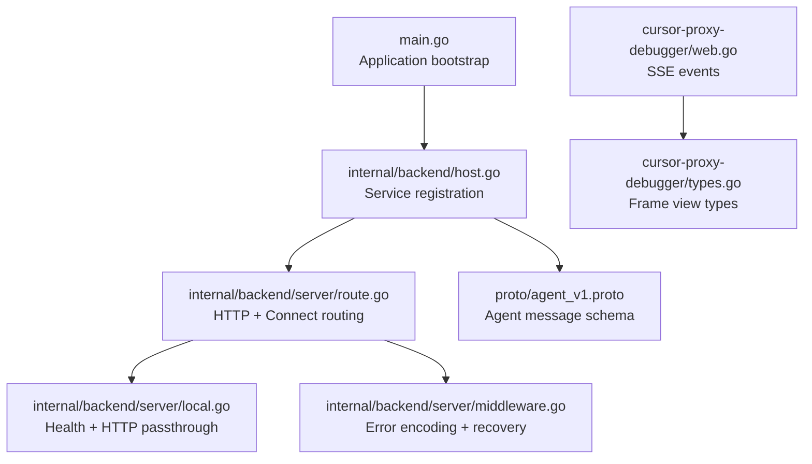
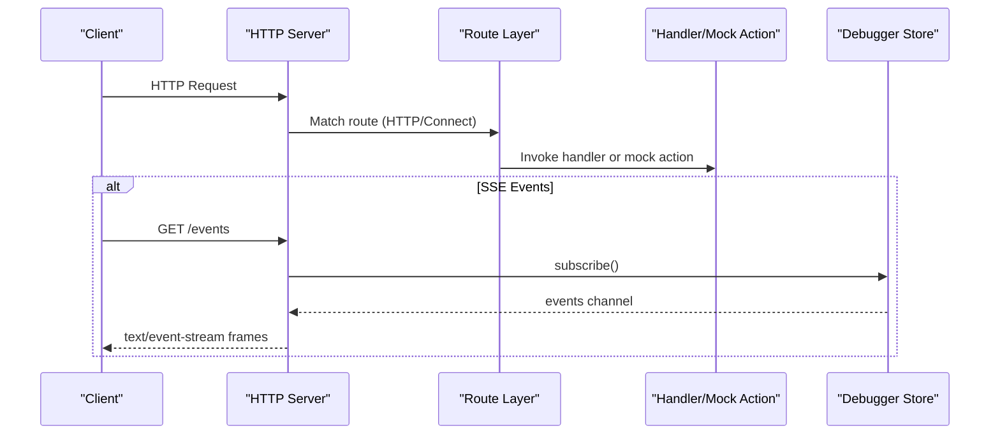
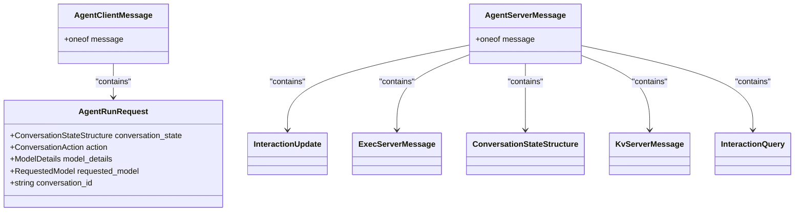
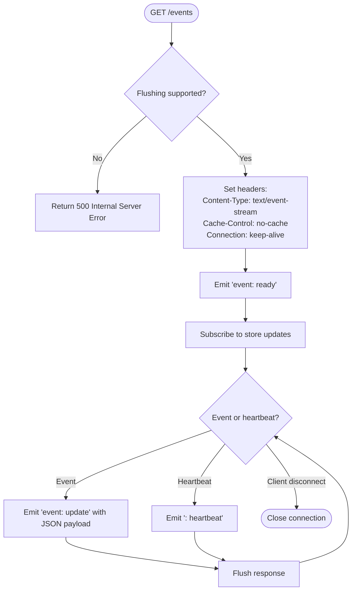
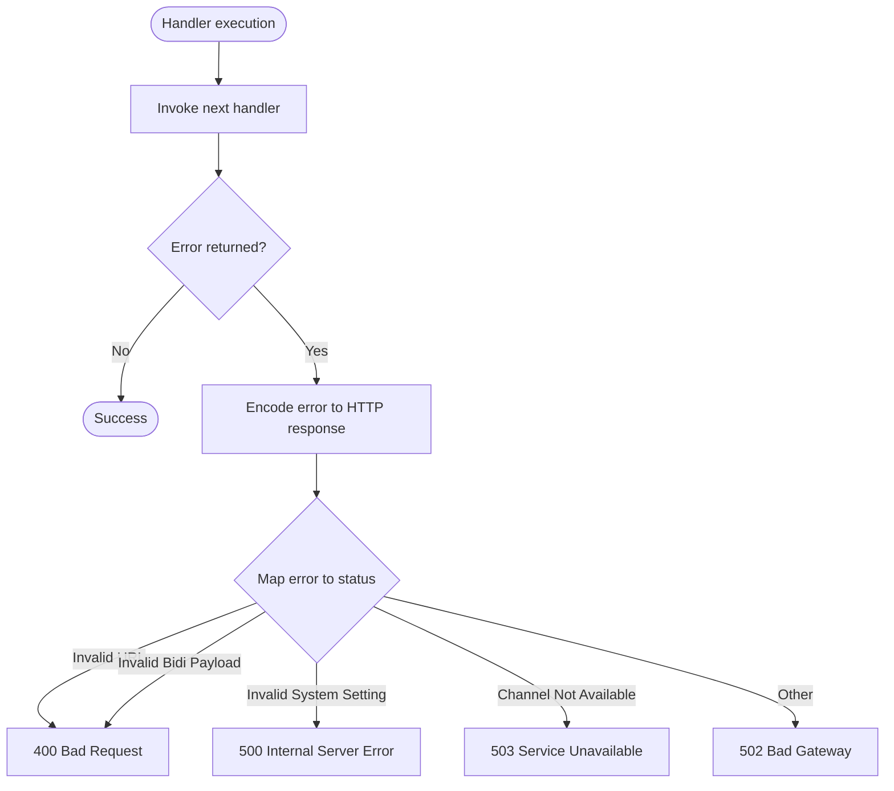
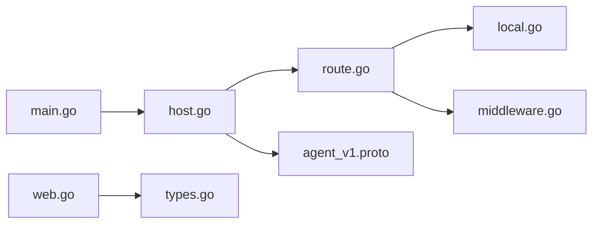

# API Reference

<cite>
**Referenced Files in This Document**
- [main.go](file://main.go)
- [host.go](file://internal/backend/host.go)
- [route.go](file://internal/backend/server/route.go)
- [local.go](file://internal/backend/server/local.go)
- [middleware.go](file://internal/backend/server/middleware.go)
- [url.go](file://internal/backend/server/url.go)
- [agent_v1.proto](file://proto/agent_v1.proto)
- [web.go](file://cursor-proxy-debugger/web.go)
- [types.go](file://cursor-proxy-debugger/types.go)
</cite>

## Table of Contents
1. [Introduction](#introduction)
2. [Project Structure](#project-structure)
3. [Core Components](#core-components)
4. [Architecture Overview](#architecture-overview)
5. [Detailed Component Analysis](#detailed-component-analysis)
6. [Dependency Analysis](#dependency-analysis)
7. [Performance Considerations](#performance-considerations)
8. [Troubleshooting Guide](#troubleshooting-guide)
9. [Conclusion](#conclusion)
10. [Appendices](#appendices)

## Introduction
This document provides the API reference for cursor-byok’s exposed interfaces, focusing on:
- REST endpoints for configuration management, service control, and status monitoring
- ConnectRPC service definitions for agent communication (unary and streaming)
- WebSocket/SSE-like event streams used by the debugger UI
- Error handling, rate limiting notes, and versioning guidance
- Client integration patterns and examples

The server is a Go application that embeds frontend assets and exposes HTTP routes and ConnectRPC services through a unified router. The primary entry point initializes logging and runs the application with embedded resources.

## Project Structure
At a high level:
- Application bootstrap and embedded assets are defined at the top-level main package.
- Backend routing and protocol dispatch are implemented under internal/backend/server.
- Service registration and ConnectRPC handlers are wired in internal/backend/host.go.
- Protocol message schemas are defined in proto/agent_v1.proto.
- A debugger web interface provides SSE-style events for real-time inspection.

**Diagram sources**
- [main.go:19-29](file://main.go#L19-L29)
- [host.go:450-649](file://internal/backend/host.go#L450-L649)
- [route.go:37-51](file://internal/backend/server/route.go#L37-L51)
- [local.go:9-38](file://internal/backend/server/local.go#L9-L38)
- [middleware.go:40-85](file://internal/backend/server/middleware.go#L40-L85)
- [agent_v1.proto:1-10](file://proto/agent_v1.proto#L1-L10)
- [web.go:58-89](file://cursor-proxy-debugger/web.go#L58-L89)
- [types.go:92-105](file://cursor-proxy-debugger/types.go#L92-L105)

**Section sources**
- [main.go:1-29](file://main.go#L1-L29)
- [host.go:450-649](file://internal/backend/host.go#L450-L649)
- [route.go:37-51](file://internal/backend/server/route.go#L37-L51)

## Core Components
- Application bootstrap: Initializes logger and runs the app with embedded assets.
- Routing layer: Provides HTTP and ConnectRPC route registration, middleware chaining, and error encoding.
- Health endpoint: Simple GET /healthz returning “ok”.
- ConnectRPC services: Unary and streaming endpoints for repository, upload, AI, Cpp, FileSync, Dashboard, and Auth services.
- Debugger SSE stream: Real-time event stream for inspecting proxy exchanges.

Key responsibilities:
- host.go registers all public endpoints and binds them to handlers or mock actions.
- route.go defines the routing primitives (GET/POST/Any), protocol selection (HTTP/ConnectUnary/ConnectStream), and middleware composition.
- local.go implements health checks and HTTP passthrough wrappers.
- middleware.go centralizes error encoding and panic recovery.
- url.go validates upstream URLs.
- agent_v1.proto defines the protobuf schema for agent messages.
- web.go and types.go implement the debugger’s SSE events and frame view structures.

**Section sources**
- [main.go:19-29](file://main.go#L19-L29)
- [host.go:450-649](file://internal/backend/host.go#L450-L649)
- [route.go:68-129](file://internal/backend/server/route.go#L68-L129)
- [local.go:9-38](file://internal/backend/server/local.go#L9-L38)
- [middleware.go:40-85](file://internal/backend/server/middleware.go#L40-L85)
- [url.go:9-25](file://internal/backend/server/url.go#L9-L25)
- [agent_v1.proto:56-139](file://proto/agent_v1.proto#L56-L139)
- [web.go:58-89](file://cursor-proxy-debugger/web.go#L58-L89)
- [types.go:92-105](file://cursor-proxy-debugger/types.go#L92-L105)

## Architecture Overview
The system exposes both REST and ConnectRPC APIs:
- REST endpoints handle configuration, OAuth, auth flows, traces, and dashboard queries.
- ConnectRPC endpoints provide agent-facing services (AI, Cpp, FileSync, Repository, Upload, Dashboard).
- The debugger provides an SSE stream for live inspection of request/response frames.

**Diagram sources**
- [route.go:140-156](file://internal/backend/server/route.go#L140-L156)
- [web.go:58-89](file://cursor-proxy-debugger/web.go#L58-L89)

**Section sources**
- [route.go:140-156](file://internal/backend/server/route.go#L140-L156)
- [web.go:58-89](file://cursor-proxy-debugger/web.go#L58-L89)

## Detailed Component Analysis

### REST Endpoints
- Health check
  - Method: GET
  - Path: /healthz
  - Response: 200 OK with body “ok”
  - Notes: Validates method; logs remote address and user agent

- OpenTelemetry traces
  - Method: POST
  - Path: /v1/traces
  - Response: 200 OK (mocked)

- OAuth token
  - Method: POST
  - Path: /oauth/token
  - Response: 200 OK (mocked)

- Authentication endpoints
  - GET /auth/has-valid-payment-method
  - Any /auth/poll
  - POST /auth/logout
  - Wildcard /auth/* returns 404 Not Found

- Dashboard usage endpoints
  - POST /aiserver.v1.DashboardService/GetTokenUsage
  - POST /aiserver.v1.DashboardService/GetCurrentPeriodUsage
  - POST /aiserver.v1.DashboardService/GetTeams
  - POST /aiserver.v1.DashboardService/GetManagedSkills
  - POST /aiserver.v1.DashboardService/GetTeamAdminSettingsOrEmptyIfNotInTeam
  - POST /aiserver.v1.DashboardService/GetTeamReposOrEmptyIfNotInTeam
  - POST /aiserver.v1.DashboardService/ListMarketplaces
  - POST /aiserver.v1.DashboardService/GetGlobalCommands
  - POST /aiserver.v1.DashboardService/GetEffectiveUserPlugins
  - POST /aiserver.v1.DashboardService/RegisterMarketplaceAndPlugins
  - POST /aiserver.v1.DashboardService/GetCliDownloadUrl

Notes:
- Some endpoints use ConnectRPC protocol even though they are mounted under HTTP paths.
- Many endpoints return mocked responses for development/testing.

**Section sources**
- [local.go:9-24](file://internal/backend/server/local.go#L9-L24)
- [host.go:453-468](file://internal/backend/host.go#L453-L468)
- [host.go:780-817](file://internal/backend/host.go#L780-L817)
- [host.go:542-649](file://internal/backend/host.go#L542-L649)

### ConnectRPC Services
- Agent AI service
  - StreamCpp: Streaming
  - StreamNextCursorPrediction: Streaming
  - GetCppEditClassification: Unary
  - RefreshTabContext: Unary
  - CppConfig: Unary
  - CppEditHistoryStatus: Unary
  - CppAppend: Unary
  - CppEditHistoryAppend: Unary
  - ReportAiCodeChangeMetrics: Unary
  - WriteGitBranchName: Unary
  - Catch-all /aiserver.v1.AiService/* routed to AiHandler

- C++ service
  - AvailableModels: Unary (mocked)
  - RecordCppFate: Unary
  - Catch-all /aiserver.v1.CppService/* returns 404

- FileSync service
  - FSSyncFile: Unary
  - FSIsEnabledForUser: Unary
  - FSConfig: Unary
  - FSUploadFile: Unary
  - Catch-all /aiserver.v1.FileSyncService/* returns 404

- Repository service
  - FastRepoInitHandshakeV2: Unary
  - FastRepoInitHandshake: Unary
  - FastRepoSyncComplete: Unary
  - SyncMerkleSubtreeV2: Unary
  - SyncMerkleSubtree: Unary
  - FastUpdateFileV2: Unary
  - FastUpdateFile: Unary
  - EnsureIndexCreated: Unary
  - GetCopyStatus: Unary
  - GetUploadLimits: Unary
  - GetNumFilesToSend: Unary
  - GetAvailableChunkingStrategies: Unary
  - GetHighLevelFolderDescription: Unary
  - RepositoryStatus: Unary
  - BatchRepositoryStatus: Unary

- Upload service
  - UploadDocumentation: Unary
  - GetDoc: Unary
  - GetPages: Unary
  - UploadedStatus: Unary

- Auth service
  - GetEmail: Unary (mocked)

Message formats:
- Agent client/server messages and conversation structures are defined in the protobuf schema.

**Diagram sources**
- [agent_v1.proto:56-139](file://proto/agent_v1.proto#L56-L139)

**Section sources**
- [host.go:469-510](file://internal/backend/host.go#L469-L510)
- [host.go:487-505](file://internal/backend/host.go#L487-L505)
- [agent_v1.proto:56-139](file://proto/agent_v1.proto#L56-L139)

### WebSocket and SSE Streams
- SSE events endpoint
  - Method: GET
  - Path: /events
  - Content-Type: text/event-stream
  - Behavior: Emits “ready” event, then periodic “update” events with JSON payloads, plus heartbeats every 15 seconds
  - Connection handling: Uses http.Flusher; closes on client disconnect

- Frame view structure
  - Fields include index, flags, length, compressed flag, end-of-stream indicator, kind, messageType, requestId, optional JSON payload, raw hex, and error string

**Diagram sources**
- [web.go:58-89](file://cursor-proxy-debugger/web.go#L58-L89)
- [types.go:92-105](file://cursor-proxy-debugger/types.go#L92-L105)

**Section sources**
- [web.go:58-89](file://cursor-proxy-debugger/web.go#L58-L89)
- [types.go:92-105](file://cursor-proxy-debugger/types.go#L92-L105)

### Error Handling and Status Codes
- Global error encoder maps errors to HTTP status codes:
  - Bad gateway (default)
  - Bad request for invalid URL or invalid bidi append payload
  - Internal server error for invalid system setting
  - Service unavailable when channel not available

- Panic recovery middleware wraps handlers to capture panics and convert them into errors.

- Upstream URL validation rejects empty or unsupported schemes.

**Diagram sources**
- [middleware.go:40-85](file://internal/backend/server/middleware.go#L40-L85)
- [url.go:9-25](file://internal/backend/server/url.go#L9-L25)

**Section sources**
- [middleware.go:40-85](file://internal/backend/server/middleware.go#L40-L85)
- [url.go:9-25](file://internal/backend/server/url.go#L9-L25)

### Versioning Strategy
- ConnectRPC service names follow aiserver.v1.* and agent.v1.* namespaces, indicating major versioning via package naming.
- Protobuf package and go_package options define versioned namespaces for generated code.

**Section sources**
- [agent_v1.proto:1-10](file://proto/agent_v1.proto#L1-L10)

### Rate Limiting Policies
- No explicit rate limiting implementation is present in the analyzed files.
- Polling logic treats HTTP 429 responses as retryable, suggesting clients should implement backoff on 429.

**Section sources**
- [internal/cursoraccount/manager.go:579-589](file://internal/cursoraccount/manager.go#L579-L589)

## Dependency Analysis
- main.go depends on internal/app runner and embedded assets.
- host.go wires routes and ConnectRPC services using the server package.
- route.go composes middlewares and builds handlers.
- local.go provides health and HTTP passthrough helpers.
- middleware.go centralizes error encoding and recovery.
- agent_v1.proto defines shared message types consumed by handlers.
- debugger web.go and types.go provide SSE events and frame view structures.

**Diagram sources**
- [main.go:19-29](file://main.go#L19-L29)
- [host.go:450-649](file://internal/backend/host.go#L450-L649)
- [route.go:37-51](file://internal/backend/server/route.go#L37-L51)
- [local.go:9-38](file://internal/backend/server/local.go#L9-L38)
- [middleware.go:40-85](file://internal/backend/server/middleware.go#L40-L85)
- [agent_v1.proto:1-10](file://proto/agent_v1.proto#L1-L10)
- [web.go:58-89](file://cursor-proxy-debugger/web.go#L58-L89)
- [types.go:92-105](file://cursor-proxy-debugger/types.go#L92-L105)

**Section sources**
- [main.go:19-29](file://main.go#L19-L29)
- [host.go:450-649](file://internal/backend/host.go#L450-L649)
- [route.go:37-51](file://internal/backend/server/route.go#L37-L51)
- [local.go:9-38](file://internal/backend/server/local.go#L9-L38)
- [middleware.go:40-85](file://internal/backend/server/middleware.go#L40-L85)
- [agent_v1.proto:1-10](file://proto/agent_v1.proto#L1-L10)
- [web.go:58-89](file://cursor-proxy-debugger/web.go#L58-L89)
- [types.go:92-105](file://cursor-proxy-debugger/types.go#L92-L105)

## Performance Considerations
- Use streaming endpoints where appropriate to reduce latency and memory pressure.
- Avoid large payloads in SSE frames; prefer incremental updates.
- Implement client-side retries with exponential backoff for transient errors and 429 responses.
- Monitor upstream URL validity to prevent unnecessary retries on misconfiguration.

[No sources needed since this section provides general guidance]

## Troubleshooting Guide
- Health check failures: Verify GET /healthz returns 200 OK.
- Invalid upstream URL: Errors map to 400 Bad Request with “invalid raw url”.
- Channel not available: Errors map to 503 Service Unavailable.
- SSE connection issues: Ensure the client supports streaming and handles heartbeats.
- Decode errors in debugger frames: Inspect FrameView.error field for details.

**Section sources**
- [local.go:9-24](file://internal/backend/server/local.go#L9-L24)
- [middleware.go:61-85](file://internal/backend/server/middleware.go#L61-L85)
- [web.go:58-89](file://cursor-proxy-debugger/web.go#L58-L89)
- [types.go:92-105](file://cursor-proxy-debugger/types.go#L92-L105)

## Conclusion
cursor-byok exposes a cohesive set of REST and ConnectRPC endpoints for configuration, authentication, telemetry, and agent communication. The server uses a modular routing layer with middleware for error handling and recovery. For real-time insights, the debugger provides an SSE stream with structured frame views. Clients should implement robust retry/backoff strategies and respect versioned service namespaces.

[No sources needed since this section summarizes without analyzing specific files]

## Appendices

### REST Endpoint Summary
- GET /healthz
- POST /v1/traces
- POST /oauth/token
- GET /auth/has-valid-payment-method
- Any /auth/poll
- POST /auth/logout
- Wildcard /auth/* returns 404
- Dashboard endpoints under /aiserver.v1.DashboardService/*

**Section sources**
- [local.go:9-24](file://internal/backend/server/local.go#L9-L24)
- [host.go:453-468](file://internal/backend/host.go#L453-L468)
- [host.go:780-817](file://internal/backend/host.go#L780-L817)
- [host.go:542-649](file://internal/backend/host.go#L542-L649)

### ConnectRPC Service Summary
- AIService: StreamCpp, StreamNextCursorPrediction, GetCppEditClassification, RefreshTabContext, CppConfig, CppEditHistoryStatus, CppAppend, CppEditHistoryAppend, ReportAiCodeChangeMetrics, WriteGitBranchName
- CppService: AvailableModels (mocked), RecordCppFate
- FileSyncService: FSSyncFile, FSIsEnabledForUser, FSConfig, FSUploadFile
- RepositoryService: FastRepoInitHandshakeV2, FastRepoInitHandshake, FastRepoSyncComplete, SyncMerkleSubtreeV2, SyncMerkleSubtree, FastUpdateFileV2, FastUpdateFile, EnsureIndexCreated, GetCopyStatus, GetUploadLimits, GetNumFilesToSend, GetAvailableChunkingStrategies, GetHighLevelFolderDescription, RepositoryStatus, BatchRepositoryStatus
- UploadService: UploadDocumentation, GetDoc, GetPages, UploadedStatus
- AuthService: GetEmail (mocked)

**Section sources**
- [host.go:469-510](file://internal/backend/host.go#L469-L510)
- [host.go:487-505](file://internal/backend/host.go#L487-L505)

### SSE Event Stream Specification
- Endpoint: GET /events
- Headers: Content-Type: text/event-stream; Cache-Control: no-cache; Connection: keep-alive
- Events:
  - event: ready (initial)
  - event: update (JSON payload)
  - : heartbeat (periodic)
- Frame view fields: index, flags, length, compressed, endStream, kind, messageType, requestId, json, rawHex, error

**Section sources**
- [web.go:58-89](file://cursor-proxy-debugger/web.go#L58-L89)
- [types.go:92-105](file://cursor-proxy-debugger/types.go#L92-L105)