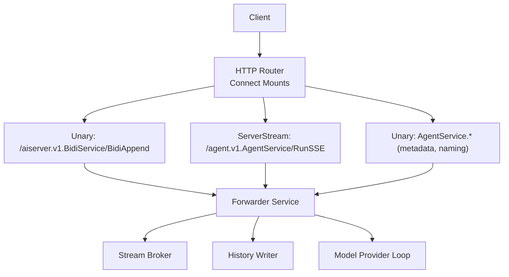
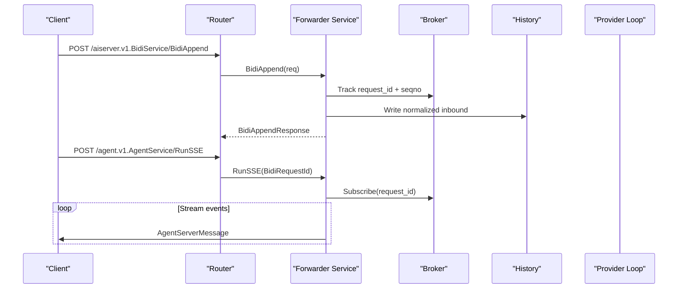
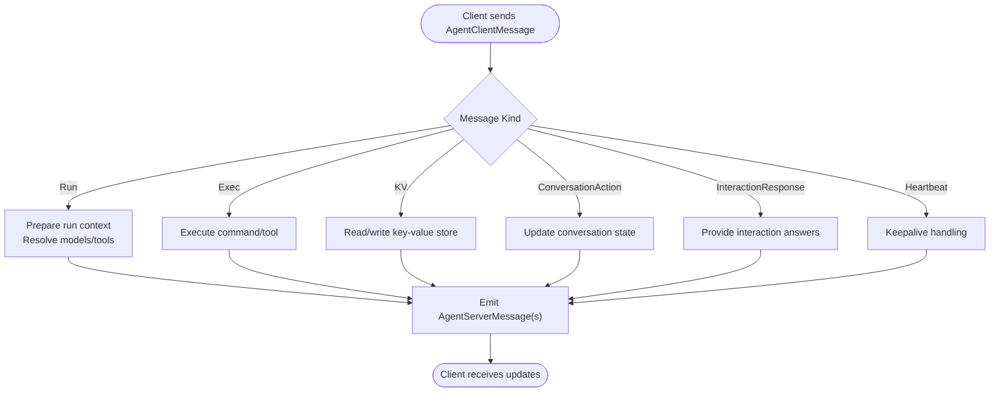
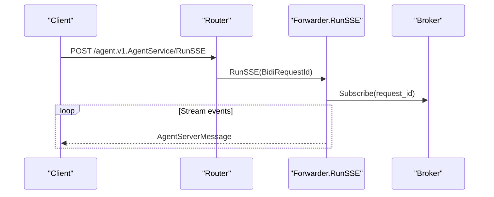
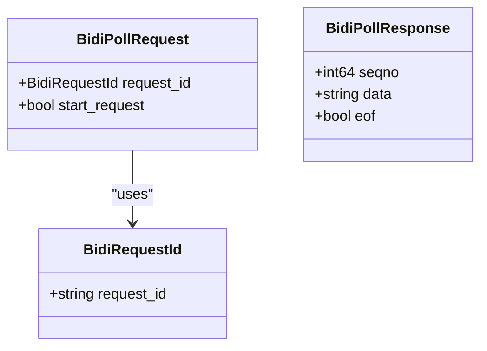
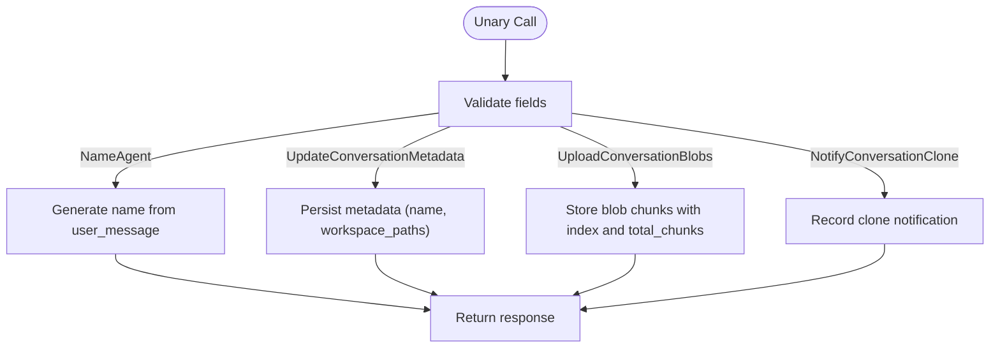
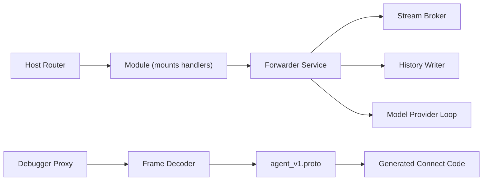

# ConnectRPC Services

<cite>
**Referenced Files in This Document**
- [agent_v1.proto](file://proto/agent_v1.proto)
- [service.go](file://internal/backend/forwarder/service.go)
- [legacy_stream.go](file://internal/backend/forwarder/legacy_stream.go)
- [module.go](file://internal/backend/forwarder/module.go)
- [host.go](file://internal/backend/host.go)
- [proxy.go](file://cursor-proxy-debugger/proxy.go)
- [decode.go](file://cursor-proxy-debugger/decode.go)
</cite>

## Table of Contents
1. [Introduction](#introduction)
2. [Project Structure](#project-structure)
3. [Core Components](#core-components)
4. [Architecture Overview](#architecture-overview)
5. [Detailed Component Analysis](#detailed-component-analysis)
6. [Dependency Analysis](#dependency-analysis)
7. [Performance Considerations](#performance-considerations)
8. [Troubleshooting Guide](#troubleshooting-guide)
9. [Conclusion](#conclusion)
10. [Appendices](#appendices)

## Introduction
This document describes the ConnectRPC services used for agent communication, focusing on service definitions, method signatures, message types, and streaming capabilities defined in the protocol buffer specifications. It covers:
- Unary RPCs for configuration and metadata management
- Bidirectional streaming for real-time agent interactions
- Server-side streaming for progress updates and event delivery
It also includes connection setup procedures, error handling strategies, protocol versioning notes, compatibility considerations, and migration guidance for service updates.

## Project Structure
The agent communication layer is implemented as a ConnectRPC server mounted behind an HTTP router. The key elements are:
- Protocol definitions in proto files
- Service implementations in Go modules
- HTTP routing and Connect handler wiring
- A debugger proxy that captures and decodes Connect frames

**Diagram sources**
- [host.go:289-331](file://internal/backend/host.go#L289-L331)
- [module.go:25-40](file://internal/backend/forwarder/module.go#L25-L40)
- [service.go:369-391](file://internal/backend/forwarder/service.go#L369-L391)
- [service.go:540-555](file://internal/backend/forwarder/service.go#L540-L555)

**Section sources**
- [host.go:279-346](file://internal/backend/host.go#L279-L346)
- [module.go:1-41](file://internal/backend/forwarder/module.go#L1-L41)

## Core Components
- AgentService (proto): Defines all agent-facing RPCs including streaming and unary operations.
- Forwarder Service: Implements core flows for bidirectional append, SSE streaming, conversation metadata, and agent naming.
- Legacy SSE Wrapper: Wraps Connect ServerStream to emit legacy text/event-stream headers for backward compatibility.
- Host Router: Wires Connect handlers into the HTTP server with proper names and Connect modes.
- Debugger Proxy: Captures Connect frames for both requests and responses, decoding specific paths for visibility.

Key responsibilities:
- Normalize and route inbound client messages
- Maintain active streams per request/conversation
- Stream progress and tool execution events back to clients
- Provide unary endpoints for configuration and metadata

**Section sources**
- [agent_v1.proto:7415-7431](file://proto/agent_v1.proto#L7415-L7431)
- [service.go:369-391](file://internal/backend/forwarder/service.go#L369-L391)
- [service.go:540-555](file://internal/backend/forwarder/service.go#L540-L555)
- [legacy_stream.go:16-26](file://internal/backend/forwarder/legacy_stream.go#L16-L26)
- [host.go:289-331](file://internal/backend/host.go#L289-L331)

## Architecture Overview
The runtime architecture connects clients to the agent pipeline via ConnectRPC:
- Clients send AgentClientMessage over bidirectional streams or use polling endpoints
- The forwarder normalizes inputs, writes to history, and drives model providers
- Progress and control messages are streamed back to clients via AgentServerMessage
- Unary RPCs manage conversation metadata and agent naming

**Diagram sources**
- [host.go:308-316](file://internal/backend/host.go#L308-L316)
- [service.go:369-391](file://internal/backend/forwarder/service.go#L369-L391)
- [service.go:540-555](file://internal/backend/forwarder/service.go#L540-L555)

## Detailed Component Analysis

### AgentService Definition and Methods
AgentService exposes:
- Streaming methods for real-time interaction
- Polling method for lightweight clients
- Unary methods for metadata and configuration

| Method | Type | Request | Response | Description |
|---|---|---|---|---|
| Run | Bidirectional stream | AgentClientMessage | AgentServerMessage | Real-time agent interaction channel |
| RunSSE | Server stream | BidiRequestId | AgentServerMessage | Server-side streaming for progress/events |
| RunPoll | Server stream | BidiPollRequest | BidiPollResponse | Lightweight polling-based streaming |
| NameAgent | Unary | NameAgentRequest | NameAgentResponse | Generate a name/title from user input |
| UpdateConversationMetadata | Unary | UpdateConversationMetadataRequest | UpdateConversationMetadataResponse | Update conversation metadata (name, workspace paths) |
| UploadConversationBlobs | Unary | UploadConversationBlobsRequest | UploadConversationBlobsResponse | Upload conversation blobs in chunks |
| NotifyConversationClone | Unary | NotifyConversationCloneRequest | NotifyConversationCloneResponse | Notify when a conversation is cloned |
| Other unary methods | Unary | Various | Various | Model picker, signed URLs, transcript overview, etc. |

Notes:
- Run uses oneof-typed messages to carry different operation types (run, exec, kv, conversation actions, interactions, heartbeats).
- RunSSE is wrapped to emit legacy SSE headers for compatibility.
- RunPoll provides a simpler polling interface using BidiPollRequest/Response.

**Section sources**
- [agent_v1.proto:56-68](file://proto/agent_v1.proto#L56-L68)
- [agent_v1.proto:128-139](file://proto/agent_v1.proto#L128-L139)
- [agent_v1.proto:596-611](file://proto/agent_v1.proto#L596-L611)
- [agent_v1.proto:3331-3338](file://proto/agent_v1.proto#L3331-L3338)
- [agent_v1.proto:6976-6996](file://proto/agent_v1.proto#L6976-L6996)
- [agent_v1.proto:7086-7096](file://proto/agent_v1.proto#L7086-L7096)
- [agent_v1.proto:7415-7431](file://proto/agent_v1.proto#L7415-L7431)

### Bidirectional Streaming: Run
- Purpose: Full-duplex communication between client and agent.
- Inbound: AgentClientMessage carries run requests, exec commands, KV operations, conversation actions, interaction responses, heartbeats, and prewarm requests.
- Outbound: AgentServerMessage carries interaction updates, exec results, control messages, conversation checkpoints, KV results, and interaction queries.

**Diagram sources**
- [agent_v1.proto:56-68](file://proto/agent_v1.proto#L56-L68)
- [agent_v1.proto:128-139](file://proto/agent_v1.proto#L128-L139)

**Section sources**
- [agent_v1.proto:56-68](file://proto/agent_v1.proto#L56-L68)
- [agent_v1.proto:128-139](file://proto/agent_v1.proto#L128-L139)

### Server-Side Streaming: RunSSE
- Purpose: Deliver progress updates and events to clients without requiring full bidirectional streams.
- Implementation: Connect ServerStream returning AgentServerMessage; wrapped to emit legacy SSE headers.
- Flow:
  - Client calls RunSSE with BidiRequestId
  - Forwarder subscribes to broker for the request
  - Events are streamed until completion or cancellation

**Diagram sources**
- [host.go:313-316](file://internal/backend/host.go#L313-L316)
- [legacy_stream.go:16-26](file://internal/backend/forwarder/legacy_stream.go#L16-L26)
- [service.go:540-555](file://internal/backend/forwarder/service.go#L540-L555)

**Section sources**
- [legacy_stream.go:16-26](file://internal/backend/forwarder/legacy_stream.go#L16-L26)
- [service.go:540-555](file://internal/backend/forwarder/service.go#L540-L555)

### Polling-Based Streaming: RunPoll
- Purpose: Provide a simple polling mechanism for clients that cannot handle full streams.
- Messages:
  - BidiPollRequest: Includes request ID and optional start flag
  - BidiPollResponse: Sequence number, data payload, and EOF indicator

**Diagram sources**
- [agent_v1.proto:596-611](file://proto/agent_v1.proto#L596-L611)

**Section sources**
- [agent_v1.proto:596-611](file://proto/agent_v1.proto#L596-L611)

### Unary RPCs: Configuration and Metadata Management
- NameAgent: Generates a title/name based on user message content.
- UpdateConversationMetadata: Updates conversation metadata such as name and workspace paths.
- UploadConversationBlobs: Uploads conversation blobs in chunks with chunk indexing.
- NotifyConversationClone: Notifies about conversation cloning events.

**Diagram sources**
- [agent_v1.proto:3331-3338](file://proto/agent_v1.proto#L3331-L3338)
- [agent_v1.proto:6976-6996](file://proto/agent_v1.proto#L6976-L6996)
- [agent_v1.proto:7086-7096](file://proto/agent_v1.proto#L7086-L7096)

**Section sources**
- [agent_v1.proto:3331-3338](file://proto/agent_v1.proto#L3331-L3338)
- [agent_v1.proto:6976-6996](file://proto/agent_v1.proto#L6976-L6996)
- [agent_v1.proto:7086-7096](file://proto/agent_v1.proto#L7086-L7096)

### Message Schema Definitions and Data Types
- AgentClientMessage: Oneof carrying various client operations.
- AgentServerMessage: Oneof carrying server-side updates and control signals.
- BidiRequestId: Identifies a bidirectional session.
- BidiPollRequest/Response: Lightweight polling envelope.
- NameAgentRequest/Response: Simple request/response pair for naming.
- UpdateConversationMetadataRequest/Response: Conversation metadata update.
- UploadConversationBlobsRequest/Response: Chunked blob upload.
- NotifyConversationCloneRequest/Response: Clone notification.

Data type mappings:
- Strings map to string
- Bytes map to bytes
- Booleans map to bool
- Integers map to int64/int32 where specified
- Repeated fields map to arrays/lists in generated code

**Section sources**
- [agent_v1.proto:56-68](file://proto/agent_v1.proto#L56-L68)
- [agent_v1.proto:128-139](file://proto/agent_v1.proto#L128-L139)
- [agent_v1.proto:596-611](file://proto/agent_v1.proto#L596-L611)
- [agent_v1.proto:3331-3338](file://proto/agent_v1.proto#L3331-L3338)
- [agent_v1.proto:6976-6996](file://proto/agent_v1.proto#L6976-L6996)
- [agent_v1.proto:7086-7096](file://proto/agent_v1.proto#L7086-L7096)

### Connection Setup Procedures
- HTTP Router mounts:
  - /aiserver.v1.BidiService/BidiAppend as Connect unary
  - /agent.v1.AgentService/RunSSE as Connect server stream
  - AgentService unary endpoints (e.g., UpdateConversationMetadata, NameAgent)
- Legacy SSE wrapper ensures compatibility by overriding Content-Type to text/event-stream when needed.

Steps:
1. Initialize router with Connect middleware (recovery, context, error encoder).
2. Mount BidiAppend and RunSSE endpoints with appropriate Connect modes.
3. Mount AgentService unary endpoints using generated connect constants.
4. For RunSSE, wrap with legacy SSE header writer to maintain compatibility.

**Section sources**
- [host.go:289-331](file://internal/backend/host.go#L289-L331)
- [module.go:25-40](file://internal/backend/forwarder/module.go#L25-L40)
- [legacy_stream.go:16-26](file://internal/backend/forwarder/legacy_stream.go#L16-L26)

### Error Handling Strategies
- Connect errors are returned using connect.NewError with explicit codes (e.g., Internal, InvalidArgument, Canceled).
- Custom error builders provide structured titles and details for RunSSE flows.
- Debugger proxy captures decode errors and read errors, storing them in exchange records for inspection.

Common patterns:
- Validate required fields early and return InvalidArgument with descriptive messages.
- Wrap provider loop interruptions with specific acknowledgment logic.
- Use structured errors with detail text and expected flags for downstream handling.

**Section sources**
- [service.go:369-391](file://internal/backend/forwarder/service.go#L369-L391)
- [service.go:540-555](file://internal/backend/forwarder/service.go#L540-L555)
- [service.go:4304-4321](file://internal/backend/forwarder/service.go#L4304-L4321)
- [proxy.go:276-308](file://cursor-proxy-debugger/proxy.go#L276-L308)

### Protocol Versioning and Compatibility
- Connect protocol version is set to 1 in tests and headers.
- Legacy SSE compatibility is maintained via custom header writer for RunSSE.
- Proto package versioning uses agent.v1 namespace; ensure clients consume matching generated code.

Compatibility matrix:
- Connect protocol version: 1
- Content-Type for SSE: text/event-stream (via wrapper)
- Proto package: agent.v1

Migration guidance:
- When updating proto definitions, regenerate client/server code and verify field numbers remain stable.
- Add new optional fields to preserve backward compatibility.
- Deprecate fields gradually and monitor client usage before removal.

**Section sources**
- [host_test.go:12-41](file://internal/backend/host_test.go#L12-L41)
- [legacy_stream.go:16-26](file://internal/backend/forwarder/legacy_stream.go#L16-L26)
- [agent_v1.proto:1-7](file://proto/agent_v1.proto#L1-L7)

### Client Implementation Examples
Note: The repository does not include client examples. Below are conceptual steps for implementing clients in multiple languages using ConnectRPC.

- Go:
  - Import generated agentv1connect package
  - Create a Connect client pointing to the server URL
  - For RunSSE, open a server stream and process AgentServerMessage events
  - For BidiAppend, send BidiAppendRequest and handle responses
  - For unary RPCs, construct request messages and parse responses

- TypeScript/JavaScript:
  - Use @bufbuild/connect-web to generate clients from the same .proto
  - Establish a WebSocket or HTTP transport depending on deployment
  - Handle server streams for RunSSE and polling for RunPoll

- Python:
  - Use grpcio or a Connect-compatible library to call endpoints
  - Parse protobuf messages according to the schema

Connection setup tips:
- Set Connect-Content-Encoding if compression is used
- Respect server timeouts and retry policies
- Handle Connect error codes and map them to application-level errors

[No sources needed since this section provides general guidance]

## Dependency Analysis
The following diagram shows how components depend on each other:

**Diagram sources**
- [module.go:25-40](file://internal/backend/forwarder/module.go#L25-L40)
- [host.go:289-331](file://internal/backend/host.go#L289-L331)
- [service.go:369-391](file://internal/backend/forwarder/service.go#L369-L391)
- [decode.go:235-244](file://cursor-proxy-debugger/decode.go#L235-L244)

**Section sources**
- [module.go:25-40](file://internal/backend/forwarder/module.go#L25-L40)
- [host.go:289-331](file://internal/backend/host.go#L289-L331)
- [service.go:369-391](file://internal/backend/forwarder/service.go#L369-L391)
- [decode.go:235-244](file://cursor-proxy-debugger/decode.go#L235-L244)

## Performance Considerations
- Streaming throughput: Ensure efficient serialization and minimal overhead in AgentServerMessage payloads.
- Heartbeats: Implement periodic heartbeats during idle periods to keep connections alive.
- Backpressure: Apply backpressure in brokers and history writers to prevent memory growth.
- Compression: Use Connect-Content-Encoding for large payloads to reduce bandwidth.
- Concurrency: Limit concurrent provider loops and executor tasks to avoid resource exhaustion.

[No sources needed since this section provides general guidance]

## Troubleshooting Guide
Common issues and resolutions:
- Invalid request parameters: Return InvalidArgument with clear messages; validate request_id and required fields.
- Stale bidi appends: Ignore stale sequences and log warnings; ensure sequence ordering.
- Decode errors: Capture and report decode errors in debugger proxy; check frame limits and encoding.
- SSE header mismatches: Verify legacy SSE wrapper is applied for RunSSE endpoints.

Debugging steps:
- Inspect captured frames in the debugger proxy
- Check Connect protocol version and content-type headers
- Review structured error details and error kinds

**Section sources**
- [service.go:369-391](file://internal/backend/forwarder/service.go#L369-L391)
- [service.go:540-555](file://internal/backend/forwarder/service.go#L540-L555)
- [proxy.go:276-308](file://cursor-proxy-debugger/proxy.go#L276-L308)

## Conclusion
The ConnectRPC services in this repository provide robust agent communication through well-defined streaming and unary interfaces. The design emphasizes compatibility (legacy SSE), structured error handling, and clear separation of concerns between routing, forwarding, and provider orchestration. Clients should adhere to the proto schemas and Connect conventions to ensure reliable integration.

[No sources needed since this section summarizes without analyzing specific files]

## Appendices

### API Reference Summary
- Streaming:
  - Run: Bidirectional stream (AgentClientMessage -> AgentServerMessage)
  - RunSSE: Server stream (BidiRequestId -> AgentServerMessage)
  - RunPoll: Server stream (BidiPollRequest -> BidiPollResponse)
- Unary:
  - NameAgent
  - UpdateConversationMetadata
  - UploadConversationBlobs
  - NotifyConversationClone
  - Additional model picker and utility endpoints

**Section sources**
- [agent_v1.proto:7415-7431](file://proto/agent_v1.proto#L7415-L7431)