# REST API Endpoints

<cite>
**Referenced Files in This Document**   
- [main.go](file://main.go)
- [host.go](file://internal/backend/host.go)
- [route.go](file://internal/backend/server/route.go)
- [middleware.go](file://internal/backend/server/middleware.go)
- [local.go](file://internal/backend/server/local.go)
- [upstream_types.go](file://internal/backend/server/upstream/types.go)
- [upstream_action.go](file://internal/backend/server/upstream/action.go)
- [upstream_client.go](file://internal/backend/server/upstream/client.go)
- [proxy_service_lifecycle.go](file://internal/client/lifecycle.go)
- [client_api.js](file://frontend/src/services/clientApi.js)
</cite>

## Table of Contents
1. [Introduction](#introduction)
2. [Project Structure](#project-structure)
3. [Core Components](#core-components)
4. [Architecture Overview](#architecture-overview)
5. [Detailed Component Analysis](#detailed-component-analysis)
6. [Dependency Analysis](#dependency-analysis)
7. [Performance Considerations](#performance-considerations)
8. [Troubleshooting Guide](#troubleshooting-guide)
9. [Conclusion](#conclusion)

## Introduction
This document provides comprehensive REST API documentation for the cursor-byok Go backend HTTP surface. It covers:
- Health and status endpoints
- Configuration management endpoints exposed to the frontend via Wails bridge calls
- Proxy service control endpoints
- Model adapter testing and model discovery helpers
- Authentication, authorization, and upstream forwarding behavior
- Middleware chain, request context propagation, and error formatting
- Rate limiting and logging controls where applicable

The backend is a local HTTP server that routes requests through a custom router with global middleware, Connect/HTTP handlers, and optional upstream forwarding to Cursor’s control plane or configured model providers.

## Project Structure
At runtime, the application embeds frontend assets and starts the backend host, which builds an HTTP mux with health checks, agent forwarding, mock services, and dashboard/control-plane endpoints. The frontend communicates with the Go backend through Wails bridge methods rather than direct HTTP calls.

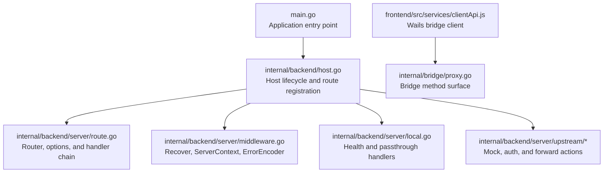

**Diagram sources**
- [main.go:19-29](file://main.go#L19-L29)
- [host.go:28-63](file://internal/backend/host.go#L28-L63)
- [route.go:37-50](file://internal/backend/server/route.go#L37-L50)
- [middleware.go:13-59](file://internal/backend/server/middleware.go#L13-L59)
- [local.go:9-38](file://internal/backend/server/local.go#L9-L38)

**Section sources**
- [main.go:19-29](file://main.go#L19-L29)
- [host.go:28-63](file://internal/backend/host.go#L28-L63)

## Core Components
- Host: Owns the HTTP server lifecycle, listens on a configurable address, rebuilds routes when configuration changes, and exposes health checks.
- Router: Provides a typed routing DSL (GET/POST/Any), protocol classification (HTTP/Connect unary/stream), middleware composition, and local action binding.
- Middleware: Global recovery, server context parsing, and standardized error encoding.
- Local Handlers: Simple health check and passthrough for existing http.Handler implementations.
- Upstream Actions: Mock responses, OAuth mocks, authenticated forwarding to Cursor control plane, and fixed-status endpoints.
- Bridge Client: Frontend uses Wails bridge to call backend methods such as LoadUserConfig, SaveUserConfig, StartProxy, StopProxy, TestModelAdapter, FetchModelAdapterModels, and GetModelAdapterTestResults.

**Section sources**
- [host.go:131-175](file://internal/backend/host.go#L131-L175)
- [route.go:10-20](file://internal/backend/server/route.go#L10-L20)
- [middleware.go:13-59](file://internal/backend/server/middleware.go#L13-L59)
- [local.go:9-38](file://internal/backend/server/local.go#L9-L38)
- [upstream_action.go:170-211](file://internal/backend/server/upstream/action.go#L170-L211)
- [client_api.js:58-179](file://frontend/src/services/clientApi.js#L58-L179)

## Architecture Overview
The backend serves HTTP requests on a loopback address. Requests flow through:
1. Global middleware: Recover -> ServerContext -> ErrorEncoder
2. Route-specific middleware (if any)
3. Local handler or upstream forwarding action
4. Standardized error response if a handler returns an error

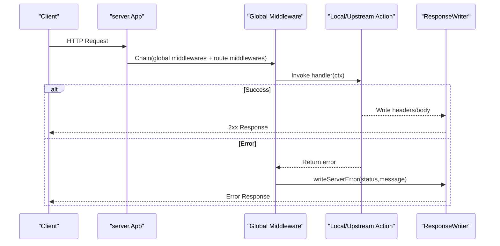

**Diagram sources**
- [route.go:140-156](file://internal/backend/server/route.go#L140-L156)
- [middleware.go:40-85](file://internal/backend/server/middleware.go#L40-L85)

**Section sources**
- [route.go:140-156](file://internal/backend/server/route.go#L140-L156)
- [middleware.go:40-85](file://internal/backend/server/middleware.go#L40-L85)

## Detailed Component Analysis

### Health and Status Endpoints
- GET /healthz
  - Purpose: Liveness probe returning plain text “ok”.
  - Method restriction: Only GET is allowed; other methods return 405.
  - Response: 200 OK with body “ok”.
  - Logging: Logs remote address and user agent on hit.

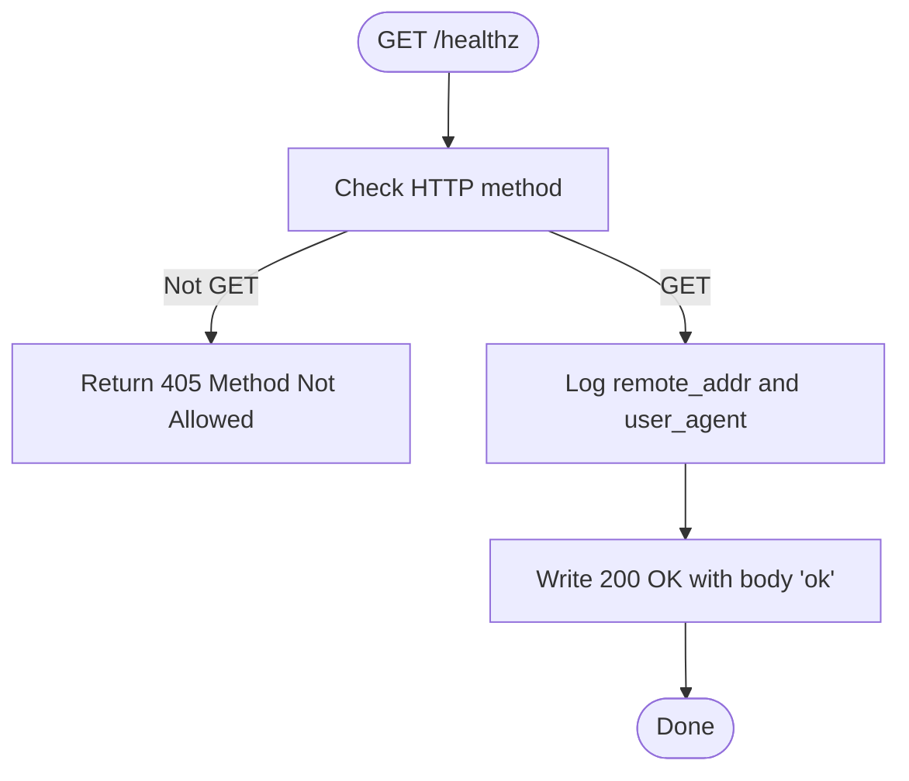

**Diagram sources**
- [local.go:9-25](file://internal/backend/server/local.go#L9-L25)

**Section sources**
- [host.go:296-307](file://internal/backend/host.go#L296-L307)
- [local.go:9-25](file://internal/backend/server/local.go#L9-L25)

### Configuration Management Endpoints
Configuration operations are not exposed directly over HTTP; they are invoked from the frontend using Wails bridge calls. The relevant bridge methods include:
- LoadUserConfig
- SaveUserConfig
- ExportUserConfig(path)
- ImportUserConfig(path)

These methods operate on the internal configuration manager and store, returning normalized configurations or errors.

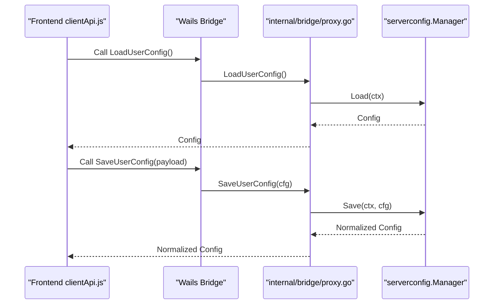

**Diagram sources**
- [client_api.js:58-86](file://frontend/src/services/clientApi.js#L58-L86)
- [proxy_service_lifecycle.go:210-261](file://internal/client/lifecycle.go#L210-L261)

**Section sources**
- [client_api.js:58-86](file://frontend/src/services/clientApi.js#L58-L86)
- [proxy_service_lifecycle.go:210-261](file://internal/client/lifecycle.go#L210-L261)

### Proxy Service Control Endpoints
Proxy lifecycle is controlled via Wails bridge methods:
- StartProxy
- StopProxy
- GetState

These methods start/stop the proxy server and expose current state including running status and last error.

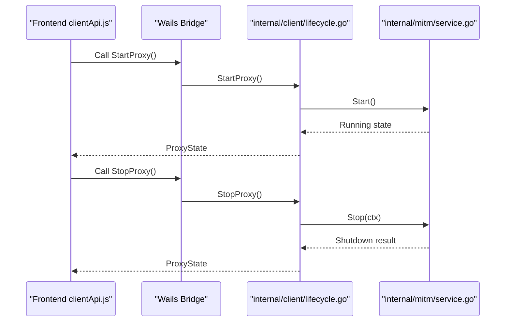

**Diagram sources**
- [client_api.js:116-122](file://frontend/src/services/clientApi.js#L116-L122)
- [proxy_service_lifecycle.go:210-261](file://internal/client/lifecycle.go#L210-L261)
- [service.go:309-338](file://internal/mitm/service.go#L309-L338)

**Section sources**
- [client_api.js:116-122](file://frontend/src/services/clientApi.js#L116-L122)
- [proxy_service_lifecycle.go:210-261](file://internal/client/lifecycle.go#L210-L261)

### Model Adapter Testing and Discovery
The frontend can test model adapters and fetch available models via bridge calls:
- TestModelAdapter(adapter)
- GetModelAdapterTestResults()
- FetchModelAdapterModels(input)

Validation rules:
- Provider type must be supported (OpenAI or Anthropic).
- Base URL and API key must be non-empty.
- Results are cached per adapter ID and request hash.

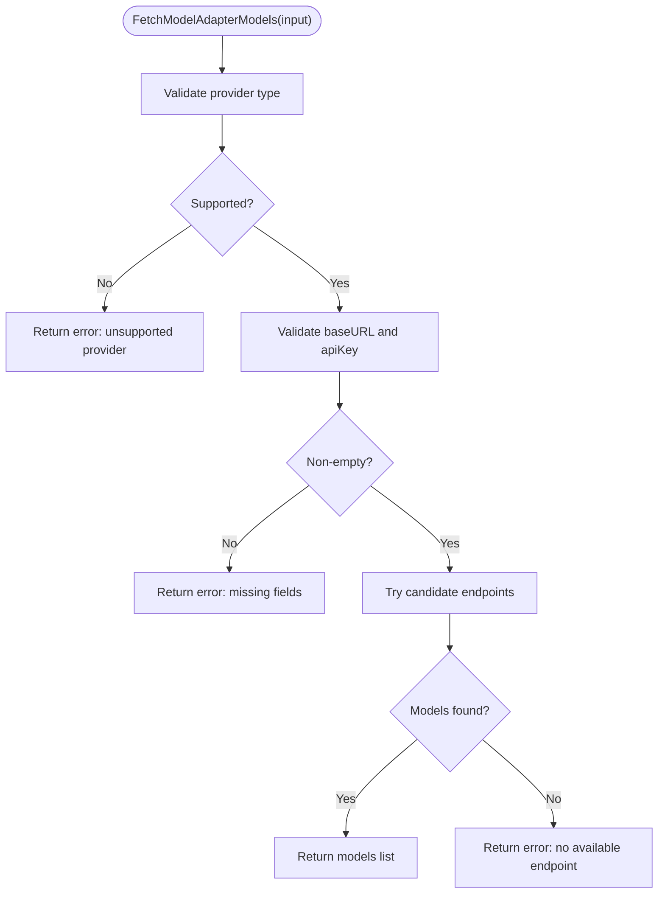

**Diagram sources**
- [model_adapter_benchmark.go:165-196](file://internal/client/model_adapter_benchmark.go#L165-L196)

**Section sources**
- [client_api.js:156-179](file://frontend/src/services/clientApi.js#L156-L179)
- [model_adapter_benchmark.go:165-196](file://internal/client/model_adapter_benchmark.go#L165-L196)

### Authentication and Authorization
- Some endpoints require Cursor control-plane authentication. When signed in, these routes forward requests to api2.cursor.sh with HTTPS.
- If not signed in, fallback handlers return 404 or mock responses depending on the route.

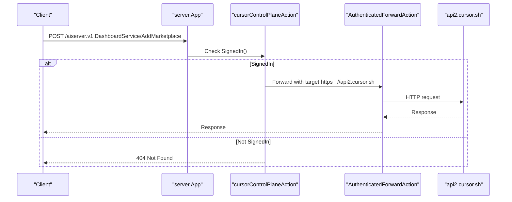

**Diagram sources**
- [host.go:895-933](file://internal/backend/host.go#L895-L933)

**Section sources**
- [host.go:895-933](file://internal/backend/host.go#L895-L933)

### Upstream Mock and Fixed-Status Endpoints
Several endpoints return mock protobuf or JSON payloads, or fixed status codes:
- /v1/traces: Returns 200 OK (fixed status).
- /oauth/token: Returns mock OAuth response.
- /auth/logout: Returns 204 No Content.
- Various /aiserver.v1.* endpoints return mock protobuf types.

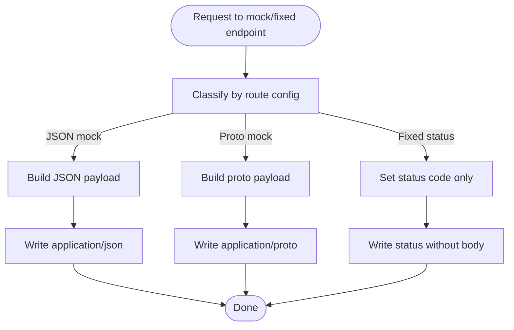

**Diagram sources**
- [upstream_client.go:225-266](file://internal/backend/server/upstream/client.go#L225-L266)
- [upstream_action.go:170-211](file://internal/backend/server/upstream/action.go#L170-L211)

**Section sources**
- [host.go:453-468](file://internal/backend/host.go#L453-L468)
- [host.go:798-813](file://internal/backend/host.go#L798-L813)
- [upstream_client.go:225-266](file://internal/backend/server/upstream/client.go#L225-L266)

### Request Context Propagation
Each request carries a RequestContext with:
- ResponseWriter
- Request
- StartedAt timestamp
- RawURL and TargetURL
- Method, Headers, ContentType, RequestBody
- Dependencies (SystemSettingService, HTTPClient, LogRoot, Routes)
- HTTPRequestID

This context enables consistent parsing of upstream URLs, header patching, and dependency access across handlers.

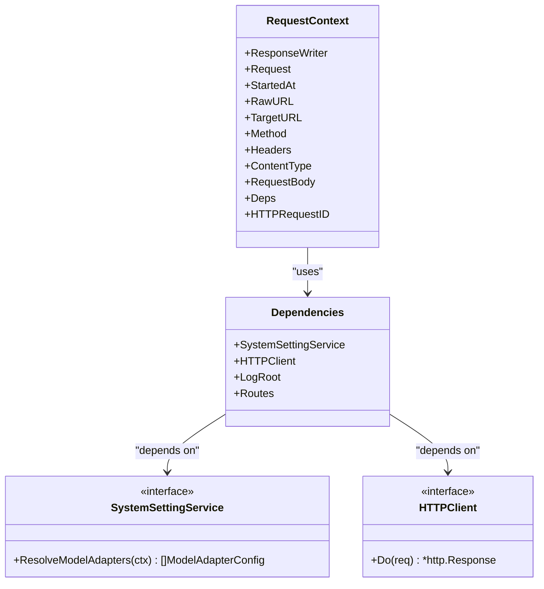

**Diagram sources**
- [upstream_types.go:34-53](file://internal/backend/server/upstream/types.go#L34-L53)

**Section sources**
- [upstream_types.go:34-53](file://internal/backend/server/upstream/types.go#L34-L53)

### Middleware Chain Behavior
Global middleware order:
1. Recover: Captures panics and converts them into structured errors.
2. ServerContext: Validates context and parses upstream URL.
3. ErrorEncoder: Wraps handler execution and writes standardized error responses.

Error mapping:
- Empty raw URL -> 400 Bad Request
- Invalid bidi append payload -> 400 Bad Request
- Invalid system setting -> 500 Internal Server Error
- Channel not available -> 503 Service Unavailable
- Default -> 502 Bad Gateway

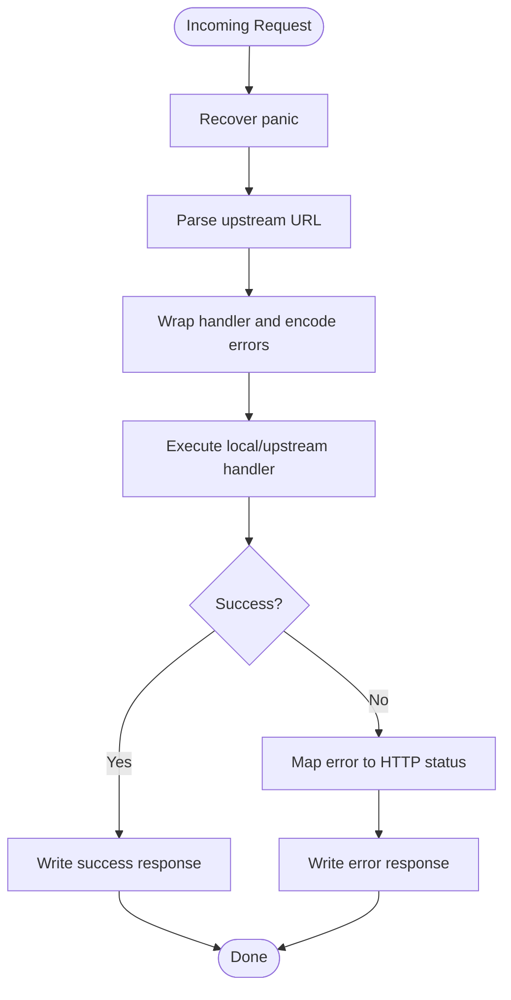

**Diagram sources**
- [middleware.go:13-85](file://internal/backend/server/middleware.go#L13-L85)

**Section sources**
- [middleware.go:13-85](file://internal/backend/server/middleware.go#L13-L85)

### Rate Limiting Policies
- Proxy log rate limiting: Limits repeated proxy logs within a sliding window to reduce noise.
- Window: 30 seconds
- TTL: 5 minutes
- Max keys: 1024

This limiter suppresses excessive logs while preserving visibility into recurring issues.

**Section sources**
- [service.go:82-100](file://internal/mitm/service.go#L82-L100)

### Response Formatting Standards
- JSON responses set content-type to application/json.
- Protobuf responses set content-type to application/proto.
- Connect stream responses set connect-protocol-version and appropriate content-type based on request content-type.
- Errors are written via writeServerError with mapped HTTP status codes.

**Section sources**
- [upstream_client.go:241-266](file://internal/backend/server/upstream/client.go#L241-L266)
- [host.go:837-877](file://internal/backend/host.go#L837-L877)
- [middleware.go:61-85](file://internal/backend/server/middleware.go#L61-L85)

## Dependency Analysis
The backend depends on:
- chi router for HTTP routing
- forwarder module for agent-related procedures
- upstream package for mock and authenticated forwarding
- serverconfig Manager for configuration persistence
- mitm service for proxy lifecycle

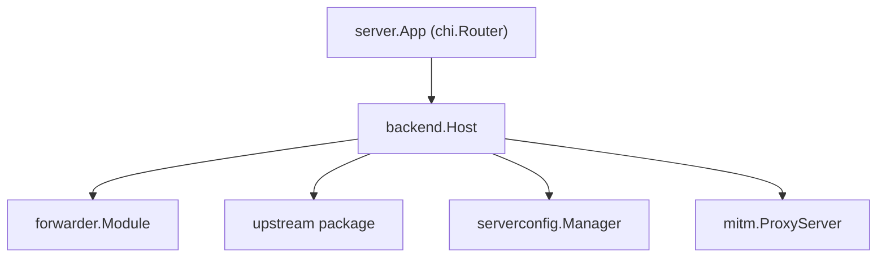

**Diagram sources**
- [host.go:28-63](file://internal/backend/host.go#L28-L63)
- [route.go:37-50](file://internal/backend/server/route.go#L37-L50)

**Section sources**
- [host.go:28-63](file://internal/backend/host.go#L28-L63)
- [route.go:37-50](file://internal/backend/server/route.go#L37-L50)

## Performance Considerations
- ReadHeaderTimeout is set to 10 seconds for the HTTP server to prevent slow clients from holding connections.
- Loopback health check client uses minimal idle connections and short dial timeouts to keep health probes lightweight.
- Proxy log rate limiting reduces overhead from excessive logging under high traffic.

[No sources needed since this section provides general guidance]

## Troubleshooting Guide
Common issues and diagnostics:
- Health check failures: Use GET /healthz to verify liveness. In-process health checks also validate mux availability and response body.
- Proxy startup errors: Inspect LastRunError and listen address binding errors.
- Configuration save/rebuild errors: Ensure serverconfig.Manager is initialized; SaveConfig triggers rebuild when the server is not running.
- Upstream forwarding errors: Check AuthorizationProvider.SignedIn() for control-plane endpoints; ensure target URL scheme and host are correct.

Recommended steps:
- Verify ListenAddr and BaseURL.
- Confirm that global middleware does not return early due to invalid context.
- Review error mappings in writeServerError for status codes.
- For model adapter tests, validate provider type, baseURL, and apiKey.

**Section sources**
- [host.go:199-253](file://internal/backend/host.go#L199-L253)
- [host.go:80-94](file://internal/backend/host.go#L80-L94)
- [middleware.go:61-85](file://internal/backend/server/middleware.go#L61-L85)
- [model_adapter_benchmark.go:165-196](file://internal/client/model_adapter_benchmark.go#L165-L196)

## Conclusion
The cursor-byok backend provides a robust local HTTP server with clear routing, middleware, and handler patterns. Configuration and proxy control are managed via Wails bridge calls, while health checks and various mock/forwarding endpoints support development and integration. Authentication is enforced for control-plane routes, and error handling is standardized across all handlers. Rate limiting and performance tuning are applied at logging and server levels to maintain stability under load.

[No sources needed since this section summarizes without analyzing specific files]