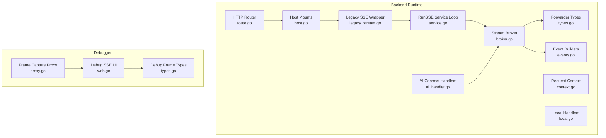
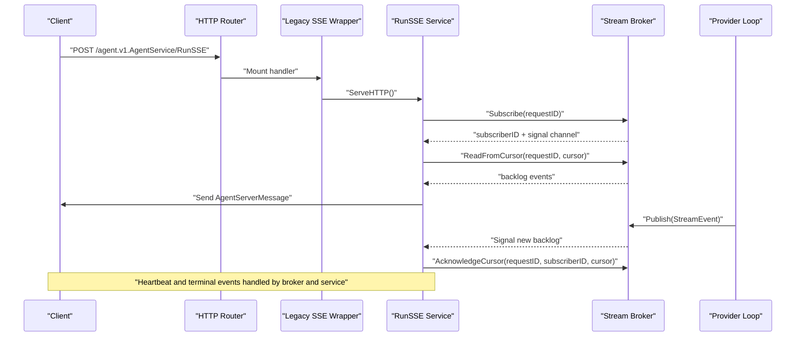
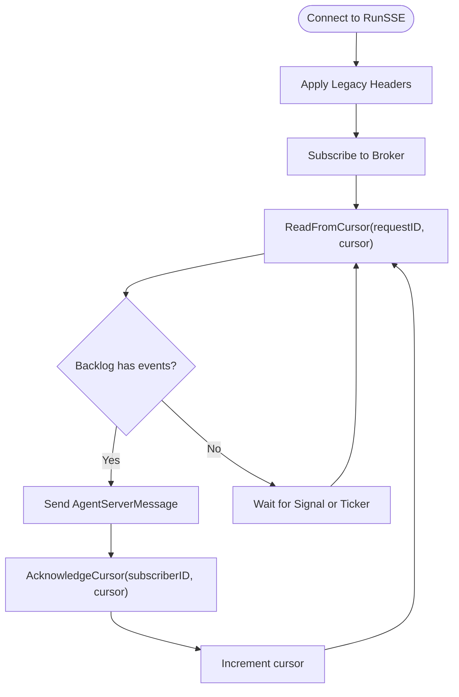
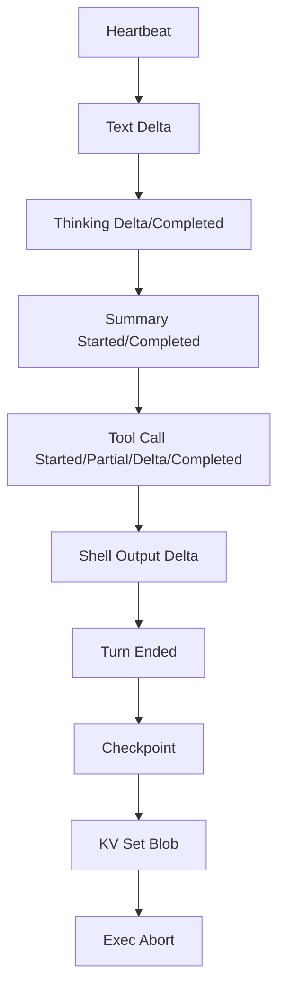
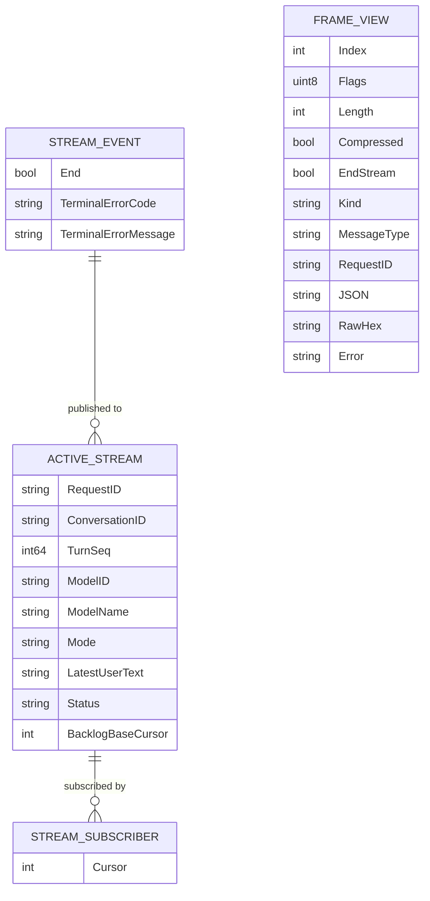
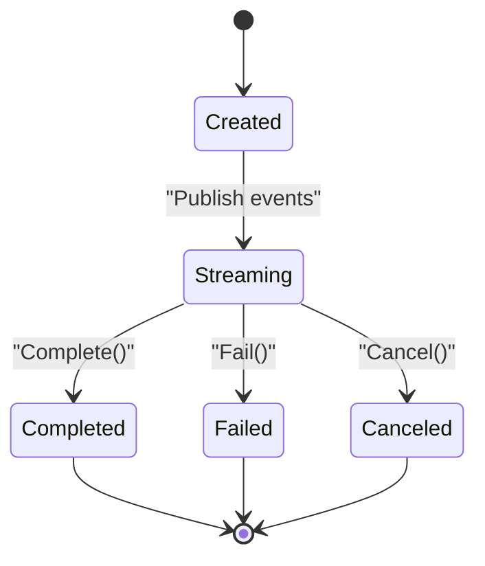
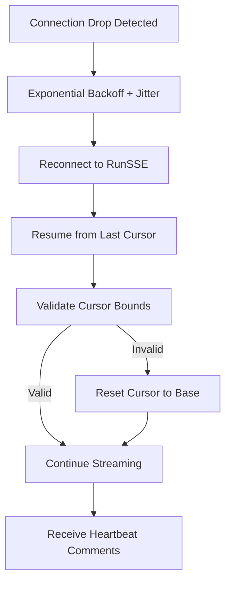
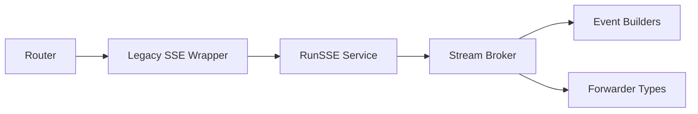

# WebSocket APIs

<cite>
**Referenced Files in This Document**
- [route.go](file://internal/backend/server/route.go)
- [context.go](file://internal/backend/server/context.go)
- [local.go](file://internal/backend/server/local.go)
- [host.go](file://internal/backend/host.go)
- [broker.go](file://internal/backend/forwarder/broker.go)
- [types.go](file://internal/backend/forwarder/types.go)
- [events.go](file://internal/backend/forwarder/events.go)
- [service.go](file://internal/backend/forwarder/service.go)
- [legacy_stream.go](file://internal/backend/forwarder/legacy_stream.go)
- [ai_handler.go](file://internal/backend/forwarder/ai_handler.go)
- [proxy.go](file://cursor-proxy-debugger/proxy.go)
- [web.go](file://cursor-proxy-debugger/web.go)
- [types.go](file://cursor-proxy-debugger/types.go)
</cite>

## Table of Contents
1. [Introduction](#introduction)
2. [Project Structure](#project-structure)
3. [Core Components](#core-components)
4. [Architecture Overview](#architecture-overview)
5. [Detailed Component Analysis](#detailed-component-analysis)
6. [Dependency Analysis](#dependency-analysis)
7. [Performance Considerations](#performance-considerations)
8. [Troubleshooting Guide](#troubleshooting-guide)
9. [Conclusion](#conclusion)

## Introduction
This document describes the real-time communication layer exposed by the backend, focusing on streaming protocols used for live updates. The system primarily uses HTTP-based streaming (Server-Sent Events and Connect server streams) rather than raw WebSocket frames. Clients connect to a legacy SSE endpoint that forwards structured agent events such as text deltas, thinking progress, tool call notifications, checkpoint updates, turn completion, and terminal errors. A debugger utility also exposes an SSE event stream for inspecting captured request/response frames.

The documentation covers:
- Connection establishment procedures
- Authentication and session concepts
- Event types and payload structures
- Message formats and JSON schemas
- Connection lifecycle management, reconnection strategies, and heartbeat mechanisms
- Client implementation patterns
- Performance considerations and scaling guidance

## Project Structure
The streaming runtime is implemented under the backend forwarder and server packages. The key responsibilities are:
- Routing and protocol classification
- Legacy SSE header wrapping
- Stream broker managing per-request active streams, backlog, and subscribers
- Event construction for client-facing messages
- Service loop reading from the broker and sending events over a streaming connection
- Debugger utilities exposing captured frames via SSE



**Diagram sources**
- [route.go:37-50](file://internal/backend/server/route.go#L37-L50)
- [context.go:28-40](file://internal/backend/server/context.go#L28-L40)
- [local.go:9-38](file://internal/backend/server/local.go#L9-L38)
- [host.go:296-315](file://internal/backend/host.go#L296-L315)
- [broker.go:20-40](file://internal/backend/forwarder/broker.go#L20-L40)
- [types.go:114-134](file://internal/backend/forwarder/types.go#L114-L134)
- [events.go:16-27](file://internal/backend/forwarder/events.go#L16-L27)
- [service.go:551-589](file://internal/backend/forwarder/service.go#L551-L589)
- [legacy_stream.go:16-26](file://internal/backend/forwarder/legacy_stream.go#L16-L26)
- [ai_handler.go:27-102](file://internal/backend/forwarder/ai_handler.go#L27-L102)
- [proxy.go:366-391](file://cursor-proxy-debugger/proxy.go#L366-L391)
- [web.go:58-89](file://cursor-proxy-debugger/web.go#L58-L89)
- [types.go:92-105](file://cursor-proxy-debugger/types.go#L92-L105)

**Section sources**
- [route.go:37-50](file://internal/backend/server/route.go#L37-L50)
- [context.go:28-40](file://internal/backend/server/context.go#L28-L40)
- [local.go:9-38](file://internal/backend/server/local.go#L9-L38)
- [host.go:296-315](file://internal/backend/host.go#L296-L315)
- [broker.go:20-40](file://internal/backend/forwarder/broker.go#L20-L40)
- [types.go:114-134](file://internal/backend/forwarder/types.go#L114-L134)
- [events.go:16-27](file://internal/backend/forwarder/events.go#L16-L27)
- [service.go:551-589](file://internal/backend/forwarder/service.go#L551-L589)
- [legacy_stream.go:16-26](file://internal/backend/forwarder/legacy_stream.go#L16-L26)
- [ai_handler.go:27-102](file://internal/backend/forwarder/ai_handler.go#L27-L102)
- [proxy.go:366-391](file://cursor-proxy-debugger/proxy.go#L366-L391)
- [web.go:58-89](file://cursor-proxy-debugger/web.go#L58-L89)
- [types.go:92-105](file://cursor-proxy-debugger/types.go#L92-L105)

## Core Components
- HTTP routing and protocol classification: routes define HTTP, unary Connect, and streaming Connect endpoints; middleware chains wrap handlers with context and error handling.
- Legacy SSE wrapper: ensures Content-Type and Cache-Control headers match the legacy RunSSE contract.
- Stream broker: maintains per-request active streams, backlog, cursor tracking, subscriber signals, and terminal cleanup.
- Event builders: construct standardized AgentServerMessage payloads for heartbeats, text deltas, thinking updates, tool calls, checkpoints, and turn endings.
- RunSSE service loop: subscribes to the broker, reads backlog by cursor, sends events, acknowledges cursors, handles timeouts, and manages cancellation.
- Debugger SSE: exposes captured request/response frames as Server-Sent Events with periodic heartbeats.

**Section sources**
- [route.go:10-129](file://internal/backend/server/route.go#L10-L129)
- [legacy_stream.go:16-73](file://internal/backend/forwarder/legacy_stream.go#L16-L73)
- [broker.go:20-40](file://internal/backend/forwarder/broker.go#L20-L40)
- [events.go:16-27](file://internal/backend/forwarder/events.go#L16-L27)
- [service.go:551-589](file://internal/backend/forwarder/service.go#L551-L589)
- [web.go:58-89](file://cursor-proxy-debugger/web.go#L58-L89)

## Architecture Overview
The runtime exposes two primary streaming interfaces:
- Legacy RunSSE endpoint: returns text/event-stream with AgentServerMessage events.
- Connect server streams: used internally for some AI services.

Clients connect to the legacy SSE endpoint. The server wraps the response headers to ensure compatibility, then runs a service loop that reads events from the broker and writes them to the client. The broker coordinates multiple subscribers per request, tracks backlog and cursors, and publishes terminal events when streams complete or fail.



**Diagram sources**
- [host.go:308-315](file://internal/backend/host.go#L308-L315)
- [legacy_stream.go:16-26](file://internal/backend/forwarder/legacy_stream.go#L16-L26)
- [service.go:551-589](file://internal/backend/forwarder/service.go#L551-L589)
- [broker.go:181-212](file://internal/backend/forwarder/broker.go#L181-L212)
- [broker.go:406-441](file://internal/backend/forwarder/broker.go#L406-L441)

## Detailed Component Analysis

### Streaming Protocol and Connection Establishment
- The legacy RunSSE endpoint is mounted as a streaming route and wrapped to return text/event-stream.
- The wrapper sets Content-Type to text/event-stream and ensures no-cache behavior.
- The service loop subscribes to the broker, reads backlog using a cursor, sends events, and acknowledges the cursor after each batch.



**Diagram sources**
- [legacy_stream.go:16-73](file://internal/backend/forwarder/legacy_stream.go#L16-L73)
- [service.go:551-589](file://internal/backend/forwarder/service.go#L551-L589)
- [broker.go:443-458](file://internal/backend/forwarder/broker.go#L443-L458)

**Section sources**
- [legacy_stream.go:16-73](file://internal/backend/forwarder/legacy_stream.go#L16-L73)
- [service.go:551-589](file://internal/backend/forwarder/service.go#L551-L589)

### Authentication and Session Management
- Authentication is not performed within the streaming handler itself; it is expected to be handled upstream or by middleware before reaching the streaming route.
- Session state is represented by per-request ActiveStream objects maintained by the broker, including conversation metadata, model information, pending tool calls, background shells, and checkpoint blobs.
- Subscribers are identified by subscriberID and associated with a cursor into the backlog.

```mermaid
classDiagram
class StreamBroker {
+OpenStream(requestID, conversationID, turnSeq, modelID, modelName, mode, latestUserText) ActiveStream
+Get(requestID) ActiveStream
+Subscribe(requestID) (string, chan struct{}, error)
+Unsubscribe(requestID, subscriberID) int
+AcknowledgeCursor(requestID, subscriberID, cursor) error
+Publish(requestID, event) error
+ReadFromCursor(requestID, cursor) []StreamEvent
+Complete(requestID, terminalCode, terminalMessage) error
+Fail(requestID, terminalCode, terminalMessage) error
+Cancel(requestID, terminalMessage) error
}
class ActiveStream {
+string RequestID
+string ConversationID
+int64 TurnSeq
+string ModelID
+string ModelName
+AgentMode Mode
+string LatestUserText
+StreamStatus Status
+[]StreamEvent Backlog
+int BacklogBaseCursor
+map[string]*StreamSubscriber Subscribers
+map[string]PendingExec PendingExecs
+map[string]PendingInteraction PendingInteractions
+map[string]struct{} PartialToolCallIDs
+map[string][]queuedPatchEditOperation PatchEditQueues
+map[string]string MCPToolServers
+map[string]string MCPToolDefinitionPaths
+[]string WorkspacePaths
+string TerminalsFolder
+map[string]string RequestFileContents
+map[uint32]time.Time RecentCompletedExecs
+map[string]*BackgroundShellState BackgroundShells
+map[uint32]string BackgroundShellsByMessageID
+map[string]string BackgroundShellsByExecID
+map[string]time.Time BackgroundShellActions
+time TimerCleanupTimer
+atomic.Uint64 TerminalCleanupSeq
}
class StreamSubscriber {
+chan struct{} Signal
+int Cursor
}
StreamBroker --> ActiveStream : "manages"
ActiveStream --> StreamSubscriber : "has many"
```

**Diagram sources**
- [broker.go:20-40](file://internal/backend/forwarder/broker.go#L20-L40)
- [broker.go:42-135](file://internal/backend/forwarder/broker.go#L42-L135)
- [broker.go:181-257](file://internal/backend/forwarder/broker.go#L181-L257)
- [types.go:141-218](file://internal/backend/forwarder/types.go#L141-L218)
- [types.go:131-134](file://internal/backend/forwarder/types.go#L131-L134)

**Section sources**
- [broker.go:42-135](file://internal/backend/forwarder/broker.go#L42-L135)
- [broker.go:181-257](file://internal/backend/forwarder/broker.go#L181-L257)
- [types.go:141-218](file://internal/backend/forwarder/types.go#L141-L218)
- [types.go:131-134](file://internal/backend/forwarder/types.go#L131-L134)

### Event Types and Payload Structures
The server constructs standardized AgentServerMessage payloads for various event categories:
- Heartbeat: keeps connections alive and indicates liveness.
- Text delta: incremental assistant text.
- Thinking delta/completed: reasoning progress and completion.
- Summary started/completed: summarization lifecycle.
- Tool call started/partial/delta/completed: tool invocation lifecycle and argument streaming.
- Shell output delta: terminal output mapped into tool call deltas.
- Turn ended: token usage summary at turn completion.
- Checkpoint: conversation state snapshots.
- KV set blob: binary blob delivery for checkpoints.
- Exec abort: control message to abort pending executions.



**Diagram sources**
- [events.go:16-27](file://internal/backend/forwarder/events.go#L16-L27)
- [events.go:29-57](file://internal/backend/forwarder/events.go#L29-L57)
- [events.go:74-120](file://internal/backend/forwarder/events.go#L74-L120)
- [events.go:122-189](file://internal/backend/forwarder/events.go#L122-L189)
- [events.go:191-237](file://internal/backend/forwarder/events.go#L191-L237)
- [events.go:239-259](file://internal/backend/forwarder/events.go#L239-L259)
- [events.go:261-297](file://internal/backend/forwarder/events.go#L261-L297)
- [events.go:299-312](file://internal/backend/forwarder/events.go#L299-L312)

**Section sources**
- [events.go:16-27](file://internal/backend/forwarder/events.go#L16-L27)
- [events.go:29-57](file://internal/backend/forwarder/events.go#L29-L57)
- [events.go:74-120](file://internal/backend/forwarder/events.go#L74-L120)
- [events.go:122-189](file://internal/backend/forwarder/events.go#L122-L189)
- [events.go:191-237](file://internal/backend/forwarder/events.go#L191-L237)
- [events.go:239-259](file://internal/backend/forwarder/events.go#L239-L259)
- [events.go:261-297](file://internal/backend/forwarder/events.go#L261-L297)
- [events.go:299-312](file://internal/backend/forwarder/events.go#L299-L312)

### Message Formats and JSON Schemas
- AgentServerMessage: protobuf-defined envelope carrying interaction updates, checkpoints, KV messages, and exec control messages.
- StreamEvent: internal representation containing either an AgentServerMessage or terminal status fields.
- ActiveStream: holds conversation metadata, backlog, subscribers, pending operations, and background shell states.
- Debugger FrameView: represents one Connect streaming envelope frame with index, flags, length, compression, end-of-stream, kind, messageType, requestId, json, rawHex, and error.



**Diagram sources**
- [types.go:124-134](file://internal/backend/forwarder/types.go#L124-L134)
- [types.go:141-218](file://internal/backend/forwarder/types.go#L141-L218)
- [types.go:131-134](file://internal/backend/forwarder/types.go#L131-L134)
- [types.go:92-105](file://cursor-proxy-debugger/types.go#L92-L105)

**Section sources**
- [types.go:124-134](file://internal/backend/forwarder/types.go#L124-L134)
- [types.go:141-218](file://internal/backend/forwarder/types.go#L141-L218)
- [types.go:131-134](file://internal/backend/forwarder/types.go#L131-L134)
- [types.go:92-105](file://cursor-proxy-debugger/types.go#L92-L105)

### Connection Lifecycle Management
- OpenStream: creates or reuses an ActiveStream for a requestID, initializing backlog, subscribers, pending operations, and background shells.
- Subscribe: registers a subscriber with a cursor initialized to the current backlog base; returns a signal channel to wake consumers.
- Publish: appends events to backlog, trims overflow if needed, and wakes all subscribers.
- AcknowledgeCursor: validates cursor bounds and trims acknowledged backlog entries.
- Complete/Fail/Cancel: mark stream terminal status, publish terminal events, and schedule cleanup if no subscribers remain.
- RemoveIfIdle: removes terminal or empty placeholder streams when idle.



**Diagram sources**
- [broker.go:42-135](file://internal/backend/forwarder/broker.go#L42-L135)
- [broker.go:181-212](file://internal/backend/forwarder/broker.go#L181-L212)
- [broker.go:406-441](file://internal/backend/forwarder/broker.go#L406-L441)
- [broker.go:461-551](file://internal/backend/forwarder/broker.go#L461-L551)
- [broker.go:370-404](file://internal/backend/forwarder/broker.go#L370-L404)

**Section sources**
- [broker.go:42-135](file://internal/backend/forwarder/broker.go#L42-L135)
- [broker.go:181-212](file://internal/backend/forwarder/broker.go#L181-L212)
- [broker.go:406-441](file://internal/backend/forwarder/broker.go#L406-L441)
- [broker.go:461-551](file://internal/backend/forwarder/broker.go#L461-L551)
- [broker.go:370-404](file://internal/backend/forwarder/broker.go#L370-L404)

### Reconnection Strategies and Heartbeat Mechanisms
- Heartbeat: the server constructs a heartbeat message to keep clients aware of liveness.
- Debugger SSE: emits periodic heartbeat comments every 15 seconds to maintain connection health.
- Reconnection: clients should implement exponential backoff with jitter, reconnect on connection drops, and resume from the last acknowledged cursor to avoid duplication.
- Orphan cancel grace period: when a RunSSE client disconnects, the service schedules a grace period to avoid prematurely marking a still-active provider request as canceled.



**Diagram sources**
- [events.go:16-27](file://internal/backend/forwarder/events.go#L16-L27)
- [web.go:71-86](file://cursor-proxy-debugger/web.go#L71-L86)
- [service.go:551-589](file://internal/backend/forwarder/service.go#L551-L589)

**Section sources**
- [events.go:16-27](file://internal/backend/forwarder/events.go#L16-L27)
- [web.go:71-86](file://cursor-proxy-debugger/web.go#L71-L86)
- [service.go:551-589](file://internal/backend/forwarder/service.go#L551-L589)

### Client Implementation Examples
- Connection handling:
  - Establish SSE connection to the legacy RunSSE endpoint.
  - Apply legacy headers expectations (text/event-stream, no-cache).
  - Handle ready event and initial heartbeat comments.
- Event subscription patterns:
  - Maintain a cursor per request.
  - On receiving events, update UI incrementally (text deltas, thinking updates).
  - Track tool call lifecycle (started, partial args, deltas, completed).
  - Process checkpoints and KV blobs for state synchronization.
  - Handle turn-ended messages for token usage summaries.
- Error recovery:
  - Detect terminal events (completed, failed, canceled).
  - Implement reconnection with backoff and cursor resumption.
  - Log send errors and retry with adjusted cursor.

**Section sources**
- [legacy_stream.go:16-73](file://internal/backend/forwarder/legacy_stream.go#L16-L73)
- [events.go:16-27](file://internal/backend/forwarder/events.go#L16-L27)
- [events.go:122-189](file://internal/backend/forwarder/events.go#L122-L189)
- [events.go:239-259](file://internal/backend/forwarder/events.go#L239-L259)
- [service.go:551-589](file://internal/backend/forwarder/service.go#L551-L589)

## Dependency Analysis
The streaming pipeline depends on:
- HTTP router for mounting handlers and applying middleware.
- Legacy SSE wrapper for header compliance.
- Broker for event distribution and lifecycle management.
- Event builders for constructing client-compatible messages.
- Service loop for reading from broker and writing to client.



**Diagram sources**
- [route.go:37-50](file://internal/backend/server/route.go#L37-L50)
- [legacy_stream.go:16-26](file://internal/backend/forwarder/legacy_stream.go#L16-L26)
- [service.go:551-589](file://internal/backend/forwarder/service.go#L551-L589)
- [broker.go:406-441](file://internal/backend/forwarder/broker.go#L406-L441)
- [types.go:114-134](file://internal/backend/forwarder/types.go#L114-L134)

**Section sources**
- [route.go:37-50](file://internal/backend/server/route.go#L37-L50)
- [legacy_stream.go:16-26](file://internal/backend/forwarder/legacy_stream.go#L16-L26)
- [service.go:551-589](file://internal/backend/forwarder/service.go#L551-L589)
- [broker.go:406-441](file://internal/backend/forwarder/broker.go#L406-L441)
- [types.go:114-134](file://internal/backend/forwarder/types.go#L114-L134)

## Performance Considerations
- Backlog limits: the broker enforces a configurable backlog limit to prevent unbounded memory growth.
- Cursor acknowledgment: clients should acknowledge cursors promptly to allow trimming of consumed backlog.
- Subscriber signaling: non-blocking signal channels reduce contention when waking consumers.
- Terminal cleanup: scheduled cleanup removes terminal streams after a retention period when no subscribers remain.
- Debugger frame limits: captured frames are limited to a maximum count per exchange to control memory usage.

Recommendations:
- Tune backlogLimit based on expected event volume and client consumption speed.
- Ensure clients acknowledge cursors after processing batches to free broker memory.
- Monitor terminal stream retention and adjust cleanup timers if long-lived diagnostics are required.
- Use connection pooling and rate limiting at the proxy/load balancer level for high-throughput scenarios.

**Section sources**
- [broker.go:15-18](file://internal/backend/forwarder/broker.go#L15-L18)
- [broker.go:239-257](file://internal/backend/forwarder/broker.go#L239-L257)
- [broker.go:406-441](file://internal/backend/forwarder/broker.go#L406-L441)
- [broker.go:321-368](file://internal/backend/forwarder/broker.go#L321-L368)
- [proxy.go:366-391](file://cursor-proxy-debugger/proxy.go#L366-L391)

## Troubleshooting Guide
Common issues and resolutions:
- No events received:
  - Verify SSE headers are correctly applied (text/event-stream, no-cache).
  - Check that the client subscribed to the correct requestID.
  - Inspect broker backlog and cursor values.
- Stale backlog or memory growth:
  - Ensure clients acknowledge cursors after processing events.
  - Confirm backlog trimming occurs after acknowledgments.
- Terminal events not emitted:
  - Verify Complete/Fail/Cancel paths are invoked by the provider loop.
  - Check terminal cleanup scheduling and subscriber counts.
- Debugger SSE not updating:
  - Confirm flush support and heartbeat emission.
  - Validate exchange store subscriptions and event marshaling.

Operational checks:
- Health endpoint returns OK for basic connectivity validation.
- Debugger SSE emits ready event and periodic heartbeat comments.
- Exchange detail endpoints provide captured frames for inspection.

**Section sources**
- [legacy_stream.go:66-73](file://internal/backend/forwarder/legacy_stream.go#L66-L73)
- [broker.go:239-257](file://internal/backend/forwarder/broker.go#L239-L257)
- [broker.go:461-551](file://internal/backend/forwarder/broker.go#L461-L551)
- [web.go:58-89](file://cursor-proxy-debugger/web.go#L58-L89)
- [local.go:9-24](file://internal/backend/server/local.go#L9-L24)

## Conclusion
The backend provides a robust streaming interface for real-time agent interactions using HTTP-based protocols. The legacy RunSSE endpoint ensures compatibility with existing clients while the broker manages per-request state, backlog, and lifecycle. Clients should implement cursor-based resumption, handle all event types, and apply resilient reconnection strategies. For high-throughput deployments, tune backlog limits, monitor terminal cleanup, and ensure prompt cursor acknowledgments to maintain performance and memory efficiency.