# Agent Protocol Support

<cite>
**Referenced Files in This Document**
- [README.md](file://README.md)
- [agent_v1.proto](file://proto/agent_v1.proto)
- [inbound.go](file://internal/backend/agent/protocol/inbound.go)
- [service.go](file://internal/backend/forwarder/service.go)
- [types.go](file://internal/backend/forwarder/types.go)
- [broker.go](file://internal/backend/forwarder/broker.go)
- [router.go](file://internal/backend/agent/model/router.go)
- [engine.go](file://internal/backend/agent/prompt/engine.go)
- [core_types.go](file://internal/backend/agent/core/types.go)
- [route.go](file://internal/backend/server/route.go)
- [mcp_schema_heal.go](file://internal/backend/forwarder/mcp_schema_heal.go)
- [mcp.go](file://internal/backend/agent/core/mcp.go)
- [local_discovery.go](file://internal/backend/agent/prompt/local_discovery.go)
- [request_context.go](file://internal/backend/forwarder/request_context.go)
- [commit_message.go](file://internal/backend/forwarder/commit_message.go)
- [engine_test.go](file://internal/backend/agent/prompt/engine_test.go)
</cite>

## Update Summary
**Changes Made**
- Enhanced slash command processing with improved skill hijacking prevention in prompt engine
- Added advanced multi-tier model selection system for commit message generation in forwarder service
- Updated skill detection logic to prevent Cursor built-in commands from hijacking ak-* skills
- Implemented sophisticated model resolution chain with live explorer overrides and persistent fallbacks

## Table of Contents
1. [Introduction](#introduction)
2. [Project Structure](#project-structure)
3. [Core Components](#core-components)
4. [Architecture Overview](#architecture-overview)
5. [Detailed Component Analysis](#detailed-component-analysis)
6. [Enhanced Slash Command Processing](#enhanced-slash-command-processing)
7. [Advanced Multi-Tier Model Selection](#advanced-multi-tier-model-selection)
8. [Enhanced MCP Integration](#enhanced-mcp-integration)
9. [Dependency Analysis](#dependency-analysis)
10. [Performance Considerations](#performance-considerations)
11. [Troubleshooting Guide](#troubleshooting-guide)
12. [Conclusion](#conclusion)

## Introduction
This document explains how cursor-byok implements Cursor's Agent protocol so that a local service can act as Cursor's backend while routing model requests to upstream OpenAI- or Anthropic-compatible providers. The implementation preserves Cursor Agent capabilities including:

- Tool calling and tool result coordination
- Skills discovery and slash-command invocation with enhanced hijacking prevention
- MCP (Model Context Protocol) descriptors and file-system-based MCP servers
- Multi-turn conversation state, plans, todos, summaries, and checkpoints
- Streaming responses with heartbeats, cancellation, and terminal error propagation

At a high level, Cursor sends binary Agent messages over a bidirectional channel. The local service decodes them into `AgentClientMessage`, maps them to internal intents, compiles prompts with tools and context, forwards streaming requests to the selected provider, executes tools through bridges, and publishes structured `AgentServerMessage` events back to the client.

The README confirms that this project is a local model gateway for Cursor and explicitly states that it preserves tool calling, Skills, and MCP while forwarding OpenAI- and Anthropic-compatible requests.

**Section sources**
- [README.md:54-102](file://README.md#L54-L102)

## Project Structure
The Agent protocol support spans several layers:

| Layer | Responsibility | Key Files |
|---|---|---|
| Protocol definitions | Cursor Agent message schema | [agent_v1.proto](file://proto/agent_v1.proto) |
| Inbound decoding | Hex payload decoding, message kind detection, command mapping | [inbound.go](file://internal/backend/agent/protocol/inbound.go) |
| Forwarder service | Request lifecycle, history persistence, prompt compilation, provider streaming, SSE output | [service.go](file://internal/backend/forwarder/service.go), [types.go](file://internal/backend/forwarder/types.go) |
| Stream broker | Per-request event backlog, subscribers, heartbeat, terminal cleanup | [broker.go](file://internal/backend/forwarder/broker.go) |
| Model router | Channel resolution and OpenAI/Anthropic adapter selection | [router.go](file://internal/backend/agent/model/router.go) |
| Prompt engine | Mode-specific system prompts, tools, skills, MCP, request context assembly | [engine.go](file://internal/backend/agent/prompt/engine.go) |
| Runtime core | Command kinds, run states, pending exec/interaction, supported tools | [core_types.go](file://internal/backend/agent/core/types.go) |
| HTTP/connect routing | Route registration, middleware chain, Connect stream/unary handling | [route.go](file://internal/backend/server/route.go) |

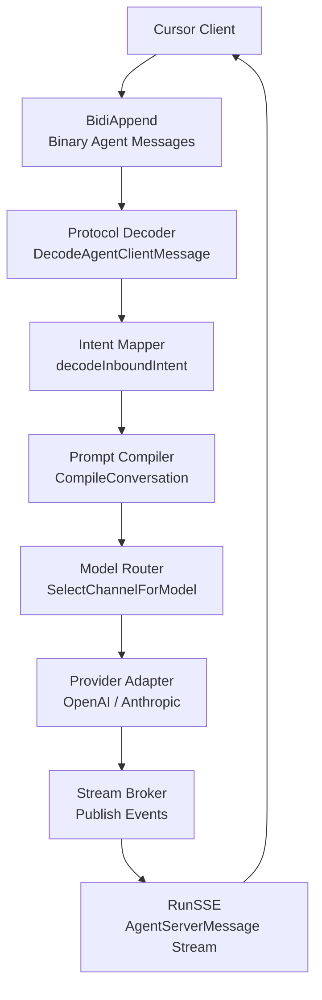

**Diagram sources**
- [inbound.go:38-53](file://internal/backend/agent/protocol/inbound.go#L38-L53)
- [service.go:370-448](file://internal/backend/forwarder/service.go#L370-L448)
- [service.go:539-653](file://internal/backend/forwarder/service.go#L539-L653)
- [router.go:37-135](file://internal/backend/agent/model/router.go#L37-L135)

**Section sources**
- [agent_v1.proto:56-139](file://proto/agent_v1.proto#L56-L139)
- [inbound.go:38-96](file://internal/backend/agent/protocol/inbound.go#L38-L96)
- [service.go:290-353](file://internal/backend/forwarder/service.go#L290-L353)
- [broker.go:20-40](file://internal/backend/forwarder/broker.go#L20-L40)
- [router.go:13-35](file://internal/backend/agent/model/router.go#L13-L35)
- [engine.go:166-178](file://internal/backend/agent/prompt/engine.go#L166-L178)
- [core_types.go:76-125](file://internal/backend/agent/core/types.go#L76-L125)
- [route.go:37-51](file://internal/backend/server/route.go#L37-L51)

## Core Components
The Agent protocol implementation is centered around five cooperating components:

1. **Protocol decoder**: Converts hex-encoded `AgentClientMessage` payloads into typed protobuf messages and identifies their oneof branch.
2. **Forwarder service**: Normalizes inbound messages into `InboundIntent`, persists conversation history, compiles prompts, starts provider streams, and writes `AgentServerMessage` events.
3. **Stream broker**: Maintains per-request active streams, backlog, subscriber cursors, heartbeats, and terminal completion/cancellation.
4. **Model router**: Resolves configured channels and selects OpenAI or Anthropic adapters based on provider metadata.
5. **Prompt engine**: Builds mode-aware system prompts, injects skills, MCP descriptors, rules, user info, and request context, and returns messages plus tools for the model.

These components together preserve Cursor's Agent contract: clients continue sending `run_request`, `conversation_action`, `exec_client_message`, `interaction_response`, and related messages, while the server replies with interaction updates, execution messages, conversation checkpoints, and other server-side events.

**Section sources**
- [inbound.go:38-96](file://internal/backend/agent/protocol/inbound.go#L38-L96)
- [service.go:370-448](file://internal/backend/forwarder/service.go#L370-L448)
- [broker.go:42-135](file://internal/backend/forwarder/broker.go#L42-L135)
- [router.go:37-135](file://internal/backend/agent/model/router.go#L37-L135)
- [engine.go:175-279](file://internal/backend/agent/prompt/engine.go#L175-L279)

## Architecture Overview
The runtime flow has two main directions:

- **Upstream direction**: Cursor → BidiAppend → decode → intent → compile → provider stream.
- **Downstream direction**: Provider events → broker publish → RunSSE backlog → client SSE stream.

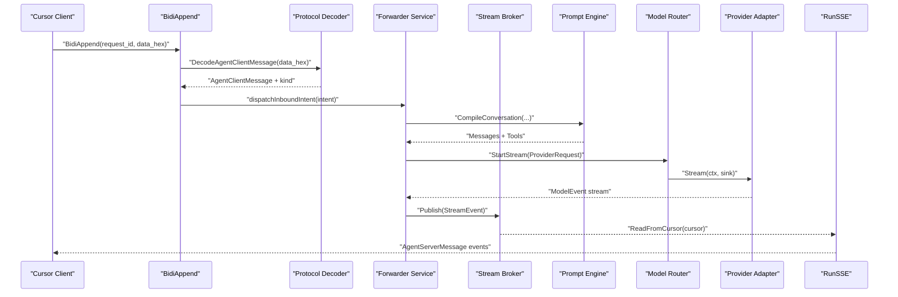

**Diagram sources**
- [service.go:370-448](file://internal/backend/forwarder/service.go#L370-L448)
- [service.go:539-653](file://internal/backend/forwarder/service.go#L539-L653)
- [router.go:37-135](file://internal/backend/agent/model/router.go#L37-L135)
- [broker.go:406-459](file://internal/backend/forwarder/broker.go#L406-L459)

## Detailed Component Analysis

### Protocol Buffer Definitions and Message Types
The Agent protocol is defined in `agent_v1.proto`. The most important top-level types are:

| Type | Purpose |
|---|---|
| `AgentClientMessage` | Top-level client-to-server message carrying `run_request`, `exec_client_message`, `conversation_action`, `interaction_response`, heartbeat, prewarm, or KV messages. |
| `AgentServerMessage` | Top-level server-to-client message carrying interaction updates, execution messages, conversation checkpoint updates, KV messages, or interaction queries. |
| `AgentRunRequest` | Carries conversation state, action, model details, MCP tools, conversation ID, skill options, subagent configuration, and pre-fetched blobs. |
| `AgentConversationTurn` | Represents a completed turn with user message and steps. |
| `AgentConversationTurnStructure` | Serialized form used for history/checkpoint storage. |
| `AgentSkill` | Describes a loaded Skill including path, content, description, environment filters, marketplace/plugin metadata, and globs. |
| `McpTools` | Declares MCP tool availability for the run. |
| `ConversationStateStructure` | Structured conversation state carried across turns and checkpoints. |

These definitions allow the local service to remain compatible with Cursor's expected Agent wire format while internally translating between Cursor's protocol and upstream provider formats.

**Section sources**
- [agent_v1.proto:56-139](file://proto/agent_v1.proto#L56-L139)
- [agent_v1.proto:99-126](file://proto/agent_v1.proto#L99-L126)
- [agent_v1.proto:70-84](file://proto/agent_v1.proto#L70-L84)
- [agent_v1.proto:141-174](file://proto/agent_v1.proto#L141-L174)

### Inbound Decoding and Command Mapping
The inbound decoder performs three key tasks:

1. Decode hex-encoded payload into `AgentClientMessage`.
2. Detect which oneof branch is active.
3. Map the client message kind to a runtime command kind.

Supported client message kinds include:

- `run_request`: Starts or resumes an Agent run.
- `prewarm_request`: Pre-warms model resources.
- `conversation_action`: Handles cancel, user message, resume, summarize, shell commands, plan actions, async ask completion, background shell/subagent actions.
- `exec_client_message`: Execution bridge messages.
- `interaction_response`: User responses to interactive tools like `AskQuestion`.
- `exec_client_control_message`: Control messages for execution bridges.
- `client_heartbeat`: Keepalive from the client.
- `kv_client_message`: Key-value bridge messages.

If decoding fails, the service logs raw and decoded debug information and returns an invalid argument error. If intent mapping fails, it also records diagnostic fields before returning an error.

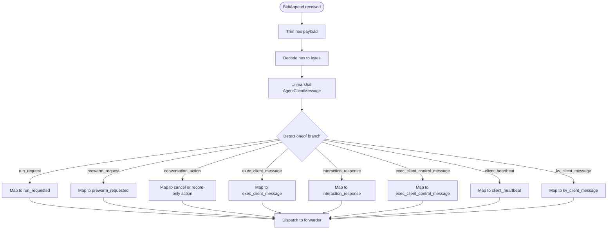

**Diagram sources**
- [inbound.go:38-96](file://internal/backend/agent/protocol/inbound.go#L38-L96)
- [service.go:370-448](file://internal/backend/forwarder/service.go#L370-L448)

**Section sources**
- [inbound.go:38-96](file://internal/backend/agent/protocol/inbound.go#L38-L96)
- [service.go:370-448](file://internal/backend/forwarder/service.go#L370-L448)

### Forwarder Service and Conversation State Management
The forwarder service is the central orchestrator. It:

- Validates `request_id` and manages append sequence deduplication.
- Decodes the inbound message and builds an `InboundIntent`.
- Persists conversation metadata, history entries, usage, and artifacts.
- Compiles the next model input using the prompt engine.
- Starts a provider stream and translates provider events into `AgentServerMessage`.
- Publishes events to the stream broker for SSE delivery.
- Manages pending executions, interactions, background shells, patch edits, MCP tool servers, and checkpoint blobs.

Key state structures include:

| Structure | Role |
|---|---|
| `ConversationFile` | Persistent conversation record with mode, turns, plans, todos, MCP servers, last provider call, and entry sequences. |
| `HistoryEntry` | Append-only history item with role, kind, tool call IDs, and JSON payload. |
| `ActiveStream` | In-memory per-request state including backlog, subscribers, pending exec/interaction, MCP servers, background shells, and checkpoint state. |
| `InboundIntent` | Internal representation of a decoded client message, including mode, model, thinking effort, conversation state, and optional user message. |
| `ProviderRequest` | Unified request passed to the model router, including messages, tools, max tokens, request knobs, and observer/artifact paths. |

The service supports multiple active modes such as agent, ask, plan, debug, and multitask, and validates explicit mode changes rather than silently downgrading unsupported modes.

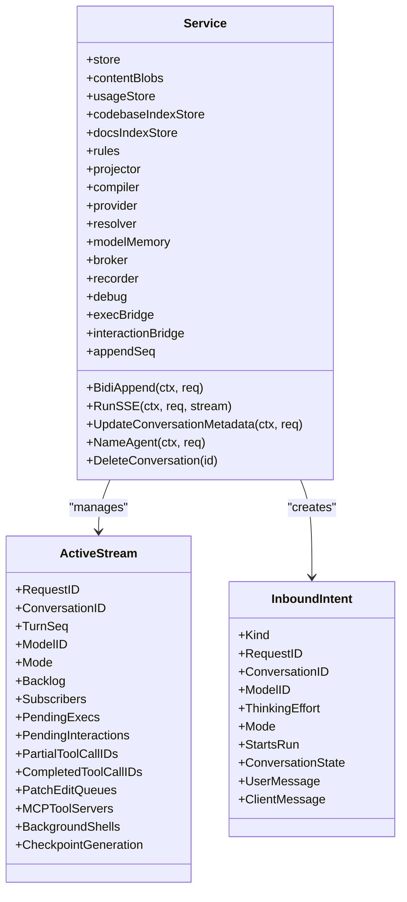

**Diagram sources**
- [service.go:290-353](file://internal/backend/forwarder/service.go#L290-L353)
- [types.go:140-216](file://internal/backend/forwarder/types.go#L140-L216)
- [types.go:459-487](file://internal/backend/forwarder/types.go#L459-L487)

**Section sources**
- [service.go:370-448](file://internal/backend/forwarder/service.go#L370-L448)
- [types.go:18-102](file://internal/backend/forwarder/types.go#L18-L102)
- [types.go:140-216](file://internal/backend/forwarder/types.go#L140-L216)
- [types.go:459-575](file://internal/backend/forwarder/types.go#L459-L575)

### Stream Handling and SSE Backlog
The stream broker maintains per-request activity and provides:

- `OpenStream`: Creates or reuses an `ActiveStream` and resets backlog and subscriber cursors when a new run starts.
- `Subscribe`: Registers a consumer and optionally creates a placeholder stream if `RunSSE` arrives before `BidiAppend`.
- `Publish`: Appends events to backlog, trims overflow, and signals all subscribers.
- `ReadFromCursor`: Returns unread backlog starting at a cursor position.
- `Complete`, `Fail`, `Cancel`: Emit terminal events and schedule cleanup when no subscribers remain.
- `RemoveIfIdle`: Removes terminal or empty placeholder streams after grace periods.

`RunSSE` uses a ticker to send periodic heartbeats when there is no backlog, ensuring the client sees liveness even during long pauses. When the client disconnects, the service schedules an orphan-cancel actor instead of immediately canceling an active provider loop.

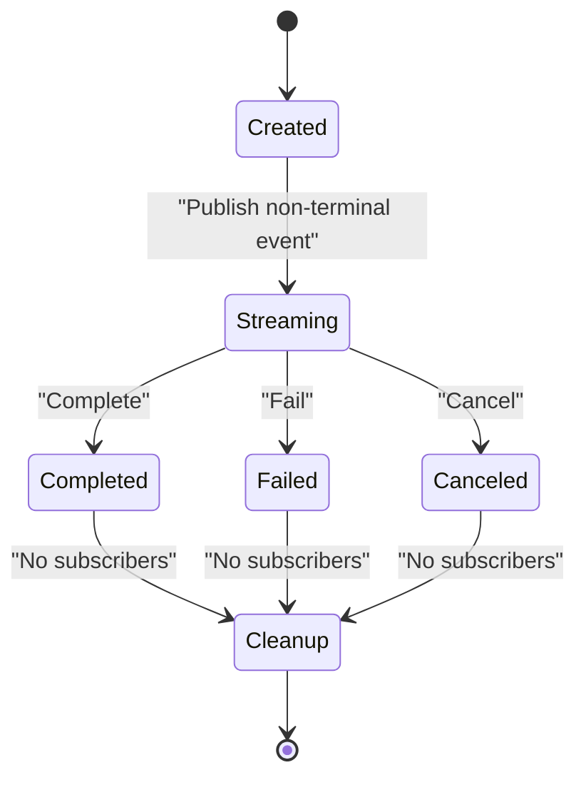

**Diagram sources**
- [broker.go:42-135](file://internal/backend/forwarder/broker.go#L42-L135)
- [broker.go:406-551](file://internal/backend/forwarder/broker.go#L406-L551)
- [service.go:539-653](file://internal/backend/forwarder/service.go#L539-L653)

**Section sources**
- [broker.go:42-135](file://internal/backend/forwarder/broker.go#L42-L135)
- [broker.go:181-257](file://internal/backend/forwarder/broker.go#L181-L257)
- [broker.go:406-551](file://internal/backend/forwarder/broker.go#L406-L551)
- [service.go:539-653](file://internal/backend/forwarder/service.go#L539-L653)

### Tool Calling and Execution Coordination
Tool calls originate from the model response and are represented by `ToolInvocation`. The runtime tracks:

- Call ID, tool name, arguments JSON.
- Reasoning content, signature, signature source, and provider metadata.
- Associated model call ID and provider identifiers.

The forwarder coordinates tool execution through:

- `PendingExec`: Tracks execution bridges such as read, write, shell stream, and background shell operations.
- `PendingInteraction`: Tracks interactive tools such as `AskQuestion` or plan creation.
- Background shell state, including PID, stdout/stderr buffers, await offsets, and recovery scheduling.
- Patch edit queues for file editing tools.
- MCP tool server mappings and workspace paths.

The runtime also exposes a whitelist of currently supported tools, including file operations, shell operations, search, planning, mode switching, web tools, task orchestration, and MCP tools.

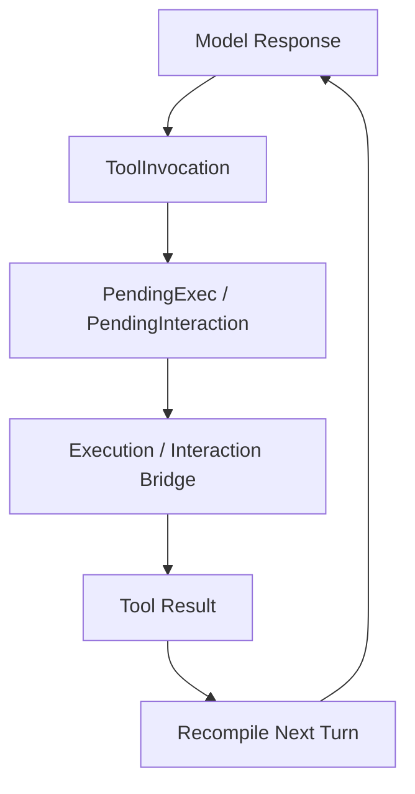

**Diagram sources**
- [core_types.go:337-365](file://internal/backend/agent/core/types.go#L337-L365)
- [core_types.go:239-311](file://internal/backend/agent/core/types.go#L239-L311)
- [types.go:140-216](file://internal/backend/forwarder/types.go#L140-L216)
- [core_types.go:410-427](file://internal/backend/agent/core/types.go#L410-L427)

**Section sources**
- [core_types.go:337-365](file://internal/backend/agent/core/types.go#L337-L365)
- [core_types.go:239-311](file://internal/backend/agent/core/types.go#L239-L311)
- [types.go:140-216](file://internal/backend/forwarder/types.go#L140-L216)
- [core_types.go:410-427](file://internal/backend/agent/core/types.go#L410-L427)

### Routing Between Cursor Clients and Upstream Providers
The model router resolves a requested model ID to a configured channel and then selects an adapter:

- If the resolved provider is `anthropic`, the Anthropic adapter handles streaming.
- If the resolved provider is `openai`, the OpenAI adapter handles streaming.
- Other providers return an unsupported provider error.

The router normalizes thinking effort, max tokens, custom headers, extra parameters, and endpoint overrides. It also sanitizes provider messages by removing replay-only placeholders, merging adjacent assistant tool-call messages, trimming dangling assistant tool calls, and removing trailing assistant prefill that some providers reject.

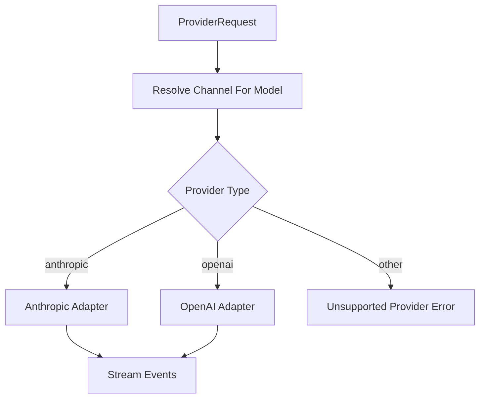

**Diagram sources**
- [router.go:37-135](file://internal/backend/agent/model/router.go#L37-L135)
- [router.go:137-161](file://internal/backend/agent/model/router.go#L137-L161)
- [router.go:363-420](file://internal/backend/agent/model/router.go#L363-L420)

**Section sources**
- [router.go:37-135](file://internal/backend/agent/model/router.go#L37-L135)
- [router.go:137-161](file://internal/backend/agent/model/router.go#L137-L161)
- [router.go:200-246](file://internal/backend/agent/model/router.go#L200-L246)
- [router.go:342-420](file://internal/backend/agent/model/router.go#L342-L420)

### Request Routing and Server Layer
The server layer defines routes, middleware chains, and protocol classes for HTTP, Connect unary, and Connect stream endpoints. While the Agent protocol primarily uses Connect-style bidirectional streaming, this routing abstraction allows the same application to expose HTTP handlers, mounted services, and Connect RPCs through a unified router.

Key responsibilities include:

- Registering routes with method, pattern, name, protocol, middleware, and local handler.
- Building middleware chains around route handlers.
- Wrapping response writers for tracking.
- Returning errors through a centralized error writer.

**Section sources**
- [route.go:10-27](file://internal/backend/server/route.go#L10-L27)
- [route.go:37-51](file://internal/backend/server/route.go#L37-L51)
- [route.go:68-129](file://internal/backend/server/route.go#L68-L129)
- [route.go:131-171](file://internal/backend/server/route.go#L131-L171)

## Enhanced Slash Command Processing

### Improved Skill Hijacking Prevention
The enhanced slash command processing introduces sophisticated skill hijacking prevention mechanisms that ensure Cursor's built-in commands don't accidentally trigger custom skills:

**Exact Name Matching**: The `detectInvokedSkill` function now performs exact case-insensitive matching between slash commands and skill names, preventing partial matches that could cause unintended skill loading.

**Built-in Command Protection**: Cursor's built-in commands like `/plan`, `/review`, `/test` are specifically protected from hijacking skills with similar names (e.g., `ak-plan`). This prevents accidental activation of custom skills when users invoke Cursor's native functionality.

**Prefix Preservation**: The system no longer strips or appends the `ak-` prefix when matching commands, ensuring that only exact skill name matches trigger skill loading.

**Enhanced Validation Logic**: The detection algorithm now validates both the command syntax and the skill naming conventions, providing robust protection against accidental skill hijacking while maintaining full compatibility with explicit skill invocations.

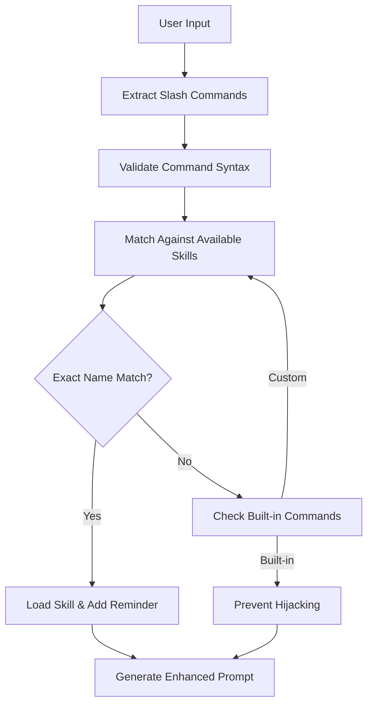

**Diagram sources**
- [engine.go:553-608](file://internal/backend/agent/prompt/engine.go#L553-L608)
- [engine_test.go:651-690](file://internal/backend/agent/prompt/engine_test.go#L651-L690)

### Enhanced Skill Detection Algorithm
The improved detection algorithm processes user input through multiple validation stages:

1. **Command Extraction**: Parses user text to extract all slash commands, stripping punctuation and normalizing case.
2. **Skill Name Derivation**: Converts skill file paths to normalized skill names, handling both `SKILL.md` files and direct file references.
3. **Exact Matching**: Performs strict case-insensitive comparison between extracted commands and derived skill names.
4. **Built-in Protection**: Specifically protects Cursor's built-in commands from triggering custom skills with similar names.

The system maintains backward compatibility by still supporting explicit skill invocations like `/ak-plan` while preventing accidental hijacking of built-in commands like `/plan`.

**Section sources**
- [engine.go:553-608](file://internal/backend/agent/prompt/engine.go#L553-L608)
- [engine_test.go:651-690](file://internal/backend/agent/prompt/engine_test.go#L651-L690)

## Advanced Multi-Tier Model Selection

### Sophisticated Model Resolution Chain
The advanced multi-tier model selection system provides intelligent model resolution for commit message generation and other secondary tasks through a prioritized chain of candidates:

**Priority-Based Resolution**: The system evaluates model candidates in a specific priority order:
1. **Explicit Configuration**: User-configured `commitMessageModel` takes highest priority
2. **Live Explorer Overrides**: Real-time subagent model overrides from the current session
3. **Persistent Explorer Hash**: Last saved explorer model hash for consistency across restarts
4. **Last Agent Model Hash**: Fallback to the most recent primary chat model
5. **Default Fallback**: System default resolver when no specific model is available

**Strict vs Flexible Resolution**: The system distinguishes between strict and flexible model resolution:
- **Strict Mode**: Requires the resolved channel ID to exactly match the stored hash (for persistent values)
- **Flexible Mode**: Allows any valid channel resolution (for dynamic/live values)

**Live Explorer Integration**: The system integrates with real-time subagent model overrides, capturing the explorer model ID that Task subagent routing would use, ensuring consistency between exploration and commit message generation.

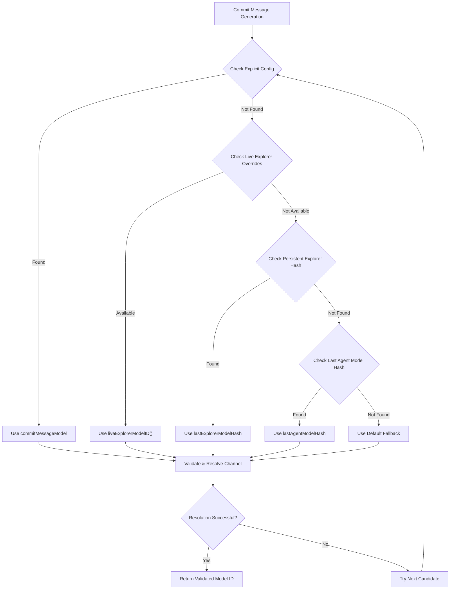

**Diagram sources**
- [commit_message.go:156-201](file://internal/backend/forwarder/commit_message.go#L156-L201)
- [service.go:2010-2022](file://internal/backend/forwarder/service.go#L2010-L2022)
- [service.go:2055-2064](file://internal/backend/forwarder/service.go#L2055-L2064)

### Explorer Model Override Management
The system includes sophisticated management of explorer model overrides:

**Real-Time Capture**: The `liveExplorerModelID()` function provides immediate access to the explorer model ID that would be used by Task subagent routing, ensuring consistency across different parts of the system.

**Override Persistence**: The `maybeCaptureExplorerModelHash()` function automatically captures and persists explorer model hashes when they change, providing stability across application restarts.

**Chain Consistency**: The `explorerSubagentOverrideModelID()` function ensures that the same lookup chain used by Task subagent routing (`explore` → `generalPurpose`) is applied consistently throughout the system.

**Error Handling**: The system gracefully handles missing or invalid overrides, falling back to previous candidates or default behavior without breaking the overall workflow.

**Section sources**
- [commit_message.go:156-201](file://internal/backend/forwarder/commit_message.go#L156-L201)
- [service.go:2010-2022](file://internal/backend/forwarder/service.go#L2010-L2022)
- [service.go:2025-2053](file://internal/backend/forwarder/service.go#L2025-L2053)
- [service.go:2055-2064](file://internal/backend/forwarder/service.go#L2055-L2064)

## Enhanced MCP Integration

### Schema Discovery and Lazy Loading
The enhanced MCP integration introduces sophisticated schema discovery mechanisms that improve tool reliability and reduce token usage:

**Schema Budget Management**: The system implements tiered budget limits for MCP tool schemas:
- Full schema budget: 1200 bytes for inline schema embedding
- Slim schema budget: 600 bytes for type/required-only schemas
- Healing budget: 4096 bytes for error recovery schema injection

**Lazy Loading Strategy**: When schemas exceed budget limits, the system falls back to lazy loading via `definition_path`, allowing models to access full schemas on-demand rather than embedding them in every prompt.

**Automatic Schema Hydration**: The `hydrateLocalMCPDescriptors` function automatically enriches MCP tool descriptors by reading definition files and compacting schemas, providing both descriptions and parameter schemas where available.

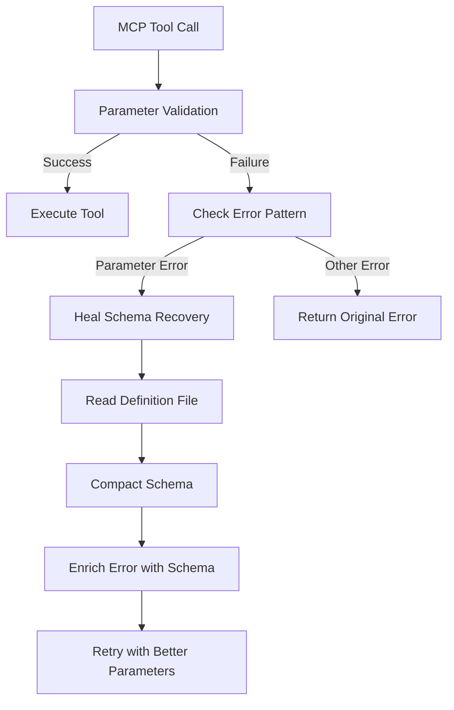

**Diagram sources**
- [mcp_schema_heal.go:35-62](file://internal/backend/forwarder/mcp_schema_heal.go#L35-L62)
- [local_discovery.go:659-723](file://internal/backend/agent/prompt/local_discovery.go#L659-L723)

### Error Recovery Mechanisms
The MCP schema healing system provides robust error recovery for parameter validation failures:

**Error Pattern Detection**: The system recognizes common MCP parameter validation error patterns including "invalid parameters", "is required", "missing required", "unknown parameter", and "validation error".

**Schema Injection**: When parameter validation fails, the system automatically reads the full tool definition file and injects the complete parameter schema into the error response, enabling the model to correct its arguments and retry successfully.

**Path Resolution**: The `resolveMCPToolDefinitionPath` function intelligently resolves tool definition paths using multiple candidate strategies, including canonical lookup names, server/tool combinations, and direct tool names.

**Caching Strategy**: Schema reads are cached with file modification time checks to avoid redundant disk I/O while maintaining freshness when definition files change.

### Improved Tool Definition Path Tracking
The enhanced path tracking system maintains comprehensive mappings between tool identifiers and their definition file locations:

**Multi-Key Mapping**: Tool definition paths are tracked under multiple keys to support different naming conventions:
- Direct tool names
- Canonical server-tool combinations (e.g., "server-name")
- Provider identifier combinations

**Automatic Path Construction**: When explicit definition paths are not provided, the system automatically constructs paths using the folder structure convention (`<folder>/tools/<tool>.json`).

**Context Collection**: The `collectMCPToolDefinitionPaths` function aggregates definition paths from both file system MCP descriptors and meta tool options, creating a comprehensive lookup table for error recovery.

### Enhanced Prompt Generation
The prompt engine now generates more informative MCP context sections:

**Embedded Schema Guidance**: MCP file system sections now include embedded tool descriptors with compact input schemas, providing models with parameter names, types, and required fields directly in the prompt.

**Fallback Descriptions**: Specialized fallback descriptions are provided for known tools like fast-context search, ensuring models have useful guidance even when descriptor information is incomplete.

**Meta Tool Support**: Modern Cursor clients receive `<mcp_meta_tools>` sections with server and tool descriptors, allowing direct `CallMcpTool` usage without requiring separate tool discovery calls.

**Definition Path References**: All MCP tool references now include `definition_path` elements, enabling models to access full schemas when needed for complex parameter validation scenarios.

**Section sources**
- [mcp_schema_heal.go:17-62](file://internal/backend/forwarder/mcp_schema_heal.go#L17-L62)
- [mcp_schema_heal.go:64-102](file://internal/backend/forwarder/mcp_schema_heal.go#L64-L102)
- [mcp_schema_heal.go:114-174](file://internal/backend/forwarder/mcp_schema_heal.go#L114-L174)
- [local_discovery.go:650-723](file://internal/backend/agent/prompt/local_discovery.go#L650-L723)
- [local_discovery.go:757-805](file://internal/backend/agent/prompt/local_discovery.go#L757-L805)
- [request_context.go:379-427](file://internal/backend/forwarder/request_context.go#L379-L427)
- [engine.go:633-701](file://internal/backend/agent/prompt/engine.go#L633-L701)
- [engine.go:740-829](file://internal/backend/agent/prompt/engine.go#L740-L829)

## Dependency Analysis
The following diagram shows the primary dependencies between Agent protocol components:

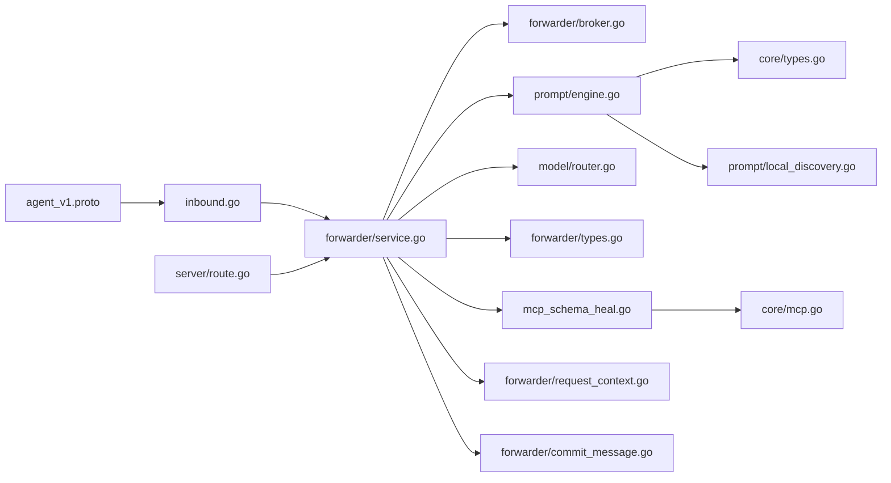

**Diagram sources**
- [agent_v1.proto:56-139](file://proto/agent_v1.proto#L56-L139)
- [inbound.go:38-96](file://internal/backend/agent/protocol/inbound.go#L38-L96)
- [service.go:290-353](file://internal/backend/forwarder/service.go#L290-L353)
- [broker.go:20-40](file://internal/backend/forwarder/broker.go#L20-L40)
- [engine.go:166-178](file://internal/backend/agent/prompt/engine.go#L166-L178)
- [router.go:13-35](file://internal/backend/agent/model/router.go#L13-L35)
- [core_types.go:76-125](file://internal/backend/agent/core/types.go#L76-L125)
- [types.go:140-216](file://internal/backend/forwarder/types.go#L140-L216)
- [route.go:37-51](file://internal/backend/server/route.go#L37-L51)
- [mcp_schema_heal.go:1-174](file://internal/backend/forwarder/mcp_schema_heal.go#L1-L174)
- [mcp.go:1-111](file://internal/backend/agent/core/mcp.go#L1-L111)
- [local_discovery.go:650-805](file://internal/backend/agent/prompt/local_discovery.go#L650-L805)
- [request_context.go:379-427](file://internal/backend/forwarder/request_context.go#L379-L427)
- [commit_message.go:156-201](file://internal/backend/forwarder/commit_message.go#L156-L201)

**Section sources**
- [inbound.go:38-96](file://internal/backend/agent/protocol/inbound.go#L38-L96)
- [service.go:290-353](file://internal/backend/forwarder/service.go#L290-L353)
- [broker.go:20-40](file://internal/backend/forwarder/broker.go#L20-L40)
- [engine.go:166-178](file://internal/backend/agent/prompt/engine.go#L166-L178)
- [router.go:13-35](file://internal/backend/agent/model/router.go#L13-L35)
- [core_types.go:76-125](file://internal/backend/agent/core/types.go#L76-L125)
- [types.go:140-216](file://internal/backend/forwarder/types.go#L140-L216)
- [route.go:37-51](file://internal/backend/server/route.go#L37-L51)

## Performance Considerations
Several mechanisms in the codebase are designed to keep streaming responsive and resource usage bounded:

| Area | Mechanism | Impact |
|---|---|---|
| SSE backlog | Fixed backlog limit with base cursor and acknowledged trimming | Prevents unbounded memory growth when consumers fall behind. |
| Heartbeats | Periodic heartbeat messages when no backlog exists | Keeps long-running connections alive and visible to clients. |
| Orphan cancel grace period | Schedules cancellation only after checking for reconnects | Reduces false-positive cancellations caused by brief client disconnects. |
| Terminal cleanup | Scheduled cleanup removes terminal streams after retention period | Reclaims memory for completed or canceled runs. |
| Provider message sanitization | Removes placeholders, merges adjacent tool calls, trims dangling calls and prefill | Reduces provider rejection risk and avoids unnecessary token usage. |
| Thinking effort normalization | Maps runtime thinking effort to provider-specific reasoning effort | Avoids sending unsupported or conflicting reasoning parameters. |
| Supported tool whitelist | Limits exposed tools to implemented runtime capabilities | Prevents model calls from invoking unhandled tools and failing entire runs. |
| MCP schema caching | File modification time-based caching for schema reads | Reduces disk I/O while maintaining schema freshness. |
| Schema budget limits | Tiered budgets for inline vs lazy-loaded schemas | Balances prompt size with schema completeness. |
| Path resolution optimization | Multi-key lookup with canonical name support | Improves tool definition path resolution performance. |
| Skill hijacking prevention | Exact name matching and built-in command protection | Prevents accidental skill loading and reduces unnecessary processing. |
| Multi-tier model selection | Prioritized candidate evaluation with strict/flexible resolution | Optimizes model resolution performance while maintaining accuracy. |

Streaming performance depends heavily on:

- How quickly the prompt compiler produces messages and tools.
- How efficiently the provider adapter emits incremental events.
- How fast the forwarder translates provider events into `AgentServerMessage`.
- Whether the client consumes the SSE stream without falling too far behind the backlog.
- How effectively the MCP schema healing reduces retry loops through better parameter guidance.
- How efficiently the skill hijacking prevention avoids unnecessary skill loading.
- How effectively the multi-tier model selection minimizes resolution attempts.

Concurrent tool execution is coordinated through pending execution and interaction state. Long-running tools such as shell streams should use background shell handling and await semantics to avoid blocking the main streaming loop.

**Section sources**
- [broker.go:15-18](file://internal/backend/forwarder/broker.go#L15-L18)
- [broker.go:406-459](file://internal/backend/forwarder/broker.go#L406-L459)
- [broker.go:519-551](file://internal/backend/forwarder/broker.go#L519-L551)
- [router.go:137-161](file://internal/backend/agent/model/router.go#L137-L161)
- [router.go:363-420](file://internal/backend/agent/model/router.go#L363-L420)
- [router.go:422-444](file://internal/backend/agent/model/router.go#L422-L444)
- [core_types.go:410-427](file://internal/backend/agent/core/types.go#L410-L427)
- [mcp_schema_heal.go:104-144](file://internal/backend/forwarder/mcp_schema_heal.go#L104-L144)
- [local_discovery.go:650-723](file://internal/backend/agent/prompt/local_discovery.go#L650-L723)
- [engine.go:553-608](file://internal/backend/agent/prompt/engine.go#L553-L608)
- [commit_message.go:156-201](file://internal/backend/forwarder/commit_message.go#L156-L201)

## Troubleshooting Guide
Common issues and their likely locations:

| Symptom | Likely Cause | Where to Inspect |
|---|---|---|
| `request_id is required` | Missing or blank request ID in `BidiAppend` or `RunSSE`. | [service.go:370-377](file://internal/backend/forwarder/service.go#L370-L377), [service.go:544-547](file://internal/backend/forwarder/service.go#L544-L547) |
| Invalid hex payload | Cursor client sent malformed binary data. | [inbound.go:38-53](file://internal/backend/agent/protocol/inbound.go#L38-L53) |
| Unsupported client message kind | New or unexpected `AgentClientMessage` branch. | [inbound.go:55-96](file://internal/backend/agent/protocol/inbound.go#L55-L96) |
| Unsupported active mode | Explicit mode not in supported set. | [types.go:494-513](file://internal/backend/forwarder/types.go#L494-L513) |
| No available channel for model | Model ID not mapped to a configured channel. | [router.go:42-48](file://internal/backend/agent/model/router.go#L42-L48) |
| Unsupported provider | Channel resolved to a provider other than OpenAI or Anthropic. | [router.go:127-134](file://internal/backend/agent/model/router.go#L127-L134) |
| SSE connection drops but provider still running | Client disconnected; orphan cancel grace period applies. | [service.go:555-568](file://internal/backend/forwarder/service.go#L555-L568) |
| Tool call never completes | Missing tool result, broken execution bridge, or unsupported tool. | [core_types.go:337-365](file://internal/backend/agent/core/types.go#L337-L365), [core_types.go:410-427](file://internal/backend/agent/core/types.go#L410-L427) |
| MCP tools not visible | MCP descriptors missing or disabled in request context. | [engine.go:633-701](file://internal/backend/agent/prompt/engine.go#L633-L701), [engine.go:740-800](file://internal/backend/agent/prompt/engine.go#L740-L800) |
| Skills not invoked | Slash command not matched or skill not listed in request context. | [engine.go:496-537](file://internal/backend/agent/prompt/engine.go#L496-L537), [engine.go:553-606](file://internal/backend/agent/prompt/engine.go#L553-L606) |
| MCP parameter validation errors | Missing or incorrect tool parameters. | [mcp_schema_heal.go:35-62](file://internal/backend/forwarder/mcp_schema_heal.go#L35-L62) |
| MCP schema not found | Definition path resolution failed or file missing. | [mcp_schema_heal.go:64-102](file://internal/backend/forwarder/mcp_schema_heal.go#L64-L102), [local_discovery.go:659-697](file://internal/backend/agent/prompt/local_discovery.go#L659-L697) |
| Excessive MCP schema size | Schema exceeds budget limits, triggering lazy loading. | [local_discovery.go:650-723](file://internal/backend/agent/prompt/local_discovery.go#L650-L723) |
| Skill hijacking detected | Similar-named built-in command triggered custom skill. | [engine.go:553-608](file://internal/backend/agent/prompt/engine.go#L553-L608), [engine_test.go:651-690](file://internal/backend/agent/prompt/engine_test.go#L651-L690) |
| Commit message uses wrong model | Model resolution chain failed or overrides not properly configured. | [commit_message.go:156-201](file://internal/backend/forwarder/commit_message.go#L156-L201), [service.go:2010-2022](file://internal/backend/forwarder/service.go#L2010-L2022) |
| Explorer model override not persisting | Subagent override capture failed or storage issue. | [service.go:2025-2053](file://internal/backend/forwarder/service.go#L2025-L2053) |

Debug logging is present throughout the forwarder and broker layers. When diagnosing Agent protocol problems, inspect:

- Raw bidi payload logs.
- Decoded client kind and intent logs.
- Subagent model override parsing results.
- SSE subscribe/unsubscribe and heartbeat logs.
- Terminal event codes and messages.
- MCP schema healing attempts and success rates.
- Tool definition path resolution results.
- Skill hijacking prevention logs.
- Multi-tier model selection candidate evaluation.

**Section sources**
- [service.go:370-448](file://internal/backend/forwarder/service.go#L370-L448)
- [service.go:539-653](file://internal/backend/forwarder/service.go#L539-L653)
- [inbound.go:38-96](file://internal/backend/agent/protocol/inbound.go#L38-L96)
- [types.go:494-513](file://internal/backend/forwarder/types.go#L494-L513)
- [router.go:42-48](file://internal/backend/agent/model/router.go#L42-L48)
- [router.go:127-134](file://internal/backend/agent/model/router.go#L127-L134)
- [engine.go:496-537](file://internal/backend/agent/prompt/engine.go#L496-L537)
- [engine.go:633-701](file://internal/backend/agent/prompt/engine.go#L633-L701)
- [engine.go:740-800](file://internal/backend/agent/prompt/engine.go#L740-L800)
- [mcp_schema_heal.go:35-102](file://internal/backend/forwarder/mcp_schema_heal.go#L35-L102)
- [local_discovery.go:659-723](file://internal/backend/agent/prompt/local_discovery.go#L659-L723)
- [engine.go:553-608](file://internal/backend/agent/prompt/engine.go#L553-L608)
- [engine_test.go:651-690](file://internal/backend/agent/prompt/engine_test.go#L651-L690)
- [commit_message.go:156-201](file://internal/backend/forwarder/commit_message.go#L156-L201)
- [service.go:2010-2053](file://internal/backend/forwarder/service.go#L2010-L2053)

## Conclusion
cursor-byok's Agent protocol implementation provides a robust bridge between Cursor's native Agent wire format and upstream model providers. It preserves Cursor's tool calling, Skills, MCP, and multi-turn conversation semantics by:

- Decoding Cursor's `AgentClientMessage` into typed protobuf structures.
- Mapping client actions to internal runtime commands.
- Compiling mode-aware prompts with tools, skills, MCP descriptors, and request context.
- Selecting OpenAI or Anthropic adapters through a configurable channel resolver.
- Coordinating tool execution through pending execution and interaction state.
- Publishing structured `AgentServerMessage` events through a buffered, cursor-aware stream broker.
- Supporting heartbeats, cancellation, terminal errors, and cleanup to maintain stable long-lived Agent sessions.

The enhanced slash command processing significantly improves reliability through intelligent skill hijacking prevention, ensuring that Cursor's built-in commands don't accidentally trigger custom skills while maintaining full compatibility with explicit skill invocations.

The advanced multi-tier model selection system provides sophisticated model resolution for commit message generation and other secondary tasks, offering a prioritized chain of candidates with both live and persistent fallbacks, ensuring consistent model selection across different parts of the system.

The enhanced MCP integration significantly improves reliability through intelligent schema discovery, automatic error recovery, and efficient path tracking. These improvements enable more robust tool execution with better parameter validation, reduced retry loops, and improved model guidance for complex MCP tool interactions.

This architecture allows users to bring their own model APIs while keeping Cursor's full Agent experience intact, with enhanced MCP support, improved skill management, and sophisticated model selection providing better tool discovery, parameter validation, error recovery, and consistent model resolution capabilities.