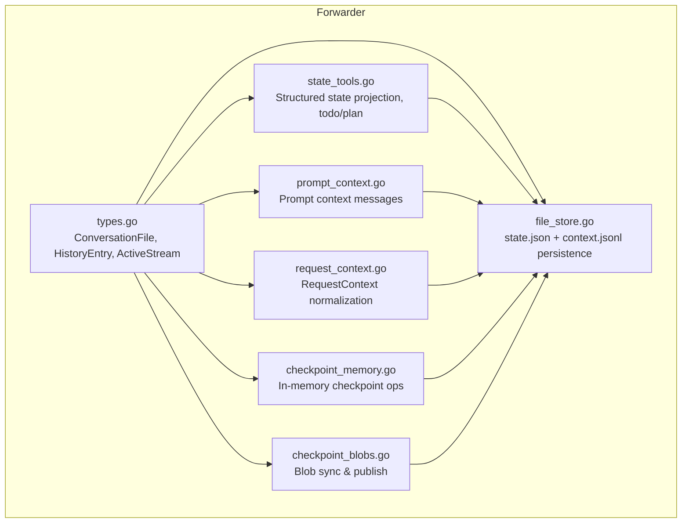
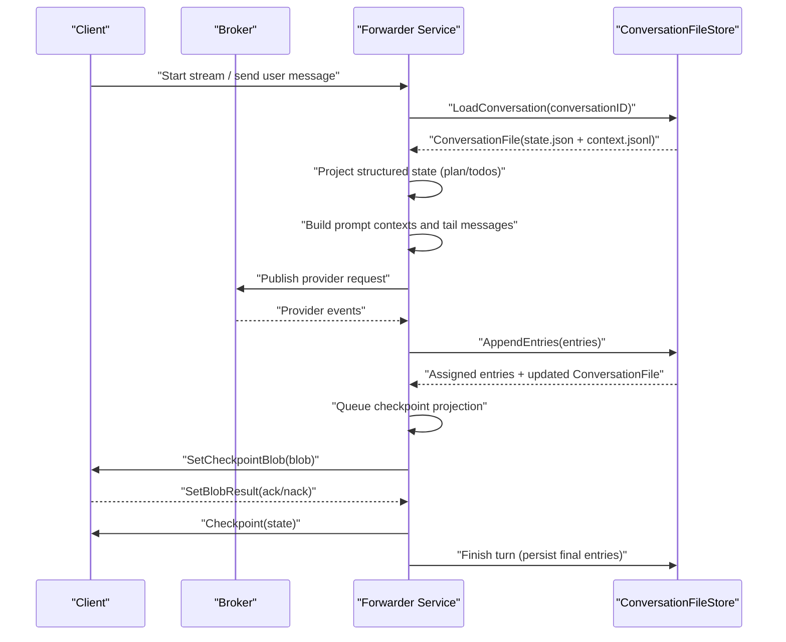
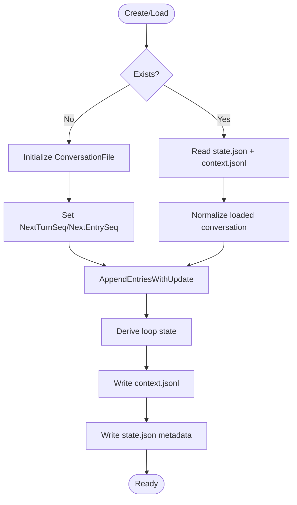
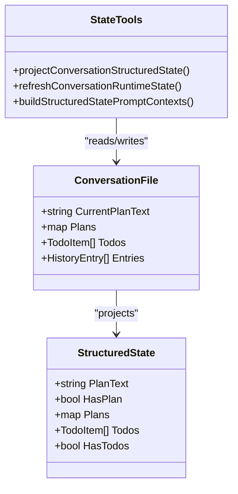
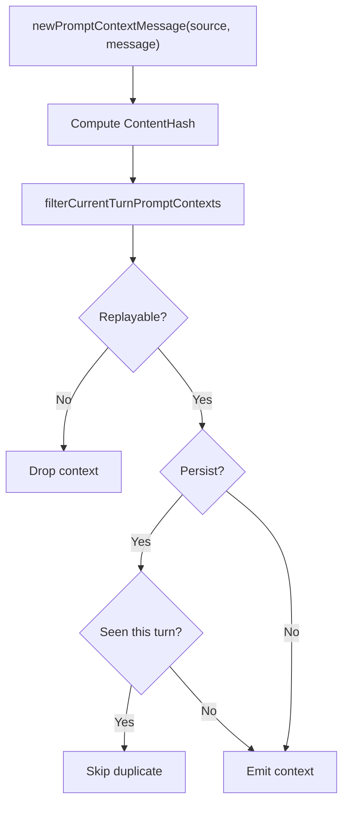
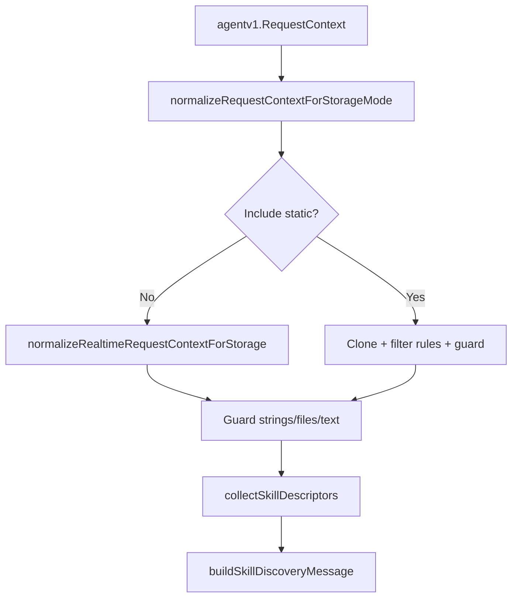
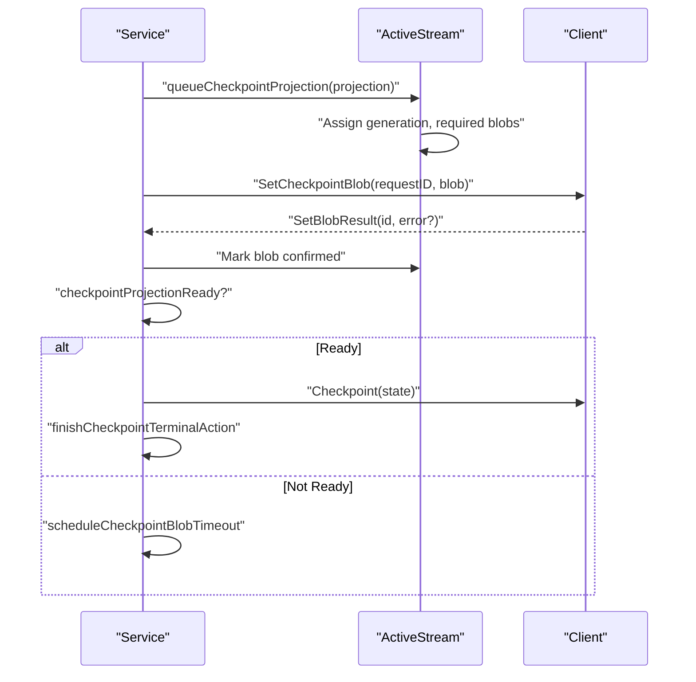
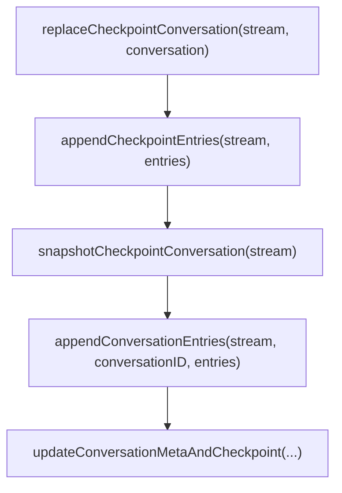
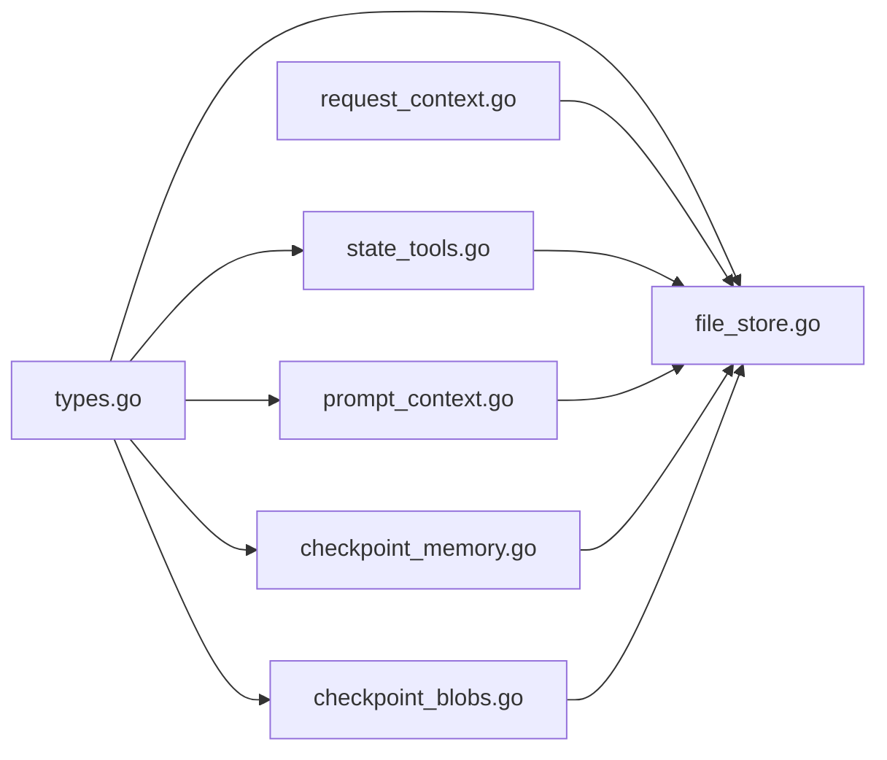

# Conversation State Management

<cite>
**Referenced Files in This Document**
- [types.go](file://internal/backend/forwarder/types.go)
- [state_loaders.go](file://internal/backend/forwarder/state_loaders.go)
- [state_tools.go](file://internal/backend/forwarder/state_tools.go)
- [prompt_context.go](file://internal/backend/forwarder/prompt_context.go)
- [request_context.go](file://internal/backend/forwarder/request_context.go)
- [checkpoint_blobs.go](file://internal/backend/forwarder/checkpoint_blobs.go)
- [checkpoint_memory.go](file://internal/backend/forwarder/checkpoint_memory.go)
- [file_store.go](file://internal/backend/forwarder/file_store.go)
</cite>

## Table of Contents
1. [Introduction](#introduction)
2. [Project Structure](#project-structure)
3. [Core Components](#core-components)
4. [Architecture Overview](#architecture-overview)
5. [Detailed Component Analysis](#detailed-component-analysis)
6. [Dependency Analysis](#dependency-analysis)
7. [Performance Considerations](#performance-considerations)
8. [Troubleshooting Guide](#troubleshooting-guide)
9. [Conclusion](#conclusion)

## Introduction
This document explains how conversation state is managed across multiple turns and interactions in the Agent protocol. It covers:
- How conversation context, history, and metadata are maintained
- The conversation lifecycle from creation to completion
- Persistence mechanisms for state and history
- Checkpointing, serialization, and recovery procedures
- Multi-turn handling, context window management, and memory optimization
- Concurrent access control, versioning, and migration strategies

## Project Structure
The conversation state system is implemented primarily under the forwarder package with clear separation between:
- Core data models and runtime structures
- Context projection and prompt assembly
- Persistent storage (state.json and context.jsonl)
- Checkpointing and blob synchronization
- Request context normalization and skill discovery

**Diagram sources**
- [types.go:18-103](file://internal/backend/forwarder/types.go#L18-L103)
- [state_tools.go:28-139](file://internal/backend/forwarder/state_tools.go#L28-L139)
- [prompt_context.go:14-132](file://internal/backend/forwarder/prompt_context.go#L14-L132)
- [request_context.go:13-87](file://internal/backend/forwarder/request_context.go#L13-L87)
- [file_store.go:61-87](file://internal/backend/forwarder/file_store.go#L61-L87)
- [checkpoint_blobs.go:42-147](file://internal/backend/forwarder/checkpoint_blobs.go#L42-L147)
- [checkpoint_memory.go:11-68](file://internal/backend/forwarder/checkpoint_memory.go#L11-L68)

**Section sources**
- [types.go:18-103](file://internal/backend/forwarder/types.go#L18-L103)
- [file_store.go:61-87](file://internal/backend/forwarder/file_store.go#L61-L87)

## Core Components
- ConversationFile: Represents a conversation’s metadata, pointers to current plan/todos, loop state, token usage, and an append-only list of HistoryEntry records.
- HistoryEntry: A single immutable event in the conversation timeline with sequence numbers, turn boundaries, roles, kinds, payloads, and timestamps.
- ActiveStream: In-memory runtime state for a live interaction, including pending compaction, checkpoint coordination, tool call tracking, and background shells.
- ConversationFileStore: Persists two facts per conversation:
  - state.json: Metadata and high-level runtime state
  - context.jsonl: Append-only JSON Lines history of entries

Key responsibilities:
- Maintain consistent next sequence counters and context versions
- Normalize and project structured state (plans, todos) from history
- Build prompt contexts and tail messages for model requests
- Persist and recover conversations atomically with file locks and atomic writes
- Coordinate client-side checkpoint blobs and publish ready checkpoints

**Section sources**
- [types.go:18-103](file://internal/backend/forwarder/types.go#L18-L103)
- [types.go:141-218](file://internal/backend/forwarder/types.go#L141-L218)
- [file_store.go:61-87](file://internal/backend/forwarder/file_store.go#L61-L87)

## Architecture Overview
The system separates in-memory runtime state from durable state:
- In-memory: ActiveStream holds transient execution state and coordinates compaction and checkpointing.
- Durable: ConversationFileStore manages state.json and context.jsonl with locking and caching.
- Projection: Structured state (plans, todos) is derived from history entries and refreshed into ConversationFile fields.
- Prompt assembly: Prompt contexts and tail messages are built from structured state and request context.
- Checkpointing: Client-server blob synchronization ensures large state snapshots are safely persisted before completing a turn.

**Diagram sources**
- [file_store.go:195-260](file://internal/backend/forwarder/file_store.go#L195-L260)
- [state_tools.go:36-139](file://internal/backend/forwarder/state_tools.go#L36-L139)
- [prompt_context.go:40-132](file://internal/backend/forwarder/prompt_context.go#L40-L132)
- [checkpoint_blobs.go:42-147](file://internal/backend/forwarder/checkpoint_blobs.go#L42-L147)

## Detailed Component Analysis

### Conversation Data Model and Lifecycle
- Creation: Initialize ConversationFile with schema version, IDs, mode, timestamps, and empty entries.
- Loading: Read state.json; load context.jsonl or legacy context.json; compute context version; normalize loaded data.
- Appending: Assign sequence numbers, update next counters, derive loop state, persist context.jsonl, then write state.json metadata.
- Replacement: Replace entire context.jsonl and reset sequences for compaction or rewind scenarios.
- Summary and listing: Provide lightweight summaries and enumerate conversation directories.

**Diagram sources**
- [file_store.go:150-193](file://internal/backend/forwarder/file_store.go#L150-L193)
- [file_store.go:195-260](file://internal/backend/forwarder/file_store.go#L195-L260)
- [file_store.go:348-395](file://internal/backend/forwarder/file_store.go#L348-L395)
- [file_store.go:570-694](file://internal/backend/forwarder/file_store.go#L570-L694)

**Section sources**
- [file_store.go:150-193](file://internal/backend/forwarder/file_store.go#L150-L193)
- [file_store.go:195-260](file://internal/backend/forwarder/file_store.go#L195-L260)
- [file_store.go:348-395](file://internal/backend/forwarder/file_store.go#L348-L395)
- [file_store.go:570-694](file://internal/backend/forwarder/file_store.go#L570-L694)

### Structured State Projection (Plans and Todos)
- Projection scans history entries to extract runtime_state and tool_result entries related to plans and todos.
- Normalizes and merges todo items, enforcing required fields and status semantics.
- Refreshes ConversationFile.CurrentPlanText, CurrentPlans, and CurrentTodos based on latest projections.
- Builds prompt contexts that inject current plan and todo list into the model prompt.

**Diagram sources**
- [state_tools.go:28-139](file://internal/backend/forwarder/state_tools.go#L28-L139)
- [state_tools.go:141-175](file://internal/backend/forwarder/state_tools.go#L141-L175)

**Section sources**
- [state_tools.go:28-139](file://internal/backend/forwarder/state_tools.go#L28-L139)
- [state_tools.go:141-175](file://internal/backend/forwarder/state_tools.go#L141-L175)

### Prompt Context Management
- PromptContextMessage carries source, normalized message, content hash, and persistence flag.
- Deduplicates persistent prompt contexts within the current turn using content hashes and keys.
- Filters non-replayable contexts and enforces role/content constraints.
- Emits prompt_context entries into history when needed.

**Diagram sources**
- [prompt_context.go:14-38](file://internal/backend/forwarder/prompt_context.go#L14-L38)
- [prompt_context.go:40-132](file://internal/backend/forwarder/prompt_context.go#L40-L132)

**Section sources**
- [prompt_context.go:14-38](file://internal/backend/forwarder/prompt_context.go#L14-L38)
- [prompt_context.go:40-132](file://internal/backend/forwarder/prompt_context.go#L40-L132)

### RequestContext Normalization and Skill Discovery
- Normalizes RequestContext for storage, separating static and realtime components.
- Collects and deduplicates skill descriptors from agent skills and cursor rules.
- Guards text sizes and file contents to prevent oversized prompts.
- Builds skill discovery messages and maps MCP tool servers and definitions.

**Diagram sources**
- [request_context.go:13-87](file://internal/backend/forwarder/request_context.go#L13-L87)
- [request_context.go:119-162](file://internal/backend/forwarder/request_context.go#L119-L162)
- [request_context.go:300-328](file://internal/backend/forwarder/request_context.go#L300-L328)

**Section sources**
- [request_context.go:13-87](file://internal/backend/forwarder/request_context.go#L13-L87)
- [request_context.go:119-162](file://internal/backend/forwarder/request_context.go#L119-L162)
- [request_context.go:300-328](file://internal/backend/forwarder/request_context.go#L300-L328)

### Checkpointing and Blob Synchronization
- Queues a checkpoint projection with a generation counter and required blob set.
- Dispatches SetCheckpointBlob messages to the client and tracks acknowledgements.
- Publishes a ready checkpoint once all required blobs are confirmed.
- Handles timeouts and failures, falling back to terminal actions if necessary.

**Diagram sources**
- [checkpoint_blobs.go:42-147](file://internal/backend/forwarder/checkpoint_blobs.go#L42-L147)
- [checkpoint_blobs.go:169-293](file://internal/backend/forwarder/checkpoint_blobs.go#L169-L293)
- [checkpoint_blobs.go:295-363](file://internal/backend/forwarder/checkpoint_blobs.go#L295-L363)

**Section sources**
- [checkpoint_blobs.go:42-147](file://internal/backend/forwarder/checkpoint_blobs.go#L42-L147)
- [checkpoint_blobs.go:169-293](file://internal/backend/forwarder/checkpoint_blobs.go#L169-L293)
- [checkpoint_blobs.go:295-363](file://internal/backend/forwarder/checkpoint_blobs.go#L295-L363)

### In-Memory Checkpoint Operations
- Initializes a checkpoint conversation snapshot for the active stream.
- Appends entries to the in-memory checkpoint and persists assigned entries via store.
- Snapshots pending executions and interactions alongside the conversation for recovery.
- Updates conversation metadata and synchronizes with the store.

**Diagram sources**
- [checkpoint_memory.go:11-68](file://internal/backend/forwarder/checkpoint_memory.go#L11-L68)
- [checkpoint_memory.go:70-147](file://internal/backend/forwarder/checkpoint_memory.go#L70-L147)

**Section sources**
- [checkpoint_memory.go:11-68](file://internal/backend/forwarder/checkpoint_memory.go#L11-L68)
- [checkpoint_memory.go:70-147](file://internal/backend/forwarder/checkpoint_memory.go#L70-L147)

### State Loaders and Token Usage
- Loads the latest summary state (conversation) from the store.
- Retrieves auto-compaction prompt tokens or token details used tokens for context window management.

**Section sources**
- [state_loaders.go:7-36](file://internal/backend/forwarder/state_loaders.go#L7-L36)

## Dependency Analysis
- types.go defines core data structures consumed by other modules.
- state_tools.go depends on types and protobuf-generated agentv1 types to project structured state.
- prompt_context.go depends on modeladapter.Message and types for context hashing and filtering.
- request_context.go normalizes agentv1.RequestContext and builds skill discovery messages.
- file_store.go orchestrates persistence and interacts with all above components through ConversationFile and HistoryEntry.
- checkpoint_blobs.go and checkpoint_memory.go coordinate with ActiveStream and ConversationFile for safe completion.

**Diagram sources**
- [types.go:18-103](file://internal/backend/forwarder/types.go#L18-L103)
- [state_tools.go:28-139](file://internal/backend/forwarder/state_tools.go#L28-L139)
- [prompt_context.go:14-132](file://internal/backend/forwarder/prompt_context.go#L14-L132)
- [request_context.go:13-87](file://internal/backend/forwarder/request_context.go#L13-L87)
- [file_store.go:61-87](file://internal/backend/forwarder/file_store.go#L61-L87)
- [checkpoint_memory.go:11-68](file://internal/backend/forwarder/checkpoint_memory.go#L11-L68)
- [checkpoint_blobs.go:42-147](file://internal/backend/forwarder/checkpoint_blobs.go#L42-L147)

**Section sources**
- [types.go:18-103](file://internal/backend/forwarder/types.go#L18-L103)
- [file_store.go:61-87](file://internal/backend/forwarder/file_store.go#L61-L87)

## Performance Considerations
- Append-only context.jsonl reduces lock contention and enables efficient streaming writes.
- In-memory cache of entries keyed by context version avoids repeated disk reads.
- Atomic writes and rename-based updates ensure durability without partial states.
- Prompt context hashing prevents redundant context duplication within a turn.
- Skill descriptor deduplication minimizes prompt size and parsing overhead.
- Checkpoint blob batching and timeout handling reduce network round-trips and detect stalled syncs.

[No sources needed since this section provides general guidance]

## Troubleshooting Guide
Common issues and diagnostics:
- Missing or stale conversation files: Ensure state.json exists and context.jsonl is readable; verify directory permissions and process locks.
- Duplicate prompt contexts: Check content hash computation and current turn key collection logic.
- Todo merge errors: Validate required fields (id, content) and status values; use merge=true for incremental updates.
- Checkpoint blob timeouts: Inspect pending blob counts and missing blob IDs; confirm client acknowledges SetCheckpointBlob responses.
- Context version mismatch: Verify contextVersionForEntries and cache invalidation after writes.

Operational checks:
- Use GetConversationSummary to validate entry counts and sequence numbers.
- Review logs emitted during checkpoint blob dispatch, ack/reject, and publish phases.
- Confirm that writeConversationMetaLocked refreshes runtime state and updates context version.

**Section sources**
- [prompt_context.go:40-132](file://internal/backend/forwarder/prompt_context.go#L40-L132)
- [state_tools.go:518-621](file://internal/backend/forwarder/state_tools.go#L518-L621)
- [checkpoint_blobs.go:169-293](file://internal/backend/forwarder/checkpoint_blobs.go#L169-L293)
- [file_store.go:672-694](file://internal/backend/forwarder/file_store.go#L672-L694)

## Conclusion
The Agent protocol’s conversation state management combines robust in-memory runtime state with durable, append-only history and atomic metadata updates. Structured state projection keeps plans and todos synchronized with history, while prompt context hashing and skill discovery optimize context windows. Checkpointing with blob synchronization ensures reliable multi-turn completion, and file locking plus atomic writes provide strong consistency. Together, these mechanisms support scalable, concurrent, and recoverable conversations across long-running interactions.

[No sources needed since this section summarizes without analyzing specific files]