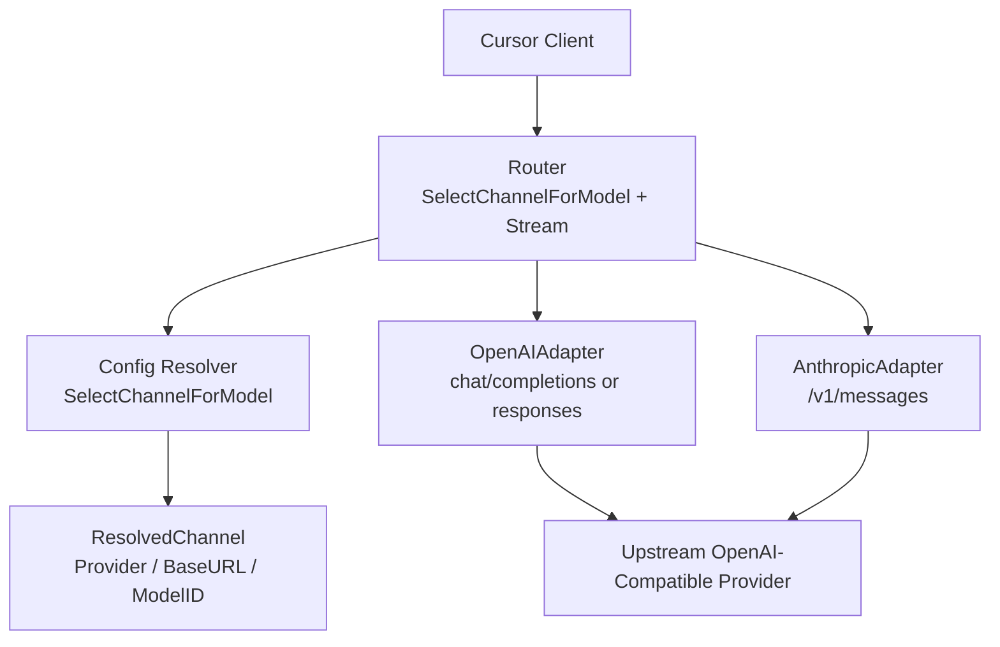
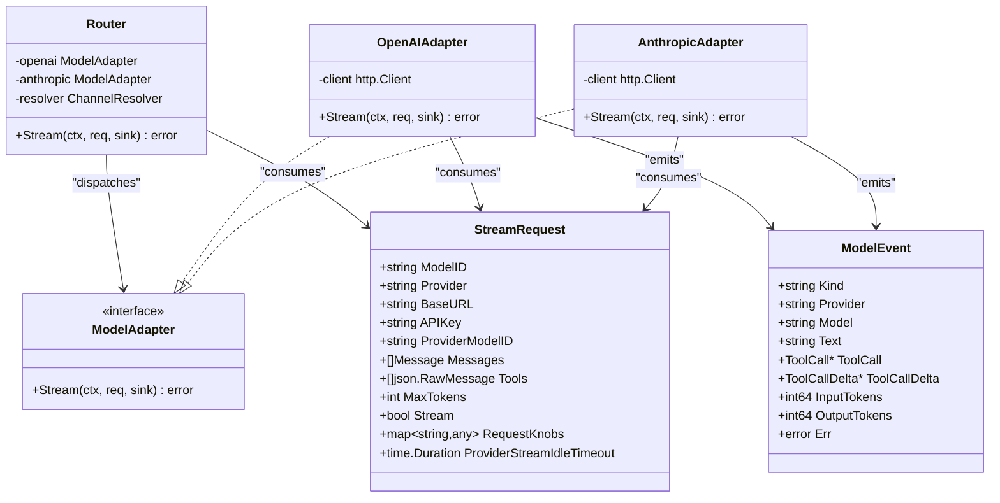
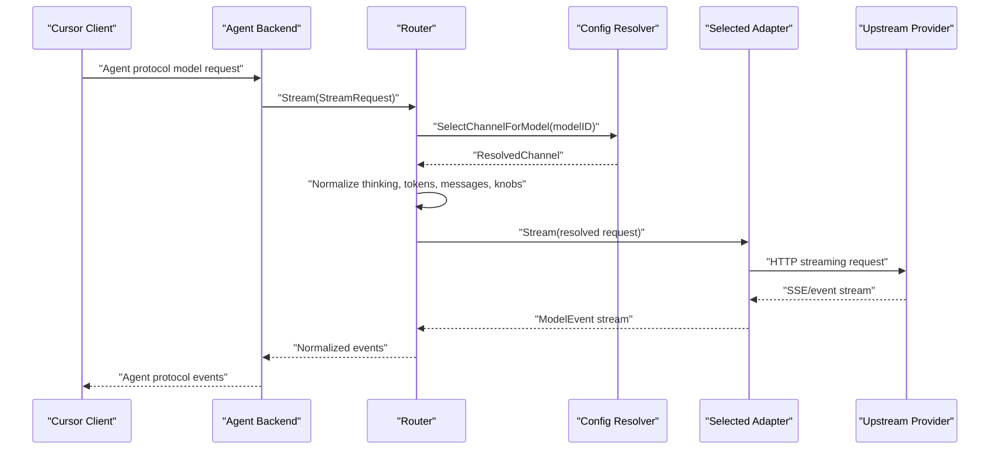
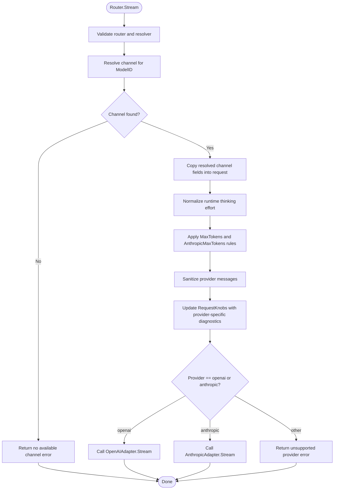
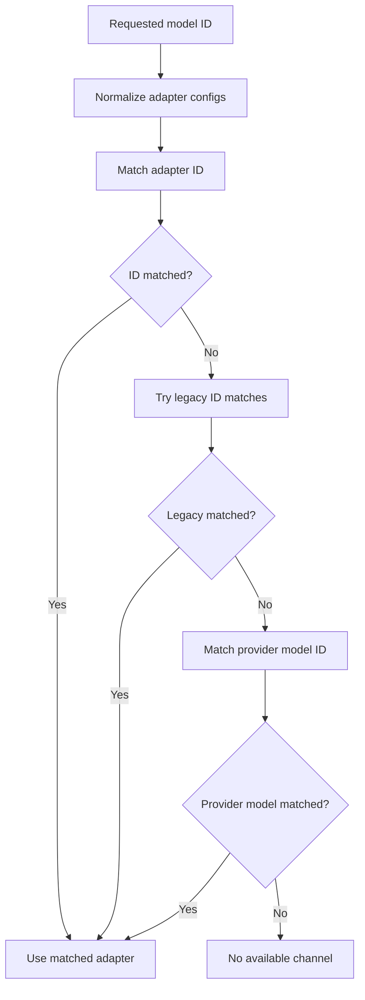
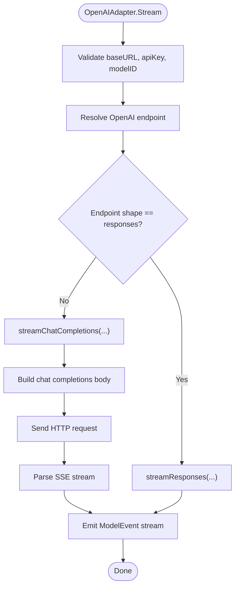
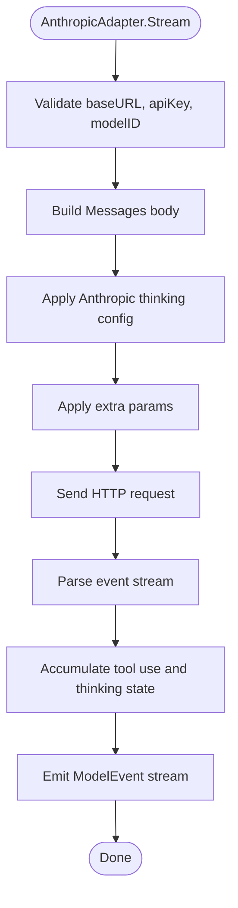
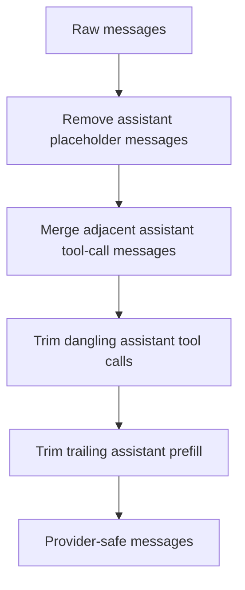
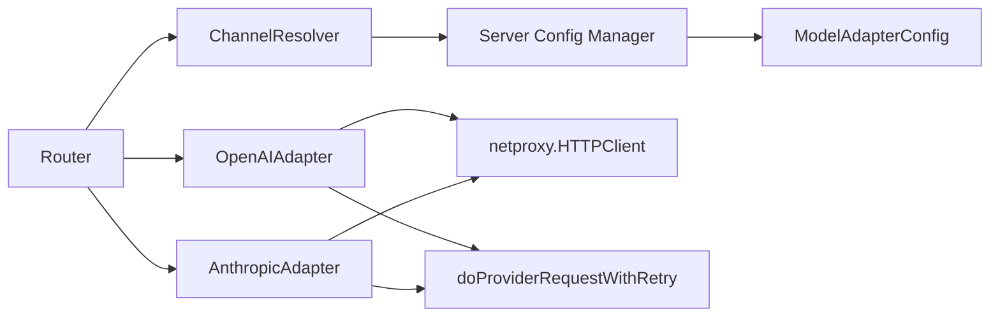
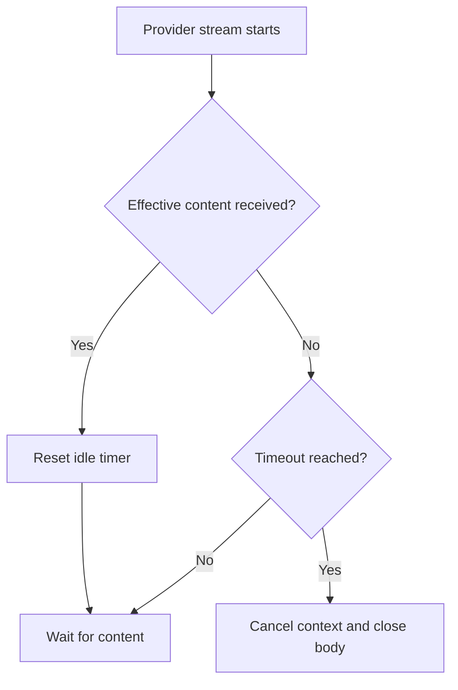

# Model Adapter Routing

<cite>
**Referenced Files in This Document**   
- [router.go](file://internal/backend/agent/model/router.go)
- [types.go](file://internal/backend/agent/model/types.go)
- [openai.go](file://internal/backend/agent/model/openai.go)
- [anthropic.go](file://internal/backend/agent/model/anthropic.go)
- [stream_idle.go](file://internal/backend/agent/model/stream_idle.go)
- [retry.go](file://internal/backend/agent/model/retry.go)
- [resolver.go](file://internal/backend/server/config/resolver.go)
- [resolve.go](file://internal/modelchannel/resolve.go)
- [router_test.go](file://internal/backend/agent/model/router_test.go)
</cite>

## Table of Contents
1. [Introduction](#introduction)
2. [Project Structure](#project-structure)
3. [Core Components](#core-components)
4. [Architecture Overview](#architecture-overview)
5. [Detailed Component Analysis](#detailed-component-analysis)
6. [Dependency Analysis](#dependency-analysis)
7. [Performance Considerations](#performance-considerations)
8. [Troubleshooting Guide](#troubleshooting-guide)
9. [Conclusion](#conclusion)

## Introduction
This document explains the model adapter routing system that sits between Cursor clients and upstream model providers. The system accepts a unified Agent protocol request, resolves the target provider channel from local configuration, normalizes messages and request knobs, and forwards the request to an OpenAI-compatible or Anthropic-compatible adapter. It emits a stable set of model events so that higher layers do not need to understand provider-specific streaming formats.

The router is intentionally small: it does not implement provider HTTP logic itself. Instead, it delegates to adapters while preserving Agent protocol semantics such as text deltas, thinking content, tool call progress, usage, and turn completion.

## Project Structure
The routing subsystem lives under `internal/backend/agent/model`. The most relevant files are:

| File | Responsibility |
|---|---|
| `types.go` | Defines the unified request, event, and adapter interfaces used by both the router and adapters. |
| `router.go` | Implements the MVP router that selects OpenAI or Anthropic based on resolved channel configuration. |
| `openai.go` | Implements OpenAI-compatible streaming, including chat completions and responses endpoint handling. |
| `anthropic.go` | Implements Anthropic Messages streaming, including thinking signatures, cache frontier, and tool use. |
| `stream_idle.go` | Provides idle watchdog behavior for long-running provider streams. |
| `retry.go` | Wraps provider HTTP calls; retries are delegated to higher layers rather than handled here. |
| `resolver.go` | Resolves a configured model adapter channel from server configuration. |
| `resolve.go` | Provides generic adapter index resolution, including alias and legacy ID fallbacks. |
| `router_test.go` | Validates router behavior for runtime thinking effort overrides and message sanitization. |

**Diagram sources**
- [router.go:14-34](file://internal/backend/agent/model/router.go#L14-L34)
- [resolver.go:19-28](file://internal/backend/server/config/resolver.go#L19-L28)
- [openai.go:408-441](file://internal/backend/agent/model/openai.go#L408-L441)
- [anthropic.go:209-323](file://internal/backend/agent/model/anthropic.go#L209-L323)

**Section sources**
- [router.go:1-445](file://internal/backend/agent/model/router.go#L1-L445)
- [types.go:1-244](file://internal/backend/agent/model/types.go#L1-L244)
- [resolver.go:1-87](file://internal/backend/server/config/resolver.go#L1-L87)

## Core Components
The routing layer is built around three core abstractions:

1. **Unified Request and Event Types**
   - `StreamRequest` carries model identity, provider credentials, messages, tools, token limits, reasoning/thinking settings, extra parameters, custom headers, artifact observers, and stream-level metadata.
   - `ModelEvent` represents normalized streaming output: text delta, thinking delta, thinking completed, partial tool call, tool call delta, tool-like completion, turn finished, and provider error.
   - These types allow the rest of the agent pipeline to remain provider-agnostic.

2. **ModelAdapter Interface**
   - Both OpenAI and Anthropic adapters implement `ModelAdapter.Stream`, which takes a context, a normalized `StreamRequest`, and a sink function that receives `ModelEvent` values.
   - This interface is the contract that lets the router switch providers without changing caller code.

3. **Router**
   - The router holds two adapter instances and a channel resolver.
   - Its `Stream` method resolves the actual provider channel, enriches the request with resolved configuration, sanitizes messages, applies thinking and token rules, and then dispatches to the correct adapter.

**Diagram sources**
- [types.go:63-137](file://internal/backend/agent/model/types.go#L63-L137)
- [types.go:153-237](file://internal/backend/agent/model/types.go#L153-L237)
- [router.go:14-34](file://internal/backend/agent/model/router.go#L14-L34)
- [openai.go:21-25](file://internal/backend/agent/model/openai.go#L21-L25)
- [anthropic.go:24-28](file://internal/backend/agent/model/anthropic.go#L24-L28)

**Section sources**
- [types.go:63-237](file://internal/backend/agent/model/types.go#L63-L237)
- [router.go:14-34](file://internal/backend/agent/model/router.go#L14-L34)

## Architecture Overview
The end-to-end flow is:

1. A Cursor client sends a model request through the agent backend.
2. The router receives a `StreamRequest`.
3. The router asks the channel resolver to select a configured channel for the requested model identifier.
4. The resolver returns a `ResolvedChannel` containing provider type, base URL, API key, provider model ID, and capability flags.
5. The router copies resolved fields into the request, normalizes thinking effort, applies max tokens, sanitizes messages, and updates request knobs.
6. The router dispatches to either the OpenAI or Anthropic adapter based on the resolved provider.
7. The selected adapter builds a provider-specific HTTP request, streams the response, converts provider events into unified `ModelEvent` values, and records artifacts.

**Diagram sources**
- [router.go:37-134](file://internal/backend/agent/model/router.go#L37-L134)
- [resolver.go:19-28](file://internal/backend/server/config/resolver.go#L19-L28)
- [openai.go:408-441](file://internal/backend/agent/model/openai.go#L408-L441)
- [anthropic.go:209-323](file://internal/backend/agent/model/anthropic.go#L209-L323)

## Detailed Component Analysis

### Router Decision-Making Process
The router performs several deterministic steps before selecting an adapter:

1. **Validate dependencies**
   - If the router or its resolver is nil, it returns an error immediately.

2. **Resolve channel**
   - It calls `SelectChannelForModel` with the request’s `ModelID`.
   - If no channel is found, it returns an error indicating no available channel.

3. **Enrich request with resolved channel data**
   - Provider, base URL, API key, provider model ID, channel ID, channel name, context window tokens, reasoning effort, OpenAI endpoint, extra parameter flags, custom header flags, Anthropic extra parameters, Anthropic max tokens, Anthropic thinking effort, thinking budget, and provider stream idle timeout are copied from the resolved channel.

4. **Normalize thinking effort**
   - Runtime-provided thinking effort is normalized to a known set: disabled, low, medium, high, xhigh, or max.
   - When thinking is disabled, reasoning effort and Anthropic thinking effort are cleared.
   - Otherwise, OpenAI reasoning effort and Anthropic thinking effort are set according to the normalized value.

5. **Apply token rules**
   - If the request did not specify `MaxTokens`, the channel default may be applied.
   - Anthropic max tokens are adjusted so that the effective limit respects both channel defaults and explicit request limits.
   - If no provider model ID was resolved, the original model ID is used as a fallback.

6. **Sanitize messages**
   - Assistant placeholder messages are removed.
   - Adjacent assistant tool-call messages are merged.
   - Dangling assistant tool calls without matching tool results are trimmed.
   - Trailing assistant prefill messages are removed because some providers reject requests that end with assistant content instead of user/tool input.

7. **Update request knobs**
   - The router writes diagnostic knobs such as `max_tokens`, `runtime_thinking_effort`, provider-specific endpoint flags, extra parameter flags, and Anthropic-specific max tokens and thinking effort.

8. **Dispatch to adapter**
   - If the resolved provider is `anthropic`, the Anthropic adapter handles the stream.
   - If the resolved provider is `openai`, the OpenAI adapter handles the stream.
   - Any other provider value returns an unsupported provider error.

**Diagram sources**
- [router.go:37-134](file://internal/backend/agent/model/router.go#L37-L134)
- [router.go:137-161](file://internal/backend/agent/model/router.go#L137-L161)
- [router.go:422-444](file://internal/backend/agent/model/router.go#L422-L444)

**Section sources**
- [router.go:37-134](file://internal/backend/agent/model/router.go#L37-L134)
- [router.go:137-444](file://internal/backend/agent/model/router.go#L137-L444)

### Channel Resolution and Provider Selection Criteria
Provider selection is not hard-coded to a particular model string. Instead, the router relies on the configured adapter list:

- The config resolver normalizes adapter configurations and calls a generic adapter index resolver.
- The generic resolver supports:
  - Exact match against adapter ID.
  - Legacy ID compatibility.
  - Fallback match against provider model ID.
  - Meta-model aliases such as fast, default, or auto, which can fall back to the first adapter when needed.

Once a channel is resolved, the router uses the channel’s `Provider` field to choose the adapter. This means:

- Adding a new provider requires adding a corresponding adapter and updating the router’s dispatch logic.
- Existing callers continue to use the same `StreamRequest` and `ModelEvent` contracts.

**Diagram sources**
- [resolver.go:19-85](file://internal/backend/server/config/resolver.go#L19-L85)
- [resolve.go:5-66](file://internal/modelchannel/resolve.go#L5-L66)

**Section sources**
- [resolver.go:19-85](file://internal/backend/server/config/resolver.go#L19-L85)
- [resolve.go:5-66](file://internal/modelchannel/resolve.go#L5-L66)

### OpenAI Adapter Abstraction
The OpenAI adapter implements the `ModelAdapter` interface and handles two primary OpenAI-compatible shapes:

1. **Chat Completions**
   - Builds a standard chat completions request body.
   - Supports prompt cache keys for compatible models.
   - Normalizes messages, tools, reasoning effort, and extra parameters.
   - Streams SSE chunks and converts them into text deltas, thinking deltas, tool call progress, usage, and turn completion.

2. **Responses Endpoint**
   - Detects whether the resolved endpoint shape is responses.
   - Uses a separate request structure for responses, including reasoning summary and include options.
   - Handles image generation detection and related tool shaping.

The adapter also:

- Resolves the final OpenAI endpoint URL based on base URL and configured endpoint.
- Applies custom headers and extra parameters conditionally.
- Tracks thinking blocks using a `<think>` tag parser when providers embed reasoning inside content.
- Records request/response artifacts and summaries for debugging.

**Diagram sources**
- [openai.go:299-386](file://internal/backend/agent/model/openai.go#L299-L386)
- [openai.go:408-441](file://internal/backend/agent/model/openai.go#L408-L441)
- [openai.go:443-517](file://internal/backend/agent/model/openai.go#L443-L517)

**Section sources**
- [openai.go:21-54](file://internal/backend/agent/model/openai.go#L21-L54)
- [openai.go:176-181](file://internal/backend/agent/model/openai.go#L176-L181)
- [openai.go:299-386](file://internal/backend/agent/model/openai.go#L299-L386)
- [openai.go:408-517](file://internal/backend/agent/model/openai.go#L408-L517)

### Anthropic Adapter Abstraction
The Anthropic adapter also implements `ModelAdapter` and focuses on the Anthropic Messages API:

- It validates base URL, API key, and model ID.
- It normalizes messages, system blocks, tools, and thinking configuration.
- It computes a cache frontier and breakpoint positions to improve prompt cache behavior.
- It supports adaptive thinking via Anthropic thinking effort and signature tracking.
- It streams Anthropic events, including text deltas, thinking deltas, tool use deltas, and stop reasons.
- It emits unified tool invocation events when tool arguments are complete.

**Diagram sources**
- [anthropic.go:152-158](file://internal/backend/agent/model/anthropic.go#L152-L158)
- [anthropic.go:209-323](file://internal/backend/agent/model/anthropic.go#L209-L323)
- [anthropic.go:342-402](file://internal/backend/agent/model/anthropic.go#L342-L402)
- [anthropic.go:528-711](file://internal/backend/agent/model/anthropic.go#L528-L711)

**Section sources**
- [anthropic.go:24-50](file://internal/backend/agent/model/anthropic.go#L24-L50)
- [anthropic.go:145-150](file://internal/backend/agent/model/anthropic.go#L145-L150)
- [anthropic.go:174-193](file://internal/backend/agent/model/anthropic.go#L174-L193)
- [anthropic.go:209-323](file://internal/backend/agent/model/anthropic.go#L209-L323)
- [anthropic.go:528-711](file://internal/backend/agent/model/anthropic.go#L528-L711)

### Message Sanitization and Tool Call Handling
Before sending requests to providers, the router normalizes messages to avoid provider rejection:

- Placeholder assistant messages with no meaningful content are removed.
- Adjacent assistant messages that only contain tool calls are merged so tool call indices remain stable.
- Assistant tool calls whose corresponding tool results are missing are trimmed to prevent dangling tool calls.
- Trailing assistant prefill content is removed because some providers require the conversation to end with user or tool input.

This sanitization is idempotent: running it multiple times should not change already-normalized messages.

**Diagram sources**
- [router.go:137-161](file://internal/backend/agent/model/router.go#L137-L161)
- [router.go:200-265](file://internal/backend/agent/model/router.go#L200-L265)
- [router.go:342-420](file://internal/backend/agent/model/router.go#L342-L420)

**Section sources**
- [router.go:137-161](file://internal/backend/agent/model/router.go#L137-L161)
- [router.go:200-420](file://internal/backend/agent/model/router.go#L200-L420)
- [router_test.go:62-112](file://internal/backend/agent/model/router_test.go#L62-L112)

### Fallback Mechanisms
The current router has limited fallback behavior:

- **Channel resolution fallback:** The generic adapter index resolver tries adapter ID, legacy ID, and provider model ID before failing.
- **Provider model ID fallback:** If the resolved channel does not provide a provider model ID, the router falls back to the original request model ID.
- **Adapter fallback:** There is no automatic retry on another provider if one adapter fails. Unsupported provider values return an error immediately.
- **HTTP retry:** The adapter HTTP wrapper does not perform internal retries; errors are returned to the caller, allowing higher layers to handle reconnection or retry policy.

This design keeps the router simple and leaves resilience strategy to higher layers.

**Section sources**
- [resolve.go:14-66](file://internal/modelchannel/resolve.go#L14-L66)
- [router.go:92-94](file://internal/backend/agent/model/router.go#L92-L94)
- [router.go:127-134](file://internal/backend/agent/model/router.go#L127-L134)
- [retry.go:9-44](file://internal/backend/agent/model/retry.go#L9-L44)

## Dependency Analysis
The routing layer depends on configuration resolution and provider adapters:

**Diagram sources**
- [router.go:14-34](file://internal/backend/agent/model/router.go#L14-L34)
- [resolver.go:19-28](file://internal/backend/server/config/resolver.go#L19-L28)
- [openai.go:176-181](file://internal/backend/agent/model/openai.go#L176-L181)
- [anthropic.go:145-150](file://internal/backend/agent/model/anthropic.go#L145-L150)
- [retry.go:21-44](file://internal/backend/agent/model/retry.go#L21-L44)

**Section sources**
- [router.go:14-34](file://internal/backend/agent/model/router.go#L14-L34)
- [resolver.go:19-85](file://internal/backend/server/config/resolver.go#L19-L85)
- [retry.go:9-44](file://internal/backend/agent/model/retry.go#L9-L44)

## Performance Considerations
The routing system includes several performance-oriented behaviors:

1. **Prompt Cache Keys (OpenAI)**
   - For OpenAI-compatible endpoints, the adapter can attach a prompt cache key derived from the conversation ID when supported by the model.
   - This improves cache reuse across turns within the same conversation.

2. **Anthropic Cache Frontier**
   - The Anthropic adapter computes canonical body hashes, breakpoint positions, and frontier paths to help providers identify stable prefixes for caching.
   - It avoids relocating images by default because moving historical images can break KV prompt cache and increase time-to-first-token.

3. **Streaming Idle Watchdog**
   - Each adapter creates a stream idle watchdog using `ProviderStreamIdleTimeout`.
   - If no effective content arrives within the timeout, the stream is canceled and closed.
   - Default idle timeout is four minutes, with a minimum of thirty seconds.

4. **Token Usage Tracking**
   - Both adapters track input tokens, output tokens, cache read tokens, and cache write tokens.
   - They emit usage presence flags so downstream systems can distinguish provider-reported usage from inferred usage.

5. **No Internal Provider Retries**
   - The adapter HTTP wrapper does not retry provider requests internally.
   - This avoids hidden retry loops and allows higher layers to apply controlled retry policies.

6. **Message Normalization Cost**
   - Message sanitization and tool call merging are linear in the number of messages.
   - This is acceptable for typical agent conversations but should be considered when very long histories are passed directly to providers.

**Diagram sources**
- [stream_idle.go:11-43](file://internal/backend/agent/model/stream_idle.go#L11-L43)
- [stream_idle.go:58-68](file://internal/backend/agent/model/stream_idle.go#L58-L68)
- [stream_idle.go:117-133](file://internal/backend/agent/model/stream_idle.go#L117-L133)

**Section sources**
- [openai.go:183-212](file://internal/backend/agent/model/openai.go#L183-L212)
- [anthropic.go:160-172](file://internal/backend/agent/model/anthropic.go#L160-L172)
- [anthropic.go:727-775](file://internal/backend/agent/model/anthropic.go#L727-L775)
- [stream_idle.go:11-133](file://internal/backend/agent/model/stream_idle.go#L11-L133)
- [retry.go:9-44](file://internal/backend/agent/model/retry.go#L9-L44)

## Troubleshooting Guide
Common issues and their likely causes:

| Symptom | Likely Cause | Recommended Check |
|---|---|---|
| No available channel for model | The requested model ID does not match any configured adapter ID, legacy ID, or provider model ID. | Verify `ModelAdapterConfig` entries and ensure the model reference maps to a configured adapter. |
| Unsupported provider error | The resolved channel has a provider value other than `openai` or `anthropic`. | Inspect the resolved channel’s provider field and update router dispatch logic if adding a new provider. |
| Empty base URL, API key, or model ID error | The resolved channel or request is missing required credentials or model identity. | Confirm channel configuration and that `ProviderModelID` is populated or falls back to `ModelID`. |
| Provider stream idle timeout | The upstream provider did not send effective content within the configured timeout. | Increase `ProviderStreamIdleTimeout`, inspect provider health, and check network proxy settings. |
| Dangling tool call warnings | Assistant tool calls were emitted without matching tool results. | Review message history and ensure tool results follow assistant tool calls. |
| Reasoning effort not applied | Runtime thinking effort was overridden to disabled. | Check `ThinkingEffort` in the request; disabled thinking clears reasoning and Anthropic thinking effort. |

**Section sources**
- [router.go:37-48](file://internal/backend/agent/model/router.go#L37-L48)
- [router.go:127-134](file://internal/backend/agent/model/router.go#L127-L134)
- [openai.go:408-429](file://internal/backend/agent/model/openai.go#L408-L429)
- [anthropic.go:209-225](file://internal/backend/agent/model/anthropic.go#L209-L225)
- [stream_idle.go:117-133](file://internal/backend/agent/model/stream_idle.go#L117-L133)
- [router_test.go:33-60](file://internal/backend/agent/model/router_test.go#L33-L60)

## Conclusion
The model adapter routing system provides a thin, stable abstraction over OpenAI and Anthropic providers. It centralizes provider selection in configuration, normalizes messages and request knobs, and emits a consistent Agent protocol event stream. The router’s decision-making process is deterministic: resolve channel, normalize request, sanitize messages, and dispatch to the appropriate adapter.

For future evolution:

- Adding a new provider requires implementing `ModelAdapter` and extending the router’s provider dispatch.
- Load balancing and multi-provider failover should be implemented at a higher layer, since the current router selects exactly one resolved channel per request.
- Performance tuning should focus on prompt cache keys, Anthropic cache frontiers, and provider stream idle timeouts rather than internal retries.
- Diagnostic knobs and artifact recording already provide strong observability for debugging provider differences.