# Protocol Buffer Definitions

<cite>
**Referenced Files in This Document**   
- [agent_v1.proto](file://proto/agent_v1.proto)
- [git_forge_v1.proto](file://proto/from_extensions/git_forge_v1.proto)
- [inbound.go](file://internal/backend/agent/protocol/inbound.go)
- [broker.go](file://internal/backend/forwarder/broker.go)
- [service.go](file://internal/backend/forwarder/service.go)
- [debug_recorder.go](file://internal/backend/forwarder/debug_recorder.go)
- [decode.go](file://cursor-proxy-debugger/decode.go)
</cite>

## Table of Contents
1. [Introduction](#introduction)
2. [Project Structure](#project-structure)
3. [Core Components](#core-components)
4. [Architecture Overview](#architecture-overview)
5. [Detailed Component Analysis](#detailed-component-analysis)
6. [Dependency Analysis](#dependency-analysis)
7. [Performance Considerations](#performance-considerations)
8. [Troubleshooting Guide](#troubleshooting-guide)
9. [Conclusion](#conclusion)
10. [Appendices](#appendices)

## Introduction
This document explains the Agent protocol buffer definitions used by the Cursor backend to coordinate conversations, tool execution, interaction flows, and extension integrations. The primary schema is `agent_v1.proto`, which defines the bidirectional message types between a client and the agent runtime. A secondary schema, `git_forge_v1.proto`, defines Git forge integration messages used by extensions.

The documentation focuses on:
- The structure of `AgentClientMessage` and `AgentServerMessage`.
- Conversation state management via `ConversationAction` and `ConversationStateStructure`.
- Tool call protocols through `ExecServerMessage` / `ExecClientMessage`.
- Interaction query/response patterns.
- Streaming response formats using `InteractionUpdate`.
- Extension protocols for Git forge and other Cursor extensions.

## Project Structure
The relevant protocol definitions live under `proto/`:
- `proto/agent_v1.proto` defines the core Agent protocol.
- `proto/from_extensions/git_forge_v1.proto` defines Git forge extension messages.
- Supporting Go code decodes, routes, and records these messages during debugging and forwarding.

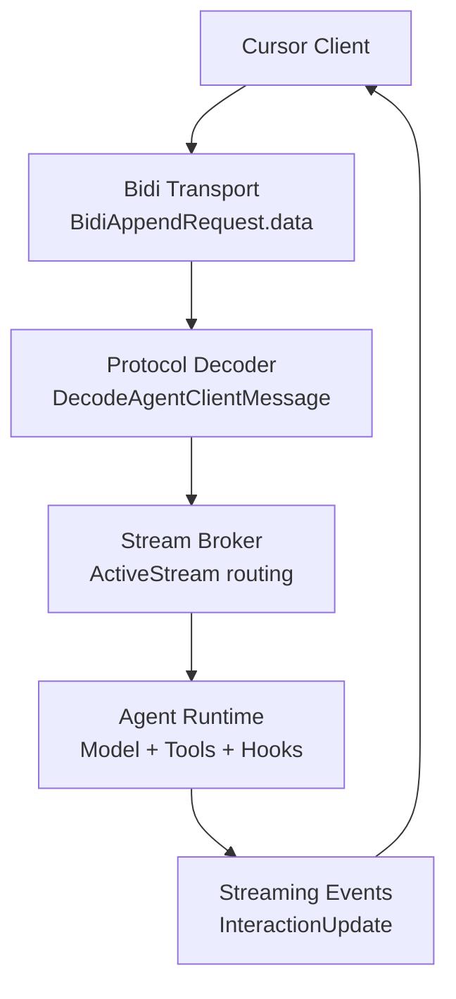

**Diagram sources**
- [decode.go:150-183](file://cursor-proxy-debugger/decode.go#L150-L183)
- [inbound.go:38-182](file://internal/backend/agent/protocol/inbound.go#L38-L182)
- [broker.go:42-134](file://internal/backend/forwarder/broker.go#L42-L134)

**Section sources**
- [agent_v1.proto:56-139](file://proto/agent_v1.proto#L56-L139)
- [git_forge_v1.proto:1-20](file://proto/from_extensions/git_forge_v1.proto#L1-L20)

## Core Components
The Agent protocol centers around two top-level message wrappers:

- `AgentClientMessage`: the client-to-server envelope. It carries one of several operation types:
  - `run_request`: start or continue an agent run with conversation context.
  - `exec_client_message`: result or stream control for a server-requested tool execution.
  - `exec_client_control_message`: stream close, throw, or heartbeat for an active exec channel.
  - `kv_client_message`: key-value store operations.
  - `conversation_action`: user message, resume, cancel, plan actions, background task completion, shell action, subagent action, subscription notification, goal continuation, or context injection.
  - `interaction_response`: answer to an `InteractionQuery`.
  - `client_heartbeat`: keepalive.
  - `prewarm_request`: model prewarming request.

- `AgentServerMessage`: the server-to-client envelope. It carries one of several operation types:
  - `interaction_update`: streaming UI updates such as text deltas, thinking deltas, token deltas, tool call lifecycle events, step updates, prompt suggestions, branch changes, feedback requests, and context injection state.
  - `exec_server_message`: server-initiated tool execution arguments.
  - `exec_server_control_message`: server control signals like abort.
  - `conversation_checkpoint_update`: checkpoint synchronization for conversation state.
  - `kv_server_message`: key-value store requests.
  - `interaction_query`: interactive prompts such as web search, ask question, mode switch, plan creation, VM setup, web fetch, PR management, MCP auth, image generation, environment replacement, or SCM connection.

These envelopes are used over a bidi transport where the client sends hex-encoded protobuf payloads inside `BidiAppendRequest.data`, and the server streams back `AgentServerMessage` instances.

**Section sources**
- [agent_v1.proto:56-68](file://proto/agent_v1.proto#L56-L68)
- [agent_v1.proto:128-139](file://proto/agent_v1.proto#L128-L139)
- [decode.go:150-183](file://cursor-proxy-debugger/decode.go#L150-L183)
- [inbound.go:38-182](file://internal/backend/agent/protocol/inbound.go#L38-L182)

## Architecture Overview
The Agent protocol implements a request-scoped streaming architecture:

1. The client opens a bidi channel and sends `AgentClientMessage` payloads.
2. The decoder extracts the inner message type and forwards it into the runtime.
3. The broker maintains per-request `ActiveStream` state, including pending tools, interactions, background shells, patch edits, and backlog cursors.
4. The runtime invokes models and tools, emitting `InteractionUpdate` events and requesting tool execution via `ExecServerMessage`.
5. The client executes requested tools and returns results via `ExecClientMessage`.
6. Interactive prompts are sent via `InteractionQuery`; the client responds with `InteractionResponse`.
7. Conversation checkpoints are synchronized via `ConversationStateStructure`.

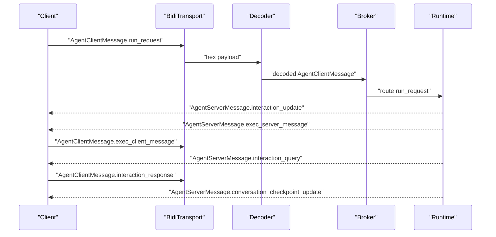

**Diagram sources**
- [agent_v1.proto:56-139](file://proto/agent_v1.proto#L56-L139)
- [broker.go:42-134](file://internal/backend/forwarder/broker.go#L42-L134)
- [decode.go:150-183](file://cursor-proxy-debugger/decode.go#L150-L183)

## Detailed Component Analysis

### AgentClientMessage and AgentServerMessage
`AgentClientMessage` and `AgentServerMessage` are the primary communication channels. They use `oneof` fields to represent distinct operation categories. The client can send:
- Run requests with conversation state and model details.
- Execution results and control messages.
- Key-value operations.
- Conversation actions.
- Interaction responses.
- Heartbeats and prewarm requests.

The server can send:
- Interaction updates for streaming UI.
- Execution requests for tools.
- Execution control messages.
- Conversation checkpoint updates.
- Key-value requests.
- Interaction queries.

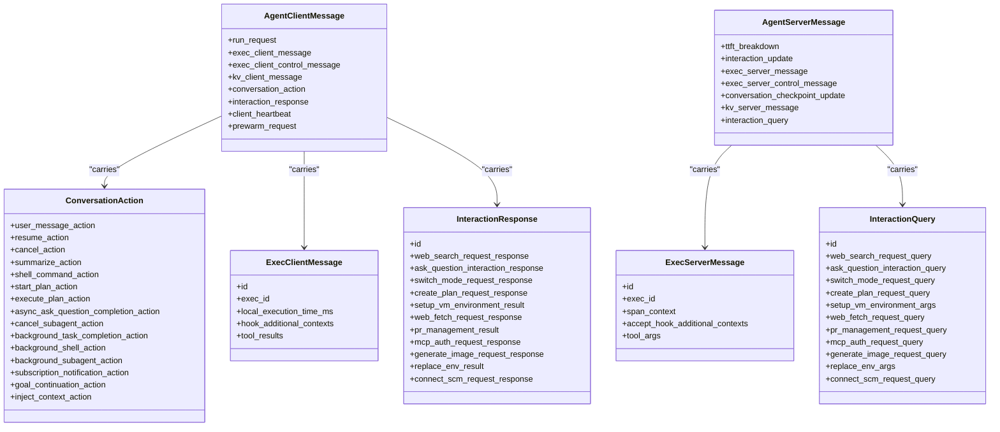

**Diagram sources**
- [agent_v1.proto:56-68](file://proto/agent_v1.proto#L56-L68)
- [agent_v1.proto:128-139](file://proto/agent_v1.proto#L128-L139)
- [agent_v1.proto:1012-1033](file://proto/agent_v1.proto#L1012-L1033)
- [agent_v1.proto:1815-1862](file://proto/agent_v1.proto#L1815-L1862)
- [agent_v1.proto:1890-1937](file://proto/agent_v1.proto#L1890-L1937)
- [agent_v1.proto:2671-2704](file://proto/agent_v1.proto#L2671-L2704)

**Section sources**
- [agent_v1.proto:56-68](file://proto/agent_v1.proto#L56-L68)
- [agent_v1.proto:128-139](file://proto/agent_v1.proto#L128-L139)
- [agent_v1.proto:1012-1033](file://proto/agent_v1.proto#L1012-L1033)
- [agent_v1.proto:1815-1862](file://proto/agent_v1.proto#L1815-L1862)
- [agent_v1.proto:1890-1937](file://proto/agent_v1.proto#L1890-L1937)
- [agent_v1.proto:2671-2704](file://proto/agent_v1.proto#L2671-L2704)

### Conversation State Management
Conversation state is passed from client to server through `AgentRunRequest.conversation_state`, which uses `ConversationStateStructure`. This structure contains serialized root prompt messages, turns, todos, pending tool calls, token details, summaries, plans, file states, and related metadata.

The server may push `conversation_checkpoint_update` messages containing updated `ConversationStateStructure` so the client can synchronize its local view.

Common conversation actions include:
- `UserMessageAction`: append a new user message.
- `ResumeAction`: continue after interruption.
- `CancelAction`: cancel the current run.
- `SummarizeAction`: summarize conversation history.
- `ShellCommandAction`: execute shell commands.
- `StartPlanAction` / `ExecutePlanAction`: manage planning workflows.
- `BackgroundTaskCompletionAction`: report background task outcomes.
- `BackgroundShellAction` / `BackgroundSubagentAction`: control background processes.
- `SubscriptionNotificationAction`: handle subscription notifications.
- `GoalContinuationAction`: continue goal-driven tasks.
- `InjectContextAction`: inject user or system context.

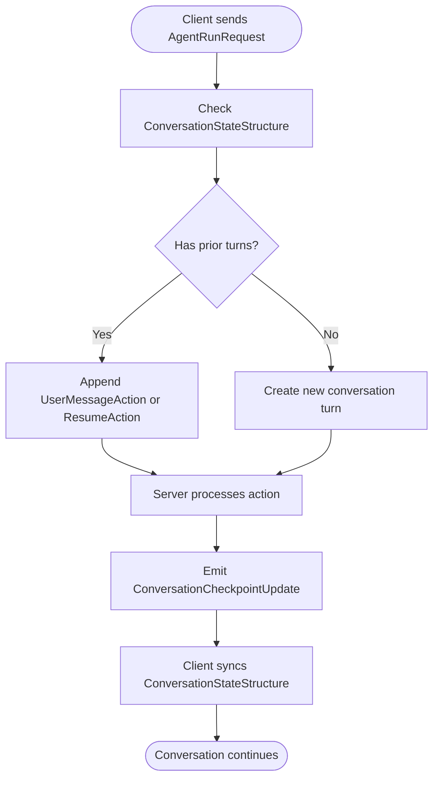

**Diagram sources**
- [agent_v1.proto:99-126](file://proto/agent_v1.proto#L99-L126)
- [agent_v1.proto:1173-1199](file://proto/agent_v1.proto#L1173-L1199)
- [agent_v1.proto:1012-1033](file://proto/agent_v1.proto#L1012-L1033)

**Section sources**
- [agent_v1.proto:99-126](file://proto/agent_v1.proto#L99-L126)
- [agent_v1.proto:1173-1199](file://proto/agent_v1.proto#L1173-L1199)
- [agent_v1.proto:1012-1033](file://proto/agent_v1.proto#L1012-L1033)

### Tool Call Protocols
Tool execution follows a clear request-response pattern:

1. The server emits `ExecServerMessage` with tool-specific arguments (e.g., shell, write, grep, read, MCP, fetch, computer use, subagent).
2. The client executes the tool locally or through a bridge.
3. The client returns `ExecClientMessage` with the corresponding result type.
4. Control messages (`ExecClientControlMessage`) allow the client to close streams, throw errors, or send heartbeats.
5. The server can send `ExecServerControlMessage` to abort ongoing executions.

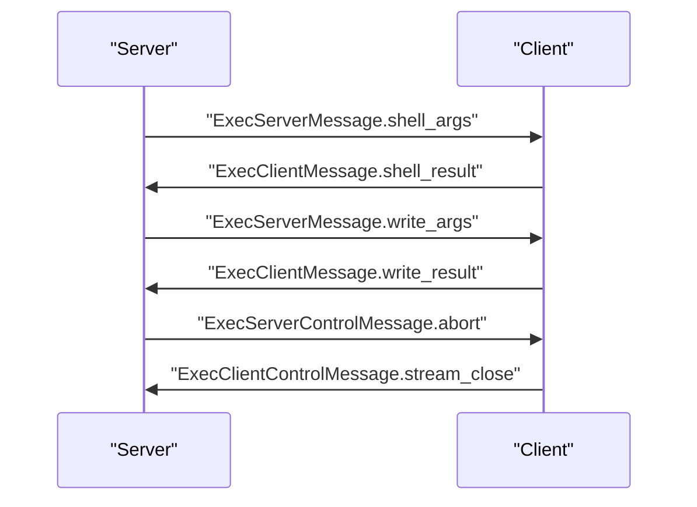

**Diagram sources**
- [agent_v1.proto:1800-1807](file://proto/agent_v1.proto#L1800-L1807)
- [agent_v1.proto:1815-1862](file://proto/agent_v1.proto#L1815-L1862)
- [agent_v1.proto:1877-1887](file://proto/agent_v1.proto#L1877-L1887)
- [agent_v1.proto:1890-1937](file://proto/agent_v1.proto#L1890-L1937)

**Section sources**
- [agent_v1.proto:1800-1807](file://proto/agent_v1.proto#L1800-L1807)
- [agent_v1.proto:1815-1862](file://proto/agent_v1.proto#L1815-L1862)
- [agent_v1.proto:1877-1887](file://proto/agent_v1.proto#L1877-L1887)
- [agent_v1.proto:1890-1937](file://proto/agent_v1.proto#L1890-L1937)

### Interaction Patterns
Interactive prompts are modeled as `InteractionQuery` and answered with `InteractionResponse`. Supported interaction types include:
- Web search.
- Ask question.
- Switch mode.
- Create plan.
- Setup VM environment.
- Web fetch.
- PR management.
- MCP authentication.
- Image generation.
- Environment replacement.
- SCM connection.

The server sends `InteractionQuery` when it needs user input or confirmation. The client must respond with the matching `InteractionResponse` carrying the selected option, freeform text, or outcome.

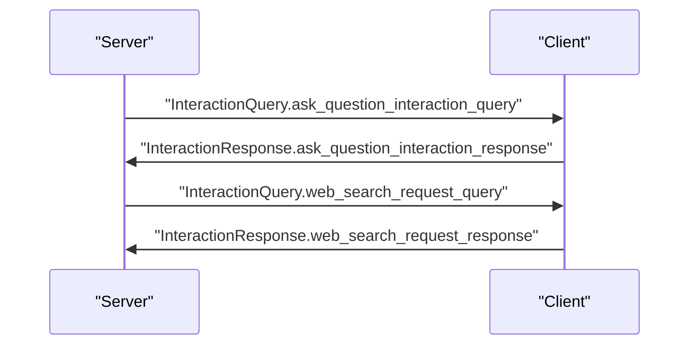

**Diagram sources**
- [agent_v1.proto:2671-2704](file://proto/agent_v1.proto#L2671-L2704)

**Section sources**
- [agent_v1.proto:2671-2704](file://proto/agent_v1.proto#L2671-L2704)

### Streaming Response Formats
Streaming responses are delivered through `InteractionUpdate`. This message supports many update kinds:
- Text delta updates.
- Partial tool call updates.
- Tool call delta updates.
- Tool call started/completed updates.
- Thinking delta/completed updates.
- User message appended updates.
- Token delta updates.
- Summary started/completed updates.
- Shell output delta updates.
- Heartbeat updates.
- Turn ended updates.
- Step started/completed updates.
- Prompt suggestion updates.
- Post-request prompt updates.
- Active branch change updates.
- Feedback request updates.
- Response comparison updates.
- Context injection state updates.

The runtime also tracks TTFT breakdowns at the top level of `AgentServerMessage`.

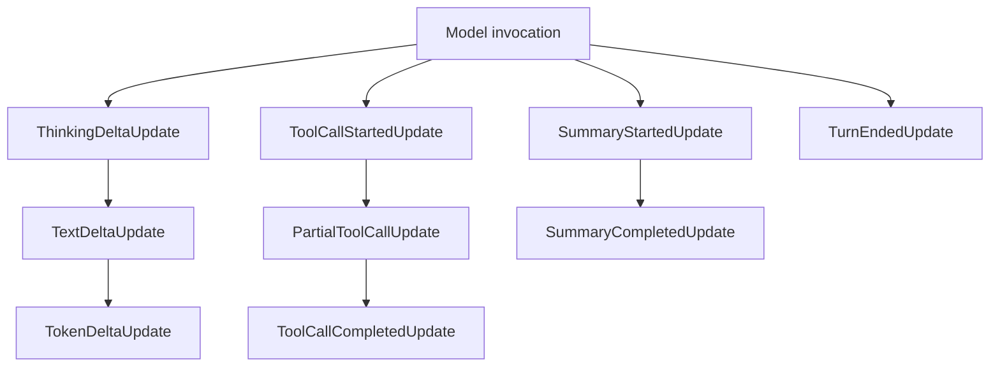

**Diagram sources**
- [agent_v1.proto:2706-2733](file://proto/agent_v1.proto#L2706-L2733)

**Section sources**
- [agent_v1.proto:128-139](file://proto/agent_v1.proto#L128-L139)
- [agent_v1.proto:2706-2733](file://proto/agent_v1.proto#L2706-L2733)

### Request/Response Flows for Common Operations

#### Model Invocation
A typical model invocation flow:
1. Client sends `AgentRunRequest` with `ConversationStateStructure`, `ConversationAction`, and `ModelDetails`.
2. Server streams `InteractionUpdate` events for thinking, text, tokens, steps, and summaries.
3. If the model decides to call tools, the server emits `ExecServerMessage`.
4. Client executes tools and returns `ExecClientMessage`.
5. Server continues until completion, optionally emitting `ConversationCheckpointUpdate`.

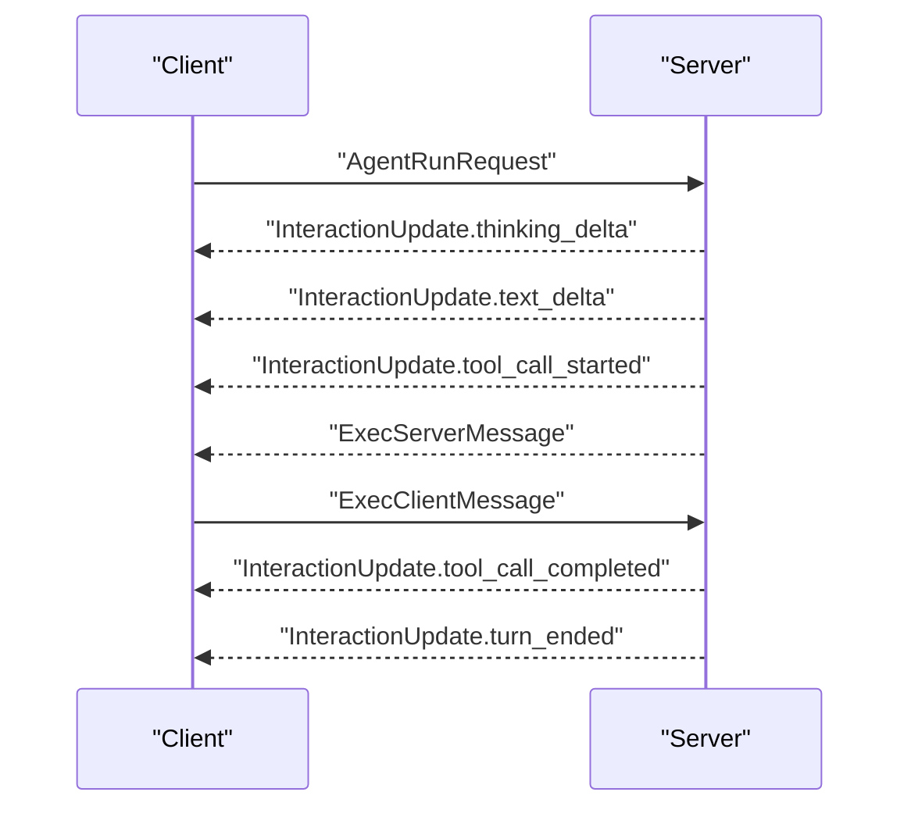

**Diagram sources**
- [agent_v1.proto:99-126](file://proto/agent_v1.proto#L99-L126)
- [agent_v1.proto:2706-2733](file://proto/agent_v1.proto#L2706-L2733)
- [agent_v1.proto:1890-1937](file://proto/agent_v1.proto#L1890-L1937)
- [agent_v1.proto:1815-1862](file://proto/agent_v1.proto#L1815-L1862)

#### Tool Execution
A typical tool execution flow:
1. Server sends `ExecServerMessage` with tool-specific args.
2. Client executes the tool.
3. Client returns `ExecClientMessage` with the result.
4. Server records the tool result and resumes the model loop if needed.

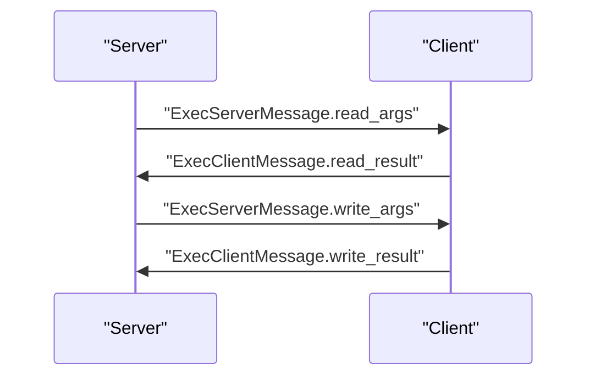

**Diagram sources**
- [agent_v1.proto:1890-1937](file://proto/agent_v1.proto#L1890-L1937)
- [agent_v1.proto:1815-1862](file://proto/agent_v1.proto#L1815-L1862)

#### Conversation Continuation
A typical conversation continuation flow:
1. Client sends `ConversationAction.user_message_action` or `ConversationAction.resume_action`.
2. Server processes the action and emits streaming updates.
3. Server may emit `ConversationCheckpointUpdate` to synchronize state.

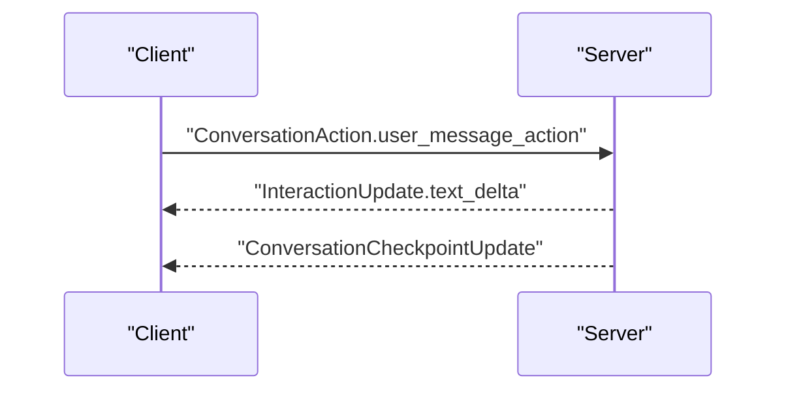

**Diagram sources**
- [agent_v1.proto:1012-1033](file://proto/agent_v1.proto#L1012-L1033)
- [agent_v1.proto:128-139](file://proto/agent_v1.proto#L128-L139)
- [agent_v1.proto:2706-2733](file://proto/agent_v1.proto#L2706-L2733)

### Extension Protocols: Git Forge Integration
The Git forge extension protocol is defined in `git_forge_v1.proto`. It provides repository content retrieval, commit diffs, blame information, tree traversal, reference listing, fuzzy path search, merge preparation, rebase stack operations, and more.

Key capabilities include:
- Batch get repo content.
- Get commit diff with pagination.
- List commits and compare revisions.
- Get file history with diff stats.
- Grep across repositories.
- Prepare and compute merge commits.
- Fast-forward references.
- Resolve ref paths.
- List refs and tree paths.

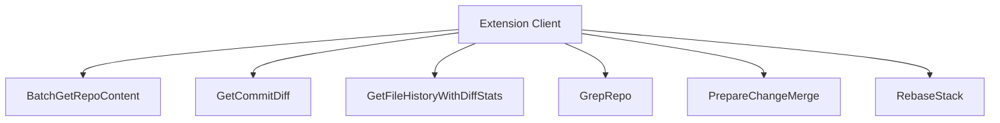

**Diagram sources**
- [git_forge_v1.proto:7-28](file://proto/from_extensions/git_forge_v1.proto#L7-L28)
- [git_forge_v1.proto:346-355](file://proto/from_extensions/git_forge_v1.proto#L346-L355)
- [git_forge_v1.proto:388-403](file://proto/from_extensions/git_forge_v1.proto#L388-L403)
- [git_forge_v1.proto:530-550](file://proto/from_extensions/git_forge_v1.proto#L530-L550)
- [git_forge_v1.proto:658-675](file://proto/from_extensions/git_forge_v1.proto#L658-L675)
- [git_forge_v1.proto:702-722](file://proto/from_extensions/git_forge_v1.proto#L702-L722)

**Section sources**
- [git_forge_v1.proto:7-28](file://proto/from_extensions/git_forge_v1.proto#L7-L28)
- [git_forge_v1.proto:346-355](file://proto/from_extensions/git_forge_v1.proto#L346-L355)
- [git_forge_v1.proto:388-403](file://proto/from_extensions/git_forge_v1.proto#L388-L403)
- [git_forge_v1.proto:530-550](file://proto/from_extensions/git_forge_v1.proto#L530-L550)
- [git_forge_v1.proto:658-675](file://proto/from_extensions/git_forge_v1.proto#L658-L675)
- [git_forge_v1.proto:702-722](file://proto/from_extensions/git_forge_v1.proto#L702-L722)

## Dependency Analysis
The protocol definitions are consumed by several components:

- The debugger decodes `BidiAppendRequest.data` and maps it to `AgentClientMessage` for human-readable logs.
- The inbound protocol module normalizes request IDs and decodes hex payloads into typed messages.
- The forwarder broker manages active streams, subscribers, backlog cursors, and terminal cleanup.
- The forwarder service handles model invocation, tool result recording, and conversation entry persistence.
- The debug recorder categorizes message types for observability.

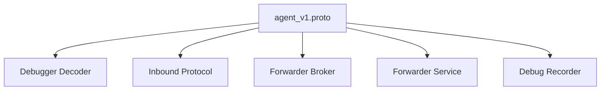

**Diagram sources**
- [decode.go:150-183](file://cursor-proxy-debugger/decode.go#L150-L183)
- [inbound.go:38-182](file://internal/backend/agent/protocol/inbound.go#L38-L182)
- [broker.go:42-134](file://internal/backend/forwarder/broker.go#L42-L134)
- [service.go:1669-1676](file://internal/backend/forwarder/service.go#L1669-L1676)
- [debug_recorder.go:327-371](file://internal/backend/forwarder/debug_recorder.go#L327-L371)

**Section sources**
- [decode.go:150-183](file://cursor-proxy-debugger/decode.go#L150-L183)
- [inbound.go:38-182](file://internal/backend/agent/protocol/inbound.go#L38-L182)
- [broker.go:42-134](file://internal/backend/forwarder/broker.go#L42-L134)
- [service.go:1669-1676](file://internal/backend/forwarder/service.go#L1669-L1676)
- [debug_recorder.go:327-371](file://internal/backend/forwarder/debug_recorder.go#L327-L371)

## Performance Considerations
- Use `ConversationStateStructure` efficiently: avoid sending excessively large serialized payloads; prefer checkpoint updates for incremental synchronization.
- Limit streaming event volume: batch small deltas where possible and rely on `InteractionUpdate` kinds that minimize redundant data.
- Manage executor backpressure: ensure `ExecClientMessage` results are returned promptly to avoid blocking the runtime.
- Monitor TTFT breakdowns: use `AgentServerMessage.ttft_breakdown` to identify latency hotspots in model invocation.
- Keep heartbeat intervals reasonable: use `ClientHeartbeat` and `ExecClientHeartbeat` to maintain liveness without excessive overhead.

[No sources needed since this section provides general guidance]

## Troubleshooting Guide
Common issues and how to diagnose them:

- Hex decoding failures:
  - Ensure `BidiAppendRequest.data` contains valid hex-encoded protobuf payloads.
  - Use the debugger to inspect decoded JSON and message kind.

- Missing client responses:
  - For `InteractionQuery`, verify the client sends `InteractionResponse` with the matching `id`.
  - For `ExecServerMessage`, verify the client sends `ExecClientMessage` with the matching `id` and `exec_id`.

- Stream termination:
  - Use `ExecClientControlMessage.stream_close` to cleanly terminate exec streams.
  - Handle `ExecClientControlMessage.throw` for error propagation.

- Conversation state drift:
  - Compare local `ConversationStateStructure` with server-emitted `ConversationCheckpointUpdate`.
  - Validate `pending_tool_calls` and `turns` consistency.

- Debugging utilities:
  - Use `DecodeAgentClientMessage` to decode hex payloads and extract message type labels.
  - Use `activeOneofName` and debug recorder helpers to identify active oneof fields.

**Section sources**
- [decode.go:150-183](file://cursor-proxy-debugger/decode.go#L150-L183)
- [inbound.go:38-182](file://internal/backend/agent/protocol/inbound.go#L38-L182)
- [debug_recorder.go:327-371](file://internal/backend/forwarder/debug_recorder.go#L327-L371)

## Conclusion
The Agent protocol uses `AgentClientMessage` and `AgentServerMessage` as the primary bidirectional channels, with well-defined envelopes for conversation actions, tool execution, interaction queries, and streaming updates. `ConversationStateStructure` enables robust conversation state management, while `ExecServerMessage`/`ExecClientMessage` provide a flexible tool call protocol. `InteractionQuery`/`InteractionResponse` support interactive workflows, and `InteractionUpdate` delivers rich streaming responses. Extension protocols such as Git forge integrate additional capabilities beyond the core agent runtime.

[No sources needed since this section summarizes without analyzing specific files]

## Appendices

### Message Type Reference Summary
- Client-to-server:
  - `AgentRunRequest`: start/continue agent runs.
  - `ConversationAction`: conversation lifecycle and control.
  - `ExecClientMessage`: tool execution results.
  - `ExecClientControlMessage`: exec stream control.
  - `KvClientMessage`: key-value operations.
  - `InteractionResponse`: answers to interaction queries.
  - `ClientHeartbeat`: keepalive.
  - `PrewarmRequest`: model prewarming.

- Server-to-client:
  - `InteractionUpdate`: streaming UI and runtime events.
  - `ExecServerMessage`: tool execution requests.
  - `ExecServerControlMessage`: server-side exec control.
  - `ConversationCheckpointUpdate`: conversation state synchronization.
  - `KvServerMessage`: key-value requests.
  - `InteractionQuery`: interactive prompts.

**Section sources**
- [agent_v1.proto:56-68](file://proto/agent_v1.proto#L56-L68)
- [agent_v1.proto:128-139](file://proto/agent_v1.proto#L128-L139)
- [agent_v1.proto:99-126](file://proto/agent_v1.proto#L99-L126)
- [agent_v1.proto:1012-1033](file://proto/agent_v1.proto#L1012-L1033)
- [agent_v1.proto:1815-1862](file://proto/agent_v1.proto#L1815-L1862)
- [agent_v1.proto:1890-1937](file://proto/agent_v1.proto#L1890-L1937)
- [agent_v1.proto:2671-2704](file://proto/agent_v1.proto#L2671-L2704)
- [agent_v1.proto:2706-2733](file://proto/agent_v1.proto#L2706-L2733)