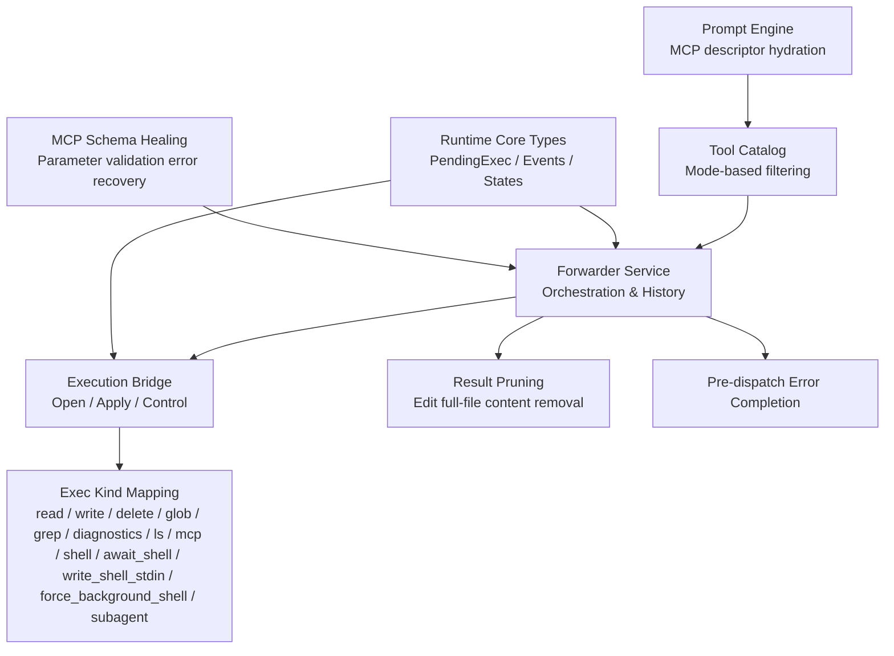
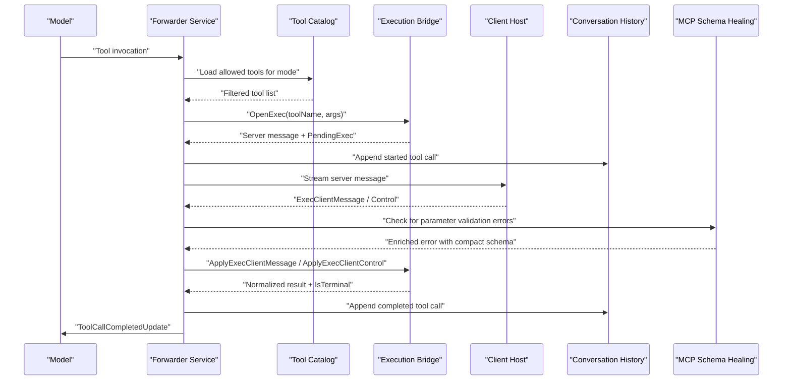
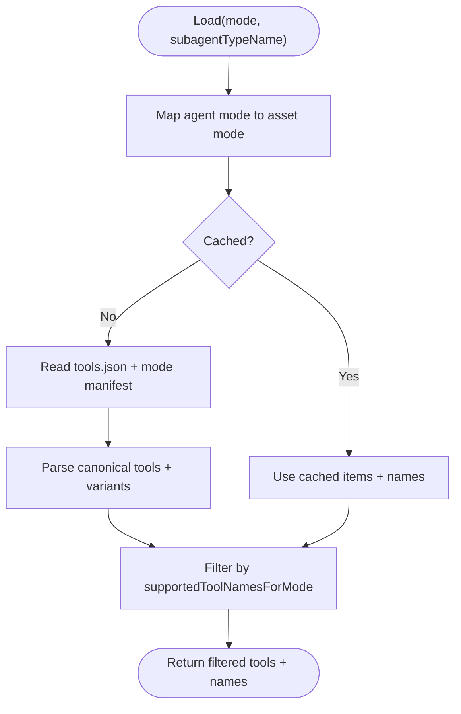
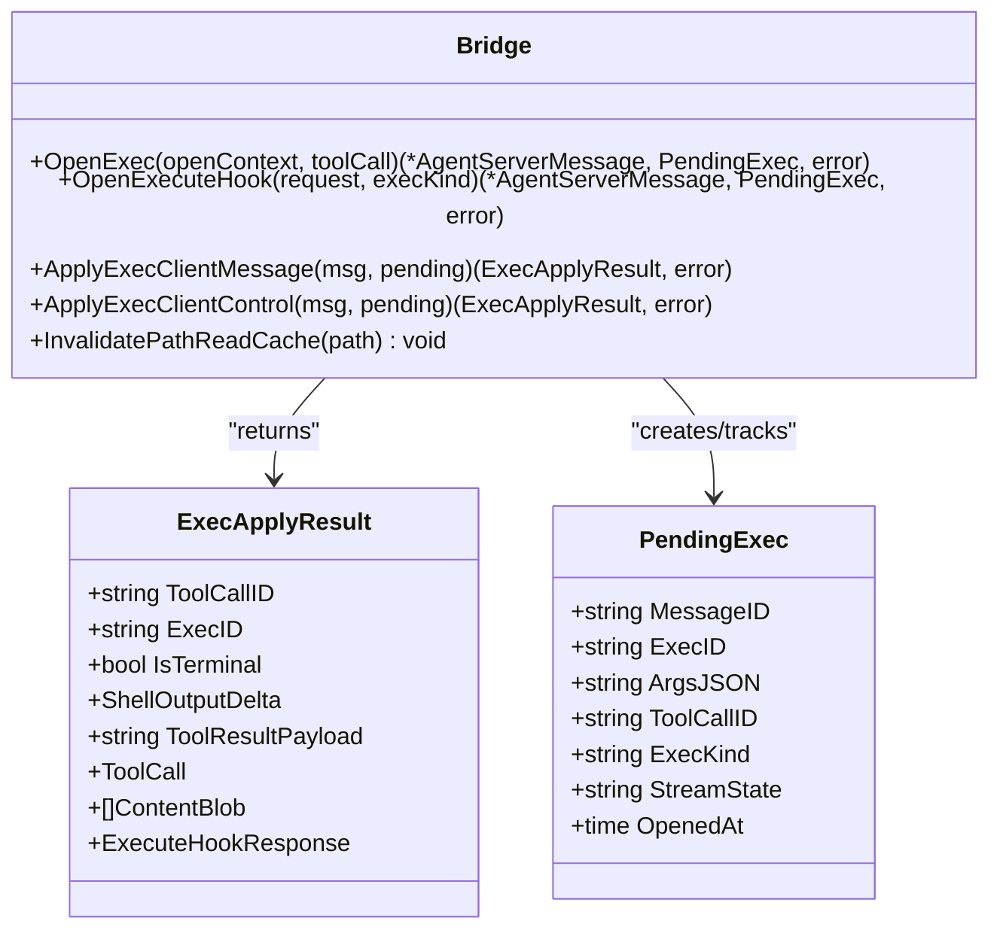
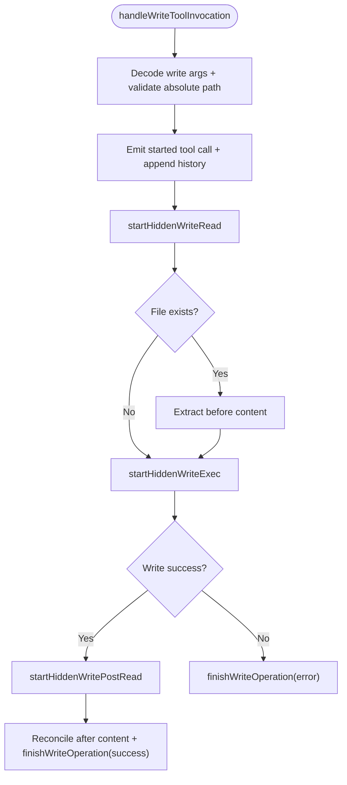
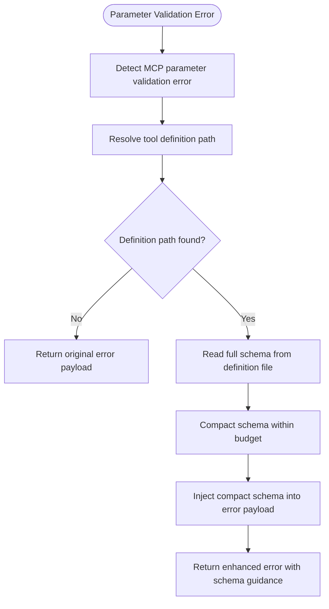
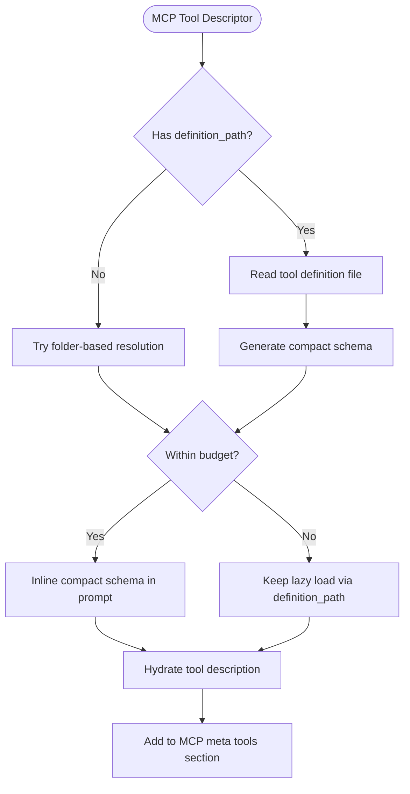
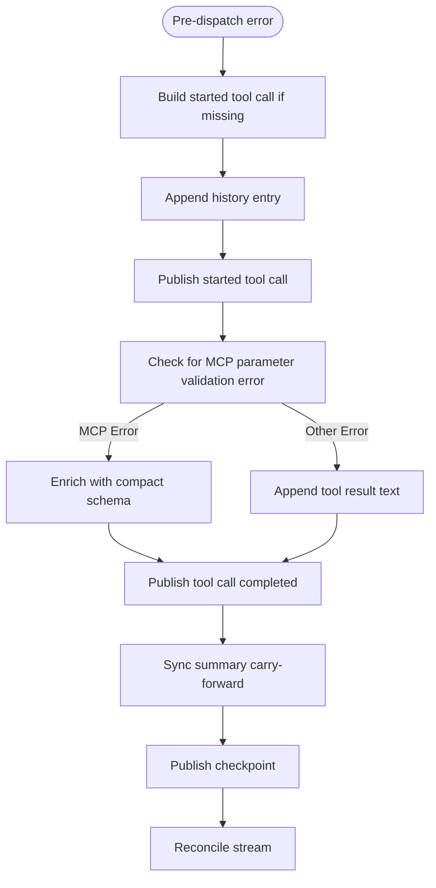
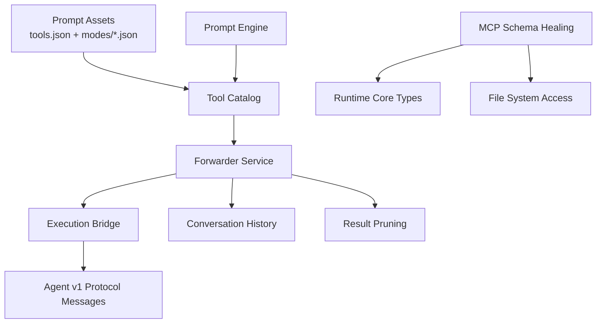

# Tool Execution Engine

<cite>
**Referenced Files in This Document**
- [tool_catalog.go](file://internal/backend/forwarder/tool_catalog.go)
- [tools.json](file://prompt/tools.json)
- [agent.json](file://prompt/modes/agent.json)
- [bridge.go](file://internal/backend/agent/bridge/exec/bridge.go)
- [service.go](file://internal/backend/forwarder/service.go)
- [write_tool.go](file://internal/backend/forwarder/write_tool.go)
- [tool_error_completion.go](file://internal/backend/forwarder/tool_error_completion.go)
- [tool_result_pruning.go](file://internal/backend/forwarder/tool_result_pruning.go)
- [mcp_schema_heal.go](file://internal/backend/forwarder/mcp_schema_heal.go)
- [types.go](file://internal/backend/agent/core/types.go)
- [engine.go](file://internal/backend/agent/prompt/engine.go)
- [local_discovery.go](file://internal/backend/agent/prompt/local_discovery.go)
- [request_context.go](file://internal/backend/forwarder/request_context.go)
</cite>

## Update Summary
**Changes Made**
- Added MCP Schema Discovery and Error Healing section documenting compact schema processing and parameter validation error healing
- Enhanced MCP Descriptor Hydration section with improved prompt engine integration
- Updated Parameter Validation section to include error healing mechanisms
- Added new diagrams illustrating MCP schema discovery and error healing workflows
- Expanded security considerations for MCP tool/resource calls

## Table of Contents
1. [Introduction](#introduction)
2. [Project Structure](#project-structure)
3. [Core Components](#core-components)
4. [Architecture Overview](#architecture-overview)
5. [Detailed Component Analysis](#detailed-component-analysis)
6. [Dependency Analysis](#dependency-analysis)
7. [Performance Considerations](#performance-considerations)
8. [Troubleshooting Guide](#troubleshooting-guide)
9. [Conclusion](#conclusion)

## Introduction
This document explains the tool execution engine that powers Cursor's Agent capabilities. It covers how tools are discovered, registered, filtered by mode, and executed through a streaming bridge protocol. It also documents the tool catalog system, parameter validation, result processing, error handling, integration with file system operations, shell commands, MCP resources, external APIs, subagent delegation, concurrent execution, resource management, and performance optimization strategies.

**Updated** Enhanced with MCP schema discovery, compact schema processing, parameter validation error healing, and improved MCP descriptor hydration in the prompt engine.

## Project Structure
The tool execution engine is implemented across several layers:
- Tool catalog discovery and filtering based on agent mode and conversation context.
- A streaming execution bridge that maps canonical tool names to internal execution kinds.
- Forwarder orchestration for write workflows, hidden multi-step writes, control messages, and result pruning.
- Runtime core types describing pending executions, events, and state transitions.
- Prompt engine integration for MCP descriptors and tool metadata exposure.
- MCP schema discovery and error healing for enhanced parameter validation.

**Diagram sources**
- [tool_catalog.go:57-99](file://internal/backend/forwarder/tool_catalog.go#L57-L99)
- [bridge.go:102-136](file://internal/backend/agent/bridge/exec/bridge.go#L102-L136)
- [service.go:4206-4253](file://internal/backend/forwarder/service.go#L4206-L4253)
- [tool_result_pruning.go:8-30](file://internal/backend/forwarder/tool_result_pruning.go#L8-L30)
- [tool_error_completion.go:50-99](file://internal/backend/forwarder/tool_error_completion.go#L50-L99)
- [types.go:76-125](file://internal/backend/agent/core/types.go#L76-L125)
- [engine.go:797-828](file://internal/backend/agent/prompt/engine.go#L797-L828)
- [mcp_schema_heal.go:48-62](file://internal/backend/forwarder/mcp_schema_heal.go#L48-L62)

**Section sources**
- [tool_catalog.go:57-99](file://internal/backend/forwarder/tool_catalog.go#L57-L99)
- [bridge.go:102-136](file://internal/backend/agent/bridge/exec/bridge.go#L102-L136)
- [service.go:4206-4253](file://internal/backend/forwarder/service.go#L4206-L4253)
- [types.go:76-125](file://internal/backend/agent/core/types.go#L76-L125)

## Core Components
- Tool Catalog: Loads static tool definitions from prompt assets, deduplicates canonical tools, selects variants per mode, and filters allowed tools per conversation type.
- Execution Bridge: Maps canonical tool names to internal exec kinds, opens streaming requests, normalizes client results, and handles control messages.
- Forwarder Orchestration: Manages write workflows (pre-read, write, post-read), publishes history entries, emits started/completed tool calls, and prunes large payloads.
- Runtime Core: Defines pending execution tracking, event kinds, run states, and command kinds used throughout the pipeline.
- Prompt Engine Integration: Hydrates MCP descriptors into prompts, including tool descriptions and input schemas.
- MCP Schema Healing: Provides parameter validation error recovery with compact schema injection and lazy loading mechanisms.

**Updated** Added MCP Schema Healing component for enhanced parameter validation error recovery.

**Section sources**
- [tool_catalog.go:57-99](file://internal/backend/forwarder/tool_catalog.go#L57-L99)
- [bridge.go:102-136](file://internal/backend/agent/bridge/exec/bridge.go#L102-L136)
- [write_tool.go:42-85](file://internal/backend/forwarder/write_tool.go#L42-L85)
- [types.go:76-125](file://internal/backend/agent/core/types.go#L76-L125)
- [engine.go:797-828](file://internal/backend/agent/prompt/engine.go#L797-L828)
- [mcp_schema_heal.go:48-62](file://internal/backend/forwarder/mcp_schema_heal.go#L48-L62)

## Architecture Overview
The tool execution engine follows a layered architecture:
- Discovery Layer: The tool catalog reads embedded tool definitions and mode manifests, then filters tools based on agent mode and subagent context.
- Dispatch Layer: The forwarder receives model-invoked tool calls, validates parameters, and dispatches them to the execution bridge or specialized handlers.
- Execution Layer: The execution bridge translates tool calls into streaming server messages, tracks pending executions, and normalizes client responses.
- Result Layer: Results are summarized, pruned, and emitted as completed tool calls; history entries are appended and checkpoints published.
- Enhancement Layer: MCP schema discovery and error healing provide intelligent parameter validation recovery with compact schema processing.

**Diagram sources**
- [tool_catalog.go:62-99](file://internal/backend/forwarder/tool_catalog.go#L62-L99)
- [bridge.go:102-136](file://internal/backend/agent/bridge/exec/bridge.go#L102-L136)
- [write_tool.go:61-85](file://internal/backend/forwarder/write_tool.go#L61-L85)
- [service.go:4206-4253](file://internal/backend/forwarder/service.go#L4206-L4253)
- [mcp_schema_heal.go:48-62](file://internal/backend/forwarder/mcp_schema_heal.go#L48-L62)

## Detailed Component Analysis

### Tool Catalog System
The tool catalog loads tool definitions from embedded assets, deduplicates canonical tools by function name, resolves variants per mode, and filters tools based on agent mode and subagent context. It caches loaded catalogs per asset mode to avoid repeated parsing.

Key behaviors:
- Load mode mapping: Converts agent protocol modes to prompt asset modes.
- Allowed tool sets: Maintains explicit allowlists per mode (agent, ask, plan, debug, multitask).
- Subagent restrictions: Child conversations disallow specific tools like AskQuestion.
- Name extraction: Extracts function names from raw tool descriptors.

**Diagram sources**
- [tool_catalog.go:62-99](file://internal/backend/forwarder/tool_catalog.go#L62-L99)
- [tool_catalog.go:221-275](file://internal/backend/forwarder/tool_catalog.go#L221-L275)
- [tool_catalog.go:283-313](file://internal/backend/forwarder/tool_catalog.go#L283-L313)
- [agent.json:1-26](file://prompt/modes/agent.json#L1-L26)

**Section sources**
- [tool_catalog.go:57-99](file://internal/backend/forwarder/tool_catalog.go#L57-L99)
- [tool_catalog.go:221-275](file://internal/backend/forwarder/tool_catalog.go#L221-L275)
- [tool_catalog.go:283-313](file://internal/backend/forwarder/tool_catalog.go#L283-L313)
- [tools.json:1-750](file://prompt/tools.json#L1-L750)
- [agent.json:1-26](file://prompt/modes/agent.json#L1-L26)

### Execution Bridge and Streaming Protocol
The execution bridge maps canonical tool names to internal exec kinds and manages a streaming protocol between the forwarder and the client host. It supports read, write, delete, glob, grep, diagnostics, ls, MCP tools/resources, shell, await shell, write shell stdin, force background shell, and subagent task delegation.

Key responsibilities:
- OpenExec: Translates tool invocations into server messages and pending executions.
- ApplyExecClientMessage: Normalizes client results, summarizes payloads, and marks terminal outcomes.
- ApplyExecClientControl: Handles stream close, heartbeat, and other control signals.
- Read cache invalidation: Invalidates path-based read cache after writes.

**Diagram sources**
- [bridge.go:62-74](file://internal/backend/agent/bridge/exec/bridge.go#L62-L74)
- [bridge.go:87-100](file://internal/backend/agent/bridge/exec/bridge.go#L87-L100)
- [bridge.go:102-136](file://internal/backend/agent/bridge/exec/bridge.go#L102-L136)
- [bridge.go:167-200](file://internal/backend/agent/bridge/exec/bridge.go#L167-L200)
- [bridge.go:346-357](file://internal/backend/agent/bridge/exec/bridge.go#L346-L357)

**Section sources**
- [bridge.go:102-136](file://internal/backend/agent/bridge/exec/bridge.go#L102-L136)
- [bridge.go:167-200](file://internal/backend/agent/bridge/exec/bridge.go#L167-L200)
- [bridge.go:346-357](file://internal/backend/agent/bridge/exec/bridge.go#L346-L357)

### Write Tool Workflow and Hidden Multi-step Writes
The write tool workflow ensures safe edits by reading before writing, performing the write, and optionally reading after to reconcile observed content. It uses hidden exec kinds to orchestrate these steps transparently while emitting user-visible started/completed tool calls.

Workflow stages:
- Pre-write read: Reads current file content to compute diffs and validate existence.
- Write execution: Sends contents to the client host via streaming write.
- Post-write reconciliation: Optionally re-reads to reconcile observed content and produce accurate diffs.

**Diagram sources**
- [write_tool.go:42-85](file://internal/backend/forwarder/write_tool.go#L42-L85)
- [write_tool.go:87-124](file://internal/backend/forwarder/write_tool.go#L87-L124)
- [write_tool.go:126-167](file://internal/backend/forwarder/write_tool.go#L126-L167)
- [write_tool.go:169-206](file://internal/backend/forwarder/write_tool.go#L169-L206)
- [write_tool.go:208-270](file://internal/backend/forwarder/write_tool.go#L208-L270)
- [write_tool.go:295-322](file://internal/backend/forwarder/write_tool.go#L295-L322)

**Section sources**
- [write_tool.go:42-85](file://internal/backend/forwarder/write_tool.go#L42-L85)
- [write_tool.go:87-124](file://internal/backend/forwarder/write_tool.go#L87-L124)
- [write_tool.go:126-167](file://internal/backend/forwarder/write_tool.go#L126-L167)
- [write_tool.go:169-206](file://internal/backend/forwarder/write_tool.go#L169-L206)
- [write_tool.go:208-270](file://internal/backend/forwarder/write_tool.go#L208-L270)
- [write_tool.go:295-322](file://internal/backend/forwarder/write_tool.go#L295-L322)

### MCP Schema Discovery and Error Healing
**New Section** The MCP schema discovery and error healing system provides intelligent parameter validation recovery by analyzing error messages and injecting compact schemas when parameter validation fails.

Key components:
- Error Detection: Identifies MCP parameter validation errors using pattern matching against common error markers.
- Definition Path Resolution: Resolves tool definition paths from pending executions and active streams.
- Compact Schema Processing: Generates compact JSON schemas with budget constraints for efficient token usage.
- Lazy Loading: Falls back to lazy loading when schemas exceed inline budget limits.

**Diagram sources**
- [mcp_schema_heal.go:35-46](file://internal/backend/forwarder/mcp_schema_heal.go#L35-L46)
- [mcp_schema_heal.go:64-102](file://internal/backend/forwarder/mcp_schema_heal.go#L64-L102)
- [mcp_schema_heal.go:116-144](file://internal/backend/forwarder/mcp_schema_heal.go#L116-L144)

**Section sources**
- [mcp_schema_heal.go:17-62](file://internal/backend/forwarder/mcp_schema_heal.go#L17-L62)
- [mcp_schema_heal.go:64-102](file://internal/backend/forwarder/mcp_schema_heal.go#L64-L102)
- [mcp_schema_heal.go:116-174](file://internal/backend/forwarder/mcp_schema_heal.go#L116-L174)

### Parameter Validation and Result Processing
Parameter validation occurs early in the pipeline with enhanced error healing capabilities:
- Write arguments require an absolute path and valid contents fields.
- Shell commands include structured options for blocking, working directory, and output monitoring.
- MCP tool/resource calls require server identifiers and URIs or tool names.
- **Enhanced** Parameter validation errors trigger automatic schema healing with compact JSON injection.

Result processing includes:
- Summarization of read/write results for model consumption.
- Content blob storage for binary image data.
- Pruning of edit payloads to remove full-file content and truncate large shell outputs.
- **Enhanced** Error enrichment with MCP parameter validation schemas when detected.

**Updated** Added MCP parameter validation error healing and compact schema injection.

**Section sources**
- [write_tool.go:324-340](file://internal/backend/forwarder/write_tool.go#L324-L340)
- [tools.json:312-367](file://prompt/tools.json#L312-L367)
- [tools.json:118-145](file://prompt/tools.json#L118-L145)
- [tool_result_pruning.go:8-30](file://internal/backend/forwarder/tool_result_pruning.go#L8-L30)
- [mcp_schema_heal.go:48-62](file://internal/backend/forwarder/mcp_schema_heal.go#L48-L62)

### MCP Descriptor Hydration in Prompt Engine
**Enhanced Section** The prompt engine now provides sophisticated MCP descriptor hydration with compact schema processing and intelligent fallback mechanisms.

Key enhancements:
- Compact Schema Processing: Generates optimized JSON schemas that preserve required fields and types while removing verbose descriptions.
- Budget-Aware Inlining: Uses tiered budgets (1200 bytes for full schema, 600 bytes for slim variant) to balance detail vs. token efficiency.
- Lazy Loading Fallback: Automatically falls back to lazy loading when schemas exceed inline budget limits.
- Description Fallback: Provides built-in descriptions for known tools like fast_context_search when file descriptions are missing.

**Diagram sources**
- [local_discovery.go:659-697](file://internal/backend/agent/prompt/local_discovery.go#L659-L697)
- [local_discovery.go:699-755](file://internal/backend/agent/prompt/local_discovery.go#L699-L755)
- [local_discovery.go:757-805](file://internal/backend/agent/prompt/local_discovery.go#L757-L805)

**Section sources**
- [local_discovery.go:650-805](file://internal/backend/agent/prompt/local_discovery.go#L650-L805)
- [engine.go:690-701](file://internal/backend/agent/prompt/engine.go#L690-L701)
- [engine.go:771-828](file://internal/backend/agent/prompt/engine.go#L771-L828)

### Error Handling Mechanisms
Error handling spans pre-dispatch failures and streaming control flows with enhanced MCP parameter validation support:
- Recoverable tool invocation errors emit started tool calls, append tool results, publish completion, sync summaries, and reconcile streams.
- Hidden write control messages handle stream close and non-streaming recovery.
- Terminal stream errors map to structured Connect errors with provider-specific details.
- **Enhanced** MCP parameter validation errors are automatically enriched with compact schemas for intelligent retry guidance.

**Diagram sources**
- [tool_error_completion.go:50-99](file://internal/backend/forwarder/tool_error_completion.go#L50-L99)
- [write_tool.go:272-293](file://internal/backend/forwarder/write_tool.go#L272-L293)
- [service.go:4280-4352](file://internal/backend/forwarder/service.go#L4280-L4352)
- [mcp_schema_heal.go:48-62](file://internal/backend/forwarder/mcp_schema_heal.go#L48-L62)

**Section sources**
- [tool_error_completion.go:50-99](file://internal/backend/forwarder/tool_error_completion.go#L50-L99)
- [write_tool.go:272-293](file://internal/backend/forwarder/write_tool.go#L272-L293)
- [service.go:4280-4352](file://internal/backend/forwarder/service.go#L4280-L4352)
- [mcp_schema_heal.go:48-62](file://internal/backend/forwarder/mcp_schema_heal.go#L48-L62)

### Integration with File System, Shell, and External APIs
- File system operations: Read, Write, Delete, Glob, Grep, Ls, ReadLints provide structured access to files, directories, and diagnostics.
- Shell commands: Shell, AwaitShell, WriteShellStdin, ForceBackgroundShell enable non-interactive command execution with backgrounding and monitoring.
- External APIs: WebFetch and WebSearch integrate web retrieval and search capabilities.
- MCP integration: CallMcpTool and FetchMcpResource invoke external MCP servers and resources, with descriptors hydrated into prompts and enhanced parameter validation support.

**Updated** Enhanced MCP integration with improved descriptor hydration and parameter validation error healing.

**Section sources**
- [tools.json:100-117](file://prompt/tools.json#L100-L117)
- [tools.json:146-168](file://prompt/tools.json#L146-L168)
- [tools.json:169-238](file://prompt/tools.json#L169-L238)
- [tools.json:239-265](file://prompt/tools.json#L239-L265)
- [tools.json:266-291](file://prompt/tools.json#L266-L291)
- [tools.json:292-310](file://prompt/tools.json#L292-L310)
- [tools.json:312-367](file://prompt/tools.json#L312-L367)
- [tools.json:368-434](file://prompt/tools.json#L368-L434)
- [tools.json:592-633](file://prompt/tools.json#L592-L633)
- [tools.json:73-98](file://prompt/tools.json#L73-L98)
- [tools.json:118-145](file://prompt/tools.json#L118-L145)
- [engine.go:797-828](file://internal/backend/agent/prompt/engine.go#L797-L828)

### Built-in Tools and Custom Tool Development
Built-in tools include:
- File operations: Read, Write, PatchEdit, Delete, Glob, Grep, Ls, ReadLints.
- Shell operations: Shell, AwaitShell, WriteShellStdin, ForceBackgroundShell.
- Interaction and planning: AskQuestion, SwitchMode, CreatePlan, TodoWrite.
- External integrations: WebFetch, WebSearch, CallMcpTool, FetchMcpResource, Task.

Custom tool development guidance:
- Define tool descriptors in prompt assets with function name, description, and parameters.
- Ensure tool names match allowed sets per mode.
- Implement corresponding exec kind mappings in the bridge if introducing new execution types.
- Add mode manifest entries to expose tools in specific agent modes.
- **Enhanced** Provide definition files with proper argument schemas for optimal MCP integration.

**Updated** Added guidance for MCP definition files and argument schemas.

**Section sources**
- [tools.json:1-750](file://prompt/tools.json#L1-L750)
- [tool_catalog.go:101-215](file://internal/backend/forwarder/tool_catalog.go#L101-L215)
- [bridge.go:102-136](file://internal/backend/agent/bridge/exec/bridge.go#L102-L136)
- [agent.json:1-26](file://prompt/modes/agent.json#L1-L26)

### Security Sandboxing and Concurrency Controls
Security and sandboxing considerations:
- Path validation enforces absolute paths for write operations.
- Shell commands are non-interactive and discourage dumping large outputs.
- Background shell execution requires explicit approval and monitoring patterns.
- MCP tool/resource calls require server identifiers and URIs, reducing arbitrary network access.
- **Enhanced** MCP parameter validation errors are safely enriched without exposing sensitive file paths.

Concurrency controls:
- Pending executions are tracked by unique IDs and matched strictly by exec_id or message_id.
- Late-arriving results are handled idempotently using recent completed executions.
- Hidden write workflows coordinate multiple steps without blocking the main turn.
- **Enhanced** MCP schema healing uses thread-safe caching with mutex protection for concurrent access.

**Updated** Added security considerations for MCP parameter validation error healing and concurrency controls.

**Section sources**
- [write_tool.go:324-340](file://internal/backend/forwarder/write_tool.go#L324-L340)
- [tools.json:312-367](file://prompt/tools.json#L312-L367)
- [tools.json:368-434](file://prompt/tools.json#L368-L434)
- [tools.json:73-98](file://prompt/tools.json#L73-L98)
- [tools.json:118-145](file://prompt/tools.json#L118-L145)
- [mcp_schema_heal.go:109-112](file://internal/backend/forwarder/mcp_schema_heal.go#L109-L112)

## Dependency Analysis
The tool execution engine exhibits clear separation of concerns:
- Tool catalog depends on prompt assets and mode manifests.
- Execution bridge depends on protocol messages and runtime core types.
- Forwarder orchestrates catalog, bridge, history, and result pruning.
- Prompt engine hydrates MCP descriptors into prompts.
- MCP schema healing depends on runtime core types and file system access for definition files.

**Diagram sources**
- [tool_catalog.go:62-99](file://internal/backend/forwarder/tool_catalog.go#L62-L99)
- [bridge.go:102-136](file://internal/backend/agent/bridge/exec/bridge.go#L102-L136)
- [tool_result_pruning.go:8-30](file://internal/backend/forwarder/tool_result_pruning.go#L8-L30)
- [engine.go:797-828](file://internal/backend/agent/prompt/engine.go#L797-L828)
- [mcp_schema_heal.go:14-15](file://internal/backend/forwarder/mcp_schema_heal.go#L14-L15)

**Section sources**
- [tool_catalog.go:62-99](file://internal/backend/forwarder/tool_catalog.go#L62-L99)
- [bridge.go:102-136](file://internal/backend/agent/bridge/exec/bridge.go#L102-L136)
- [tool_result_pruning.go:8-30](file://internal/backend/forwarder/tool_result_pruning.go#L8-L30)
- [engine.go:797-828](file://internal/backend/agent/prompt/engine.go#L797-L828)
- [mcp_schema_heal.go:14-15](file://internal/backend/forwarder/mcp_schema_heal.go#L14-L15)

## Performance Considerations
Optimization strategies implemented in the engine:
- Catalog caching: Tool catalogs are cached per asset mode to avoid repeated parsing.
- Read cache invalidation: Path-based read cache is invalidated after writes to prevent stale results.
- Result pruning: Edit payloads strip full-file content and truncate large shell outputs to reduce context bloat.
- Parallel batching: Independent tool calls can be batched in a single response to improve throughput.
- Background execution: Shell commands support backgrounding and monitoring to avoid blocking turns.
- **Enhanced** MCP schema caching: Definition files and compact schemas are cached with modTime-based invalidation.
- **Enhanced** Budget-aware schema processing: Tiered budgets ensure optimal token usage while preserving essential schema information.

Recommendations:
- Prefer dedicated tools over generic shell commands to minimize overhead.
- Use pagination and limits for large file reads and searches.
- Batch independent operations within a single turn when safe.
- Monitor shell output with stable regex patterns to avoid excessive notifications.
- **Enhanced** Provide well-structured MCP definition files to maximize compact schema effectiveness.

**Updated** Added MCP schema caching and budget-aware processing optimizations.

**Section sources**
- [tool_catalog.go:18-52](file://internal/backend/forwarder/tool_catalog.go#L18-L52)
- [bridge.go:186-198](file://internal/backend/agent/bridge/exec/bridge.go#L186-L198)
- [tool_result_pruning.go:8-30](file://internal/backend/forwarder/tool_result_pruning.go#L8-L30)
- [tools.json:239-265](file://prompt/tools.json#L239-L265)
- [tools.json:312-367](file://prompt/tools.json#L312-L367)
- [mcp_schema_heal.go:109-144](file://internal/backend/forwarder/mcp_schema_heal.go#L109-L144)
- [local_discovery.go:650-657](file://internal/backend/agent/prompt/local_discovery.go#L650-L657)

## Troubleshooting Guide
Common issues and resolutions:
- Unsupported exec tool: Ensure the tool name matches a known exec kind mapping.
- Missing pending exec: Verify strict matching by exec_id or message_id; late results should be ignored idempotently.
- Write path validation errors: Confirm absolute paths and correct field names.
- Large context growth: Enable result pruning and avoid dumping full file contents.
- Shell timeout or permission denied: Check block_until_ms, notify_on_output, and permissions.
- **Enhanced** MCP parameter validation errors: Check if the tool has a proper definition file with argument schemas; the system will automatically inject compact schemas for intelligent retry guidance.

Debugging utilities:
- Pre-dispatch error completion logs started tool calls and results even on failure.
- Terminal stream errors map to structured Connect errors with provider details.
- Hidden write workflows log intermediate steps and reconcile observed content.
- **Enhanced** MCP schema healing provides detailed error messages with compact schemas when parameter validation fails.

**Updated** Added troubleshooting guidance for MCP parameter validation errors and schema healing.

**Section sources**
- [bridge.go:133-135](file://internal/backend/agent/bridge/exec/bridge.go#L133-L135)
- [service.go:1352-1380](file://internal/backend/forwarder/service.go#L1352-L1380)
- [write_tool.go:324-340](file://internal/backend/forwarder/write_tool.go#L324-L340)
- [tool_error_completion.go:50-99](file://internal/backend/forwarder/tool_error_completion.go#L50-L99)
- [service.go:4280-4352](file://internal/backend/forwarder/service.go#L4280-L4352)
- [mcp_schema_heal.go:35-46](file://internal/backend/forwarder/mcp_schema_heal.go#L35-L46)

## Conclusion
Cursor's tool execution engine provides a robust, mode-aware, and streaming-first architecture for executing tools safely and efficiently. The tool catalog system ensures only appropriate tools are exposed per conversation context. The execution bridge standardizes tool invocation and result normalization across file system, shell, MCP, and external API integrations. Forwarder orchestration adds safety through hidden multi-step workflows, comprehensive error handling, and aggressive result pruning to maintain performance. 

**Enhanced** With the addition of MCP schema discovery and error healing, the engine now provides intelligent parameter validation recovery that transforms guesswork retries into informed corrections. The compact schema processing and budget-aware hydration mechanisms ensure optimal token usage while maintaining essential schema information. These enhancements significantly improve the reliability and usability of MCP tool interactions, making the agent more resilient to parameter validation failures while maintaining performance and security standards.

With careful parameter validation, concurrency controls, sandboxing practices, and intelligent error healing, the engine supports complex agent workflows while minimizing context bloat and risk.