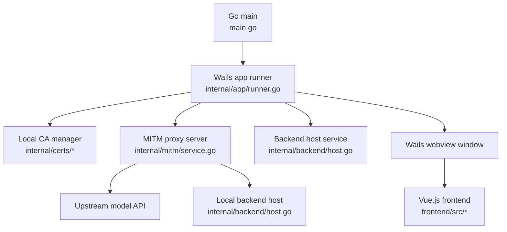
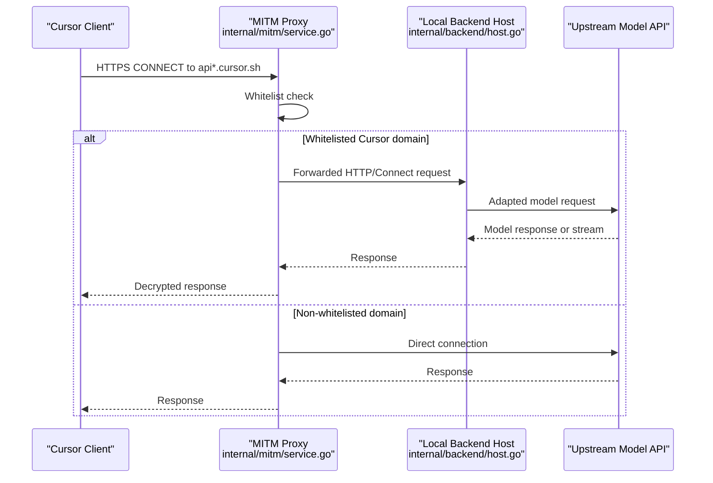
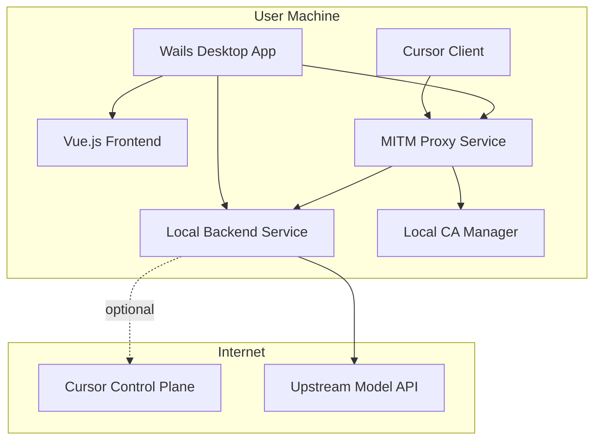
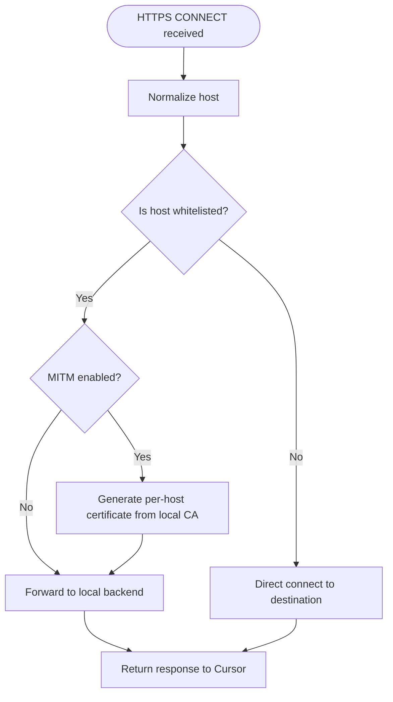
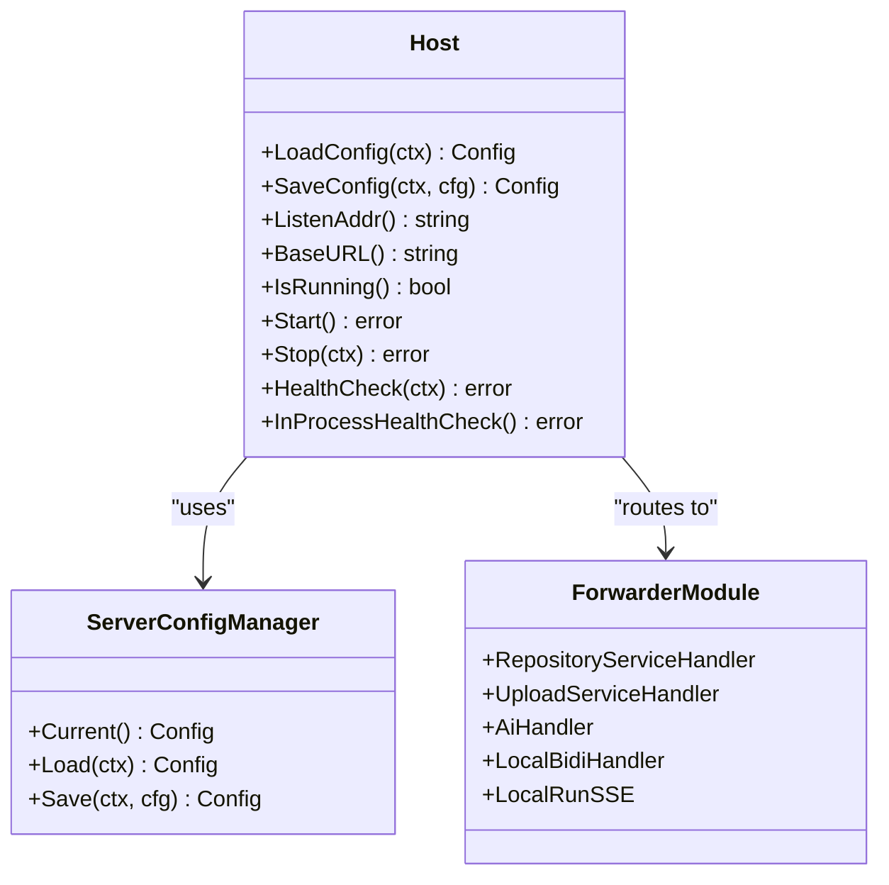
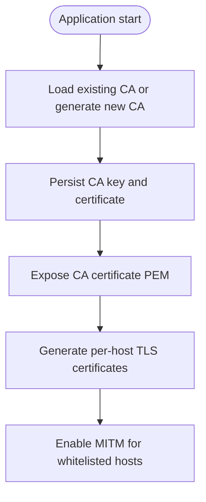
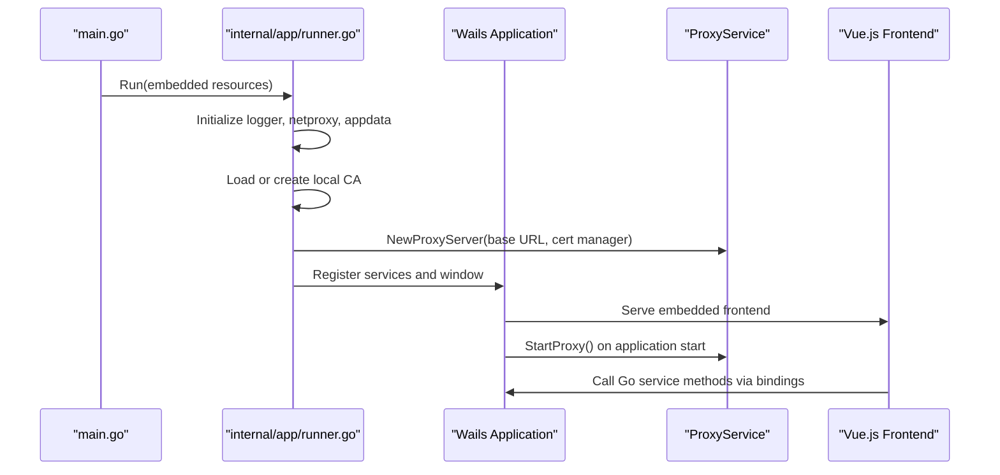
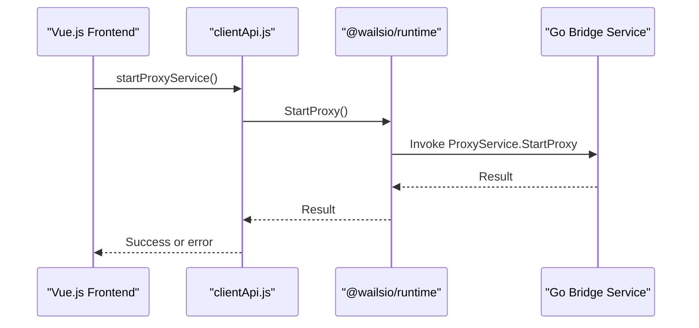
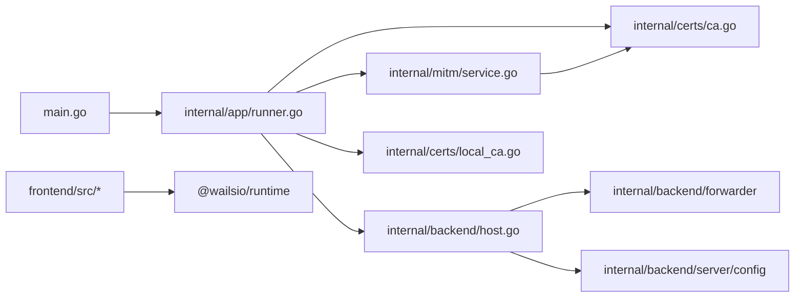

# Architecture Overview

<cite>
**Referenced Files in This Document**   
- [main.go](file://main.go)
- [runner.go](file://internal/app/runner.go)
- [service.go](file://internal/mitm/service.go)
- [host.go](file://internal/backend/host.go)
- [ca.go](file://internal/certs/ca.go)
- [local_ca.go](file://internal/certs/local_ca.go)
- [App.vue](file://frontend/src/App.vue)
- [package.json](file://frontend/package.json)
- [clientApi.js](file://frontend/src/services/clientApi.js)
- [README.md](file://README.md)
</cite>

## Table of Contents
1. [Introduction](#introduction)
2. [Project Structure](#project-structure)
3. [Core Components](#core-components)
4. [Architecture Overview](#architecture-overview)
5. [Detailed Component Analysis](#detailed-component-analysis)
6. [Dependency Analysis](#dependency-analysis)
7. [Performance Considerations](#performance-considerations)
8. [Troubleshooting Guide](#troubleshooting-guide)
9. [Conclusion](#conclusion)

## Introduction
cursor-byok is a local model gateway for Cursor. It runs on the user’s machine and acts as a bridge between the Cursor client and upstream model APIs. The application embeds a Wails-based desktop UI, manages a local backend service that emulates parts of Cursor’s control plane, and provides an HTTPS MITM proxy that intercepts Cursor traffic to route selected requests through the local backend before forwarding them to configured model providers.

The high-level goal is to return model choice to the user: instead of being locked into Cursor’s bundled models and billing, users can configure OpenAI-compatible or Anthropic-compatible endpoints, customize credentials and request parameters, and keep Cursor Agent capabilities such as tool calling, Skills, and MCP.

**Section sources**
- [README.md:1-10](file://README.md#L1-L10)
- [README.md:54-102](file://README.md#L54-L102)

## Project Structure
At runtime, the Go entry point embeds the built Vue.js frontend and starts the Wails application. The Wails app initializes logging, network transport, application data directories, a local certificate authority, the MITM proxy, the backend host, and the desktop window.

**Diagram sources**
- [main.go:1-30](file://main.go#L1-L30)
- [runner.go:120-190](file://internal/app/runner.go#L120-L190)
- [service.go:180-206](file://internal/mitm/service.go#L180-L206)
- [host.go:44-64](file://internal/backend/host.go#L44-L64)
- [App.vue:1-56](file://frontend/src/App.vue#L1-L56)

**Section sources**
- [main.go:1-30](file://main.go#L1-L30)
- [runner.go:120-190](file://internal/app/runner.go#L120-L190)
- [package.json:1-40](file://frontend/package.json#L1-L40)

## Core Components
- **Application entrypoint**: `main.go` loads embedded frontend assets and delegates lifecycle to `app.Run`.
- **Wails application runner**: `internal/app/runner.go` wires services, creates the system tray, manages single-instance behavior, auto-starts the proxy, and exposes events to the frontend.
- **MITM proxy**: `internal/mitm/service.go` implements an HTTPS CONNECT proxy using goproxy, optionally intercepting Cursor domains with a locally generated CA.
- **Backend host**: `internal/backend/host.go` runs a local HTTP/Connect server that emulates Cursor control-plane routes and forwards agent traffic to model adapters.
- **Certificate management**: `internal/certs/ca.go` and `internal/certs/local_ca.go` manage installation-specific CA keys, per-host certificate generation, and trust material.
- **Frontend**: A Vue.js application served by Wails, communicating with Go services via generated bindings and Wails runtime calls.

**Section sources**
- [main.go:1-30](file://main.go#L1-L30)
- [runner.go:120-190](file://internal/app/runner.go#L120-L190)
- [service.go:180-206](file://internal/mitm/service.go#L180-L206)
- [host.go:44-64](file://internal/backend/host.go#L44-L64)
- [ca.go:23-79](file://internal/certs/ca.go#L23-L79)
- [local_ca.go:22-56](file://internal/certs/local_ca.go#L22-L56)
- [App.vue:1-56](file://frontend/src/App.vue#L1-L56)

## Architecture Overview
The system has three primary runtime layers:

1. **Cursor client layer**: Cursor sends agent requests and tool results to the local proxy.
2. **Local service layer**: The MITM proxy intercepts HTTPS connections to Cursor domains, forwards whitelisted requests to the local backend, and passes other traffic directly to the internet.
3. **Model provider layer**: The local backend adapts Cursor protocol requests to OpenAI/Anthropic-compatible model APIs and returns responses back through the proxy to Cursor.

**Diagram sources**
- [service.go:360-450](file://internal/mitm/service.go#L360-L450)
- [service.go:453-488](file://internal/mitm/service.go#L453-L488)
- [service.go:635-658](file://internal/mitm/service.go#L635-L658)
- [host.go:296-510](file://internal/backend/host.go#L296-L510)

### Security Boundaries and Network Topology
- **Local trust boundary**: The application generates or loads a local CA and uses it only for HTTPS interception of Cursor domains.
- **Browser/WebView boundary**: The Wails webview serves the Vue.js frontend from embedded assets; the frontend communicates with Go services through Wails bindings rather than exposing arbitrary HTTP endpoints.
- **Network boundary**: Only whitelisted Cursor hosts are intercepted. Other outbound HTTPS traffic bypasses MITM and goes directly to the destination.
- **Control-plane boundary**: Some backend routes mock Cursor control-plane behavior locally; others may forward authenticated requests to Cursor’s control plane when the user is signed in.

**Diagram sources**
- [runner.go:120-190](file://internal/app/runner.go#L120-L190)
- [service.go:360-450](file://internal/mitm/service.go#L360-L450)
- [host.go:296-510](file://internal/backend/host.go#L296-L510)
- [ca.go:23-79](file://internal/certs/ca.go#L23-L79)

## Detailed Component Analysis

### MITM Proxy Component
The MITM proxy is implemented around goproxy. It listens for HTTPS CONNECT requests, applies a whitelist for Cursor domains, and optionally performs TLS interception using the local CA. For whitelisted hosts, it forwards requests to the local backend; for other hosts, it connects directly to the original destination.

Key responsibilities:
- Parse and normalize base URLs for the local backend.
- Configure goproxy transport, error handling, and logging rate limiting.
- Generate per-host TLS certificates from the local CA when MITM is enabled.
- Handle CORS preflight requests for local browser access.
- Forward whitelisted requests to the backend while preserving headers and query paths.

**Diagram sources**
- [service.go:360-450](file://internal/mitm/service.go#L360-L450)
- [service.go:453-488](file://internal/mitm/service.go#L453-L488)
- [service.go:635-658](file://internal/mitm/service.go#L635-L658)
- [ca.go:81-154](file://internal/certs/ca.go#L81-L154)

**Section sources**
- [service.go:180-206](file://internal/mitm/service.go#L180-L206)
- [service.go:360-450](file://internal/mitm/service.go#L360-L450)
- [service.go:453-488](file://internal/mitm/service.go#L453-L488)
- [service.go:635-658](file://internal/mitm/service.go#L635-L658)
- [service.go:690-735](file://internal/mitm/service.go#L690-L735)

### Backend Host Service
The backend host manages a local HTTP/Connect server that emulates Cursor’s internal API surface. It mounts health checks, ad routes, legacy Bidi and SSE handlers, agent routes, repository and upload handlers, dashboard routes, auth routes, and analytics routes. Many routes return mocked or empty responses to keep Cursor functional without requiring the real Cursor cloud.

Key responsibilities:
- Load and save backend configuration.
- Rebuild the HTTP mux when configuration changes.
- Provide health checks both in-process and over loopback.
- Route agent traffic to the forwarder module.
- Optionally forward authenticated control-plane requests to Cursor’s API.

**Diagram sources**
- [host.go:28-64](file://internal/backend/host.go#L28-L64)
- [host.go:131-175](file://internal/backend/host.go#L131-L175)
- [host.go:199-253](file://internal/backend/host.go#L199-L253)
- [host.go:271-317](file://internal/backend/host.go#L271-L317)
- [host.go:487-510](file://internal/backend/host.go#L487-L510)

**Section sources**
- [host.go:44-64](file://internal/backend/host.go#L44-L64)
- [host.go:131-175](file://internal/backend/host.go#L131-L175)
- [host.go:199-253](file://internal/backend/host.go#L199-L253)
- [host.go:271-317](file://internal/backend/host.go#L271-L317)
- [host.go:296-510](file://internal/backend/host.go#L296-L510)
- [host.go:895-933](file://internal/backend/host.go#L895-L933)

### Certificate Management
The certificate subsystem manages an installation-specific CA. On first run, or when a legacy shared CA is detected, it generates a new RSA-based CA, persists the private key and certificate, and restricts file permissions. At runtime, it generates per-host TLS certificates for MITM interception.

Key responsibilities:
- Load or generate a persistent CA pair.
- Validate that the CA is a proper signing certificate.
- Generate short-lived per-host certificates for HTTPS interception.
- Expose the CA certificate PEM for distribution to the system trust store.

**Diagram sources**
- [local_ca.go:22-56](file://internal/certs/local_ca.go#L22-L56)
- [local_ca.go:71-95](file://internal/certs/local_ca.go#L71-L95)
- [local_ca.go:97-134](file://internal/certs/local_ca.go#L97-L134)
- [ca.go:81-154](file://internal/certs/ca.go#L81-L154)

**Section sources**
- [local_ca.go:22-56](file://internal/certs/local_ca.go#L22-L56)
- [local_ca.go:71-95](file://internal/certs/local_ca.go#L71-L95)
- [local_ca.go:97-134](file://internal/certs/local_ca.go#L97-L134)
- [ca.go:23-79](file://internal/certs/ca.go#L23-L79)
- [ca.go:81-154](file://internal/certs/ca.go#L81-L154)

### Wails-Based Desktop Application
The Wails application embeds the Vue.js frontend and exposes Go services to the UI. It registers event types, creates services for proxy state, metrics, windows, and ads, and manages the system tray and window lifecycle.

Key responsibilities:
- Initialize logging and default network transport.
- Ensure application data directories exist.
- Create the MITM proxy and backend host.
- Register Wails services and events.
- Manage tray menu actions: start, stop, show/hide window, quit.
- Auto-start the proxy on application launch.

**Diagram sources**
- [main.go:1-30](file://main.go#L1-L30)
- [runner.go:120-190](file://internal/app/runner.go#L120-L190)
- [runner.go:263-340](file://internal/app/runner.go#L263-L340)
- [runner.go:423-454](file://internal/app/runner.go#L423-L454)

**Section sources**
- [runner.go:120-190](file://internal/app/runner.go#L120-L190)
- [runner.go:263-340](file://internal/app/runner.go#L263-L340)
- [runner.go:423-454](file://internal/app/runner.go#L423-L454)
- [App.vue:1-56](file://frontend/src/App.vue#L1-L56)
- [package.json:1-40](file://frontend/package.json#L1-L40)

### Frontend-to-Backend Communication
The Vue.js frontend communicates with Go services through Wails-generated bindings and direct `Call.ByName` invocations. The client API wraps service calls with logging and exposes functions for proxy control, user configuration, metrics, updates, and model adapter testing.

Key responsibilities:
- Load and save user configuration.
- Start and stop the proxy service.
- Query proxy state and home metrics.
- Open configuration and history windows.
- Test model adapters and fetch available models.

**Diagram sources**
- [clientApi.js:1-180](file://frontend/src/services/clientApi.js#L1-L180)
- [package.json:12-24](file://frontend/package.json#L12-L24)

**Section sources**
- [clientApi.js:1-180](file://frontend/src/services/clientApi.js#L1-L180)
- [package.json:12-24](file://frontend/package.json#L12-L24)

## Dependency Analysis
The application follows a layered dependency pattern:

- `main.go` depends on `internal/app` and `internal/logger`.
- `internal/app/runner.go` depends on `internal/mitm`, `internal/backend`, `internal/certs`, `internal/bridge`, `internal/ads`, `internal/updater`, and Wails runtime.
- `internal/mitm/service.go` depends on `internal/certs`, `internal/netproxy`, and goproxy.
- `internal/backend/host.go` depends on `internal/backend/server`, `internal/backend/forwarder`, `internal/backend/server/config`, `internal/backend/server/upstream`, and `internal/ads`.
- The frontend depends on Vue, Wails runtime, Chart.js, and Tailwind-related tooling.

**Diagram sources**
- [main.go:1-30](file://main.go#L1-L30)
- [runner.go:18-36](file://internal/app/runner.go#L18-L36)
- [service.go:3-25](file://internal/mitm/service.go#L3-L25)
- [host.go:3-24](file://internal/backend/host.go#L3-L24)
- [package.json:12-24](file://frontend/package.json#L12-L24)

**Section sources**
- [main.go:1-30](file://main.go#L1-L30)
- [runner.go:18-36](file://internal/app/runner.go#L18-L36)
- [service.go:3-25](file://internal/mitm/service.go#L3-L25)
- [host.go:3-24](file://internal/backend/host.go#L3-L24)
- [package.json:12-24](file://frontend/package.json#L12-L24)

## Performance Considerations
- **HTTP client pooling**: Both the MITM proxy and backend use configured HTTP transports with idle connection limits, timeouts, and HTTP/2 preference.
- **Logging rate limiting**: The proxy suppresses repeated log messages to reduce noise under high request volume.
- **Certificate caching**: Per-host TLS certificates are cached to avoid repeated RSA/x509 operations for the same hostname.
- **Health checks**: The backend supports in-process and loopback health checks to detect startup and runtime failures quickly.
- **Single instance**: The Wails application enforces a single instance to avoid duplicate proxy listeners and conflicting state.

[No sources needed since this section provides general guidance]

## Troubleshooting Guide
Common operational areas to inspect:

- **MITM TLS handshake errors**: The proxy filters expected TLS handshake mismatch logs and distinguishes them from actual TLS handshake errors.
- **Client disconnects**: Expected disconnect patterns such as broken pipe or connection reset are filtered from noisy logs.
- **Backend startup failure**: The backend records last-run errors and exposes health endpoints for diagnostics.
- **CA issues**: The application logs installation CA information and validates CA structure and permissions.
- **Frontend connectivity**: The frontend uses Wails bindings; if Go services fail, UI calls will surface errors through the client API logging wrapper.

Recommended steps:
1. Verify the local CA was generated and persisted correctly.
2. Confirm the proxy is listening on the expected address.
3. Check backend health via the `/healthz` endpoint or in-process health check.
4. Inspect proxy logs for suppressed message counts and TLS handshake diagnostics.
5. Use the frontend’s model adapter test functions to validate upstream model connectivity.

**Section sources**
- [service.go:737-759](file://internal/mitm/service.go#L737-L759)
- [service.go:761-791](file://internal/mitm/service.go#L761-L791)
- [host.go:199-253](file://internal/backend/host.go#L199-L253)
- [runner.go:493-520](file://internal/app/runner.go#L493-L520)
- [clientApi.js:31-56](file://frontend/src/services/clientApi.js#L31-L56)

## Conclusion
cursor-byok’s architecture centers on a local service that bridges Cursor and upstream model APIs. The MITM proxy handles HTTPS interception for Cursor domains, the backend host emulates Cursor’s control plane and routes agent traffic, and the Wails-based desktop application provides a cross-platform UI for configuration and monitoring. Certificate management ensures secure interception only where intended, and the layered Go backend plus Vue.js frontend design keeps concerns separated while enabling rich local functionality.

[No sources needed since this section summarizes without analyzing specific files]