# Backend Services

<cite>
**Referenced Files in This Document**
- [main.go](file://main.go)
- [runner.go](file://internal/app/runner.go)
- [host.go](file://internal/backend/host.go)
- [route.go](file://internal/backend/server/route.go)
- [middleware.go](file://internal/backend/server/middleware.go)
- [context.go](file://internal/backend/server/context.go)
- [url.go](file://internal/backend/server/url.go)
- [response_writer.go](file://internal/backend/server/response_writer.go)
- [local.go](file://internal/backend/server/local.go)
- [manager.go](file://internal/backend/server/config/manager.go)
- [commit_message.go](file://internal/backend/forwarder/commit_message.go)
- [compaction.go](file://internal/backend/forwarder/compaction.go)
- [token_estimator.go](file://internal/backend/forwarder/token_estimator.go)
- [commit_message_manifest_test.go](file://internal/backend/forwarder/commit_message_manifest_test.go)
</cite>

## Update Summary
**Changes Made**
- Enhanced forwarder component with adaptive token budget management for commit messages
- Added comprehensive file change manifest generation for commit message prompts
- Improved compaction summary generation with better token budget handling
- Added extensive test coverage for commit message functionality including manifest generation and budget calculations

## Table of Contents
1. [Introduction](#introduction)
2. [Project Structure](#project-structure)
3. [Core Components](#core-components)
4. [Architecture Overview](#architecture-overview)
5. [Detailed Component Analysis](#detailed-component-analysis)
6. [Forwarder Component Enhancements](#forwarder-component-enhancements)
7. [Dependency Analysis](#dependency-analysis)
8. [Performance Considerations](#performance-considerations)
9. [Troubleshooting Guide](#troubleshooting-guide)
10. [Conclusion](#conclusion)

## Introduction
This document explains the backend services architecture, focusing on HTTP server lifecycle management, route definitions, middleware stack, service registration, health checks, configuration management, and how the local backend serves both REST APIs and WebSocket/Connect streams to the frontend. It also documents how upstream model provider APIs are proxied and how the main application runner orchestrates modules. The forwarder component has been enhanced with adaptive token budget management for commit messages, file change manifest generation, and improved compaction summary handling.

## Project Structure
The backend is composed of:
- Application entrypoint that initializes logging and delegates to the app runner.
- App runner that sets up system services (proxy, metrics, window, ads), creates the Wails application, and starts the backend host.
- Backend Host that owns an http.Server, builds a router with routes and middleware, and manages lifecycle (start/stop).
- Server framework providing routing, middleware composition, context, and response tracking.
- Configuration manager for hot-reloadable settings used by routes and handlers.
- Enhanced Forwarder component with adaptive token budget management and improved commit message generation.

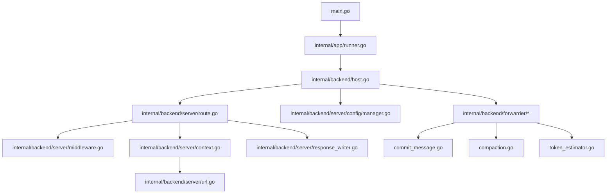

**Diagram sources**
- [main.go:19-29](file://main.go#L19-L29)
- [runner.go:119-470](file://internal/app/runner.go#L119-L470)
- [host.go:28-175](file://internal/backend/host.go#L28-L175)
- [route.go:37-51](file://internal/backend/server/route.go#L37-L51)
- [middleware.go:13-85](file://internal/backend/server/middleware.go#L13-L85)
- [context.go:28-70](file://internal/backend/server/context.go#L28-L70)
- [url.go:9-25](file://internal/backend/server/url.go#L9-L25)
- [response_writer.go:14-79](file://internal/backend/server/response_writer.go#L14-L79)
- [manager.go:17-86](file://internal/backend/server/config/manager.go#L17-L86)

**Section sources**
- [main.go:19-29](file://main.go#L19-L29)
- [runner.go:119-470](file://internal/app/runner.go#L119-L470)

## Core Components
- Application Runner: Initializes environment, installs network transport, loads CA, creates proxy and services, configures Wails app, and starts the backend host automatically.
- Backend Host: Owns the http.Server, builds the mux with routes and middleware, exposes Start/Stop/HealthCheck, and rebuilds routes when configuration changes.
- Server Framework: Provides chi-based routing, middleware chain, protocol classification (HTTP, Connect unary/stream), and error encoding.
- Context and URL Utilities: Provide request-scoped context, upstream URL parsing, and validation.
- Response Writer Tracking: Ensures headers are written once and supports streaming and hijacking.
- Configuration Manager: Hot-reloads configuration from storage and notifies subscribers.
- Enhanced Forwarder Component: Manages adaptive token budget allocation, commit message generation with file manifests, and improved compaction summaries.

**Section sources**
- [runner.go:119-470](file://internal/app/runner.go#L119-L470)
- [host.go:28-175](file://internal/backend/host.go#L28-L175)
- [route.go:37-171](file://internal/backend/server/route.go#L37-L171)
- [context.go:28-70](file://internal/backend/server/context.go#L28-L70)
- [url.go:9-25](file://internal/backend/server/url.go#L9-L25)
- [response_writer.go:14-79](file://internal/backend/server/response_writer.go#L14-L79)
- [manager.go:17-86](file://internal/backend/server/config/manager.go#L17-L86)

## Architecture Overview
The backend exposes a local HTTP server that handles:
- Health endpoint for liveness.
- REST endpoints for auth, analytics, dashboard, and OAuth.
- Connect unary/stream endpoints for agent workflows and repository operations.
- A catch-all AI service handler that forwards requests to upstream model providers based on configuration.
- Enhanced commit message generation with adaptive token budgeting and file change manifests.

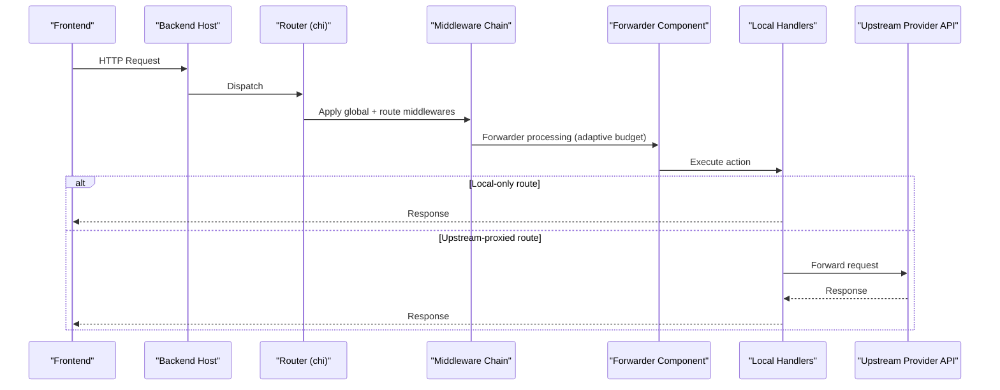

**Diagram sources**
- [host.go:296-814](file://internal/backend/host.go#L296-L814)
- [route.go:140-156](file://internal/backend/server/route.go#L140-L156)
- [middleware.go:13-85](file://internal/backend/server/middleware.go#L13-L85)

## Detailed Component Analysis

### HTTP Server Lifecycle Management
- The app runner constructs the backend host and starts it during application startup.
- The host builds the mux via server.New with global middlewares and mounts, then binds an http.Server to a TCP listener.
- Start returns immediately; Serve runs in a goroutine and records errors.
- Stop gracefully shuts down the server and closes the forwarder module if present.

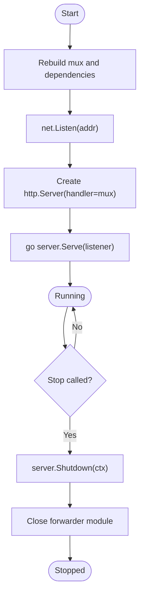

**Diagram sources**
- [host.go:131-175](file://internal/backend/host.go#L131-L175)
- [host.go:177-197](file://internal/backend/host.go#L177-L197)

**Section sources**
- [runner.go:423-438](file://internal/app/runner.go#L423-L438)
- [host.go:131-197](file://internal/backend/host.go#L131-L197)

### Route Definitions and Middleware Stack
- Global middlewares: Recover (panic recovery), ServerContext (upstream URL parsing), ErrorEncoder (error mapping and writing).
- Routes are declared using server.GET/POST/Any with options: Name, Protocol (HTTP, ConnectUnary, ConnectStream), and Local action.
- Middlewares can be applied globally or per-route.
- The router wraps each handler with tracked response writer and context creation.

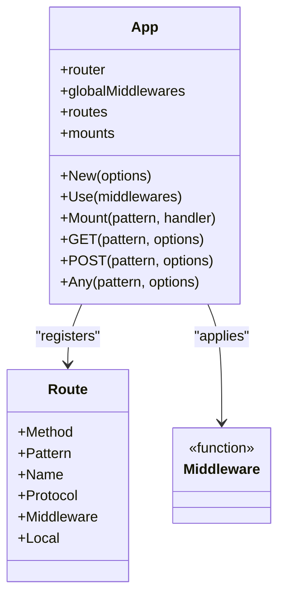

**Diagram sources**
- [route.go:13-129](file://internal/backend/server/route.go#L13-L129)
- [route.go:140-171](file://internal/backend/server/route.go#L140-L171)

**Section sources**
- [route.go:37-171](file://internal/backend/server/route.go#L37-L171)
- [middleware.go:13-85](file://internal/backend/server/middleware.go#L13-L85)

### Service Registration Pattern
- The host constructs the mux by composing multiple server.Options: Use(global middlewares), Mount(assets), GET/POST/Any(route declarations).
- Each route declares a name and protocol, and provides a Local action.
- Some routes delegate to local handlers (e.g., prompt optimization, agent procedures), while others mock responses or forward to upstream APIs.

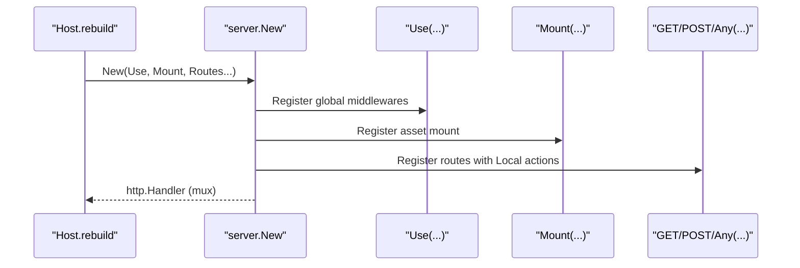

**Diagram sources**
- [host.go:296-814](file://internal/backend/host.go#L296-L814)
- [route.go:37-51](file://internal/backend/server/route.go#L37-L51)

**Section sources**
- [host.go:296-814](file://internal/backend/host.go#L296-L814)

### Health Check Endpoints
- The /healthz endpoint is registered as a GET route with a Local handler that writes "ok".
- Host.HealthCheck performs two checks:
  - Loopback HTTP call to /healthz.
  - In-process health check by invoking the mux directly.
- If loopback fails but in-process succeeds, it logs and reports a loopback failure; if both fail, it returns the underlying error.

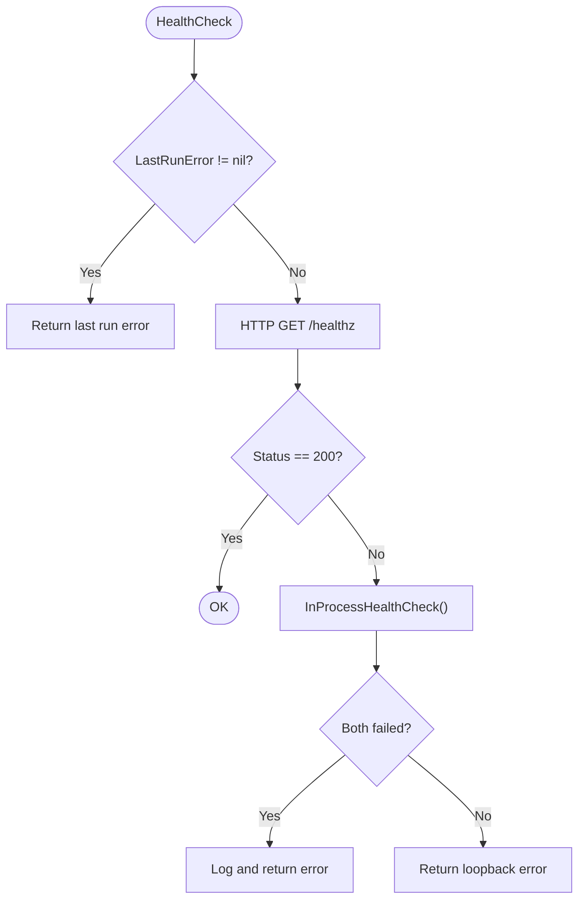

**Diagram sources**
- [host.go:199-253](file://internal/backend/host.go#L199-L253)
- [local.go:9-25](file://internal/backend/server/local.go#L9-L25)

**Section sources**
- [host.go:199-253](file://internal/backend/host.go#L199-L253)
- [local.go:9-25](file://internal/backend/server/local.go#L9-L25)

### Configuration Management
- The configuration manager loads from a store, caches current config atomically, and hot-reloads when the file changes.
- Save persists normalized config, updates snapshot, clears reload error, and notifies listeners.
- Subscribers receive updated configs; minimum interval prevents excessive reloads.

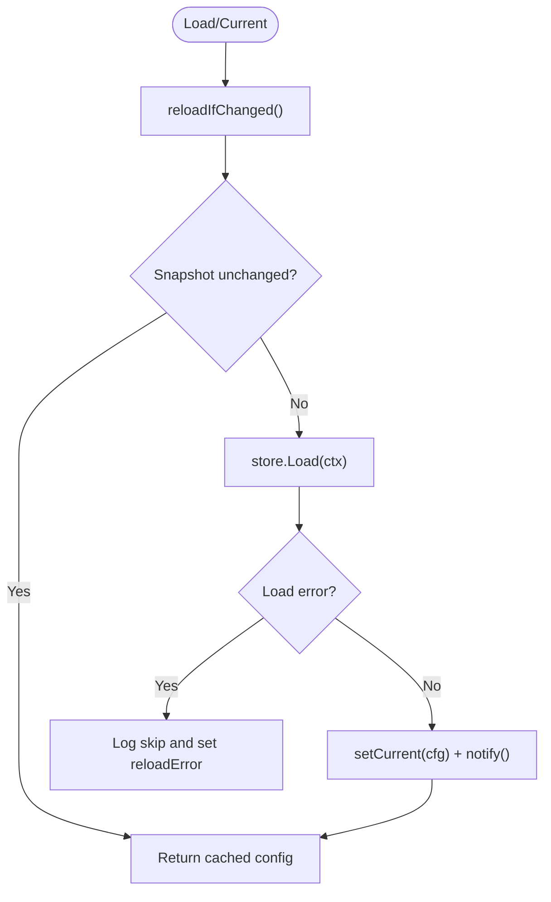

**Diagram sources**
- [manager.go:44-86](file://internal/backend/server/config/manager.go#L44-L86)
- [manager.go:180-225](file://internal/backend/server/config/manager.go#L180-L225)

**Section sources**
- [manager.go:17-86](file://internal/backend/server/config/manager.go#L17-L86)
- [manager.go:180-225](file://internal/backend/server/config/manager.go#L180-L225)

### Frontend Communication: REST and WebSocket/Connect
- REST endpoints: Auth, OAuth token, Stripe profile, analytics, dashboard, and more are exposed via POST/GET routes with Local actions that either mock responses or forward to upstream.
- Connect protocols: Unary and stream endpoints are defined for agent workflows, repository operations, and other services.
- The AI service catch-all routes any /aiserver.v1.AiService/* to a local handler that proxies to upstream model providers.

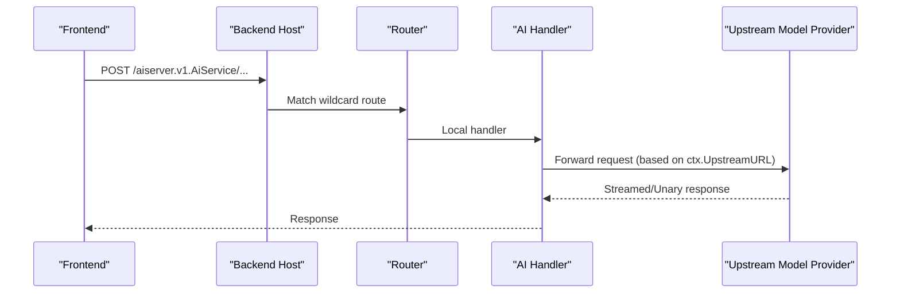

**Diagram sources**
- [host.go:506-510](file://internal/backend/host.go#L506-L510)
- [context.go:53-70](file://internal/backend/server/context.go#L53-L70)

**Section sources**
- [host.go:506-510](file://internal/backend/host.go#L506-L510)
- [context.go:53-70](file://internal/backend/server/context.go#L53-L70)

### Relationship Between Local Backend and Upstream Model Providers
- Requests may include X-Server-Upstream-URL header to indicate an upstream target (MITM source).
- ServerContext middleware parses and validates this header; if absent, Source is native and no upstream is set.
- For control-plane routes, the host forces the upstream to api2.cursor.sh:443 and forwards authenticated requests.
- Many routes use mock builders to simulate upstream responses locally.

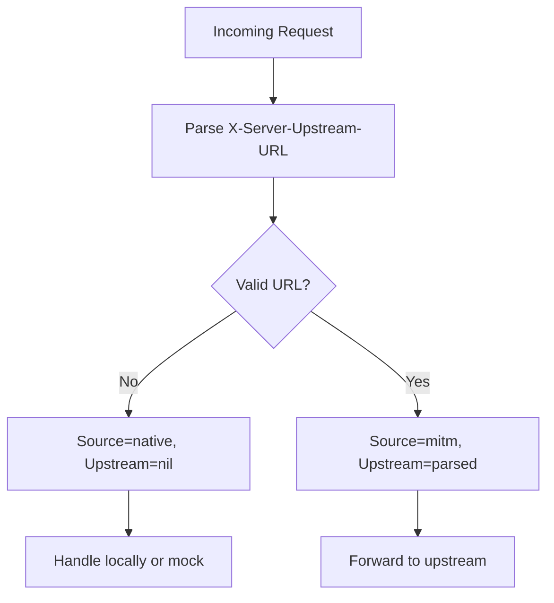

**Diagram sources**
- [context.go:53-70](file://internal/backend/server/context.go#L53-L70)
- [url.go:9-25](file://internal/backend/server/url.go#L9-L25)
- [host.go:913-933](file://internal/backend/host.go#L913-L933)

**Section sources**
- [context.go:53-70](file://internal/backend/server/context.go#L53-L70)
- [url.go:9-25](file://internal/backend/server/url.go#L9-L25)
- [host.go:913-933](file://internal/backend/host.go#L913-L933)

### Service Discovery Mechanism
- The backend does not implement dynamic service discovery; instead, it uses explicit route registrations and configuration-driven behavior.
- Configuration manager provides current settings (e.g., listen address, provider timeouts) which influence runtime behavior.
- The host rebuilds the mux when configuration changes, ensuring routes reflect the latest settings.

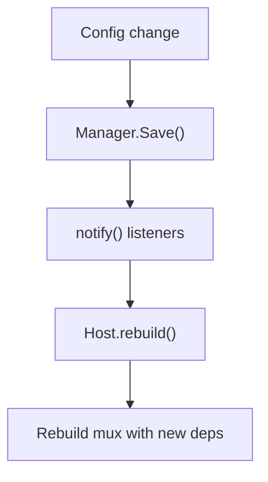

**Diagram sources**
- [manager.go:70-86](file://internal/backend/server/config/manager.go#L70-L86)
- [host.go:271-288](file://internal/backend/host.go#L271-L288)

**Section sources**
- [manager.go:70-86](file://internal/backend/server/config/manager.go#L70-L86)
- [host.go:271-288](file://internal/backend/host.go#L271-L288)

### Orchestration by Main Application Runner
- The runner initializes logging, installs default HTTP transport, ensures app data paths, loads/creates CA, and creates a proxy server.
- It registers bridge services (proxy, metrics, window, ads) with the Wails application.
- On application start, it auto-starts the proxy and refreshes ad assets based on backend listen address.
- The runner constructs the main webview window and systray menu, wiring UI events to backend state.

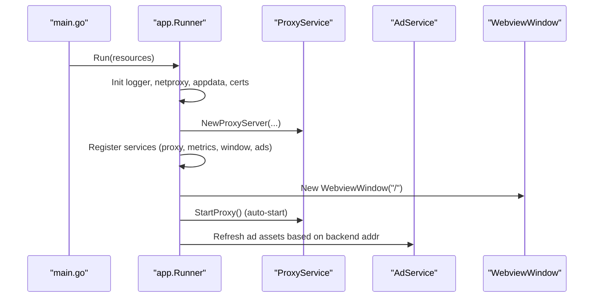

**Diagram sources**
- [main.go:19-29](file://main.go#L19-L29)
- [runner.go:119-470](file://internal/app/runner.go#L119-L470)

**Section sources**
- [main.go:19-29](file://main.go#L19-L29)
- [runner.go:119-470](file://internal/app/runner.go#L119-L470)

## Forwarder Component Enhancements

### Adaptive Token Budget Management for Commit Messages

The forwarder component now includes sophisticated adaptive token budget management for commit message generation. This enhancement ensures optimal resource allocation based on the complexity of code changes.

**Key Features:**
- **Dynamic Budget Calculation**: The `commitMessageOutputBudget` function calculates output token budgets based on the number of changed files, scaling from a base of 512 tokens up to a maximum of 1,536 tokens.
- **File Change Manifest Generation**: The system generates comprehensive file change manifests that provide context about modified files, including addition/deletion counts.
- **Truncated Diff Handling**: Even when diffs are truncated due to budget constraints, the manifest ensures the model understands the full scope of changes.

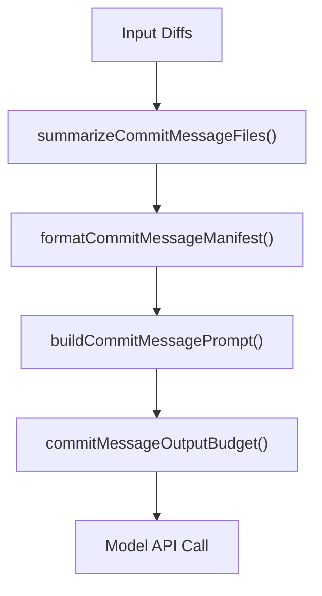

**Diagram sources**
- [commit_message.go:123-156](file://internal/backend/forwarder/commit_message.go#L123-L156)
- [commit_message.go:158-169](file://internal/backend/forwarder/commit_message.go#L158-L169)
- [commit_message.go:177-208](file://internal/backend/forwarder/commit_message.go#L177-L208)

**Section sources**
- [commit_message.go:123-169](file://internal/backend/forwarder/commit_message.go#L123-L169)
- [commit_message.go:177-208](file://internal/backend/forwarder/commit_message.go#L177-L208)
- [commit_message_manifest_test.go:77-90](file://internal/backend/forwarder/commit_message_manifest_test.go#L77-L90)

### File Change Manifest Generation

The enhanced commit message system includes sophisticated file change manifest generation that provides the model with comprehensive context about code modifications:

- **File Scanning**: The `summarizeCommitMessageFiles` function scans diff headers to identify all modified files and count additions/deletions across entire diffs (before truncation).
- **Manifest Formatting**: The `formatCommitMessageManifest` function creates human-readable manifests showing file changes with +/- counts and handling large file sets with omission indicators.
- **Scope Preservation**: Even when individual diffs are truncated, the manifest preserves the complete scope of changes, preventing the model from making assumptions about unrepresented files.

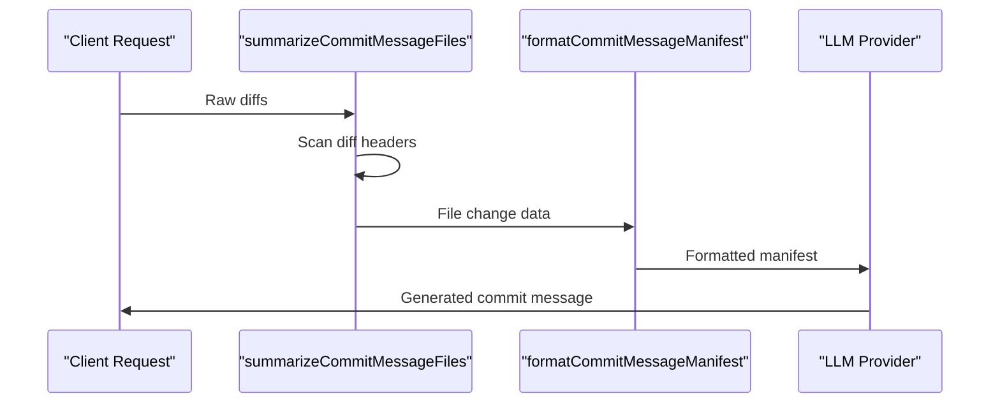

**Diagram sources**
- [commit_message.go:177-208](file://internal/backend/forwarder/commit_message.go#L177-L208)
- [commit_message.go:230-249](file://internal/backend/forwarder/commit_message.go#L230-L249)

**Section sources**
- [commit_message.go:177-208](file://internal/backend/forwarder/commit_message.go#L177-L208)
- [commit_message.go:230-249](file://internal/backend/forwarder/commit_message.go#L230-L249)
- [commit_message_manifest_test.go:10-43](file://internal/backend/forwarder/commit_message_manifest_test.go#L10-L43)

### Compaction Summary Improvements

The compaction system has been enhanced with better token budget management and improved summary generation:

- **Adaptive Reserve Tokens**: The system dynamically adjusts reserve token allocation based on model capabilities and conversation context.
- **Enhanced Summary Generation**: The `generateCompactionSummary` function now includes better error handling and token usage tracking.
- **Budget Validation**: Improved validation ensures compaction results stay within context budget constraints.
- **Fallback Mechanisms**: Robust fallback mechanisms ensure compaction succeeds even when primary methods fail.

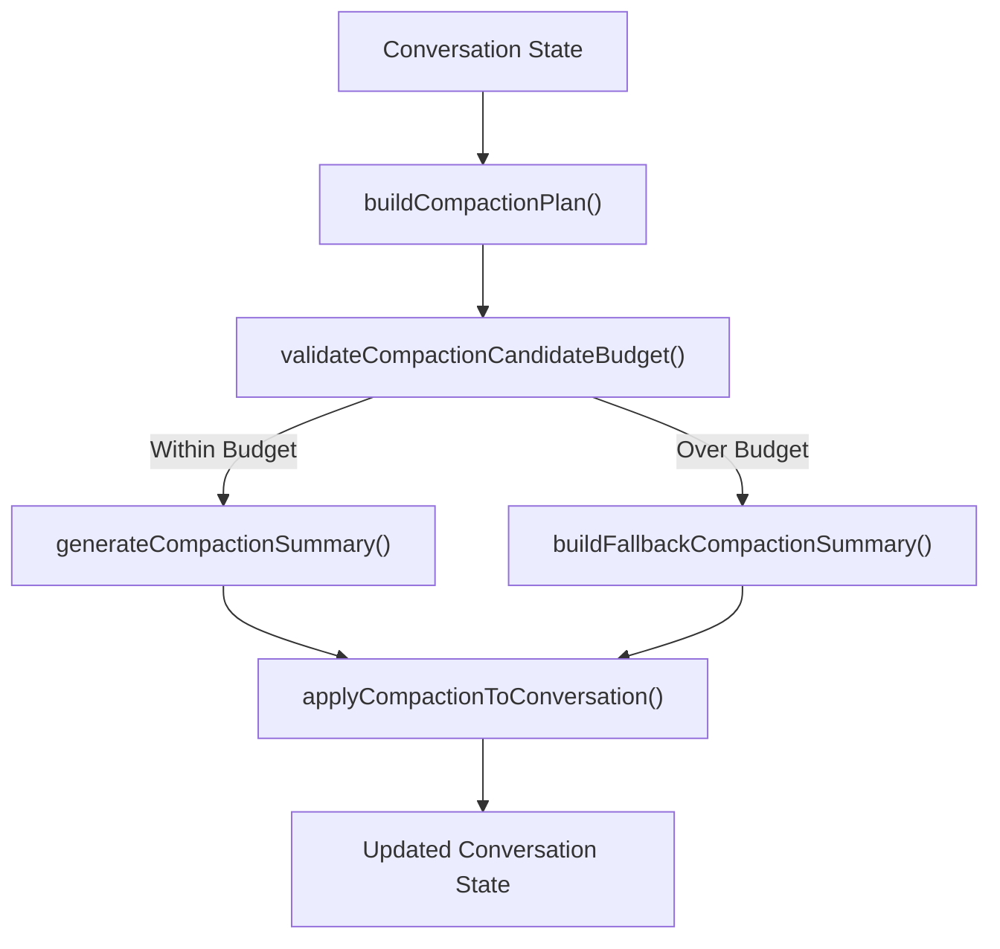

**Diagram sources**
- [compaction.go:777-802](file://internal/backend/forwarder/compaction.go#L777-L802)
- [compaction.go:1413-1501](file://internal/backend/forwarder/compaction.go#L1413-L1501)
- [compaction.go:737-775](file://internal/backend/forwarder/compaction.go#L737-L775)

**Section sources**
- [compaction.go:777-802](file://internal/backend/forwarder/compaction.go#L777-L802)
- [compaction.go:1413-1501](file://internal/backend/forwarder/compaction.go#L1413-L1501)
- [compaction.go:737-775](file://internal/backend/forwarder/compaction.go#L737-L775)

### Comprehensive Test Coverage

The commit message functionality now includes extensive test coverage ensuring reliability and correctness:

- **Budget Calculation Tests**: Verify adaptive budget scaling and clamping behavior.
- **Manifest Generation Tests**: Ensure proper file change counting and formatting.
- **Truncation Handling Tests**: Validate behavior when diffs exceed budget limits.
- **Edge Case Coverage**: Test negative inputs, empty diffs, and malformed content.

**Section sources**
- [commit_message_manifest_test.go:77-123](file://internal/backend/forwarder/commit_message_manifest_test.go#L77-L123)

## Dependency Analysis
- main.go depends on internal/app for orchestration.
- internal/app/runner.go depends on internal/backend/host for HTTP server lifecycle and on various bridge services.
- internal/backend/host.go composes server framework components and forwarder modules.
- server framework (route.go, middleware.go, context.go, url.go, response_writer.go) is reused across all routes.
- Configuration manager is consumed by host and handlers to provide runtime settings.
- Enhanced forwarder component depends on token estimation utilities and prompt assets.

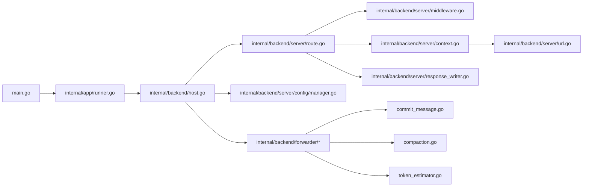

**Diagram sources**
- [main.go:19-29](file://main.go#L19-L29)
- [runner.go:119-470](file://internal/app/runner.go#L119-L470)
- [host.go:28-175](file://internal/backend/host.go#L28-L175)
- [route.go:37-51](file://internal/backend/server/route.go#L37-L51)
- [middleware.go:13-85](file://internal/backend/server/middleware.go#L13-L85)
- [context.go:28-70](file://internal/backend/server/context.go#L28-L70)
- [url.go:9-25](file://internal/backend/server/url.go#L9-L25)
- [response_writer.go:14-79](file://internal/backend/server/response_writer.go#L14-L79)
- [manager.go:17-86](file://internal/backend/server/config/manager.go#L17-L86)

**Section sources**
- [main.go:19-29](file://main.go#L19-L29)
- [runner.go:119-470](file://internal/app/runner.go#L119-L470)
- [host.go:28-175](file://internal/backend/host.go#L28-L175)

## Performance Considerations
- Keep-alive and connection pooling: The loopback health client uses minimal idle connections and short timeouts to avoid resource contention.
- Streaming support: Tracked response writer supports Flush and Hijack for long-lived connections (Connect streams).
- Middleware overhead: Global middlewares add parsing and error handling; ensure they remain lightweight.
- Configuration hot reload: Debounced reloads prevent frequent disk I/O and notifications.
- **Enhanced Forwarder Performance**: Adaptive token budgeting reduces unnecessary API calls and optimizes resource utilization for commit message generation.
- **Efficient Diff Processing**: File change manifest generation operates on raw diffs before truncation, ensuring accurate context without reprocessing.

[No sources needed since this section provides general guidance]

## Troubleshooting Guide
- Health check failures:
  - If loopback /healthz fails but in-process succeeds, investigate firewall or port binding issues.
  - If both fail, inspect LastRunError and server logs for bind errors or panics.
- Error encoding:
  - Errors are mapped to HTTP status codes (e.g., invalid URL -> 400, channel unavailable -> 503).
  - Panics are recovered and logged with stack traces.
- Upstream URL parsing:
  - Ensure X-Server-Upstream-URL is valid and uses http/https schemes.
  - Empty or malformed URLs result in bad request responses.
- **Commit Message Generation Issues**:
  - Check adaptive budget calculations if commit messages are too short or incomplete.
  - Verify file change manifests are being generated correctly for complex repositories.
  - Monitor token usage patterns to optimize budget thresholds.
- **Compaction Problems**:
  - Review budget validation errors if conversations aren't being compacted properly.
  - Check fallback mechanisms when primary compaction methods fail.

**Section sources**
- [host.go:199-253](file://internal/backend/host.go#L199-L253)
- [middleware.go:40-85](file://internal/backend/server/middleware.go#L40-L85)
- [url.go:9-25](file://internal/backend/server/url.go#L9-L25)

## Conclusion
The backend services architecture centers around a robust HTTP server managed by the Backend Host, with a flexible routing and middleware framework. The app runner orchestrates system services and ensures the backend is started and integrated with the UI. Routes cover REST and Connect protocols, supporting both local processing and upstream forwarding. Configuration hot reloading enables dynamic behavior without restarts. Health checks and comprehensive error handling improve reliability and observability.

The enhanced forwarder component significantly improves commit message generation through adaptive token budget management, comprehensive file change manifest generation, and improved compaction summary handling. These enhancements provide better context awareness, more efficient resource utilization, and more reliable operation across diverse codebases and change patterns. The extensive test coverage ensures these features work correctly in various scenarios, from simple single-file changes to complex multi-file refactoring operations.