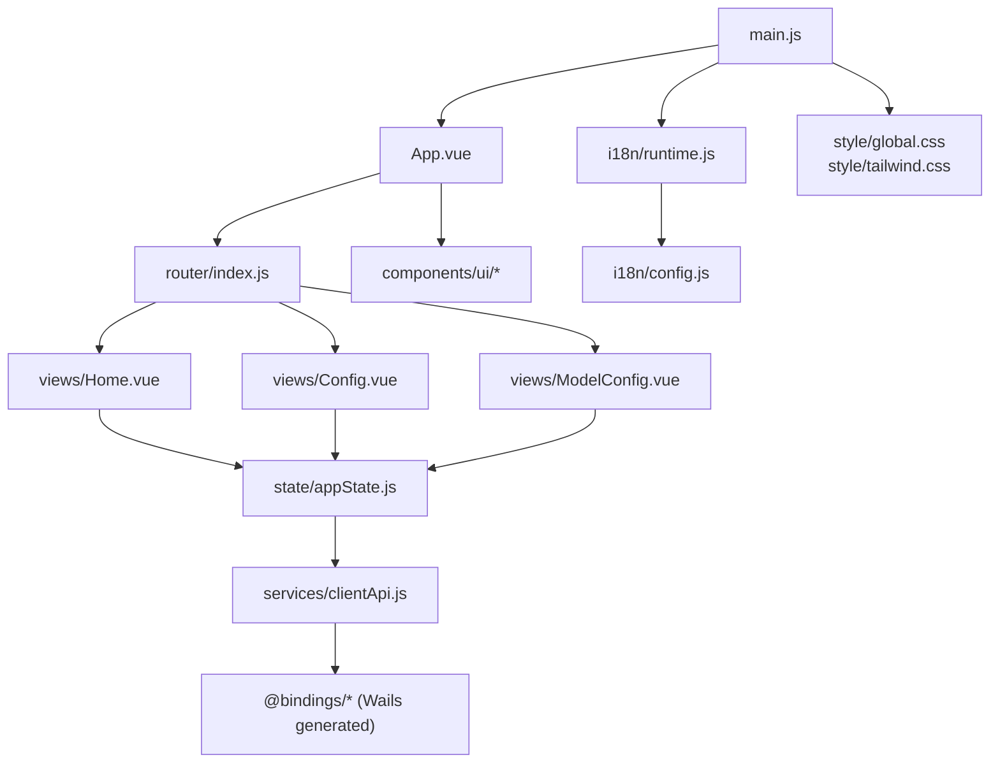
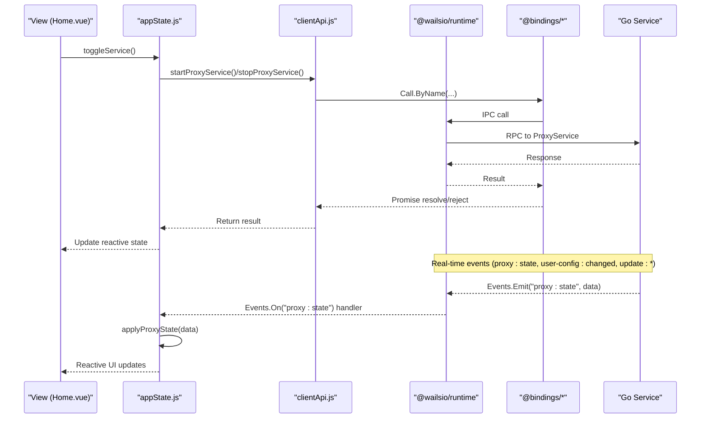
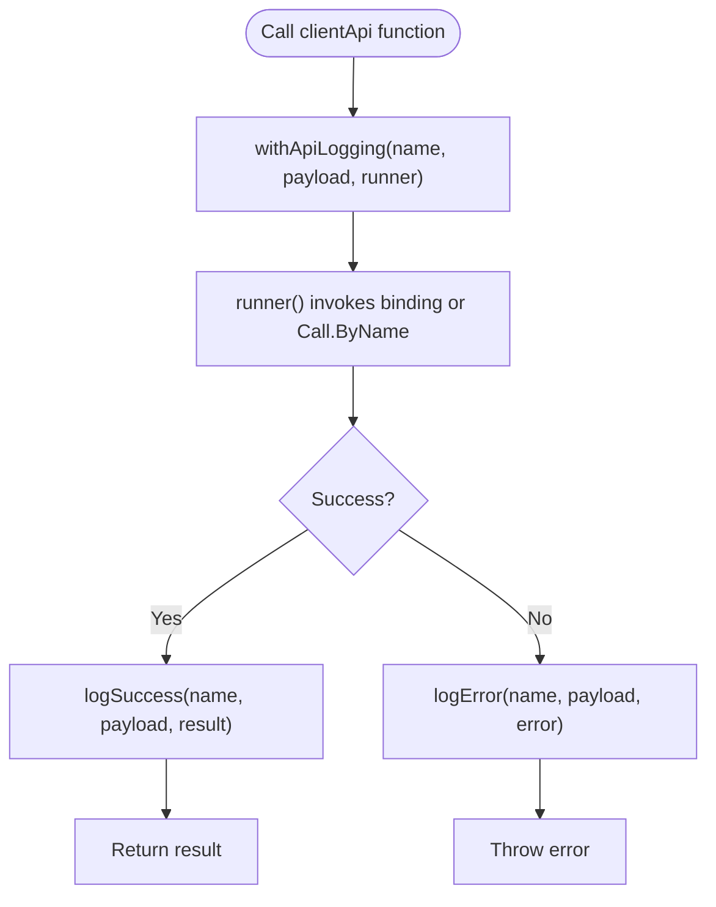
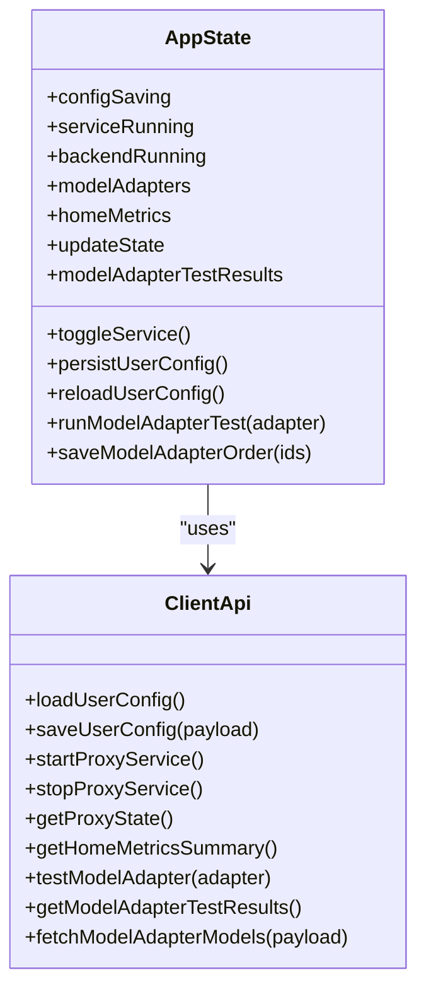
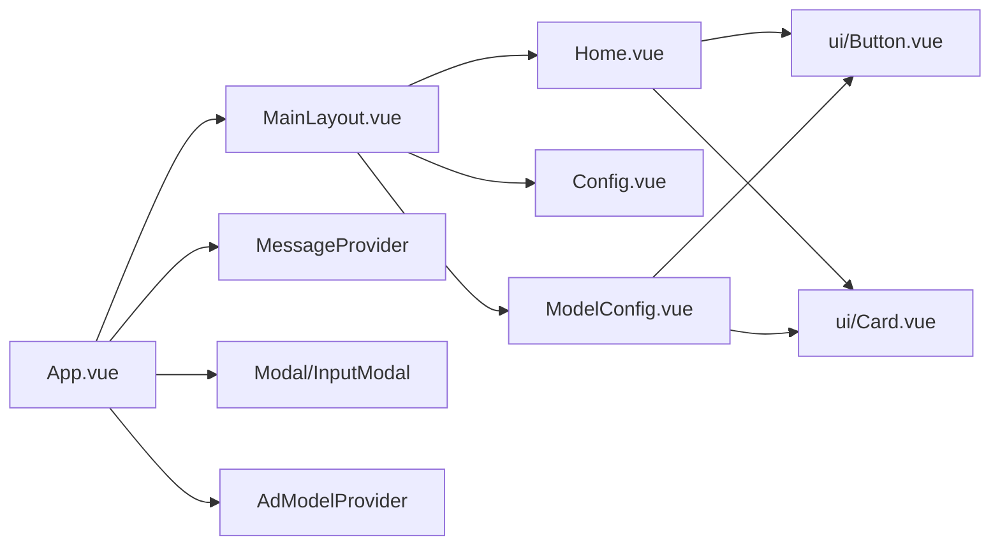
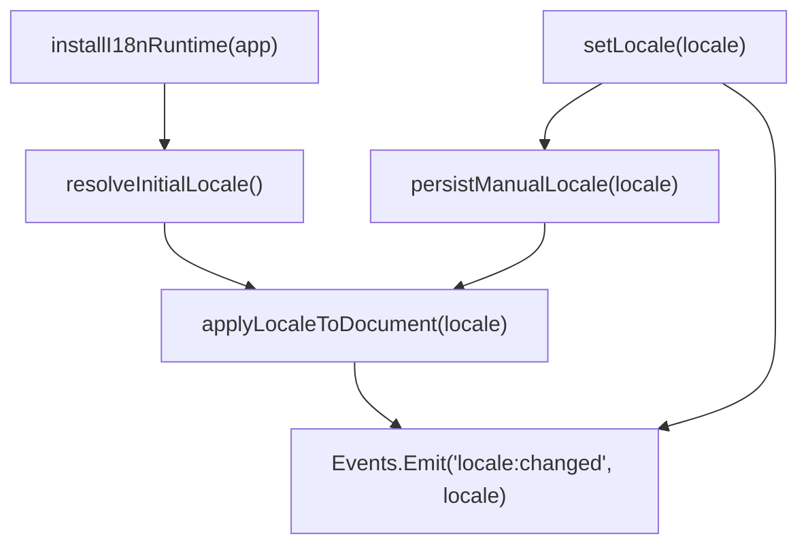
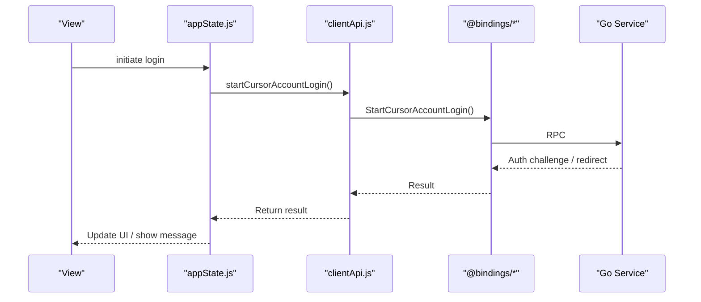
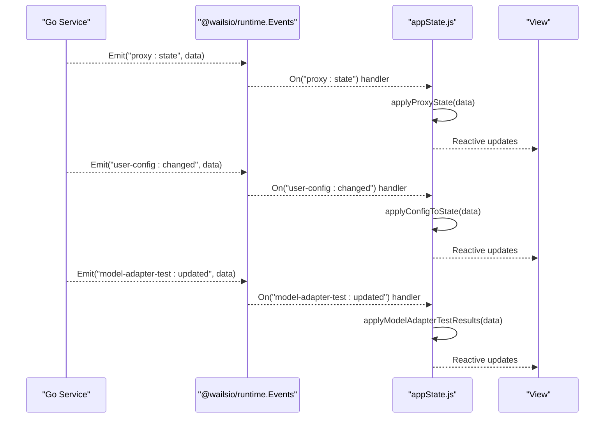
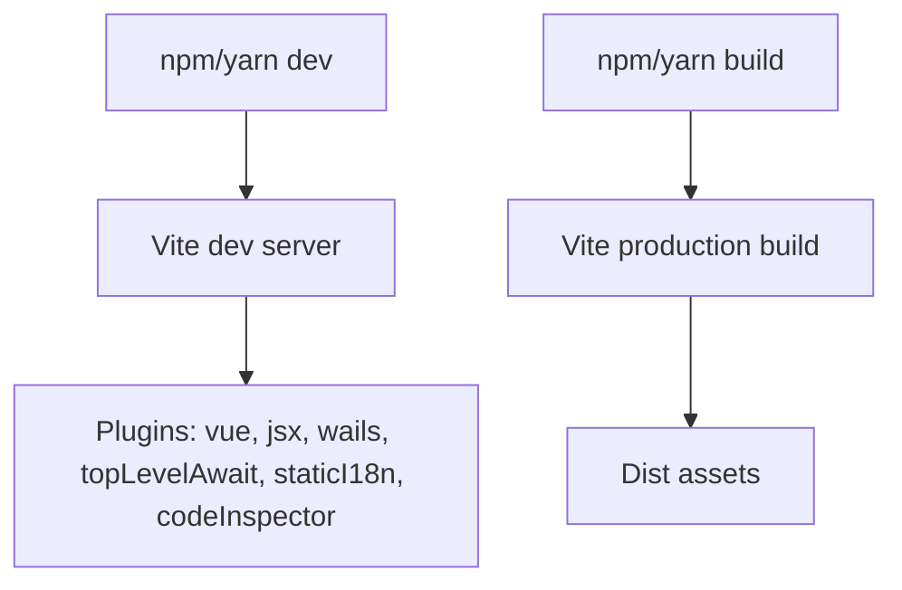
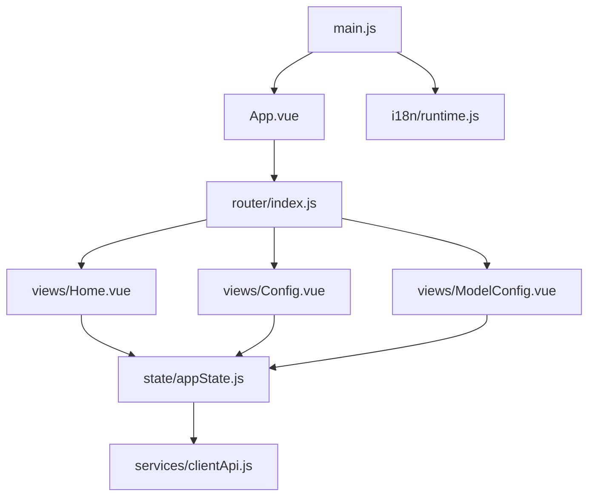

# Frontend Integration

<cite>
**Referenced Files in This Document**
- [package.json](file://frontend/package.json)
- [vite.config.js](file://frontend/vite.config.js)
- [main.js](file://frontend/src/main.js)
- [App.vue](file://frontend/src/App.vue)
- [router/index.js](file://frontend/src/router/index.js)
- [services/clientApi.js](file://frontend/src/services/clientApi.js)
- [state/appState.js](file://frontend/src/state/appState.js)
- [i18n/config.js](file://frontend/src/i18n/config.js)
- [i18n/runtime.js](file://frontend/src/i18n/runtime.js)
- [views/Home.vue](file://frontend/src/views/Home.vue)
- [views/Config.vue](file://frontend/src/views/Config.vue)
- [views/ModelConfig.vue](file://frontend/src/views/ModelConfig.vue)
- [components/ui/Button.vue](file://frontend/src/components/ui/Button.vue)
- [components/ui/Card.vue](file://frontend/src/components/ui/Card.vue)
</cite>

## Table of Contents
1. [Introduction](#introduction)
2. [Project Structure](#project-structure)
3. [Core Components](#core-components)
4. [Architecture Overview](#architecture-overview)
5. [Detailed Component Analysis](#detailed-component-analysis)
6. [Dependency Analysis](#dependency-analysis)
7. [Performance Considerations](#performance-considerations)
8. [Troubleshooting Guide](#troubleshooting-guide)
9. [Conclusion](#conclusion)

## Introduction
This document explains the frontend integration architecture for the Vue 3 application that communicates with the Go backend through Wails-generated bindings and runtime events. It covers:
- Client API abstraction layer over Wails bindings
- State management patterns using reactive state and event-driven updates
- Component composition strategies across views and UI primitives
- Internationalization setup and runtime behavior
- Build process, asset bundling with Vite, and deployment considerations
- Communication protocols between frontend and backend (Wails IPC and runtime events), including authentication flow and session management as implemented in the client

The frontend is a single-page app built with Vue 3, Vue Router, Tailwind CSS, and Chart.js. It uses Wails to call Go services and listen to real-time events from the backend.

## Project Structure
The frontend project is organized by feature and layer:
- Entry point and bootstrap: main.js, App.vue
- Routing: router/index.js
- Services: services/clientApi.js (Wails binding wrappers)
- State: state/appState.js (reactive state, normalization, validation, persistence)
- Views: views/Home.vue, views/Config.vue, views/ModelConfig.vue
- UI components: components/ui/*
- i18n: i18n/config.js, i18n/runtime.js, locales/*
- Build configuration: vite.config.js, package.json

**Diagram sources**
- [main.js:1-41](file://frontend/src/main.js#L1-L41)
- [App.vue:1-56](file://frontend/src/App.vue#L1-L56)
- [router/index.js:1-22](file://frontend/src/router/index.js#L1-L22)
- [services/clientApi.js:1-180](file://frontend/src/services/clientApi.js#L1-L180)
- [state/appState.js:1-120](file://frontend/src/state/appState.js#L1-L120)
- [i18n/runtime.js:1-192](file://frontend/src/i18n/runtime.js#L1-L192)
- [i18n/config.js:1-12](file://frontend/src/i18n/config.js#L1-L12)

**Section sources**
- [package.json:1-40](file://frontend/package.json#L1-L40)
- [vite.config.js:1-38](file://frontend/vite.config.js#L1-L38)
- [main.js:1-41](file://frontend/src/main.js#L1-L41)

## Core Components
- Client API abstraction: Centralizes calls to Wails-generated bindings and adds logging and error propagation.
- State management: Reactive state object with normalization, validation, persistence, and event listeners for real-time updates.
- Views and layout: Home, Config, ModelConfig pages composed from reusable UI components.
- i18n runtime: Locale resolution, persistence, and global $ls/$lt helpers.

Key responsibilities:
- services/clientApi.js: Wraps Wails methods like LoadUserConfig, SaveUserConfig, StartProxy, StopProxy, GetState, GetHomeMetricsSummary, and window operations.
- state/appState.js: Holds application state, normalizes payloads, validates model adapters, persists config, listens to proxy/update/ad events, and exposes actions like toggleService, persistUserConfig, reloadUserConfig, runModelAdapterTest.
- i18n/runtime.js: Provides locale switching, document lang attribute updates, and localized text utilities.

**Section sources**
- [services/clientApi.js:1-180](file://frontend/src/services/clientApi.js#L1-L180)
- [state/appState.js:1-120](file://frontend/src/state/appState.js#L1-L120)
- [i18n/runtime.js:1-192](file://frontend/src/i18n/runtime.js#L1-L192)

## Architecture Overview
The frontend integrates with the backend via Wails:
- Synchronous or asynchronous method calls are made through @wailsio/runtime.Call and generated bindings under @bindings.
- Real-time updates are delivered via Events.Emit on the backend and Events.On/Events.Off on the frontend.
- The client API layer abstracts these calls and centralizes logging and error handling.
- State subscribes to backend events (proxy state, user config changes, update progress, model adapter test results) and updates reactive state accordingly.

**Diagram sources**
- [views/Home.vue:88-128](file://frontend/src/views/Home.vue#L88-L128)
- [state/appState.js:643-677](file://frontend/src/state/appState.js#L643-L677)
- [services/clientApi.js:116-122](file://frontend/src/services/clientApi.js#L116-L122)
- [services/clientApi.js:1-26](file://frontend/src/services/clientApi.js#L1-L26)

## Detailed Component Analysis

### Client API Abstraction Layer
Responsibilities:
- Provide typed functions for each backend operation (load/save config, proxy lifecycle, metrics, windows, updates).
- Add consistent logging and error propagation.
- Use Wails Call.ByName for dynamic service invocation where needed.

Key behaviors:
- Logging wrapper around all API calls for debugging.
- Direct imports from @bindings for strongly-typed methods.
- Dynamic calls for ExportUserConfig, ImportUserConfig, TestModelAdapter, FetchModelAdapterModels.

**Diagram sources**
- [services/clientApi.js:31-56](file://frontend/src/services/clientApi.js#L31-L56)
- [services/clientApi.js:58-180](file://frontend/src/services/clientApi.js#L58-L180)

**Section sources**
- [services/clientApi.js:1-180](file://frontend/src/services/clientApi.js#L1-L180)

### State Management Patterns
Responsibilities:
- Normalize and validate incoming payloads (model adapters, home metrics, proxy state, update snapshots).
- Persist user configuration to backend and cache locally.
- Subscribe to backend events to keep UI in sync.
- Expose actions for views to trigger operations (toggle service, save config, open windows, run tests).

Key patterns:
- Reactive state with computed properties for derived values.
- Event-driven updates via Events.On for proxy state, user config changes, update lifecycle, and model adapter test results.
- Validation and normalization functions ensure robustness against inconsistent backend payloads.

**Diagram sources**
- [state/appState.js:1-120](file://frontend/src/state/appState.js#L1-L120)
- [state/appState.js:581-641](file://frontend/src/state/appState.js#L581-L641)
- [state/appState.js:643-694](file://frontend/src/state/appState.js#L643-L694)
- [services/clientApi.js:58-180](file://frontend/src/services/clientApi.js#L58-L180)

**Section sources**
- [state/appState.js:1-120](file://frontend/src/state/appState.js#L1-L120)
- [state/appState.js:581-641](file://frontend/src/state/appState.js#L581-L641)
- [state/appState.js:643-694](file://frontend/src/state/appState.js#L643-L694)

### Component Composition Strategies
- App.vue composes global providers (MessageProvider, AdModelProvider), modals, and input modals.
- MainLayout provides page shell; views compose cards, buttons, and charts.
- UI primitives (Button, Card) encapsulate styling and interaction patterns.

**Diagram sources**
- [App.vue:1-56](file://frontend/src/App.vue#L1-L56)
- [views/Home.vue:1-193](file://frontend/src/views/Home.vue#L1-L193)
- [views/Config.vue:1-85](file://frontend/src/views/Config.vue#L1-L85)
- [views/ModelConfig.vue:1-514](file://frontend/src/views/ModelConfig.vue#L1-L514)
- [components/ui/Button.vue:1-39](file://frontend/src/components/ui/Button.vue#L1-L39)
- [components/ui/Card.vue:1-10](file://frontend/src/components/ui/Card.vue#L1-L10)

**Section sources**
- [App.vue:1-56](file://frontend/src/App.vue#L1-L56)
- [components/ui/Button.vue:1-39](file://frontend/src/components/ui/Button.vue#L1-L39)
- [components/ui/Card.vue:1-10](file://frontend/src/components/ui/Card.vue#L1-L10)

### Internationalization Setup and Runtime
- Configuration defines supported locales, default locale, storage keys, and options.
- Runtime resolves initial locale from system settings or persisted manual choice, applies document.lang, and emits locale change events.
- Global helpers $ls and $lt provide localized strings and templates with interpolation.

**Diagram sources**
- [i18n/runtime.js:78-107](file://frontend/src/i18n/runtime.js#L78-L107)
- [i18n/runtime.js:148-165](file://frontend/src/i18n/runtime.js#L148-L165)
- [i18n/runtime.js:188-192](file://frontend/src/i18n/runtime.js#L188-L192)
- [i18n/config.js:1-12](file://frontend/src/i18n/config.js#L1-L12)

**Section sources**
- [i18n/config.js:1-12](file://frontend/src/i18n/config.js#L1-L12)
- [i18n/runtime.js:1-192](file://frontend/src/i18n/runtime.js#L1-L192)

### Authentication Flow and Session Management
- Authentication and session management are handled by backend services exposed via Wails bindings.
- The frontend triggers login flows and queries account status through clientApi functions:
  - getCursorAccountStatus
  - startCursorAccountLogin
  - disconnectCursorAccount
- These functions log success/error and propagate errors to callers.

**Diagram sources**
- [services/clientApi.js:88-98](file://frontend/src/services/clientApi.js#L88-L98)

**Section sources**
- [services/clientApi.js:88-98](file://frontend/src/services/clientApi.js#L88-L98)

### Real-Time Updates
- Backend emits events for proxy state, user config changes, update lifecycle, and model adapter test results.
- Frontend subscribes to these events and updates reactive state, which drives UI changes.

**Diagram sources**
- [state/appState.js:643-694](file://frontend/src/state/appState.js#L643-L694)

**Section sources**
- [state/appState.js:643-694](file://frontend/src/state/appState.js#L643-L694)

### Build Process, Asset Bundling, and Deployment
- Vite configuration sets up Vue and JSX plugins, Wails plugin, top-level await support, static i18n plugin, and dev-only inspector.
- Build targets ES2019 and Safari 13; CSS target set to Safari 13.
- Aliases configured for @ and @bindings.
- Scripts in package.json define dev, build, build:dev, and preview commands.

**Diagram sources**
- [vite.config.js:1-38](file://frontend/vite.config.js#L1-L38)
- [package.json:6-10](file://frontend/package.json#L6-L10)

**Section sources**
- [vite.config.js:1-38](file://frontend/vite.config.js#L1-L38)
- [package.json:1-40](file://frontend/package.json#L1-L40)

## Dependency Analysis
High-level dependencies:
- main.js bootstraps Vue app, installs i18n runtime, registers router, mounts app, and initializes app state.
- App.vue composes layout, providers, and modals.
- Router maps routes to views.
- Views depend on state/appState.js for business logic and services/clientApi.js for backend communication.
- i18n/runtime.js provides global localization helpers.

**Diagram sources**
- [main.js:1-41](file://frontend/src/main.js#L1-L41)
- [App.vue:1-56](file://frontend/src/App.vue#L1-L56)
- [router/index.js:1-22](file://frontend/src/router/index.js#L1-L22)
- [views/Home.vue:1-193](file://frontend/src/views/Home.vue#L1-L193)
- [views/Config.vue:1-85](file://frontend/src/views/Config.vue#L1-L85)
- [views/ModelConfig.vue:1-514](file://frontend/src/views/ModelConfig.vue#L1-L514)
- [state/appState.js:1-120](file://frontend/src/state/appState.js#L1-L120)
- [services/clientApi.js:1-180](file://frontend/src/services/clientApi.js#L1-L180)
- [i18n/runtime.js:1-192](file://frontend/src/i18n/runtime.js#L1-L192)

**Section sources**
- [main.js:1-41](file://frontend/src/main.js#L1-L41)
- [App.vue:1-56](file://frontend/src/App.vue#L1-L56)
- [router/index.js:1-22](file://frontend/src/router/index.js#L1-L22)

## Performance Considerations
- Normalization and validation functions prevent expensive downstream processing by sanitizing inputs early.
- Event-driven updates avoid polling; UI reacts only when backend emits changes.
- Batch testing of model adapters uses concurrency control to balance throughput and responsiveness.
- Localized text caching reduces repeated string creation overhead.

[No sources needed since this section provides general guidance]

## Troubleshooting Guide
Common issues and resolutions:
- Service operations fail: Check serviceBusy flags and lastError in appState; use message helper to display errors.
- Config save fails: Validate model adapters before saving; review normalize/validate functions and ensure JSON fields are valid.
- Real-time updates not reflecting: Ensure Events.On handlers are registered and backend emits expected events.
- i18n not updating: Verify setLocale is called and document.lang is updated; check localStorage keys for manual locale source.

Operational tips:
- Use clientApi logging to trace RPC calls and errors.
- Inspect normalized state objects to confirm backend payloads are correctly interpreted.
- For batch tests, monitor batchTesting and batchStopping states; cancel active calls if needed.

**Section sources**
- [views/Home.vue:83-128](file://frontend/src/views/Home.vue#L83-L128)
- [views/Config.vue:22-41](file://frontend/src/views/Config.vue#L22-L41)
- [views/ModelConfig.vue:297-366](file://frontend/src/views/ModelConfig.vue#L297-L366)
- [services/clientApi.js:31-56](file://frontend/src/services/clientApi.js#L31-L56)

## Conclusion
The frontend integrates tightly with the Go backend via Wails, using a clear separation of concerns:
- A thin client API layer wraps backend calls and centralizes logging.
- Reactive state manages application data, validation, persistence, and real-time synchronization.
- Views compose reusable UI components and interact with state and services.
- i18n runtime ensures consistent internationalization across the app.
- Vite builds produce optimized assets targeting modern browsers while supporting legacy environments.

This architecture enables reliable communication, responsive UI updates, and maintainable code organization.