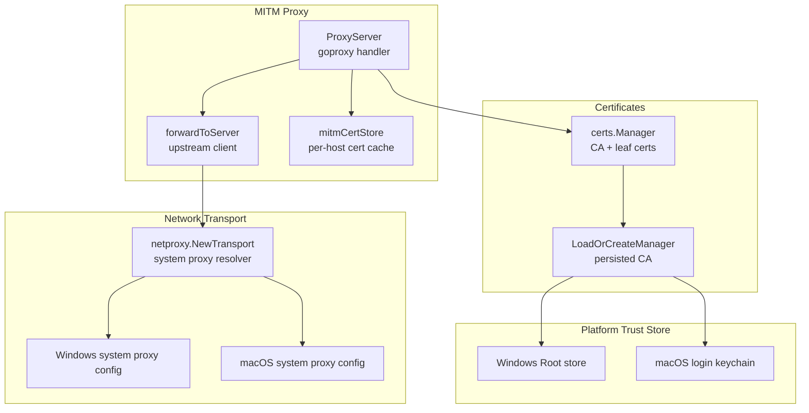
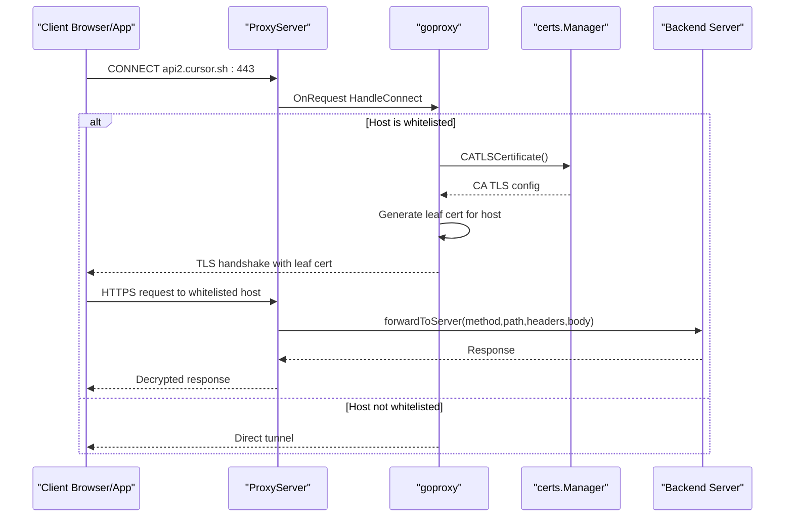
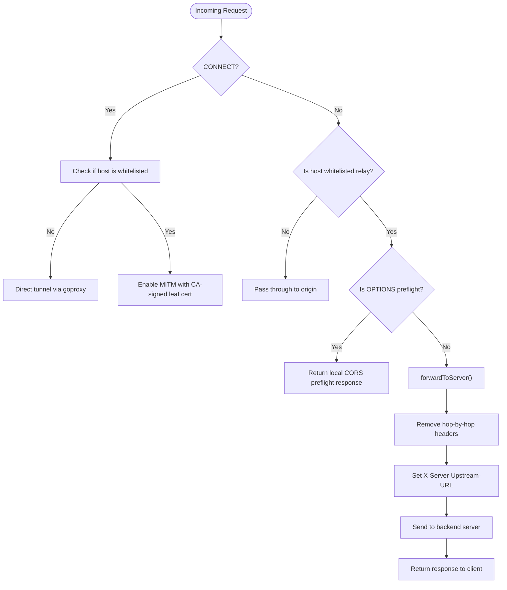
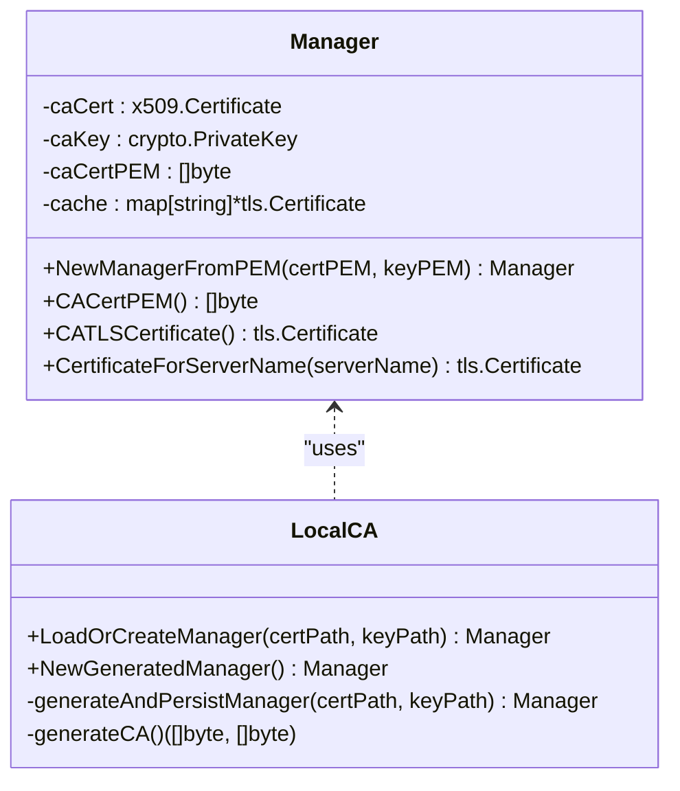
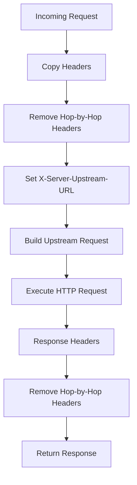
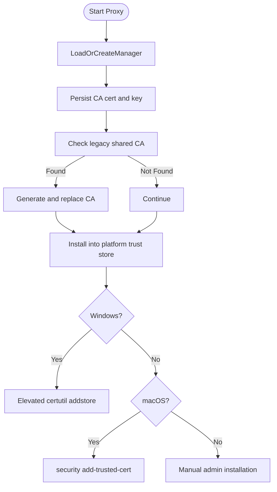
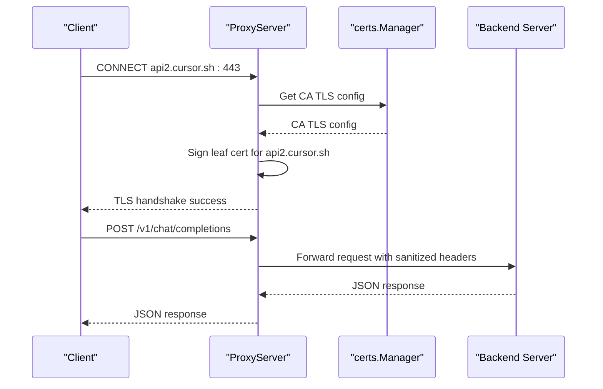
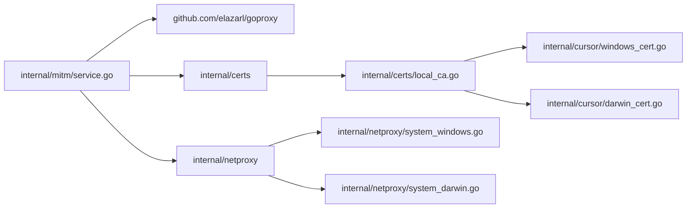

# MITM Proxy Architecture

<cite>
**Referenced Files in This Document**
- [service.go](file://internal/mitm/service.go)
- [ca.go](file://internal/certs/ca.go)
- [local_ca.go](file://internal/certs/local_ca.go)
- [netproxy.go](file://internal/netproxy/netproxy.go)
- [system_windows.go](file://internal/netproxy/system_windows.go)
- [system_darwin.go](file://internal/netproxy/system_darwin.go)
- [windows_cert.go](file://internal/cursor/windows_cert.go)
- [darwin_cert.go](file://internal/cursor/darwin_cert.go)
- [main.go](file://cmd/cursor-proxy-debugger/main.go)
</cite>

## Table of Contents
1. [Introduction](#introduction)
2. [Project Structure](#project-structure)
3. [Core Components](#core-components)
4. [Architecture Overview](#architecture-overview)
5. [Detailed Component Analysis](#detailed-component-analysis)
6. [Dependency Analysis](#dependency-analysis)
7. [Performance Considerations](#performance-considerations)
8. [Troubleshooting Guide](#troubleshooting-guide)
9. [Conclusion](#conclusion)

## Introduction
This document explains the Man-in-the-Middle proxy architecture used to intercept HTTPS traffic, generate per-host certificates through a local certificate authority, and forward selected requests to an upstream backend server. It focuses on:

- How goproxy is configured for CONNECT interception and TLS termination.
- How the local CA is generated, persisted, and installed into platform trust stores.
- How request routing decides whether to intercept or pass through.
- How sensitive headers are handled and how hop-by-hop headers are sanitized.
- Platform-specific certificate installation behavior on Windows, macOS, and Linux.
- Practical guidance for troubleshooting certificate trust, browser warnings, and connection issues.

The goal is to make this accessible to beginners while providing enough technical depth for developers implementing custom traffic manipulation logic.

## Project Structure
The MITM proxy implementation spans several packages:

- `internal/mitm`: HTTP/HTTPS proxy server built on goproxy, including CONNECT handling, request forwarding, CORS preflight handling, logging, and rate limiting.
- `internal/certs`: Local CA manager, certificate generation, leaf certificate caching, and persistence.
- `internal/netproxy`: System-aware HTTP transport and proxy resolver that respects environment variables and OS proxy settings.
- `internal/cursor`: Platform-specific helpers for installing and removing trusted root certificates.
- `cmd/cursor-proxy-debugger`: A standalone debugger tool that starts a proxy with a web UI.

**Diagram sources**
- [service.go:360-450](file://internal/mitm/service.go#L360-L450)
- [ca.go:23-154](file://internal/certs/ca.go#L23-L154)
- [local_ca.go:22-95](file://internal/certs/local_ca.go#L22-L95)
- [netproxy.go:49-67](file://internal/netproxy/netproxy.go#L49-L67)
- [system_windows.go:13-46](file://internal/netproxy/system_windows.go#L13-L46)
- [system_darwin.go:11-73](file://internal/netproxy/system_darwin.go#L11-L73)
- [windows_cert.go:149-189](file://internal/cursor/windows_cert.go#L149-L189)
- [darwin_cert.go:87-131](file://internal/cursor/darwin_cert.go#L87-L131)

**Section sources**
- [service.go:32-57](file://internal/mitm/service.go#L32-L57)
- [ca.go:23-59](file://internal/certs/ca.go#L23-L59)
- [local_ca.go:22-69](file://internal/certs/local_ca.go#L22-L69)
- [netproxy.go:19-67](file://internal/netproxy/netproxy.go#L19-L67)

## Core Components
- **ProxyServer**: The main HTTP/HTTPS proxy entry point. It creates a goproxy instance, configures MITM behavior, sets up a custom transport, and forwards whitelisted requests to a backend server.
- **certs.Manager**: Loads or generates a local CA, validates it, exposes PEM/TLS representations, and dynamically signs per-host leaf certificates.
- **Local CA Persistence**: Creates an installation-scoped CA pair, persists them securely, and detects legacy shared CA artifacts.
- **netproxy.Transport**: Wraps Go’s default transport with a proxy resolver that reads environment variables and OS proxy configuration, with bypass rules and PAC awareness.
- **Platform Certificate Helpers**: Install or remove the local CA from Windows Root store and macOS login keychain, including legacy shared CA cleanup.

Key responsibilities:
- Intercept CONNECT for specific hosts and terminate TLS using dynamically signed certificates.
- Forward selected requests to an upstream backend while preserving method, path, query, headers, and body.
- Sanitize hop-by-hop headers and avoid leaking internal routing information.
- Provide safe defaults for timeouts, connection pooling, and error logging.

**Section sources**
- [service.go:180-206](file://internal/mitm/service.go#L180-L206)
- [service.go:360-450](file://internal/mitm/service.go#L360-L450)
- [ca.go:61-154](file://internal/certs/ca.go#L61-L154)
- [local_ca.go:22-95](file://internal/certs/local_ca.go#L22-L95)
- [netproxy.go:49-67](file://internal/netproxy/netproxy.go#L49-L67)
- [windows_cert.go:149-189](file://internal/cursor/windows_cert.go#L149-L189)
- [darwin_cert.go:87-131](file://internal/cursor/darwin_cert.go#L87-L131)

## Architecture Overview
At runtime, the proxy listens for HTTP and HTTPS connections. For HTTPS, it uses goproxy’s CONNECT handler to decide whether to perform MITM. If the target host matches the whitelist, the proxy terminates TLS by generating a leaf certificate signed by the local CA. After decryption, the proxy routes the request:

- Whitelisted relay hosts (for example, Cursor API domains) are forwarded to the configured backend server.
- Other hosts are passed through directly via goproxy’s normal outbound transport.

**Diagram sources**
- [service.go:360-450](file://internal/mitm/service.go#L360-L450)
- [ca.go:69-154](file://internal/certs/ca.go#L69-L154)

## Detailed Component Analysis

### MITM Proxy Server and Request Routing
The proxy server initializes a goproxy instance with:

- A custom logger adapter that filters noisy TLS handshake messages and expected client disconnect logs.
- A per-host certificate store to avoid repeated RSA/x509 signing operations for the same hostname.
- A transport backed by netproxy, which respects environment and OS proxy settings.
- A CONNECT handler that enables MITM only for whitelisted relay hosts.
- An HTTP request handler that forwards whitelisted requests to the backend server after sanitizing headers.

Important behaviors:
- Only hosts matching the whitelist trigger MITM; others use direct tunneling.
- The proxy removes hop-by-hop headers before forwarding to the backend.
- A special header is set to record the original absolute URL when forwarding.
- CORS preflight requests for local relay hosts are handled locally without contacting the backend.

**Diagram sources**
- [service.go:360-450](file://internal/mitm/service.go#L360-L450)
- [service.go:453-488](file://internal/mitm/service.go#L453-L488)
- [service.go:635-658](file://internal/mitm/service.go#L635-L658)
- [service.go:690-735](file://internal/mitm/service.go#L690-L735)

**Section sources**
- [service.go:360-450](file://internal/mitm/service.go#L360-L450)
- [service.go:453-488](file://internal/mitm/service.go#L453-L488)
- [service.go:635-658](file://internal/mitm/service.go#L635-L658)
- [service.go:690-735](file://internal/mitm/service.go#L690-L735)

### Certificate Authority Management
The certificate authority manager supports:

- Loading a CA from PEM files or generating a new one.
- Validating that the CA certificate is a proper signing CA and that the private key matches.
- Exposing the CA as a TLS certificate for goproxy.
- Generating per-host leaf certificates with appropriate DNS names or IP addresses.
- Caching generated leaf certificates to reduce cryptographic overhead.

The local CA persistence layer:

- Generates a 3072-bit RSA CA with a long validity period.
- Persists the private key first, then the certificate, to avoid inconsistent state.
- Restricts file permissions for the private key.
- Detects and replaces a legacy shared CA artifact.

**Diagram sources**
- [ca.go:23-154](file://internal/certs/ca.go#L23-L154)
- [local_ca.go:22-95](file://internal/certs/local_ca.go#L22-L95)

**Section sources**
- [ca.go:23-154](file://internal/certs/ca.go#L23-L154)
- [local_ca.go:22-95](file://internal/certs/local_ca.go#L22-L95)

### Request and Response Filtering
The proxy applies filtering and sanitization before forwarding:

- Removes hop-by-hop headers such as Connection, Keep-Alive, Transfer-Encoding, and Upgrade.
- Copies incoming headers while applying sanitization.
- Sets a special header containing the original absolute URL for backend visibility.
- Handles CORS preflight requests locally for whitelisted relay hosts.
- Uses a log limiter to suppress repeated noisy messages and normalize sensitive fields like ports and request IDs.

**Diagram sources**
- [service.go:453-488](file://internal/mitm/service.go#L453-L488)
- [service.go:570-597](file://internal/mitm/service.go#L570-L597)
- [service.go:690-735](file://internal/mitm/service.go#L690-L735)

**Section sources**
- [service.go:453-488](file://internal/mitm/service.go#L453-L488)
- [service.go:570-597](file://internal/mitm/service.go#L570-L597)
- [service.go:690-735](file://internal/mitm/service.go#L690-L735)

### Security Model for Sensitive Data
The proxy does not inspect or modify request bodies or sensitive headers unless explicitly implemented by higher-level logic. Its security model includes:

- Avoiding unnecessary logging of full URLs and user agents by trimming and rate-limiting logs.
- Removing hop-by-hop headers that could leak connection details.
- Recording the original upstream URL only as a single controlled header for backend processing.
- Using a per-host certificate cache to minimize repeated cryptographic work.
- Restricting file permissions for the local CA private key.

Recommendations for custom traffic manipulation:

- Never log Authorization, Cookie, or other secret headers.
- Normalize or redact tokens before writing to logs.
- Validate and sanitize any modified headers before forwarding.
- Limit modifications to the smallest necessary scope.
- Use context values rather than global mutable state for per-request metadata.

**Section sources**
- [service.go:82-178](file://internal/mitm/service.go#L82-L178)
- [service.go:453-488](file://internal/mitm/service.go#L453-L488)
- [service.go:737-791](file://internal/mitm/service.go#L737-L791)
- [local_ca.go:79-95](file://internal/certs/local_ca.go#L79-L95)

### Certificate Generation and Installation Process

#### Certificate Generation
- The local CA is generated with a strong RSA key and marked as a CA with signing capabilities.
- The CA certificate and private key are persisted atomically using temporary files.
- The private key is restricted to owner-only read/write permissions.
- Legacy shared CA artifacts are detected and replaced.

#### Platform-Specific Installation
- **Windows**: Installs the CA into the LocalMachine Root store using elevated certutil via PowerShell UAC prompt. Also provides removal of a legacy shared CA.
- **macOS**: Adds the CA to the login keychain as a trusted root using the security CLI. Also provides removal of a legacy shared CA.
- **Linux**: No automatic trust-store installation is provided in the analyzed files. Administrators should manually install the CA where required.

**Diagram sources**
- [local_ca.go:22-95](file://internal/certs/local_ca.go#L22-L95)
- [windows_cert.go:149-189](file://internal/cursor/windows_cert.go#L149-L189)
- [darwin_cert.go:87-131](file://internal/cursor/darwin_cert.go#L87-L131)

**Section sources**
- [local_ca.go:22-95](file://internal/certs/local_ca.go#L22-L95)
- [windows_cert.go:149-189](file://internal/cursor/windows_cert.go#L149-L189)
- [darwin_cert.go:87-131](file://internal/cursor/darwin_cert.go#L87-L131)

### Traffic Interception Examples

#### Example 1: Intercepting Cursor API Requests
When a client connects to a whitelisted host such as `api2.cursor.sh`, the proxy:

1. Recognizes the CONNECT request.
2. Enables MITM because the host is whitelisted.
3. Generates a leaf certificate signed by the local CA.
4. Completes TLS handshake with the client.
5. Forwards the decrypted request to the backend server.
6. Returns the backend response to the client.

**Diagram sources**
- [service.go:360-450](file://internal/mitm/service.go#L360-L450)
- [service.go:453-488](file://internal/mitm/service.go#L453-L488)
- [service.go:635-658](file://internal/mitm/service.go#L635-L658)

#### Example 2: Passing Through Non-Whitelisted Traffic
For hosts not in the whitelist, the proxy does not perform MITM. Instead, it establishes a direct TCP tunnel through goproxy, allowing the client to communicate directly with the origin server.

**Section sources**
- [service.go:360-450](file://internal/mitm/service.go#L360-L450)
- [service.go:635-658](file://internal/mitm/service.go#L635-L658)

## Dependency Analysis
The MITM proxy depends on:

- goproxy for HTTP/HTTPS proxying and CONNECT handling.
- certs.Manager for CA management and leaf certificate generation.
- netproxy for system-aware outbound proxy resolution.
- Platform-specific helpers for trust store management.

**Diagram sources**
- [service.go:3-25](file://internal/mitm/service.go#L3-L25)
- [service.go:360-450](file://internal/mitm/service.go#L360-L450)
- [local_ca.go:22-95](file://internal/certs/local_ca.go#L22-L95)
- [netproxy.go:49-67](file://internal/netproxy/netproxy.go#L49-L67)
- [system_windows.go:13-46](file://internal/netproxy/system_windows.go#L13-L46)
- [system_darwin.go:11-73](file://internal/netproxy/system_darwin.go#L11-L73)

**Section sources**
- [service.go:3-25](file://internal/mitm/service.go#L3-L25)
- [service.go:360-450](file://internal/mitm/service.go#L360-L450)
- [local_ca.go:22-95](file://internal/certs/local_ca.go#L22-L95)
- [netproxy.go:49-67](file://internal/netproxy/netproxy.go#L49-L67)

## Performance Considerations
- **Connection Pooling**: Both the proxy’s upstream client and goproxy transport configure idle connection limits, keep-alive, and handshake timeouts.
- **Certificate Caching**: Per-host certificate caching avoids repeated RSA/x509 operations for the same hostname.
- **Log Rate Limiting**: Repeated proxy logs are suppressed and normalized to reduce I/O overhead and protect sensitive data.
- **System Proxy Resolution**: netproxy caches proxy snapshots and closes idle connections when configuration changes.

Best practices:
- Tune timeout values based on upstream latency expectations.
- Monitor memory usage if many unique hosts are intercepted.
- Avoid excessive logging of large payloads or secrets.
- Use separate transports for different upstream classes if needed.

[No sources needed since this section provides general guidance]

## Troubleshooting Guide

### Certificate Trust Issues
Symptoms:
- Browser warns about untrusted certificate.
- curl reports certificate verification failure.
- Applications refuse to connect to localhost proxy.

Checks:
- Confirm the local CA certificate was generated and persisted.
- Verify the CA is installed in the correct trust store:
  - Windows: LocalMachine Root store.
  - macOS: login keychain as a trusted root.
  - Linux: manual installation into system trust store.
- Ensure the legacy shared CA has been removed if present.

Relevant code paths:
- CA generation and persistence.
- Windows Root store installation and legacy CA removal.
- macOS login keychain installation and legacy CA removal.

**Section sources**
- [local_ca.go:22-95](file://internal/certs/local_ca.go#L22-L95)
- [windows_cert.go:83-104](file://internal/cursor/windows_cert.go#L83-L104)
- [windows_cert.go:149-189](file://internal/cursor/windows_cert.go#L149-L189)
- [darwin_cert.go:57-85](file://internal/cursor/darwin_cert.go#L57-L85)
- [darwin_cert.go:87-131](file://internal/cursor/darwin_cert.go#L87-L131)

### Browser Warnings and Mixed Content
Symptoms:
- Browser shows certificate warning even after CA installation.
- Mixed content errors occur.

Causes:
- CA installed in wrong store or user context.
- Browser using its own trust store instead of OS trust store.
- Cached invalid certificates in browser.

Actions:
- Reinstall CA into the correct store.
- Restart the browser.
- Clear browser certificate cache.
- Verify the proxy is actually intercepting the intended host.

**Section sources**
- [service.go:635-658](file://internal/mitm/service.go#L635-L658)

### Connection Problems and Timeouts
Symptoms:
- Connections hang or fail.
- Errors mention TLS handshake mismatch or broken pipe.

Checks:
- Review filtered HTTP error logs for TLS handshake mismatches.
- Check whether the client is connecting to the correct proxy address.
- Verify upstream backend reachability.
- Inspect system proxy configuration if outbound traffic is unexpectedly proxied.

Relevant code paths:
- HTTP error filter writer.
- goproxy log adapter.
- System proxy resolver.

**Section sources**
- [service.go:737-791](file://internal/mitm/service.go#L737-L791)
- [netproxy.go:160-193](file://internal/netproxy/netproxy.go#L160-L193)
- [system_windows.go:13-46](file://internal/netproxy/system_windows.go#L13-L46)
- [system_darwin.go:11-73](file://internal/netproxy/system_darwin.go#L11-L73)

### Debugging Tool Usage
The cursor-proxy-debugger provides a convenient way to start a proxy with a web interface:

- Default proxy address: `127.0.0.1:9090`.
- Default UI address: `127.0.0.1:9091`.
- Target host can be configured.
- Automatically opens the UI in the browser unless disabled.

Usage pattern:
- Run the debugger binary.
- Configure your application or browser to use the proxy address.
- Open the UI URL to inspect captured exchanges.

**Section sources**
- [main.go:18-52](file://cmd/cursor-proxy-debugger/main.go#L18-L52)

## Conclusion
The MITM proxy architecture combines goproxy-based HTTPS interception, a robust local CA manager, and platform-aware trust store integration. It selectively intercepts whitelisted hosts, forwards requests to a backend server with careful header sanitization, and provides practical tools for debugging and troubleshooting. By following the security recommendations and troubleshooting steps outlined here, developers can implement custom traffic manipulation logic safely and reliably across Windows, macOS, and Linux environments.

[No sources needed since this section summarizes without analyzing specific files]