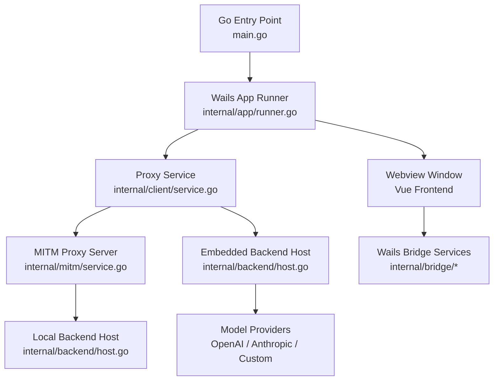
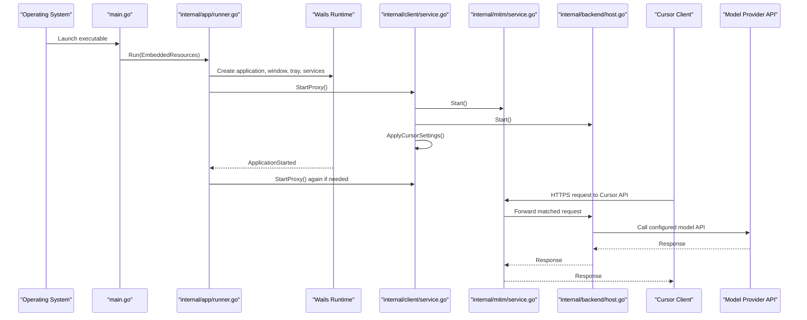
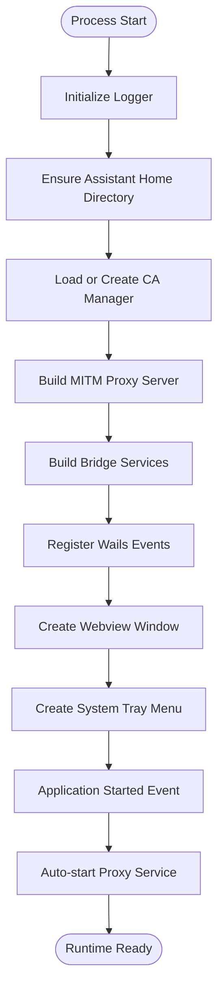
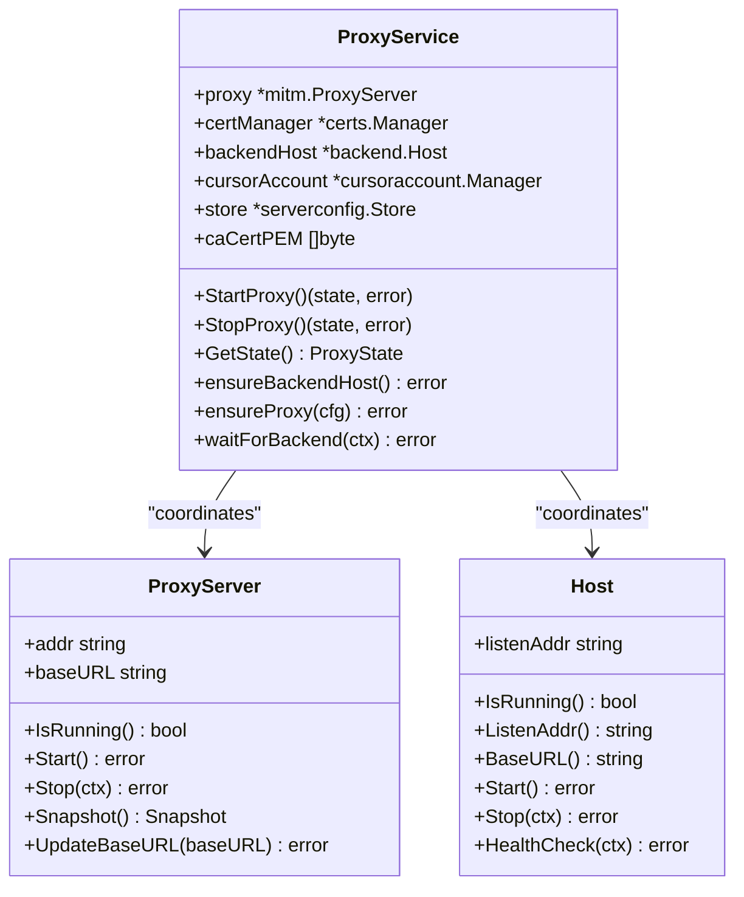
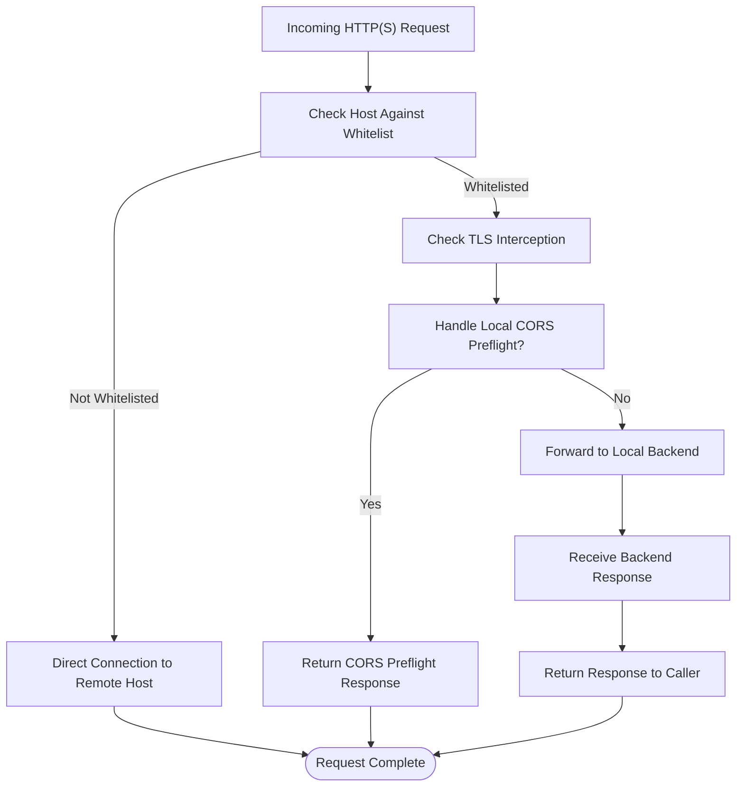
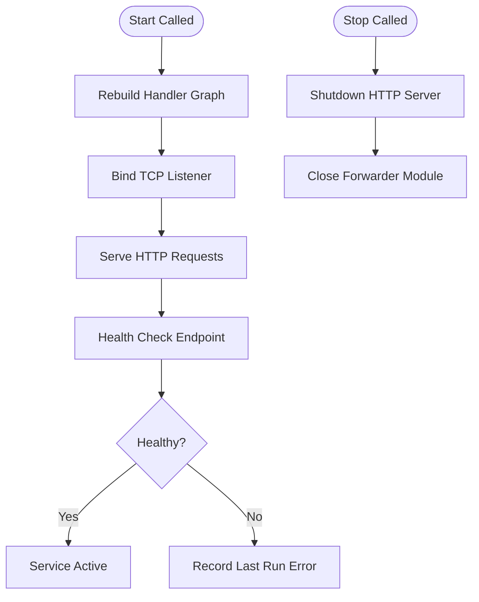
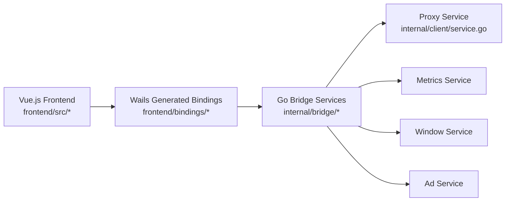
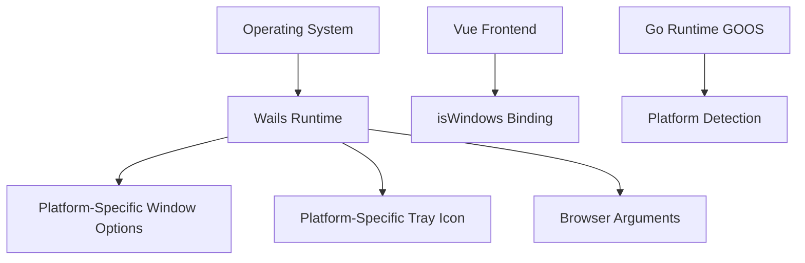
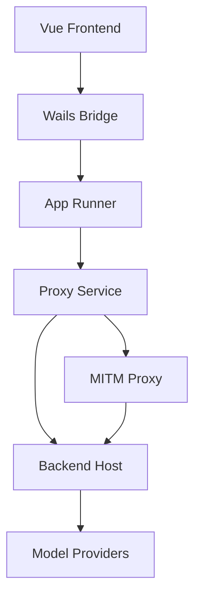

# System Overview

<cite>
**Referenced Files in This Document**   
- [main.go](file://main.go)
- [runner.go](file://internal/app/runner.go)
- [service.go](file://internal/client/service.go)
- [lifecycle.go](file://internal/client/lifecycle.go)
- [host.go](file://internal/backend/host.go)
- [service.go](file://internal/mitm/service.go)
- [proxy.go](file://internal/bridge/proxy.go)
- [vite.config.js](file://frontend/vite.config.js)
- [package.json](file://frontend/package.json)
- [isWindows.js](file://frontend/src/utils/isWindows.js)
- [README.md](file://README.md)
</cite>

## Table of Contents
1. [Introduction](#introduction)
2. [Project Structure](#project-structure)
3. [Core Components](#core-components)
4. [Architecture Overview](#architecture-overview)
5. [Detailed Component Analysis](#detailed-component-analysis)
6. [Dependency Analysis](#dependency-analysis)
7. [Performance Considerations](#performance-considerations)
8. [Troubleshooting Guide](#troubleshooting-guide)
9. [Conclusion](#conclusion)

## Introduction
cursor-byok is a local desktop application that wraps Cursor’s agent workflow behind a user-controlled backend. It runs a Wails-based desktop shell, an embedded Go backend host, and a local MITM proxy. The frontend is a Vue.js application served by Wails. At runtime, the system intercepts Cursor’s network traffic, forwards model requests to the local backend, and then routes them to the model providers configured by the user.

The high-level goal is to keep Cursor’s Agent capabilities while giving users full control over model endpoints, credentials, and request behavior. The application lifecycle starts from a small Go entry point, initializes logging, assets, certificates, services, and the Wails window, then automatically starts the proxy and backend when the application is ready.

**Section sources**
- [README.md:54-102](file://README.md#L54-L102)
- [main.go:19-29](file://main.go#L19-L29)

## Project Structure
At a high level, the repository separates concerns into:

| Area | Responsibility |
|---|---|
| `main.go` | Desktop process entry point; embeds frontend assets and icons; calls the app runner. |
| `internal/app` | Wails application assembly, window management, tray menu, event registration, and startup orchestration. |
| `internal/client` | Lifecycle service that coordinates the MITM proxy, embedded backend, Cursor account state, and configuration store. |
| `internal/backend` | Embedded HTTP server exposing Cursor-compatible backend functionality. |
| `internal/mitm` | Local HTTPS-capable proxy that intercepts Cursor API traffic and forwards it to the backend. |
| `internal/bridge` | Wails-exposed Go services used by the Vue.js frontend. |
| `frontend` | Vue.js + Vite UI for model configuration, metrics, and service controls. |
| `cursor-proxy-debugger`, `cursor-tab-server`, `proto`, `prompt` | Supporting tools, servers, protocol definitions, and prompt assets. |

**Diagram sources**
- [main.go:19-29](file://main.go#L19-L29)
- [runner.go:119-189](file://internal/app/runner.go#L119-L189)
- [service.go:77-105](file://internal/client/service.go#L77-L105)
- [service.go:181-206](file://internal/mitm/service.go#L181-L206)
- [host.go:28-64](file://internal/backend/host.go#L28-L64)

**Section sources**
- [main.go:1-29](file://main.go#L1-L29)
- [runner.go:119-189](file://internal/app/runner.go#L119-L189)
- [package.json:1-39](file://frontend/package.json#L1-L39)

## Core Components
The system is composed of five main runtime components:

1. **Desktop Entry and App Runner**  
   - Initializes logging, installs default network transport, ensures assistant home directories, loads or creates a local CA certificate, constructs the MITM proxy server, and registers Wails services.
   - Creates the Wails application, webview window, system tray, and event handlers.
   - Starts the proxy service automatically after application start.

2. **Proxy Service**  
   - Coordinates the MITM proxy and embedded backend host.
   - Manages Cursor settings injection and cleanup.
   - Provides health checks, state snapshots, and lifecycle transitions.

3. **MITM Proxy Server**  
   - Listens on a local address.
   - Optionally performs TLS interception for whitelisted Cursor domains using a locally managed CA.
   - Forwards matching requests to the local backend host.
   - Handles CORS preflight responses and rate-limited logging.

4. **Embedded Backend Host**  
   - Runs an HTTP server bound to a loopback address.
   - Exposes health checks and Cursor-compatible backend routes.
   - Rebuilds its internal handler graph when configuration changes.

5. **Vue.js Frontend**  
   - Built with Vite and Vue 3.
   - Uses Wails bindings to call Go services.
   - Displays dashboard, model configuration, metrics, and service controls.

**Section sources**
- [runner.go:119-189](file://internal/app/runner.go#L119-L189)
- [service.go:77-105](file://internal/client/service.go#L77-L105)
- [service.go:181-206](file://internal/mitm/service.go#L181-L206)
- [host.go:28-64](file://internal/backend/host.go#L28-L64)
- [vite.config.js:1-37](file://frontend/vite.config.js#L1-L37)

## Architecture Overview
The desktop application acts as an orchestrator. It does not directly implement all business logic; instead, it composes services through Wails and exposes them to the frontend.

**Diagram sources**
- [main.go:19-29](file://main.go#L19-L29)
- [runner.go:423-439](file://internal/app/runner.go#L423-L439)
- [lifecycle.go:94-127](file://internal/client/lifecycle.go#L94-L127)
- [service.go:265-307](file://internal/mitm/service.go#L265-L307)
- [host.go:131-174](file://internal/backend/host.go#L131-L174)

## Detailed Component Analysis

### Desktop Application Lifecycle
The lifecycle begins at `main.go`, which embeds frontend assets and icons, initializes logging, and delegates to `app.Run`. The runner:

- Installs a default HTTP transport.
- Ensures the assistant home directory exists.
- Loads or creates a local CA manager.
- Constructs the MITM proxy server with a default backend base URL.
- Builds bridge services for proxy state, metrics, windows, ads, and updates.
- Registers Wails events.
- Creates the main webview window and system tray.
- Automatically starts the proxy service after application startup.

**Diagram sources**
- [main.go:19-29](file://main.go#L19-L29)
- [runner.go:120-189](file://internal/app/runner.go#L120-L189)
- [runner.go:423-439](file://internal/app/runner.go#L423-L439)

**Section sources**
- [main.go:19-29](file://main.go#L19-L29)
- [runner.go:119-189](file://internal/app/runner.go#L119-L189)
- [runner.go:423-439](file://internal/app/runner.go#L423-L439)

### Proxy Service Orchestration
The client `ProxyService` is the central coordinator between the MITM proxy and the embedded backend. Its responsibilities include:

- Creating the backend host from a shared configuration store.
- Lazily ensuring the backend host exists.
- Building or updating the MITM proxy based on current configuration.
- Waiting for the backend to become healthy before considering the service fully started.
- Starting and stopping the proxy and backend in a controlled order.
- Applying and clearing Cursor-specific settings during lifecycle transitions.

**Diagram sources**
- [service.go:32-74](file://internal/client/service.go#L32-L74)
- [service.go:77-105](file://internal/client/service.go#L77-L105)
- [service.go:107-178](file://internal/client/service.go#L107-L178)
- [service.go:181-206](file://internal/mitm/service.go#L181-L206)
- [host.go:28-64](file://internal/backend/host.go#L28-L64)

**Section sources**
- [service.go:32-74](file://internal/client/service.go#L32-L74)
- [service.go:77-105](file://internal/client/service.go#L77-L105)
- [service.go:107-178](file://internal/client/service.go#L107-L178)

### MITM Proxy Behavior
The MITM proxy server listens on a configurable local address and forwards requests matching whitelisted Cursor hosts to the local backend. Key behaviors include:

- Base URL parsing and normalization.
- Optional TLS interception for whitelisted domains using a local CA.
- Forwarding only recognized Cursor API hosts to the backend.
- Handling CORS preflight requests for local development scenarios.
- Rate-limited logging to avoid log flooding.
- Graceful shutdown and running-state inspection.

**Diagram sources**
- [service.go:360-450](file://internal/mitm/service.go#L360-L450)
- [service.go:453-488](file://internal/mitm/service.go#L453-L488)
- [service.go:635-658](file://internal/mitm/service.go#L635-L658)
- [service.go:690-735](file://internal/mitm/service.go#L690-L735)

**Section sources**
- [service.go:181-206](file://internal/mitm/service.go#L181-L206)
- [service.go:265-307](file://internal/mitm/service.go#L265-L307)
- [service.go:360-450](file://internal/mitm/service.go#L360-L450)
- [service.go:453-488](file://internal/mitm/service.go#L453-L488)
- [service.go:635-658](file://internal/mitm/service.go#L635-L658)
- [service.go:690-735](file://internal/mitm/service.go#L690-L735)

### Embedded Backend Host
The backend host manages an embedded HTTP server that serves Cursor-compatible routes. It:

- Reads configuration from a persistent store.
- Rebuilds its internal mux and forwarder module when configuration changes.
- Starts and stops the HTTP server safely.
- Exposes a health endpoint for both in-process and loopback checks.
- Tracks last run errors and current listen address.

**Diagram sources**
- [host.go:131-174](file://internal/backend/host.go#L131-L174)
- [host.go:177-197](file://internal/backend/host.go#L177-L197)
- [host.go:199-253](file://internal/backend/host.go#L199-L253)
- [host.go:271-280](file://internal/backend/host.go#L271-L280)

**Section sources**
- [host.go:28-64](file://internal/backend/host.go#L28-L64)
- [host.go:131-174](file://internal/backend/host.go#L131-L174)
- [host.go:177-197](file://internal/backend/host.go#L177-L197)
- [host.go:199-253](file://internal/backend/host.go#L199-L253)
- [host.go:271-280](file://internal/backend/host.go#L271-L280)

### Frontend and Go Backend Relationship
The frontend is a Vue.js application built with Vite. It integrates with Wails through:

- The `@wailsio/runtime` package.
- A Vite plugin that generates bindings.
- Go services exposed via the `internal/bridge` layer.
- Runtime events such as proxy state changes and locale updates.

The Go backend exposes services like proxy state, metrics, window control, and ad runtime data. The frontend consumes these through generated bindings and updates the UI accordingly.

**Diagram sources**
- [vite.config.js:1-37](file://frontend/vite.config.js#L1-L37)
- [package.json:12-24](file://frontend/package.json#L12-L24)
- [proxy.go:57-64](file://internal/bridge/proxy.go#L57-L64)
- [runner.go:181-189](file://internal/app/runner.go#L181-L189)

**Section sources**
- [vite.config.js:1-37](file://frontend/vite.config.js#L1-L37)
- [package.json:1-39](file://frontend/package.json#L1-L39)
- [proxy.go:57-64](file://internal/bridge/proxy.go#L57-L64)

### Cross-Platform Considerations
The system supports Windows, macOS, and Linux through platform-aware code paths:

- Wails window options differ per platform, including frameless windows on Windows and macOS-specific backdrop/title-bar settings.
- System tray icon selection varies by operating system.
- Environment variables can adjust WebView behavior, such as disabling the WebView sandbox on affected environments.
- The frontend can query whether it is running on Windows through generated bindings.
- Network proxy and certificate handling are split across platform-specific files in the netproxy and cursor packages.

**Diagram sources**
- [runner.go:263-298](file://internal/app/runner.go#L263-L298)
- [runner.go:456-465](file://internal/app/runner.go#L456-L465)
- [runner.go:473-479](file://internal/app/runner.go#L473-L479)
- [isWindows.js:1-4](file://frontend/src/utils/isWindows.js#L1-L4)

**Section sources**
- [runner.go:263-298](file://internal/app/runner.go#L263-L298)
- [runner.go:456-465](file://internal/app/runner.go#L456-L465)
- [runner.go:473-479](file://internal/app/runner.go#L473-L479)
- [isWindows.js:1-4](file://frontend/src/utils/isWindows.js#L1-L4)

## Dependency Analysis
The main runtime dependencies form a layered architecture:

| Layer | Components | Direction |
|---|---|---|
| Presentation | Vue.js frontend, Wails webview | Calls Go services through bindings |
| Orchestration | Wails app runner, system tray, events | Starts and manages services |
| Coordination | Proxy service | Controls MITM proxy and backend host |
| Networking | MITM proxy server | Intercepts and forwards Cursor traffic |
| Backend | Embedded backend host | Serves Cursor-compatible routes |
| External | Model providers | OpenAI, Anthropic, or custom APIs |

**Diagram sources**
- [main.go:19-29](file://main.go#L19-L29)
- [runner.go:119-189](file://internal/app/runner.go#L119-L189)
- [service.go:77-105](file://internal/client/service.go#L77-L105)
- [service.go:181-206](file://internal/mitm/service.go#L181-L206)
- [host.go:131-174](file://internal/backend/host.go#L131-L174)

**Section sources**
- [runner.go:119-189](file://internal/app/runner.go#L119-L189)
- [service.go:77-105](file://internal/client/service.go#L77-L105)
- [service.go:181-206](file://internal/mitm/service.go#L181-L206)
- [host.go:131-174](file://internal/backend/host.go#L131-L174)

## Performance Considerations
- The MITM proxy uses a tuned HTTP transport with connection pooling, idle timeouts, and HTTP/2 support.
- Logging is rate-limited to prevent excessive output during high-volume proxy operations.
- The backend host performs both in-process and loopback health checks to detect startup issues early.
- The proxy service waits for the backend to become healthy before completing startup, reducing race conditions.
- The frontend targets older browser engines through Vite configuration, improving compatibility at the cost of some modern features.

[No sources needed since this section provides general guidance]

## Troubleshooting Guide
Common operational signals and their likely causes:

| Symptom | Likely Cause | Where to Inspect |
|---|---|---|
| Service starts but Cursor cannot connect | Backend not healthy or wrong listen address | Backend health check and listen address |
| HTTPS requests fail | CA not trusted or MITM disabled | CA manager and proxy TLS configuration |
| Proxy logs show repeated errors | Rate-limited proxy logging suppressing duplicates | Proxy log limiter and error handler |
| Frontend cannot reach backend | Loopback base URL resolution issue | Browser-reachable loopback URL helper |
| Window behaves differently on platforms | Platform-specific Wails options | Runner window and tray initialization |

**Section sources**
- [host.go:199-253](file://internal/backend/host.go#L199-L253)
- [service.go:265-307](file://internal/mitm/service.go#L265-L307)
- [service.go:737-759](file://internal/mitm/service.go#L737-L759)
- [runner.go:481-491](file://internal/app/runner.go#L481-L491)

## Conclusion
cursor-byok’s system overview centers on a Wails-based desktop application that orchestrates a local MITM proxy and an embedded backend host. The frontend communicates with Go services through Wails bindings, while the backend routes Cursor’s agent requests to user-configured model providers. The design emphasizes local control, cross-platform compatibility, and clear separation between presentation, orchestration, networking, and backend routing.

[No sources needed since this section summarizes without analyzing specific files]