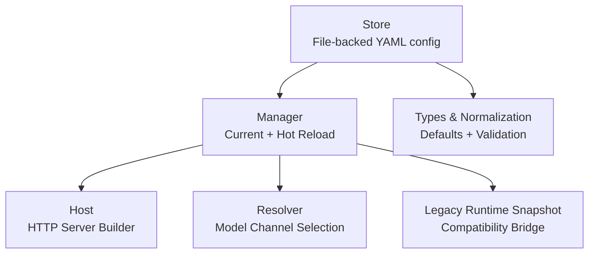
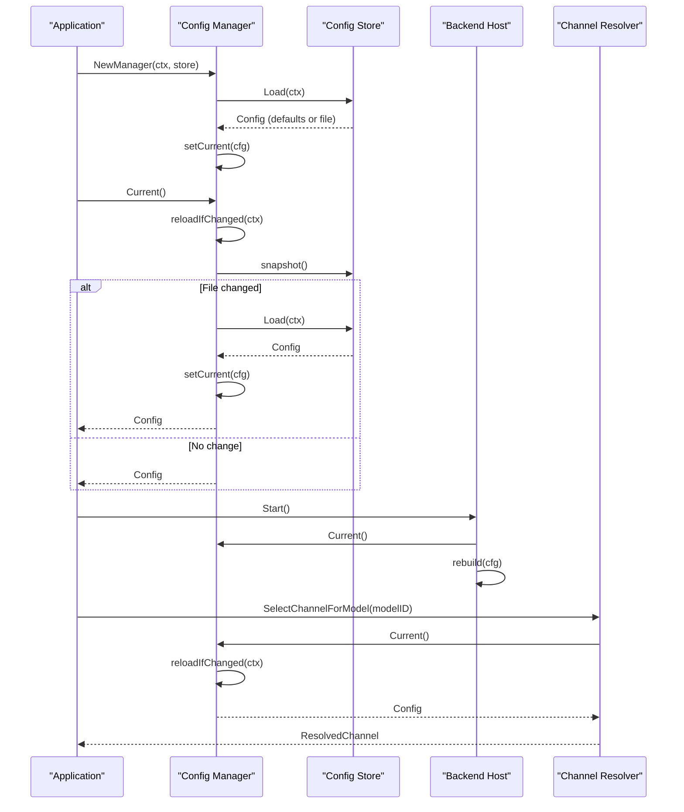
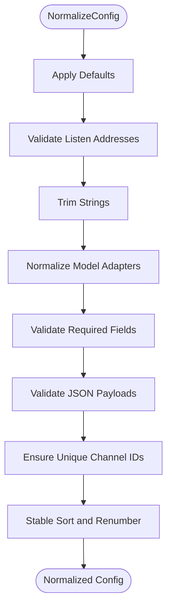
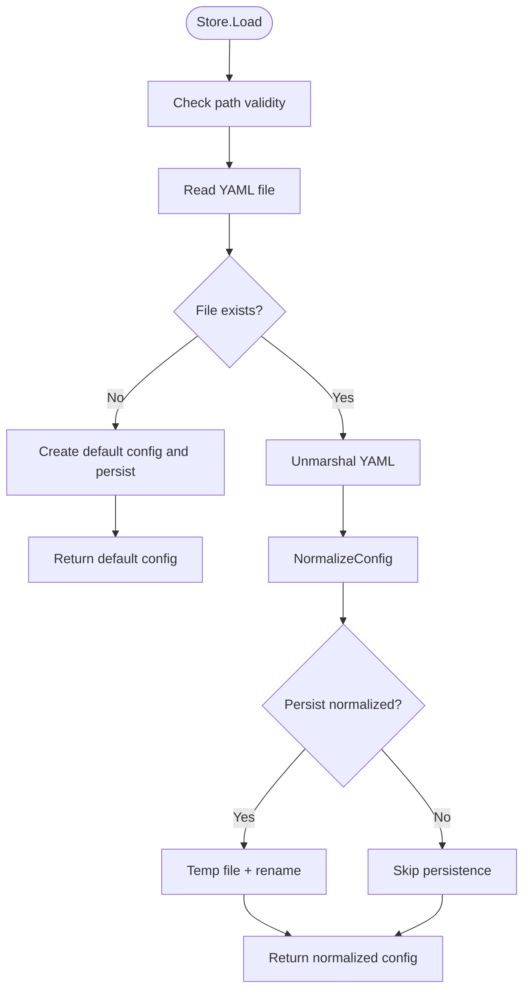
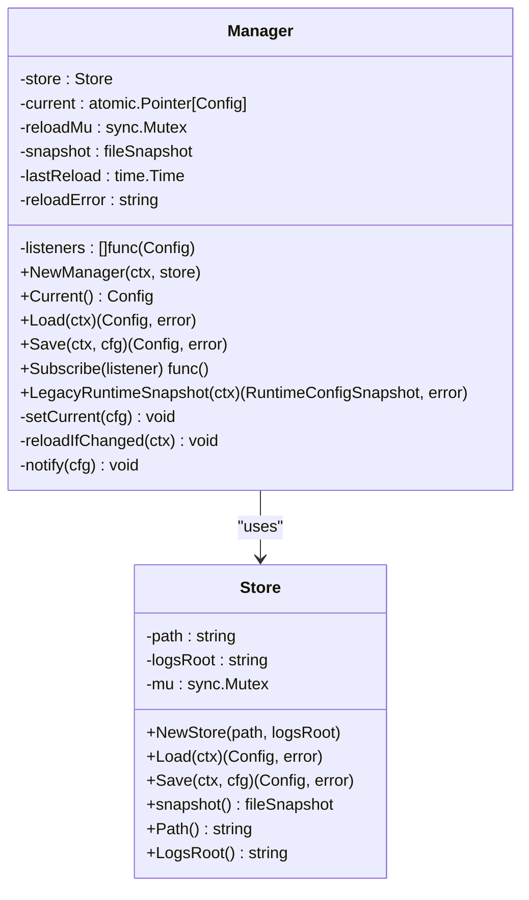
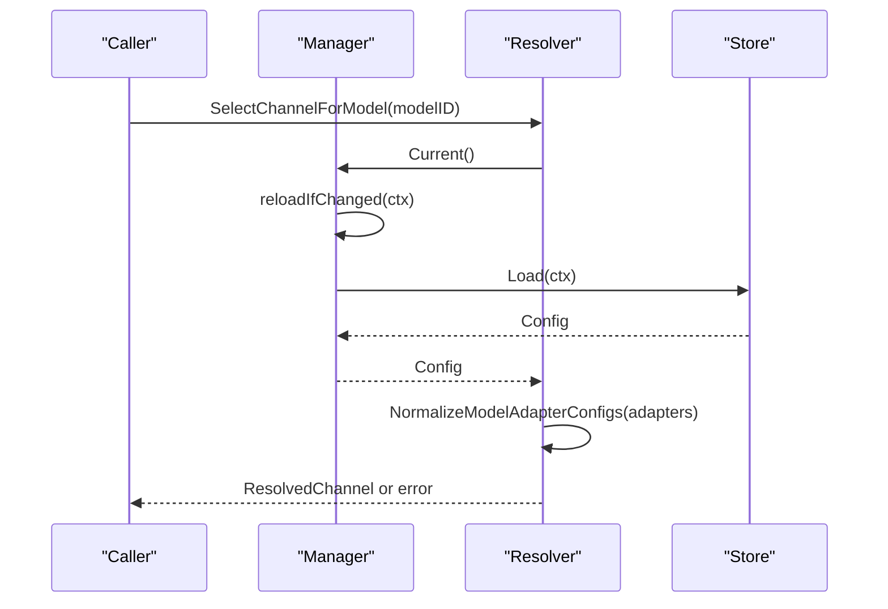
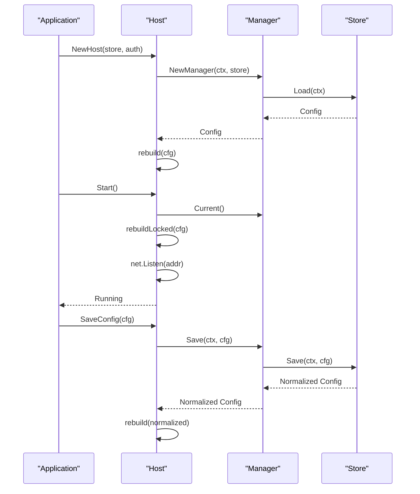
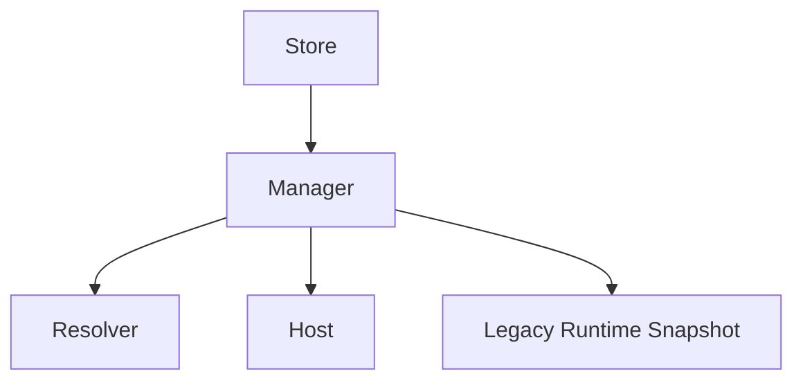

# Configuration Lifecycle Management

<cite>
**Referenced Files in This Document**
- [manager.go](file://internal/backend/server/config/manager.go)
- [store.go](file://internal/backend/server/config/store.go)
- [types.go](file://internal/backend/server/config/types.go)
- [resolver.go](file://internal/backend/server/config/resolver.go)
- [legacy_runtime.go](file://internal/backend/server/config/legacy_runtime.go)
- [host.go](file://internal/backend/host.go)
- [local_runtime.go](file://internal/runtime/local_runtime.go)
</cite>

## Table of Contents
1. [Introduction](#introduction)
2. [Project Structure](#project-structure)
3. [Core Components](#core-components)
4. [Architecture Overview](#architecture-overview)
5. [Detailed Component Analysis](#detailed-component-analysis)
6. [Dependency Analysis](#dependency-analysis)
7. [Performance Considerations](#performance-considerations)
8. [Troubleshooting Guide](#troubleshooting-guide)
9. [Conclusion](#conclusion)

## Introduction
This document explains the complete configuration lifecycle from discovery to runtime updates. It covers how configuration is discovered and loaded, the loading order and precedence rules, hot-reload behavior, change detection, service restart requirements, inheritance and override mechanisms, environment-specific configuration patterns, dynamic update examples, testing utilities, debugging strategies, caching strategies, performance optimization, and memory management for large configurations.

The implementation centers on a file-backed YAML configuration with normalization, validation, atomic current-state exposure, and hot reload with debouncing and snapshot-based change detection. The backend host rebuilds its HTTP server when listen addresses change, while model adapter selection uses normalized configuration at request time.

## Project Structure
Configuration-related code lives under the backend server configuration package and integrates with the backend host and legacy runtime:

- Configuration types, defaults, and normalization logic
- File-backed store with atomic save/load and snapshot-based change detection
- Manager that exposes current configuration, persists changes, and triggers hot reload
- Resolver that selects model channels based on normalized adapters
- Legacy runtime snapshot bridge for compatibility
- Backend host that constructs HTTP routes and rebuilds services when configuration changes

**Diagram sources**
- [manager.go:17-42](file://internal/backend/server/config/manager.go#L17-L42)
- [store.go:15-32](file://internal/backend/server/config/store.go#L15-L32)
- [types.go:51-93](file://internal/backend/server/config/types.go#L51-L93)
- [resolver.go:19-28](file://internal/backend/server/config/resolver.go#L19-L28)
- [legacy_runtime.go:9-47](file://internal/backend/server/config/legacy_runtime.go#L9-L47)
- [host.go:44-64](file://internal/backend/host.go#L44-L64)

**Section sources**
- [manager.go:17-42](file://internal/backend/server/config/manager.go#L17-L42)
- [store.go:15-32](file://internal/backend/server/config/store.go#L15-L32)
- [types.go:51-93](file://internal/backend/server/config/types.go#L51-L93)
- [resolver.go:19-28](file://internal/backend/server/config/resolver.go#L19-L28)
- [legacy_runtime.go:9-47](file://internal/backend/server/config/legacy_runtime.go#L9-L47)
- [host.go:44-64](file://internal/backend/host.go#L44-L64)

## Core Components
- Config types and defaults: Define the configuration schema, default values, and normalization/validation rules for fields such as listen addresses, provider stream idle timeout, and model adapters.
- Store: Reads and writes YAML configuration files, normalizes data, persists normalized output when needed, and provides snapshots for change detection.
- Manager: Wraps Store, exposes Current() and Load(), handles Save(), implements hot reload with debouncing and listener notifications, and bridges to legacy runtime snapshots.
- Resolver: Selects a model channel by matching requested model IDs against normalized adapters and building resolved channel objects.
- Legacy runtime snapshot: Converts current configuration into a legacy runtime-compatible snapshot.
- Host: Builds the HTTP server using configuration; rebuilds internal services when configuration changes (e.g., listen address).

Key responsibilities:
- Discovery and loading: Store.Load returns defaults if the file does not exist and creates it.
- Precedence and inheritance: Defaults are applied first, then user-provided values are normalized and validated.
- Hot reload: Manager.reloadIfChanged detects file changes via snapshot comparison and debounced reloading.
- Service restart: Host.rebuildLocked reconstructs the HTTP server and forwarder module when necessary.

**Section sources**
- [types.go:51-93](file://internal/backend/server/config/types.go#L51-L93)
- [store.go:63-96](file://internal/backend/server/config/store.go#L63-L96)
- [manager.go:28-42](file://internal/backend/server/config/manager.go#L28-L42)
- [resolver.go:19-28](file://internal/backend/server/config/resolver.go#L19-L28)
- [legacy_runtime.go:9-47](file://internal/backend/server/config/legacy_runtime.go#L9-L47)
- [host.go:271-289](file://internal/backend/host.go#L271-L289)

## Architecture Overview
The configuration lifecycle flows through Store -> Manager -> Consumers (Host, Resolver, Legacy Runtime).

**Diagram sources**
- [manager.go:28-42](file://internal/backend/server/config/manager.go#L28-L42)
- [manager.go:44-68](file://internal/backend/server/config/manager.go#L44-L68)
- [manager.go:180-214](file://internal/backend/server/config/manager.go#L180-L214)
- [store.go:63-96](file://internal/backend/server/config/store.go#L63-L96)
- [host.go:131-175](file://internal/backend/host.go#L131-L175)
- [resolver.go:19-28](file://internal/backend/server/config/resolver.go#L19-L28)

## Detailed Component Analysis

### Configuration Types, Defaults, and Normalization
- Default values include backend/proxy listen addresses, frontend base URL, and provider stream idle timeout.
- NormalizeConfig applies defaults, validates and normalizes listen addresses, trims strings, and normalizes model adapters.
- Model adapter normalization enforces required fields, supported types, endpoint constraints, JSON payload validation, and uniqueness of channel IDs. Sorting is stable and renumbered.

Precedence rules:
- Defaults are always applied first.
- User-provided values override defaults after normalization.
- Invalid values cause errors during normalization; safe defaults are used where applicable.

Environment-specific configuration:
- Environment variables are not directly read by these components. Environment-specific behavior can be achieved by providing different configuration files or paths to Store.

**Diagram sources**
- [types.go:61-93](file://internal/backend/server/config/types.go#L61-L93)
- [types.go:95-172](file://internal/backend/server/config/types.go#L95-L172)
- [types.go:174-192](file://internal/backend/server/config/types.go#L174-L192)

**Section sources**
- [types.go:15-21](file://internal/backend/server/config/types.go#L15-L21)
- [types.go:51-93](file://internal/backend/server/config/types.go#L51-L93)
- [types.go:95-172](file://internal/backend/server/config/types.go#L95-L172)
- [types.go:174-192](file://internal/backend/server/config/types.go#L174-L192)

### Store: Discovery, Loading, Persistence, and Change Detection
- Discovery: If the configuration file does not exist, Store.Load creates it with default values.
- Loading: Reads YAML, unmarshals into Config, normalizes, and optionally persists normalized config.
- Persistence: Uses atomic write via temp file and rename to avoid partial writes.
- Change detection: snapshot() captures existence, modification time, and size; Manager compares snapshots to detect changes.

Loading order and precedence:
- Defaults are created if the file is missing.
- Existing file content is parsed and normalized; normalized values may be persisted back if they differ from raw content.

**Diagram sources**
- [store.go:63-96](file://internal/backend/server/config/store.go#L63-L96)
- [store.go:118-136](file://internal/backend/server/config/store.go#L118-L136)
- [store.go:138-152](file://internal/backend/server/config/store.go#L138-L152)

**Section sources**
- [store.go:48-61](file://internal/backend/server/config/store.go#L48-L61)
- [store.go:63-96](file://internal/backend/server/config/store.go#L63-L96)
- [store.go:99-116](file://internal/backend/server/config/store.go#L99-L116)
- [store.go:118-136](file://internal/backend/server/config/store.go#L118-L136)
- [store.go:138-152](file://internal/backend/server/config/store.go#L138-L152)

### Manager: Hot Reload, Listeners, and Current State Exposure
- Initialization: Loads initial config from Store and sets current state.
- Current(): Triggers reloadIfChanged and returns current config atomically.
- Load(): Same as Current but returns error semantics from Store.
- Save(): Normalizes, persists, updates snapshot and lastReload timestamp, clears reloadError, and notifies listeners.
- Hot reload: Debounces reload attempts (minimum interval), compares snapshots, loads new config on change, updates current state, and notifies all registered listeners.

Hot reload capabilities:
- Change detection via file snapshot comparison.
- Debouncing to prevent excessive reloads.
- Listener notification for reactive updates.

Service restart requirements:
- Changing listen addresses requires rebuilding the HTTP server; Host.rebuildLocked handles this.

**Diagram sources**
- [manager.go:17-42](file://internal/backend/server/config/manager.go#L17-L42)
- [manager.go:70-86](file://internal/backend/server/config/manager.go#L70-L86)
- [manager.go:126-142](file://internal/backend/server/config/manager.go#L126-L142)
- [manager.go:175-214](file://internal/backend/server/config/manager.go#L175-L214)
- [store.go:15-32](file://internal/backend/server/config/store.go#L15-L32)
- [store.go:63-96](file://internal/backend/server/config/store.go#L63-L96)

**Section sources**
- [manager.go:28-42](file://internal/backend/server/config/manager.go#L28-L42)
- [manager.go:44-68](file://internal/backend/server/config/manager.go#L44-L68)
- [manager.go:70-86](file://internal/backend/server/config/manager.go#L70-L86)
- [manager.go:126-142](file://internal/backend/server/config/manager.go#L126-L142)
- [manager.go:175-214](file://internal/backend/server/config/manager.go#L175-L214)

### Resolver: Model Channel Selection
- SelectChannelForModel normalizes adapters from current config and resolves a channel for a given model ID.
- ResolvedChannel includes provider details, endpoints, extra parameters, token limits, and thinking budget.

**Diagram sources**
- [resolver.go:19-28](file://internal/backend/server/config/resolver.go#L19-L28)
- [manager.go:44-68](file://internal/backend/server/config/manager.go#L44-L68)
- [store.go:63-96](file://internal/backend/server/config/store.go#L63-L96)

**Section sources**
- [resolver.go:19-28](file://internal/backend/server/config/resolver.go#L19-L28)
- [resolver.go:30-86](file://internal/backend/server/config/resolver.go#L30-L86)

### Legacy Runtime Snapshot Bridge
- Provides a snapshot compatible with legacy runtime consumers by mapping current Config fields to legacy types.

**Section sources**
- [legacy_runtime.go:9-47](file://internal/backend/server/config/legacy_runtime.go#L9-L47)
- [manager.go:144-173](file://internal/backend/server/config/manager.go#L144-L173)

### Backend Host: Service Rebuild on Configuration Changes
- Host initializes Manager and builds HTTP routes using current configuration.
- On Save(), if the HTTP server is already running, Host.rebuild is invoked to update internal modules and routes.
- Start() constructs the HTTP server with the configured listen address and starts serving.

**Diagram sources**
- [host.go:44-64](file://internal/backend/host.go#L44-L64)
- [host.go:131-175](file://internal/backend/host.go#L131-L175)
- [host.go:271-289](file://internal/backend/host.go#L271-L289)
- [manager.go:70-86](file://internal/backend/server/config/manager.go#L70-L86)
- [store.go:99-116](file://internal/backend/server/config/store.go#L99-L116)

**Section sources**
- [host.go:44-64](file://internal/backend/host.go#L44-L64)
- [host.go:131-175](file://internal/backend/host.go#L131-L175)
- [host.go:271-289](file://internal/backend/host.go#L271-L289)

## Dependency Analysis
- Manager depends on Store for persistence and snapshotting.
- Resolver depends on Manager.Current() to access normalized adapters.
- Host depends on Manager for current configuration and rebuilds services on changes.
- Legacy runtime snapshot depends on Manager.Store.LegacyRuntimeSnapshot.

**Diagram sources**
- [manager.go:17-42](file://internal/backend/server/config/manager.go#L17-L42)
- [resolver.go:19-28](file://internal/backend/server/config/resolver.go#L19-L28)
- [host.go:44-64](file://internal/backend/host.go#L44-L64)
- [legacy_runtime.go:9-47](file://internal/backend/server/config/legacy_runtime.go#L9-L47)

**Section sources**
- [manager.go:17-42](file://internal/backend/server/config/manager.go#L17-L42)
- [resolver.go:19-28](file://internal/backend/server/config/resolver.go#L19-L28)
- [host.go:44-64](file://internal/backend/host.go#L44-L64)
- [legacy_runtime.go:9-47](file://internal/backend/server/config/legacy_runtime.go#L9-L47)

## Performance Considerations
- Debounced hot reload: Minimum interval prevents excessive reloads and reduces I/O pressure.
- Snapshot-based change detection: Avoids full parsing unless file metadata indicates changes.
- Atomic persistence: Temp file + rename ensures consistent reads during writes.
- Normalization only when needed: shouldPersistNormalizedConfig avoids unnecessary writes.
- Memory management: Large adapter arrays are normalized once per load; consider limiting adapter count and avoiding oversized JSON payloads.

Optimization recommendations:
- Keep configuration files small and well-structured.
- Use explicit sort values sparingly; rely on stable sorting.
- Avoid frequent edits to the configuration file to minimize reload overhead.
- Monitor reload errors and log them once per distinct message to reduce noise.

[No sources needed since this section provides general guidance]

## Troubleshooting Guide
Common issues and diagnostics:
- Configuration file missing: Store.Load creates defaults and persists them.
- YAML parse errors: Errors are wrapped and returned; check file syntax.
- Normalization failures: Validate required fields, supported types, endpoint constraints, and JSON payloads.
- Hot reload skipped due to errors: Manager logs skipped reloads with path and error; inspect logs for repeated messages.
- Listen address conflicts: Host.Start reports binding errors; ensure ports are available.
- Channel not available: Resolver returns an error if no adapter matches the requested model ID.

Debugging steps:
- Inspect current configuration via Manager.Current().
- Verify Store.Path() and LogsRoot() are set correctly.
- Check file permissions and directory creation.
- Review normalization errors for specific field validations.
- Use Subscribe to observe configuration changes and validate listener behavior.

**Section sources**
- [store.go:63-96](file://internal/backend/server/config/store.go#L63-L96)
- [manager.go:180-214](file://internal/backend/server/config/manager.go#L180-L214)
- [host.go:131-175](file://internal/backend/host.go#L131-L175)
- [resolver.go:19-28](file://internal/backend/server/config/resolver.go#L19-L28)

## Conclusion
The configuration lifecycle combines robust defaults, strict normalization, atomic persistence, and efficient hot reload. Manager coordinates Store operations and exposes current configuration safely, while Host rebuilds services when necessary. Resolver consumes normalized configuration to select model channels dynamically. Together, these components provide a reliable, performant, and observable configuration system suitable for runtime updates without requiring full application restarts, except when network bindings change.

[No sources needed since this section summarizes without analyzing specific files]