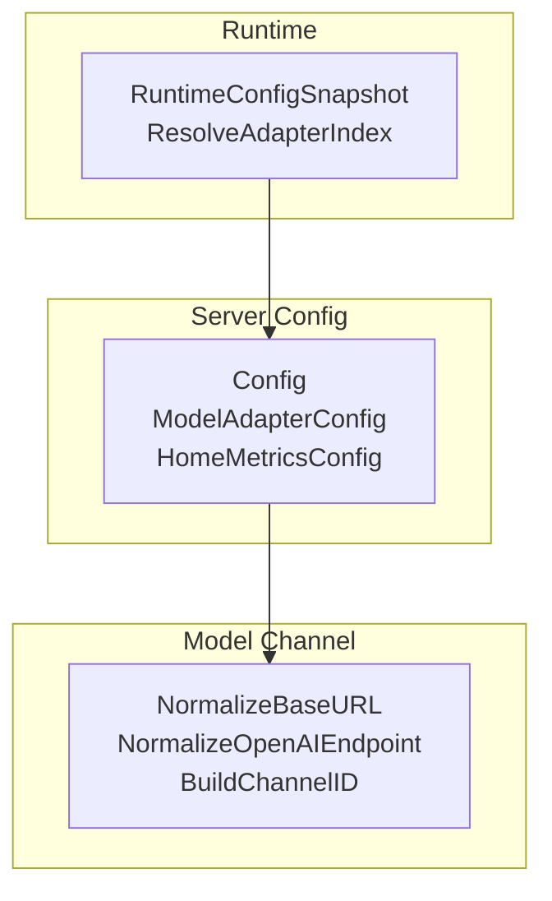
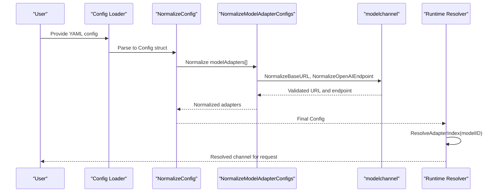
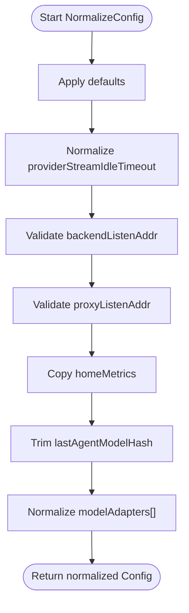
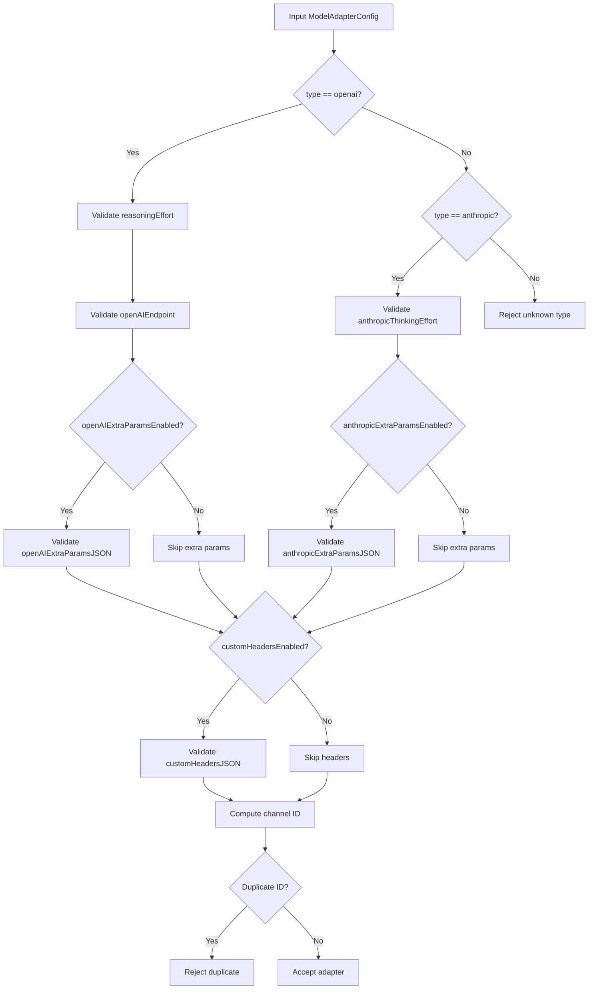
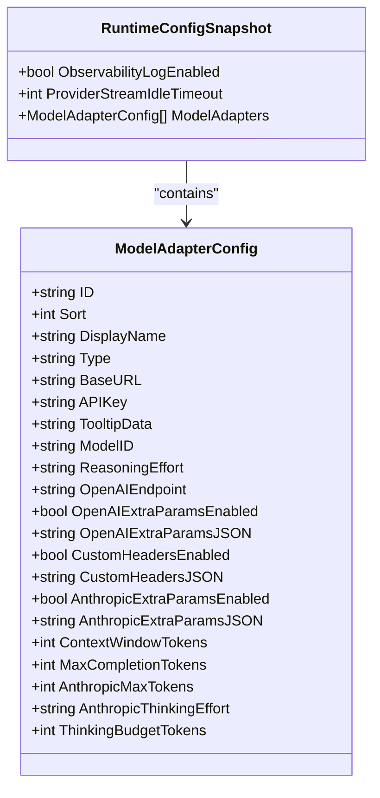
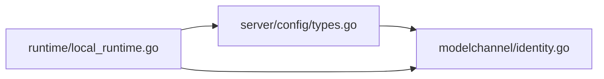

# Configuration Schema and Types

<cite>
**Referenced Files in This Document**
- [types.go](file://internal/backend/server/config/types.go)
- [identity.go](file://internal/modelchannel/identity.go)
- [local_runtime.go](file://internal/runtimelocal_runtime.go)
- [config.yaml](file://cursor-tab-server/config.yaml)
</cite>

## Table of Contents
1. [Introduction](#introduction)
2. [Project Structure](#project-structure)
3. [Core Components](#core-components)
4. [Architecture Overview](#architecture-overview)
5. [Detailed Component Analysis](#detailed-component-analysis)
6. [Dependency Analysis](#dependency-analysis)
7. [Performance Considerations](#performance-considerations)
8. [Troubleshooting Guide](#troubleshooting-guide)
9. [Conclusion](#conclusion)
10. [Appendices](#appendices)

## Introduction
This document describes the configuration schema and type definitions used by cursor-byok for model adapters and server runtime settings. It focuses on:
- The top-level configuration structure
- Model adapter configuration for OpenAI and Anthropic providers
- Validation rules, default values, and normalization behavior
- How nested objects, arrays, and complex JSON fields are handled
- Required vs optional fields, enum-like constraints, and format requirements
- Inheritance patterns between config sections and how they relate to each other

The goal is to help you author correct YAML configurations for different use cases and understand how the system validates and normalizes them at runtime.

## Project Structure
Configuration-related types live primarily under the backend server configuration package, with shared URL and identity helpers in the model channel package. A runtime snapshot layer reuses the same adapter configuration shape for runtime resolution.

**Diagram sources**
- [types.go:23-59](file://internal/backend/server/config/types.go#L23-L59)
- [identity.go:19-59](file://internal/modelchannel/identity.go#L19-L59)
- [local_runtime.go:83-90](file://internal/runtimelocal_runtime.go#L83-L90)

**Section sources**
- [types.go:23-59](file://internal/backend/server/config/types.go#L23-L59)
- [identity.go:19-59](file://internal/modelchannel/identity.go#L19-L59)
- [local_runtime.go:83-90](file://internal/runtimelocal_runtime.go#L83-L90)

## Core Components
This section documents the primary configuration structures and their semantics.

### Top-Level Config
- Purpose: Holds global server/runtime options and the list of model adapters.
- Key fields:
  - log: boolean flag for enabling logs.
  - providerStreamIdleTimeout: seconds; normalized to a minimum if too low or non-positive.
  - backendListenAddr: host:port string for the backend service.
  - proxyListenAddr: host:port string for the proxy service.
  - modelAdapters: array of model adapter configurations.
  - homeMetrics: nested metrics configuration object.
  - lastAgentModelHash: string; trimmed during normalization.

Defaults and normalization:
- Default listen addresses and stream idle timeout are applied when missing or invalid.
- Listen addresses must be valid host:port with port in range 1–65535.
- Non-positive providerStreamIdleTimeout is replaced with a default; values below a minimum are clamped to that minimum.

**Section sources**
- [types.go:15-21](file://internal/backend/server/config/types.go#L15-L21)
- [types.go:51-69](file://internal/backend/server/config/types.go#L51-L69)
- [types.go:71-93](file://internal/backend/server/config/types.go#L71-L93)
- [types.go:250-284](file://internal/backend/server/config/types.go#L250-L284)

### HomeMetricsConfig
- Purpose: Controls whether cache writes are included in hit rate calculations.
- Fields:
  - includeCacheWriteInHitRate: boolean.

Normalization:
- The value is copied as-is into the normalized output.

**Section sources**
- [types.go:47-49](file://internal/backend/server/config/types.go#L47-L49)
- [types.go:85-86](file://internal/backend/server/config/types.go#L85-L86)

### ModelAdapterConfig
- Purpose: Defines a single model provider channel (adapter).
- Common fields:
  - id: computed identifier; not serialized from input.
  - sort: display order; normalized to sequential indices after validation.
  - displayName: human-readable name; required.
  - type: provider type; must be one of openai or anthropic.
  - baseURL: provider endpoint base URL; required and validated as http/https URL.
  - apiKey: provider API key; required.
  - tooltipData: descriptive text; required.
  - modelID: provider model identifier; required.
  - reasoningEffort: OpenAI reasoning effort; allowed values include empty and specific levels.
  - openAIEndpoint: OpenAI endpoint path; required for openai type; supports predefined paths or custom.
  - openAIExtraParamsEnabled: toggle for extra parameters.
  - openAIExtraParamsJSON: JSON map of extra parameters; required when enabled.
  - customHeadersEnabled: toggle for custom headers.
  - customHeadersJSON: JSON map of header name to string value; required when enabled.
  - contextWindowTokens: context window size override; positive integer or zero.
  - maxCompletionTokens: maximum completion tokens; positive integer or zero.
  - anthropicMaxTokens: Anthropic-specific max tokens; positive integer or zero.
  - anthropicThinkingEffort: Anthropic adaptive thinking effort; allowed values include specific levels.
  - thinkingBudgetTokens: thinking budget tokens; positive integer or zero.

Validation and normalization highlights:
- displayName, type, apiKey, tooltipData, modelID are required.
- type must be openai or anthropic.
- baseURL must be a valid http/https URL with a host.
- For openai:
  - reasoningEffort must be empty or one of supported levels.
  - openAIEndpoint must be one of predefined endpoints or /custom.
  - If openAIExtraParamsEnabled is true, openAIExtraParamsJSON must be a valid JSON object.
- For anthropic:
  - anthropicThinkingEffort must be one of supported levels.
  - If anthropicExtraParamsEnabled is true, anthropicExtraParamsJSON must be a valid JSON object.
- customHeadersJSON must be a JSON object whose keys are strings and values are strings; header names cannot be blank.
- Token fields (contextWindowTokens, maxCompletionTokens, anthropicMaxTokens, thinkingBudgetTokens) must be positive integers; non-positive values are treated as zero.
- Duplicate channels are detected via a computed ID based on baseURL, modelID, apiKey, displayName, and openAIEndpoint.

**Section sources**
- [types.go:23-45](file://internal/backend/server/config/types.go#L23-L45)
- [types.go:95-172](file://internal/backend/server/config/types.go#L95-L172)
- [types.go:194-224](file://internal/backend/server/config/types.go#L194-L224)
- [types.go:226-295](file://internal/backend/server/config/types.go#L226-L295)
- [identity.go:19-59](file://internal/modelchannel/identity.go#L19-L59)

## Architecture Overview
The configuration flows through normalization and validation before being used by runtime components.

**Diagram sources**
- [types.go:71-93](file://internal/backend/server/config/types.go#L71-L93)
- [types.go:95-172](file://internal/backend/server/config/types.go#L95-L172)
- [identity.go:19-59](file://internal/modelchannel/identity.go#L19-L59)
- [local_runtime.go:389-456](file://internal/runtimelocal_runtime.go#L389-L456)

## Detailed Component Analysis

### Config Normalization Flow
- Defaults are applied for missing fields.
- providerStreamIdleTimeout is clamped to a minimum if too small or non-positive.
- backendListenAddr and proxyListenAddr are parsed and validated as host:port.
- lastAgentModelHash is trimmed.
- modelAdapters are normalized and validated; duplicates are rejected.

**Diagram sources**
- [types.go:61-93](file://internal/backend/server/config/types.go#L61-L93)
- [types.go:250-284](file://internal/backend/server/config/types.go#L250-L284)

**Section sources**
- [types.go:61-93](file://internal/backend/server/config/types.go#L61-L93)
- [types.go:250-284](file://internal/backend/server/config/types.go#L250-L284)

### ModelAdapterConfig Validation Rules
- Required fields: displayName, type, apiKey, tooltipData, modelID.
- Enum-like constraints:
  - type: openai | anthropic
  - reasoningEffort (openai): "" | low | medium | high | xhigh | max
  - anthropicThinkingEffort (anthropic): low | medium | high | xhigh | max
- Format constraints:
  - baseURL: http/https URL with host
  - openAIEndpoint: "/v1/responses" | "/v1/chat/completions" | "/custom"
  - openAIExtraParamsJSON: valid JSON object
  - anthropicExtraParamsJSON: valid JSON object
  - customHeadersJSON: JSON object with string keys and string values; no blank keys
- Token fields: positive integers or zero; non-positive become zero.
- Uniqueness: computed channel ID must be unique across adapters.

**Diagram sources**
- [types.go:95-172](file://internal/backend/server/config/types.go#L95-L172)
- [types.go:194-224](file://internal/backend/server/config/types.go#L194-L224)
- [identity.go:19-59](file://internal/modelchannel/identity.go#L19-L59)

**Section sources**
- [types.go:95-172](file://internal/backend/server/config/types.go#L95-L172)
- [types.go:194-224](file://internal/backend/server/config/types.go#L194-L224)
- [identity.go:19-59](file://internal/modelchannel/identity.go#L19-L59)

### Runtime Integration
- Runtime snapshots expose ProviderStreamIdleTimeout and ModelAdapters.
- Resolution selects an adapter by matching modelID against normalized adapters.
- Defaults for timeouts, context windows, and token limits are applied unless overridden by adapter config.

**Diagram sources**
- [local_runtime.go:38-90](file://internal/runtimelocal_runtime.go#L38-L90)

**Section sources**
- [local_runtime.go:38-90](file://internal/runtimelocal_runtime.go#L38-L90)
- [local_runtime.go:389-456](file://internal/runtimelocal_runtime.go#L389-L456)

## Dependency Analysis
- Server config depends on modelchannel for URL and endpoint normalization and channel ID computation.
- Runtime uses the same adapter configuration shape and relies on modelchannel utilities for selection logic.

**Diagram sources**
- [types.go:23-59](file://internal/backend/server/config/types.go#L23-L59)
- [identity.go:19-59](file://internal/modelchannel/identity.go#L19-L59)
- [local_runtime.go:38-90](file://internal/runtimelocal_runtime.go#L38-L90)

**Section sources**
- [types.go:23-59](file://internal/backend/server/config/types.go#L23-L59)
- [identity.go:19-59](file://internal/modelchannel/identity.go#L19-L59)
- [local_runtime.go:38-90](file://internal/runtimelocal_runtime.go#L38-L90)

## Performance Considerations
- providerStreamIdleTimeout controls stream idle behavior; ensure it is set appropriately for your environment to avoid premature timeouts.
- Token limits (maxCompletionTokens, anthropicMaxTokens, thinkingBudgetTokens) should be tuned to balance latency and cost.
- Avoid excessive custom headers or large extra parameter payloads to minimize overhead.

[No sources needed since this section provides general guidance]

## Troubleshooting Guide
Common validation errors and resolutions:
- Missing required fields: Ensure displayName, type, apiKey, tooltipData, and modelID are present.
- Invalid type: Use openai or anthropic.
- Invalid baseURL: Must be a valid http/https URL with a host.
- Unsupported reasoningEffort: For openai, use one of the supported values or leave empty.
- Invalid openAIEndpoint: For openai, use "/v1/responses", "/v1/chat/completions", or "/custom".
- Invalid JSON maps: openAIExtraParamsJSON, anthropicExtraParamsJSON, and customHeadersJSON must be valid JSON objects; customHeadersJSON values must be strings and keys non-empty.
- Duplicate channel: Adjust baseURL, modelID, apiKey, displayName, or openAIEndpoint to make the computed channel ID unique.
- Port out of range: Ensure backendListenAddr and proxyListenAddr have ports in 1–65535.

**Section sources**
- [types.go:95-172](file://internal/backend/server/config/types.go#L95-L172)
- [types.go:194-224](file://internal/backend/server/config/types.go#L194-L224)
- [types.go:250-284](file://internal/backend/server/config/types.go#L250-L284)

## Conclusion
The configuration schema centers around a top-level Config with a list of ModelAdapterConfig entries. Each adapter defines provider-specific settings for OpenAI or Anthropic, including endpoint selection, extra parameters, custom headers, and token limits. Normalization and validation enforce strict constraints to ensure safe and predictable runtime behavior. By following the documented field requirements and constraints, you can construct robust YAML configurations for diverse use cases.

[No sources needed since this section summarizes without analyzing specific files]

## Appendices

### Field Reference Summary

- Config
  - log: boolean
  - providerStreamIdleTimeout: integer seconds; clamped to minimum if too low or non-positive
  - backendListenAddr: host:port; validated
  - proxyListenAddr: host:port; validated
  - modelAdapters: array of ModelAdapterConfig
  - homeMetrics: HomeMetricsConfig
  - lastAgentModelHash: string; trimmed

- HomeMetricsConfig
  - includeCacheWriteInHitRate: boolean

- ModelAdapterConfig
  - id: computed; not user-provided
  - sort: integer; normalized to sequential indices
  - displayName: string; required
  - type: string; openai | anthropic
  - baseURL: string; http/https URL with host; required
  - apiKey: string; required
  - tooltipData: string; required
  - modelID: string; required
  - reasoningEffort: string; openai only; "" | low | medium | high | xhigh | max
  - openAIEndpoint: string; openai only; "/v1/responses" | "/v1/chat/completions" | "/custom"
  - openAIExtraParamsEnabled: boolean
  - openAIExtraParamsJSON: string; valid JSON object when enabled
  - customHeadersEnabled: boolean
  - customHeadersJSON: string; valid JSON object with string keys/values when enabled
  - anthropicExtraParamsEnabled: boolean
  - anthropicExtraParamsJSON: string; valid JSON object when enabled
  - contextWindowTokens: integer; positive or zero
  - maxCompletionTokens: integer; positive or zero
  - anthropicMaxTokens: integer; positive or zero
  - anthropicThinkingEffort: string; anthropic only; low | medium | high | xhigh | max
  - thinkingBudgetTokens: integer; positive or zero

**Section sources**
- [types.go:23-59](file://internal/backend/server/config/types.go#L23-L59)
- [types.go:95-172](file://internal/backend/server/config/types.go#L95-L172)
- [identity.go:19-59](file://internal/modelchannel/identity.go#L19-L59)

### Example YAML Structures

Note: The repository includes a minimal example file. Use the following structures as templates aligned with the schema.

- Minimal server config
  - File: [config.yaml](file://cursor-tab-server/config.yaml)
  - Contains a placeholder token field; extend with the fields described above.

- OpenAI adapter example
  - type: openai
  - Required: baseURL, apiKey, displayName, tooltipData, modelID
  - Optional: reasoningEffort, openAIEndpoint, openAIExtraParamsEnabled/openAIExtraParamsJSON, customHeadersEnabled/customHeadersJSON, contextWindowTokens, maxCompletionTokens, thinkingBudgetTokens

- Anthropic adapter example
  - type: anthropic
  - Required: baseURL, apiKey, displayName, tooltipData, modelID
  - Optional: anthropicThinkingEffort, anthropicExtraParamsEnabled/anthropicExtraParamsJSON, customHeadersEnabled/customHeadersJSON, contextWindowTokens, anthropicMaxTokens, thinkingBudgetTokens

- Multiple adapters
  - Define multiple entries under modelAdapters; ensure uniqueness of computed channel IDs.

[No sources needed since this section provides conceptual examples aligned with the schema]