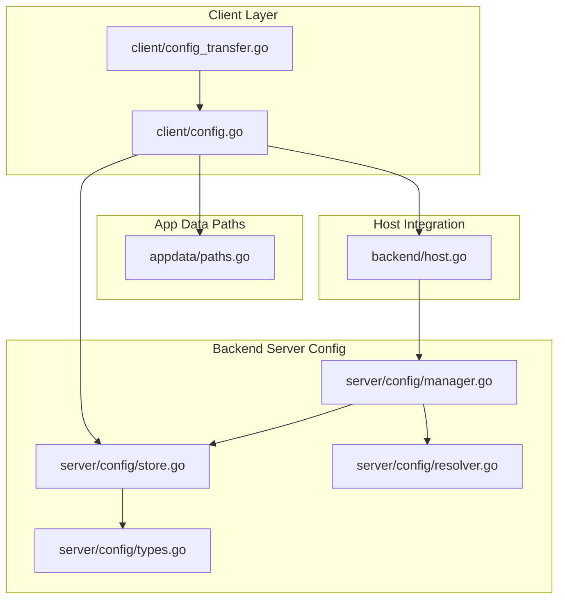
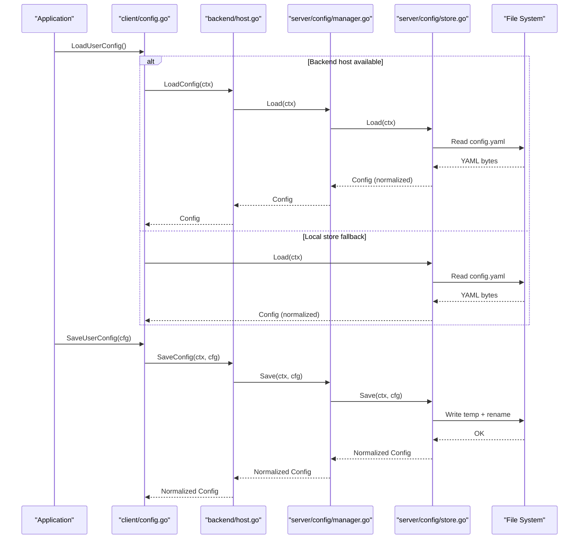
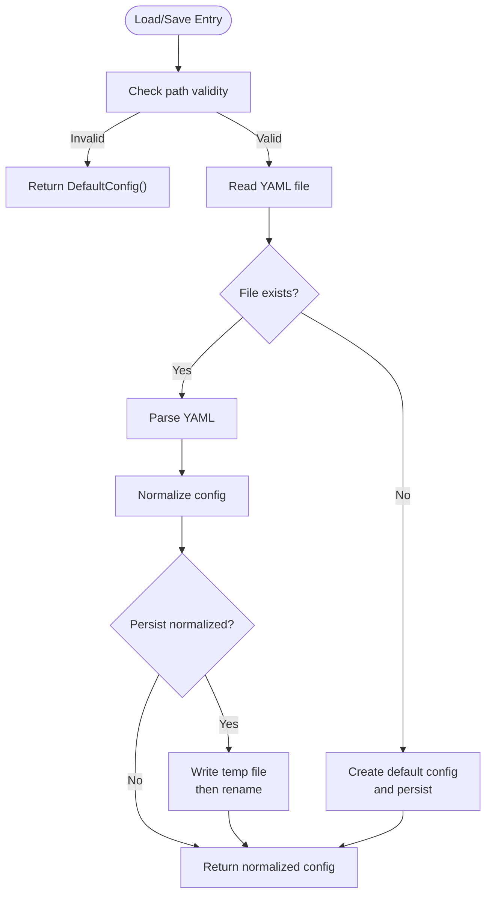
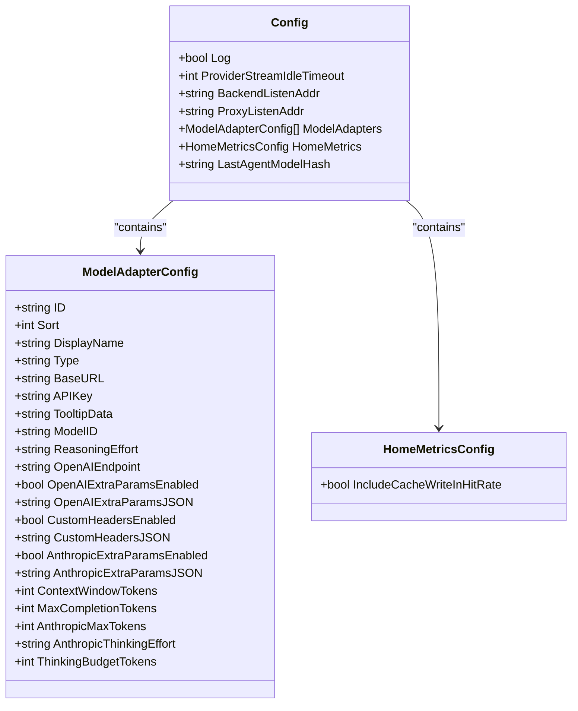
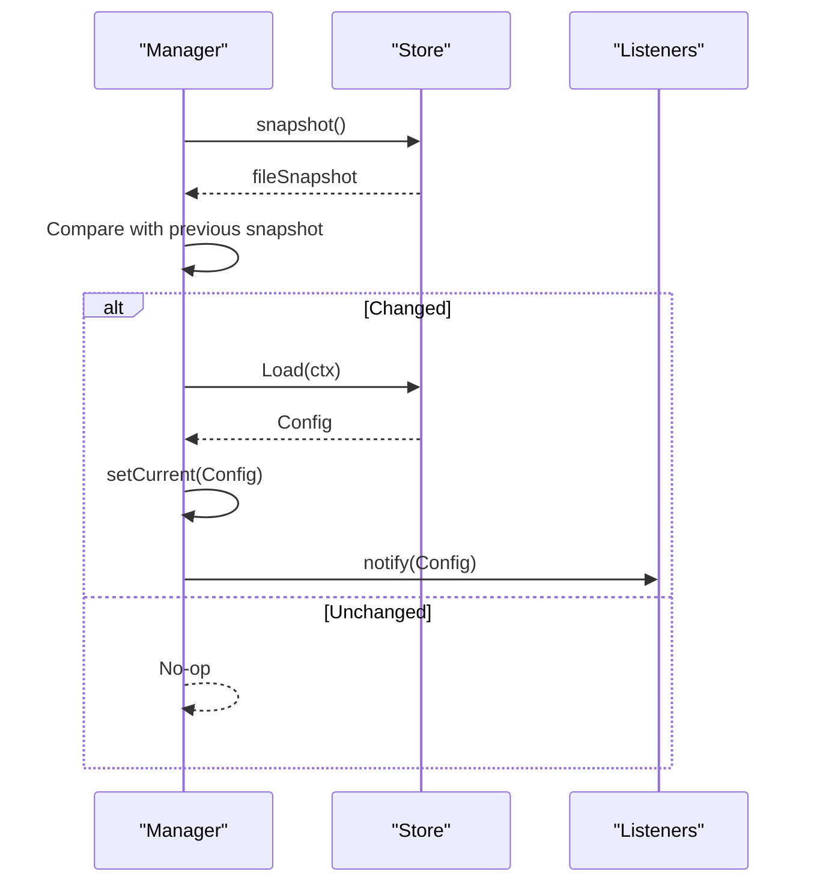
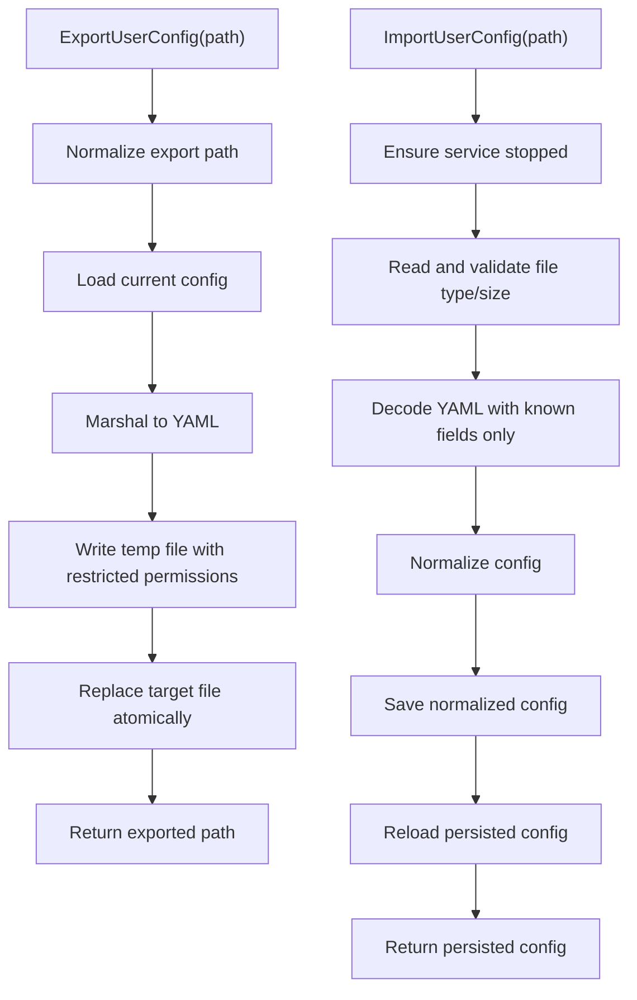
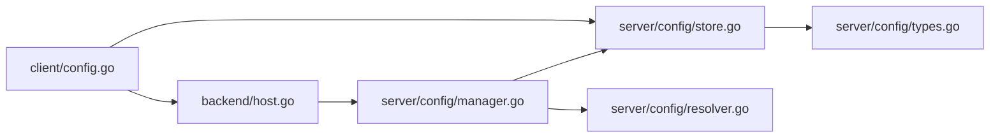

# Configuration Storage and Persistence

<cite>
**Referenced Files in This Document**
- [store.go](file://internal/backend/server/config/store.go)
- [manager.go](file://internal/backend/server/config/manager.go)
- [types.go](file://internal/backend/server/config/types.go)
- [resolver.go](file://internal/backend/server/config/resolver.go)
- [config.go](file://internal/client/config.go)
- [config_transfer.go](file://internal/client/config_transfer.go)
- [paths.go](file://internal/appdata/paths.go)
- [host.go](file://internal/backend/host.go)
</cite>

## Table of Contents
1. [Introduction](#introduction)
2. [Project Structure](#project-structure)
3. [Core Components](#core-components)
4. [Architecture Overview](#architecture-overview)
5. [Detailed Component Analysis](#detailed-component-analysis)
6. [Dependency Analysis](#dependency-analysis)
7. [Performance Considerations](#performance-considerations)
8. [Troubleshooting Guide](#troubleshooting-guide)
9. [Conclusion](#conclusion)
10. [Appendices](#appendices)

## Introduction
This document explains how configuration is stored, persisted, and updated across the application. It focuses on:
- File-based storage using YAML
- Hot-reload and normalization behavior
- Import/export operations for configuration files
- Directory layout and file permissions
- Security considerations for sensitive fields
- Environment variable usage patterns observed in the codebase

The goal is to provide a clear mental model for operators and developers who need to manage, back up, or troubleshoot configuration safely.

## Project Structure
Configuration-related logic spans several packages:
- internal/backend/server/config: Core configuration schema, persistence store, manager with hot reload, and channel resolution helpers
- internal/client: Client-facing API that delegates to backend host or local store, plus import/export utilities
- internal/appdata: Cross-platform path resolution for config and data directories
- internal/backend/host: Host integration that wires the configuration manager into runtime rebuilds

**Diagram sources**
- [config.go:16-38](file://internal/client/config.go#L16-L38)
- [config_transfer.go:24-78](file://internal/client/config_transfer.go#L24-L78)
- [store.go:27-136](file://internal/backend/server/config/store.go#L27-L136)
- [manager.go:28-86](file://internal/backend/server/config/manager.go#L28-L86)
- [types.go:51-93](file://internal/backend/server/config/types.go#L51-L93)
- [resolver.go:19-86](file://internal/backend/server/config/resolver.go#L19-L86)
- [paths.go:14-34](file://internal/appdata/paths.go#L14-L34)
- [host.go:73-93](file://internal/backend/host.go#L73-L93)

**Section sources**
- [config.go:16-38](file://internal/client/config.go#L16-L38)
- [config_transfer.go:24-78](file://internal/client/config_transfer.go#L24-L78)
- [store.go:27-136](file://internal/backend/server/config/store.go#L27-L136)
- [manager.go:28-86](file://internal/backend/server/config/manager.go#L28-L86)
- [types.go:51-93](file://internal/backend/server/config/types.go#L51-L93)
- [resolver.go:19-86](file://internal/backend/server/config/resolver.go#L19-L86)
- [paths.go:14-34](file://internal/appdata/paths.go#L14-L34)
- [host.go:73-93](file://internal/backend/host.go#L73-L93)

## Core Components
- Configuration schema and defaults: Defines fields such as log toggles, listen addresses, provider stream idle timeout, model adapters, and last agent model hash. Includes normalization and validation rules.
- File-backed store: Loads and saves YAML configuration with atomic writes and directory creation. Normalizes on load when needed.
- Manager with hot reload: Maintains an in-memory current configuration, detects file changes, and notifies subscribers.
- Client API: Exposes LoadUserConfig/SaveUserConfig and Import/Export UserConfig operations. Delegates to backend host when available; otherwise uses local store.
- Path resolution: Provides cross-platform paths for root directory, config.yaml, logs, and other data locations.
- Channel resolver: Maps requested model IDs to configured model adapters.

Key responsibilities:
- Normalize and validate configuration before persisting
- Ensure safe, atomic file updates
- Provide hot reload with throttling
- Support import/export with strict validation and size limits
- Resolve OS-specific paths consistently

**Section sources**
- [types.go:51-93](file://internal/backend/server/config/types.go#L51-L93)
- [store.go:63-136](file://internal/backend/server/config/store.go#L63-L136)
- [manager.go:28-86](file://internal/backend/server/config/manager.go#L28-L86)
- [config.go:16-38](file://internal/client/config.go#L16-L38)
- [config_transfer.go:24-78](file://internal/client/config_transfer.go#L24-L78)
- [paths.go:14-34](file://internal/appdata/paths.go#L14-L34)
- [resolver.go:19-86](file://internal/backend/server/config/resolver.go#L19-L86)

## Architecture Overview
The configuration flow integrates client calls, backend host, manager, and file store.

**Diagram sources**
- [config.go:16-38](file://internal/client/config.go#L16-L38)
- [host.go:73-93](file://internal/backend/host.go#L73-L93)
- [manager.go:62-86](file://internal/backend/server/config/manager.go#L62-L86)
- [store.go:63-136](file://internal/backend/server/config/store.go#L63-L136)

## Detailed Component Analysis

### File-Based YAML Storage
Responsibilities:
- Read/write user configuration from a single YAML file
- Create parent directories if missing
- Use atomic write pattern via temporary file and rename
- Normalize configuration on load and persist normalized values when necessary

Behavior highlights:
- If the file does not exist, default configuration is created and persisted
- On load, the store normalizes the configuration and may rewrite it if differences are detected
- Writes use a .tmp file then rename to avoid partial writes

**Diagram sources**
- [store.go:63-136](file://internal/backend/server/config/store.go#L63-L136)

Operational notes:
- Directory creation uses permissive mode for directories
- Temporary file permissions are set explicitly during export operations
- The store ensures consistent normalization before saving

**Section sources**
- [store.go:63-136](file://internal/backend/server/config/store.go#L63-L136)

### Configuration Schema and Normalization
Responsibilities:
- Define configuration fields and defaults
- Validate and normalize values (addresses, timeouts, adapter settings)
- Enforce uniqueness and required fields for model adapters

Key behaviors:
- Listen addresses must be valid host:port pairs within allowed port ranges
- Provider stream idle timeout is clamped to a minimum and defaults applied when invalid
- Model adapters require specific fields and supported types; extra parameters are validated as JSON maps
- Adapters are sorted by explicit sort order and renumbered

**Diagram sources**
- [types.go:23-59](file://internal/backend/server/config/types.go#L23-L59)

Validation and normalization ensure robust configuration states and prevent invalid runtime behavior.

**Section sources**
- [types.go:51-93](file://internal/backend/server/config/types.go#L51-L93)
- [types.go:95-172](file://internal/backend/server/config/types.go#L95-L172)
- [types.go:250-295](file://internal/backend/server/config/types.go#L250-L295)

### Hot Reload and In-Memory State
Responsibilities:
- Maintain current configuration in memory
- Detect file changes and reload with throttling
- Notify subscribers when configuration changes

Mechanisms:
- Snapshot-based change detection using file metadata
- Minimum interval between reload attempts
- Thread-safe access to current configuration and listeners

**Diagram sources**
- [manager.go:180-214](file://internal/backend/server/config/manager.go#L180-L214)

**Section sources**
- [manager.go:28-86](file://internal/backend/server/config/manager.go#L28-L86)
- [manager.go:180-214](file://internal/backend/server/config/manager.go#L180-L214)

### Client API and Backend Delegation
Responsibilities:
- Provide LoadUserConfig and SaveUserConfig
- Delegate to backend host when available; otherwise use local store
- Emit events on configuration changes

Flow:
- If backend host is present, all operations go through host methods
- Otherwise, operations fall back to local store
- Events are emitted to notify UI or other components

**Section sources**
- [config.go:16-38](file://internal/client/config.go#L16-L38)
- [config.go:40-72](file://internal/client/config.go#L40-L72)
- [host.go:73-93](file://internal/backend/host.go#L73-L93)

### Import and Export Operations
Responsibilities:
- Export full configuration to YAML with secure temporary file handling
- Import configuration with strict validation, size limits, and state checks
- Prevent import while services are running

Security and safety:
- Export writes to a temporary file with restrictive permissions before replacing target
- Import validates YAML structure, disallows unknown fields, enforces single-document limit
- Size limit prevents oversized payloads
- Import blocked if backend/proxy is running

**Diagram sources**
- [config_transfer.go:24-78](file://internal/client/config_transfer.go#L24-L78)
- [config_transfer.go:92-119](file://internal/client/config_transfer.go#L92-L119)
- [config_transfer.go:121-179](file://internal/client/config_transfer.go#L121-L179)

**Section sources**
- [config_transfer.go:24-78](file://internal/client/config_transfer.go#L24-L78)
- [config_transfer.go:92-119](file://internal/client/config_transfer.go#L92-L119)
- [config_transfer.go:121-179](file://internal/client/config_transfer.go#L121-L179)

### Channel Resolution for Model Adapters
Responsibilities:
- Map requested model IDs to configured adapters
- Build resolved channel objects with defaults and adapter overrides

Behavior:
- Uses adapter index resolution based on model ID and adapter properties
- Applies default timeouts and token limits unless overridden by adapter settings

**Section sources**
- [resolver.go:19-86](file://internal/backend/server/config/resolver.go#L19-L86)

## Dependency Analysis
High-level dependencies:
- client/config depends on appdata paths and either backend/host or server/config/store
- backend/host depends on server/config/manager
- server/config/manager depends on server/config/store and legacy runtime snapshot conversion
- server/config/store depends on YAML marshaling/unmarshaling and filesystem operations
- server/config/resolver depends on legacy runtime types for resolved channels

**Diagram sources**
- [config.go:16-38](file://internal/client/config.go#L16-L38)
- [host.go:73-93](file://internal/backend/host.go#L73-L93)
- [manager.go:28-86](file://internal/backend/server/config/manager.go#L28-L86)
- [store.go:63-136](file://internal/backend/server/config/store.go#L63-L136)
- [resolver.go:19-86](file://internal/backend/server/config/resolver.go#L19-L86)
- [types.go:51-93](file://internal/backend/server/config/types.go#L51-L93)

**Section sources**
- [config.go:16-38](file://internal/client/config.go#L16-L38)
- [host.go:73-93](file://internal/backend/host.go#L73-L93)
- [manager.go:28-86](file://internal/backend/server/config/manager.go#L28-L86)
- [store.go:63-136](file://internal/backend/server/config/store.go#L63-L136)
- [resolver.go:19-86](file://internal/backend/server/config/resolver.go#L19-L86)
- [types.go:51-93](file://internal/backend/server/config/types.go#L51-L93)

## Performance Considerations
- Hot reload throttling avoids excessive file polling and repeated parsing
- Atomic writes reduce risk of torn configurations and improve reliability
- Normalization on load can trigger a rewrite only when necessary, minimizing disk churn
- Import/export operations enforce size limits to prevent resource exhaustion

[No sources needed since this section provides general guidance]

## Troubleshooting Guide
Common issues and remedies:
- Missing configuration file: The store creates a default configuration and persists it automatically
- Invalid YAML or unknown fields: Import will reject malformed or non-conforming documents
- Service running during import: Import is blocked until services stop
- Permission errors on export: Export sets restrictive permissions on temporary files; ensure the target directory is writable
- Hot reload errors: Manager logs skipped reloads with error details; check file readability and YAML validity

Operational tips:
- Verify directory existence and permissions for the config root
- Use export to create backups before making manual edits
- After import, confirm the persisted configuration matches expectations by reloading

**Section sources**
- [store.go:63-136](file://internal/backend/server/config/store.go#L63-L136)
- [config_transfer.go:121-179](file://internal/client/config_transfer.go#L121-L179)
- [manager.go:180-214](file://internal/backend/server/config/manager.go#L180-L214)

## Conclusion
The configuration system emphasizes correctness, safety, and usability:
- YAML-based file storage with atomic writes
- Strict normalization and validation
- Hot reload with throttling
- Secure import/export workflows
- Clear directory layout and permission practices

For production environments, prefer export/import for versioning and backup, and rely on the built-in normalization and validation to maintain consistent configuration states.

[No sources needed since this section summarizes without analyzing specific files]

## Appendices

### Configuration File Locations and Directory Layout
- Root directory: Determined by platform home directory; name includes a versioned app identifier
- Configuration file: config.yaml under the root directory
- Logs directory: logs under the root directory
- Data directories: data, history, rules under the root directory

Examples of resolved paths:
- RootDir -> <home>/.cursor-local-assistant-v2
- ConfigFilePath -> <root>/config.yaml
- LogsRootPath -> <root>/logs

**Section sources**
- [paths.go:14-34](file://internal/appdata/paths.go#L14-L34)
- [paths.go:36-77](file://internal/appdata/paths.go#L36-L77)

### Environment Variables Observed in Codebase
Environment variables are used elsewhere in the application for behavior control and environment setup. Examples include:
- Disabling WebView sandbox
- Relocating images for certain providers
- Injecting CA certificates for Node.js
- Platform-specific app data and config directories

These are not part of the core configuration schema but influence runtime behavior and environment setup.

**Section sources**
- [runner.go:474-474](file://internal/app/runner.go#L474-L474)
- [anthropic.go:168-168](file://internal/backend/agent/model/anthropic.go#L168-L168)
- [settings.go:77-77](file://internal/cursor/settings.go#L77-L77)
- [settings.go:248-254](file://internal/cursor/settings.go#L248-L254)
- [state_db.go:223-229](file://internal/cursor/state_db.go#L223-L229)

### Security Notes
- Sensitive fields such as API keys are included in the configuration schema and persisted in YAML
- Export operations write temporary files with restrictive permissions before replacing the target
- Import operations enforce strict validation and block imports while services are running
- Operators should protect the config directory and restrict access to users who should not read secrets

[No sources needed since this section provides general guidance]