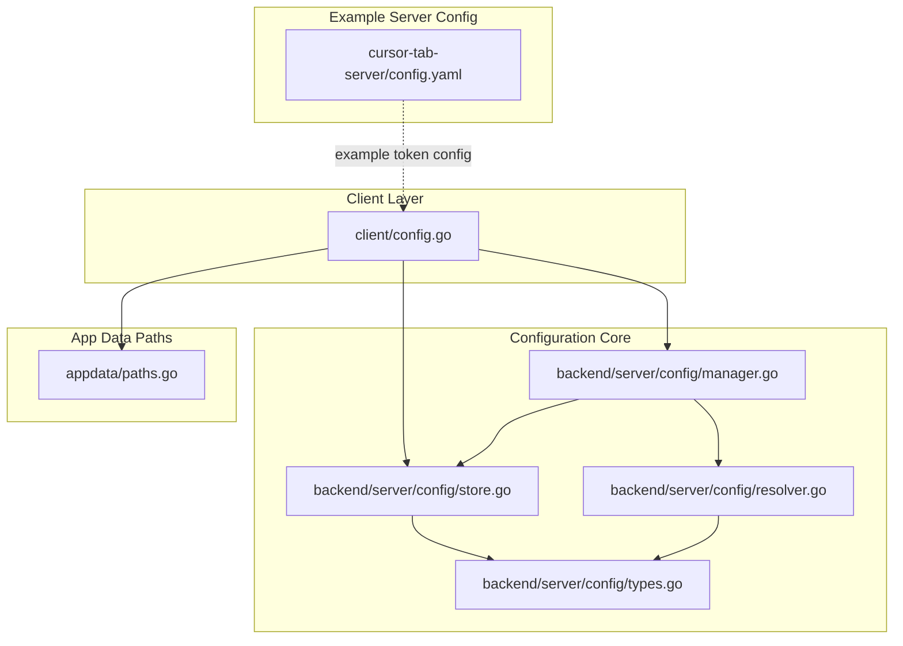
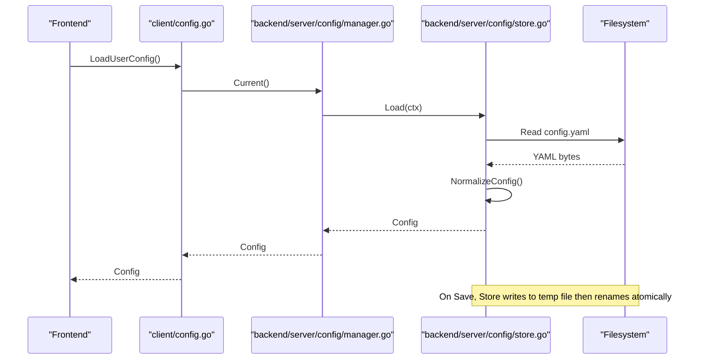
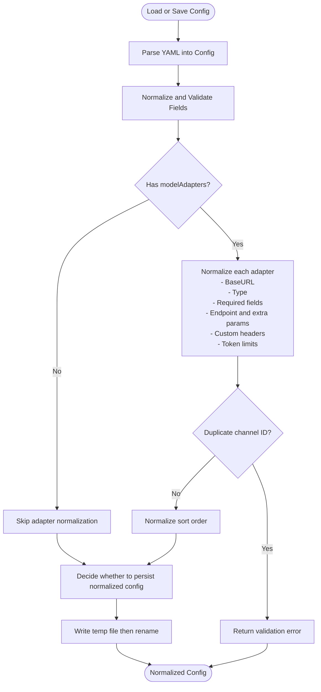
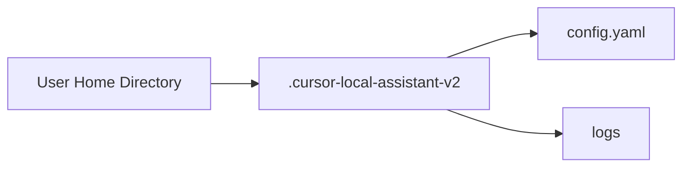
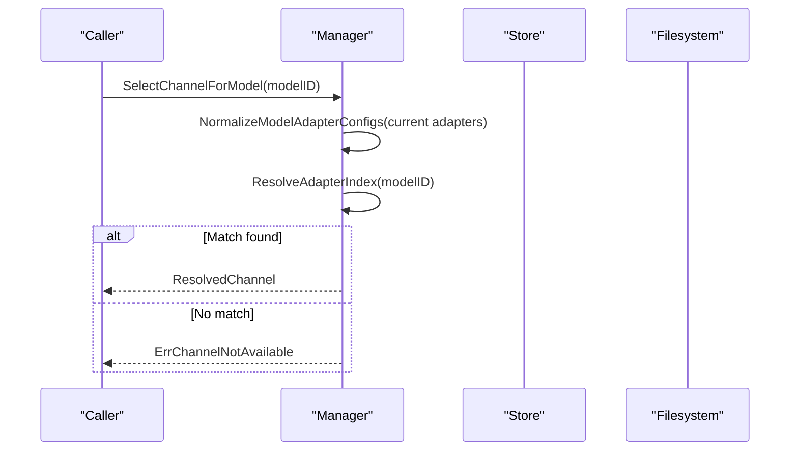
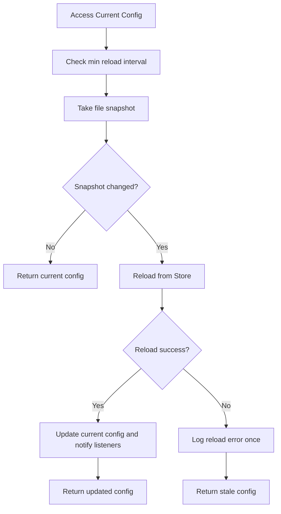
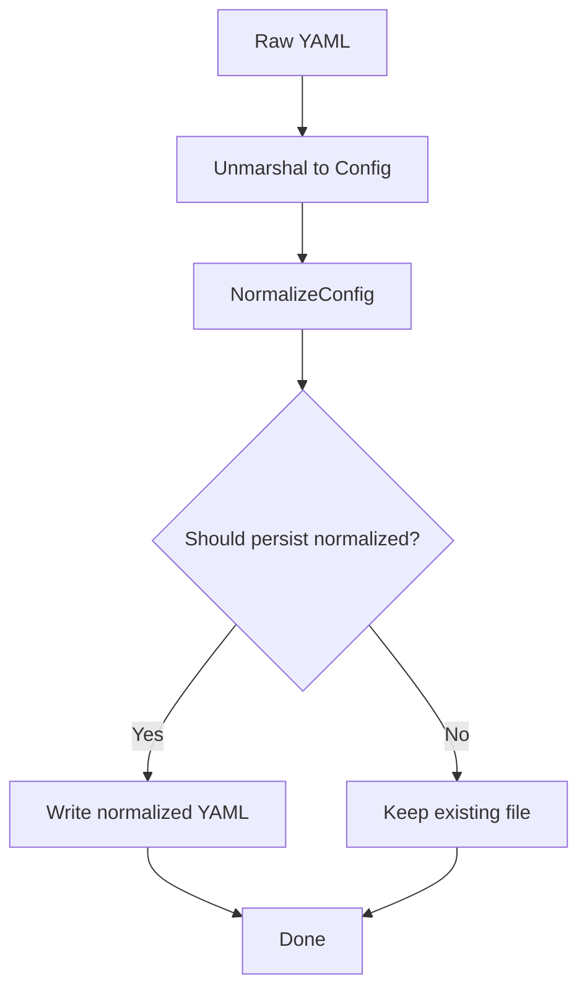
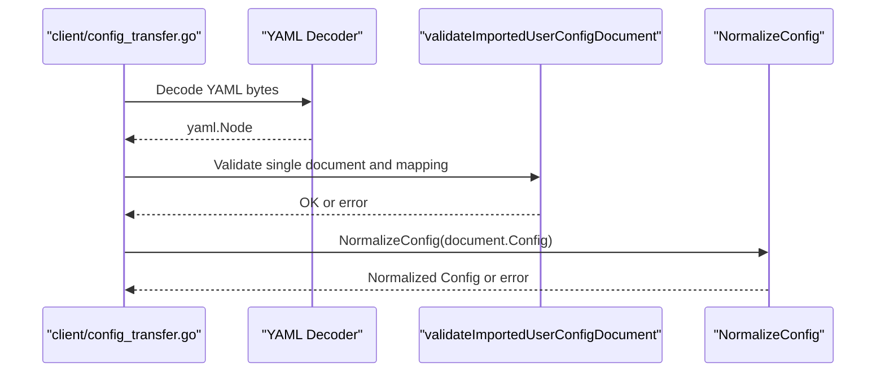
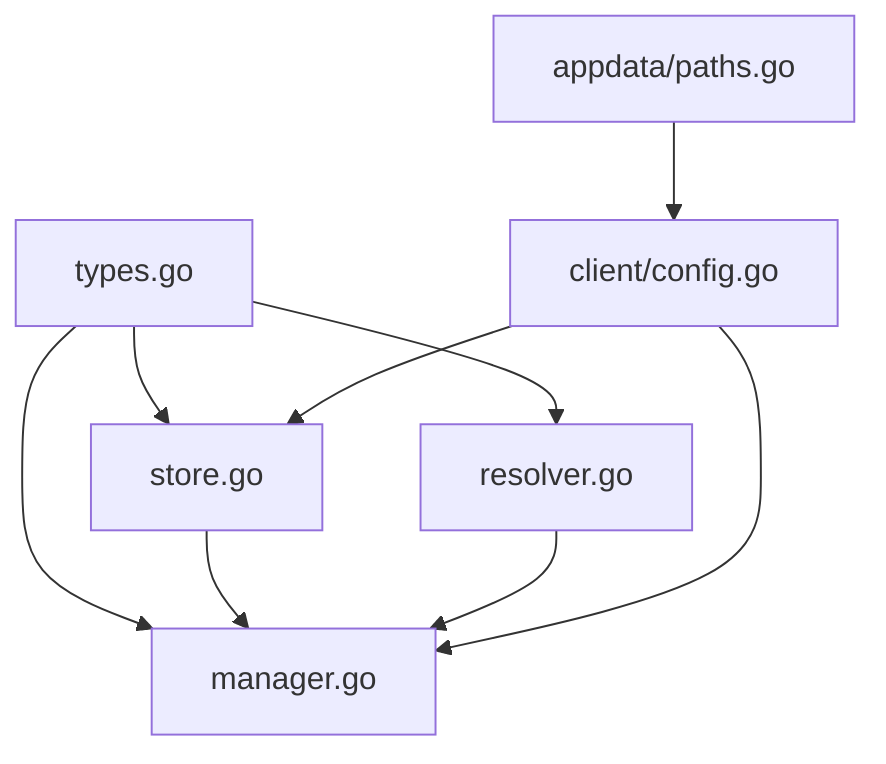

# Configuration System

<cite>
**Referenced Files in This Document**
- [types.go](file://internal/backend/server/config/types.go)
- [store.go](file://internal/backend/server/config/store.go)
- [manager.go](file://internal/backend/server/config/manager.go)
- [resolver.go](file://internal/backend/server/config/resolver.go)
- [config.go](file://internal/client/config.go)
- [paths.go](file://internal/appdata/paths.go)
- [config_transfer.go](file://internal/client/config_transfer.go)
- [types_test.go](file://internal/backend/server/config/types_test.go)
- [config.yaml](file://cursor-tab-server/config.yaml)
</cite>

## Table of Contents
1. [Introduction](#introduction)
2. [Project Structure](#project-structure)
3. [Core Components](#core-components)
4. [Architecture Overview](#architecture-overview)
5. [Detailed Component Analysis](#detailed-component-analysis)
6. [Dependency Analysis](#dependency-analysis)
7. [Performance Considerations](#performance-considerations)
8. [Troubleshooting Guide](#troubleshooting-guide)
9. [Conclusion](#conclusion)
10. [Appendices](#appendices)

## Introduction
This document explains the configuration management system used by cursor-byok. It covers the YAML-based configuration schema, validation and normalization rules, default values, file locations, hot reload behavior, runtime updates without service restart, import/export behavior, and security considerations for sensitive data such as API keys.

The configuration system is centered around a normalized `Config` structure stored in a user-level YAML file. A store layer handles persistence, while a manager provides an in-memory view with hot reload and listener notifications. The client layer integrates this configuration into the proxy service and exposes it to the frontend.

## Project Structure
The configuration system spans several packages:

- `internal/backend/server/config`: Core configuration types, normalization, persistence, hot reload, and channel resolution.
- `internal/client`: Client-side integration that resolves configuration paths and emits configuration change events.
- `internal/appdata`: Application data path helpers that determine where configuration files are stored.
- `cursor-tab-server`: Example server configuration file demonstrating token usage outside the main configuration schema.

**Diagram sources**
- [config.go:16-38](file://internal/client/config.go#L16-L38)
- [store.go:63-96](file://internal/backend/server/config/store.go#L63-L96)
- [manager.go:28-41](file://internal/backend/server/config/manager.go#L28-L41)
- [types.go:51-93](file://internal/backend/server/config/types.go#L51-L93)
- [resolver.go:19-28](file://internal/backend/server/config/resolver.go#L19-L28)
- [paths.go:31-34](file://internal/appdata/paths.go#L31-L34)
- [config.yaml:1-2](file://cursor-tab-server/config.yaml#L1-L2)

**Section sources**
- [config.go:16-38](file://internal/client/config.go#L16-L38)
- [store.go:63-96](file://internal/backend/server/config/store.go#L63-L96)
- [manager.go:28-41](file://internal/backend/server/config/manager.go#L28-L41)
- [types.go:51-93](file://internal/backend/server/config/types.go#L51-L93)
- [resolver.go:19-28](file://internal/backend/server/config/resolver.go#L19-L28)
- [paths.go:31-34](file://internal/appdata/paths.go#L31-L34)
- [config.yaml:1-2](file://cursor-tab-server/config.yaml#L1-L2)

## Core Components
- `Config`: Top-level configuration object including logging flags, provider stream idle timeout, backend and proxy listen addresses, model adapters, home metrics settings, and last agent model hash.
- `ModelAdapterConfig`: Per-model adapter configuration including display name, provider type, base URL, API key, endpoint overrides, extra parameters, custom headers, token limits, and thinking-related options.
- `Store`: File-backed persistence layer that reads, validates, normalizes, and writes the YAML configuration.
- `Manager`: In-memory configuration manager with hot reload, listeners, and convenience methods for current configuration access.
- `Resolver`: Channel selection logic that maps requested model IDs to configured adapters.
- `client/config.go`: Client integration that resolves configuration paths and delegates load/save operations.
- `appdata/paths.go`: Path resolution utilities for configuration and logs directories.

Key responsibilities:
- Schema definition and defaults live in `types.go`.
- Validation and normalization occur during load and save.
- Persistence uses atomic write patterns via temporary files.
- Hot reload detects file changes and notifies subscribers.
- Channel resolution converts adapters into runtime channels.

**Section sources**
- [types.go:15-93](file://internal/backend/server/config/types.go#L15-L93)
- [store.go:15-136](file://internal/backend/server/config/store.go#L15-L136)
- [manager.go:17-86](file://internal/backend/server/config/manager.go#L17-L86)
- [resolver.go:19-86](file://internal/backend/server/config/resolver.go#L19-L86)
- [config.go:16-38](file://internal/client/config.go#L16-L38)
- [paths.go:31-34](file://internal/appdata/paths.go#L31-L34)

## Architecture Overview
The configuration architecture follows a layered design:

- Client layer calls into the backend host or local store depending on runtime context.
- Store performs YAML parsing, normalization, and persistence.
- Manager maintains an atomic current configuration snapshot and triggers hot reload when the underlying file changes.
- Resolver selects appropriate model adapters based on requested model identifiers.

**Diagram sources**
- [config.go:16-38](file://internal/client/config.go#L16-L38)
- [manager.go:44-50](file://internal/backend/server/config/manager.go#L44-L50)
- [store.go:63-96](file://internal/backend/server/config/store.go#L63-L96)

## Detailed Component Analysis

### Configuration Schema and Defaults
The top-level `Config` includes:
- `log`: Enables observability logging.
- `providerStreamIdleTimeout`: Provider stream idle timeout in seconds, normalized against minimum and default thresholds.
- `backendListenAddr`: Backend HTTP listen address, validated as host:port.
- `proxyListenAddr`: Proxy HTTP listen address, validated as host:port.
- `modelAdapters`: Array of model adapter configurations.
- `homeMetrics`: Home metrics settings, including cache hit rate calculation options.
- `lastAgentModelHash`: Last known agent model hash.

Defaults:
- Logging disabled.
- Provider stream idle timeout set to a default value with a minimum threshold enforced.
- Backend listen address defaults to localhost port 18090.
- Proxy listen address defaults to localhost port 18080.
- Model adapters array starts empty.

Validation and normalization:
- Listen addresses must be valid host:port strings with ports in range 1–65535.
- Provider stream idle timeout is clamped to a minimum if too low; non-positive values use the default.
- Model adapters require required fields like display name, type, base URL, API key, tooltip data, and model ID.
- Adapter type supports only specific providers.
- OpenAI-specific fields include endpoint restrictions and optional extra parameters JSON validation.
- Anthropic-specific fields include thinking effort normalization and optional extra parameters JSON validation.
- Custom headers JSON must be a string-to-string map with non-empty header names.
- Duplicate adapter channel IDs are rejected.
- Sort order is normalized to stable ascending indices.

**Diagram sources**
- [types.go:71-172](file://internal/backend/server/config/types.go#L71-L172)
- [store.go:118-136](file://internal/backend/server/config/store.go#L118-L136)

**Section sources**
- [types.go:15-93](file://internal/backend/server/config/types.go#L15-L93)
- [types.go:95-172](file://internal/backend/server/config/types.go#L95-L172)
- [types.go:249-284](file://internal/backend/server/config/types.go#L249-L284)

### Configuration File Locations
The primary configuration file is located under the application’s root directory:
- Root directory: User home directory joined with `.cursor-local-assistant-v2`.
- Configuration file: `<root>/config.yaml`.
- Logs root directory: `<root>/logs`.

These paths are resolved through appdata helpers and consumed by the client configuration module.

**Diagram sources**
- [paths.go:14-34](file://internal/appdata/paths.go#L14-L34)
- [paths.go:64-67](file://internal/appdata/paths.go#L64-L67)

**Section sources**
- [paths.go:14-34](file://internal/appdata/paths.go#L14-L34)
- [paths.go:64-67](file://internal/appdata/paths.go#L64-L67)
- [config.go:82-100](file://internal/client/config.go#L82-L100)

### Environment Variable Overrides
The configuration loading path does not implement environment variable overrides for the main `Config` schema. Instead, environment variables are used elsewhere in the codebase for unrelated concerns (for example, sandbox toggles, logger behavior, or platform-specific paths). Therefore, configuration values should be managed through the YAML file rather than environment variables.

If you need environment-driven configuration, consider extending the client configuration loader to read environment variables before delegating to the store, but note that this is not currently implemented.

**Section sources**
- [config.go:16-38](file://internal/client/config.go#L16-L38)
- [paths.go:31-34](file://internal/appdata/paths.go#L31-L34)

### Secret Management Practices
Sensitive values such as API keys are stored directly in the YAML configuration under model adapter entries. There is no built-in encryption for these secrets in the configuration storage layer. Security recommendations:
- Restrict filesystem permissions on the configuration directory so only the intended user can read/write.
- Avoid committing configuration files containing secrets to version control.
- Use external secret managers at deployment time and inject values into the configuration file programmatically if needed.
- Be cautious when sharing configuration backups.

Note: The example server configuration file demonstrates a token field, which illustrates how tokens may appear in configuration files outside the main schema.

**Section sources**
- [types.go:23-45](file://internal/backend/server/config/types.go#L23-L45)
- [config.yaml:1-2](file://cursor-tab-server/config.yaml#L1-L2)

### Configuration Loading and Resolution Strategies
Loading strategy:
- If the configuration path is empty or the store is nil, defaults are returned.
- If the file does not exist, defaults are created and persisted.
- If the file exists, it is parsed and normalized.
- Normalized configuration may be persisted back to disk if certain fields were missing or changed.

Resolution strategy:
- The manager holds an atomic pointer to the current configuration.
- On every access, it checks for file changes and reloads if necessary.
- Listeners are notified after successful reload.

Channel resolution:
- Given a requested model ID, the resolver finds the matching adapter among configured model adapters.
- If no match is found, it returns an error indicating channel unavailability.
- Resolved channels include provider details, endpoints, extra parameters, and token limits.

**Diagram sources**
- [resolver.go:19-28](file://internal/backend/server/config/resolver.go#L19-L28)
- [resolver.go:30-86](file://internal/backend/server/config/resolver.go#L30-L86)

**Section sources**
- [store.go:63-96](file://internal/backend/server/config/store.go#L63-L96)
- [manager.go:44-50](file://internal/backend/server/config/manager.go#L44-L50)
- [manager.go:180-214](file://internal/backend/server/config/manager.go#L180-L214)
- [resolver.go:19-86](file://internal/backend/server/config/resolver.go#L19-L86)

### Runtime Updates Without Service Restart
Hot reload is supported:
- The manager periodically checks the configuration file’s metadata (existence, modification time, size).
- If the file has changed since the last reload, it reloads and persists normalized configuration.
- Reload errors are logged once per distinct error message.
- Subscribers registered via `Subscribe` receive the new configuration after successful reload.

**Diagram sources**
- [manager.go:180-214](file://internal/backend/server/config/manager.go#L180-L214)

**Section sources**
- [manager.go:180-214](file://internal/backend/server/config/manager.go#L180-L214)

### Migration Procedures
Migration behavior is primarily handled through normalization and persistence decisions:
- Missing listen addresses are filled with defaults.
- Provider stream idle timeout is clamped to minimum or default.
- Adapter fields are normalized and validated.
- If legacy routing fields are present or essential fields are missing, the normalized configuration is persisted to ensure consistency.

There is no explicit multi-version migration pipeline in the configuration package; instead, normalization ensures that the persisted file reflects a canonical form.

**Diagram sources**
- [store.go:83-96](file://internal/backend/server/config/store.go#L83-L96)
- [store.go:138-152](file://internal/backend/server/config/store.go#L138-L152)

**Section sources**
- [store.go:83-96](file://internal/backend/server/config/store.go#L83-L96)
- [store.go:138-152](file://internal/backend/server/config/store.go#L138-L152)

### Import and Export Behavior
Import validation:
- Imported configuration must be a single YAML document.
- The top-level node must be a mapping object.
- After parsing, the imported configuration is normalized using the same normalization rules as regular configuration.

Export behavior:
- The store serializes normalized configuration to YAML when saving.
- Atomic writes are performed using a temporary file followed by rename.

**Diagram sources**
- [config_transfer.go:170-195](file://internal/client/config_transfer.go#L170-L195)

**Section sources**
- [config_transfer.go:170-195](file://internal/client/config_transfer.go#L170-L195)

### Complete Configuration Examples
Below is guidance for constructing a complete configuration file. Replace placeholder values with your actual settings.

Recommended fields:
- `log`: Boolean to enable observability logging.
- `providerStreamIdleTimeout`: Integer seconds for provider stream idle timeout.
- `backendListenAddr`: String in host:port format for backend service.
- `proxyListenAddr`: String in host:port format for proxy service.
- `modelAdapters`: Array of adapter objects.

Model adapter recommended fields:
- `displayName`: Human-readable adapter name.
- `type`: Provider type (`openai` or `anthropic`).
- `baseURL`: Provider base URL.
- `apiKey`: Provider API key.
- `tooltipData`: Tooltip information for the adapter.
- `modelID`: Model identifier.
- Optional fields:
  - `reasoningEffort`: For OpenAI reasoning models.
  - `openAIEndpoint`: OpenAI endpoint override.
  - `openAIExtraParamsEnabled` and `openAIExtraParamsJSON`: Extra parameters for OpenAI.
  - `anthropicThinkingEffort`: Thinking effort for Anthropic.
  - `anthropicExtraParamsEnabled` and `anthropicExtraParamsJSON`: Extra parameters for Anthropic.
  - `customHeadersEnabled` and `customHeadersJSON`: Custom request headers.
  - `contextWindowTokens`, `maxCompletionTokens`, `anthropicMaxTokens`, `thinkingBudgetTokens`: Token limits.

Security reminder:
- Do not commit files containing `apiKey` or tokens to version control.
- Restrict filesystem permissions on the configuration directory.

**Section sources**
- [types.go:51-93](file://internal/backend/server/config/types.go#L51-L93)
- [types.go:23-45](file://internal/backend/server/config/types.go#L23-L45)

### Validation Error Handling
Common validation errors include:
- Invalid listen address format or out-of-range port.
- Empty required adapter fields such as display name, type, API key, tooltip data, or model ID.
- Unsupported adapter type or reasoning effort values.
- Invalid JSON for extra parameters or custom headers.
- Duplicate adapter channel IDs.

When normalization fails, the store returns a default configuration along with an error, preventing invalid configuration from being applied.

**Section sources**
- [types.go:133-172](file://internal/backend/server/config/types.go#L133-L172)
- [types.go:249-284](file://internal/backend/server/config/types.go#L249-L284)
- [store.go:83-96](file://internal/backend/server/config/store.go#L83-L96)

### Configuration Backup and Restore
Backup:
- Copy the configuration file located at `<root>/config.yaml` to a secure location.
- Ensure the backup excludes any unintended sensitive data if you plan to share it.

Restore:
- Place the backed-up YAML file at `<root>/config.yaml`.
- Restart the application or wait for hot reload to pick up changes.
- Verify that the configuration loads successfully and that listeners receive updates.

Atomic persistence:
- The store writes to a temporary file and then renames it, reducing the risk of partial writes.

**Section sources**
- [paths.go:31-34](file://internal/appdata/paths.go#L31-L34)
- [store.go:118-136](file://internal/backend/server/config/store.go#L118-L136)
- [manager.go:180-214](file://internal/backend/server/config/manager.go#L180-L214)

## Dependency Analysis
The configuration system exhibits clear separation of concerns:
- `types.go` defines the schema and normalization logic.
- `store.go` implements persistence and file I/O.
- `manager.go` manages in-memory state and hot reload.
- `resolver.go` depends on adapter configuration to resolve runtime channels.
- `client/config.go` bridges the client and backend configuration layers.
- `appdata/paths.go` provides path resolution utilities.

**Diagram sources**
- [types.go:51-93](file://internal/backend/server/config/types.go#L51-L93)
- [store.go:63-96](file://internal/backend/server/config/store.go#L63-L96)
- [manager.go:28-41](file://internal/backend/server/config/manager.go#L28-L41)
- [resolver.go:19-28](file://internal/backend/server/config/resolver.go#L19-L28)
- [config.go:16-38](file://internal/client/config.go#L16-L38)
- [paths.go:31-34](file://internal/appdata/paths.go#L31-L34)

**Section sources**
- [types.go:51-93](file://internal/backend/server/config/types.go#L51-L93)
- [store.go:63-96](file://internal/backend/server/config/store.go#L63-L96)
- [manager.go:28-41](file://internal/backend/server/config/manager.go#L28-L41)
- [resolver.go:19-28](file://internal/backend/server/config/resolver.go#L19-L28)
- [config.go:16-38](file://internal/client/config.go#L16-L38)
- [paths.go:31-34](file://internal/appdata/paths.go#L31-L34)

## Performance Considerations
- Hot reload is throttled to a minimum interval to avoid excessive file polling.
- Normalization occurs on both load and save, ensuring consistent persisted state.
- Atomic file writes reduce corruption risk during concurrent saves.
- Listener notifications are executed after successful reload, minimizing unnecessary updates.

[No sources needed since this section provides general guidance]

## Troubleshooting Guide
Common issues and resolutions:
- Configuration file missing: Defaults are created and persisted automatically.
- YAML parse errors: Fix syntax issues in the configuration file; the store returns a default configuration with an error.
- Validation errors: Correct required fields, adapter types, endpoint values, JSON structures, and duplicate adapter IDs.
- Hot reload not applying changes: Ensure the file was modified and that the reload interval has elapsed; check logs for reload errors.
- Channel not available: Verify that the requested model ID matches a configured adapter.

Operational tips:
- Inspect the configuration file path and logs directory using the path helpers.
- Use the client’s event emission mechanism to observe configuration changes in the frontend.

**Section sources**
- [store.go:71-96](file://internal/backend/server/config/store.go#L71-L96)
- [types.go:133-172](file://internal/backend/server/config/types.go#L133-L172)
- [manager.go:180-214](file://internal/backend/server/config/manager.go#L180-L214)
- [resolver.go:19-28](file://internal/backend/server/config/resolver.go#L19-L28)
- [config.go:74-80](file://internal/client/config.go#L74-L80)

## Conclusion
The cursor-byok configuration system provides a robust, normalized YAML-based configuration model with strong validation, safe persistence, and hot reload capabilities. While environment variable overrides are not part of the main configuration schema, the system offers reliable file-based configuration management suitable for local development and production deployments. Sensitive data such as API keys should be protected through filesystem permissions and operational practices, as there is no built-in encryption for configuration storage.

[No sources needed since this section summarizes without analyzing specific files]

## Appendices

### Appendix A: Key Constants and Defaults
- Default backend listen address: localhost port 18090.
- Default proxy listen address: localhost port 18080.
- Default provider stream idle timeout: default seconds with a minimum threshold.
- Minimum provider stream idle timeout: enforced lower bound.

**Section sources**
- [types.go:15-21](file://internal/backend/server/config/types.go#L15-L21)
- [types.go:61-69](file://internal/backend/server/config/types.go#L61-L69)
- [types.go:269-277](file://internal/backend/server/config/types.go#L269-L277)

### Appendix B: Adapter Sorting Behavior
- Explicit sort values are respected and normalized to stable ascending indices.
- Tests verify preservation of legacy array order and stable sorting behavior.

**Section sources**
- [types.go:174-192](file://internal/backend/server/config/types.go#L174-L192)
- [types_test.go:19-60](file://internal/backend/server/config/types_test.go#L19-L60)