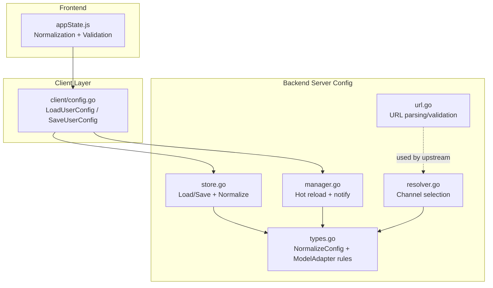
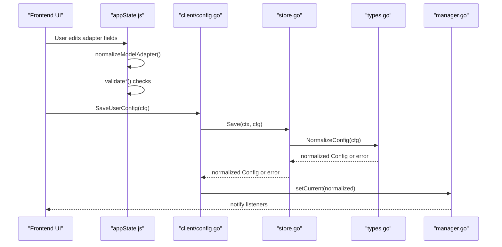
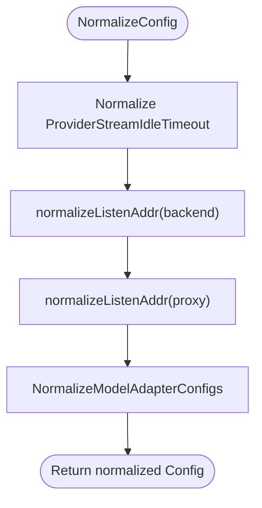
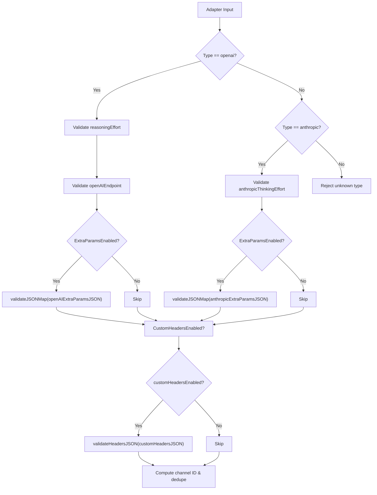
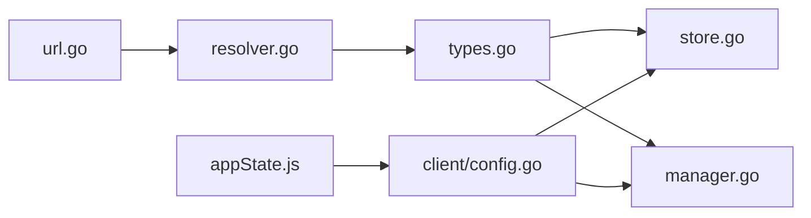

# Configuration Validation and Rules

<cite>
**Referenced Files in This Document**
- [types.go](file://internal/backend/server/config/types.go)
- [store.go](file://internal/backend/server/config/store.go)
- [manager.go](file://internal/backend/server/config/manager.go)
- [resolver.go](file://internal/backend/server/config/resolver.go)
- [url.go](file://internal/backend/server/url.go)
- [config.go](file://internal/client/config.go)
- [appState.js](file://frontend/src/state/appState.js)
</cite>

## Table of Contents
1. [Introduction](#introduction)
2. [Project Structure](#project-structure)
3. [Core Components](#core-components)
4. [Architecture Overview](#architecture-overview)
5. [Detailed Component Analysis](#detailed-component-analysis)
6. [Dependency Analysis](#dependency-analysis)
7. [Performance Considerations](#performance-considerations)
8. [Troubleshooting Guide](#troubleshooting-guide)
9. [Conclusion](#conclusion)

## Introduction
This document explains the configuration validation mechanisms in cursor-byok. It covers the end-to-end validation pipeline, rule enforcement, error reporting, built-in validators for API keys, URL formats, port numbers, and provider-specific settings, as well as custom validation functions, conditional rules, cross-field checks, performance considerations, bulk operations, migration validation, and backwards compatibility.

The system validates configuration both on the backend (Go) and frontend (JavaScript), with normalization and persistence ensuring consistent runtime behavior.

## Project Structure
Configuration validation is primarily implemented in the backend server config package, with complementary validation logic in the frontend state module. The client layer delegates to either a backend host or an in-process store depending on runtime mode.

**Diagram sources**
- [appState.js:278-486](file://frontend/src/state/appState.js#L278-L486)
- [config.go:16-70](file://internal/client/config.go#L16-L70)
- [manager.go:28-86](file://internal/backend/server/config/manager.go#L28-L86)
- [store.go:63-116](file://internal/backend/server/config/store.go#L63-L116)
- [types.go:61-171](file://internal/backend/server/config/types.go#L61-L171)
- [resolver.go:19-28](file://internal/backend/server/config/resolver.go#L19-L28)
- [url.go:9-24](file://internal/backend/server/url.go#L9-L24)

**Section sources**
- [types.go:61-171](file://internal/backend/server/config/types.go#L61-L171)
- [store.go:63-116](file://internal/backend/server/config/store.go#L63-L116)
- [manager.go:28-86](file://internal/backend/server/config/manager.go#L28-L86)
- [resolver.go:19-28](file://internal/backend/server/config/resolver.go#L19-L28)
- [url.go:9-24](file://internal/backend/server/url.go#L9-L24)
- [config.go:16-70](file://internal/client/config.go#L16-L70)
- [appState.js:278-486](file://frontend/src/state/appState.js#L278-L486)

## Core Components
- Normalization and validation entry points:
  - Backend: NormalizeConfig and NormalizeModelAdapterConfigs enforce field-level and cross-field rules, normalize values, and return errors for invalid inputs.
  - Frontend: normalizeModelAdapter and related validators provide immediate feedback and pre-save checks.
- Storage and lifecycle:
  - Store.Load and Store.Save call NormalizeConfig before persisting, ensuring only valid configurations are written.
  - Manager coordinates hot reloads and notifies subscribers when configuration changes.
- Channel resolution:
  - Resolver.SelectChannelForModel re-validates adapters at runtime to select a channel for a requested model.

Key responsibilities:
- Validate required fields (e.g., displayName, type, apiKey, modelID).
- Enforce allowed enumerations (e.g., reasoningEffort, anthropicThinkingEffort).
- Validate JSON structures (extra params, custom headers).
- Validate network addresses (host:port ranges) and URLs (scheme/host).
- Ensure uniqueness across adapters via computed channel IDs.

**Section sources**
- [types.go:61-171](file://internal/backend/server/config/types.go#L61-L171)
- [store.go:63-116](file://internal/backend/server/config/store.go#L63-L116)
- [manager.go:28-86](file://internal/backend/server/config/manager.go#L28-L86)
- [resolver.go:19-28](file://internal/backend/server/config/resolver.go#L19-L28)
- [appState.js:278-486](file://frontend/src/state/appState.js#L278-L486)

## Architecture Overview
The validation pipeline spans multiple layers:

**Diagram sources**
- [appState.js:278-486](file://frontend/src/state/appState.js#L278-L486)
- [config.go:40-70](file://internal/client/config.go#L40-L70)
- [store.go:99-116](file://internal/backend/server/config/store.go#L99-L116)
- [types.go:61-171](file://internal/backend/server/config/types.go#L61-L171)
- [manager.go:70-86](file://internal/backend/server/config/manager.go#L70-L86)

## Detailed Component Analysis

### Backend Validation Pipeline
- NormalizeConfig:
  - Normalizes provider stream idle timeout within allowed bounds.
  - Normalizes listen addresses (backend and proxy) including host/port parsing and range checks.
  - Trims LastAgentModelHash.
  - Delegates adapter list normalization to NormalizeModelAdapterConfigs.
- NormalizeModelAdapterConfigs:
  - Normalizes base URL per provider channel utilities.
  - Normalizes type, reasoning effort, thinking effort, and token limits.
  - Validates required fields: displayName, type, apiKey, tooltipData, modelID.
  - Conditional validations:
    - OpenAI: supported reasoning effort, endpoint format, optional extra params JSON.
    - Anthropic: supported thinking effort, optional extra params JSON.
    - Custom headers JSON structure validation.
  - Cross-field uniqueness: computes channel ID and rejects duplicates.
  - Sort normalization: stable sort and re-indexing.

**Diagram sources**
- [types.go:61-93](file://internal/backend/server/config/types.go#L61-L93)
- [types.go:95-171](file://internal/backend/server/config/types.go#L95-L171)
- [types.go:250-277](file://internal/backend/server/config/types.go#L250-L277)

**Section sources**
- [types.go:61-171](file://internal/backend/server/config/types.go#L61-L171)
- [types.go:250-277](file://internal/backend/server/config/types.go#L250-L277)

### Built-in Validators
- API key validation:
  - Required and non-empty for each adapter.
- URL formats:
  - Base URL normalization uses provider channel utilities; upstream URL parser enforces http/https scheme and non-empty host.
- Port numbers:
  - Listen address validator ensures host:port format, non-empty host, and port range 1–65535.
- Provider-specific settings:
  - OpenAI: reasoning effort must be one of allowed values; endpoint must be one of supported paths or a custom path starting with “/”.
  - Anthropic: thinking effort must be one of allowed values.
  - Token limits: positive integer checks where applicable.
  - Extra parameters and custom headers: validated as JSON objects with correct value types.

**Diagram sources**
- [types.go:95-171](file://internal/backend/server/config/types.go#L95-L171)
- [types.go:194-224](file://internal/backend/server/config/types.go#L194-L224)
- [url.go:9-24](file://internal/backend/server/url.go#L9-L24)

**Section sources**
- [types.go:95-171](file://internal/backend/server/config/types.go#L95-L171)
- [types.go:194-224](file://internal/backend/server/config/types.go#L194-L224)
- [url.go:9-24](file://internal/backend/server/url.go#L9-L24)

### Error Reporting System
- Errors are returned as Go errors with descriptive messages for:
  - Missing required fields (displayName, type, apiKey, tooltipData, modelID).
  - Invalid enumerations (reasoningEffort, anthropicThinkingEffort).
  - Invalid JSON structures (extra params, custom headers).
  - Duplicate adapters (computed channel ID collision).
  - Invalid listen addresses (host:port format, port range).
- Frontend mirrors many validations and returns user-friendly messages for immediate feedback.

Common error categories:
- Field missing or empty.
- Value not in allowed set.
- JSON malformed or wrong shape.
- Network address invalid.
- Adapter identity conflict.

**Section sources**
- [types.go:133-171](file://internal/backend/server/config/types.go#L133-L171)
- [types.go:194-224](file://internal/backend/server/config/types.go#L194-L224)
- [types.go:250-277](file://internal/backend/server/config/types.go#L250-L277)
- [appState.js:293-332](file://frontend/src/state/appState.js#L293-L332)
- [appState.js:433-486](file://frontend/src/state/appState.js#L433-L486)

### Custom Validation Functions
- Backend:
  - validateJSONMap: Ensures a string is a non-empty JSON object.
  - validateHeadersJSON: Extends JSON object validation and enforces header name/value constraints.
- Frontend:
  - validateJSONObject: Parses and validates JSON object shape.
  - validateHeadersJSON: Validates header names and string values.
  - validateOpenAIExtraParamsJSON / validateAnthropicExtraParamsJSON: Delegate to generic JSON object validation.

These functions are reused across different validation contexts to ensure consistency between UI and server.

**Section sources**
- [types.go:194-224](file://internal/backend/server/config/types.go#L194-L224)
- [appState.js:293-332](file://frontend/src/state/appState.js#L293-L332)

### Conditional Validation Rules
- OpenAI:
  - reasoningEffort must be in allowed set if present.
  - openAIEndpoint must be one of supported endpoints or a custom path.
  - openAIExtraParamsJSON validated only when enabled.
- Anthropic:
  - anthropicThinkingEffort must be in allowed set.
  - anthropicExtraParamsJSON validated only when enabled.
- Common:
  - customHeadersJSON validated only when enabled.

Conditional checks prevent unnecessary validation overhead and tailor rules per provider.

**Section sources**
- [types.go:123-162](file://internal/backend/server/config/types.go#L123-L162)
- [appState.js:447-479](file://frontend/src/state/appState.js#L447-L479)

### Cross-Field Validation
- Adapter identity uniqueness:
  - Channel ID is computed from base URL, model ID, API key, display name, and endpoint.
  - Duplicate combinations are rejected to avoid ambiguous routing.
- Sorting normalization:
  - Explicit sort values are respected; otherwise, stable ordering is applied and indices are reassigned.

**Section sources**
- [types.go:163-171](file://internal/backend/server/config/types.go#L163-L171)
- [types.go:174-192](file://internal/backend/server/config/types.go#L174-L192)

### Configuration Migration and Backwards Compatibility
- Load-time normalization:
  - Store.Load unmarshals YAML, normalizes it, and persists normalized values when necessary.
- Persistence heuristics:
  - shouldPersistNormalizedConfig decides whether to rewrite the file based on presence of legacy keys and differences between current and normalized values.
- Hot reload:
  - Manager reloads configuration when the underlying file changes, debouncing reloads to avoid excessive work.

Migration-related behaviors:
- Legacy routing keys trigger persistence to keep explicit configuration visible.
- Listen address normalization may rewrite defaults into the file for clarity.
- ProviderStreamIdleTimeout normalization clamps values to allowed ranges.

**Section sources**
- [store.go:63-96](file://internal/backend/server/config/store.go#L63-L96)
- [store.go:138-152](file://internal/backend/server/config/store.go#L138-L152)
- [manager.go:180-214](file://internal/backend/server/config/manager.go#L180-L214)

## Dependency Analysis
The following diagram shows how components depend on each other during configuration validation and usage.

**Diagram sources**
- [types.go:61-171](file://internal/backend/server/config/types.go#L61-L171)
- [store.go:63-116](file://internal/backend/server/config/store.go#L63-L116)
- [manager.go:28-86](file://internal/backend/server/config/manager.go#L28-L86)
- [resolver.go:19-28](file://internal/backend/server/config/resolver.go#L19-L28)
- [url.go:9-24](file://internal/backend/server/url.go#L9-L24)
- [config.go:16-70](file://internal/client/config.go#L16-L70)
- [appState.js:278-486](file://frontend/src/state/appState.js#L278-L486)

**Section sources**
- [types.go:61-171](file://internal/backend/server/config/types.go#L61-L171)
- [store.go:63-116](file://internal/backend/server/config/store.go#L63-L116)
- [manager.go:28-86](file://internal/backend/server/config/manager.go#L28-L86)
- [resolver.go:19-28](file://internal/backend/server/config/resolver.go#L19-L28)
- [url.go:9-24](file://internal/backend/server/url.go#L9-L24)
- [config.go:16-70](file://internal/client/config.go#L16-L70)
- [appState.js:278-486](file://frontend/src/state/appState.js#L278-L486)

## Performance Considerations
- Debounced hot reload:
  - Manager throttles reload attempts to a minimum interval to avoid frequent disk reads and repeated normalization.
- Minimal persistence writes:
  - shouldPersistNormalizedConfig avoids rewriting files unless necessary, reducing I/O churn.
- Efficient normalization:
  - Token limit normalization and trimming operations are lightweight.
  - JSON validation is performed only when feature flags are enabled.
- Bulk validation:
  - NormalizeModelAdapterConfigs processes all adapters in a single pass, performing deduplication and sorting efficiently.

Recommendations:
- Prefer enabling optional features (extra params, custom headers) only when needed to reduce validation overhead.
- Keep adapter lists concise to minimize per-request normalization cost.

[No sources needed since this section provides general guidance]

## Troubleshooting Guide
Common validation errors and resolutions:
- Missing required fields:
  - Ensure displayName, type, apiKey, tooltipData, and modelID are provided for each adapter.
- Invalid enumeration values:
  - For OpenAI, use allowed reasoningEffort values.
  - For Anthropic, use allowed anthropicThinkingEffort values.
- Invalid JSON:
  - Ensure extra params and custom headers are valid JSON objects with correct value types.
- Duplicate adapters:
  - Adjust base URL, model ID, API key, display name, or endpoint to make channel IDs unique.
- Invalid listen addresses:
  - Use host:port format with a valid port range (1–65535).
- Unsupported URL schemes:
  - Use http or https schemes for upstream URLs.

Where to look:
- Backend validation errors originate from NormalizeConfig and NormalizeModelAdapterConfigs.
- Frontend validation messages come from normalizeModelAdapter and associated validators.

**Section sources**
- [types.go:133-171](file://internal/backend/server/config/types.go#L133-L171)
- [types.go:194-224](file://internal/backend/server/config/types.go#L194-L224)
- [types.go:250-277](file://internal/backend/server/config/types.go#L250-L277)
- [appState.js:433-486](file://frontend/src/state/appState.js#L433-L486)

## Conclusion
cursor-byok implements a robust configuration validation pipeline that combines strict backend normalization with responsive frontend checks. The system enforces required fields, enumerations, JSON shapes, network address formats, and cross-field uniqueness. It also supports conditional validation tailored to provider-specific settings, performs efficient bulk validation, and ensures safe migrations through load-time normalization and selective persistence. The Manager’s hot reload mechanism keeps runtime configuration synchronized while minimizing overhead.