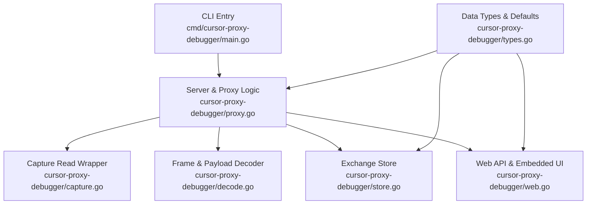
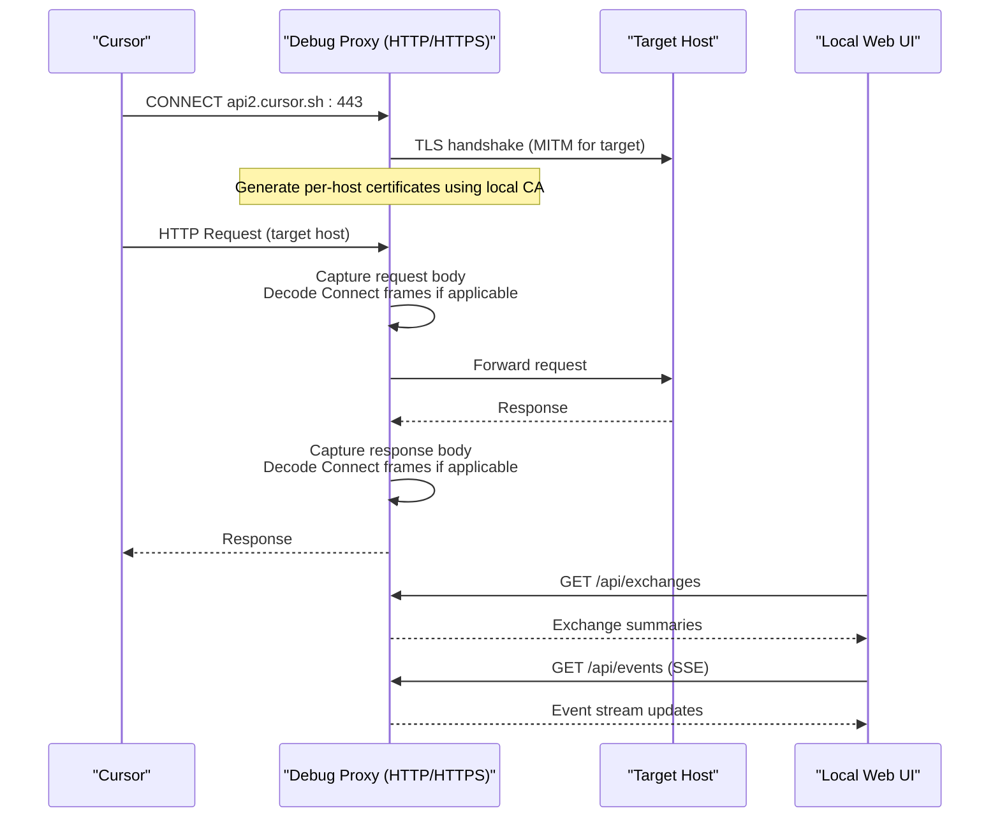
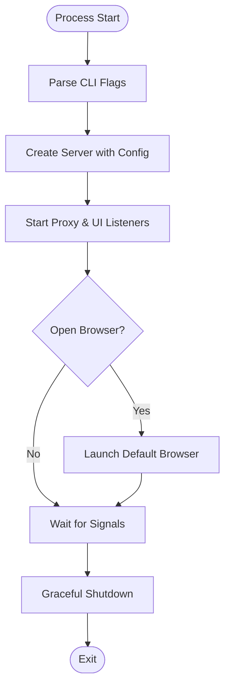
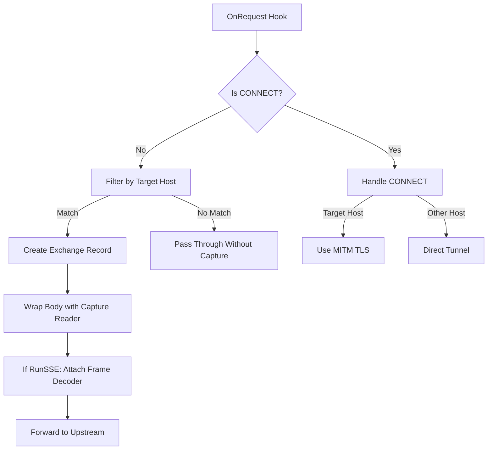
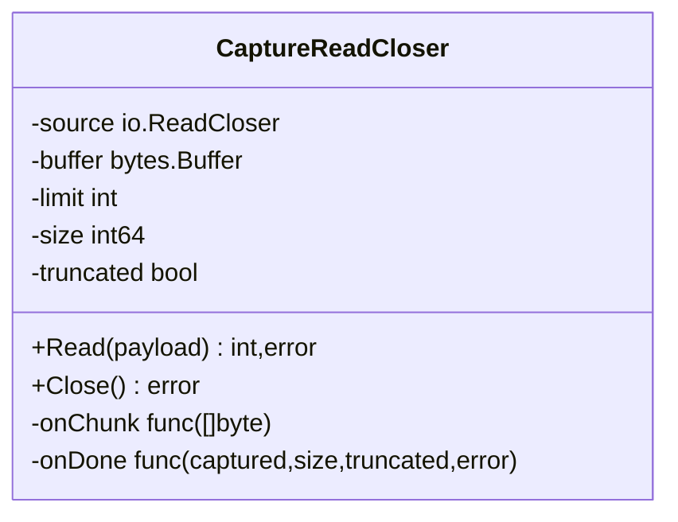
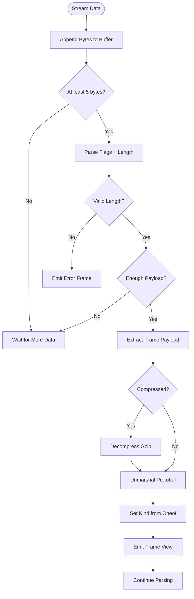
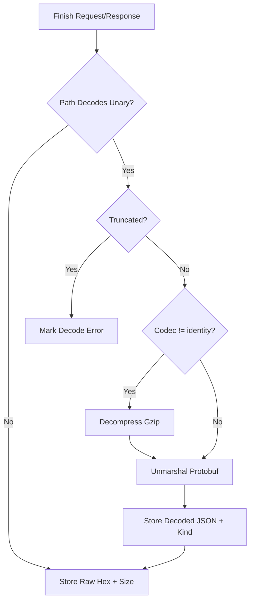
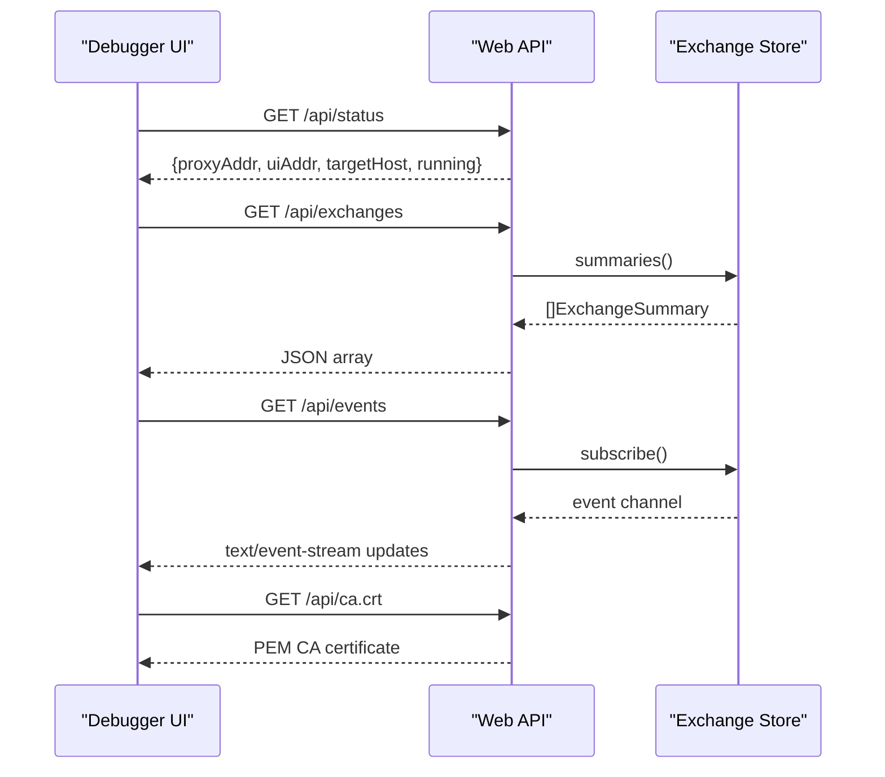
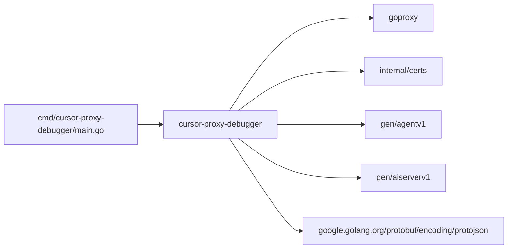

# Debug Proxy Tool

<cite>
**Referenced Files in This Document**
- [main.go](file://cmd/cursor-proxy-debugger/main.go)
- [proxy.go](file://cursor-proxy-debugger/proxy.go)
- [capture.go](file://cursor-proxy-debugger/capture.go)
- [decode.go](file://cursor-proxy-debugger/decode.go)
- [types.go](file://cursor-proxy-debugger/types.go)
- [store.go](file://cursor-proxy-debugger/store.go)
- [web.go](file://cursor-proxy-debugger/web.go)
- [README.md](file://cursor-proxy-debugger/README.md)
- [decode_test.go](file://cursor-proxy-debugger/decode_test.go)
</cite>

## Table of Contents
1. [Introduction](#introduction)
2. [Project Structure](#project-structure)
3. [Core Components](#core-components)
4. [Architecture Overview](#architecture-overview)
5. [Detailed Component Analysis](#detailed-component-analysis)
6. [Dependency Analysis](#dependency-analysis)
7. [Performance Considerations](#performance-considerations)
8. [Troubleshooting Guide](#troubleshooting-guide)
9. [Conclusion](#conclusion)
10. [Appendices](#appendices)

## Introduction
This document explains the standalone debug proxy tool used to intercept and inspect Cursor’s HTTPS traffic. It covers how to start the proxy, configure Cursor to route traffic through it, manage the generated MITM certificate, filter target hosts, capture requests and responses, decode Connect protocol frames for streaming endpoints, handle payload compression, and tune configuration options such as maximum captured bytes, frame limits, and connection timeouts. It also includes practical debugging scenarios, performance guidance, and memory management recommendations for large payloads.

The tool runs locally without modifying Cursor or system proxy settings. It provides:
- An HTTP/HTTPS proxy listener for interception.
- A local web UI for viewing captured exchanges.
- Automatic generation of a local CA certificate for HTTPS decryption.
- Selective decoding of specific Cursor API paths and Connect streaming frames.

**Section sources**
- [README.md:1-61](file://cursor-proxy-debugger/README.md#L1-L61)

## Project Structure
The debug proxy is implemented as a Go application with a small CLI entry point and a modular package that handles proxying, capture, decoding, storage, and the embedded web UI.

**Diagram sources**
- [main.go:18-52](file://cmd/cursor-proxy-debugger/main.go#L18-L52)
- [proxy.go:27-66](file://cursor-proxy-debugger/proxy.go#L27-L66)
- [capture.go:10-34](file://cursor-proxy-debugger/capture.go#L10-L34)
- [decode.go:30-46](file://cursor-proxy-debugger/decode.go#L30-L46)
- [store.go:9-23](file://cursor-proxy-debugger/store.go#L9-L23)
- [web.go:16-28](file://cursor-proxy-debugger/web.go#L16-L28)
- [types.go:14-44](file://cursor-proxy-debugger/types.go#L14-L44)

**Section sources**
- [main.go:18-52](file://cmd/cursor-proxy-debugger/main.go#L18-L52)
- [proxy.go:27-66](file://cursor-proxy-debugger/proxy.go#L27-L66)
- [types.go:14-44](file://cursor-proxy-debugger/types.go#L14-L44)

## Core Components
- CLI entry point: parses flags, creates the server, starts listeners, opens the UI, and handles graceful shutdown.
- Proxy server: uses goproxy to intercept CONNECT and HTTP requests, applies MITM only for the configured target host, and wires request/response capture hooks.
- Capture wrapper: reads request/response bodies with a configurable byte limit, emits chunks, and reports truncation and errors.
- Decoder: decodes Connect streaming frames and selected unary protobuf messages; supports gzip decompression and JSON pretty-printing.
- Exchange store: thread-safe in-memory store with bounded capacity, event subscriptions, and sensitive header masking.
- Web API: exposes status, exchange list/detail, clear endpoint, SSE events stream, and CA certificate download; serves embedded static assets.

Key responsibilities:
- Target host filtering ensures only the intended Cursor backend is intercepted.
- Streaming support for `/agent.v1.AgentService/RunSSE` via Connect framing.
- Unary protobuf decoding for specific paths like `BidiAppend`, `ForkBackgroundComposer`, `NotifyConversationClone`, and `UploadConversationBlobs`.
- Compression handling for both streaming frames and unary payloads using gzip.

**Section sources**
- [main.go:18-52](file://cmd/cursor-proxy-debugger/main.go#L18-L52)
- [proxy.go:118-164](file://cursor-proxy-debugger/proxy.go#L118-L164)
- [capture.go:10-89](file://cursor-proxy-debugger/capture.go#L10-L89)
- [decode.go:30-148](file://cursor-proxy-debugger/decode.go#L30-L148)
- [store.go:9-163](file://cursor-proxy-debugger/store.go#L9-L163)
- [web.go:16-111](file://cursor-proxy-debugger/web.go#L16-L111)

## Architecture Overview
The proxy operates as a local MITM intermediary for HTTPS traffic bound to a single target host. The UI is served on a separate loopback address.

**Diagram sources**
- [proxy.go:118-164](file://cursor-proxy-debugger/proxy.go#L118-L164)
- [proxy.go:167-274](file://cursor-proxy-debugger/proxy.go#L167-L274)
- [web.go:16-28](file://cursor-proxy-debugger/web.go#L16-L28)
- [web.go:58-89](file://cursor-proxy-debugger/web.go#L58-L89)

## Detailed Component Analysis

### CLI and Server Lifecycle
- Flags control proxy/UI addresses, target host, max exchanges, and whether to open the browser automatically.
- On startup, the server initializes a generated CA manager, configures the proxy handler, and starts two listeners.
- Graceful shutdown waits up to a short timeout to stop servers cleanly.

**Diagram sources**
- [main.go:18-52](file://cmd/cursor-proxy-debugger/main.go#L18-L52)

**Section sources**
- [main.go:18-52](file://cmd/cursor-proxy-debugger/main.go#L18-L52)
- [proxy.go:41-66](file://cursor-proxy-debugger/proxy.go#L41-L66)
- [proxy.go:69-112](file://cursor-proxy-debugger/proxy.go#L69-L112)

### Proxy Handler and Target Host Filtering
- The proxy uses goproxy with HTTP/2 enabled and a tuned transport for dialing, idle connections, and TLS handshakes.
- CONNECT requests are inspected; only the configured target host triggers MITM; others pass through transparently.
- Request and response hooks create an exchange record, wrap bodies for capture, and attach Connect frame decoders for streaming endpoints.

**Diagram sources**
- [proxy.go:118-164](file://cursor-proxy-debugger/proxy.go#L118-L164)
- [proxy.go:167-224](file://cursor-proxy-debugger/proxy.go#L167-L224)
- [proxy.go:405-412](file://cursor-proxy-debugger/proxy.go#L405-L412)

**Section sources**
- [proxy.go:118-164](file://cursor-proxy-debugger/proxy.go#L118-L164)
- [proxy.go:167-224](file://cursor-proxy-debugger/proxy.go#L167-L224)
- [proxy.go:405-412](file://cursor-proxy-debugger/proxy.go#L405-L412)

### Request and Response Capture
- A capture reader wraps the original body, buffers data up to a configurable limit, tracks total size, and marks truncation when exceeded.
- Chunks are forwarded to optional frame decoders and final callbacks report completion, truncation, and read errors.
- Sensitive headers are masked in stored records.

**Diagram sources**
- [capture.go:10-89](file://cursor-proxy-debugger/capture.go#L10-L89)

**Section sources**
- [capture.go:10-89](file://cursor-proxy-debugger/capture.go#L10-L89)
- [store.go:122-150](file://cursor-proxy-debugger/store.go#L122-L150)

### Connect Protocol Frame Decoding
- For `/agent.v1.AgentService/RunSSE`, the proxy attaches a Connect frame decoder.
- Each frame has a 5-byte header: 1 flag byte and 4 big-endian length bytes.
- Frames can be compressed; the decoder checks the compression flag and decompresses using gzip based on the content codec header.
- Protobuf payloads are unmarshaled into known message types; the active oneof field name becomes the frame kind.
- End-of-stream frames are recognized and recorded.

**Diagram sources**
- [decode.go:30-129](file://cursor-proxy-debugger/decode.go#L30-L129)

**Section sources**
- [decode.go:30-129](file://cursor-proxy-debugger/decode.go#L30-L129)

### Unary Payload Decoding and Compression Handling
- Selected unary request/response paths are decoded into protobuf JSON for readability.
- If the path indicates a unary message and the content codec is not identity, the payload is decompressed using gzip before decoding.
- Errors during decompression or unmarshaling are recorded in the exchange for visibility.

**Diagram sources**
- [proxy.go:276-363](file://cursor-proxy-debugger/proxy.go#L276-L363)
- [decode.go:131-148](file://cursor-proxy-debugger/decode.go#L131-L148)
- [decode.go:150-233](file://cursor-proxy-debugger/decode.go#L150-L233)

**Section sources**
- [proxy.go:276-363](file://cursor-proxy-debugger/proxy.go#L276-L363)
- [decode.go:131-233](file://cursor-proxy-debugger/decode.go#L131-L233)

### Configuration Options
- Proxy address: default `127.0.0.1:9090`.
- UI address: default `127.0.0.1:9091`; validated to be loopback only.
- Target host: default `api2.cursor.sh`; only this host is MITM-decrypted.
- Max exchanges: default `200`; bounds in-memory storage.
- Max capture bytes: default `2 MiB`; caps captured raw payload per side.
- Max frames: default `2000`; caps streamed Connect frames per exchange.
- Connection timeouts: dial timeout `10s`, keepalive `30s`, TLS handshake `10s`, idle conn timeout `90s`, expect continue `1s`.

These defaults are normalized at server creation time.

**Section sources**
- [types.go:5-44](file://cursor-proxy-debugger/types.go#L5-L44)
- [proxy.go:134-142](file://cursor-proxy-debugger/proxy.go#L134-L142)

### Web API and Certificate Management
- Status endpoint returns current configuration and running state.
- Exchanges list and detail endpoints expose captured data.
- Clear endpoint resets the in-memory store.
- Events endpoint streams store updates via Server-Sent Events with heartbeat.
- CA certificate endpoint serves the generated CA PEM for installation.
- Static assets are embedded and served under root path.

**Diagram sources**
- [web.go:16-28](file://cursor-proxy-debugger/web.go#L16-L28)
- [web.go:30-95](file://cursor-proxy-debugger/web.go#L30-L95)
- [store.go:47-101](file://cursor-proxy-debugger/store.go#L47-L101)

**Section sources**
- [web.go:16-111](file://cursor-proxy-debugger/web.go#L16-L111)
- [store.go:47-101](file://cursor-proxy-debugger/store.go#L47-L101)

## Dependency Analysis
The proxy depends on:
- goproxy for HTTP/HTTPS interception and CONNECT handling.
- internal certs manager for generating and serving a local CA.
- generated protobuf packages for Cursor agent and AIServer messages.
- standard library net/http, crypto/tls, compress/gzip, encoding/json, etc.

**Diagram sources**
- [main.go:13-16](file://cmd/cursor-proxy-debugger/main.go#L13-L16)
- [proxy.go:18-21](file://cursor-proxy-debugger/proxy.go#L18-L21)
- [decode.go:13-19](file://cursor-proxy-debugger/decode.go#L13-L19)

**Section sources**
- [proxy.go:18-21](file://cursor-proxy-debugger/proxy.go#L18-L21)
- [decode.go:13-19](file://cursor-proxy-debugger/decode.go#L13-L19)

## Performance Considerations
- Memory usage is bounded by:
  - Max exchanges: controls number of stored request/response pairs.
  - Max capture bytes: caps raw payload buffer per side.
  - Max frames: caps streamed Connect frames per exchange.
- Streaming frames are parsed incrementally; incomplete frames at stream end are reported as errors.
- Large payloads beyond capture limits are truncated and marked accordingly; decoding is skipped for truncated unary payloads to avoid misleading results.
- Compression is limited to gzip; unsupported codecs produce explicit errors.
- Transport settings include reasonable timeouts and connection pooling to balance throughput and resource usage.

Recommendations:
- Tune `max-exchanges` according to expected concurrency and available RAM.
- Adjust `max-capture-bytes` if you need larger payloads but monitor memory growth.
- Lower `max-frames` for high-throughput streaming endpoints to reduce memory pressure.
- Keep target host filtering precise to minimize unnecessary MITM overhead.

[No sources needed since this section provides general guidance]

## Troubleshooting Guide
Common issues and resolutions:

- Cannot decrypt HTTPS traffic:
  - Ensure Cursor trusts the local CA certificate downloaded from `/api/ca.crt`.
  - Verify Cursor’s Network settings enable HTTP/1.1 and that the proxy address matches the tool’s printed value.
  - Confirm the target host matches the configured value; only matching hosts are MITM-decrypted.

- No requests appear in the UI:
  - Check that Cursor is routing traffic through the proxy.
  - Verify the target host filter is correct.
  - Use `/api/status` to confirm the proxy is running and its configuration.

- Streaming responses show incomplete frames:
  - Inspect frame errors indicating incomplete Connect frames at stream end.
  - Increase `max-frames` if many frames are expected.
  - Review frame kinds and request IDs to correlate client/server messages.

- Authentication failures:
  - Sensitive headers like Authorization and Cookie are masked in the UI; do not rely on them for troubleshooting.
  - Focus on status codes, response kinds, and decoded JSON fields for authentication-related errors.

- API call failures:
  - Look for decode errors in the exchange details.
  - Check whether the payload was truncated or used an unsupported compression codec.
  - Validate that the path is among those supported for unary decoding.

Operational tips:
- Use `/api/events` to watch live updates while reproducing issues.
- Clear captured exchanges periodically to free memory.
- After debugging, restore Cursor’s original proxy and network settings.

**Section sources**
- [README.md:23-31](file://cursor-proxy-debugger/README.md#L23-L31)
- [proxy.go:123-133](file://cursor-proxy-debugger/proxy.go#L123-L133)
- [proxy.go:276-363](file://cursor-proxy-debugger/proxy.go#L276-L363)
- [store.go:122-150](file://cursor-proxy-debugger/store.go#L122-L150)
- [web.go:30-95](file://cursor-proxy-debugger/web.go#L30-L95)

## Conclusion
The debug proxy tool provides a focused, low-friction way to inspect Cursor’s HTTPS traffic. By limiting MITM to a single target host, capturing and decoding Connect frames, and supporting selective unary protobuf decoding with gzip handling, it enables effective troubleshooting of streaming responses, authentication flows, and API call failures. Proper configuration of capture limits and frame counts helps maintain performance and memory stability during intensive debugging sessions.

[No sources needed since this section summarizes without analyzing specific files]

## Appendices

### Setup and Configuration Steps
- Start the proxy:
  - Run the CLI to launch the proxy and UI.
  - Note the proxy address and UI URL.
- Configure Cursor:
  - Set the proxy address to the displayed value.
  - Enable HTTP/1.1 in Cursor’s Network settings.
  - Download and trust the CA certificate from `/api/ca.crt`.
- Stop and cleanup:
  - Restore Cursor’s original proxy and network settings after debugging.

**Section sources**
- [README.md:7-31](file://cursor-proxy-debugger/README.md#L7-L31)
- [main.go:18-52](file://cmd/cursor-proxy-debugger/main.go#L18-L52)

### Practical Debugging Scenarios

- Analyzing streaming responses:
  - Observe Connect frames for `/agent.v1.AgentService/RunSSE`.
  - Track frame kinds, request IDs, and end-of-stream markers.
  - Use frame JSON to understand server messages and errors.

- Identifying authentication issues:
  - Inspect response status codes and decoded response kinds.
  - Avoid relying on masked sensitive headers; focus on structured fields.

- Troubleshooting API call failures:
  - Check decode errors and truncation flags.
  - Validate compression codecs and ensure they are supported.
  - Correlate request and response kinds and IDs across exchanges.

**Section sources**
- [decode.go:30-129](file://cursor-proxy-debugger/decode.go#L30-L129)
- [proxy.go:276-363](file://cursor-proxy-debugger/proxy.go#L276-L363)
- [store.go:122-150](file://cursor-proxy-debugger/store.go#L122-L150)