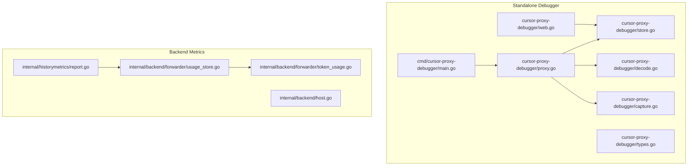
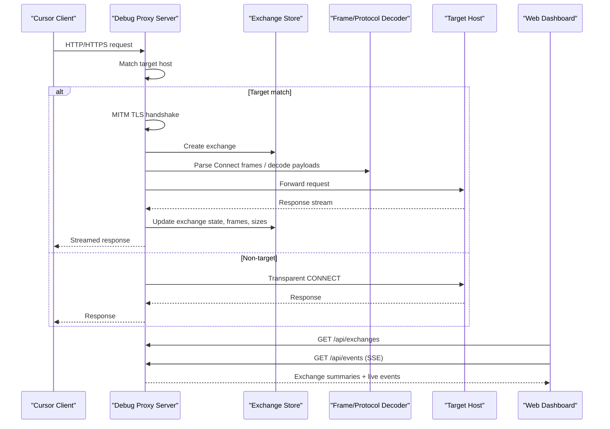
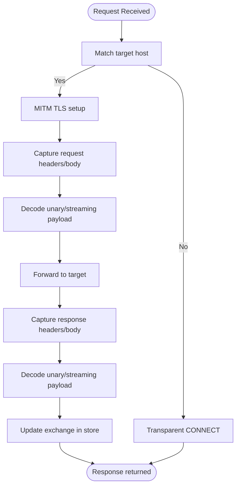
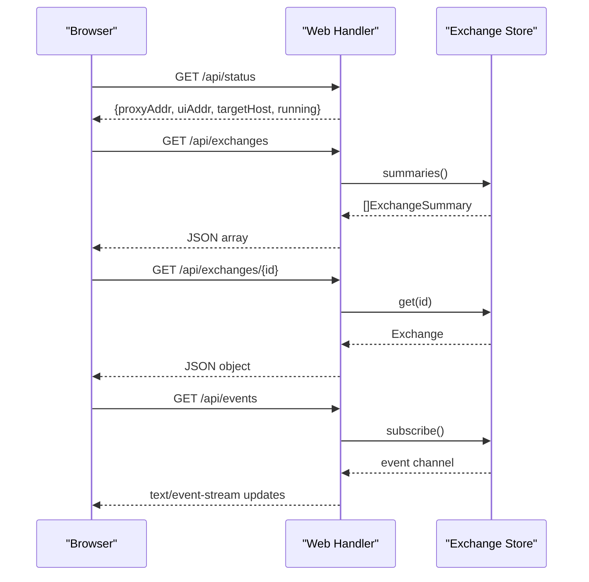
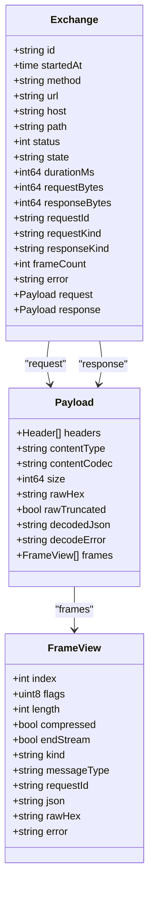
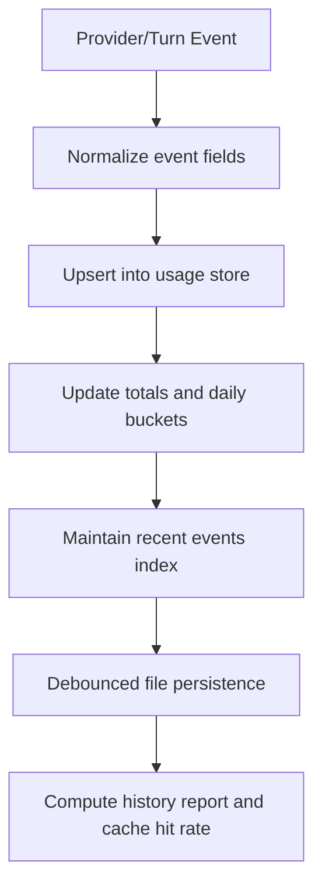
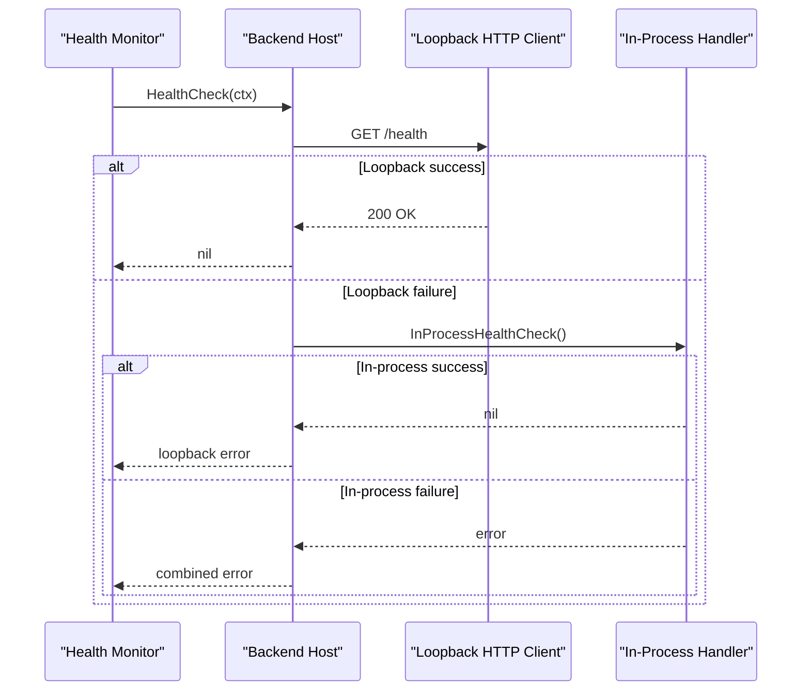
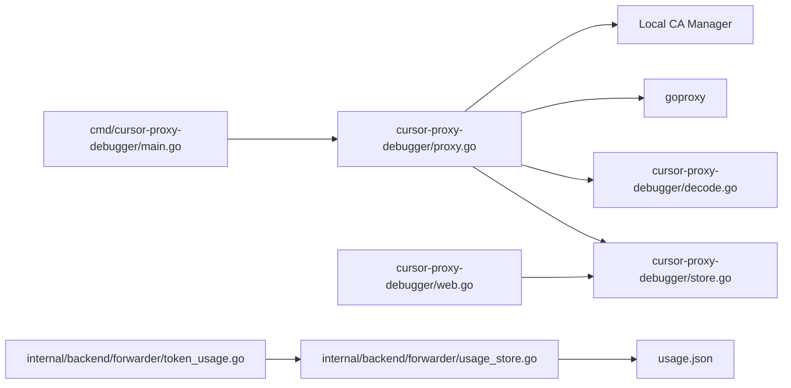

# Debugging and Monitoring

<cite>
**Referenced Files in This Document**
- [main.go](file://cmd/cursor-proxy-debugger/main.go)
- [proxy.go](file://cursor-proxy-debugger/proxy.go)
- [web.go](file://cursor-proxy-debugger/web.go)
- [store.go](file://cursor-proxy-debugger/store.go)
- [types.go](file://cursor-proxy-debugger/types.go)
- [capture.go](file://cursor-proxy-debugger/capture.go)
- [decode.go](file://cursor-proxy-debugger/decode.go)
- [report.go](file://internal/historymetrics/report.go)
- [usage_store.go](file://internal/backend/forwarder/usage_store.go)
- [token_usage.go](file://internal/backend/forwarder/token_usage.go)
- [host.go](file://internal/backend/host.go)
</cite>

## Table of Contents
1. [Introduction](#introduction)
2. [Project Structure](#project-structure)
3. [Core Components](#core-components)
4. [Architecture Overview](#architecture-overview)
5. [Detailed Component Analysis](#detailed-component-analysis)
6. [Dependency Analysis](#dependency-analysis)
7. [Performance Considerations](#performance-considerations)
8. [Troubleshooting Guide](#troubleshooting-guide)
9. [Conclusion](#conclusion)

## Introduction
This document explains the debugging and monitoring capabilities available in cursor-byok, with a focus on the standalone Cursor protocol debugger and the usage tracking infrastructure used by the backend. It covers:

- The standalone HTTPS debug proxy for inspecting request/response pairs, streaming frames, and decoding Cursor protocol payloads.
- The embedded web-based debugging interface, including live event updates, exchange listing, detail inspection, and CA certificate download.
- Log collection mechanisms, sensitive header masking, and raw payload capture limits.
- Usage tracking, token consumption monitoring, cache hit rate analysis, and performance metrics such as time-to-first-token and total duration.
- Health check endpoints and status monitoring patterns for production deployments.
- Guidance for interpreting logs, identifying bottlenecks, and optimizing model response times.

The debugger is intentionally local and does not modify Cursor’s system proxy settings or installed client behavior. It runs alongside Cursor so you can configure Cursor to use the local proxy address and trust the generated CA certificate.

## Project Structure
The debugging and monitoring surface spans two main areas:

- Standalone debugger: `cmd/cursor-proxy-debugger` and `cursor-proxy-debugger`.
- Backend usage and metrics: `internal/backend/forwarder` and `internal/historymetrics`.

**Diagram sources**
- [main.go:18-52](file://cmd/cursor-proxy-debugger/main.go#L18-L52)
- [proxy.go:27-164](file://cursor-proxy-debugger/proxy.go#L27-L164)
- [web.go:16-28](file://cursor-proxy-debugger/web.go#L16-L28)
- [store.go:9-23](file://cursor-proxy-debugger/store.go#L9-L23)
- [types.go:14-22](file://cursor-proxy-debugger/types.go#L14-L22)
- [capture.go:10-20](file://cursor-proxy-debugger/capture.go#L10-L20)
- [decode.go:30-46](file://cursor-proxy-debugger/decode.go#L30-L46)
- [usage_store.go:28-51](file://internal/backend/forwarder/usage_store.go#L28-L51)
- [token_usage.go:15-31](file://internal/backend/forwarder/token_usage.go#L15-L31)
- [report.go:3-14](file://internal/historymetrics/report.go#L3-L14)
- [host.go:199-232](file://internal/backend/host.go#L199-L232)

**Section sources**
- [main.go:18-52](file://cmd/cursor-proxy-debugger/main.go#L18-L52)
- [proxy.go:27-164](file://cursor-proxy-debugger/proxy.go#L27-L164)
- [web.go:16-28](file://cursor-proxy-debugger/web.go#L16-L28)
- [store.go:9-23](file://cursor-proxy-debugger/store.go#L9-L23)
- [types.go:14-22](file://cursor-proxy-debugger/types.go#L14-L22)
- [capture.go:10-20](file://cursor-proxy-debugger/capture.go#L10-L20)
- [decode.go:30-46](file://cursor-proxy-debugger/decode.go#L30-L46)
- [usage_store.go:28-51](file://internal/backend/forwarder/usage_store.go#L28-L51)
- [token_usage.go:15-31](file://internal/backend/forwarder/token_usage.go#L15-L31)
- [report.go:3-14](file://internal/historymetrics/report.go#L3-L14)
- [host.go:199-232](file://internal/backend/host.go#L199-L232)

## Core Components
The core debugging components are:

- **CLI entrypoint**: Parses flags, creates the server, starts listeners, opens the UI, and handles graceful shutdown.
- **Proxy server**: Intercepts HTTP/HTTPS traffic, performs MITM only for the configured target host, captures requests and responses, decodes Connect streaming frames, and stores exchanges.
- **Web UI handler**: Serves static assets, exposes API endpoints for exchange list/detail/status/events, and provides the generated CA certificate.
- **Exchange store**: Thread-safe in-memory storage with bounded capacity, ordered insertion, summary export, subscription-based events, and sensitive header masking.
- **Capture reader**: Wraps request/response bodies to capture bytes up to a configurable limit, track truncation, and emit chunk callbacks.
- **Decoder**: Handles gzip decompression, Connect frame parsing, protobuf JSON decoding, and special handling for BidiAppend and Fork Chat paths.

Key configuration options include proxy address, UI address, target host, maximum exchanges, maximum captured bytes, and maximum streamed frames.

**Section sources**
- [main.go:18-52](file://cmd/cursor-proxy-debugger/main.go#L18-L52)
- [proxy.go:27-164](file://cursor-proxy-debugger/proxy.go#L27-L164)
- [web.go:16-28](file://cursor-proxy-debugger/web.go#L16-L28)
- [store.go:9-23](file://cursor-proxy-debugger/store.go#L9-L23)
- [types.go:14-44](file://cursor-proxy-debugger/types.go#L14-L44)
- [capture.go:10-20](file://cursor-proxy-debugger/capture.go#L10-L20)
- [decode.go:30-46](file://cursor-proxy-debugger/decode.go#L30-L46)

## Architecture Overview
The debugger operates as a local HTTPS proxy with an embedded web dashboard. Traffic to the configured target host is intercepted via MITM; other CONNECT traffic is passed through transparently. Requests and responses are captured, optionally decoded, and stored in memory. The web UI polls or subscribes to live updates.

**Diagram sources**
- [proxy.go:118-164](file://cursor-proxy-debugger/proxy.go#L118-L164)
- [proxy.go:167-274](file://cursor-proxy-debugger/proxy.go#L167-L274)
- [proxy.go:276-392](file://cursor-proxy-debugger/proxy.go#L276-L392)
- [web.go:16-28](file://cursor-proxy-debugger/web.go#L16-L28)
- [web.go:58-89](file://cursor-proxy-debugger/web.go#L58-L89)
- [store.go:25-45](file://cursor-proxy-debugger/store.go#L25-L45)
- [decode.go:48-87](file://cursor-proxy-debugger/decode.go#L48-L87)

## Detailed Component Analysis

### Standalone Debug Proxy
The debug proxy is responsible for:

- Listening on a proxy address and a separate UI address.
- Generating a local CA certificate and serving it at `/api/ca.crt`.
- Intercepting CONNECT requests and applying MITM only when the host matches the configured target.
- Capturing request/response headers, content encoding, body size, truncation status, and raw hex.
- Decoding unary and streaming Cursor protocol messages where supported.
- Updating exchange state from pending to streaming to completed or error.

**Diagram sources**
- [proxy.go:118-164](file://cursor-proxy-debugger/proxy.go#L118-L164)
- [proxy.go:167-274](file://cursor-proxy-debugger/proxy.go#L167-L274)
- [proxy.go:276-392](file://cursor-proxy-debugger/proxy.go#L276-L392)

**Section sources**
- [proxy.go:27-164](file://cursor-proxy-debugger/proxy.go#L27-L164)
- [proxy.go:167-274](file://cursor-proxy-debugger/proxy.go#L167-L274)
- [proxy.go:276-392](file://cursor-proxy-debugger/proxy.go#L276-L392)

### Web-Based Debugging Interface
The web interface provides:

- Static asset serving for the dashboard.
- Status endpoint returning proxy/UI addresses, target host, and running flag.
- Exchange list and detail endpoints.
- SSE-based live events channel for real-time updates.
- CA certificate download endpoint.
- Security headers applied to all routes.

**Diagram sources**
- [web.go:16-28](file://cursor-proxy-debugger/web.go#L16-L28)
- [web.go:30-55](file://cursor-proxy-debugger/web.go#L30-L55)
- [web.go:58-89](file://cursor-proxy-debugger/web.go#L58-L89)
- [store.go:47-67](file://cursor-proxy-debugger/store.go#L47-L67)
- [store.go:77-101](file://cursor-proxy-debugger/store.go#L77-L101)

**Section sources**
- [web.go:16-28](file://cursor-proxy-debugger/web.go#L16-L28)
- [web.go:30-55](file://cursor-proxy-debugger/web.go#L30-L55)
- [web.go:58-89](file://cursor-proxy-debugger/web.go#L58-L89)

### Log Collection and Payload Inspection
The debugger collects:

- Request and response headers with sensitive values masked.
- Content type and content codec.
- Raw byte size and truncated flag.
- Raw hex payload clipped to a safe length.
- Decoded JSON for supported paths.
- Streaming frame metadata and decoded protobuf JSON for supported message types.

Sensitive headers like Authorization, Cookie, Set-Cookie, Proxy-Authorization, and X-API-Key are hidden in the UI. Body capture is limited by `MaxCaptureBytes`, and streaming frames are limited by `MaxFrames`.

**Diagram sources**
- [types.go:46-105](file://cursor-proxy-debugger/types.go#L46-L105)

**Section sources**
- [store.go:122-150](file://cursor-proxy-debugger/store.go#L122-L150)
- [capture.go:36-84](file://cursor-proxy-debugger/capture.go#L36-L84)
- [decode.go:89-129](file://cursor-proxy-debugger/decode.go#L89-L129)
- [types.go:46-105](file://cursor-proxy-debugger/types.go#L46-L105)

### Usage Tracking, Token Consumption, and Cache Hit Rate
The backend tracks usage through:

- A file-backed usage store that persists provider calls, turns, token counts, and recent events.
- Token usage snapshots that aggregate input/output/cache tokens, provider pass count, compile duration, estimated prompt tokens, replay message count, TTFT, and total duration.
- History report structures that compute totals and cache hit rate.

Token consumption monitoring includes:

- Input tokens, output tokens, cache read tokens, cache write tokens, and total tokens.
- Provider call counters and turn counters.
- Per-event fields such as TTFTMS and DurationMS for performance benchmarking.
- Cache hit rate computed from cache read tokens and input tokens.

**Diagram sources**
- [usage_store.go:133-157](file://internal/backend/forwarder/usage_store.go#L133-L157)
- [usage_store.go:230-301](file://internal/backend/forwarder/usage_store.go#L230-L301)
- [usage_store.go:456-496](file://internal/backend/forwarder/usage_store.go#L456-L496)
- [report.go:38-45](file://internal/historymetrics/report.go#L38-L45)

**Section sources**
- [usage_store.go:28-51](file://internal/backend/forwarder/usage_store.go#L28-L51)
- [usage_store.go:133-157](file://internal/backend/forwarder/usage_store.go#L133-L157)
- [usage_store.go:230-301](file://internal/backend/forwarder/usage_store.go#L230-L301)
- [usage_store.go:456-496](file://internal/backend/forwarder/usage_store.go#L456-L496)
- [token_usage.go:15-31](file://internal/backend/forwarder/token_usage.go#L15-L31)
- [token_usage.go:322-410](file://internal/backend/forwarder/token_usage.go#L322-L410)
- [report.go:3-14](file://internal/historymetrics/report.go#L3-L14)
- [report.go:38-45](file://internal/historymetrics/report.go#L38-L45)

### Health Check Endpoints and Status Monitoring
For production deployments, health checks should verify both process-level readiness and network reachability. The backend host implements:

- A health check that attempts an HTTP GET against the base URL.
- Fallback to an in-process health check if loopback access fails.
- Error reporting when either loopback or in-process checks fail.

The debugger itself exposes a simple status endpoint indicating whether it is running and what addresses it is bound to.

**Diagram sources**
- [host.go:199-232](file://internal/backend/host.go#L199-L232)

**Section sources**
- [host.go:199-232](file://internal/backend/host.go#L199-L232)
- [web.go:30-37](file://cursor-proxy-debugger/web.go#L30-L37)

## Dependency Analysis
The debugger depends on:

- Go standard library networking and TLS.
- goproxy for proxying and MITM.
- Local certificate generation for CA issuance.
- Protobuf JSON marshaling for decoded payloads.
- Embedded filesystem for serving the web UI.

The backend metrics depend on:

- File I/O for usage.json persistence.
- Mutexes for thread-safe updates.
- Debounced writer goroutine for efficient disk writes.
- Time-based calculations for TTFT and duration.

**Diagram sources**
- [main.go:18-52](file://cmd/cursor-proxy-debugger/main.go#L18-L52)
- [proxy.go:18-21](file://cursor-proxy-debugger/proxy.go#L18-L21)
- [proxy.go:47-66](file://cursor-proxy-debugger/proxy.go#L47-L66)
- [decode.go:3-19](file://cursor-proxy-debugger/decode.go#L3-L19)
- [web.go:3-11](file://cursor-proxy-debugger/web.go#L3-L11)
- [usage_store.go:1-14](file://internal/backend/forwarder/usage_store.go#L1-L14)
- [token_usage.go:1-13](file://internal/backend/forwarder/token_usage.go#L1-L13)

**Section sources**
- [proxy.go:18-21](file://cursor-proxy-debugger/proxy.go#L18-L21)
- [proxy.go:47-66](file://cursor-proxy-debugger/proxy.go#L47-L66)
- [decode.go:3-19](file://cursor-proxy-debugger/decode.go#L3-L19)
- [web.go:3-11](file://cursor-proxy-debugger/web.go#L3-L11)
- [usage_store.go:1-14](file://internal/backend/forwarder/usage_store.go#L1-L14)
- [token_usage.go:1-13](file://internal/backend/forwarder/token_usage.go#L1-L13)

## Performance Considerations
To optimize model response times and reduce overhead:

- Use appropriate `MaxCaptureBytes` to avoid excessive memory usage while retaining enough data for diagnosis.
- Tune `MaxFrames` to balance frame visibility with memory pressure during long streams.
- Limit `MaxExchanges` to control in-memory retention and prevent unbounded growth.
- Prefer filtering by `requestId` in the UI to focus on specific interactions.
- Inspect `durationMs`, `ttft_ms`, and `duration_ms` in usage events to identify slow providers or internal processing steps.
- Monitor cache hit rate; low rates may indicate insufficient cache reuse or high variability in prompts.
- For streaming responses, examine frame kinds and errors to detect incomplete frames or decoding failures.

[No sources needed since this section provides general guidance]

## Troubleshooting Guide

### Interpreting Logs and Exchange State
- Pending: Request captured but response not yet received.
- Streaming: Response headers received; body streaming ongoing.
- Completed: Response finished successfully.
- Error: Connection error, read error, or decode error occurred.

Look for:

- `state` and `error` fields in exchange summaries.
- `rawTruncated` to determine whether captured payload was cut off.
- `decodeError` to identify protobuf or compression issues.
- `frameCount`, `kind`, and `messageType` for streaming diagnostics.
- Masked sensitive headers to ensure credentials are not exposed in logs.

**Section sources**
- [proxy.go:123-133](file://cursor-proxy-debugger/proxy.go#L123-L133)
- [proxy.go:330-363](file://cursor-proxy-debugger/proxy.go#L330-L363)
- [store.go:122-150](file://cursor-proxy-debugger/store.go#L122-L150)
- [types.go:46-105](file://cursor-proxy-debugger/types.go#L46-L105)

### Identifying Bottlenecks
Use these signals:

- High `durationMs` in debugger exchanges indicates slow upstream responses or heavy decoding.
- High `ttft_ms` in usage events indicates delay before first token.
- Low `cache_read_tokens` relative to `input_tokens` suggests poor cache utilization.
- Frequent `provider_pass` increments may indicate retries or multiple model calls per turn.
- Large `compile_duration_ms` points to prompt compilation overhead.

**Section sources**
- [token_usage.go:322-410](file://internal/backend/forwarder/token_usage.go#L322-L410)
- [usage_store.go:78-96](file://internal/backend/forwarder/usage_store.go#L78-L96)
- [report.go:3-14](file://internal/historymetrics/report.go#L3-L14)

### Optimizing Model Response Times
Recommendations:

- Reduce prompt size and unnecessary context to lower input tokens and improve cache hits.
- Enable caching where possible and monitor cache hit rate trends.
- Avoid excessive retries; investigate root causes of provider errors instead of blindly increasing passes.
- Use streaming responses and inspect frame-level errors to pinpoint protocol issues.
- Adjust capture and frame limits to reduce memory pressure during long conversations.

[No sources needed since this section provides general guidance]

### Health and Status Checks
Production monitoring should:

- Poll `/api/status` for the debugger to confirm it is running and bound to expected addresses.
- Implement a health check similar to the backend host pattern: attempt loopback HTTP access and fall back to in-process checks.
- Alert on non-200 health responses or repeated failures.
- Track usage store flush errors and log them for operational visibility.

**Section sources**
- [web.go:30-37](file://cursor-proxy-debugger/web.go#L30-L37)
- [host.go:199-232](file://internal/backend/host.go#L199-L232)
- [usage_store.go:230-301](file://internal/backend/forwarder/usage_store.go#L230-L301)

## Conclusion
The cursor-byok debugging and monitoring stack combines a local HTTPS proxy with a rich web dashboard and a robust usage tracking system. The debugger helps you inspect request/response pairs, decode Cursor protocol payloads, and analyze streaming frames. The backend usage store records token consumption, provider calls, and performance metrics, enabling cache hit rate analysis and bottleneck identification. For production, combine health checks, status monitoring, and alerting to maintain reliability and performance.

[No sources needed since this section summarizes without analyzing specific files]