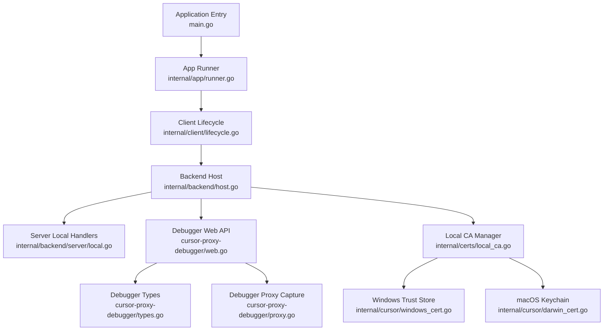
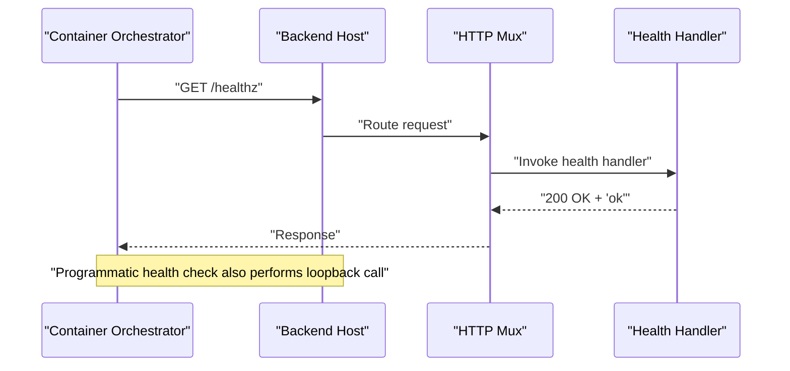
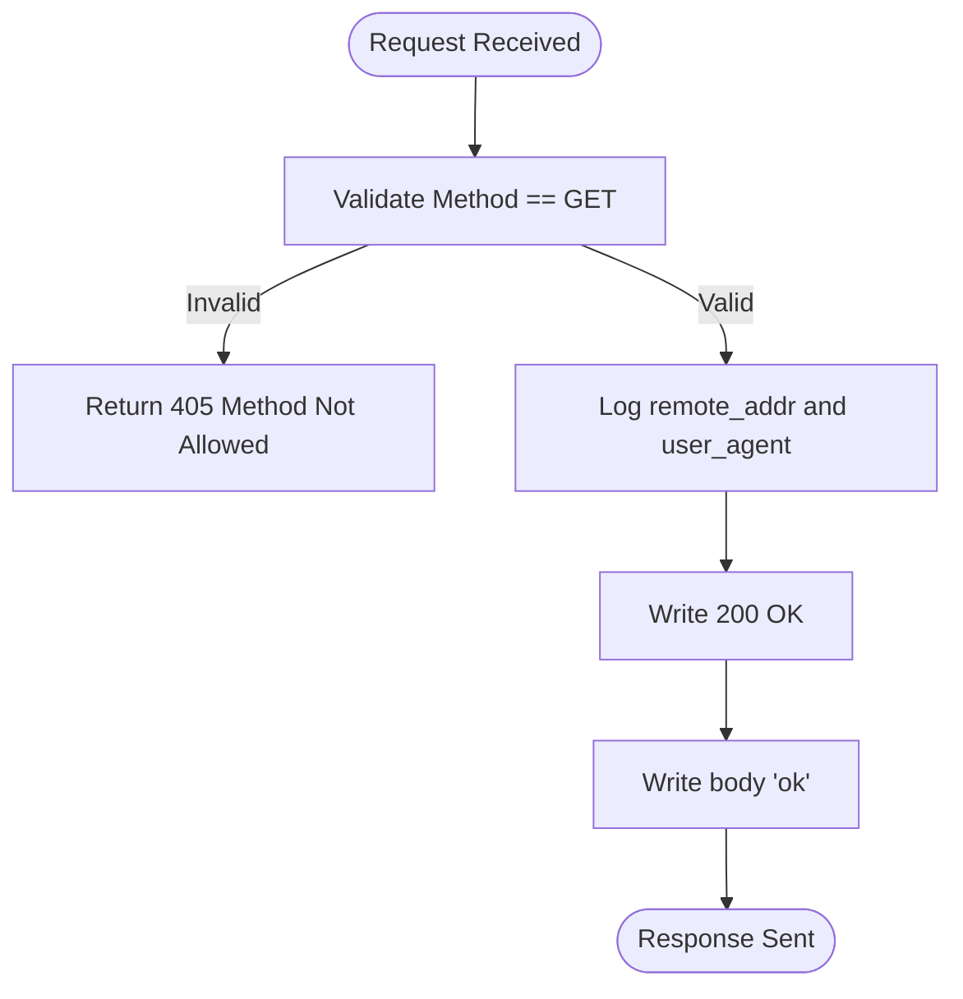
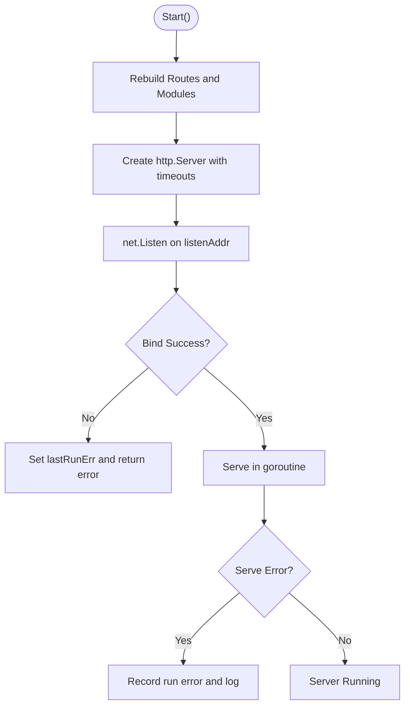
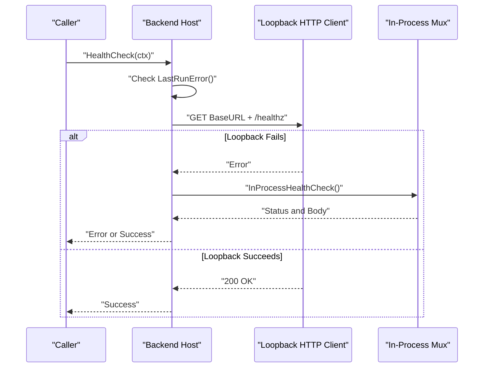
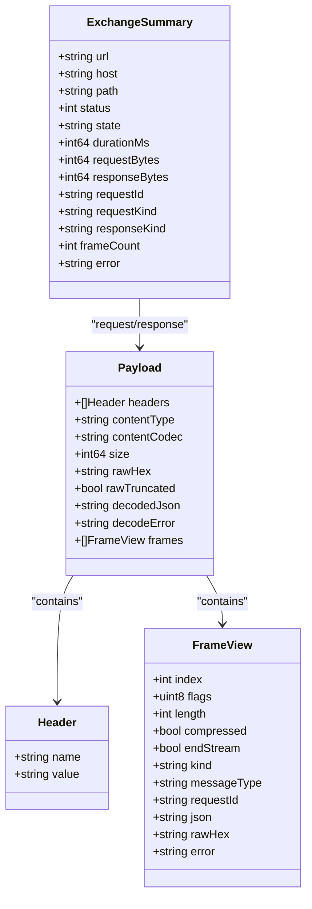
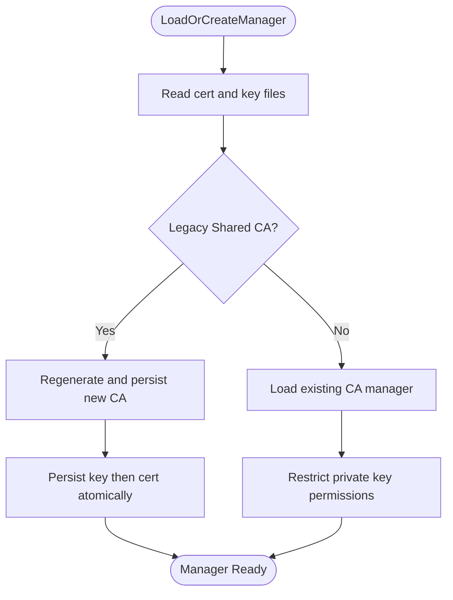
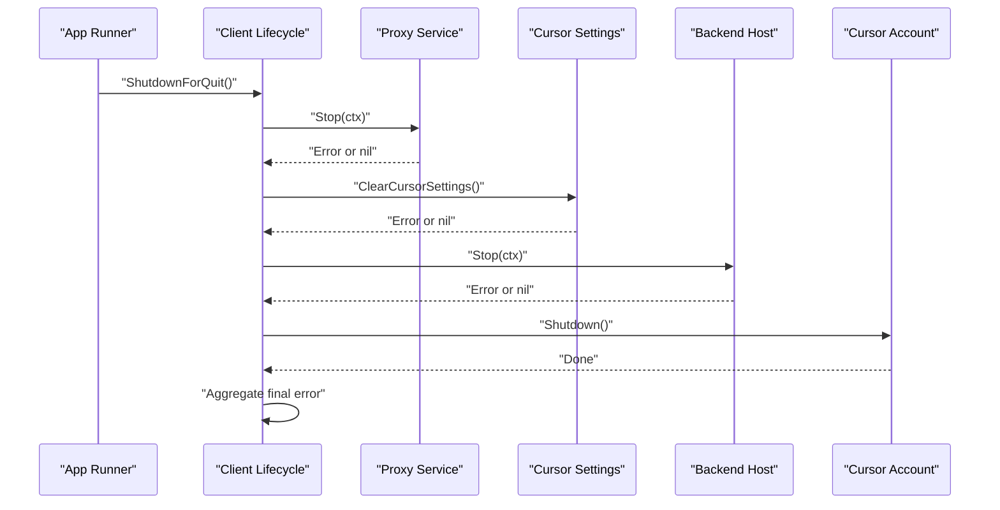
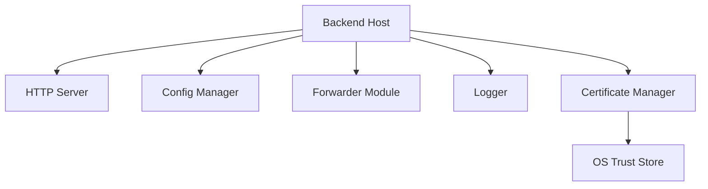

# Health Checks and Status

<cite>
**Referenced Files in This Document**
- [main.go](file://main.go)
- [host.go](file://internal/backend/host.go)
- [local.go](file://internal/backend/server/local.go)
- [lifecycle.go](file://internal/client/lifecycle.go)
- [runner.go](file://internal/app/runner.go)
- [web.go](file://cursor-proxy-debugger/web.go)
- [types.go](file://cursor-proxy-debugger/types.go)
- [proxy.go](file://cursor-proxy-debugger/proxy.go)
- [local_ca.go](file://internal/certs/local_ca.go)
- [windows_cert.go](file://internal/cursor/windows_cert.go)
- [darwin_cert.go](file://internal/cursor/darwin_cert.go)
</cite>

## Table of Contents
1. [Introduction](#introduction)
2. [Project Structure](#project-structure)
3. [Core Components](#core-components)
4. [Architecture Overview](#architecture-overview)
5. [Detailed Component Analysis](#detailed-component-analysis)
6. [Dependency Analysis](#dependency-analysis)
7. [Performance Considerations](#performance-considerations)
8. [Troubleshooting Guide](#troubleshooting-guide)
9. [Conclusion](#conclusion)

## Introduction
This document explains the health check endpoints, status monitoring, startup validation, port availability checks, certificate validity verification, error reporting, and graceful shutdown behavior for the service. It also provides guidance on integrating these health checks with container orchestration systems, setting up monitoring alerts, and troubleshooting initialization failures.

The backend exposes a local-only health endpoint that returns a simple success response when the HTTP server is running and reachable. The application lifecycle manages starting and stopping the backend, while the debugger provides an additional diagnostic status endpoint for request inspection. Certificate management ensures local CA trust and validates system store presence across platforms.

## Project Structure
The health and status functionality spans several layers:
- Application entry point initializes logging and starts the app runtime.
- Backend host constructs the HTTP server, registers routes including the health endpoint, and provides programmatic health checks.
- Server utilities implement the health handler logic.
- Client lifecycle coordinates graceful shutdown of proxy, settings, backend, and account services.
- App runner orchestrates UI events and triggers service start/stop.
- Debugger exposes a diagnostic status API and captures request/response details.
- Certificate modules manage local CA generation, persistence, and platform-specific trust store operations.

**Diagram sources**
- [main.go:19-29](file://main.go#L19-L29)
- [runner.go:200-205](file://internal/app/runner.go#L200-L205)
- [lifecycle.go:258-278](file://internal/client/lifecycle.go#L258-L278)
- [host.go:26-42](file://internal/backend/host.go#L26-L42)
- [local.go:9-25](file://internal/backend/server/local.go#L9-L25)
- [web.go:18-50](file://cursor-proxy-debugger/web.go#L18-L50)
- [types.go:51-64](file://cursor-proxy-debugger/types.go#L51-L64)
- [proxy.go:331-362](file://cursor-proxy-debugger/proxy.go#L331-L362)
- [local_ca.go:22-56](file://internal/certs/local_ca.go#L22-L56)
- [windows_cert.go:50-83](file://internal/cursor/windows_cert.go#L50-L83)
- [darwin_cert.go:47-86](file://internal/cursor/darwin_cert.go#L47-L86)

**Section sources**
- [main.go:19-29](file://main.go#L19-L29)
- [host.go:26-42](file://internal/backend/host.go#L26-L42)
- [local.go:9-25](file://internal/backend/server/local.go#L9-L25)
- [lifecycle.go:258-278](file://internal/client/lifecycle.go#L258-L278)
- [web.go:18-50](file://cursor-proxy-debugger/web.go#L18-L50)
- [types.go:51-64](file://cursor-proxy-debugger/types.go#L51-L64)
- [proxy.go:331-362](file://cursor-proxy-debugger/proxy.go#L331-L362)
- [local_ca.go:22-56](file://internal/certs/local_ca.go#L22-L56)
- [windows_cert.go:50-83](file://internal/cursor/windows_cert.go#L50-L83)
- [darwin_cert.go:47-86](file://internal/cursor/darwin_cert.go#L47-L86)

## Core Components
- Backend Host: Manages HTTP server lifecycle, route registration (including health), listen address resolution, and health checking via loopback and in-process requests.
- Server Local Handlers: Implements the /healthz endpoint returning a plain text success body and method validation.
- Client Lifecycle: Coordinates graceful shutdown of components, ensuring resources are released even if errors occur during stop.
- App Runner: Triggers service start/stop based on UI events and updates status labels.
- Debugger Web API: Exposes diagnostic endpoints for status and request history, capturing detailed exchange information.
- Certificate Management: Generates and persists local CA, validates legacy shared CA removal, and verifies installation into OS trust stores.

Key responsibilities:
- Health endpoint exposure and validation.
- Port binding and error tracking.
- Graceful shutdown and resource cleanup.
- Diagnostic status and request capture.
- Certificate trust store verification.

**Section sources**
- [host.go:131-175](file://internal/backend/host.go#L131-L175)
- [host.go:199-253](file://internal/backend/host.go#L199-L253)
- [local.go:9-25](file://internal/backend/server/local.go#L9-L25)
- [lifecycle.go:258-278](file://internal/client/lifecycle.go#L258-L278)
- [runner.go:349-365](file://internal/app/runner.go#L349-L365)
- [web.go:18-50](file://cursor-proxy-debugger/web.go#L18-L50)
- [types.go:51-64](file://cursor-proxy-debugger/types.go#L51-L64)
- [local_ca.go:22-56](file://internal/certs/local_ca.go#L22-L56)

## Architecture Overview
The health check architecture combines process-level readiness checks with network reachability validation. The backend registers a local-only health route that responds to GET requests with a success body. Programmatic health checks perform both loopback HTTP calls and in-process mux invocations to ensure the server is not only listening but also routing correctly.

**Diagram sources**
- [host.go:296-307](file://internal/backend/host.go#L296-L307)
- [local.go:9-25](file://internal/backend/server/local.go#L9-L25)

## Detailed Component Analysis

### Health Endpoint Implementation
The health endpoint is registered under a constant path and uses a local-only handler. The handler validates the HTTP method, logs access metadata, writes a success status code, and returns a plain text body indicating operational readiness.

**Diagram sources**
- [local.go:9-25](file://internal/backend/server/local.go#L9-L25)

**Section sources**
- [host.go:26-26](file://internal/backend/host.go#L26-L26)
- [host.go:296-307](file://internal/backend/host.go#L296-L307)
- [local.go:9-25](file://internal/backend/server/local.go#L9-L25)

### Startup Sequence Validation and Port Availability
During startup, the backend constructs the HTTP server with configured timeouts and attempts to bind to the listen address. If binding fails, the error is recorded and returned. On successful binding, the server begins serving requests in a goroutine, and any unexpected termination sets a last-run error.

**Diagram sources**
- [host.go:131-175](file://internal/backend/host.go#L131-L175)

**Section sources**
- [host.go:131-175](file://internal/backend/host.go#L131-L175)

### Programmatic Health Checks
The host provides two health check mechanisms:
- Loopback HTTP check: Sends an HTTP GET to the base URL plus the health path using a dedicated client with short dial timeout and minimal connection pooling.
- In-process mux check: Uses httptest to invoke the mux directly, verifying status code and body content.

If the loopback call fails, the in-process check is attempted to distinguish between network reachability issues and internal routing problems.

**Diagram sources**
- [host.go:199-253](file://internal/backend/host.go#L199-L253)

**Section sources**
- [host.go:199-253](file://internal/backend/host.go#L199-L253)

### Status Endpoint Responses and Diagnostics
The debugger exposes a status endpoint that returns structured JSON containing summary information about captured exchanges. Each exchange includes fields such as status code, state, duration, request/response sizes, and optional error messages.

**Diagram sources**
- [types.go:51-105](file://cursor-proxy-debugger/types.go#L51-L105)

**Section sources**
- [web.go:18-50](file://cursor-proxy-debugger/web.go#L18-L50)
- [types.go:51-105](file://cursor-proxy-debugger/types.go#L51-L105)

### Certificate Validity Verification
Certificate management generates a per-installation CA, persists it securely, and detects legacy shared CA artifacts. Platform-specific helpers verify whether the CA is installed in the system trust store and can remove compromised legacy certificates.

**Diagram sources**
- [local_ca.go:22-56](file://internal/certs/local_ca.go#L22-L56)
- [local_ca.go:71-94](file://internal/certs/local_ca.go#L71-L94)

Platform trust store verification:
- Windows: Uses certutil to verify thumbprint presence in the root store.
- macOS: Uses security tool to check login keychain for fingerprint.

**Section sources**
- [local_ca.go:22-56](file://internal/certs/local_ca.go#L22-L56)
- [local_ca.go:71-94](file://internal/certs/local_ca.go#L71-L94)
- [windows_cert.go:50-83](file://internal/cursor/windows_cert.go#L50-L83)
- [darwin_cert.go:47-86](file://internal/cursor/darwin_cert.go#L47-L86)

### Graceful Shutdown and Resource Cleanup
Graceful shutdown is coordinated by the client lifecycle, which stops the proxy, clears cursor settings, shuts down the backend host, and terminates the cursor account service. Errors during shutdown are aggregated and stored as the last error.

**Diagram sources**
- [lifecycle.go:258-278](file://internal/client/lifecycle.go#L258-L278)

**Section sources**
- [lifecycle.go:258-278](file://internal/client/lifecycle.go#L258-L278)

## Dependency Analysis
The health and status subsystem depends on:
- HTTP server stack for route handling and request processing.
- Logger for access and error diagnostics.
- Configuration manager for listen address and runtime settings.
- Forwarder module for background services that may affect overall health.
- Certificate managers for trust store validation.

**Diagram sources**
- [host.go:296-307](file://internal/backend/host.go#L296-L307)
- [local_ca.go:22-56](file://internal/certs/local_ca.go#L22-L56)

**Section sources**
- [host.go:296-307](file://internal/backend/host.go#L296-L307)
- [local_ca.go:22-56](file://internal/certs/local_ca.go#L22-L56)

## Performance Considerations
- Health check HTTP client uses minimal connection pooling and short dial timeouts to avoid blocking long-running operations.
- In-process health checks bypass network overhead and validate routing correctness quickly.
- Logging during health checks provides visibility without significant performance impact.
- Certificate operations are performed at startup; subsequent checks rely on in-memory managers where applicable.

[No sources needed since this section provides general guidance]

## Troubleshooting Guide
Common issues and resolutions:
- Port binding failure: Indicates another process is using the configured address or insufficient permissions. Check the last-run error and adjust the listen address.
- Loopback health check failure with successful in-process check: Suggests firewall or proxy configuration preventing localhost access. Verify loopback connectivity and client transport settings.
- Non-200 health response: Indicates route misconfiguration or handler error. Inspect server logs and ensure the health route is mounted correctly.
- Certificate trust store issues: On Windows, verify certutil output and thumbprint presence. On macOS, confirm the fingerprint exists in the login keychain. Remove legacy shared CA if detected.
- Graceful shutdown errors: Review aggregated final error from lifecycle shutdown to identify failing components.

Diagnostic tips:
- Use the debugger status endpoint to inspect recent request statuses and errors.
- Monitor server logs for health check hits and error messages.
- Validate certificate files exist and have correct permissions.

**Section sources**
- [host.go:131-175](file://internal/backend/host.go#L131-L175)
- [host.go:199-253](file://internal/backend/host.go#L199-L253)
- [web.go:18-50](file://cursor-proxy-debugger/web.go#L18-L50)
- [local_ca.go:22-56](file://internal/certs/local_ca.go#L22-L56)
- [windows_cert.go:50-83](file://internal/cursor/windows_cert.go#L50-L83)
- [darwin_cert.go:47-86](file://internal/cursor/darwin_cert.go#L47-L86)

## Conclusion
The service provides robust health checking through a combination of HTTP endpoint exposure, programmatic loopback and in-process validations, and comprehensive lifecycle management. Certificate management ensures secure local interception capabilities with platform-specific trust store verification. Integrating these health checks with container orchestration systems involves polling the /healthz endpoint and interpreting loopback vs in-process failures appropriately. Monitoring alerts should trigger on non-200 responses, repeated health check failures, and certificate trust store mismatches. Graceful shutdown procedures ensure resources are cleaned up reliably, minimizing disruption during maintenance or restarts.

[No sources needed since this section summarizes without analyzing specific files]