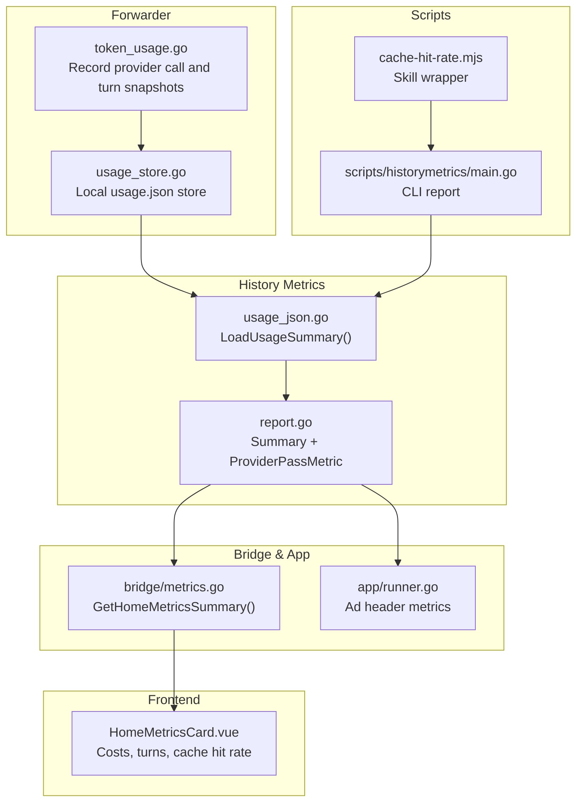
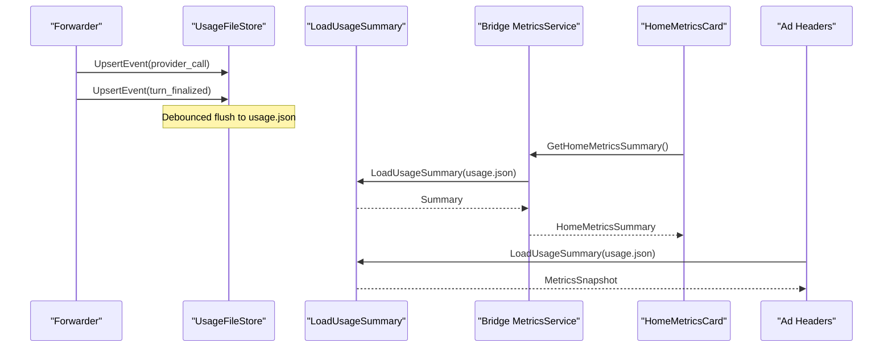
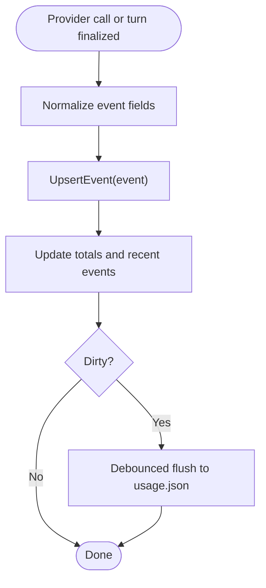
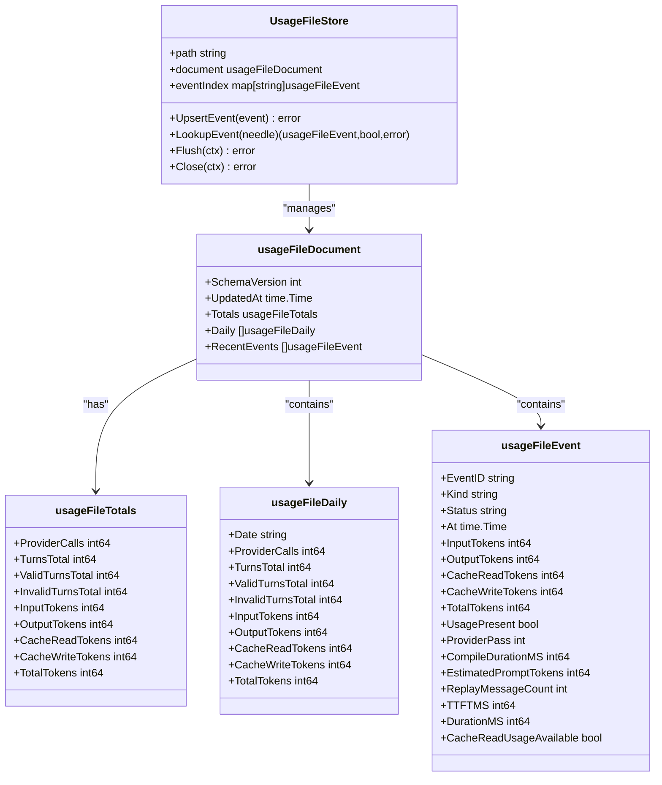
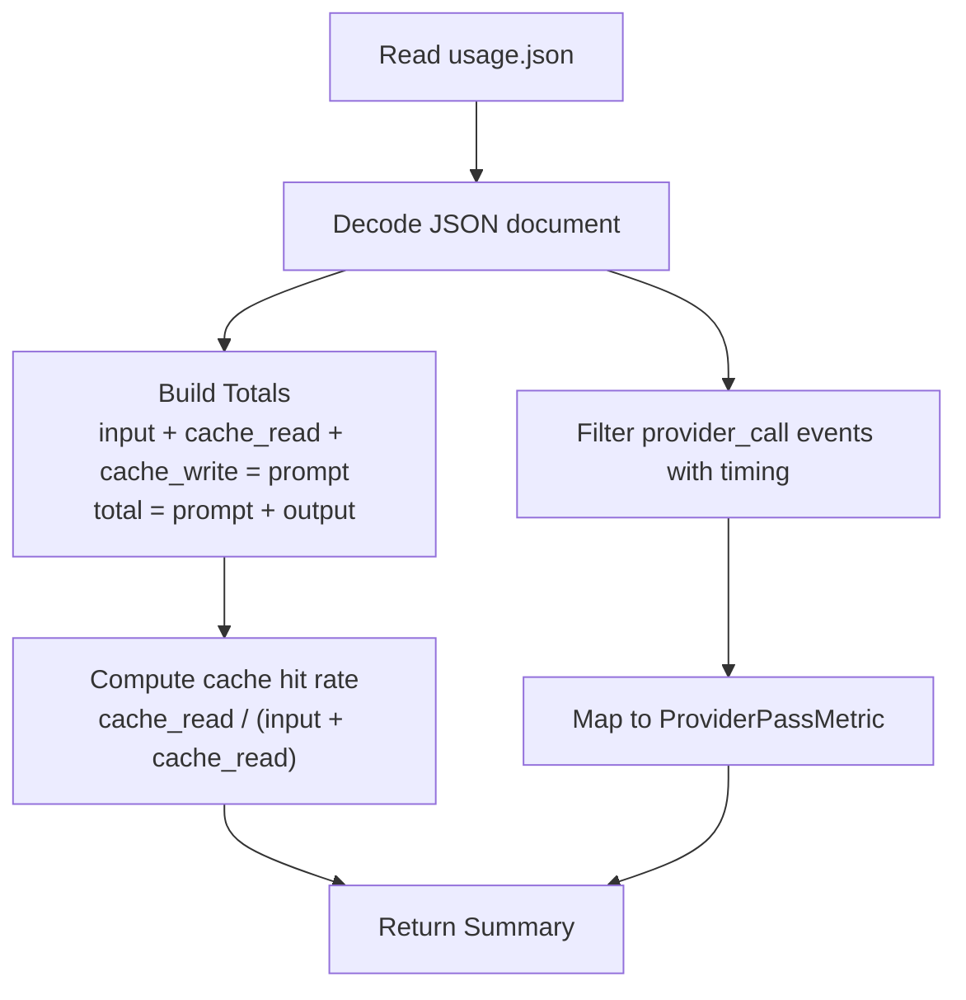
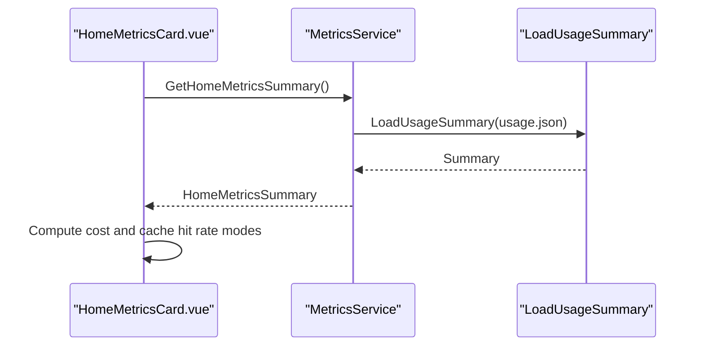
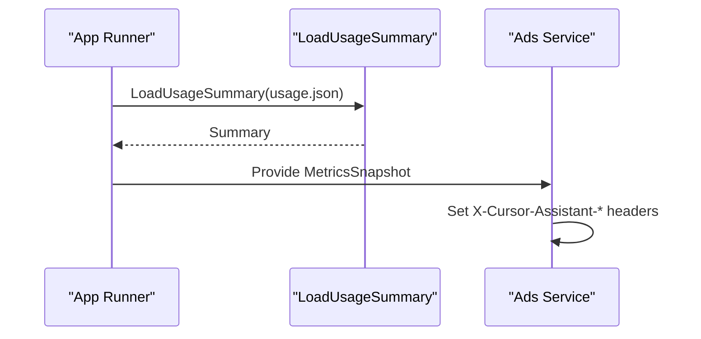
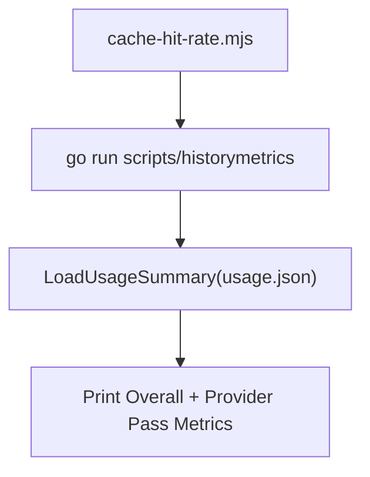
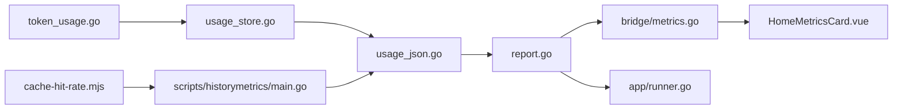

# Metrics and Monitoring

<cite>
**Referenced Files in This Document**
- [report.go](file://internal/historymetrics/report.go)
- [usage_json.go](file://internal/historymetrics/usage_json.go)
- [metrics.go](file://internal/bridge/metrics.go)
- [runner.go](file://internal/app/runner.go)
- [token_usage.go](file://internal/backend/forwarder/token_usage.go)
- [usage_store.go](file://internal/backend/forwarder/usage_store.go)
- [main.go](file://scripts/historymetrics/main.go)
- [HomeMetricsCard.vue](file://frontend/src/components/HomeMetricsCard.vue)
- [cache-hit-rate.mjs](file://.agents/skills/cursor-client-e2e-debugging/scripts/cache-hit-rate.mjs)
</cite>

## Table of Contents
1. [Introduction](#introduction)
2. [Project Structure](#project-structure)
3. [Core Components](#core-components)
4. [Architecture Overview](#architecture-overview)
5. [Detailed Component Analysis](#detailed-component-analysis)
6. [Dependency Analysis](#dependency-analysis)
7. [Performance Considerations](#performance-considerations)
8. [Troubleshooting Guide](#troubleshooting-guide)
9. [Conclusion](#conclusion)
10. [Appendices](#appendices)

## Introduction
This document explains the metrics collection and monitoring capabilities for token consumption, model performance timing, and cache hit rate analysis. It covers how usage data is recorded, aggregated, stored, exported, and visualized, as well as how it integrates with internal services and external tooling.

The system centers on:
- Token usage tracking per provider call and per conversation turn.
- Performance timing such as time-to-first-token and total duration.
- Cache read/write token accounting and derived cache hit/reuse rates.
- A local JSON-based usage store with totals, daily summaries, and recent events.
- A CLI and frontend interface for interpreting reports and monitoring trends.

## Project Structure
The metrics pipeline spans several layers:

- Forwarder layer records provider calls and turn finalization into a usage file store.
- History metrics layer loads and summarizes the usage file into a report structure.
- Bridge layer exposes a service to the UI for home metrics.
- App runner wires history metrics into runtime features such as ad headers.
- Frontend renders usage cards, cost estimates, and cache hit rate charts.
- Scripts provide CLI and helper utilities for manual inspection.

**Diagram sources**
- [token_usage.go:322-447](file://internal/backend/forwarder/token_usage.go#L322-L447)
- [usage_store.go:110-157](file://internal/backend/forwarder/usage_store.go#L110-L157)
- [usage_json.go:36-69](file://internal/historymetrics/usage_json.go#L36-L69)
- [report.go:3-27](file://internal/historymetrics/report.go#L3-L27)
- [metrics.go:29-50](file://internal/bridge/metrics.go#L29-L50)
- [runner.go:151-166](file://internal/app/runner.go#L151-L166)
- [HomeMetricsCard.vue:11-196](file://frontend/src/components/HomeMetricsCard.vue#L11-L196)
- [main.go:13-54](file://scripts/historymetrics/main.go#L13-L54)
- [cache-hit-rate.mjs:1-33](file://.agents/skills/cursor-client-e2e-debugging/scripts/cache-hit-rate.mjs#L1-L33)

**Section sources**
- [token_usage.go:322-447](file://internal/backend/forwarder/token_usage.go#L322-L447)
- [usage_store.go:110-157](file://internal/backend/forwarder/usage_store.go#L110-L157)
- [usage_json.go:36-69](file://internal/historymetrics/usage_json.go#L36-L69)
- [report.go:3-27](file://internal/historymetrics/report.go#L3-L27)
- [metrics.go:29-50](file://internal/bridge/metrics.go#L29-L50)
- [runner.go:151-166](file://internal/app/runner.go#L151-L166)
- [HomeMetricsCard.vue:11-196](file://frontend/src/components/HomeMetricsCard.vue#L11-L196)
- [main.go:13-54](file://scripts/historymetrics/main.go#L13-L54)
- [cache-hit-rate.mjs:1-33](file://.agents/skills/cursor-client-e2e-debugging/scripts/cache-hit-rate.mjs#L1-L33)

## Core Components
- Usage recording: The forwarder captures provider call and turn-finalized events, including token counts and timing.
- Usage storage: A debounced, atomic writer persists totals, daily buckets, and recent events to a local JSON file.
- Report loading: The history metrics loader reads the usage file and computes summary fields like cache hit rate.
- Home metrics service: Exposes a normalized summary to the UI.
- Ad integration: Runtime headers include selected metrics for downstream telemetry.
- Frontend visualization: Displays costs, turns, and cache hit rate with optional inclusion of cache writes in the denominator.
- CLI reporting: Prints overall and per-provider-pass metrics for manual analysis.

Key responsibilities:
- Token accounting: input, output, cache read, cache write, prompt tokens, request tokens.
- Timing: compile duration, TTFT, total duration.
- Aggregation: totals, daily buckets, recent event window.
- Export: JSON file plus CLI and UI views.

**Section sources**
- [token_usage.go:15-52](file://internal/backend/forwarder/token_usage.go#L15-L52)
- [usage_store.go:16-96](file://internal/backend/forwarder/usage_store.go#L16-L96)
- [usage_json.go:10-34](file://internal/historymetrics/usage_json.go#L10-L34)
- [report.go:3-27](file://internal/historymetrics/report.go#L3-L27)
- [metrics.go:8-19](file://internal/bridge/metrics.go#L8-L19)
- [HomeMetricsCard.vue:11-196](file://frontend/src/components/HomeMetricsCard.vue#L11-L196)
- [main.go:13-54](file://scripts/historymetrics/main.go#L13-L54)

## Architecture Overview
The metrics flow starts when a model provider call completes or a conversation turn finalizes. The forwarder records structured events into an in-memory store that periodically flushes to disk. Consumers then load the latest usage file to compute summaries and render dashboards.

**Diagram sources**
- [token_usage.go:322-447](file://internal/backend/forwarder/token_usage.go#L322-L447)
- [usage_store.go:133-157](file://internal/backend/forwarder/usage_store.go#L133-L157)
- [usage_json.go:36-69](file://internal/historymetrics/usage_json.go#L36-L69)
- [metrics.go:29-50](file://internal/bridge/metrics.go#L29-L50)
- [runner.go:151-166](file://internal/app/runner.go#L151-L166)

## Detailed Component Analysis

### Token Usage Recording
The forwarder tracks two primary event kinds:
- Provider call events: capture token usage and timing for each provider pass.
- Turn finalized events: mark turn status and aggregate token usage across provider passes.

Important behaviors:
- Input/output/cache token fields are normalized to non-negative values.
- Total tokens are computed from input, output, cache read, and cache write.
- TTFT and duration are calculated from request preparation and first/last event timestamps.
- Conversation metadata is updated with last provider call details and auto-compaction state based on prompt/request token totals.

**Diagram sources**
- [token_usage.go:322-447](file://internal/backend/forwarder/token_usage.go#L322-L447)
- [usage_store.go:133-157](file://internal/backend/forwarder/usage_store.go#L133-L157)

**Section sources**
- [token_usage.go:15-52](file://internal/backend/forwarder/token_usage.go#L15-L52)
- [token_usage.go:322-447](file://internal/backend/forwarder/token_usage.go#L322-L447)

### Usage Storage and Aggregation
The usage store maintains:
- Totals: provider calls, turns, valid/invalid turns, input/output/cache tokens, total tokens.
- Daily buckets: same metrics grouped by date.
- Recent events: limited window of detailed events with timing and cache availability flags.

Aggregation strategy:
- Each upsert computes a delta and applies it to totals and the matching daily bucket.
- Recent events are deduplicated by event ID and trimmed to a fixed limit.
- Writes are debounced and retried with exponential backoff-like retry delay.

**Diagram sources**
- [usage_store.go:28-96](file://internal/backend/forwarder/usage_store.go#L28-L96)
- [usage_store.go:110-157](file://internal/backend/forwarder/usage_store.go#L110-L157)
- [usage_store.go:420-496](file://internal/backend/forwarder/usage_store.go#L420-L496)

**Section sources**
- [usage_store.go:16-96](file://internal/backend/forwarder/usage_store.go#L16-L96)
- [usage_store.go:110-157](file://internal/backend/forwarder/usage_store.go#L110-L157)
- [usage_store.go:230-301](file://internal/backend/forwarder/usage_store.go#L230-L301)
- [usage_store.go:420-496](file://internal/backend/forwarder/usage_store.go#L420-L496)

### Report Loading and Cache Hit Rate
The history metrics loader reads the usage file and produces:
- Summary totals: provider calls, turns, token counts, and derived prompt/request totals.
- Cache hit rate: ratio of cache read tokens to input plus cache read tokens.
- Provider pass metrics: per-call timing and token availability flags.

**Diagram sources**
- [usage_json.go:36-69](file://internal/historymetrics/usage_json.go#L36-L69)
- [usage_json.go:71-102](file://internal/historymetrics/usage_json.go#L71-L102)
- [report.go:3-27](file://internal/historymetrics/report.go#L3-L27)
- [report.go:38-45](file://internal/historymetrics/report.go#L38-L45)

**Section sources**
- [usage_json.go:36-69](file://internal/historymetrics/usage_json.go#L36-L69)
- [usage_json.go:71-102](file://internal/historymetrics/usage_json.go#L71-L102)
- [report.go:3-27](file://internal/historymetrics/report.go#L3-L27)
- [report.go:38-45](file://internal/historymetrics/report.go#L38-L45)

### Home Metrics Service and UI Integration
The bridge service provides a normalized home metrics summary to the UI. The frontend uses this data to:
- Display provider calls, turns, and token totals.
- Show estimated token cost using configurable per-million pricing.
- Render cache hit rate with an option to include cache writes in the denominator.
- Provide tooltips explaining formulas and current mode.

**Diagram sources**
- [metrics.go:29-50](file://internal/bridge/metrics.go#L29-L50)
- [usage_json.go:36-69](file://internal/historymetrics/usage_json.go#L36-L69)
- [HomeMetricsCard.vue:11-196](file://frontend/src/components/HomeMetricsCard.vue#L11-L196)

**Section sources**
- [metrics.go:8-19](file://internal/bridge/metrics.go#L8-L19)
- [metrics.go:29-50](file://internal/bridge/metrics.go#L29-L50)
- [HomeMetricsCard.vue:11-196](file://frontend/src/components/HomeMetricsCard.vue#L11-L196)

### Ad Header Metrics Integration
The app runner injects selected metrics into ad-related requests via headers. This enables downstream systems to correlate ad interactions with usage volume.

**Diagram sources**
- [runner.go:151-166](file://internal/app/runner.go#L151-L166)
- [usage_json.go:36-69](file://internal/historymetrics/usage_json.go#L36-L69)

**Section sources**
- [runner.go:151-166](file://internal/app/runner.go#L151-L166)

### CLI Reporting and Skill Wrapper
The CLI prints overall metrics and per-provider-pass details, including timing and cache availability. The skill wrapper invokes the Go CLI for convenience.

**Diagram sources**
- [cache-hit-rate.mjs:1-33](file://.agents/skills/cursor-client-e2e-debugging/scripts/cache-hit-rate.mjs#L1-L33)
- [main.go:13-54](file://scripts/historymetrics/main.go#L13-L54)
- [usage_json.go:36-69](file://internal/historymetrics/usage_json.go#L36-L69)

**Section sources**
- [main.go:13-54](file://scripts/historymetrics/main.go#L13-L54)
- [cache-hit-rate.mjs:1-33](file://.agents/skills/cursor-client-e2e-debugging/scripts/cache-hit-rate.mjs#L1-L33)

## Dependency Analysis
The following diagram shows key dependencies between components involved in metrics collection and reporting.

**Diagram sources**
- [token_usage.go:322-447](file://internal/backend/forwarder/token_usage.go#L322-L447)
- [usage_store.go:110-157](file://internal/backend/forwarder/usage_store.go#L110-L157)
- [usage_json.go:36-69](file://internal/historymetrics/usage_json.go#L36-L69)
- [report.go:3-27](file://internal/historymetrics/report.go#L3-L27)
- [metrics.go:29-50](file://internal/bridge/metrics.go#L29-L50)
- [runner.go:151-166](file://internal/app/runner.go#L151-L166)
- [HomeMetricsCard.vue:11-196](file://frontend/src/components/HomeMetricsCard.vue#L11-L196)
- [main.go:13-54](file://scripts/historymetrics/main.go#L13-L54)
- [cache-hit-rate.mjs:1-33](file://.agents/skills/cursor-client-e2e-debugging/scripts/cache-hit-rate.mjs#L1-L33)

**Section sources**
- [token_usage.go:322-447](file://internal/backend/forwarder/token_usage.go#L322-L447)
- [usage_store.go:110-157](file://internal/backend/forwarder/usage_store.go#L110-L157)
- [usage_json.go:36-69](file://internal/historymetrics/usage_json.go#L36-L69)
- [report.go:3-27](file://internal/historymetrics/report.go#L3-L27)
- [metrics.go:29-50](file://internal/bridge/metrics.go#L29-L50)
- [runner.go:151-166](file://internal/app/runner.go#L151-L166)
- [HomeMetricsCard.vue:11-196](file://frontend/src/components/HomeMetricsCard.vue#L11-L196)
- [main.go:13-54](file://scripts/historymetrics/main.go#L13-L54)
- [cache-hit-rate.mjs:1-33](file://.agents/skills/cursor-client-e2e-debugging/scripts/cache-hit-rate.mjs#L1-L33)

## Performance Considerations
- Debounced writes: The usage store batches updates and flushes after a short debounce interval to reduce I/O pressure.
- Atomic writes: File writes use locking and atomic operations to prevent corruption under concurrent access.
- Event index: An in-memory index supports efficient lookup and aggregation of recent events.
- Recent event limit: Only a bounded number of recent events are retained to control memory and file size.
- Non-negative normalization: All token counters are clamped to non-negative values to avoid inconsistent totals.

Recommendations:
- Monitor disk I/O latency during high-throughput sessions.
- Use the CLI to inspect recent events and verify timely flushing.
- Avoid excessive concurrent writers; rely on the provided store API.

[No sources needed since this section provides general guidance]

## Troubleshooting Guide
Common issues and diagnostics:

- Missing or empty usage file:
  - If the usage file does not exist, loaders return empty summaries without errors.
  - Check whether the forwarder has recorded any provider call or turn events.

- Stale totals:
  - Verify that the background writer is running and not blocked by disk errors.
  - Inspect lastError and persisted generation counters in the store.

- Incorrect cache hit rate:
  - Confirm that cache read tokens are present and that input tokens are accounted for.
  - In the UI, toggle the “include cache writes” mode to compare default hit rate vs reuse rate.

- Timing anomalies:
  - Ensure request preparation and first/last event timestamps are set correctly.
  - Look at compile duration, TTFT, and total duration in provider pass metrics.

Operational checks:
- Run the CLI to print overall and per-provider-pass metrics.
- Validate the usage JSON schema version and recent events count.
- Confirm that the bridge service can load the usage file path successfully.

**Section sources**
- [usage_json.go:36-47](file://internal/historymetrics/usage_json.go#L36-L47)
- [usage_store.go:230-301](file://internal/backend/forwarder/usage_store.go#L230-L301)
- [HomeMetricsCard.vue:98-117](file://frontend/src/components/HomeMetricsCard.vue#L98-L117)
- [main.go:13-54](file://scripts/historymetrics/main.go#L13-L54)

## Conclusion
The metrics and monitoring subsystem provides a robust, local-first approach to tracking token consumption, model performance timing, and cache effectiveness. It aggregates usage into totals and daily buckets, retains a bounded set of recent events, and exposes summaries through both UI and CLI interfaces. For advanced analysis, consumers can export the usage JSON and integrate with external tools. Privacy-sensitive usage data remains local unless explicitly exported, and the design emphasizes resilience, correctness, and performance.

[No sources needed since this section summarizes without analyzing specific files]

## Appendices

### Metrics Reporting Format
- Totals:
  - provider_calls, turns_total, valid_turns_total, invalid_turns_total
  - input_tokens, output_tokens, cache_read_tokens, cache_write_tokens, total_tokens
- Daily buckets:
  - Same fields as totals, grouped by date.
- Recent events:
  - event_id, kind, status, timestamp
  - input_tokens, output_tokens, cache_read_tokens, cache_write_tokens, total_tokens
  - usage_present, provider_pass, compile_duration_ms, estimated_prompt_tokens, replay_message_count
  - ttft_ms, duration_ms, cache_read_usage_available

Derived fields:
- Prompt tokens total: input + cache_read + cache_write
- Request tokens total: prompt + output
- Cache hit rate: cache_read / (input + cache_read)

**Section sources**
- [usage_store.go:45-96](file://internal/backend/forwarder/usage_store.go#L45-L96)
- [usage_json.go:10-34](file://internal/historymetrics/usage_json.go#L10-L34)
- [report.go:3-27](file://internal/historymetrics/report.go#L3-L27)
- [report.go:38-45](file://internal/historymetrics/report.go#L38-L45)

### Data Retention and Privacy
- Retention:
  - Recent events are trimmed to a fixed limit.
  - Totals and daily buckets persist indefinitely unless the file is removed.
- Privacy:
  - Usage data is stored locally in a JSON file.
  - No automatic upload is performed by the metrics pipeline.
- Export:
  - Copy usage.json for offline analysis.
  - Use the CLI to print summaries and provider pass details.

**Section sources**
- [usage_store.go:16-21](file://internal/backend/forwarder/usage_store.go#L16-L21)
- [usage_store.go:391-396](file://internal/backend/forwarder/usage_store.go#L391-L396)
- [main.go:13-54](file://scripts/historymetrics/main.go#L13-L54)

### Interpreting Usage Reports
- High cache hit rate indicates effective reuse of cached content.
- Low TTFT suggests fast provider response; high TTFT may indicate network or provider latency.
- Large compile durations may point to prompt compilation overhead.
- Discrepancies between input and prompt tokens can reveal cache write contributions.

**Section sources**
- [HomeMetricsCard.vue:98-117](file://frontend/src/components/HomeMetricsCard.vue#L98-L117)
- [main.go:39-53](file://scripts/historymetrics/main.go#L39-L53)

### Alerting Thresholds and Benchmarking Tools
- Built-in alerting thresholds are not defined in the metrics pipeline.
- External monitoring systems can be integrated by consuming usage.json or by leveraging ad header metrics.
- Benchmarking:
  - Use provider pass metrics (compile_duration_ms, ttft_ms, duration_ms) to identify bottlenecks.
  - Compare cache hit rate across configurations to evaluate caching strategies.

**Section sources**
- [runner.go:151-166](file://internal/app/runner.go#L151-L166)
- [main.go:39-53](file://scripts/historymetrics/main.go#L39-L53)