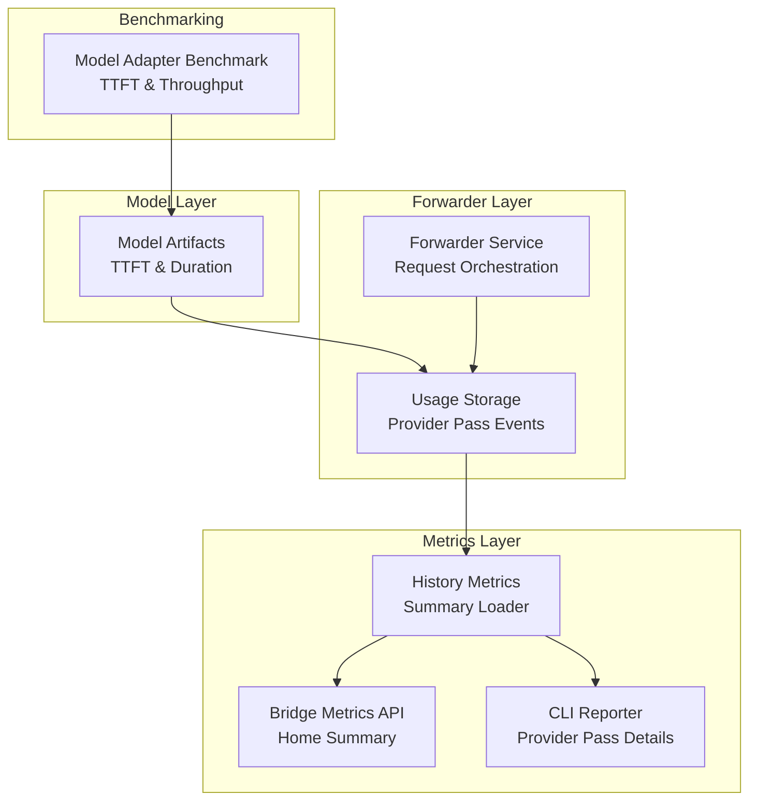
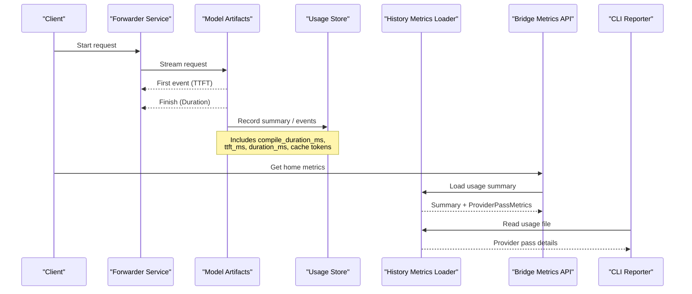
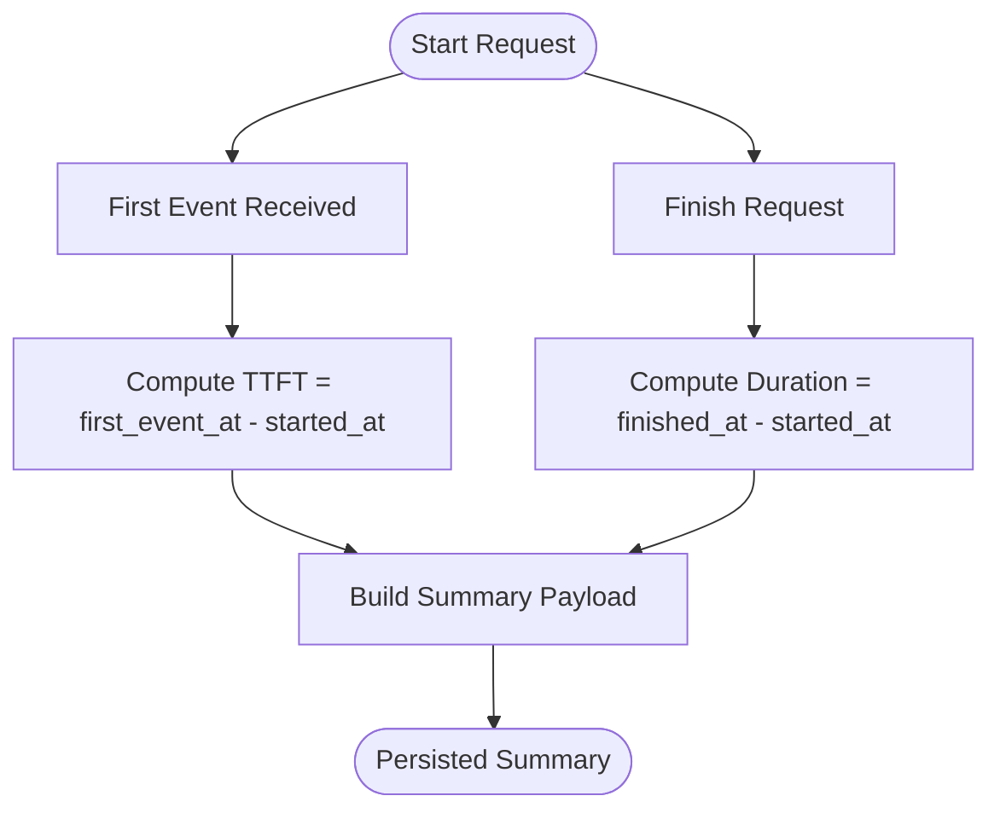
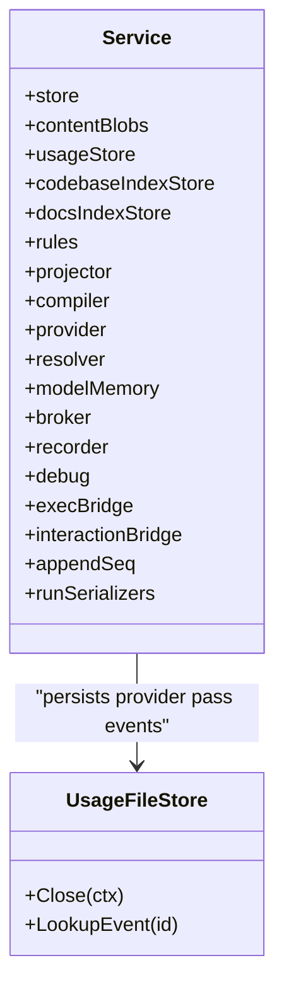
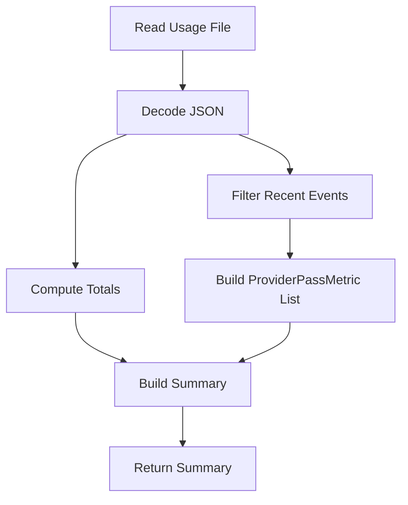
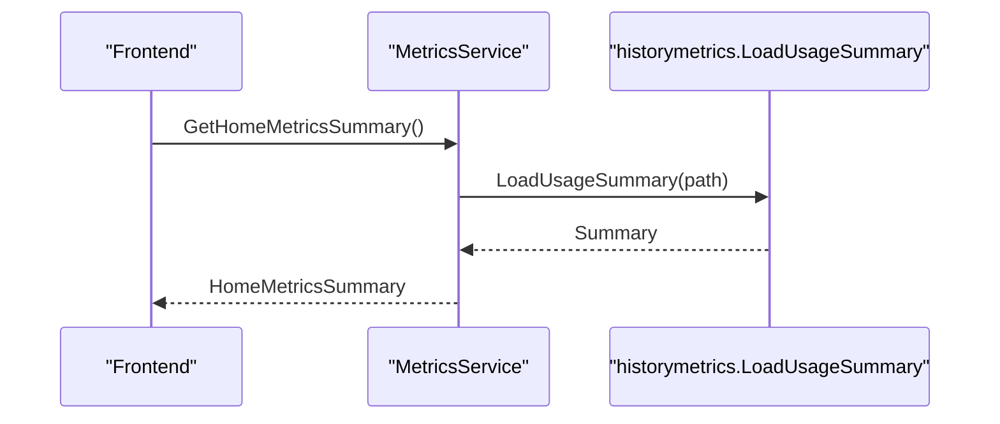
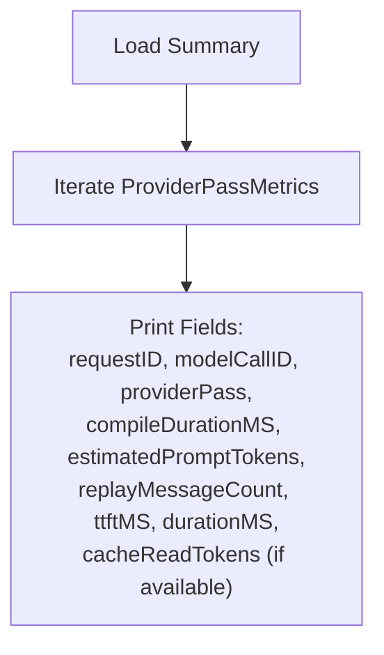
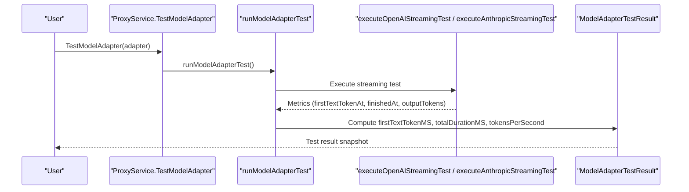
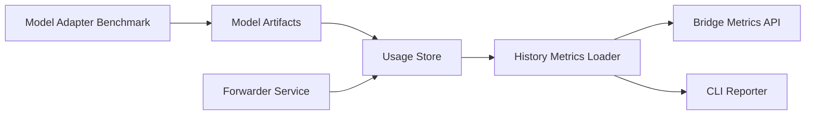

# Performance Metrics and Latency Analysis

<cite>
**Referenced Files in This Document**
- [artifacts.go](file://internal/backend/agent/model/artifacts.go)
- [service.go](file://internal/backend/forwarder/service.go)
- [latency_metrics_test.go](file://internal/backend/forwarder/latency_metrics_test.go)
- [usage_json.go](file://internal/historymetrics/usage_json.go)
- [report.go](file://internal/historymetrics/report.go)
- [metrics.go](file://internal/bridge/metrics.go)
- [main.go](file://scripts/historymetrics/main.go)
- [model_adapter_benchmark.go](file://internal/client/model_adapter_benchmark.go)
</cite>

## Table of Contents
1. [Introduction](#introduction)
2. [Project Structure](#project-structure)
3. [Core Components](#core-components)
4. [Architecture Overview](#architecture-overview)
5. [Detailed Component Analysis](#detailed-component-analysis)
6. [Dependency Analysis](#dependency-analysis)
7. [Performance Considerations](#performance-considerations)
8. [Troubleshooting Guide](#troubleshooting-guide)
9. [Conclusion](#conclusion)

## Introduction
This document explains how the system measures and reports performance for model requests, with a focus on:
- Response time measurement
- Time-to-first-token (TTFT)
- Compilation duration
- Overall request processing latency
- Metrics collection and persistence
- Benchmarking tools for adapter testing
- Guidance for interpreting latency metrics and identifying bottlenecks

The implementation is centered around artifact recording during model calls, usage event persistence, summary loading for UI and CLI consumption, and dedicated benchmarking utilities.

## Project Structure
The performance-related code spans several packages:
- Model adapter artifacts compute TTFT and total duration and record structured summaries.
- Forwarder service orchestrates request handling and integrates with usage storage.
- History metrics package loads persisted usage data into a typed summary including per-provider-pass metrics.
- Bridge exposes a home metrics API backed by history metrics.
- Scripts provide a CLI to print provider pass metrics.
- Client benchmarking tests adapters end-to-end and computes first token and throughput metrics.

**Diagram sources**
- [artifacts.go:39-77](file://internal/backend/agent/model/artifacts.go#L39-L77)
- [service.go:290-353](file://internal/backend/forwarder/service.go#L290-L353)
- [usage_json.go:36-68](file://internal/historymetrics/usage_json.go#L36-L68)
- [metrics.go:29-50](file://internal/bridge/metrics.go#L29-L50)
- [main.go:39-53](file://scripts/historymetrics/main.go#L39-L53)
- [model_adapter_benchmark.go:413-517](file://internal/client/model_adapter_benchmark.go#L413-L517)

**Section sources**
- [artifacts.go:39-77](file://internal/backend/agent/model/artifacts.go#L39-L77)
- [service.go:290-353](file://internal/backend/forwarder/service.go#L290-L353)
- [usage_json.go:36-68](file://internal/historymetrics/usage_json.go#L36-L68)
- [metrics.go:29-50](file://internal/bridge/metrics.go#L29-L50)
- [main.go:39-53](file://scripts/historymetrics/main.go#L39-L53)
- [model_adapter_benchmark.go:413-517](file://internal/client/model_adapter_benchmark.go#L413-L517)

## Core Components
- Model artifacts: Compute TTFT and total duration from timestamps and persist structured LLM summaries.
- Forwarder service: Orchestrates request lifecycle and integrates with usage storage for provider call events.
- History metrics loader: Reads usage JSON and builds a typed summary including per-provider-pass metrics.
- Bridge metrics API: Exposes a home metrics summary to the frontend.
- CLI reporter: Prints provider pass metrics including compile duration, TTFT, and duration.
- Benchmarking tool: Runs non-streaming and streaming adapter tests and computes first token latency and throughput.

Key responsibilities:
- Measure TTFT as the interval between request start and first event.
- Measure total duration as the interval between request start and finish.
- Persist provider pass events with compile duration, estimated prompt tokens, replay message count, cache read tokens, and availability flags.
- Aggregate totals and compute cache hit rate.
- Provide benchmark results with first text token latency and tokens per second.

**Section sources**
- [artifacts.go:165-187](file://internal/backend/agent/model/artifacts.go#L165-L187)
- [usage_json.go:71-117](file://internal/historymetrics/usage_json.go#L71-L117)
- [report.go:3-27](file://internal/historymetrics/report.go#L3-L27)
- [metrics.go:8-19](file://internal/bridge/metrics.go#L8-L19)
- [main.go:39-53](file://scripts/historymetrics/main.go#L39-L53)
- [model_adapter_benchmark.go:85-99](file://internal/client/model_adapter_benchmark.go#L85-L99)

## Architecture Overview
The performance pipeline records timing at the model layer, persists provider pass events, aggregates them into a summary, and exposes that summary through APIs and CLI.

**Diagram sources**
- [artifacts.go:39-77](file://internal/backend/agent/model/artifacts.go#L39-L77)
- [usage_json.go:36-68](file://internal/historymetrics/usage_json.go#L36-L68)
- [metrics.go:29-50](file://internal/bridge/metrics.go#L29-L50)
- [main.go:39-53](file://scripts/historymetrics/main.go#L39-L53)

## Detailed Component Analysis

### Model Artifacts: TTFT and Duration Measurement
- Computes TTFT from request start and first event timestamps.
- Computes total duration from request start and finish timestamps.
- Builds a structured LLM summary payload containing provider, model, timestamps, token counts, error summary, TTFT, and duration.

**Diagram sources**
- [artifacts.go:39-77](file://internal/backend/agent/model/artifacts.go#L39-L77)
- [artifacts.go:165-187](file://internal/backend/agent/model/artifacts.go#L165-L187)

**Section sources**
- [artifacts.go:39-77](file://internal/backend/agent/model/artifacts.go#L39-L77)
- [artifacts.go:165-187](file://internal/backend/agent/model/artifacts.go#L165-L187)

### Forwarder Service: Integration with Usage Storage
- The forwarder service owns orchestration of request flows and integrates with usage storage for provider call events.
- Tests assert that per-pass latency metadata (including TTFT and duration) is persisted correctly.

**Diagram sources**
- [service.go:290-353](file://internal/backend/forwarder/service.go#L290-L353)
- [latency_metrics_test.go:8-68](file://internal/backend/forwarder/latency_metrics_test.go#L8-L68)

**Section sources**
- [service.go:290-353](file://internal/backend/forwarder/service.go#L290-L353)
- [latency_metrics_test.go:8-68](file://internal/backend/forwarder/latency_metrics_test.go#L8-L68)

### History Metrics: Summary and Per-Provider-Pass Metrics
- Loads usage JSON and constructs a typed summary including totals and recent provider pass metrics.
- Filters provider_call events that include timing information (compile duration or duration).
- Extracts request ID and model call ID from event IDs.

**Diagram sources**
- [usage_json.go:36-68](file://internal/historymetrics/usage_json.go#L36-L68)
- [usage_json.go:71-117](file://internal/historymetrics/usage_json.go#L71-L117)

**Section sources**
- [usage_json.go:36-68](file://internal/historymetrics/usage_json.go#L36-L68)
- [usage_json.go:71-117](file://internal/historymetrics/usage_json.go#L71-L117)
- [report.go:3-27](file://internal/historymetrics/report.go#L3-L27)

### Bridge Metrics API: Home Summary Exposure
- Provides a Wails service method returning a home metrics summary loaded from history metrics.
- Aggregates provider calls, turns, token counts, cache reads/writes, and cache hit rate.

**Diagram sources**
- [metrics.go:29-50](file://internal/bridge/metrics.go#L29-L50)
- [usage_json.go:36-68](file://internal/historymetrics/usage_json.go#L36-L68)

**Section sources**
- [metrics.go:29-50](file://internal/bridge/metrics.go#L29-L50)

### CLI Reporter: Provider Pass Details
- Iterates over summary.ProviderPassMetrics and prints per-call details including compile duration, TTFT, duration, and cache read tokens availability.

**Diagram sources**
- [main.go:39-53](file://scripts/historymetrics/main.go#L39-L53)

**Section sources**
- [main.go:39-53](file://scripts/historymetrics/main.go#L39-L53)

### Benchmarking Tool: Adapter Test Metrics
- Executes non-streaming and streaming adapter tests.
- Captures first text token timestamp and finish timestamp.
- Computes firstTextTokenMS and totalDurationMS; estimates output tokens if not provided.
- Calculates tokensPerSecond based on output tokens and total duration.

**Diagram sources**
- [model_adapter_benchmark.go:413-517](file://internal/client/model_adapter_benchmark.go#L413-L517)
- [model_adapter_benchmark.go:520-664](file://internal/client/model_adapter_benchmark.go#L520-L664)

**Section sources**
- [model_adapter_benchmark.go:413-517](file://internal/client/model_adapter_benchmark.go#L413-L517)
- [model_adapter_benchmark.go:520-664](file://internal/client/model_adapter_benchmark.go#L520-L664)

## Dependency Analysis
- Model artifacts depend on timestamps and produce structured payloads used downstream.
- Forwarder service depends on usage store to persist provider pass events.
- History metrics loader depends on usage JSON structure and provides typed summaries.
- Bridge metrics API depends on history metrics loader.
- CLI reporter depends on history metrics loader.
- Benchmarking tool uses model adapter interfaces and produces test results.

**Diagram sources**
- [artifacts.go:39-77](file://internal/backend/agent/model/artifacts.go#L39-L77)
- [service.go:290-353](file://internal/backend/forwarder/service.go#L290-L353)
- [usage_json.go:36-68](file://internal/historymetrics/usage_json.go#L36-L68)
- [metrics.go:29-50](file://internal/bridge/metrics.go#L29-L50)
- [main.go:39-53](file://scripts/historymetrics/main.go#L39-L53)
- [model_adapter_benchmark.go:413-517](file://internal/client/model_adapter_benchmark.go#L413-L517)

**Section sources**
- [artifacts.go:39-77](file://internal/backend/agent/model/artifacts.go#L39-L77)
- [service.go:290-353](file://internal/backend/forwarder/service.go#L290-L353)
- [usage_json.go:36-68](file://internal/historymetrics/usage_json.go#L36-L68)
- [metrics.go:29-50](file://internal/bridge/metrics.go#L29-L50)
- [main.go:39-53](file://scripts/historymetrics/main.go#L39-L53)
- [model_adapter_benchmark.go:413-517](file://internal/client/model_adapter_benchmark.go#L413-L517)

## Performance Considerations
- Interpreting TTFT: Use TTFT to identify cold starts, upstream latency, or slow initial processing. Compare across providers and models to detect regressions.
- Interpreting Duration: Total duration reflects end-to-end completion time. High duration with low TTFT may indicate slow streaming or large outputs.
- Compile Duration: Indicates preprocessing overhead before provider call. Elevated values suggest prompt compilation or context building bottlenecks.
- Cache Read Tokens: When available, high cache read tokens correlate with lower TTFT and duration due to reuse of prior context.
- Benchmarking Results: Use firstTextTokenMS and tokensPerSecond to compare adapter configurations and detect performance regressions.

Optimization strategies:
- Connection pooling: Reuse HTTP connections where possible to reduce handshake overhead.
- Caching strategies: Increase effective cache hit rates by stabilizing prompts and context windows; monitor cache hit rate and cache read tokens.
- Prompt optimization: Reduce unnecessary context and tool definitions to lower compile duration.
- Streaming tuning: Tune stream idle timeouts and chunk sizes to balance responsiveness and throughput.

[No sources needed since this section provides general guidance]

## Troubleshooting Guide
Common issues and diagnostics:
- Missing or negative timestamps: TTFT and duration computations treat missing or invalid times as unavailable (zero), which can mask real latency. Validate timestamps at source.
- Unavailable cache read tokens: Some events may not include cache read usage; rely on availability flags and fallback to other indicators.
- Provider pass events not persisted: Ensure forwarder integration with usage store is active and that provider_call events include timing fields.
- Benchmark failures: Check adapter configuration, network connectivity, and provider-specific headers; review raw response and error messages.

Diagnostic steps:
- Inspect provider pass metrics via CLI to verify compile duration, TTFT, and duration presence.
- Review LLM summary artifacts for timestamps and token counts.
- Validate usage JSON structure and ensure recent_events include provider_call entries with timing.

**Section sources**
- [latency_metrics_test.go:71-79](file://internal/backend/forwarder/latency_metrics_test.go#L71-L79)
- [usage_json.go:104-117](file://internal/historymetrics/usage_json.go#L104-L117)
- [artifacts.go:165-187](file://internal/backend/agent/model/artifacts.go#L165-L187)

## Conclusion
The system measures performance through precise TTFT and duration calculations within model artifacts, persists rich provider pass events, and aggregates them into a typed summary consumed by both UI and CLI. Benchmarking utilities complement operational metrics by providing controlled tests for adapter performance. By monitoring TTFT, duration, compile duration, and cache utilization, teams can identify bottlenecks, detect regressions, and apply optimizations such as connection pooling and caching to improve overall request processing latency.

[No sources needed since this section summarizes without analyzing specific files]