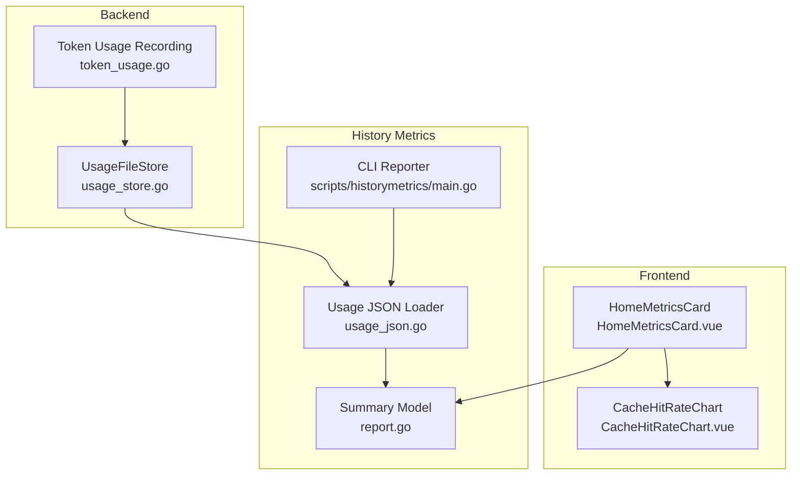
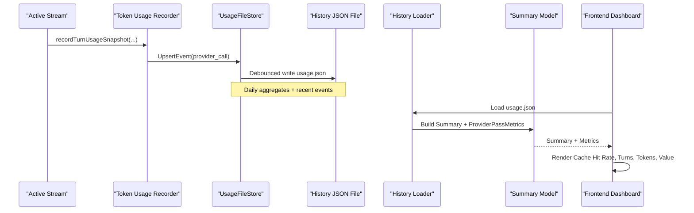
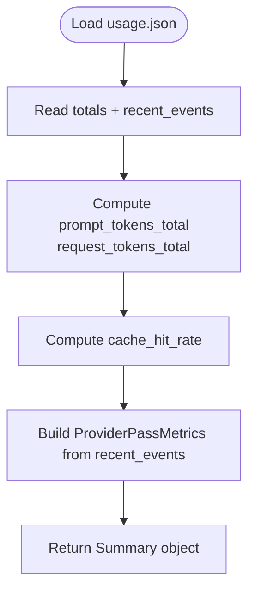
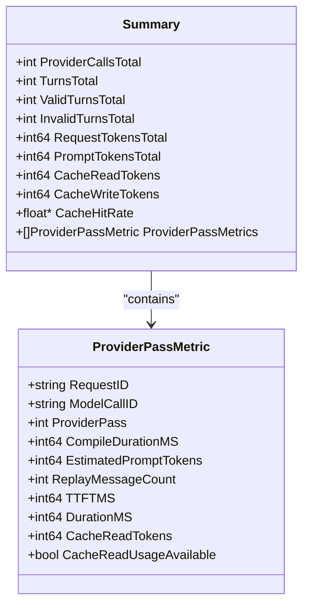
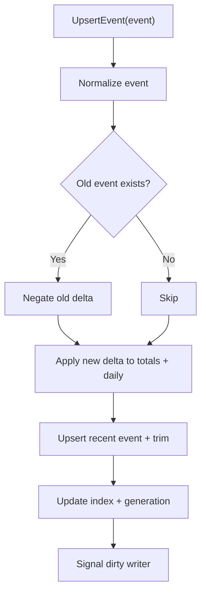
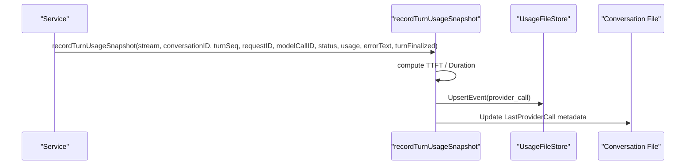
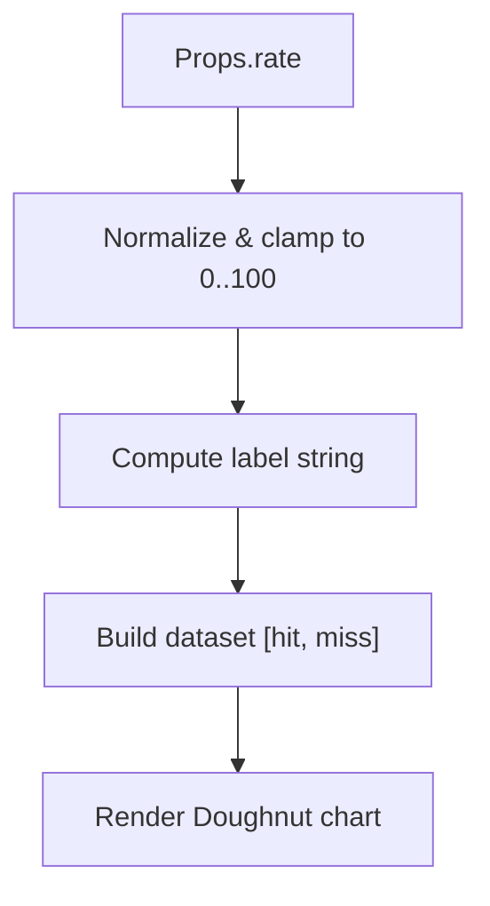
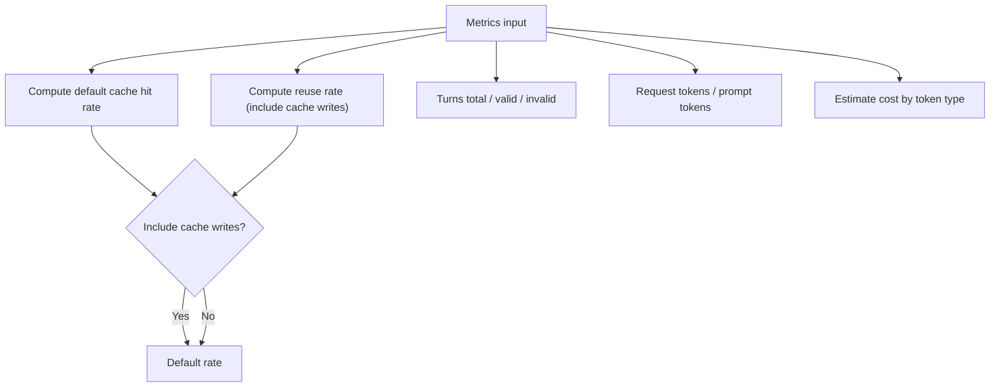
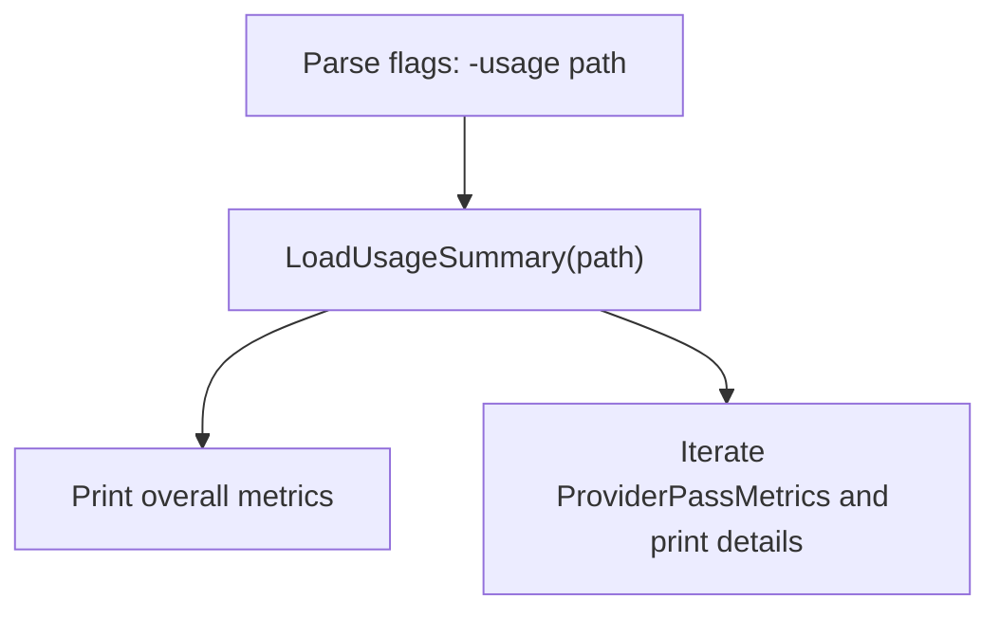
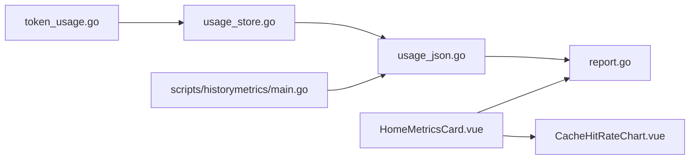

# Reporting and Analytics Dashboard

<cite>
**Referenced Files in This Document**
- [report.go](file://internal/historymetrics/report.go)
- [usage_json.go](file://internal/historymetrics/usage_json.go)
- [main.go](file://scripts/historymetrics/main.go)
- [usage_store.go](file://internal/backend/forwarder/usage_store.go)
- [token_usage.go](file://internal/backend/forwarder/token_usage.go)
- [HomeMetricsCard.vue](file://frontend/src/components/HomeMetricsCard.vue)
- [CacheHitRateChart.vue](file://frontend/src/charts/CacheHitRateChart.vue)
</cite>

## Table of Contents
1. [Introduction](#introduction)
2. [Project Structure](#project-structure)
3. [Core Components](#core-components)
4. [Architecture Overview](#architecture-overview)
5. [Detailed Component Analysis](#detailed-component-analysis)
6. [Dependency Analysis](#dependency-analysis)
7. [Performance Considerations](#performance-considerations)
8. [Troubleshooting Guide](#troubleshooting-guide)
9. [Conclusion](#conclusion)
10. [Appendices](#appendices)

## Introduction
This document explains the reporting and analytics dashboard capabilities, focusing on how usage data is collected, summarized, visualized, and exported. It covers:
- Summary report structure and provider pass metrics
- Aggregated statistics such as cache hit rate, token consumption, and turn counts
- Frontend visualization components for cache hit rate and performance dashboards
- Export formats and command-line tooling for external analysis
- Guidance for scheduled reports, custom metric calculations, optimization insights, and business intelligence integration
- Data retention policies, privacy considerations, and compliance guidance for sensitive information handling

## Project Structure
The reporting and analytics pipeline spans backend event ingestion, usage file persistence, summary parsing, a CLI export tool, and frontend visualization components.

**Diagram sources**
- [usage_store.go:16-26](file://internal/backend/forwarder/usage_store.go#L16-L26)
- [usage_store.go:110-131](file://internal/backend/forwarder/usage_store.go#L110-L131)
- [usage_store.go:133-157](file://internal/backend/forwarder/usage_store.go#L133-L157)
- [token_usage.go:322-409](file://internal/backend/forwarder/token_usage.go#L322-L409)
- [usage_json.go:36-69](file://internal/historymetrics/usage_json.go#L36-L69)
- [report.go:3-14](file://internal/historymetrics/report.go#L3-L14)
- [main.go:13-54](file://scripts/historymetrics/main.go#L13-L54)
- [HomeMetricsCard.vue:18-39](file://frontend/src/components/HomeMetricsCard.vue#L18-L39)
- [CacheHitRateChart.vue:12-17](file://frontend/src/charts/CacheHitRateChart.vue#L12-L17)

**Section sources**
- [usage_store.go:16-26](file://internal/backend/forwarder/usage_store.go#L16-L26)
- [usage_store.go:110-131](file://internal/backend/forwarder/usage_store.go#L110-L131)
- [token_usage.go:322-409](file://internal/backend/forwarder/token_usage.go#L322-L409)
- [usage_json.go:36-69](file://internal/historymetrics/usage_json.go#L36-L69)
- [report.go:3-14](file://internal/historymetrics/report.go#L3-L14)
- [main.go:13-54](file://scripts/historymetrics/main.go#L13-L54)
- [HomeMetricsCard.vue:18-39](file://frontend/src/components/HomeMetricsCard.vue#L18-L39)
- [CacheHitRateChart.vue:12-17](file://frontend/src/charts/CacheHitRateChart.vue#L12-L17)

## Core Components
- Summary model and provider pass metrics: Defines the high-level summary fields and per-call metrics used by both CLI and UI.
- Usage JSON loader: Reads the persisted usage file, computes totals, recent events, and derived metrics like cache hit rate.
- Usage store: Persists usage events and daily aggregates to a local JSON file with debounced writes and an event index.
- Token usage recording: Emits usage events from active streams and turns, including timing and cache usage signals.
- CLI reporter: Prints structured usage summaries and provider pass details for external tools or logs.
- Frontend dashboard: Displays cache hit rate, conversation turns, token consumption, and estimated value; supports alternative cache hit rate calculation modes.

Key responsibilities:
- Backend collects granular events and persists them efficiently.
- History metrics layer converts raw events into a stable summary format.
- Frontend renders actionable metrics and allows toggling cache hit rate computation.

**Section sources**
- [report.go:3-27](file://internal/historymetrics/report.go#L3-L27)
- [usage_json.go:36-69](file://internal/historymetrics/usage_json.go#L36-L69)
- [usage_store.go:110-157](file://internal/backend/forwarder/usage_store.go#L110-L157)
- [token_usage.go:322-409](file://internal/backend/forwarder/token_usage.go#L322-L409)
- [main.go:13-54](file://scripts/historymetrics/main.go#L13-L54)
- [HomeMetricsCard.vue:90-145](file://frontend/src/components/HomeMetricsCard.vue#L90-L145)
- [CacheHitRateChart.vue:12-33](file://frontend/src/charts/CacheHitRateChart.vue#L12-L33)

## Architecture Overview
The system follows a clear separation between event collection, persistence, summarization, and visualization.

**Diagram sources**
- [token_usage.go:322-409](file://internal/backend/forwarder/token_usage.go#L322-L409)
- [usage_store.go:133-157](file://internal/backend/forwarder/usage_store.go#L133-L157)
- [usage_store.go:230-301](file://internal/backend/forwarder/usage_store.go#L230-L301)
- [usage_json.go:36-69](file://internal/historymetrics/usage_json.go#L36-L69)
- [report.go:3-14](file://internal/historymetrics/report.go#L3-L14)
- [HomeMetricsCard.vue:291-396](file://frontend/src/components/HomeMetricsCard.vue#L291-L396)

## Detailed Component Analysis

### Summary Report Structure and Aggregated Statistics
The summary model provides:
- Overall counters: provider calls, total turns, valid/invalid turns
- Token accounting: request tokens, prompt tokens, cache read/write tokens
- Derived metrics: optional cache hit rate
- Per-call breakdown: provider pass metrics with timing and cache availability

Aggregation logic:
- Totals are computed from persisted usage events.
- Prompt tokens include input plus cache reads/writes.
- Request tokens equal prompt tokens plus output tokens.
- Cache hit rate is computed from cache read tokens relative to input plus cache reads.

**Diagram sources**
- [usage_json.go:36-69](file://internal/historymetrics/usage_json.go#L36-L69)
- [report.go:38-45](file://internal/historymetrics/report.go#L38-L45)

**Section sources**
- [report.go:3-27](file://internal/historymetrics/report.go#L3-L27)
- [usage_json.go:36-69](file://internal/historymetrics/usage_json.go#L36-L69)

### Provider Pass Metrics
Provider pass metrics capture per-call details:
- Identifiers: request ID and model call ID
- Provider pass count and compile duration
- Estimated prompt tokens and replay message count
- Time-to-first-token (TTFT) and total duration
- Cache read tokens and whether cache usage is available

These metrics are filtered from recent events where timing data is present.

**Diagram sources**
- [report.go:3-27](file://internal/historymetrics/report.go#L3-L27)

**Section sources**
- [report.go:16-27](file://internal/historymetrics/report.go#L16-L27)
- [usage_json.go:71-101](file://internal/historymetrics/usage_json.go#L71-L101)

### Usage Persistence and Event Indexing
The usage store:
- Persists a schema-versioned document with totals, daily aggregates, and recent events
- Maintains an event index for fast lookups and aggregation
- Debounces writes and retries on failure
- Trims recent events to a fixed limit

**Diagram sources**
- [usage_store.go:133-157](file://internal/backend/forwarder/usage_store.go#L133-L157)
- [usage_store.go:230-301](file://internal/backend/forwarder/usage_store.go#L230-L301)
- [usage_store.go:391-408](file://internal/backend/forwarder/usage_store.go#L391-L408)

**Section sources**
- [usage_store.go:16-26](file://internal/backend/forwarder/usage_store.go#L16-L26)
- [usage_store.go:110-157](file://internal/backend/forwarder/usage_store.go#L110-L157)
- [usage_store.go:230-301](file://internal/backend/forwarder/usage_store.go#L230-L301)
- [usage_store.go:391-408](file://internal/backend/forwarder/usage_store.go#L391-L408)

### Token Usage Recording Flow
Token usage recording captures per-call metrics and updates conversation metadata:
- Computes TTFT and duration from timestamps
- Persists provider_call events with cache and timing signals
- Updates last provider call metadata for the conversation

**Diagram sources**
- [token_usage.go:322-409](file://internal/backend/forwarder/token_usage.go#L322-L409)

**Section sources**
- [token_usage.go:322-409](file://internal/backend/forwarder/token_usage.go#L322-L409)

### Frontend Visualization Components

#### Cache Hit Rate Chart
The chart component:
- Accepts a normalized rate and clamps it to 0–100%
- Renders a doughnut-like visualization with labeled percentage
- Provides accessibility labels and responsive sizing

**Diagram sources**
- [CacheHitRateChart.vue:12-33](file://frontend/src/charts/CacheHitRateChart.vue#L12-L33)
- [CacheHitRateChart.vue:75-107](file://frontend/src/charts/CacheHitRateChart.vue#L75-L107)

**Section sources**
- [CacheHitRateChart.vue:12-33](file://frontend/src/charts/CacheHitRateChart.vue#L12-L33)
- [CacheHitRateChart.vue:75-107](file://frontend/src/charts/CacheHitRateChart.vue#L75-L107)

#### Home Metrics Card
The home metrics card displays:
- Cache hit rate with two calculation modes: default and including cache writes
- Conversation turns with valid/invalid breakdown
- Token consumption with prompt vs output derivation
- Estimated value based on token pricing assumptions

It also exposes tooltips explaining formulas and values.

**Diagram sources**
- [HomeMetricsCard.vue:90-145](file://frontend/src/components/HomeMetricsCard.vue#L90-L145)
- [HomeMetricsCard.vue:147-196](file://frontend/src/components/HomeMetricsCard.vue#L147-L196)
- [HomeMetricsCard.vue:291-396](file://frontend/src/components/HomeMetricsCard.vue#L291-L396)

**Section sources**
- [HomeMetricsCard.vue:90-145](file://frontend/src/components/HomeMetricsCard.vue#L90-L145)
- [HomeMetricsCard.vue:147-196](file://frontend/src/components/HomeMetricsCard.vue#L147-L196)
- [HomeMetricsCard.vue:291-396](file://frontend/src/components/HomeMetricsCard.vue#L291-L396)

### Export Formats and CLI Tooling
The CLI tool reads the usage JSON file and prints:
- Overall metrics: provider calls, turns, cache hit rate, cache tokens, prompt/request tokens
- Provider pass details: identifiers, pass count, compile duration, estimated prompt tokens, replay messages, TTFT, duration, cache read availability

This output can be consumed by external analysis tools or logged for auditing.

**Diagram sources**
- [main.go:13-54](file://scripts/historymetrics/main.go#L13-L54)
- [usage_json.go:36-69](file://internal/historymetrics/usage_json.go#L36-L69)

**Section sources**
- [main.go:13-54](file://scripts/historymetrics/main.go#L13-L54)
- [usage_json.go:36-69](file://internal/historymetrics/usage_json.go#L36-L69)

## Dependency Analysis
The following diagram shows key dependencies among modules:

**Diagram sources**
- [token_usage.go:322-409](file://internal/backend/forwarder/token_usage.go#L322-L409)
- [usage_store.go:133-157](file://internal/backend/forwarder/usage_store.go#L133-L157)
- [usage_json.go:36-69](file://internal/historymetrics/usage_json.go#L36-L69)
- [report.go:3-14](file://internal/historymetrics/report.go#L3-L14)
- [main.go:13-54](file://scripts/historymetrics/main.go#L13-L54)
- [HomeMetricsCard.vue:18-39](file://frontend/src/components/HomeMetricsCard.vue#L18-L39)
- [CacheHitRateChart.vue:12-17](file://frontend/src/charts/CacheHitRateChart.vue#L12-L17)

**Section sources**
- [token_usage.go:322-409](file://internal/backend/forwarder/token_usage.go#L322-L409)
- [usage_store.go:133-157](file://internal/backend/forwarder/usage_store.go#L133-L157)
- [usage_json.go:36-69](file://internal/historymetrics/usage_json.go#L36-L69)
- [report.go:3-14](file://internal/historymetrics/report.go#L3-L14)
- [main.go:13-54](file://scripts/historymetrics/main.go#L13-L54)
- [HomeMetricsCard.vue:18-39](file://frontend/src/components/HomeMetricsCard.vue#L18-L39)
- [CacheHitRateChart.vue:12-17](file://frontend/src/charts/CacheHitRateChart.vue#L12-L17)

## Performance Considerations
- Debounced writes: The usage store batches updates to reduce disk I/O and contention.
- Recent event limit: Keeps the recent events array bounded to control memory and file size.
- Event indexing: An in-memory index accelerates lookups and aggregations.
- Frontend rendering: The cache hit rate chart uses minimal datasets and disables heavy plugins for responsiveness.

Recommendations:
- Monitor disk latency and adjust debounce intervals if needed.
- Periodically archive or rotate usage files to prevent unbounded growth.
- Use the CLI tool for batch processing rather than frequent UI refreshes.

[No sources needed since this section provides general guidance]

## Troubleshooting Guide
Common issues and resolutions:
- Missing usage file: The loader returns an empty summary when the file does not exist. Ensure the history directory is initialized and the service has written at least one event.
- Corrupted usage file: Decoding errors will surface; verify JSON integrity and schema version compatibility.
- No provider pass metrics: Events without timing data are filtered out. Confirm that provider calls emit compile or duration metrics.
- Low cache hit rate: Check whether cache reads are reported and consider enabling the “include cache writes” mode to evaluate reuse efficiency.
- High token costs: Review prompt sizes and cache effectiveness; optimize prompts and leverage caching strategies.

Operational checks:
- Validate the usage file path passed to the CLI tool.
- Inspect recent events to confirm provider_call entries with timing fields.
- Verify that daily aggregates are being updated as expected.

**Section sources**
- [usage_json.go:36-47](file://internal/historymetrics/usage_json.go#L36-L47)
- [usage_json.go:71-101](file://internal/historymetrics/usage_json.go#L71-L101)
- [main.go:13-54](file://scripts/historymetrics/main.go#L13-L54)
- [HomeMetricsCard.vue:147-196](file://frontend/src/components/HomeMetricsCard.vue#L147-L196)

## Conclusion
The reporting and analytics dashboard integrates backend event collection, robust usage persistence, a stable summary model, and intuitive frontend visualizations. It enables users to understand cache effectiveness, token consumption, and performance characteristics while providing exportable outputs for external analysis. By leveraging the provided tools and understanding the underlying data structures, teams can identify optimization opportunities, integrate with BI systems, and maintain responsible data practices.

[No sources needed since this section summarizes without analyzing specific files]

## Appendices

### Generating Usage Reports
- Run the CLI tool with the usage file path to print overall metrics and provider pass details.
- Capture the output for external analysis or log archival.

Example steps:
- Locate the usage JSON file path.
- Execute the CLI with the appropriate flag pointing to the usage file.
- Parse the printed output for downstream processing.

**Section sources**
- [main.go:13-54](file://scripts/historymetrics/main.go#L13-L54)

### Interpreting Analytics Data for Optimization
- Cache hit rate: Higher rates indicate effective reuse; consider prompt normalization and caching strategies.
- Turn quality: Track valid vs invalid turns to improve conversation flows and error handling.
- Token distribution: Analyze prompt vs output ratios to refine prompting and model selection.
- Performance: Use TTFT and duration metrics to identify slow providers or bottlenecks.

**Section sources**
- [HomeMetricsCard.vue:90-145](file://frontend/src/components/HomeMetricsCard.vue#L90-L145)
- [report.go:3-27](file://internal/historymetrics/report.go#L3-L27)

### Integrating with Business Intelligence Tools
- Use the CLI output as a structured text source for ingestion pipelines.
- Map summary fields to BI dimensions and measures (e.g., provider calls, turns, tokens, cache hit rate).
- Schedule periodic runs to build time-series datasets for trend analysis.

[No sources needed since this section provides general guidance]

### Data Retention Policies
- Recent events are trimmed to a fixed limit to bound storage.
- Daily aggregates provide historical summaries without retaining every event indefinitely.
- Consider archiving older usage files and rotating current ones.

**Section sources**
- [usage_store.go:391-396](file://internal/backend/forwarder/usage_store.go#L391-L396)

### Privacy and Compliance Considerations
- Usage data may contain identifiers and timing information; treat it as potentially sensitive.
- Avoid exporting raw conversation content unless explicitly required and authorized.
- Apply access controls and encryption for stored usage files.
- Align retention and deletion practices with organizational policies and applicable regulations.

[No sources needed since this section provides general guidance]