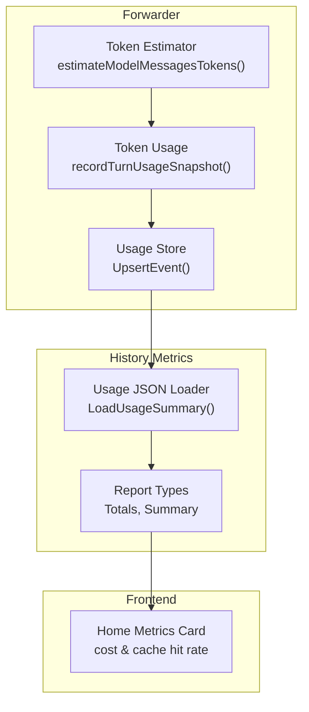
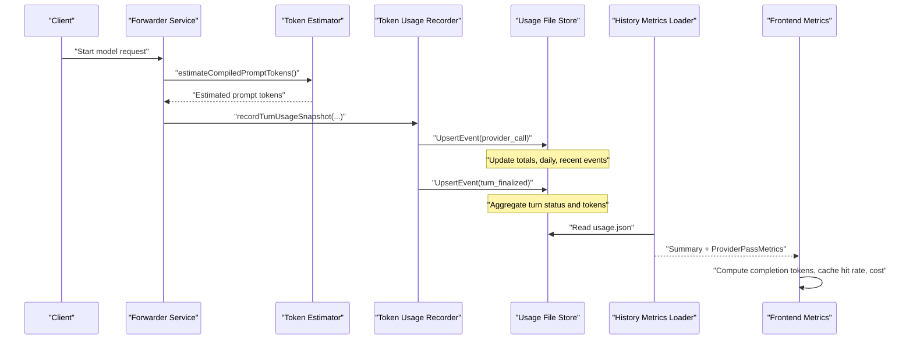
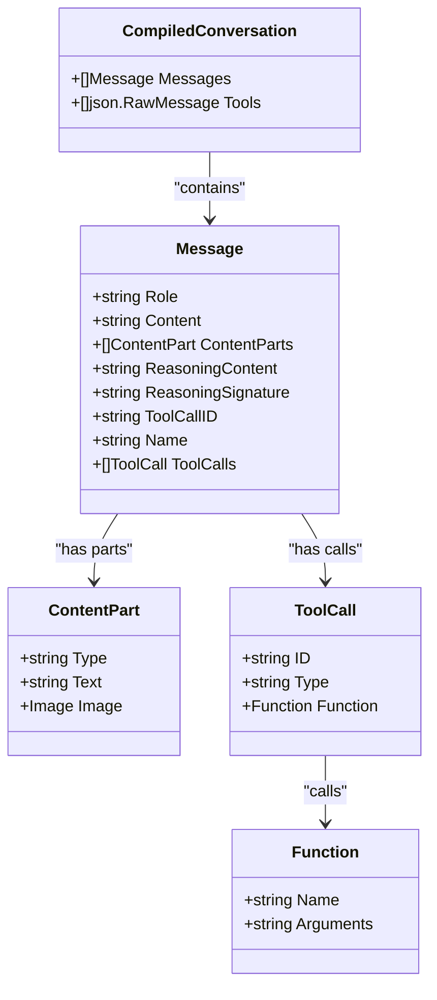
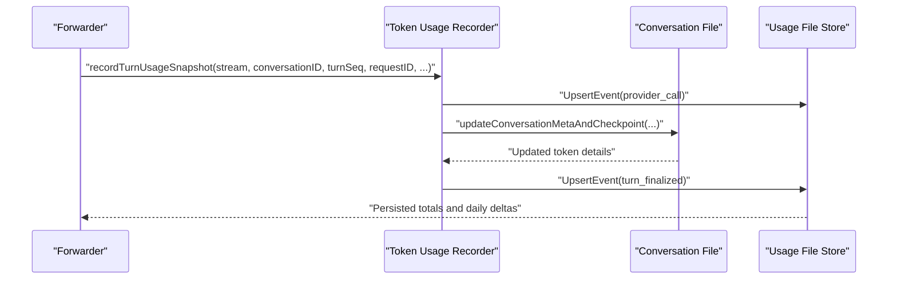
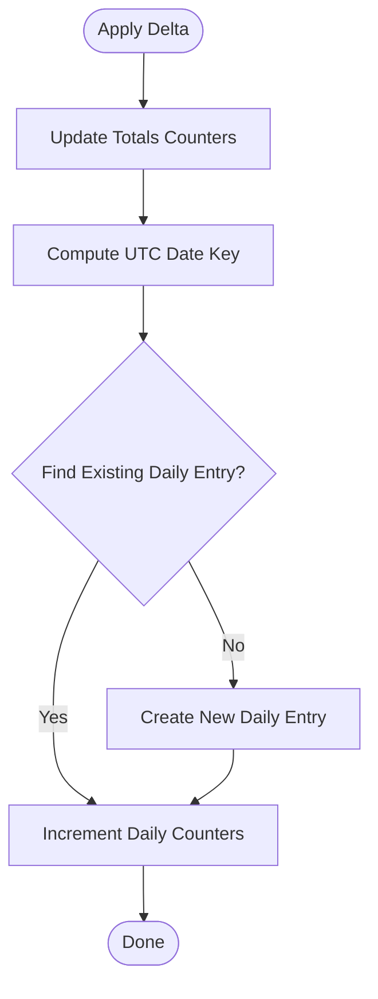
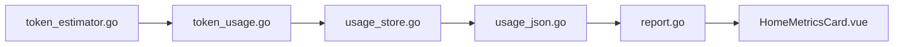

# Usage Tracking and Token Management

<cite>
**Referenced Files in This Document**
- [token_estimator.go](file://internal/backend/forwarder/token_estimator.go)
- [token_usage.go](file://internal/backend/forwarder/token_usage.go)
- [usage_store.go](file://internal/backend/forwarder/usage_store.go)
- [report.go](file://internal/historymetrics/report.go)
- [usage_json.go](file://internal/historymetrics/usage_json.go)
- [main.go](file://scripts/historymetrics/main.go)
- [HomeMetricsCard.vue](file://frontend/src/components/HomeMetricsCard.vue)
</cite>

## Table of Contents
1. [Introduction](#introduction)
2. [Project Structure](#project-structure)
3. [Core Components](#core-components)
4. [Architecture Overview](#architecture-overview)
5. [Detailed Component Analysis](#detailed-component-analysis)
6. [Dependency Analysis](#dependency-analysis)
7. [Performance Considerations](#performance-considerations)
8. [Troubleshooting Guide](#troubleshooting-guide)
9. [Conclusion](#conclusion)
10. [Appendices](#appendices)

## Introduction
This document explains how the system tracks token consumption across providers, estimates prompt tokens, records usage metrics, aggregates them over time, and computes cost implications. It focuses on:
- Request tokens, prompt tokens, cache read/write tokens, and output tokens
- Token estimation algorithms for compiled prompts and messages
- Caching mechanisms that affect token usage and how cache hit rates are calculated
- Data structures used to store usage metrics
- Aggregation strategies for totals and daily periods
- Methods for interpreting usage reports and optimizing usage through caching

## Project Structure
The usage tracking and token management capabilities span several layers:
- Forwarder layer: collects per-request usage snapshots, updates conversation metadata, and persists events
- Storage layer: maintains an in-memory document with totals, daily breakdowns, recent events, and an event index
- History metrics layer: reads persisted usage data and produces a summary including cache hit rate
- Frontend layer: visualizes metrics, calculates derived values like completion tokens and estimated cost, and offers two cache hit rate modes

**Diagram sources**
- [token_estimator.go:23-51](file://internal/backend/forwarder/token_estimator.go#L23-L51)
- [token_usage.go:322-410](file://internal/backend/forwarder/token_usage.go#L322-L410)
- [usage_store.go:133-157](file://internal/backend/forwarder/usage_store.go#L133-L157)
- [usage_json.go:36-69](file://internal/historymetrics/usage_json.go#L36-L69)
- [report.go:3-45](file://internal/historymetrics/report.go#L3-L45)
- [HomeMetricsCard.vue:11-16](file://frontend/src/components/HomeMetricsCard.vue#L11-L16)

**Section sources**
- [token_estimator.go:1-513](file://internal/backend/forwarder/token_estimator.go#L1-L513)
- [token_usage.go:1-500](file://internal/backend/forwarder/token_usage.go#L1-L500)
- [usage_store.go:1-504](file://internal/backend/forwarder/usage_store.go#L1-L504)
- [report.go:1-46](file://internal/historymetrics/report.go#L1-L46)
- [usage_json.go:1-136](file://internal/historymetrics/usage_json.go#L1-L136)
- [main.go:1-86](file://scripts/historymetrics/main.go#L1-L86)
- [HomeMetricsCard.vue:1-200](file://frontend/src/components/HomeMetricsCard.vue#L1-L200)

## Core Components
- Token estimator: estimates prompt tokens from compiled conversations, messages, tool descriptors, and content parts; supports detailed breakdown by category (system prompt, tools, rules, skills, MCP, subagents, summarized conversation, conversation).
- Token usage recorder: builds turn-level snapshots with provider/model identifiers, input/output/cache tokens, timing, and estimated prompt tokens; persists provider-call and turn-finalized events.
- Usage file store: maintains totals, daily aggregations, recent events, and an event index; writes asynchronously with debouncing and retry.
- History metrics loader: reads the persisted usage file and produces a summary with totals, cache hit rate, and per-provider-pass metrics.
- Frontend metrics card: derives completion tokens, input tokens, cache hit rate (two modes), and estimated cost using fixed per-million pricing constants.

**Section sources**
- [token_estimator.go:23-51](file://internal/backend/forwarder/token_estimator.go#L23-L51)
- [token_usage.go:15-52](file://internal/backend/forwarder/token_usage.go#L15-L52)
- [usage_store.go:28-96](file://internal/backend/forwarder/usage_store.go#L28-L96)
- [usage_json.go:36-69](file://internal/historymetrics/usage_json.go#L36-L69)
- [HomeMetricsCard.vue:11-16](file://frontend/src/components/HomeMetricsCard.vue#L11-L16)

## Architecture Overview
The flow starts when a model request is processed. The forwarder estimates prompt tokens, records provider call usage, and persists events. The history metrics loader reads the persisted usage file to compute summaries and cache hit rate. The frontend renders these metrics and provides cost estimations.

**Diagram sources**
- [token_estimator.go:23-25](file://internal/backend/forwarder/token_estimator.go#L23-L25)
- [token_usage.go:322-410](file://internal/backend/forwarder/token_usage.go#L322-L410)
- [usage_store.go:133-157](file://internal/backend/forwarder/usage_store.go#L133-L157)
- [usage_json.go:36-69](file://internal/historymetrics/usage_json.go#L36-L69)
- [HomeMetricsCard.vue:127-145](file://frontend/src/components/HomeMetricsCard.vue#L127-L145)

## Detailed Component Analysis

### Token Estimation Algorithms
The estimator computes prompt token counts from compiled conversations and messages:
- Message overhead and text tokenization: each message has a base overhead; text tokens are estimated from UTF-8 rune count plus newline adjustments.
- Content parts: text parts reuse text estimation; image parts use a fixed estimate plus metadata fields.
- Tool calls: each tool call adds overhead and includes function name and arguments.
- Breakdown categories: system prompt, tools, rules, skills, MCP, subagents, summarized conversation, conversation; the estimator measures character counts and overhead per category and fits estimates to match total used tokens when available.

Key behaviors:
- `estimateModelMessageTokens` accumulates role, content, reasoning fields, tool call metadata, and content parts.
- `estimateTextTokens` normalizes empty strings and applies a simple formula based on runes and newlines.
- `estimateCheckpointPromptTokenBreakdown` maps measured categories into a structured snapshot and adjusts distribution to fit effective used tokens.

Complexity considerations:
- Linear scan over messages and content parts.
- Tag scanning for breakdown categories uses string search and sorting ranges; overall linear-ish with respect to prompt size.

Optimization opportunities:
- Avoid repeated string trimming and counting where possible.
- Cache intermediate measurements for repeated compilation paths.

Error handling:
- Empty or malformed content returns zero tokens safely.
- JSON marshaling fallback to string representation for context items.

**Section sources**
- [token_estimator.go:23-51](file://internal/backend/forwarder/token_estimator.go#L23-L51)
- [token_estimator.go:73-88](file://internal/backend/forwarder/token_estimator.go#L73-L88)
- [token_estimator.go:90-134](file://internal/backend/forwarder/token_estimator.go#L90-L134)
- [token_estimator.go:136-160](file://internal/backend/forwarder/token_estimator.go#L136-L160)
- [token_estimator.go:232-322](file://internal/backend/forwarder/token_estimator.go#L232-L322)
- [token_estimator.go:324-362](file://internal/backend/forwarder/token_estimator.go#L324-L362)
- [token_estimator.go:374-411](file://internal/backend/forwarder/token_estimator.go#L374-L411)
- [token_estimator.go:413-502](file://internal/backend/forwarder/token_estimator.go#L413-L502)

#### Class Diagram: Token Estimator Structures

**Diagram sources**
- [token_estimator.go:23-51](file://internal/backend/forwarder/token_estimator.go#L23-L51)
- [token_estimator.go:90-134](file://internal/backend/forwarder/token_estimator.go#L90-L134)

### Token Usage Recording and Persistence
The recorder builds a turn usage snapshot containing:
- Provider and model identifiers
- Input tokens, output tokens, cache read/write tokens
- Flags indicating whether usage fields were present
- Timing metrics (compile duration, TTFT, duration)
- Estimated prompt tokens and replay message count

It then:
- Updates conversation metadata (used tokens, max tokens, auto-compaction state)
- Persists provider-call events and turn-finalized events via the usage store
- Normalizes negative values and clamps integers to safe ranges

Data flows:
- `updateConversationTokenState` updates conversation-level token details and compaction flags.
- `recordTurnUsageSnapshot` persists provider-call events and conversation last provider call metadata.
- `recordTurnFinalizedSnapshot` persists turn-finalized events with aggregated token values.

Aggregation strategy:
- Totals include provider calls, turns (total/valid/invalid), input/output/cache tokens, and total tokens.
- Daily aggregation groups by date and increments counters accordingly.

Persistence characteristics:
- Debounced writer with retry delay.
- Recent events trimmed to a limit.
- Event index for fast lookup and aggregation.

**Section sources**
- [token_usage.go:15-52](file://internal/backend/forwarder/token_usage.go#L15-L52)
- [token_usage.go:244-273](file://internal/backend/forwarder/token_usage.go#L244-L273)
- [token_usage.go:284-320](file://internal/backend/forwarder/token_usage.go#L284-L320)
- [token_usage.go:322-410](file://internal/backend/forwarder/token_usage.go#L322-L410)
- [token_usage.go:423-447](file://internal/backend/forwarder/token_usage.go#L423-L447)
- [usage_store.go:133-157](file://internal/backend/forwarder/usage_store.go#L133-L157)
- [usage_store.go:456-496](file://internal/backend/forwarder/usage_store.go#L456-L496)

#### Sequence Diagram: Turn Usage Recording

**Diagram sources**
- [token_usage.go:322-410](file://internal/backend/forwarder/token_usage.go#L322-L410)
- [usage_store.go:133-157](file://internal/backend/forwarder/usage_store.go#L133-L157)

### Usage Data Structures and Aggregation
The usage store defines:
- `usageFileDocument`: schema version, updated timestamp, totals, daily list, recent events
- `usageFileTotals`: provider calls, turns, valid/invalid turns, input/output/cache tokens, total tokens
- `usageFileDaily`: same counters grouped by date
- `usageFileEvent`: per-event token counts, flags, timing, and availability indicators
- `usageFileDelta`: internal delta structure for applying changes atomically

Aggregation logic:
- `applyUsageFileDelta` updates both totals and the matching daily entry by date.
- `normalizeUsageFileEvent` ensures non-negative token counts and computes total tokens.
- `buildUsageEventIndex` indexes recent events by event ID for fast lookup.
- `LookupEvent` aggregates multiple events sharing a prefix (e.g., request ID and model call ID).

Time period aggregation:
- Totals accumulate across all events.
- Daily entries group by UTC date and increment counters.

**Section sources**
- [usage_store.go:28-96](file://internal/backend/forwarder/usage_store.go#L28-L96)
- [usage_store.go:311-326](file://internal/backend/forwarder/usage_store.go#L311-L326)
- [usage_store.go:456-496](file://internal/backend/forwarder/usage_store.go#L456-L496)
- [usage_store.go:159-198](file://internal/backend/forwarder/usage_store.go#L159-L198)

#### Flowchart: Delta Application and Daily Aggregation

**Diagram sources**
- [usage_store.go:456-496](file://internal/backend/forwarder/usage_store.go#L456-L496)

### Cache Hit Rate Calculation
Cache hit rate is computed from totals:
- Default mode: cache read tokens divided by (cache read tokens + input tokens)
- Alternative mode: cache read tokens divided by (cache read tokens + cache write tokens + input tokens)

The backend report type exposes a helper to compute default cache hit rate from totals. The frontend provides both modes and labels them accordingly.

Interpretation:
- A higher cache hit rate indicates more reuse of cached prefixes, reducing non-cached input tokens.
- Including cache writes in the denominator reflects the cost of creating cache entries alongside reusing them.

**Section sources**
- [report.go:38-45](file://internal/historymetrics/report.go#L38-L45)
- [HomeMetricsCard.vue:98-113](file://frontend/src/components/HomeMetricsCard.vue#L98-L113)

### Cost Implications and Pricing Models
The frontend computes estimated costs using fixed per-million pricing constants:
- Input tokens price per million
- Output tokens price per million
- Cache read tokens price per million
- Cache write tokens price per million

Derived metrics:
- Completion tokens = request tokens - prompt tokens
- Input tokens = prompt tokens - cache read tokens - cache write tokens
- Estimated cost components sum input, output, cache read, and cache write costs

Note: These prices are illustrative defaults in the frontend and not sourced from provider pricing APIs. They provide a consistent baseline for estimating value.

**Section sources**
- [HomeMetricsCard.vue:11-16](file://frontend/src/components/HomeMetricsCard.vue#L11-L16)
- [HomeMetricsCard.vue:127-145](file://frontend/src/components/HomeMetricsCard.vue#L127-L145)
- [HomeMetricsCard.vue:184-195](file://frontend/src/components/HomeMetricsCard.vue#L184-L195)

### Interpreting Usage Reports
The CLI tool prints:
- Overall totals: provider calls, turns, cache hit rate, cache read/write tokens, prompt tokens total, request tokens total
- Per provider pass: request/model call IDs, provider pass count, compile duration, estimated prompt tokens, replay message count, TTFT, duration, cache read tokens availability

Guidance:
- Use provider pass metrics to identify slow requests, high compile durations, or low cache read availability.
- Compare prompt tokens vs request tokens to understand output volume.
- Track cache hit rate trends to evaluate caching effectiveness.

**Section sources**
- [main.go:13-54](file://scripts/historymetrics/main.go#L13-L54)
- [usage_json.go:36-69](file://internal/historymetrics/usage_json.go#L36-L69)

## Dependency Analysis
The following diagram shows dependencies between core modules involved in usage tracking and token management.

**Diagram sources**
- [token_estimator.go:1-15](file://internal/backend/forwarder/token_estimator.go#L1-L15)
- [token_usage.go:1-13](file://internal/backend/forwarder/token_usage.go#L1-L13)
- [usage_store.go:1-14](file://internal/backend/forwarder/usage_store.go#L1-L14)
- [usage_json.go:1-8](file://internal/historymetrics/usage_json.go#L1-L8)
- [report.go:1-46](file://internal/historymetrics/report.go#L1-L46)
- [HomeMetricsCard.vue:1-16](file://frontend/src/components/HomeMetricsCard.vue#L1-L16)

**Section sources**
- [token_estimator.go:1-15](file://internal/backend/forwarder/token_estimator.go#L1-L15)
- [token_usage.go:1-13](file://internal/backend/forwarder/token_usage.go#L1-L13)
- [usage_store.go:1-14](file://internal/backend/forwarder/usage_store.go#L1-L14)
- [usage_json.go:1-8](file://internal/historymetrics/usage_json.go#L1-L8)
- [report.go:1-46](file://internal/historymetrics/report.go#L1-L46)
- [HomeMetricsCard.vue:1-16](file://frontend/src/components/HomeMetricsCard.vue#L1-L16)

## Performance Considerations
- Token estimation scans messages and content parts linearly; large conversations increase CPU time proportionally.
- Breakdown measurement performs tag scanning and sorting; consider minimizing repeated parsing if compiling frequently.
- Usage store writes are debounced and retried; frequent UpsertEvent calls will be coalesced, reducing disk I/O.
- Recent events are trimmed to a fixed limit to control memory growth.
- Daily aggregation avoids full scans by matching date keys; ensure timestamps are normalized to UTC.

[No sources needed since this section provides general guidance]

## Troubleshooting Guide
Common issues and resolutions:
- Missing cache read usage:
  - Check `CacheReadUsageAvailable` flag in provider-call events.
  - If unavailable, cache read tokens may not be reported by the provider; rely on other metrics.
- Unexpected negative token counts:
  - Normalization functions clamp negative values to zero; verify upstream sources.
- Stale totals:
  - Ensure the usage store writer is running and not blocked; check flush errors and retry delays.
- Low cache hit rate:
  - Review prompt composition and dynamic content; reduce variability in prefixes to improve cache reuse.
  - Consider enabling cache write inclusion in hit rate calculation to assess creation costs.

**Section sources**
- [token_usage.go:322-410](file://internal/backend/forwarder/token_usage.go#L322-L410)
- [usage_store.go:311-326](file://internal/backend/forwarder/usage_store.go#L311-L326)
- [usage_store.go:230-267](file://internal/backend/forwarder/usage_store.go#L230-L267)

## Conclusion
The system provides comprehensive token tracking and estimation:
- Estimates prompt tokens from compiled conversations and messages with category breakdowns
- Records provider-call and turn-finalized events with timing and cache usage indicators
- Persists totals and daily aggregations with robust normalization and indexing
- Computes cache hit rates and estimated costs for operational insights

By interpreting usage reports and monitoring cache hit rates, teams can optimize prompt composition and caching strategies to reduce token consumption and costs.

[No sources needed since this section summarizes without analyzing specific files]

## Appendices

### Example: Interpreting a Usage Report
- Provider calls total: number of upstream model requests
- Turns total: number of recorded turns; valid/invalid indicate success/failure states
- Prompt tokens total: input + cache read + cache write tokens
- Request tokens total: total tokens billed or tracked (prompt + output)
- Cache hit rate: ratio of cache read tokens to input+cache read tokens (default mode)

Use these figures to:
- Identify spikes in prompt tokens due to large tool definitions or conversation history
- Evaluate the impact of cache writes on hit rate and cost
- Correlate compile duration and TTFT with prompt complexity

**Section sources**
- [main.go:31-54](file://scripts/historymetrics/main.go#L31-L54)
- [usage_json.go:48-69](file://internal/historymetrics/usage_json.go#L48-L69)