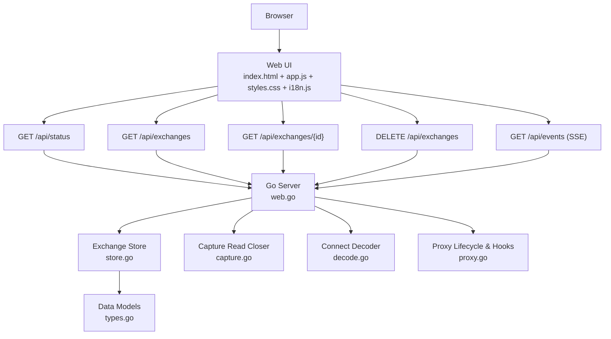
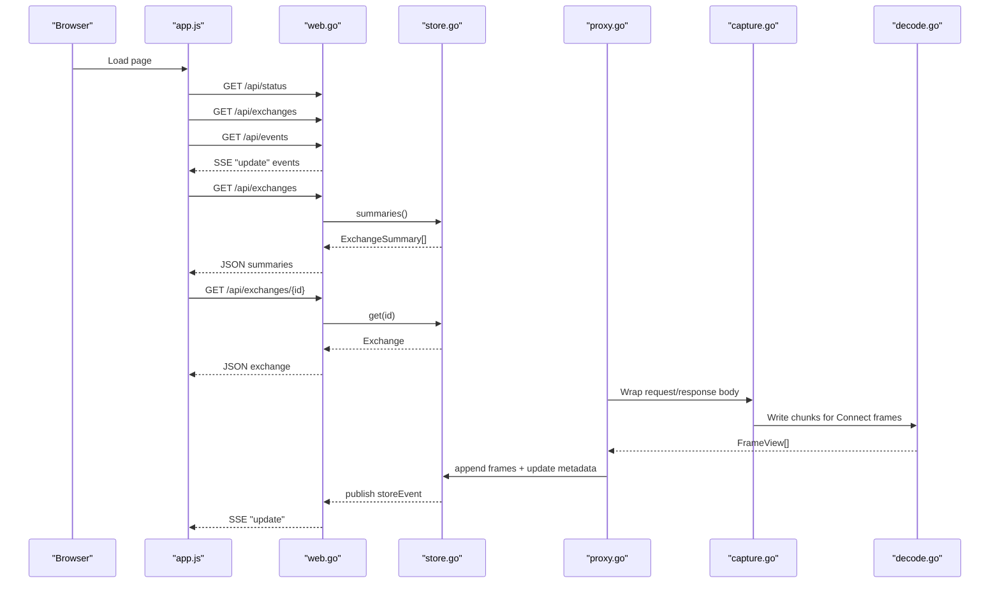
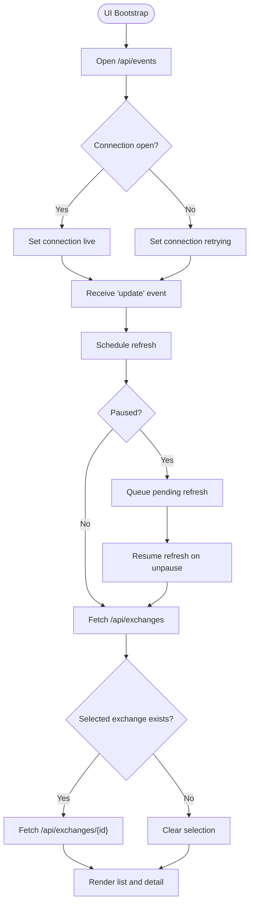
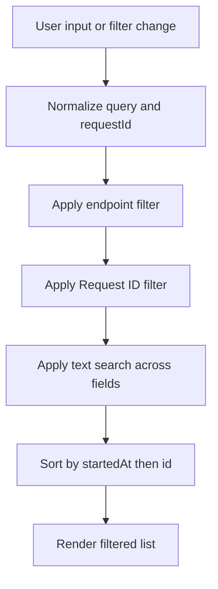
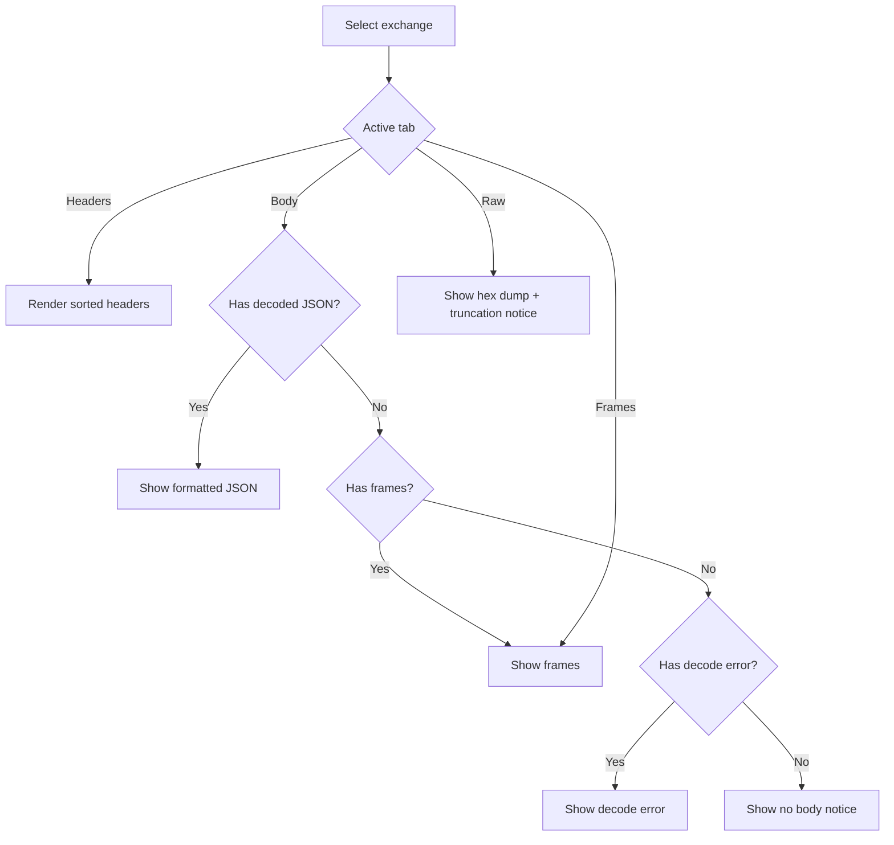
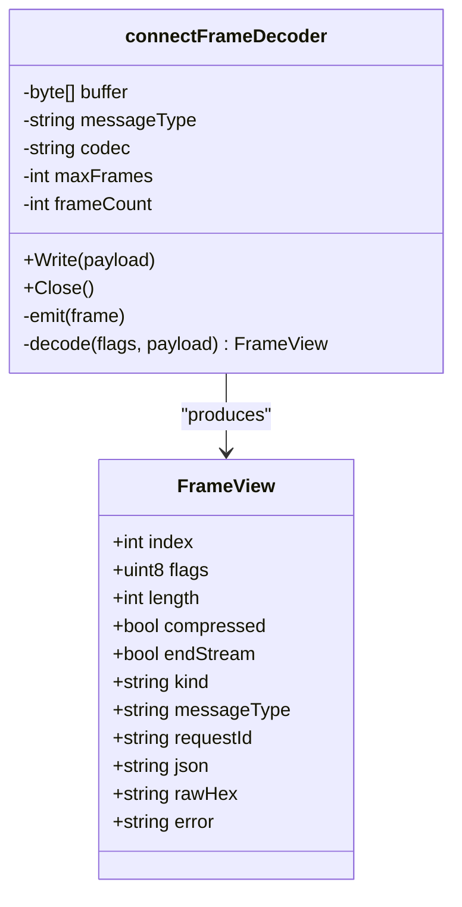
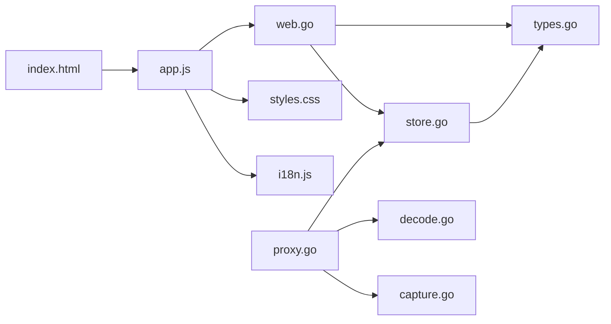

# Web Debugging Interface

<cite>
**Referenced Files in This Document**
- [index.html](file://cursor-proxy-debugger/web/index.html)
- [app.js](file://cursor-proxy-debugger/web/app.js)
- [styles.css](file://cursor-proxy-debugger/web/styles.css)
- [i18n.js](file://cursor-proxy-debugger/web/i18n.js)
- [web.go](file://cursor-proxy-debugger/web.go)
- [proxy.go](file://cursor-proxy-debugger/proxy.go)
- [capture.go](file://cursor-proxy-debugger/capture.go)
- [decode.go](file://cursor-proxy-debugger/decode.go)
- [store.go](file://cursor-proxy-debugger/store.go)
- [types.go](file://cursor-proxy-debugger/types.go)
</cite>

## Table of Contents
1. [Introduction](#introduction)
2. [Project Structure](#project-structure)
3. [Core Components](#core-components)
4. [Architecture Overview](#architecture-overview)
5. [Detailed Component Analysis](#detailed-component-analysis)
6. [Dependency Analysis](#dependency-analysis)
7. [Performance Considerations](#performance-considerations)
8. [Troubleshooting Guide](#troubleshooting-guide)
9. [Conclusion](#conclusion)

## Introduction
This document explains the web-based debugging interface used to inspect Cursor protocol traffic captured by the local proxy debugger. It covers how users view captured exchanges, inspect request and response pairs, analyze performance metrics, filter and sort requests, interpret visual indicators, navigate between multiple captures, and understand the real-time update mechanism. It also documents the Connect frame viewer, JSON formatting behavior, error display, browser compatibility considerations, and responsive layout behavior.

The interface is a self-contained single-page application served by the Go backend. It uses an HTML shell, a JavaScript controller, CSS styles, and a small internationalization module. The backend provides API endpoints for status, exchange summaries, detailed exchange payloads, event streaming, and CA certificate download.

## Project Structure
The debugging interface lives under `cursor-proxy-debugger/web` and is embedded into the Go server:

- `index.html`: UI shell with topbar, filters, request list, detail panels, and status bar.
- `app.js`: Client-side state management, event handling, filtering, rendering, and real-time updates.
- `styles.css`: Dark theme, grid layout, table styling, frame viewer, and responsive breakpoints.
- `i18n.js`: Locale resolution, message dictionary, and document translation utilities.

The backend exposes the UI and APIs:

- `web.go`: Static file serving, security headers, and HTTP handlers for `/api/status`, `/api/exchanges`, `/api/exchanges/{id}`, `/api/events`, and `/api/ca.crt`.
- `proxy.go`: Proxy lifecycle, request/response capture, frame decoding hooks, store updates, and connection error handling.
- `capture.go`: Streaming body capture with size limits and truncation tracking.
- `decode.go`: Connect frame parsing, gzip decompression, protobuf decoding, and JSON pretty-printing.
- `store.go`: Thread-safe exchange storage, summary generation, subscription channel, and header sanitization.
- `types.go`: Configuration defaults, exchange model, payload model, frame view model, and store events.

**Diagram sources**
- [web.go:16-27](file://cursor-proxy-debugger/web.go#L16-L27)
- [web.go:30-55](file://cursor-proxy-debugger/web.go#L30-L55)
- [web.go:58-89](file://cursor-proxy-debugger/web.go#L58-L89)
- [proxy.go:167-223](file://cursor-proxy-debugger/proxy.go#L167-L223)
- [proxy.go:226-273](file://cursor-proxy-debugger/proxy.go#L226-L273)
- [capture.go:22-84](file://cursor-proxy-debugger/capture.go#L22-L84)
- [decode.go:30-87](file://cursor-proxy-debugger/decode.go#L30-L87)
- [store.go:9-23](file://cursor-proxy-debugger/store.go#L9-L23)
- [types.go:46-110](file://cursor-proxy-debugger/types.go#L46-L110)

**Section sources**
- [index.html:1-127](file://cursor-proxy-debugger/web/index.html#L1-L127)
- [app.js:1-461](file://cursor-proxy-debugger/web/app.js#L1-L461)
- [styles.css:1-922](file://cursor-proxy-debugger/web/styles.css#L1-L922)
- [i18n.js:1-181](file://cursor-proxy-debugger/web/i18n.js#L1-L181)
- [web.go:1-111](file://cursor-proxy-debugger/web.go#L1-L111)
- [proxy.go:1-450](file://cursor-proxy-debugger/proxy.go#L1-L450)
- [capture.go:1-89](file://cursor-proxy-debugger/capture.go#L1-L89)
- [decode.go:1-295](file://cursor-proxy-debugger/decode.go#L1-L295)
- [store.go:1-163](file://cursor-proxy-debugger/store.go#L1-L163)
- [types.go:1-111](file://cursor-proxy-debugger/types.go#L1-L111)

## Core Components
The interface consists of five main user-facing components:

1. **Topbar**: Shows runtime status, proxy address, target host, language selector, CA certificate link, pause/resume control, and clear button.
2. **Filter Bar**: Provides URL search, Request ID search, endpoint segmentation (All, RunSSE, BidiAppend, Fork), sort order toggle, and request count.
3. **Request List**: A scrollable table showing per-exchange status dot, index, URL, Request ID, message kind, method, HTTP status, response size, and duration.
4. **Detail Panels**: Split request/response panels with tabs for Headers, Body, Frames, and Raw. Each panel supports copy-to-clipboard.
5. **Status Bar**: Displays live connection label, total upload/download bytes, and target host.

Key behaviors:

- Real-time updates via Server-Sent Events (`/api/events`).
- Pausing UI refreshes without stopping proxy capture.
- Filtering by endpoint path patterns and Request ID.
- Sorting by start time ascending or descending.
- Frame viewer for Connect protocol messages with flags, compression, and optional JSON.
- JSON formatted output when protobuf decoding succeeds; hex dump otherwise.
- Error notices for decode failures, truncated payloads, and missing content.

**Section sources**
- [index.html:11-122](file://cursor-proxy-debugger/web/index.html#L11-L122)
- [app.js:21-43](file://cursor-proxy-debugger/web/app.js#L21-L43)
- [app.js:133-184](file://cursor-proxy-debugger/web/app.js#L133-L184)
- [app.js:198-231](file://cursor-proxy-debugger/web/app.js#L198-L231)
- [app.js:241-270](file://cursor-proxy-debugger/web/app.js#L241-L270)
- [app.js:325-428](file://cursor-proxy-debugger/web/app.js#L325-L428)
- [styles.css:62-722](file://cursor-proxy-debugger/web/styles.css#L62-L722)

## Architecture Overview
The debugging interface follows a client-server architecture:

- The browser loads static assets from the embedded filesystem.
- The client polls `/api/status` and `/api/exchanges`, then subscribes to `/api/events` for live updates.
- When new events arrive, the client schedules a refresh that fetches updated summaries and details.
- The backend stores exchanges in a thread-safe map with ordered insertion and bounded capacity.
- The proxy captures request/response bodies, decodes Connect frames, and pushes incremental frame views into the store.
- The UI renders summaries, payloads, headers, frames, raw hex, and notices.

**Diagram sources**
- [web.go:16-27](file://cursor-proxy-debugger/web.go#L16-L27)
- [web.go:30-55](file://cursor-proxy-debugger/web.go#L30-L55)
- [web.go:58-89](file://cursor-proxy-debugger/web.go#L58-L89)
- [app.js:45-112](file://cursor-proxy-debugger/web/app.js#L45-L112)
- [proxy.go:167-223](file://cursor-proxy-debugger/proxy.go#L167-L223)
- [proxy.go:226-273](file://cursor-proxy-debugger/proxy.go#L226-L273)
- [capture.go:22-84](file://cursor-proxy-debugger/capture.go#L22-L84)
- [decode.go:30-87](file://cursor-proxy-debugger/decode.go#L30-L87)
- [store.go:25-45](file://cursor-proxy-debugger/store.go#L25-L45)

## Detailed Component Analysis

### User Interface Layout and Navigation
The UI is structured as a grid with a topbar, filter bar, workspace, and status bar. The workspace contains a request list pane and a detail pane separated by a draggable horizontal splitter.

- Topbar includes brand, runtime status, proxy address, locale picker, CA certificate link, pause button, and clear button.
- Filter bar includes URL search, Request ID search, endpoint segmented control, sort order control, and request count.
- Request list shows status dots, IDs, URLs, Request IDs, message kinds, methods, statuses, response sizes, and durations.
- Detail pane has two side-by-side panels for request and response, each with tabs: Headers, Body, Frames, Raw.
- Status bar shows live connection label, traffic totals, and target host.

Navigation:

- Click a row to select an exchange.
- Switch tabs within each panel to inspect headers, decoded body, frames, or raw hex.
- Use the splitter to resize the list and detail areas.
- Use the pause button to stop automatic refreshes.
- Use the clear button to delete all stored exchanges.

Responsive behavior:

- At smaller widths, the filter bar wraps, some columns hide, and the detail panels stack vertically.
- On very small screens, the topbar wraps, and the workspace adjusts row heights.

**Section sources**
- [index.html:11-122](file://cursor-proxy-debugger/web/index.html#L11-L122)
- [styles.css:62-722](file://cursor-proxy-debugger/web/styles.css#L62-L722)
- [styles.css:728-922](file://cursor-proxy-debugger/web/styles.css#L728-L922)
- [app.js:430-447](file://cursor-proxy-debugger/web/app.js#L430-L447)

### Real-Time Update Mechanism
The interface connects to `/api/events` using `EventSource`. The backend streams SSE events with heartbeat pings every 15 seconds. On `open`, the UI marks the connection as live. On `update`, it schedules a refresh. On `error`, it marks the connection as retrying.

Refresh logic:

- Fetches `/api/exchanges` to update the list and traffic summary.
- If a selected exchange still exists, it fetches its detail.
- If the selected exchange was removed, it clears selection and re-renders empty detail.
- Refresh errors set a connection failure notice.

Pause mode:

- When paused, updates are queued but not executed immediately.
- Resuming triggers one pending refresh if available.

**Diagram sources**
- [app.js:45-112](file://cursor-proxy-debugger/web/app.js#L45-L112)
- [app.js:90-105](file://cursor-proxy-debugger/web/app.js#L90-L105)
- [app.js:395-404](file://cursor-proxy-debugger/web/app.js#L395-L404)
- [web.go:58-89](file://cursor-proxy-debugger/web.go#L58-L89)

**Section sources**
- [app.js:45-112](file://cursor-proxy-debugger/web/app.js#L45-L112)
- [app.js:90-105](file://cursor-proxy-debugger/web/app.js#L90-L105)
- [app.js:395-404](file://cursor-proxy-debugger/web/app.js#L395-L404)
- [web.go:58-89](file://cursor-proxy-debugger/web.go#L58-L89)

### Exchange Filtering and Sorting
The client maintains filter state and applies it before rendering the list.

Filters:

- URL/message/status free-text search across URL, Request ID, request kind, response kind, state, and HTTP status.
- Request ID substring filter.
- Endpoint filter: All, RunSSE, BidiAppend, Fork.
- Sort order: Ascending or Descending by start time, with ID fallback.

Fork detection:

- The Fork filter matches paths containing background composer, conversation clone notification, or conversation blob upload endpoints.

Sorting:

- Primary sort by `startedAt`.
- Secondary sort by ID using numeric-aware comparison.

**Diagram sources**
- [app.js:133-160](file://cursor-proxy-debugger/web/app.js#L133-L160)
- [app.js:162-184](file://cursor-proxy-debugger/web/app.js#L162-L184)

**Section sources**
- [app.js:133-160](file://cursor-proxy-debugger/web/app.js#L133-L160)
- [app.js:162-184](file://cursor-proxy-debugger/web/app.js#L162-L184)

### Payload Inspection and JSON Formatting
For each selected exchange, the UI renders request and response payloads based on the active tab.

Tabs:

- Headers: Renders sorted header pairs. Sensitive headers are hidden by the backend.
- Body: If protobuf decoding succeeded, displays formatted JSON. Otherwise, falls back to frames, decode error, or no-body notice.
- Frames: Renders Connect frame entries with index, kind, size, flags, compression indicator, and optional JSON or hex.
- Raw: Displays hex dump of captured bytes with truncation notice if applicable.

JSON formatting:

- Protobuf messages are marshaled to pretty-printed JSON using proto names.
- For known unary request/response paths, the backend decodes and formats the payload.
- For Connect streaming payloads, individual frames may contain JSON if protobuf decoding succeeds.

Error display:

- Decode errors appear as notices in the body tab or inside frame items.
- Truncation notices indicate that the local capture limit was reached.
- Missing content shows localized notices.

**Diagram sources**
- [app.js:217-270](file://cursor-proxy-debugger/web/app.js#L217-L270)
- [decode.go:246-287](file://cursor-proxy-debugger/decode.go#L246-L287)
- [store.go:122-149](file://cursor-proxy-debugger/store.go#L122-L149)

**Section sources**
- [app.js:217-270](file://cursor-proxy-debugger/web/app.js#L217-L270)
- [decode.go:246-287](file://cursor-proxy-debugger/decode.go#L246-L287)
- [store.go:122-149](file://cursor-proxy-debugger/store.go#L122-L149)

### Connect Frame Viewer
The frame viewer is designed for Connect protocol messages, especially the `/agent.v1.AgentService/RunSSE` stream.

Frame properties:

- Index: Sequential frame number.
- Kind: Active oneof name or special value like `end_stream`.
- Flags: Bitmask indicating compression and end-stream.
- Length: Frame payload length.
- Compressed: Whether the frame payload is gzip-compressed.
- EndStream: Whether this frame signals stream completion.
- JSON: Pretty-printed protobuf JSON when decoding succeeds.
- RawHex: Hex dump of the frame payload when JSON is unavailable.
- Error: Decoding or framing error message.

Backend decoding:

- Reads Connect frames from streaming request/response bodies.
- Validates frame length and bounds.
- Decompresses gzip payloads when indicated.
- Unmarshals protobuf messages and extracts active oneof field names.
- Emits frame views incrementally and caps frame count.

**Diagram sources**
- [types.go:92-105](file://cursor-proxy-debugger/types.go#L92-L105)
- [decode.go:30-87](file://cursor-proxy-debugger/decode.go#L30-L87)
- [decode.go:89-129](file://cursor-proxy-debugger/decode.go#L89-L129)

**Section sources**
- [decode.go:30-87](file://cursor-proxy-debugger/decode.go#L30-L87)
- [decode.go:89-129](file://cursor-proxy-debugger/decode.go#L89-L129)
- [types.go:92-105](file://cursor-proxy-debugger/types.go#L92-L105)

### Visual Indicators and Timing
Visual indicators communicate exchange state and result:

- Row state dot:
  - Pending: neutral gray.
  - Streaming: green.
  - Completed: cyan.
  - Error: red.
- HTTP status color:
  - Success range: green.
  - Error range: red.
- Method badge and status badge in the selection summary.
- Duration column shows milliseconds or seconds.
- Response size column shows human-readable bytes.
- Traffic summary shows total upload and download bytes.

Timing information:

- Duration is computed from the exchange start time.
- The backend updates duration when response processing completes or when connection errors occur.
- The UI formats duration values for readability.

**Section sources**
- [app.js:162-184](file://cursor-proxy-debugger/web/app.js#L162-L184)
- [app.js:186-196](file://cursor-proxy-debugger/web/app.js#L186-L196)
- [app.js:310-314](file://cursor-proxy-debugger/web/app.js#L310-L314)
- [store.go:115-120](file://cursor-proxy-debugger/store.go#L115-L120)
- [proxy.go:123-133](file://cursor-proxy-debugger/proxy.go#L123-L133)
- [proxy.go:330-363](file://cursor-proxy-debugger/proxy.go#L330-L363)
- [styles.css:401-434](file://cursor-proxy-debugger/web/styles.css#L401-L434)

### Internationalization and Accessibility
The interface supports Chinese and English locales.

- Locale resolution checks stored preference, then browser languages, then falls back to defaults.
- Document attributes such as labels, placeholders, and titles are translated at runtime.
- The UI re-renders after locale changes.

Accessibility:

- Semantic roles and aria-labels are present for key controls.
- Focus outlines are visible.
- Color scheme is dark with high contrast tokens.

**Section sources**
- [i18n.js:1-181](file://cursor-proxy-debugger/web/i18n.js#L1-L181)
- [index.html:11-33](file://cursor-proxy-debugger/web/index.html#L11-L33)
- [app.js:406-420](file://cursor-proxy-debugger/web/app.js#L406-L420)
- [styles.css:54-60](file://cursor-proxy-debugger/web/styles.css#L54-L60)

### Security and Content Delivery
The backend serves static assets and API endpoints with security headers:

- `X-Content-Type-Options: nosniff`
- `Referrer-Policy: no-referrer`
- `Content-Security-Policy` restricting script, style, and connect sources to same origin.

CA certificate download:

- The `/api/ca.crt` endpoint returns the generated MITM CA certificate for installing in the system trust store.

**Section sources**
- [web.go:103-110](file://cursor-proxy-debugger/web.go#L103-L110)
- [web.go:91-95](file://cursor-proxy-debugger/web.go#L91-L95)

## Dependency Analysis
The following diagram maps the primary dependencies among core files:

**Diagram sources**
- [index.html:124-124](file://cursor-proxy-debugger/web/index.html#L124-L124)
- [app.js:1-1](file://cursor-proxy-debugger/web/app.js#L1-L1)
- [web.go:16-27](file://cursor-proxy-debugger/web.go#L16-L27)
- [proxy.go:167-223](file://cursor-proxy-debugger/proxy.go#L167-L223)
- [capture.go:22-84](file://cursor-proxy-debugger/capture.go#L22-L84)
- [decode.go:30-87](file://cursor-proxy-debugger/decode.go#L30-L87)
- [store.go:9-23](file://cursor-proxy-debugger/store.go#L9-L23)
- [types.go:46-110](file://cursor-proxy-debugger/types.go#L46-L110)

**Section sources**
- [index.html:124-124](file://cursor-proxy-debugger/web/index.html#L124-L124)
- [app.js:1-1](file://cursor-proxy-debugger/web/app.js#L1-L1)
- [web.go:16-27](file://cursor-proxy-debugger/web.go#L16-L27)
- [proxy.go:167-223](file://cursor-proxy-debugger/proxy.go#L167-L223)
- [capture.go:22-84](file://cursor-proxy-debugger/capture.go#L22-L84)
- [decode.go:30-87](file://cursor-proxy-debugger/decode.go#L30-L87)
- [store.go:9-23](file://cursor-proxy-debugger/store.go#L9-L23)
- [types.go:46-110](file://cursor-proxy-debugger/types.go#L46-L110)

## Performance Considerations
- Capture limits:
  - Maximum captured bytes per body prevent excessive memory usage.
  - Maximum frame count prevents unbounded frame accumulation.
- Streaming updates:
  - SSE events trigger scheduled refreshes with debouncing to avoid rapid polling.
  - Heartbeat pings keep the connection alive.
- Rendering efficiency:
  - The list is rendered from filtered arrays.
  - Large payloads use preformatted code blocks with monospace fonts.
- Network overhead:
  - Only summaries are fetched on refresh; details are fetched per selected exchange.
  - Traffic summary aggregates request and response bytes.

Recommendations:

- Keep MaxExchanges and MaxFrames tuned to expected workload.
- Use pause mode during heavy traffic to reduce UI churn.
- Inspect only necessary exchanges to minimize detail fetches.
- Monitor truncation notices to ensure payloads are fully captured.

[No sources needed since this section provides general guidance]

## Troubleshooting Guide

Common issues and resolutions:

- Connection fails:
  - The UI sets a connection failure notice when initial bootstrap fails.
  - Verify the UI address is reachable and the server is running.
- Live updates not refreshing:
  - Check whether the UI is paused.
  - Confirm SSE connection is open and receiving events.
  - Look for refresh failure notices.
- Empty request or response content:
  - Some exchanges may not have captured bodies due to configuration or transport behavior.
  - Check notices for “no request content,” “no response content,” or “no body available.”
- Decode errors:
  - May indicate unsupported compression, malformed protobuf, or truncated payload.
  - Inspect the decode error notice and raw hex for clues.
- Truncated payloads:
  - Indicates the local capture limit was exceeded.
  - Forwarded data is not truncated; only local inspection is limited.
- Sensitive headers hidden:
  - Authorization, cookie, set-cookie, proxy-authorization, and x-api-key are masked.
- Fork filter not matching:
  - Ensure the path contains one of the recognized fork-related endpoints.
- Responsive layout issues:
  - On narrow screens, some columns and elements are hidden or stacked.
  - Adjust window width or use the splitter to optimize visibility.

**Section sources**
- [app.js:449-458](file://cursor-proxy-debugger/web/app.js#L449-L458)
- [app.js:212-231](file://cursor-proxy-debugger/web/app.js#L212-L231)
- [app.js:264-270](file://cursor-proxy-debugger/web/app.js#L264-L270)
- [store.go:143-149](file://cursor-proxy-debugger/store.go#L143-L149)
- [decode.go:53-79](file://cursor-proxy-debugger/decode.go#L53-L79)
- [decode.go:131-148](file://cursor-proxy-debugger/decode.go#L131-L148)
- [styles.css:728-922](file://cursor-proxy-debugger/web/styles.css#L728-L922)

## Conclusion
The web debugging interface provides a focused, real-time view of Cursor protocol traffic. It combines a compact request list, rich payload inspection, Connect frame analysis, and clear visual indicators to help developers diagnose request/response behavior, streaming frames, and performance characteristics. The backend ensures safe, bounded capture and decoding, while the frontend offers filtering, sorting, localization, and responsive design suitable for desktop and mobile workflows.

[No sources needed since this section summarizes without analyzing specific files]