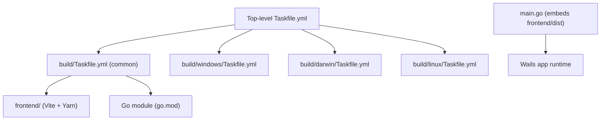
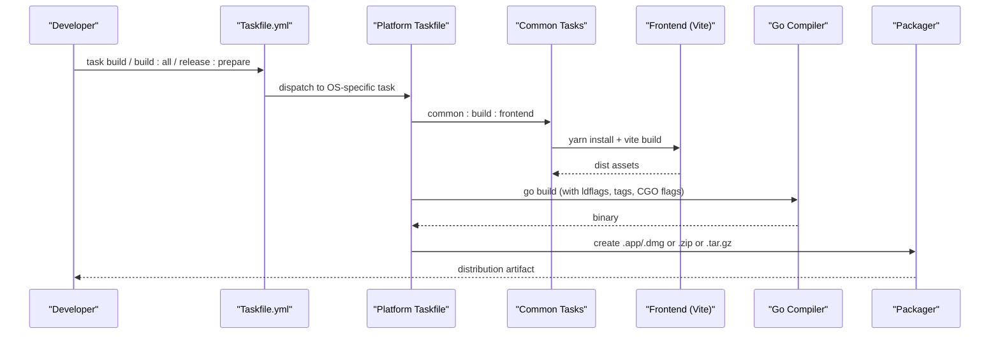

# Build Process and Packaging

<cite>
**Referenced Files in This Document**
- [Taskfile.yml](file://Taskfile.yml)
- [build.bat](file://build.bat)
- [build.ps1](file://build.ps1)
- [main.go](file://main.go)
- [go.mod](file://go.mod)
- [frontend/package.json](file://frontend/package.json)
- [frontend/vite.config.js](file://frontend/vite.config.js)
- [frontend/scripts/run-vite-build.mjs](file://frontend/scripts/run-vite-build.mjs)
- [build/Taskfile.yml](file://build/Taskfile.yml)
- [build/windows/Taskfile.yml](file://build/windows/Taskfile.yml)
- [build/darwin/Taskfile.yml](file://build/darwin/Taskfile.yml)
- [build/linux/Taskfile.yml](file://build/linux/Taskfile.yml)
- [build/config.yml](file://build/config.yml)
- [internal/buildinfo/buildinfo.go](file://internal/buildinfo/buildinfo.go)
</cite>

## Table of Contents
1. [Introduction](#introduction)
2. [Project Structure](#project-structure)
3. [Core Components](#core-components)
4. [Architecture Overview](#architecture-overview)
5. [Detailed Component Analysis](#detailed-component-analysis)
6. [Dependency Management](#dependency-management)
7. [Environment Setup](#environment-setup)
8. [Build Workflows](#build-workflows)
9. [Distribution Packaging](#distribution-packaging)
10. [Optimization and Caching](#optimization-and-caching)
11. [Troubleshooting Guide](#troubleshooting-guide)
12. [Conclusion](#conclusion)

## Introduction
This document explains the build and packaging system for cursor-byok, focusing on:
- Multi-platform orchestration via Taskfile.yml
- Windows entry scripts (build.bat and build.ps1)
- Go build process with Wails v3
- Frontend asset compilation with Vite
- Cross-compilation targets for macOS, Windows, and Linux
- Dependency management for Go modules and Node.js packages
- Step-by-step setup, local builds, and distribution packaging
- Optimization techniques, caching strategies, and troubleshooting

## Project Structure
The build system is organized around a top-level Taskfile that delegates to platform-specific Taskfiles under build/. The frontend assets are built by Vite and embedded into the Go binary at compile time.

**Diagram sources**
- [Taskfile.yml:1-8](file://Taskfile.yml#L1-L8)
- [build/Taskfile.yml:103-123](file://build/Taskfile.yml#L103-L123)
- [main.go:10-17](file://main.go#L10-L17)

**Section sources**
- [Taskfile.yml:1-8](file://Taskfile.yml#L1-L8)
- [build/Taskfile.yml:1-161](file://build/Taskfile.yml#L1-L161)
- [main.go:1-30](file://main.go#L1-L30)

## Core Components
- Top-level orchestrator: Taskfile.yml defines tasks for building current platform, all platforms, dev mode, release preparation, and GitHub releases.
- Platform builders: build/{windows,darwin,linux}/Taskfile.yml implement per-OS build, packaging, and run tasks.
- Common build utilities: build/Taskfile.yml provides shared tasks for frontend build, bindings generation, proto generation, icon generation, Docker cross-compilation setup, and asset updates.
- Entry point: main.go embeds compiled frontend assets and application icons into the binary.
- Versioning: internal/buildinfo/buildinfo.go exposes version constants injected at build time; build/config.yml holds metadata used by Wails and release tooling.

Key responsibilities:
- Orchestrate multi-platform builds and packaging
- Compile frontend assets with Vite and generate Wails bindings
- Produce platform-native artifacts (.app/.dmg on macOS, .exe/.zip on Windows, tar.gz on Linux)
- Generate update manifests and publish releases

**Section sources**
- [Taskfile.yml:27-184](file://Taskfile.yml#L27-L184)
- [build/Taskfile.yml:63-161](file://build/Taskfile.yml#L63-L161)
- [build/windows/Taskfile.yml:26-56](file://build/windows/Taskfile.yml#L26-L56)
- [build/darwin/Taskfile.yml:28-56](file://build/darwin/Taskfile.yml#L28-L56)
- [build/linux/Taskfile.yml:41-74](file://build/linux/Taskfile.yml#L41-L74)
- [main.go:10-29](file://main.go#L10-L29)
- [internal/buildinfo/buildinfo.go:1-25](file://internal/buildinfo/buildinfo.go#L1-L25)
- [build/config.yml:1-44](file://build/config.yml#L1-L44)

## Architecture Overview
The build pipeline integrates Go, Vite, and Wails across platforms.

**Diagram sources**
- [Taskfile.yml:27-184](file://Taskfile.yml#L27-L184)
- [build/Taskfile.yml:103-123](file://build/Taskfile.yml#L103-L123)
- [build/windows/Taskfile.yml:26-56](file://build/windows/Taskfile.yml#L26-L56)
- [build/darwin/Taskfile.yml:28-56](file://build/darwin/Taskfile.yml#L28-L56)
- [build/linux/Taskfile.yml:41-74](file://build/linux/Taskfile.yml#L41-L74)

## Detailed Component Analysis

### Top-level Taskfile.yml
Responsibilities:
- Includes platform Taskfiles and defines variables like APP_NAME, BIN_DIR, APP_VERSION, RELEASE_* paths, and VITE_PORT.
- Provides tasks:
  - build: current platform build
  - build:all: macOS-only orchestrator for macOS arm64/amd64 and Windows 386/amd64
  - build:current: routes to OS-specific tasks
  - build:darwin:current, build:windows:current, build:linux:current
  - build:windows:binary, build:windows:386, build:windows:amd64
  - build:linux:current, build:linux:amd64
  - dev: start Wails dev server with Vite port
  - release:prepare:darwin|linux, release:build:* variants, release:manifest, release:verify:assets, release:sync:readme, release:github

Key behaviors:
- Uses wails3 CLI for development and asset updates
- Generates release notes from release-notes.md
- Produces update.json manifest and uploads assets to GitHub Releases

**Section sources**
- [Taskfile.yml:1-26](file://Taskfile.yml#L1-L26)
- [Taskfile.yml:27-184](file://Taskfile.yml#L27-L184)
- [Taskfile.yml:232-579](file://Taskfile.yml#L232-L579)

### Windows Scripts: build.bat and build.ps1
Purpose:
- Provide convenient one-click Windows builds without requiring manual Task invocation.
- Resolve PATH including Machine and User environment variables plus $HOME\go\bin.
- Compute version using scripts/release version and call task build:windows:binary with an explicit OUTPUT path.

Differences:
- build.bat wraps PowerShell execution and pauses before exit.
- build.ps1 runs directly in PowerShell.

**Section sources**
- [build.bat:1-7](file://build.bat#L1-L7)
- [build.ps1:1-22](file://build.ps1#L1-L22)

### Common Build Tasks (build/Taskfile.yml)
Highlights:
- install:frontend:deps: installs Yarn dependencies using frozen lockfile.
- generate:bindings: invokes wails3 generate bindings after proto generation and go mod tidy.
- build:frontend: compiles frontend assets via yarn run build or build:dev depending on DEV flag; supports --scan for static i18n scanning.
- dev:frontend: starts Vite dev server with configurable port.
- generate:icons: uses wails3 generate icons to produce platform icons.
- update:build-assets: updates Wails build assets based on build/config.yml.
- setup:docker: builds cross-compilation Docker image for Linux.

**Section sources**
- [build/Taskfile.yml:63-161](file://build/Taskfile.yml#L63-L161)

### Windows Builder (build/windows/Taskfile.yml)
Highlights:
- build:native: sets GOOS=windows, CGO_ENABLED=0, GOARCH to target architecture; compiles with production or dev ldflags; generates syso resources and cleans up temporary files.
- package: creates NSIS installer or MSIX package.
- create:zip: produces ZIP archives containing the executable.
- run: executes the built Windows executable.

**Section sources**
- [build/windows/Taskfile.yml:26-56](file://build/windows/Taskfile.yml#L26-L56)
- [build/windows/Taskfile.yml:75-153](file://build/windows/Taskfile.yml#L75-L153)
- [build/windows/Taskfile.yml:154-160](file://build/windows/Taskfile.yml#L154-L160)

### macOS Builder (build/darwin/Taskfile.yml)
Highlights:
- build:native: sets GOOS=darwin, CGO_ENABLED=1, minimum deployment target 10.15; compiles with production or dev ldflags.
- build:universal: combines amd64 and arm64 binaries using lipo.
- package: create .app bundle with Info.plist and icons; optional ad-hoc codesign.
- package:dmg: creates DMG using create-dmg if available, otherwise hdiutil fallback.
- package:archive: creates tar.gz for updater distribution.
- run: launches a development .dev.app bundle.

**Section sources**
- [build/darwin/Taskfile.yml:28-56](file://build/darwin/Taskfile.yml#L28-L56)
- [build/darwin/Taskfile.yml:57-74](file://build/darwin/Taskfile.yml#L57-L74)
- [build/darwin/Taskfile.yml:187-238](file://build/darwin/Taskfile.yml#L187-L238)
- [build/darwin/Taskfile.yml:240-274](file://build/darwin/Taskfile.yml#L240-L274)

### Linux Builder (build/linux/Taskfile.yml)
Highlights:
- build:native: requires pkg-config and GTK/WebKit2GTK dependencies; sets GOOS=linux, CGO_ENABLED=1.
- build:docker: uses a prebuilt Docker image to cross-compile when not on native Linux or missing compilers; mounts GOPATH cache and handles replace directives.
- package:archive: creates tar.gz for updater distribution.
- run: executes the built Linux executable.

**Section sources**
- [build/linux/Taskfile.yml:41-74](file://build/linux/Taskfile.yml#L41-L74)
- [build/linux/Taskfile.yml:75-119](file://build/linux/Taskfile.yml#L75-L119)
- [build/linux/Taskfile.yml:120-193](file://build/linux/Taskfile.yml#L120-L193)

### Frontend Asset Compilation (Vite)
Highlights:
- frontend/package.json defines scripts for dev, build:dev, build, and preview.
- frontend/vite.config.js configures Vue plugins, Wails runtime plugin, code inspector in dev, and static i18n plugin.
- frontend/scripts/run-vite-build.mjs spawns Vite with forwarded arguments and sets STATIC_I18N_SCAN based on --scan flag.

Behavior:
- Common build task invokes yarn run build or build:dev depending on DEV variable.
- SCAN variable propagates to enable static i18n scanning during builds.

**Section sources**
- [frontend/package.json:1-40](file://frontend/package.json#L1-L40)
- [frontend/vite.config.js:1-38](file://frontend/vite.config.js#L1-L38)
- [frontend/scripts/run-vite-build.mjs:1-28](file://frontend/scripts/run-vite-build.mjs#L1-L28)
- [build/Taskfile.yml:103-123](file://build/Taskfile.yml#L103-L123)

### Go Build and Embedding
Highlights:
- main.go embeds frontend/dist and application/tray icons using //go:embed.
- Version is injected via ldflags (-X cursor/internal/buildinfo.Version=...) during build tasks.
- internal/buildinfo/buildinfo.go exposes CurrentVersion() and ReleaseTag() helpers.

**Section sources**
- [main.go:10-29](file://main.go#L10-L29)
- [internal/buildinfo/buildinfo.go:1-25](file://internal/buildinfo/buildinfo.go#L1-L25)
- [build/windows/Taskfile.yml:45-56](file://build/windows/Taskfile.yml#L45-L56)
- [build/darwin/Taskfile.yml:43-56](file://build/darwin/Taskfile.yml#L43-L56)
- [build/linux/Taskfile.yml:17-17](file://build/linux/Taskfile.yml#L17-L17)

## Dependency Management
- Go modules:
  - Managed via go.mod and go.sum.
  - Common task go:mod:tidy ensures dependency consistency.
  - Linux Docker build honors replace directives in go.mod by mounting local replace paths read-only.

- Node.js packages:
  - Managed via frontend/package.json and frontend/yarn.lock.
  - Common task install:frontend:deps uses Yarn with --frozen-lockfile to ensure reproducible installs.

**Section sources**
- [go.mod:1-76](file://go.mod#L1-L76)
- [build/Taskfile.yml:63-69](file://build/Taskfile.yml#L63-L69)
- [build/Taskfile.yml:70-83](file://build/Taskfile.yml#L70-L83)
- [build/linux/Taskfile.yml:106-119](file://build/linux/Taskfile.yml#L106-L119)

## Environment Setup
Prerequisites:
- Go toolchain (version specified in go.mod).
- Wails v3 CLI installed and available in PATH.
- Yarn installed for frontend dependency management.
- For macOS builds: Xcode command-line tools and optionally create-dmg for DMG creation.
- For Linux native builds: pkg-config, gcc or clang, and GTK/WebKit2GTK development libraries (gtk+-3.0, webkit2gtk-4.1, gdk-3.0, gio-unix-2.0).
- For Docker-based Linux cross-compilation: Docker daemon running and cross image built via setup:docker.

Optional:
- GitHub CLI (gh) for release synchronization and publishing.

**Section sources**
- [Taskfile.yml:308-310](file://Taskfile.yml#L308-L310)
- [build/Taskfile.yml:78-82](file://build/Taskfile.yml#L78-L82)
- [build/linux/Taskfile.yml:54-63](file://build/linux/Taskfile.yml#L54-L63)
- [build/linux/Taskfile.yml:88-94](file://build/linux/Taskfile.yml#L88-L94)
- [Taskfile.yml:365-370](file://Taskfile.yml#L365-L370)

## Build Workflows

### Local Development
- Start Wails dev mode with Vite:
  - Run task dev to launch Wails dev server with configured Vite port.
- Frontend development:
  - Use task common:dev:frontend to start Vite dev server independently.

**Section sources**
- [Taskfile.yml:185-189](file://Taskfile.yml#L185-L189)
- [build/Taskfile.yml:125-132](file://build/Taskfile.yml#L125-L132)

### Building Current Platform
- Build current platform artifact:
  - Run task build to clean dist and build current OS target.
- Build specific targets:
  - macOS: task build:darwin:current
  - Windows: task build:windows:current
  - Linux: task build:linux:current

**Section sources**
- [Taskfile.yml:27-57](file://Taskfile.yml#L27-L57)

### All Platforms (macOS host only)
- Build macOS arm64/amd64 and Windows 386/amd64:
  - Run task build:all on macOS.

**Section sources**
- [Taskfile.yml:42-52](file://Taskfile.yml#L42-L52)

### Windows One-Click Builds
- Double-click build.bat or run build.ps1 to produce a versioned .exe in bin/.

**Section sources**
- [build.bat:1-7](file://build.bat#L1-L7)
- [build.ps1:1-22](file://build.ps1#L1-L22)

### Release Preparation
- Prepare release assets:
  - On macOS: task release:prepare:darwin builds macOS arm64/amd64, Windows amd64, and Linux amd64 artifacts.
  - On Linux: task release:prepare:linux builds Linux amd64 artifact.
- Generate update manifest:
  - task release:manifest produces update.json in release directory.
- Verify assets:
  - task release:verify:assets checks presence of expected artifacts.

**Section sources**
- [Taskfile.yml:297-356](file://Taskfile.yml#L297-L356)

### Publishing to GitHub Releases
- Publish workflow:
  - task release:github verifies assets, generates manifest, syncs README, and uploads assets to GitHub Releases.

**Section sources**
- [Taskfile.yml:441-579](file://Taskfile.yml#L441-L579)

## Distribution Packaging

### macOS
- App Bundle:
  - Created via build/darwin/Taskfile.yml with Info.plist and icons; optional ad-hoc codesign.
- DMG:
  - Generated using create-dmg if available; falls back to hdiutil.
- Updater Archive:
  - tar.gz created for updater distribution.

**Section sources**
- [build/darwin/Taskfile.yml:187-238](file://build/darwin/Taskfile.yml#L187-L238)
- [build/darwin/Taskfile.yml:240-249](file://build/darwin/Taskfile.yml#L240-L249)

### Windows
- Executable:
  - Built with CGO disabled; syso resources generated for icons and version info.
- Installer:
  - NSIS installer or MSIX package via wails3 tooling.
- ZIP:
  - ZIP archive containing executable produced by create:zip.

**Section sources**
- [build/windows/Taskfile.yml:26-56](file://build/windows/Taskfile.yml#L26-L56)
- [build/windows/Taskfile.yml:75-119](file://build/windows/Taskfile.yml#L75-L119)
- [build/windows/Taskfile.yml:121-153](file://build/windows/Taskfile.yml#L121-L153)

### Linux
- Native vs Docker:
  - Native build requires GTK/WebKit2GTK dependencies; otherwise uses Docker cross-compilation.
- Updater Archive:
  - tar.gz created with executable inside.

**Section sources**
- [build/linux/Taskfile.yml:41-74](file://build/linux/Taskfile.yml#L41-L74)
- [build/linux/Taskfile.yml:75-119](file://build/linux/Taskfile.yml#L75-L119)
- [build/linux/Taskfile.yml:120-173](file://build/linux/Taskfile.yml#L120-L173)

## Optimization and Caching
- Go build optimizations:
  - Production builds use -trimpath, -w, -s, and set buildvcs=false to reduce binary size and avoid embedding VCS metadata.
  - Version injection via -ldflags "-X cursor/internal/buildinfo.Version=...".
- Frontend build optimizations:
  - Vite production build minifies assets; dev builds disable minification for faster iteration.
  - Static i18n scanning can be enabled via --scan to optimize localization assets.
- Dependency caching:
  - Yarn uses frozen lockfile to ensure deterministic installs.
  - Docker Linux build mounts GOPATH module cache to speed up repeated builds.
  - Replace directives in go.mod are mounted read-only to support local module development within Docker.

**Section sources**
- [build/windows/Taskfile.yml:45-56](file://build/windows/Taskfile.yml#L45-L56)
- [build/darwin/Taskfile.yml:43-56](file://build/darwin/Taskfile.yml#L43-L56)
- [build/linux/Taskfile.yml:17-17](file://build/linux/Taskfile.yml#L17-L17)
- [frontend/package.json:6-10](file://frontend/package.json#L6-L10)
- [frontend/scripts/run-vite-build.mjs:9-17](file://frontend/scripts/run-vite-build.mjs#L9-L17)
- [build/linux/Taskfile.yml:106-119](file://build/linux/Taskfile.yml#L106-L119)

## Troubleshooting Guide
Common issues and resolutions:
- Missing Wails CLI:
  - Ensure wails3 is installed and accessible in PATH; release tasks require it.
- Yarn not found:
  - Install Yarn globally; frontend dependency installation requires it.
- Linux native build fails due to missing dependencies:
  - Install pkg-config, gcc or clang, and GTK/WebKit2GTK development packages (gtk+-3.0, webkit2gtk-4.1, gdk-3.0, gio-unix-2.0).
- Docker Linux cross-compilation fails:
  - Ensure Docker daemon is running and cross image exists; run setup:docker to build the image.
- GitHub CLI errors during release:
  - Ensure gh is installed and authenticated; verify token availability.
- Frontend build issues:
  - Clear node_modules and reinstall dependencies; ensure Vite version compatibility.
- Version mismatch:
  - Confirm build/config.yml version matches intended release; version is injected into binary via ldflags.

**Section sources**
- [Taskfile.yml:308-310](file://Taskfile.yml#L308-L310)
- [build/Taskfile.yml:78-82](file://build/Taskfile.yml#L78-L82)
- [build/linux/Taskfile.yml:54-63](file://build/linux/Taskfile.yml#L54-L63)
- [build/linux/Taskfile.yml:88-94](file://build/linux/Taskfile.yml#L88-L94)
- [Taskfile.yml:365-370](file://Taskfile.yml#L365-L370)
- [build/config.yml:1-44](file://build/config.yml#L1-L44)

## Conclusion
The cursor-byok build system leverages Taskfile.yml for consistent multi-platform orchestration, integrating Go, Vite, and Wails. It supports local development, cross-compilation, and automated release workflows, with robust caching and optimization strategies. By following the setup and workflow instructions, developers can reliably build, test, and distribute cursor-byok across macOS, Windows, and Linux.