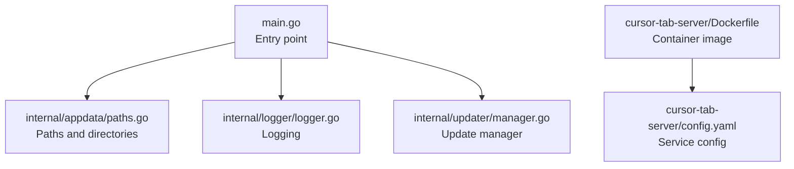
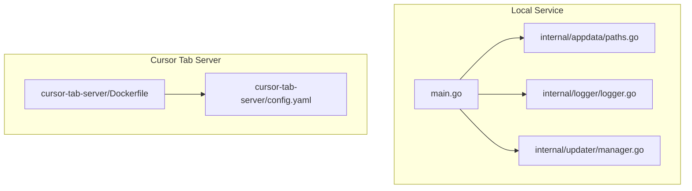
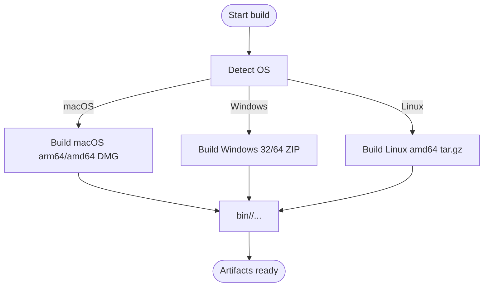
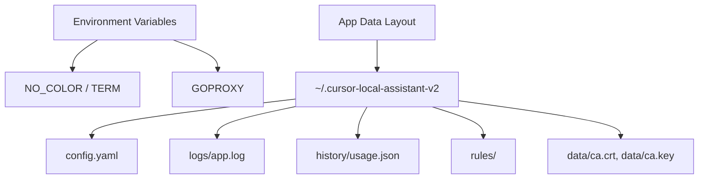
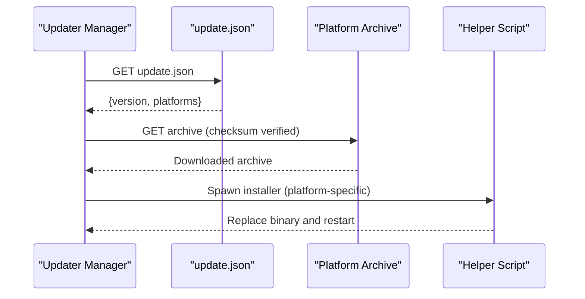
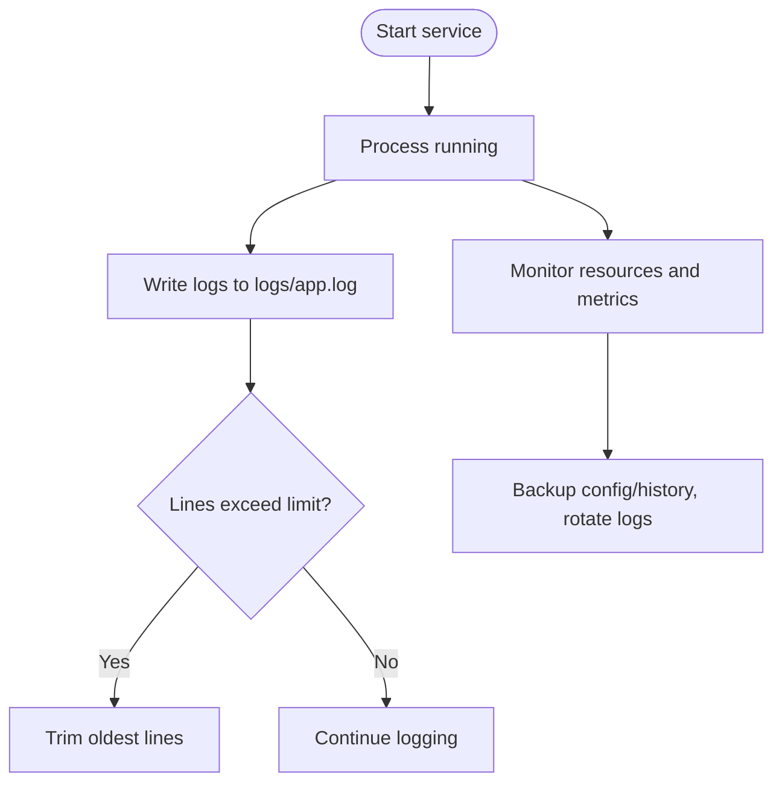
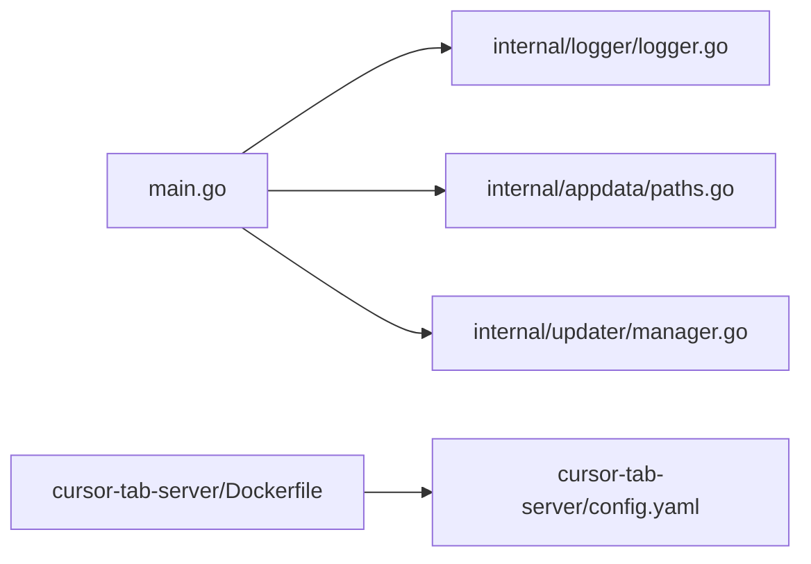

# Deployment and Operations

<cite>
**Referenced Files in This Document**
- [README.md](file://README.md)
- [Taskfile.yml](file://Taskfile.yml)
- [main.go](file://main.go)
- [internal/appdata/paths.go](file://internal/appdata/paths.go)
- [internal/logger/logger.go](file://internal/logger/logger.go)
- [internal/updater/manager.go](file://internal/updater/manager.go)
- [cursor-tab-server/Dockerfile](file://cursor-tab-server/Dockerfile)
- [cursor-tab-server/config.yaml](file://cursor-tab-server/config.yaml)
- [build.ps1](file://build.ps1)
</cite>

## Table of Contents
1. [Introduction](#introduction)
2. [Project Structure](#project-structure)
3. [Core Components](#core-components)
4. [Architecture Overview](#architecture-overview)
5. [Detailed Component Analysis](#detailed-component-analysis)
6. [Dependency Analysis](#dependency-analysis)
7. [Performance Considerations](#performance-considerations)
8. [Troubleshooting Guide](#troubleshooting-guide)
9. [Conclusion](#conclusion)
10. [Appendices](#appendices)

## Introduction
This document provides deployment and operations guidance for cursor-byok across macOS, Windows, and Linux. It covers build and packaging procedures, distribution workflows, system requirements, dependency management, environment setup, update mechanisms, version management, rollback considerations, service lifecycle management, log rotation, resource monitoring, maintenance tasks, security best practices, firewall configuration, and network considerations for different deployment topologies.

The project is a local model gateway that runs on your machine, connects Cursor to configured model APIs, routes requests through your providers, and preserves Agent capabilities such as tool calling, Skills, and MCP. The application embeds its frontend assets and exposes a local service for the host IDE.

**Section sources**
- [README.md:54-102](file://README.md#L54-L102)

## Project Structure
At runtime, the main entry point initializes logging and starts the application with embedded frontend assets and icons. The application data layout includes configuration, logs, history, rules, and optional CA artifacts under a dedicated home directory. A separate component, cursor-tab-server, can be containerized and exposed via Docker.

**Diagram sources**
- [main.go:19-29](file://main.go#L19-L29)
- [internal/appdata/paths.go:14-77](file://internal/appdata/paths.go#L14-L77)
- [internal/logger/logger.go:34-58](file://internal/logger/logger.go#L34-L58)
- [internal/updater/manager.go:79-88](file://internal/updater/manager.go#L79-L88)
- [cursor-tab-server/Dockerfile:1-25](file://cursor-tab-server/Dockerfile#L1-L25)
- [cursor-tab-server/config.yaml:1-2](file://cursor-tab-server/config.yaml#L1-L2)

**Section sources**
- [main.go:1-29](file://main.go#L1-L29)
- [internal/appdata/paths.go:1-78](file://internal/appdata/paths.go#L1-L78)
- [cursor-tab-server/Dockerfile:1-25](file://cursor-tab-server/Dockerfile#L1-L25)
- [cursor-tab-server/config.yaml:1-2](file://cursor-tab-server/config.yaml#L1-L2)

## Core Components
- Application entrypoint and asset embedding: The main program initializes logging and launches the app with embedded frontend assets and icons.
- Application data paths: Centralized path resolution for configuration, logs, history, rules, and CA files.
- Logging subsystem: Structured logging with console output and a bounded file writer that trims old lines automatically.
- Update manager: Periodic or manual update checks, manifest fetching, asset download with checksum verification, and platform-specific installers.
- Cursor tab server: A Go service packaged into a minimal Docker image exposing port 8041.

Operational implications:
- Logs are written under the application’s logs directory and trimmed by line count.
- Configuration is stored under the application root directory.
- Updates use an external manifest and per-platform assets; installation scripts replace binaries safely.

**Section sources**
- [main.go:19-29](file://main.go#L19-L29)
- [internal/appdata/paths.go:14-77](file://internal/appdata/paths.go#L14-L77)
- [internal/logger/logger.go:34-58](file://internal/logger/logger.go#L34-L58)
- [internal/updater/manager.go:79-88](file://internal/updater/manager.go#L79-L88)
- [cursor-tab-server/Dockerfile:1-25](file://cursor-tab-server/Dockerfile#L1-L25)

## Architecture Overview
The runtime architecture consists of the local service (cursor-byok), the embedded UI assets, the logging subsystem, the update manager, and optional integration with the cursor-tab-server.

**Diagram sources**
- [main.go:19-29](file://main.go#L19-L29)
- [internal/appdata/paths.go:14-77](file://internal/appdata/paths.go#L14-L77)
- [internal/logger/logger.go:34-58](file://internal/logger/logger.go#L34-L58)
- [internal/updater/manager.go:79-88](file://internal/updater/manager.go#L79-L88)
- [cursor-tab-server/Dockerfile:1-25](file://cursor-tab-server/Dockerfile#L1-L25)
- [cursor-tab-server/config.yaml:1-2](file://cursor-tab-server/config.yaml#L1-L2)

## Detailed Component Analysis

### Build and Packaging Procedures
The repository uses Taskfile-based tasks to build and package for multiple platforms. Key behaviors:
- Current-platform builds produce native packages:
  - macOS: DMG bundles for arm64 and amd64.
  - Windows: ZIP archives containing executables for 32-bit and 64-bit.
  - Linux: tar.gz archives for amd64.
- Cross-building:
  - macOS hosts can build macOS and Windows assets.
  - Linux builds require a native Linux host.
- Release workflow:
  - Generates release notes from release-notes.md.
  - Builds all target assets.
  - Verifies asset presence.
  - Generates update.json manifest.
  - Syncs README to a public repository.
  - Publishes GitHub Releases with assets.

Recommended operational commands:
- Build current platform: task build
- Build all supported desktop platforms: task build:all (macOS only)
- Prepare release assets: task release:prepare (macOS/Linux)
- Verify release assets: task release:verify:assets
- Generate update manifest: task release:manifest
- Publish to GitHub Releases: task release:github

Windows helper script:
- build.ps1 invokes the Taskfile to create a named executable artifact.

**Diagram sources**
- [Taskfile.yml:28-154](file://Taskfile.yml#L28-L154)
- [build.ps1:1-22](file://build.ps1#L1-L22)

**Section sources**
- [Taskfile.yml:28-154](file://Taskfile.yml#L28-L154)
- [Taskfile.yml:232-356](file://Taskfile.yml#L232-L356)
- [Taskfile.yml:297-301](file://Taskfile.yml#L297-L301)
- [Taskfile.yml:441-578](file://Taskfile.yml#L441-L578)
- [build.ps1:1-22](file://build.ps1#L1-L22)

### System Requirements and Environment Setup
- Operating systems: macOS, Windows, Linux.
- Development tools:
  - Go toolchain.
  - Wails v3 CLI for development and packaging.
  - Docker for building the cursor-tab-server image.
  - GitHub CLI for publishing releases.
- Network:
  - Access to Go module proxy if needed.
  - Access to GitHub API for release publication.
  - Access to update manifest URL at runtime.

Environment variables and flags:
- NO_COLOR disables colored terminal output.
- TERM=dumb disables color.
- GOPROXY can be set for module downloads.

Application data layout:
- Root directory: ~/.cursor-local-assistant-v2
- Configuration: config.yaml
- Logs: logs/app.log
- History and usage: history/usage.json
- Rules: rules/
- Optional CA artifacts: data/ca.crt and data/ca.key

**Diagram sources**
- [internal/logger/logger.go:92-101](file://internal/logger/logger.go#L92-L101)
- [internal/appdata/paths.go:14-77](file://internal/appdata/paths.go#L14-L77)

**Section sources**
- [README.md:73-80](file://README.md#L73-L80)
- [internal/logger/logger.go:92-101](file://internal/logger/logger.go#L92-L101)
- [internal/appdata/paths.go:14-77](file://internal/appdata/paths.go#L14-L77)

### Dependency Management
- Go modules: go.mod and go.sum define dependencies.
- Docker build for cursor-tab-server sets GOPROXY for module resolution.
- Frontend assets are embedded at build time.

Operational notes:
- Ensure Go module cache and proxies are accessible during builds.
- For air-gapped environments, pre-download dependencies and configure GOPROXY accordingly.

**Section sources**
- [cursor-tab-server/Dockerfile:1-12](file://cursor-tab-server/Dockerfile#L1-L12)
- [main.go:10-17](file://main.go#L10-L17)

### Distribution Methods
- Desktop distributions:
  - macOS: .dmg bundles for arm64 and amd64.
  - Windows: .zip archives for 32-bit and 64-bit.
  - Linux: .tar.gz archives for amd64.
- Container distribution:
  - cursor-tab-server Docker image exposing port 8041.
- Release artifacts:
  - update.json manifest describing versions, platforms, URLs, sizes, and checksums.
  - Assets uploaded to GitHub Releases.

Operational guidance:
- Use task release:prepare to generate assets locally.
- Use task release:verify:assets to validate completeness.
- Use task release:manifest to generate update.json.
- Use task release:github to publish assets and metadata.

**Section sources**
- [Taskfile.yml:28-154](file://Taskfile.yml#L28-L154)
- [Taskfile.yml:297-301](file://Taskfile.yml#L297-L301)
- [Taskfile.yml:441-578](file://Taskfile.yml#L441-L578)
- [cursor-tab-server/Dockerfile:18-25](file://cursor-tab-server/Dockerfile#L18-L25)

### Update Mechanisms, Version Management, and Rollback
Update flow:
- The updater fetches update.json from the configured base URL.
- Compares current version with manifest version.
- Selects the appropriate platform asset.
- Downloads the archive and verifies SHA-256 checksum.
- Emits progress events and marks the update as ready.
- Installs using platform-specific helper scripts:
  - macOS: replaces .app bundle after process exits.
  - Windows: copies payload and restarts the executable.
  - Linux: writes a new binary atomically and relaunches.

Version management:
- Manifest contains version, release date, release notes, mandatory flag, and per-platform assets.
- Platform keys map runtime GOOS/GOARCH to asset identifiers.

Rollback considerations:
- No built-in automatic rollback is present.
- Recommended strategy:
  - Keep previous version artifacts available.
  - Maintain a stable manifest pointing to a known-good version.
  - On failure, revert the manifest and redeploy the previous asset.

**Diagram sources**
- [internal/updater/manager.go:186-229](file://internal/updater/manager.go#L186-L229)
- [internal/updater/manager.go:231-279](file://internal/updater/manager.go#L231-L279)
- [internal/updater/manager.go:306-410](file://internal/updater/manager.go#L306-L410)

**Section sources**
- [internal/updater/manager.go:27-88](file://internal/updater/manager.go#L27-L88)
- [internal/updater/manager.go:186-279](file://internal/updater/manager.go#L186-L279)
- [internal/updater/manager.go:306-410](file://internal/updater/manager.go#L306-L410)

### Operational Procedures: Service Lifecycle, Logs, Monitoring, Maintenance
Service lifecycle:
- Start: Run the built executable or container.
- Stop: Terminate the process gracefully; updater waits for process exit before installing updates.
- Restart: After successful update, the installer restarts the service automatically.

Log rotation:
- Logs are written to logs/app.log.
- The logger maintains a maximum line window and trims older lines when exceeded.
- No external log rotation tool is required; trimming is built-in.

Resource monitoring:
- Monitor CPU, memory, and network I/O for the running process.
- Track token usage and conversation metrics via the application’s internal metrics where applicable.

Maintenance tasks:
- Rotate or archive logs periodically if retention policies require it beyond the built-in trim behavior.
- Back up configuration and history directories.
- Validate CA certificates if MITM features are used.

**Diagram sources**
- [internal/logger/logger.go:103-153](file://internal/logger/logger.go#L103-L153)
- [internal/appdata/paths.go:64-67](file://internal/appdata/paths.go#L64-L67)

**Section sources**
- [internal/logger/logger.go:103-153](file://internal/logger/logger.go#L103-L153)
- [internal/appdata/paths.go:64-67](file://internal/appdata/paths.go#L64-L67)

### Security Best Practices, Firewall Configuration, and Network Considerations
Security best practices:
- Store API keys and credentials securely in the application’s configuration directory.
- Restrict access to the application data directory to the intended user or service account.
- If using CA injection for MITM scenarios, protect ca.crt and ca.key and avoid distributing private keys.
- Validate update manifests and checksums; do not bypass integrity checks.

Firewall configuration:
- Allow outbound HTTPS to model provider endpoints and update manifest URLs.
- If exposing cursor-tab-server externally, restrict inbound access to port 8041 to trusted networks or reverse proxy.

Network considerations:
- Local-only deployments should bind services to loopback interfaces unless explicitly required otherwise.
- Corporate proxies may require GOPROXY and HTTP(S) proxy configuration for module downloads and update checks.

**Section sources**
- [internal/appdata/paths.go:69-77](file://internal/appdata/paths.go#L69-L77)
- [internal/updater/manager.go:231-279](file://internal/updater/manager.go#L231-L279)
- [cursor-tab-server/Dockerfile:22-25](file://cursor-tab-server/Dockerfile#L22-L25)

## Dependency Analysis
The main application depends on:
- Logging subsystem for structured output and file handling.
- Application data paths for configuration and storage locations.
- Update manager for version checks and asset installation.
- Embedded frontend assets served at runtime.

The cursor-tab-server is independent and packaged as a Docker image.

**Diagram sources**
- [main.go:19-29](file://main.go#L19-L29)
- [internal/logger/logger.go:34-58](file://internal/logger/logger.go#L34-L58)
- [internal/appdata/paths.go:14-77](file://internal/appdata/paths.go#L14-L77)
- [internal/updater/manager.go:79-88](file://internal/updater/manager.go#L79-L88)
- [cursor-tab-server/Dockerfile:1-25](file://cursor-tab-server/Dockerfile#L1-L25)
- [cursor-tab-server/config.yaml:1-2](file://cursor-tab-server/config.yaml#L1-L2)

**Section sources**
- [main.go:19-29](file://main.go#L19-L29)
- [internal/logger/logger.go:34-58](file://internal/logger/logger.go#L34-L58)
- [internal/appdata/paths.go:14-77](file://internal/appdata/paths.go#L14-L77)
- [internal/updater/manager.go:79-88](file://internal/updater/manager.go#L79-L88)
- [cursor-tab-server/Dockerfile:1-25](file://cursor-tab-server/Dockerfile#L1-L25)
- [cursor-tab-server/config.yaml:1-2](file://cursor-tab-server/config.yaml#L1-L2)

## Performance Considerations
- Logging overhead: The logger writes to both console and file; consider reducing verbosity in production.
- Update checks: Periodic checks occur at intervals; ensure network latency does not impact startup performance.
- Resource usage: Monitor memory and CPU during long-running sessions; tune model request parameters to balance throughput and latency.

[No sources needed since this section provides general guidance]

## Troubleshooting Guide
Common issues and resolutions:
- Cannot write logs:
  - Verify permissions on the logs directory under the application root.
  - Check that the application has write access to the home directory.
- Update fails:
  - Confirm network access to the update manifest URL.
  - Validate checksum matches the expected value.
  - Ensure the installation directory is writable on Linux.
- Cursor tab server not reachable:
  - Confirm the container is running and port 8041 is exposed.
  - Validate firewall rules allow inbound traffic to the service.

Operational diagnostics:
- Inspect logs/app.log for errors and warnings.
- Review update state events emitted by the updater.
- Validate configuration files under the application root.

**Section sources**
- [internal/logger/logger.go:103-153](file://internal/logger/logger.go#L103-L153)
- [internal/updater/manager.go:231-279](file://internal/updater/manager.go#L231-L279)
- [internal/updater/manager.go:383-410](file://internal/updater/manager.go#L383-L410)
- [cursor-tab-server/Dockerfile:22-25](file://cursor-tab-server/Dockerfile#L22-L25)

## Conclusion
cursor-byok provides a flexible, cross-platform local gateway for connecting Cursor to your model APIs. The build and release pipeline supports macOS, Windows, and Linux with clear packaging targets and a robust update mechanism. Operationally, focus on secure credential management, controlled network exposure, reliable logging, and disciplined versioning. For containerized components like cursor-tab-server, follow standard container best practices and expose only necessary ports.

[No sources needed since this section summarizes without analyzing specific files]

## Appendices

### Quick Reference: Commands and Artifacts
- Build current platform: task build
- Build all desktop platforms: task build:all
- Prepare release assets: task release:prepare
- Verify release assets: task release:verify:assets
- Generate update manifest: task release:manifest
- Publish to GitHub Releases: task release:github
- Windows helper: build.ps1

**Section sources**
- [Taskfile.yml:28-154](file://Taskfile.yml#L28-L154)
- [Taskfile.yml:232-356](file://Taskfile.yml#L232-L356)
- [Taskfile.yml:297-301](file://Taskfile.yml#L297-L301)
- [Taskfile.yml:441-578](file://Taskfile.yml#L441-L578)
- [build.ps1:1-22](file://build.ps1#L1-L22)