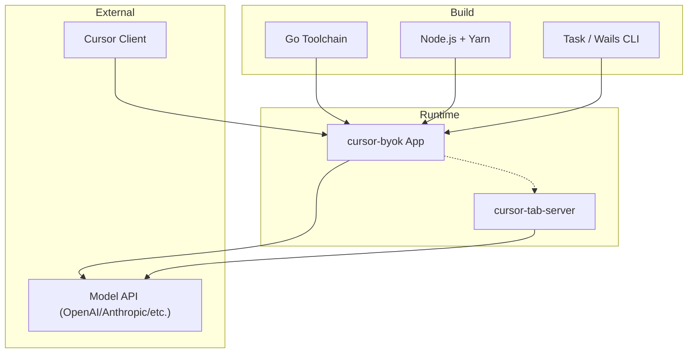
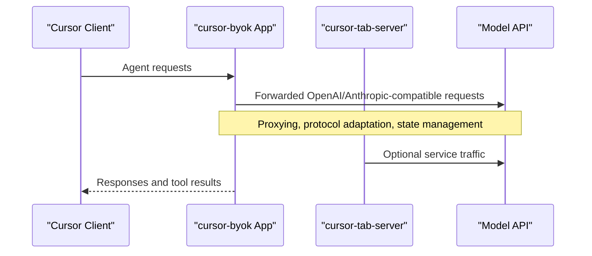
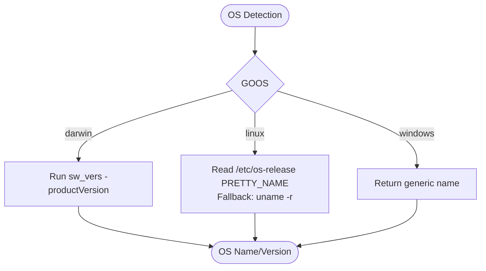
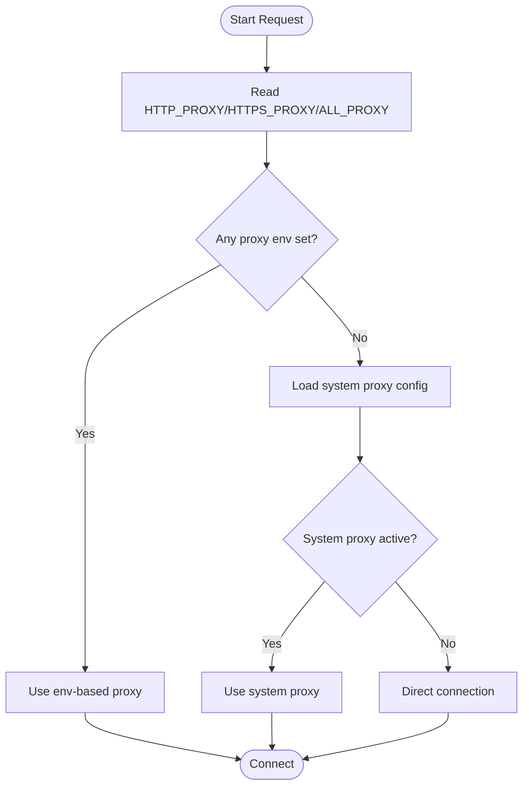
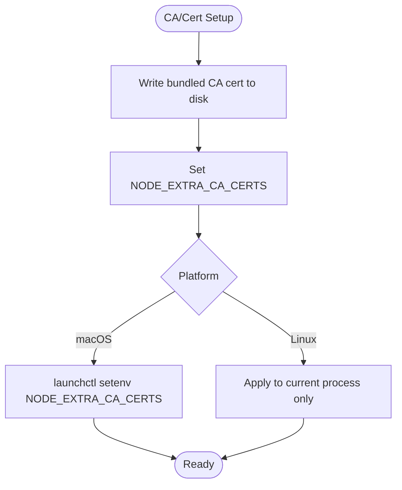
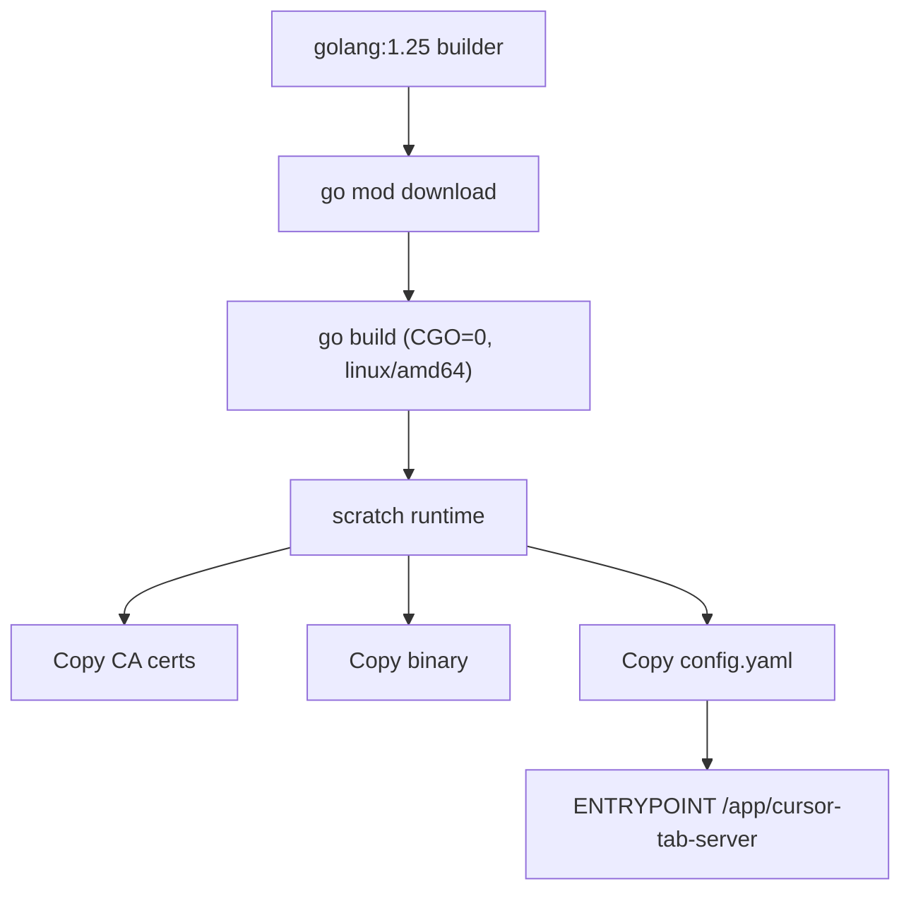
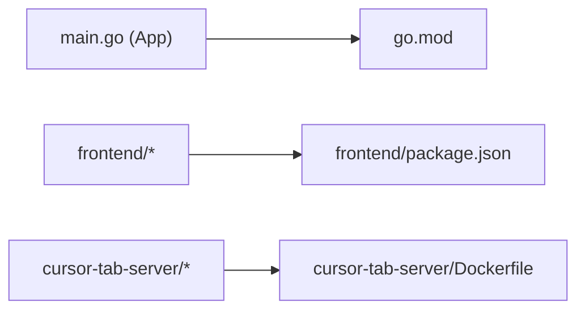

# System Requirements and Environment Setup

<cite>
**Referenced Files in This Document**
- [README.md](file://README.md)
- [CONTRIBUTING_EN.md](file://CONTRIBUTING_EN.md)
- [go.mod](file://go.mod)
- [frontend/package.json](file://frontend/package.json)
- [cursor-tab-server/Dockerfile](file://cursor-tab-server/Dockerfile)
- [cursor-tab-server/config.yaml](file://cursor-tab-server/config.yaml)
- [internal/netproxy/netproxy.go](file://internal/netproxy/netproxy.go)
- [internal/cursor/settings.go](file://internal/cursor/settings.go)
- [internal/ads/system.go](file://internal/ads/system.go)
- [Taskfile.yml](file://Taskfile.yml)
</cite>

## Table of Contents
1. [Introduction](#introduction)
2. [Project Structure](#project-structure)
3. [Core Components](#core-components)
4. [Architecture Overview](#architecture-overview)
5. [Detailed Component Analysis](#detailed-component-analysis)
6. [Dependency Analysis](#dependency-analysis)
7. [Performance Considerations](#performance-considerations)
8. [Troubleshooting Guide](#troubleshooting-guide)
9. [Conclusion](#conclusion)

## Introduction
This document specifies the system requirements, supported platforms, software dependencies, environment configuration, network and proxy behavior, certificate handling, permissions, and Docker containerization for running cursor-byok locally or as a service. It is intended for users who want to install, configure, and operate the application across Windows, macOS, and Linux.

## Project Structure
The repository contains:
- A Go-based backend that proxies and adapts model requests.
- A Vue 3 + Vite frontend used by the desktop app.
- A separate tab server component with its own build and Docker image.
- Build tooling via Task and Wails CLI.

[No sources needed since this diagram shows conceptual workflow, not actual code structure]

**Section sources**
- [README.md:54-80](file://README.md#L54-L80)
- [CONTRIBUTING_EN.md:32-49](file://CONTRIBUTING_EN.md#L32-L49)

## Core Components
- Desktop app (Go + Wails): Provides UI, local runtime, proxying, and integration with Cursor.
- Tab server (Go): Standalone service with a simple config file and Docker support.
- Frontend (Vue 3 + Vite): Bundled into the desktop app; development uses Node.js and Yarn.

Key environment and dependency facts:
- Go version: 1.25.x (module requires go 1.25.0).
- Node.js: >= 20 (development prerequisite).
- Yarn: 1.x (classic).
- Task: >= 3.
- Wails v3 CLI: alpha.74+.
- Linux GUI libraries: libgtk-3-dev, libwebkit2gtk-4.1-dev (for Wails runtime).

Supported operating systems:
- Windows, macOS, Linux.

Minimum hardware specifications:
- Not specified by the project. Typical modern desktops are sufficient.

**Section sources**
- [go.mod:1-4](file://go.mod#L1-L4)
- [CONTRIBUTING_EN.md:7-17](file://CONTRIBUTING_EN.md#L7-L17)
- [README.md:71-80](file://README.md#L71-L80)

## Architecture Overview
At runtime, the app acts as a local gateway between Cursor and your configured model APIs. The tab server can run independently and exposes an HTTP port.

[No sources needed since this diagram shows conceptual workflow, not actual code structure]

## Detailed Component Analysis

### Supported Platforms and OS Detection
The application detects and reports OS details at runtime for diagnostics.

- macOS: Uses sw_vers to report productVersion.
- Linux: Reads /etc/os-release PRETTY_NAME when available; otherwise uname -r.
- Windows: Reported generically without version string.

**Diagram sources**
- [internal/ads/system.go:11-64](file://internal/ads/system.go#L11-L64)

**Section sources**
- [internal/ads/system.go:11-64](file://internal/ads/system.go#L11-L64)

### Software Dependencies and Versions
- Go: 1.25.x (module declares go 1.25.0).
- Node.js: >= 20 (development prerequisite).
- Yarn: 1.x (classic).
- Task: >= 3.
- Wails v3 CLI: alpha.74+.
- Linux GUI libraries: libgtk-3-dev, libwebkit2gtk-4.1-dev.

Frontend build tooling:
- Vite, Vue 3, Tailwind CSS, Chart.js, and related dev dependencies.

**Section sources**
- [go.mod:1-4](file://go.mod#L1-L4)
- [CONTRIBUTING_EN.md:7-17](file://CONTRIBUTING_EN.md#L7-L17)
- [frontend/package.json:1-39](file://frontend/package.json#L1-L39)

### Network Requirements, Firewall, and Proxy Settings
Outbound connectivity is required to reach your configured model providers. The application supports:
- Direct connections.
- Environment-variable-based proxies.
- System-level proxy settings on supported platforms.

Proxy resolution behavior:
- Reads HTTP_PROXY/HTTPS_PROXY/ALL_PROXY (and lowercase variants).
- Supports NO_PROXY/no_proxy exclusion lists.
- Detects system PAC/automatic proxy and may ignore it depending on configuration.
- Produces a description of active proxy source and values (with credentials removed).

**Diagram sources**
- [internal/netproxy/netproxy.go:183-260](file://internal/netproxy/netproxy.go#L183-L260)

Firewall considerations:
- Allow outbound HTTPS to your model provider endpoints.
- If using the tab server, allow inbound TCP port 8041 if you expose it externally.

Proxy configuration tips:
- Set HTTP_PROXY/HTTPS_PROXY for all traffic or ALL_PROXY as a fallback.
- Use NO_PROXY to exclude internal hosts or localhost.
- If your environment uses PAC, be aware the app may treat it as direct unless explicitly configured otherwise.

**Section sources**
- [internal/netproxy/netproxy.go:183-260](file://internal/netproxy/netproxy.go#L183-L260)

### Environment Variables
Important variables:
- HTTP_PROXY, HTTPS_PROXY, ALL_PROXY: Define outbound proxy servers.
- NO_PROXY: Comma-separated list of hosts to bypass the proxy.
- NODE_EXTRA_CA_CERTS: Path to a CA bundle trusted by Node-based components.

Certificate-related operations:
- The app writes a bundled CA certificate to a user-writable location and sets NODE_EXTRA_CA_CERTS.
- On macOS, it persists NODE_EXTRA_CA_CERTS via launchctl so child processes inherit it.
- On Linux, it applies to the current process only.
- Clearing removes the variable from the process and, on macOS, from the user environment.

Cursor client integration:
- The app can write Cursor’s HTTP proxy settings into Cursor’s settings file to align network behavior.

**Diagram sources**
- [internal/cursor/settings.go:47-96](file://internal/cursor/settings.go#L47-L96)
- [internal/cursor/settings.go:98-118](file://internal/cursor/settings.go#L98-L118)

**Section sources**
- [internal/cursor/settings.go:47-118](file://internal/cursor/settings.go#L47-L118)
- [internal/cursor/settings.go:120-157](file://internal/cursor/settings.go#L120-L157)

### Permissions and System Integration
- Certificate writing: Requires write access to the target directory for the CA file.
- macOS environment persistence: Requires launchctl to set/unset environment variables.
- Cursor settings update: Requires read/write access to Cursor’s settings file path.
- Linux GUI libraries: Required for Wails runtime during development/builds.

**Section sources**
- [internal/cursor/settings.go:47-118](file://internal/cursor/settings.go#L47-L118)
- [CONTRIBUTING_EN.md:17-17](file://CONTRIBUTING_EN.md#L17-L17)

### Docker Containerization (Tab Server)
The tab server provides a minimal Docker image:
- Base image: golang:1.25 for building.
- Build flags: CGO_ENABLED=0, GOOS=linux, GOARCH=amd64.
- Final image: scratch with only the binary, CA certificates, and config.yaml.
- Exposed port: 8041.
- Entrypoint: /app/cursor-tab-server.
- GOPROXY: Configurable via ARG/ENV for module downloads.

Configuration:
- The container expects a config.yaml mounted or copied into /app/config.yaml.
- Example config includes a token field.

**Diagram sources**
- [cursor-tab-server/Dockerfile:1-25](file://cursor-tab-server/Dockerfile#L1-L25)
- [cursor-tab-server/config.yaml:1-2](file://cursor-tab-server/config.yaml#L1-L2)

**Section sources**
- [cursor-tab-server/Dockerfile:1-25](file://cursor-tab-server/Dockerfile#L1-L25)
- [cursor-tab-server/config.yaml:1-2](file://cursor-tab-server/config.yaml#L1-L2)

### Development and Build Environment
- Install frontend dependencies with Yarn.
- Start development mode with Task (hot reload).
- Build for the current platform with Task.
- Cross-platform builds are supported via Task tasks.

**Section sources**
- [CONTRIBUTING_EN.md:19-30](file://CONTRIBUTING_EN.md#L19-L30)
- [Taskfile.yml:19-19](file://Taskfile.yml#L19-L19)
- [Taskfile.yml:188-188](file://Taskfile.yml#L188-L188)

## Dependency Analysis
High-level relationships:
- The main app depends on Go modules defined in go.mod.
- The frontend depends on Node.js packages defined in package.json.
- The tab server has its own go.mod and Dockerfile.

**Diagram sources**
- [go.mod:1-76](file://go.mod#L1-L76)
- [frontend/package.json:1-40](file://frontend/package.json#L1-L40)
- [cursor-tab-server/Dockerfile:1-25](file://cursor-tab-server/Dockerfile#L1-L25)

**Section sources**
- [go.mod:1-76](file://go.mod#L1-L76)
- [frontend/package.json:1-40](file://frontend/package.json#L1-L40)
- [cursor-tab-server/Dockerfile:1-25](file://cursor-tab-server/Dockerfile#L1-L25)

## Performance Considerations
- Keep outbound latency low by placing the app close to your model providers or using regional endpoints.
- Avoid unnecessary proxy hops; use NO_PROXY for local services.
- For high-throughput scenarios, consider running the tab server in a container near your models.

[No sources needed since this section provides general guidance]

## Troubleshooting Guide
Common issues and checks:
- Model connectivity failures: Verify firewall allows outbound HTTPS to provider endpoints.
- Proxy misconfiguration: Inspect NetProxyDescription and related fields to confirm whether the app uses system proxy, environment variables, or direct connection.
- Certificate errors with Node-based components: Ensure NODE_EXTRA_CA_CERTS points to a valid CA bundle and is set correctly for the process.
- Cursor integration: Confirm Cursor’s settings file is readable/writable and that proxy settings were applied successfully.

Relevant implementation references:
- Proxy snapshot and description generation.
- Environment variable handling for NODE_EXTRA_CA_CERTS.
- Cursor settings updates for HTTP proxy.

**Section sources**
- [internal/netproxy/netproxy.go:183-260](file://internal/netproxy/netproxy.go#L183-L260)
- [internal/cursor/settings.go:47-118](file://internal/cursor/settings.go#L47-L118)
- [internal/cursor/settings.go:120-157](file://internal/cursor/settings.go#L120-L157)

## Conclusion
To deploy cursor-byok successfully:
- Use Go 1.25+ and Node.js 20+ for development.
- Ensure outbound HTTPS to your model providers is allowed.
- Configure proxies via environment variables or system settings as appropriate.
- Set NODE_EXTRA_CA_CERTS when using custom CA bundles.
- For containerized deployments, use the provided Dockerfile for the tab server and mount config.yaml.

[No sources needed since this section summarizes without analyzing specific files]