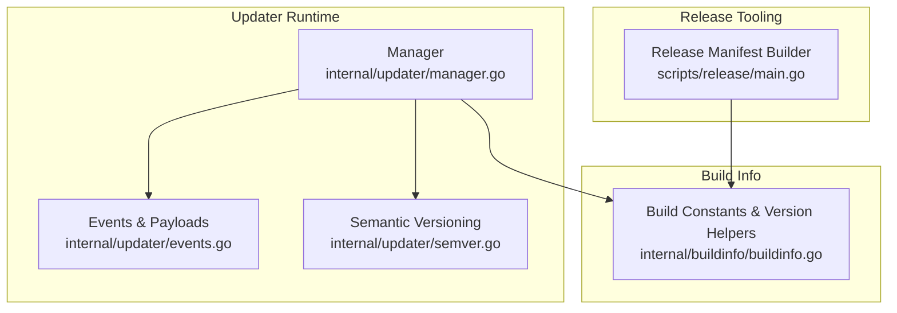
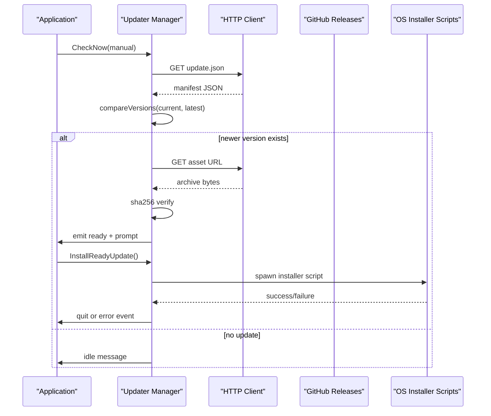
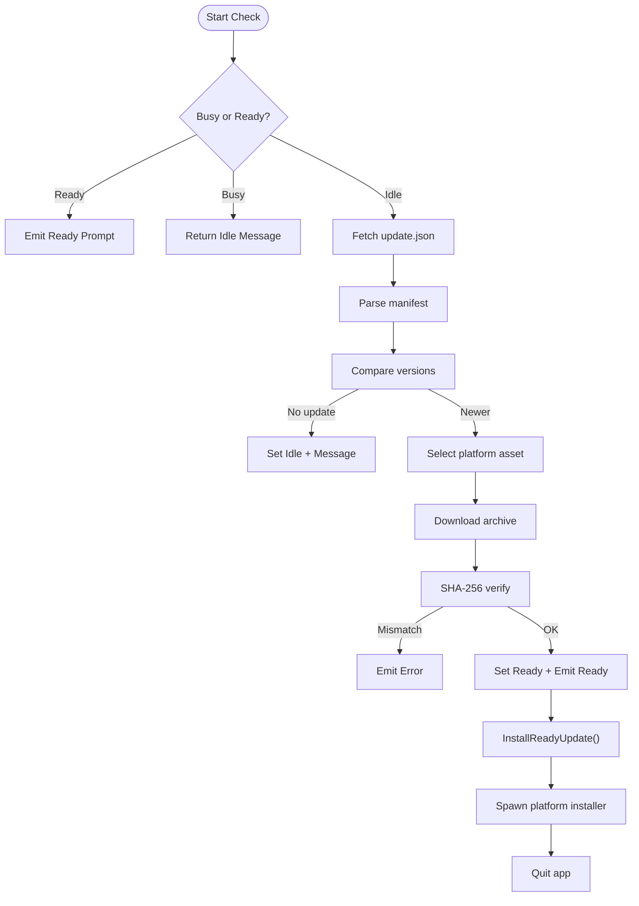
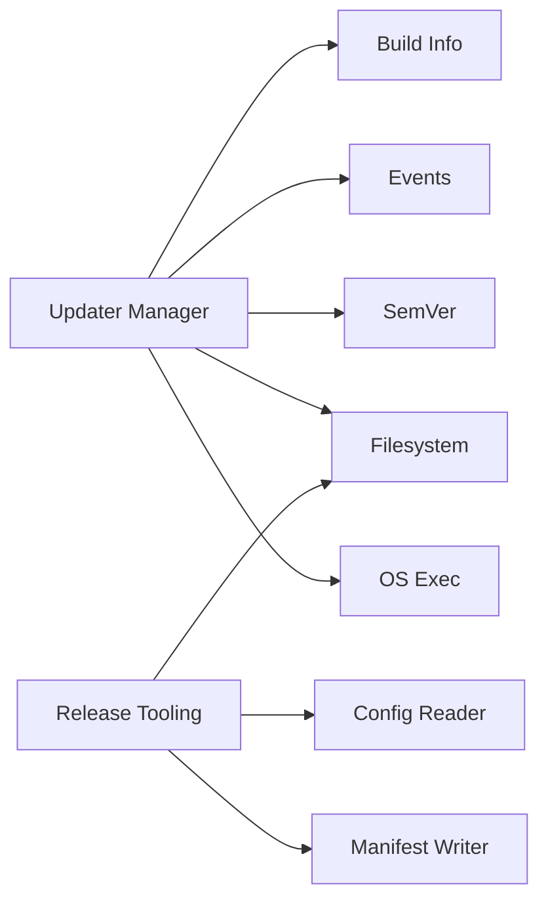

# Update Management and Version Control

<cite>
**Referenced Files in This Document**   
- [manager.go](file://internal/updater/manager.go)
- [events.go](file://internal/updater/events.go)
- [semver.go](file://internal/updater/semver.go)
- [buildinfo.go](file://internal/buildinfo/buildinfo.go)
- [main.go](file://scripts/release/main.go)
</cite>

## Table of Contents
1. [Introduction](#introduction)
2. [Project Structure](#project-structure)
3. [Core Components](#core-components)
4. [Architecture Overview](#architecture-overview)
5. [Detailed Component Analysis](#detailed-component-analysis)
6. [Dependency Analysis](#dependency-analysis)
7. [Performance Considerations](#performance-considerations)
8. [Troubleshooting Guide](#troubleshooting-guide)
9. [Conclusion](#conclusion)
10. [Appendices](#appendices)

## Introduction
This document explains the update management system and version control processes for the project. It focuses on:
- Automatic update checking, downloading, and installation implemented in the updater module.
- Build information and version tracking used by both the runtime and release tooling.
- Manual update procedures, rollback considerations, and validation mechanisms.
- Release workflow, version numbering scheme, platform compatibility, and security measures such as checksum verification.

The goal is to provide a clear, code-grounded understanding of how updates are discovered, verified, installed, and reported across platforms.

## Project Structure
The update-related functionality is primarily located under internal/updater and internal/buildinfo, with release tooling under scripts/release.

**Diagram sources**
- [manager.go:1-25](file://internal/updater/manager.go#L1-L25)
- [events.go:1-48](file://internal/updater/events.go#L1-L48)
- [semver.go:1-90](file://internal/updater/semver.go#L1-L90)
- [buildinfo.go:1-25](file://internal/buildinfo/buildinfo.go#L1-L25)
- [main.go:1-50](file://scripts/release/main.go#L1-L50)

**Section sources**
- [manager.go:1-25](file://internal/updater/manager.go#L1-L25)
- [buildinfo.go:1-25](file://internal/buildinfo/buildinfo.go#L1-L25)
- [main.go:1-50](file://scripts/release/main.go#L1-L50)

## Core Components
- Updater Manager: Orchestrates update lifecycle (check, download, install), emits events, and spawns platform-specific installers.
- Events: Defines event names and payload structures for state changes, progress, readiness, and errors.
- Semantic Versioning: Implements version parsing and comparison logic.
- Build Info: Provides build-time constants for release URLs and current version helpers.
- Release Tooling: Generates update manifests with asset metadata and SHA-256 checksums.

**Section sources**
- [manager.go:29-77](file://internal/updater/manager.go#L29-L77)
- [events.go:1-48](file://internal/updater/events.go#L1-L48)
- [semver.go:8-44](file://internal/updater/semver.go#L8-L44)
- [buildinfo.go:5-24](file://internal/buildinfo/buildinfo.go#L5-L24)
- [main.go:19-49](file://scripts/release/main.go#L19-L49)

## Architecture Overview
The update flow integrates the updater manager with GitHub releases via an update manifest. The release tooling produces a manifest that includes per-platform assets, sizes, and checksums. At runtime, the manager fetches the manifest, compares versions, downloads the appropriate asset, verifies its checksum, and installs it using platform-specific helper scripts.

**Diagram sources**
- [manager.go:99-184](file://internal/updater/manager.go#L99-L184)
- [manager.go:186-279](file://internal/updater/manager.go#L186-L279)
- [manager.go:281-317](file://internal/updater/manager.go#L281-L317)
- [buildinfo.go:5-9](file://internal/buildinfo/buildinfo.go#L5-L9)
- [main.go:141-171](file://scripts/release/main.go#L141-L171)

## Detailed Component Analysis

### Updater Manager
Responsibilities:
- Lifecycle control: start, periodic checks, shutdown.
- Update discovery: fetch manifest from GitHub releases and parse platform-specific assets.
- Download pipeline: stream archive, compute SHA-256, validate against manifest checksum.
- Installation: spawn platform-specific helper scripts; handle macOS app bundle replacement, Windows executable replacement, and Linux in-place binary replacement.
- Event emission: notify UI/state consumers about state transitions, progress, readiness, and errors.

Key behaviors:
- Periodic check interval is defined; automatic background checks can be enabled via StartPeriodicCheck.
- Manual checks bypass busy-state guards when necessary.
- Platform key mapping determines which asset to use.
- Progress events are emitted at intervals during download.
- On successful install, the application quits so the external installer can replace files and relaunch.

**Diagram sources**
- [manager.go:99-184](file://internal/updater/manager.go#L99-L184)
- [manager.go:186-279](file://internal/updater/manager.go#L186-L279)
- [manager.go:281-317](file://internal/updater/manager.go#L281-L317)

**Section sources**
- [manager.go:27-88](file://internal/updater/manager.go#L27-L88)
- [manager.go:90-122](file://internal/updater/manager.go#L90-L122)
- [manager.go:124-184](file://internal/updater/manager.go#L124-L184)
- [manager.go:186-279](file://internal/updater/manager.go#L186-L279)
- [manager.go:281-410](file://internal/updater/manager.go#L281-L410)
- [manager.go:412-500](file://internal/updater/manager.go#L412-L500)
- [manager.go:502-528](file://internal/updater/manager.go#L502-L528)
- [manager.go:557-594](file://internal/updater/manager.go#L557-L594)
- [manager.go:596-617](file://internal/updater/manager.go#L596-L617)
- [manager.go:619-734](file://internal/updater/manager.go#L619-L734)

### Events and Payloads
Defines event names and structured payloads for:
- State changes: general status updates with optional messages and prompts.
- Progress: download progress with downloaded/total bytes and percentage.
- Ready: availability of a new version with release notes and optional prompt.
- Error: failure details with optional version context.

These payloads are emitted through the Wails application event bus.

**Section sources**
- [events.go:1-48](file://internal/updater/events.go#L1-L48)
- [manager.go:412-491](file://internal/updater/manager.go#L412-L491)

### Semantic Versioning
Implements a semantic version parser and comparator supporting:
- Major.minor.patch numeric comparison.
- Pre-release suffix handling where a release without pre-release is considered newer than one with pre-release.
- Optional leading “v” prefix stripping.

Used to determine whether the remote manifest represents a newer version than the currently running build.

**Section sources**
- [semver.go:8-44](file://internal/updater/semver.go#L8-L44)
- [semver.go:46-78](file://internal/updater/semver.go#L46-L78)
- [manager.go:207-209](file://internal/updater/manager.go#L207-L209)

### Build Information
Provides:
- Release repository and base URL for update artifacts.
- Current version helper that normalizes injected version strings.
- Release tag generator for consistent tagging.

The updater uses these constants to locate update.json and compare versions.

**Section sources**
- [buildinfo.go:5-24](file://internal/buildinfo/buildinfo.go#L5-L24)
- [manager.go:186-188](file://internal/updater/manager.go#L186-L188)
- [manager.go:163-169](file://internal/updater/manager.go#L163-L169)

### Release Tooling
Generates:
- A JSON update manifest containing version, release date, release notes, mandatory flag, and per-platform assets.
- Per-asset metadata including URL, size, and SHA-256 checksum prefixed with “sha256:”.
- Asset naming conventions based on version, platform, and file extension.

Supported platforms and formats:
- macOS ARM64 and AMD64 as tar.gz archives.
- Windows AMD64 as zip archives.
- Linux AMD64 as tar.gz archives.

The manifest is consumed by the updater to discover and download the correct asset.

**Section sources**
- [main.go:19-49](file://scripts/release/main.go#L19-L49)
- [main.go:108-171](file://scripts/release/main.go#L108-L171)
- [main.go:174-189](file://scripts/release/main.go#L174-L189)
- [main.go:210-240](file://scripts/release/main.go#L210-L240)

## Dependency Analysis
The updater depends on:
- Build info for release endpoints and current version.
- HTTP client configured with timeouts and proxy support.
- OS-level exec utilities for spawning installer scripts.
- Filesystem operations for temporary files and directory writability checks.

The release tooling depends on:
- YAML config reader for version.
- Filesystem access to read assets and compute checksums.
- JSON writer to produce the update manifest.

**Diagram sources**
- [manager.go:1-25](file://internal/updater/manager.go#L1-L25)
- [buildinfo.go:1-25](file://internal/buildinfo/buildinfo.go#L1-L25)
- [events.go:1-48](file://internal/updater/events.go#L1-L48)
- [semver.go:1-90](file://internal/updater/semver.go#L1-L90)
- [main.go:1-50](file://scripts/release/main.go#L1-L50)

**Section sources**
- [manager.go:1-25](file://internal/updater/manager.go#L1-L25)
- [main.go:1-50](file://scripts/release/main.go#L1-L50)

## Performance Considerations
- Network timeouts: HTTP requests use a 90-second timeout for update checks and a 5-minute client timeout for downloads.
- Streaming downloads: Uses streaming I/O with incremental SHA-256 computation to avoid loading entire archives into memory.
- Progress throttling: Emits progress events at approximately 120ms intervals to reduce overhead.
- Temporary files: Downloads write to temp directories and clean up on failure.
- Platform checks: Early exit if no supported asset exists for the current platform.

[No sources needed since this section provides general guidance]

## Troubleshooting Guide
Common issues and resolutions:
- No supported asset found: Occurs when the current platform/arch combination is not present in the manifest. Ensure the release includes the expected platform key.
- Checksum mismatch: Indicates corrupted or tampered download. Re-download and verify again.
- Permission errors on Linux: In-place update requires a writable installation directory. Run with sufficient privileges or adjust directory permissions.
- macOS not in .app bundle: The updater expects a standard macOS app bundle structure; otherwise, in-place replacement cannot proceed.
- Windows PowerShell execution policy: The installer runs with bypass policy; ensure the environment allows script execution.
- Failed installer spawn: Review logs for platform-specific errors and confirm helper scripts were created successfully.

Operational tips:
- Use manual checks to trigger updates when automatic checks are disabled.
- After a successful install, the application quits; the external installer relaunches the updated binary.
- For rollbacks, keep previous binaries available outside the updater’s managed directories or maintain separate installation paths.

**Section sources**
- [manager.go:211-219](file://internal/updater/manager.go#L211-L219)
- [manager.go:270-275](file://internal/updater/manager.go#L270-L275)
- [manager.go:393-395](file://internal/updater/manager.go#L393-L395)
- [manager.go:545-554](file://internal/updater/manager.go#L545-L554)
- [manager.go:557-594](file://internal/updater/manager.go#L557-L594)
- [manager.go:619-734](file://internal/updater/manager.go#L619-L734)

## Conclusion
The update system combines a robust runtime manager with a deterministic release process. The manager discovers updates via a GitHub-hosted manifest, validates integrity with SHA-256, and installs updates using platform-specific scripts. The release tooling ensures consistent artifact naming and checksum generation. Together, they provide a secure, cross-platform update mechanism with clear event-driven feedback and safe installation practices.

[No sources needed since this section summarizes without analyzing specific files]

## Appendices

### Manual Update Procedures
- Trigger a manual check: Call the manager’s manual check method to initiate an immediate update scan.
- If an update is available, the manager will emit a ready event prompting the user to install.
- Confirm installation to invoke the platform installer; the application will quit after initiating the installer.

**Section sources**
- [manager.go:99-105](file://internal/updater/manager.go#L99-L105)
- [manager.go:124-184](file://internal/updater/manager.go#L124-L184)
- [manager.go:281-304](file://internal/updater/manager.go#L281-L304)

### Rollback Mechanisms
- The updater does not implement automatic rollback. If an update fails mid-installation, platform scripts attempt cleanup but do not restore prior binaries.
- Recommended approach: Maintain a backup of the previous binary or install path before updating.
- For Linux, the installer writes a new binary atomically; if the process crashes, the old binary may remain depending on filesystem behavior.

**Section sources**
- [manager.go:697-734](file://internal/updater/manager.go#L697-L734)
- [manager.go:652-695](file://internal/updater/manager.go#L652-L695)
- [manager.go:619-650](file://internal/updater/manager.go#L619-L650)

### Update Validation Processes
- Manifest integrity: The updater trusts the HTTPS endpoint for update.json; additional signature verification is not implemented.
- Asset integrity: SHA-256 checksums are computed during download and compared against the manifest value.
- Size hints: Content-Length is used for progress reporting when available.

**Section sources**
- [manager.go:231-279](file://internal/updater/manager.go#L231-L279)
- [main.go:210-240](file://scripts/release/main.go#L210-L240)

### Release Workflow Documentation
Steps:
1. Set the version in build/config.yml.
2. Build platform-specific artifacts and place them in the assets directory.
3. Generate release notes markdown.
4. Run the release tooling to generate the update manifest with checksums and URLs.
5. Publish artifacts and the manifest to GitHub releases.

Version numbering scheme:
- Semantic versioning (major.minor.patch) with optional pre-release identifiers.
- Leading “v” prefix is stripped internally for comparisons.

Compatibility matrix:
- macOS ARM64: tar.gz
- macOS AMD64: tar.gz
- Windows AMD64: zip
- Linux AMD64: tar.gz

Security:
- Assets are delivered over HTTPS.
- SHA-256 checksum verification is enforced during download.
- No cryptographic signature verification is performed beyond checksums.

**Section sources**
- [main.go:108-171](file://scripts/release/main.go#L108-L171)
- [main.go:174-189](file://scripts/release/main.go#L174-L189)
- [main.go:210-240](file://scripts/release/main.go#L210-L240)
- [semver.go:8-44](file://internal/updater/semver.go#L8-L44)
- [buildinfo.go:5-9](file://internal/buildinfo/buildinfo.go#L5-L9)