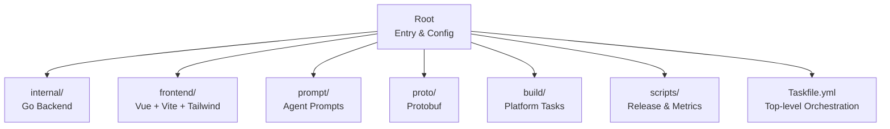
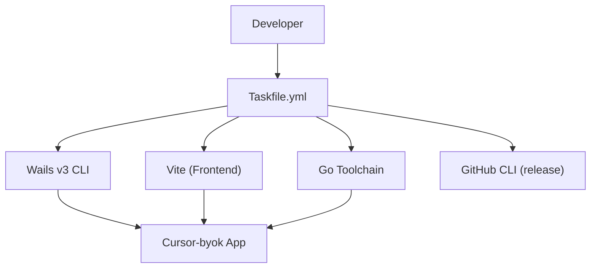
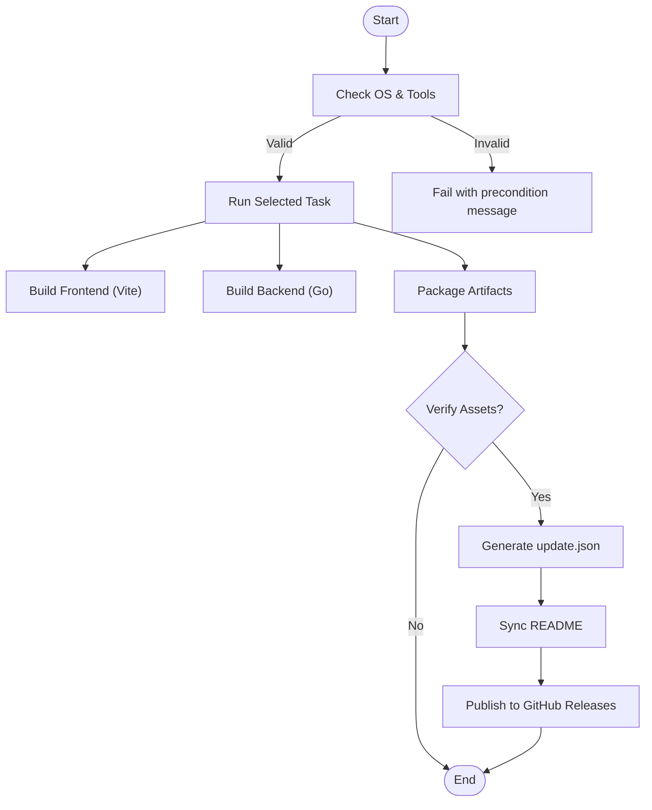
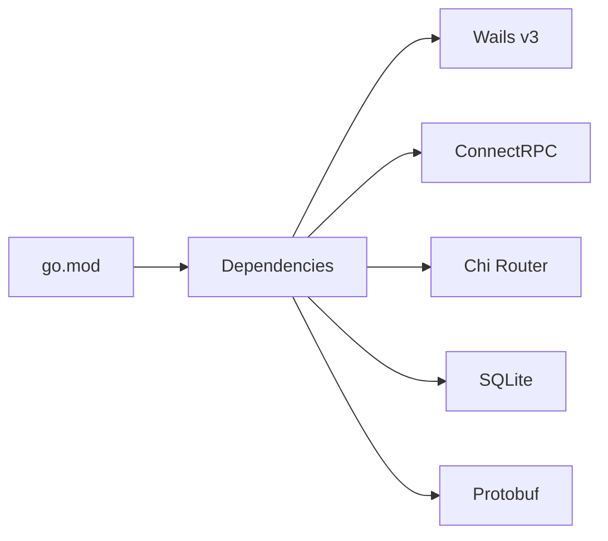
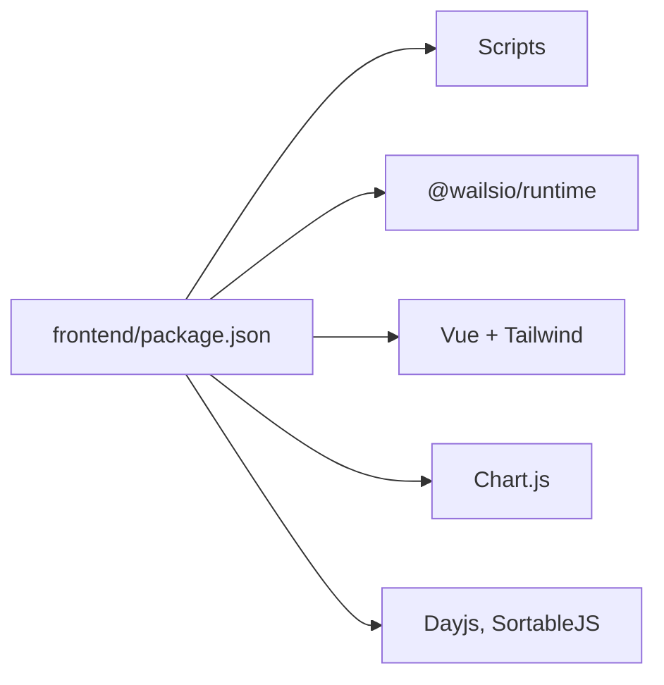
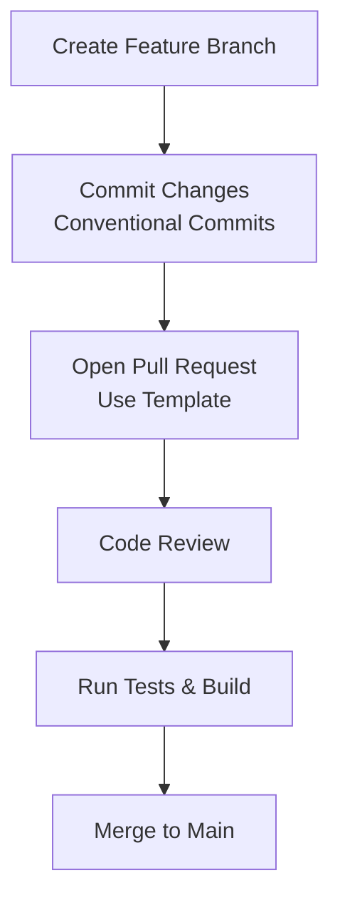
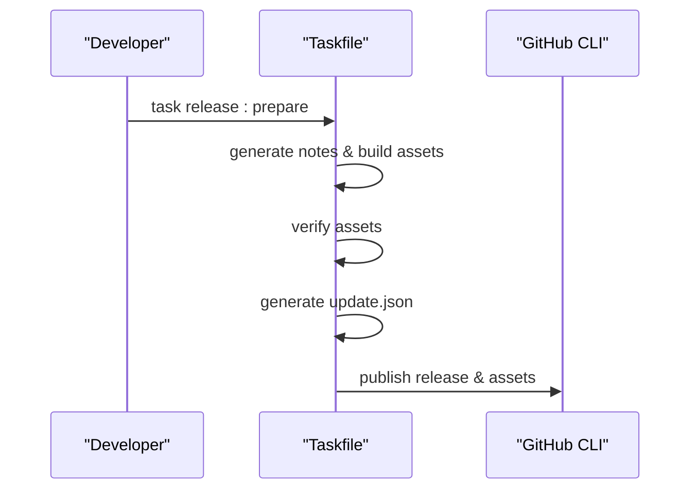
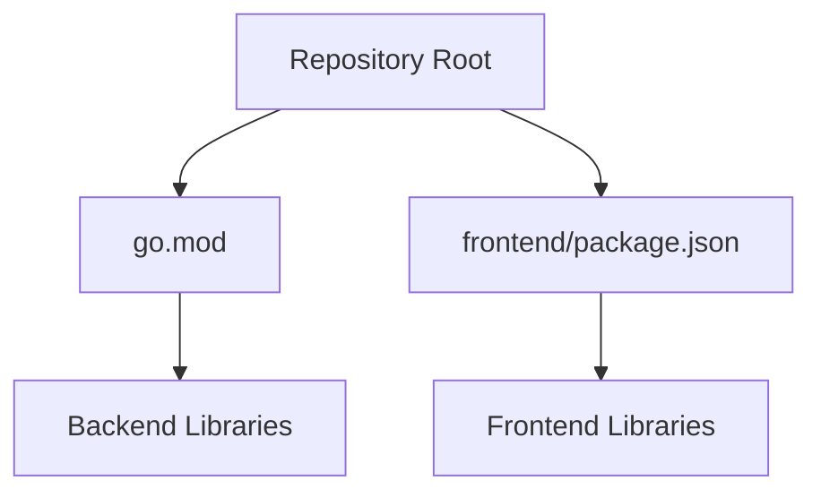

# Development Guide

<cite>
**Referenced Files in This Document**
- [README.md](file://README.md)
- [CONTRIBUTING_EN.md](file://CONTRIBUTING_EN.md)
- [Taskfile.yml](file://Taskfile.yml)
- [go.mod](file://go.mod)
- [frontend/package.json](file://frontend/package.json)
- [.github/PULL_REQUEST_TEMPLATE.md](file://.github/PULL_REQUEST_TEMPLATE.md)
- [main.go](file://main.go)
</cite>

## Table of Contents
1. [Introduction](#introduction)
2. [Project Structure](#project-structure)
3. [Core Components](#core-components)
4. [Architecture Overview](#architecture-overview)
5. [Detailed Component Analysis](#detailed-component-analysis)
6. [Dependency Analysis](#dependency-analysis)
7. [Performance Considerations](#performance-considerations)
8. [Troubleshooting Guide](#troubleshooting-guide)
9. [Conclusion](#conclusion)
10. [Appendices](#appendices)

## Introduction
This document is the comprehensive development guide for contributing to cursor-byok. It explains the project structure, coding standards, and development workflow; documents the build system using Taskfile; covers dependency management for both Go backend and Vue.js frontend; outlines testing strategies; and provides guidance on pull requests, code review, releases, environment setup, running tests, generating documentation, and debugging both frontend and backend components.

cursor-byok is a local implementation of Cursor’s backend that runs on your machine, connects Cursor to model APIs you configure, routes model requests through your own providers, and preserves Agent capabilities such as tool calling, Skills, and MCP.

**Section sources**
- [README.md:1-139](file://README.md#L1-L139)

## Project Structure
The repository is organized into clear layers:
- Root-level entry point and configuration files
- internal/ for Go backend modules (proxy, forwarding, client management, server, agent, etc.)
- frontend/ for the Vue 3 + Vite + Tailwind UI
- prompt/ for built-in Agent prompt templates
- proto/ for Protobuf definitions
- build/ for platform-specific build configurations and Taskfiles
- scripts/ for helper scripts (release, metrics)
- Taskfile.yml for top-level task orchestration

**Diagram sources**
- [main.go:1-30](file://main.go#L1-L30)
- [Taskfile.yml:1-579](file://Taskfile.yml#L1-L579)

**Section sources**
- [CONTRIBUTING_EN.md:32-49](file://CONTRIBUTING_EN.md#L32-L49)
- [Taskfile.yml:1-579](file://Taskfile.yml#L1-L579)

## Core Components
- Application entrypoint initializes logging and starts the app with embedded assets and icons.
- The backend includes proxying, request forwarding, client management, and server routing.
- The frontend is a Vue 3 application built with Vite and styled with Tailwind.
- Build and release are orchestrated via Taskfile tasks for cross-platform packaging and publishing.

Key responsibilities:
- main.go: Bootstraps the application and embeds frontend assets and icons.
- Taskfile.yml: Defines dev, build, run, release, and platform-specific packaging tasks.
- go.mod: Declares Go dependencies and runtime version.
- frontend/package.json: Declares frontend dependencies and scripts.

**Section sources**
- [main.go:1-30](file://main.go#L1-L30)
- [Taskfile.yml:1-579](file://Taskfile.yml#L1-L579)
- [go.mod:1-76](file://go.mod#L1-L76)
- [frontend/package.json:1-40](file://frontend/package.json#L1-L40)

## Architecture Overview
At a high level, the development workflow integrates:
- Wails v3 CLI for dev mode and packaging
- Vite for frontend development and builds
- Taskfile for orchestrating tasks across platforms
- Go toolchain for backend builds and tests
- GitHub CLI for release publishing

**Diagram sources**
- [Taskfile.yml:185-193](file://Taskfile.yml#L185-L193)
- [Taskfile.yml:303-340](file://Taskfile.yml#L303-L340)
- [Taskfile.yml:441-578](file://Taskfile.yml#L441-L578)

## Detailed Component Analysis

### Build System and Taskfile Orchestration
The Taskfile defines tasks for:
- Development: dev, proxy-debugger
- Building: build, build:all, platform-specific builds
- Release: release:prepare, release:verify:assets, release:manifest, release:sync:readme, release:github
- Utilities: clean:dist, setup:docker, cursor-tab-server docker image

Important behaviors:
- Precondition checks ensure correct OS and required tools (wails3, gh).
- Cross-platform packaging outputs DMG, ZIP, and tar.gz artifacts.
- Release notes are generated from release-notes.md and synced to README.

**Diagram sources**
- [Taskfile.yml:28-57](file://Taskfile.yml#L28-L57)
- [Taskfile.yml:185-193](file://Taskfile.yml#L185-L193)
- [Taskfile.yml:303-340](file://Taskfile.yml#L303-L340)
- [Taskfile.yml:342-356](file://Taskfile.yml#L342-L356)
- [Taskfile.yml:441-578](file://Taskfile.yml#L441-L578)

**Section sources**
- [Taskfile.yml:1-579](file://Taskfile.yml#L1-L579)

### Dependency Management

#### Go Backend
- Runtime version: Go 1.25+
- Key dependencies include Wails v3, ConnectRPC, Chi, SQLite, Protobuf, and various utilities.
- Use standard Go module commands to manage dependencies.

**Diagram sources**
- [go.mod:1-76](file://go.mod#L1-L76)

**Section sources**
- [go.mod:1-76](file://go.mod#L1-L76)

#### Vue.js Frontend
- Framework: Vue 3 with Vite and Tailwind CSS
- Scripts: dev, build, build:dev, preview
- Dependencies include Chart.js, sortablejs, dayjs, and Wails runtime integration.

**Diagram sources**
- [frontend/package.json:1-40](file://frontend/package.json#L1-L40)

**Section sources**
- [frontend/package.json:1-40](file://frontend/package.json#L1-L40)

### Testing Strategies
- Unit tests: Go test files under internal/* directories cover core logic, including agent bridge, model handling, and utility functions.
- Integration tests: Tests validate interactions between components, such as mock handlers and upstream clients.
- E2E testing: Not explicitly defined in the repository; focus is on unit and integration tests within Go packages.

Recommended practices:
- Add or extend existing *_test.go files for new functionality.
- Use table-driven tests where appropriate.
- Keep tests focused and deterministic.

**Section sources**
- [CONTRIBUTING_EN.md:63-67](file://CONTRIBUTING_EN.md#L63-L67)

### Pull Request Process and Code Review Guidelines
- Create feature branches from main: feat/xxx, fix/xxx.
- Keep PRs small and focused — one problem per PR.
- Describe motivation and how to test in the PR description.
- Follow Conventional Commits style for commit messages.
- Use the provided PR template to structure descriptions.

**Diagram sources**
- [CONTRIBUTING_EN.md:69-73](file://CONTRIBUTING_EN.md#L69-L73)
- [.github/PULL_REQUEST_TEMPLATE.md:1-13](file://.github/PULL_REQUEST_TEMPLATE.md#L1-L13)

**Section sources**
- [CONTRIBUTING_EN.md:51-73](file://CONTRIBUTING_EN.md#L51-L73)
- [.github/PULL_REQUEST_TEMPLATE.md:1-13](file://.github/PULL_REQUEST_TEMPLATE.md#L1-L13)

### Release Procedures
- Prepare release assets on macOS or Linux using wails3.
- Generate release notes from release-notes.md.
- Verify all platform artifacts exist.
- Generate update manifest and sync README.
- Publish to GitHub Releases using GitHub CLI.

**Diagram sources**
- [Taskfile.yml:303-340](file://Taskfile.yml#L303-L340)
- [Taskfile.yml:342-356](file://Taskfile.yml#L342-L356)
- [Taskfile.yml:441-578](file://Taskfile.yml#L441-L578)

**Section sources**
- [Taskfile.yml:303-340](file://Taskfile.yml#L303-L340)
- [Taskfile.yml:342-356](file://Taskfile.yml#L342-L356)
- [Taskfile.yml:441-578](file://Taskfile.yml#L441-L578)

### Environment Setup and Development Workflow
Prerequisites:
- Go >= 1.25
- Node.js >= 20
- Yarn 1.x (classic)
- Task >= 3
- Wails v3 CLI alpha.74+
- Linux additional dependencies: libgtk-3-dev, libwebkit2gtk-4.1-dev

Quick start:
- Install frontend dependencies: cd frontend && yarn install --frozen-lockfile && cd ..
- Start dev mode: task dev
- Build current platform: task build

Development tips:
- Use task dev for hot reload during frontend changes.
- Use task proxy-debugger to start an independent Cursor protocol debugger.
- Use platform-specific build tasks for packaging.

**Section sources**
- [CONTRIBUTING_EN.md:7-30](file://CONTRIBUTING_EN.md#L7-L30)
- [Taskfile.yml:185-193](file://Taskfile.yml#L185-L193)

### Debugging Frontend and Backend
Frontend:
- Run Vite dev server via task dev.
- Inspect network calls and UI state in browser developer tools.
- Use Vite plugins and Tailwind utilities for faster iteration.

Backend:
- Use task proxy-debugger to launch a standalone Cursor protocol debugger.
- Leverage Go logging and structured logs for tracing requests and responses.
- Validate upstream client behavior and mock handlers.

**Section sources**
- [Taskfile.yml:190-198](file://Taskfile.yml#L190-L198)

## Dependency Analysis
The project has two primary dependency surfaces:
- Go backend dependencies declared in go.mod
- Frontend dependencies declared in frontend/package.json

**Diagram sources**
- [go.mod:1-76](file://go.mod#L1-L76)
- [frontend/package.json:1-40](file://frontend/package.json#L1-L40)

**Section sources**
- [go.mod:1-76](file://go.mod#L1-L76)
- [frontend/package.json:1-40](file://frontend/package.json#L1-L40)

## Performance Considerations
- Prefer efficient data structures and avoid unnecessary allocations in Go code.
- Use streaming and incremental processing where possible for large payloads.
- Minimize frontend bundle size by leveraging Vite optimizations and lazy loading.
- Profile critical paths using Go pprof and browser performance tools.

[No sources needed since this section provides general guidance]

## Troubleshooting Guide
Common issues and resolutions:
- Missing prerequisites: Ensure Go, Node.js, Yarn, Task, and Wails v3 CLI are installed and meet version requirements.
- Linux GUI dependencies: Install libgtk-3-dev and libwebkit2gtk-4.1-dev for Wails runtime.
- Frontend build failures: Clear node_modules and reinstall dependencies; verify yarn.lock consistency.
- Release publishing errors: Authenticate GitHub CLI and ensure release assets are present.

Operational checks:
- Validate Taskfile preconditions pass before running tasks.
- Confirm Docker daemon availability when building cursor-tab-server images.

**Section sources**
- [CONTRIBUTING_EN.md:7-17](file://CONTRIBUTING_EN.md#L7-L17)
- [Taskfile.yml:156-174](file://Taskfile.yml#L156-L174)
- [Taskfile.yml:303-340](file://Taskfile.yml#L303-L340)

## Conclusion
This guide consolidates the development workflow, build system, dependency management, testing strategies, and release procedures for cursor-byok. By following the outlined conventions and using the provided Taskfile tasks, contributors can efficiently develop, test, and release changes while maintaining consistency across platforms.

[No sources needed since this section summarizes without analyzing specific files]

## Appendices

### Quick Reference Commands
- Install frontend dependencies: cd frontend && yarn install --frozen-lockfile && cd ..
- Start development mode: task dev
- Build current platform: task build
- Build all platforms (macOS host only): task build:all
- Prepare release assets: task release:prepare
- Publish to GitHub Releases: task release:github

**Section sources**
- [CONTRIBUTING_EN.md:19-30](file://CONTRIBUTING_EN.md#L19-L30)
- [CONTRIBUTING_EN.md:75-86](file://CONTRIBUTING_EN.md#L75-L86)