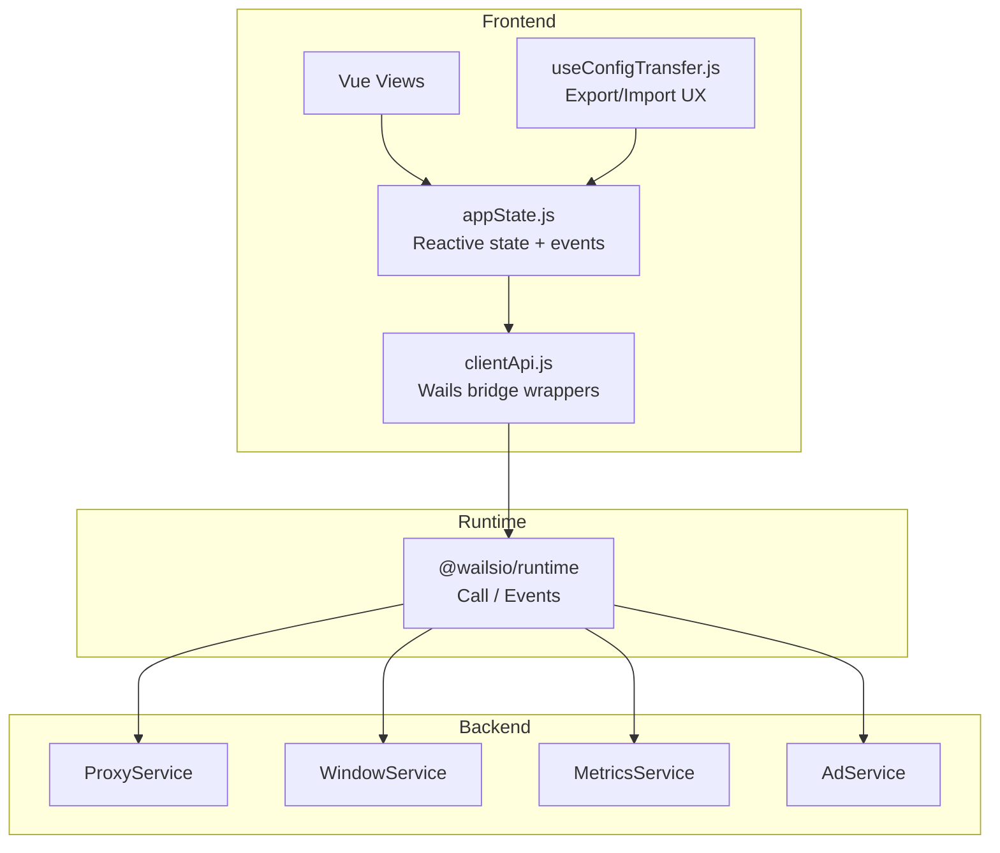
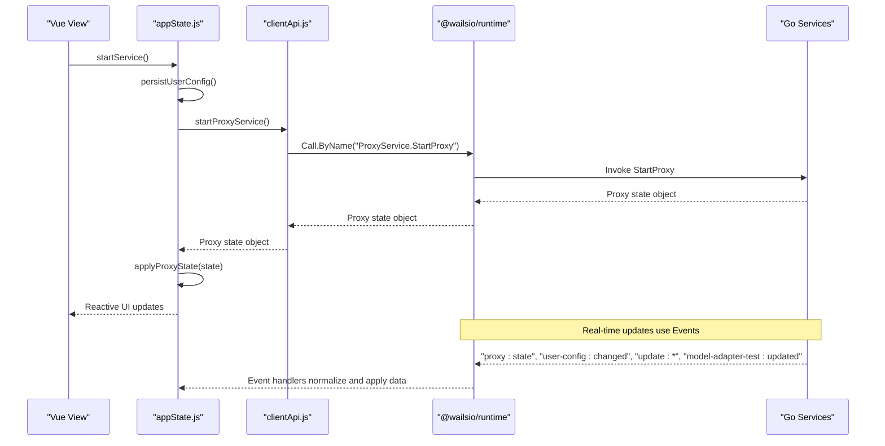
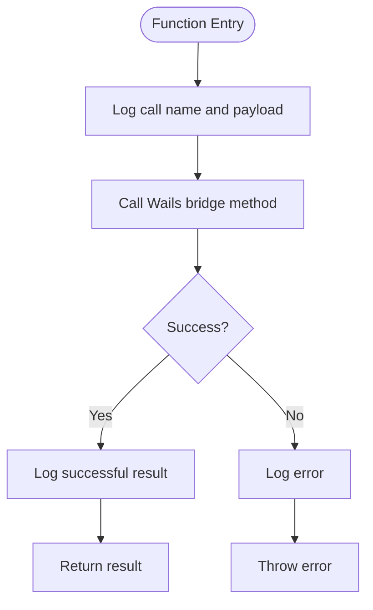
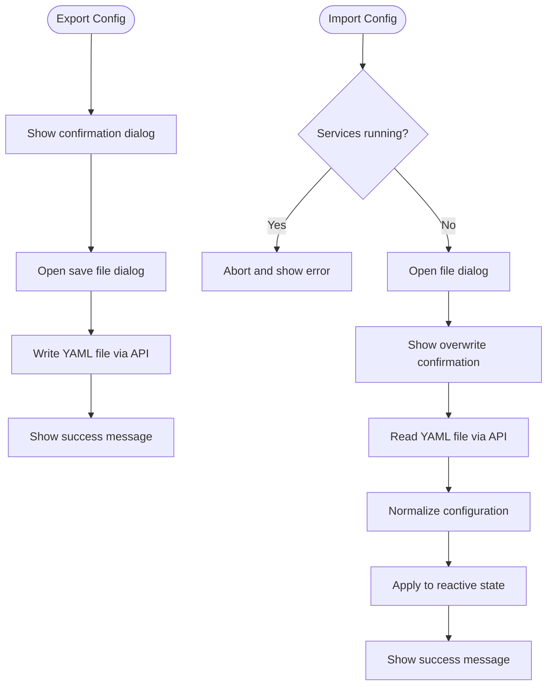
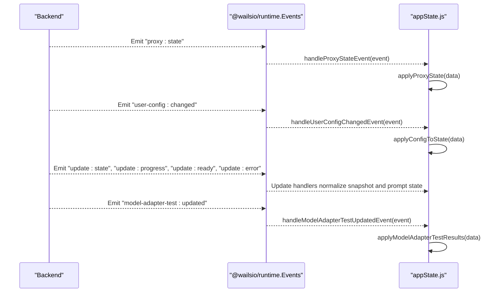
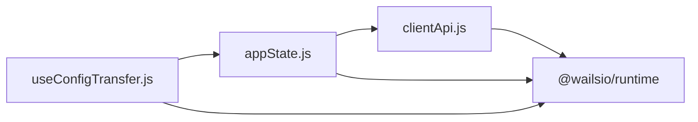

# API Integration

<cite>
**Referenced Files in This Document**
- [clientApi.js](file://frontend/src/services/clientApi.js)
- [appState.js](file://frontend/src/state/appState.js)
- [useConfigTransfer.js](file://frontend/src/composables/useConfigTransfer.js)
</cite>

## Table of Contents
1. [Introduction](#introduction)
2. [Project Structure](#project-structure)
3. [Core Components](#core-components)
4. [Architecture Overview](#architecture-overview)
5. [Detailed Component Analysis](#detailed-component-analysis)
6. [Dependency Analysis](#dependency-analysis)
7. [Performance Considerations](#performance-considerations)
8. [Troubleshooting Guide](#troubleshooting-guide)
9. [Conclusion](#conclusion)
10. [Appendices](#appendices)

## Introduction
This document explains how the frontend communicates with the backend through a Wails-based bridge. It focuses on the client API service layer, request and response handling, error management, configuration transfer, real-time event updates, and practical guidelines for adding new endpoints. The application does not use HTTP APIs directly; instead, it calls Go services via `@wailsio/runtime`. There is no WebSocket connection in the frontend codebase.

## Project Structure
The relevant frontend integration lives under `frontend/src`:
- `services/clientApi.js` exposes typed wrappers around Wails bridge calls.
- `state/appState.js` owns reactive state, persistence, event subscriptions, and orchestration of API calls.
- `composables/useConfigTransfer.js` provides user-facing export/import flows that rely on file dialogs and the API service layer.

**Diagram sources**
- [clientApi.js:1-26](file://frontend/src/services/clientApi.js#L1-L26)
- [appState.js:1-52](file://frontend/src/state/appState.js#L1-L52)
- [useConfigTransfer.js:1-10](file://frontend/src/composables/useConfigTransfer.js#L1-L10)

**Section sources**
- [clientApi.js:1-26](file://frontend/src/services/clientApi.js#L1-L26)
- [appState.js:1-52](file://frontend/src/state/appState.js#L1-L52)
- [useConfigTransfer.js:1-10](file://frontend/src/composables/useConfigTransfer.js#L1-L10)

## Core Components
- Client API service layer (`clientApi.js`)
  - Wraps Wails bridge methods for proxy, window, metrics, and ad services.
  - Adds consistent logging helpers for success and error paths.
  - Exposes functions such as loading/saving user config, starting/stopping proxy, fetching metrics, checking updates, and testing model adapters.

- Application state manager (`appState.js`)
  - Owns all reactive UI state and business normalization logic.
  - Subscribes to runtime events for proxy state, user config changes, update lifecycle, and model adapter test results.
  - Persists configuration to local storage and coordinates save/load operations.
  - Orchestrates higher-level workflows like starting/stopping services, refreshing metrics, and managing update prompts.

- Configuration transfer composable (`useConfigTransfer.js`)
  - Provides user flows for exporting and importing YAML configuration files.
  - Validates service running state before import and shows confirmation dialogs.

**Section sources**
- [clientApi.js:28-56](file://frontend/src/services/clientApi.js#L28-L56)
- [clientApi.js:58-180](file://frontend/src/services/clientApi.js#L58-L180)
- [appState.js:518-605](file://frontend/src/state/appState.js#L518-L605)
- [appState.js:643-694](file://frontend/src/state/appState.js#L643-L694)
- [appState.js:820-900](file://frontend/src/state/appState.js#L820-L900)
- [useConfigTransfer.js:13-91](file://frontend/src/composables/useConfigTransfer.js#L13-L91)

## Architecture Overview
The frontend uses Wails runtime to call backend services synchronously or asynchronously. There are two primary communication patterns:
- Direct method calls via `Call.ByName` or generated bindings.
- Event-driven updates via `Events.On` for long-running or asynchronous backend notifications.

**Diagram sources**
- [appState.js:1349-1367](file://frontend/src/state/appState.js#L1349-L1367)
- [clientApi.js:116-122](file://frontend/src/services/clientApi.js#L116-L122)
- [appState.js:902-970](file://frontend/src/state/appState.js#L902-L970)

## Detailed Component Analysis

### Client API Service Layer
Responsibilities:
- Centralize all Wails bridge calls.
- Provide consistent logging for debugging.
- Export simple functions for views and state to consume.

Key behaviors:
- Logging wrapper logs payload and result/error for each call.
- Some calls use generated bindings (for example, load/save user config, get proxy state).
- Other calls use `Call.ByName` with a fixed service name prefix for proxy-related operations.

**Diagram sources**
- [clientApi.js:31-56](file://frontend/src/services/clientApi.js#L31-L56)
- [clientApi.js:58-180](file://frontend/src/services/clientApi.js#L58-L180)

**Section sources**
- [clientApi.js:28-56](file://frontend/src/services/clientApi.js#L28-L56)
- [clientApi.js:58-180](file://frontend/src/services/clientApi.js#L58-L180)

### Request and Response Handling
Patterns:
- Synchronous-looking async calls return Promises resolved by Wails bridge.
- Responses are normalized in `appState.js` before being applied to reactive state.
- Errors are extracted into user-friendly messages using a helper that supports string and object errors.

Normalization examples:
- Model adapter configurations are normalized for field names, types, and supported values.
- Home metrics are normalized to a stable shape.
- Update lifecycle snapshots are normalized to safe states and percentages.

**Section sources**
- [appState.js:334-422](file://frontend/src/state/appState.js#L334-L422)
- [appState.js:538-605](file://frontend/src/state/appState.js#L538-L605)
- [appState.js:696-758](file://frontend/src/state/appState.js#L696-L758)
- [appState.js:810-818](file://frontend/src/state/appState.js#L810-L818)

### Error Management
Strategies:
- Service-layer logging captures payloads and errors for debugging.
- State layer converts raw errors into user-readable strings.
- Workflows wrap critical operations in try/catch blocks and set explicit error fields in state.
- UI components can display these error fields or show action-specific error messages.

Common error sources:
- Bridge call failures.
- Invalid configuration payloads.
- Service busy flags preventing concurrent operations.

**Section sources**
- [clientApi.js:31-56](file://frontend/src/services/clientApi.js#L31-L56)
- [appState.js:611-641](file://frontend/src/state/appState.js#L611-L641)
- [appState.js:1318-1385](file://frontend/src/state/appState.js#L1318-L1385)
- [appState.js:1434-1437](file://frontend/src/state/appState.js#L1434-L1437)

### Authentication Flows
There is no direct authentication flow in the frontend code. Authentication is handled by the backend services exposed through Wails. The frontend triggers account-related actions such as:
- Getting cursor account status.
- Starting login.
- Disconnecting the account.

These are exposed as service functions and invoked from state or views.

**Section sources**
- [clientApi.js:88-98](file://frontend/src/services/clientApi.js#L88-L98)

### Configuration Transfer Mechanisms
The application supports full configuration export and import:
- Export opens a file dialog, writes a YAML file, and reports success.
- Import validates that services are stopped, asks for confirmation, reads the YAML file, normalizes the configuration, and applies it to state.

**Diagram sources**
- [useConfigTransfer.js:16-47](file://frontend/src/composables/useConfigTransfer.js#L16-L47)
- [useConfigTransfer.js:49-85](file://frontend/src/composables/useConfigTransfer.js#L49-L85)
- [appState.js:1127-1146](file://frontend/src/state/appState.js#L1127-L1146)

**Section sources**
- [useConfigTransfer.js:13-91](file://frontend/src/composables/useConfigTransfer.js#L13-L91)
- [appState.js:1127-1146](file://frontend/src/state/appState.js#L1127-L1146)

### Real-Time Updates and WebSocket Connections
Real-time updates are implemented through Wails events rather than WebSockets:
- Proxy state events update service status, listen addresses, and network proxy information.
- User config change events keep the UI synchronized with persisted configuration.
- Update lifecycle events manage version checks, downloads, readiness, and errors.
- Model adapter test updated events push incremental test results.

**Diagram sources**
- [appState.js:902-970](file://frontend/src/state/appState.js#L902-L970)
- [appState.js:643-694](file://frontend/src/state/appState.js#L643-L694)
- [appState.js:696-808](file://frontend/src/state/appState.js#L696-L808)

**Section sources**
- [appState.js:44-52](file://frontend/src/state/appState.js#L44-L52)
- [appState.js:643-694](file://frontend/src/state/appState.js#L643-L694)
- [appState.js:696-808](file://frontend/src/state/appState.js#L696-L808)
- [appState.js:902-970](file://frontend/src/state/appState.js#L902-L970)

### Request Interception, Response Caching, Retry Logic, and Connection Pooling
- Request interception: Not implemented. All calls go through `clientApi.js`, which adds logging but no interceptor chain.
- Response caching: No generic HTTP cache exists. Local storage caches application state and configuration, not individual API responses.
- Retry logic: No automatic retry mechanism is present in the frontend.
- Connection pooling: Not applicable because there is no HTTP client; communication uses Wails bridge calls.

Recommendations if you add an HTTP layer later:
- Add an interceptor for auth headers and request tracing.
- Implement response caching keyed by request signature.
- Add exponential backoff retries for transient errors.
- Use a connection pool for shared HTTP clients.

[No sources needed since this section provides general guidance]

### Guidelines for Adding New API Endpoints
Steps:
1. Define the function in `clientApi.js`.
   - Prefer generated bindings when available.
   - Use `Call.ByName` with the correct service name and method.
   - Wrap the call with the logging helper for consistency.
2. Add a state workflow in `appState.js`.
   - Normalize the response.
   - Apply it to reactive state.
   - Handle errors and loading states.
3. Subscribe to events if the operation is long-running.
   - Add a constant for the event name.
   - Register a handler with `Events.On`.
   - Normalize and apply the event payload.
4. Expose a high-level function for views.
   - Keep view code free of bridge details.
   - Return structured results with `ok` and `error` where appropriate.

Example pattern references:
- Adding a proxy control endpoint: see start/stop proxy functions.
- Adding a metrics endpoint: see home metrics sync.
- Adding an update lifecycle endpoint: see update event handlers.

**Section sources**
- [clientApi.js:116-122](file://frontend/src/services/clientApi.js#L116-L122)
- [clientApi.js:132-146](file://frontend/src/services/clientApi.js#L132-L146)
- [appState.js:1318-1385](file://frontend/src/state/appState.js#L1318-L1385)
- [appState.js:1324-1347](file://frontend/src/state/appState.js#L1324-L1347)
- [appState.js:932-970](file://frontend/src/state/appState.js#L932-L970)

### Handling Different Response Formats
Best practices:
- Always normalize backend responses before applying them to state.
- Support multiple field names for backward compatibility.
- Validate enums and numeric ranges.
- Provide fallback defaults for missing fields.

Examples:
- Model adapter normalization supports legacy and new field names.
- Home metrics normalization maps provider totals to internal metrics.
- Update snapshot normalization ensures safe state transitions.

**Section sources**
- [appState.js:334-422](file://frontend/src/state/appState.js#L334-L422)
- [appState.js:561-574](file://frontend/src/state/appState.js#L561-L574)
- [appState.js:696-758](file://frontend/src/state/appState.js#L696-L758)

### Robust Error Handling Strategies
Recommended approach:
- Convert raw errors to user-friendly messages at the state layer.
- Preserve original error details for debugging while showing safe messages to users.
- Guard against concurrent operations using busy flags.
- Reset loading and error states in finally blocks.

**Section sources**
- [appState.js:810-818](file://frontend/src/state/appState.js#L810-L818)
- [appState.js:1434-1437](file://frontend/src/state/appState.js#L1434-L1437)
- [appState.js:611-641](file://frontend/src/state/appState.js#L611-L641)
- [appState.js:1349-1385](file://frontend/src/state/appState.js#L1349-L1385)

## Dependency Analysis
The frontend has clear separation between service calls and state management:
- `clientApi.js` depends only on Wails runtime and generated bindings.
- `appState.js` depends on `clientApi.js` and Wails events.
- `useConfigTransfer.js` depends on Wails dialogs and state utilities.

**Diagram sources**
- [clientApi.js:1-26](file://frontend/src/services/clientApi.js#L1-L26)
- [appState.js:1-22](file://frontend/src/state/appState.js#L1-L22)
- [useConfigTransfer.js:1-10](file://frontend/src/composables/useConfigTransfer.js#L1-L10)

**Section sources**
- [clientApi.js:1-26](file://frontend/src/services/clientApi.js#L1-L26)
- [appState.js:1-22](file://frontend/src/state/appState.js#L1-L22)
- [useConfigTransfer.js:1-10](file://frontend/src/composables/useConfigTransfer.js#L1-L10)

## Performance Considerations
- Avoid redundant API calls by relying on event-driven updates for proxy state and configuration changes.
- Normalize data once and reuse normalized objects in state.
- Debounce frequent UI-triggered operations if you add new endpoints.
- Keep logging minimal in production; the current logging helper is useful for development.

[No sources needed since this section provides general guidance]

## Troubleshooting Guide
Common issues and resolutions:
- Service busy errors: Prevent concurrent start/stop operations by checking busy flags.
- Configuration save conflicts: Ensure only one configuration operation runs at a time.
- Missing event updates: Verify event constants and handlers are registered.
- Invalid configuration imports: Validate service running state and confirm overwrite before import.

Debugging tips:
- Use the service-layer logging to inspect payloads and errors.
- Check reactive state fields for error messages and loading indicators.
- Inspect event emissions for proxy state, user config changes, and update lifecycle.

**Section sources**
- [clientApi.js:31-56](file://frontend/src/services/clientApi.js#L31-L56)
- [appState.js:611-641](file://frontend/src/state/appState.js#L611-L641)
- [appState.js:1318-1385](file://frontend/src/state/appState.js#L1318-L1385)
- [useConfigTransfer.js:49-85](file://frontend/src/composables/useConfigTransfer.js#L49-L85)

## Conclusion
The frontend integrates with the backend through Wails runtime, using direct service calls and event-driven updates. The client API service layer centralizes bridge calls and logging, while the state manager normalizes responses, persists configuration, and handles real-time updates. There is no HTTP client, WebSocket, request interceptor, response cache, retry logic, or connection pooling in the current implementation. To extend the system, follow the established patterns for service wrappers, state normalization, event handling, and error conversion.

[No sources needed since this section summarizes without analyzing specific files]

## Appendices

### Adding a New Endpoint Checklist
- Add a function in `clientApi.js` with logging.
- Add normalization and state application in `appState.js`.
- Subscribe to events if the operation emits progress or completion signals.
- Expose a high-level workflow for views.
- Add tests or manual verification for error paths and edge cases.

[No sources needed since this section provides general guidance]