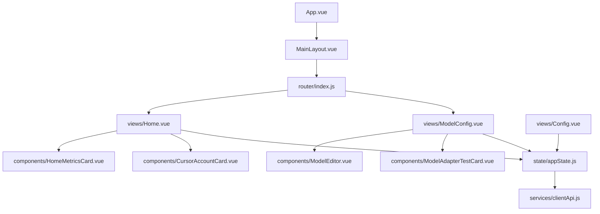
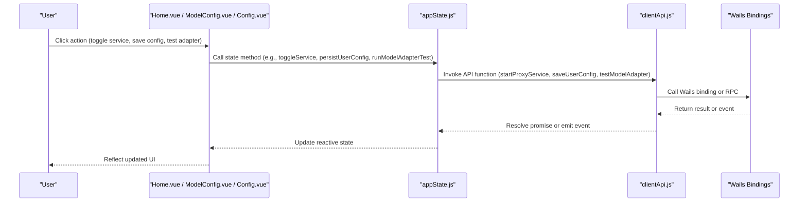
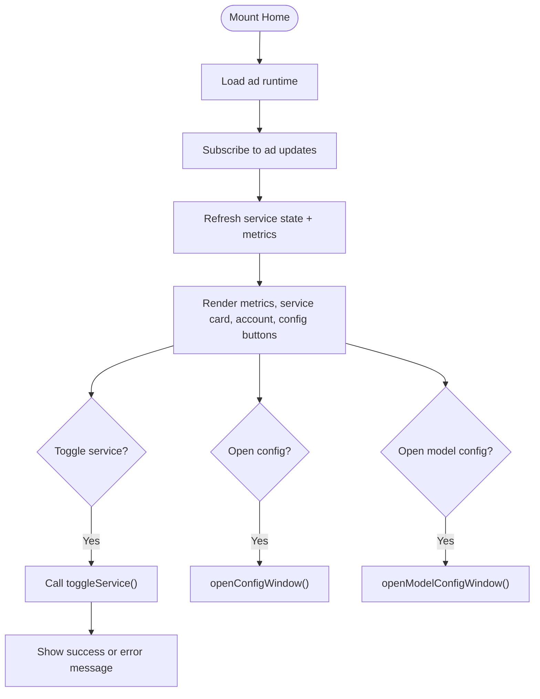
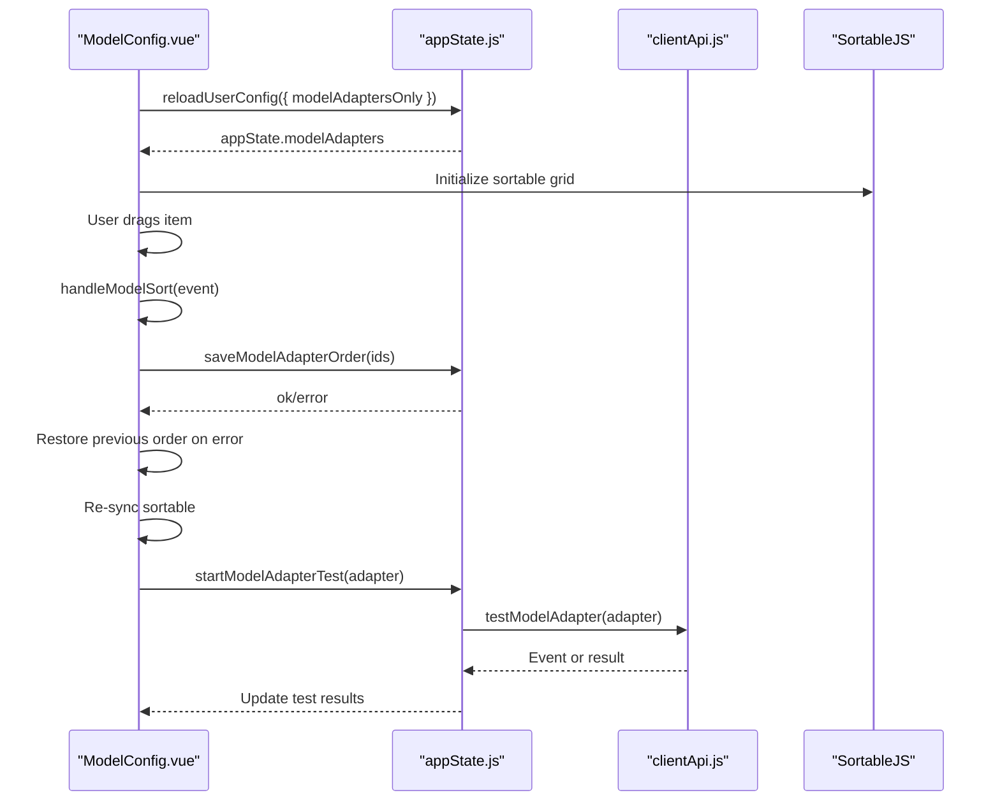
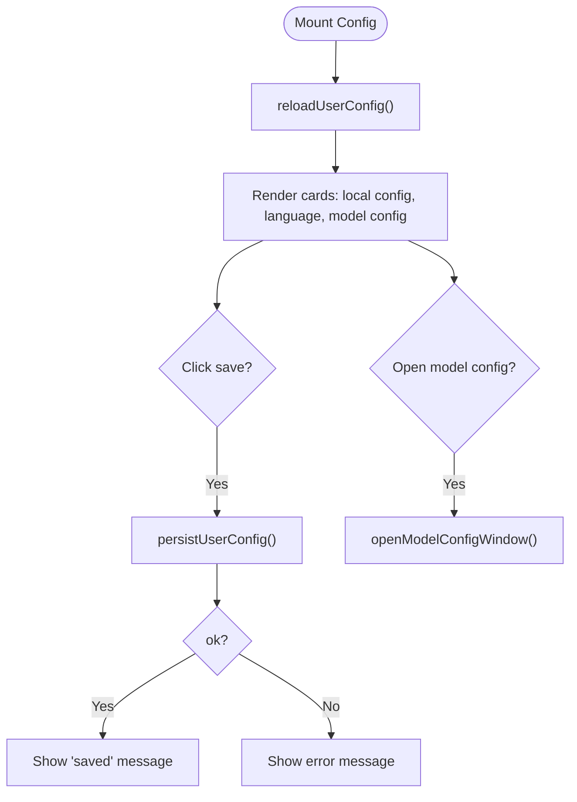
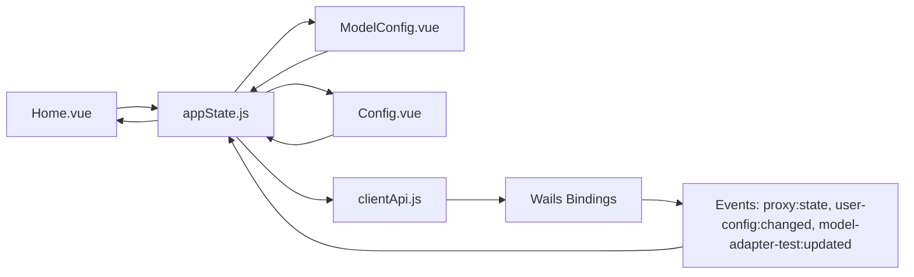
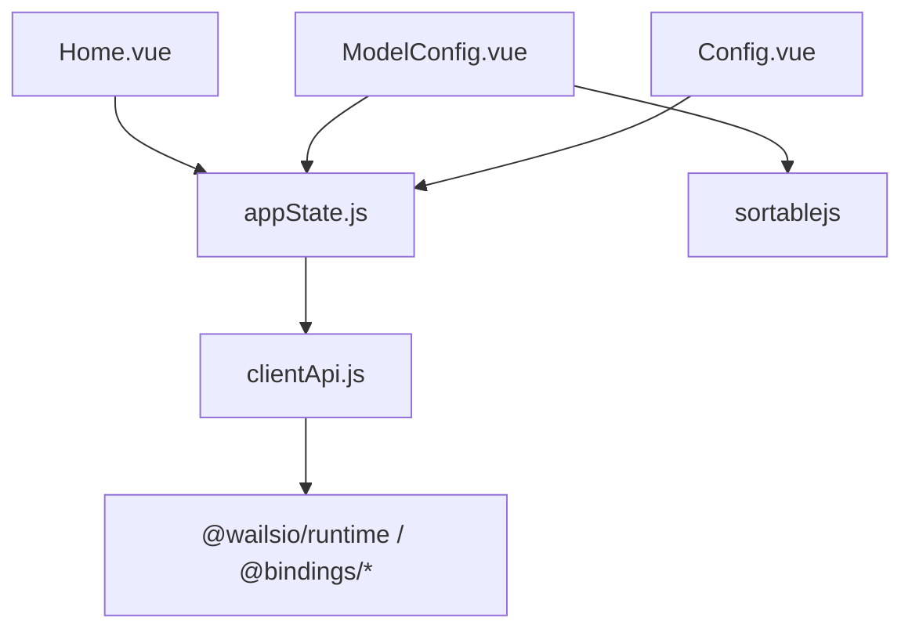

# Application Views

<cite>
**Referenced Files in This Document**
- [App.vue](file://frontend/src/App.vue)
- [MainLayout.vue](file://frontend/src/layouts/MainLayout.vue)
- [index.js](file://frontend/src/router/index.js)
- [Home.vue](file://frontend/src/views/Home.vue)
- [ModelConfig.vue](file://frontend/src/views/ModelConfig.vue)
- [Config.vue](file://frontend/src/views/Config.vue)
- [appState.js](file://frontend/src/state/appState.js)
- [clientApi.js](file://frontend/src/services/clientApi.js)
- [HomeMetricsCard.vue](file://frontend/src/components/HomeMetricsCard.vue)
- [CursorAccountCard.vue](file://frontend/src/components/CursorAccountCard.vue)
- [ModelEditor.vue](file://frontend/src/components/ModelEditor.vue)
- [ModelAdapterTestCard.vue](file://frontend/src/components/ModelAdapterTestCard.vue)
</cite>

## Table of Contents
1. [Introduction](#introduction)
2. [Project Structure](#project-structure)
3. [Core Components](#core-components)
4. [Architecture Overview](#architecture-overview)
5. [Detailed Component Analysis](#detailed-component-analysis)
6. [Dependency Analysis](#dependency-analysis)
7. [Performance Considerations](#performance-considerations)
8. [Troubleshooting Guide](#troubleshooting-guide)
9. [Conclusion](#conclusion)
10. [Appendices](#appendices)

## Introduction
This document explains the main application views and layouts for the frontend:
- Home dashboard view with metrics display, service controls, account card, and configuration entry points.
- Model Configuration view for managing LLM providers, including adapter listing, sorting, editing, testing, and batch operations.
- Settings view for local application configuration, language selection, and navigation to model configuration.

It also covers the layout system, routing, state management, API integration, error handling, user interaction patterns, and guidance for adding new views while maintaining consistent UX.

## Project Structure
The frontend is a Vue 3 application using Vue Router for navigation and Wails bindings for native integrations. The key structure relevant to this documentation is:

**Diagram sources**
- [App.vue:1-56](file://frontend/src/App.vue#L1-L56)
- [MainLayout.vue:1-232](file://frontend/src/layouts/MainLayout.vue#L1-L232)
- [index.js:1-22](file://frontend/src/router/index.js#L1-L22)
- [Home.vue:1-193](file://frontend/src/views/Home.vue#L1-L193)
- [ModelConfig.vue:1-514](file://frontend/src/views/ModelConfig.vue#L1-L514)
- [Config.vue:1-85](file://frontend/src/views/Config.vue#L1-L85)
- [appState.js:1-800](file://frontend/src/state/appState.js#L1-L800)
- [clientApi.js:1-180](file://frontend/src/services/clientApi.js#L1-L180)
- [HomeMetricsCard.vue:1-403](file://frontend/src/components/HomeMetricsCard.vue#L1-L403)
- [CursorAccountCard.vue:1-203](file://frontend/src/components/CursorAccountCard.vue#L1-L203)
- [ModelEditor.vue:1-699](file://frontend/src/components/ModelEditor.vue#L1-L699)
- [ModelAdapterTestCard.vue:1-150](file://frontend/src/components/ModelAdapterTestCard.vue#L1-L150)

**Section sources**
- [App.vue:1-56](file://frontend/src/App.vue#L1-L56)
- [MainLayout.vue:1-232](file://frontend/src/layouts/MainLayout.vue#L1-L232)
- [index.js:1-22](file://frontend/src/router/index.js#L1-L22)

## Core Components
- MainLayout provides the shell: draggable header, window controls on Windows, footer with update checks, usage docs, author link, and locale selector. It renders the current route via `router-view`.
- Router defines two routes:
  - `/` maps to Home dashboard.
  - `/model-config` maps to Model Configuration.
- App mounts MainLayout and global UI providers (message, modal, input modal), plus an ad/model provider when on the main window.

Key responsibilities:
- Layout manages window behavior, footer actions, and periodic proxy state polling.
- Router controls which view is rendered and sets meta like title and close behavior.
- App composes global UI primitives and conditionally renders main-window-only components.

**Section sources**
- [MainLayout.vue:108-121](file://frontend/src/layouts/MainLayout.vue#L108-L121)
- [MainLayout.vue:124-232](file://frontend/src/layouts/MainLayout.vue#L124-L232)
- [index.js:5-21](file://frontend/src/router/index.js#L5-L21)
- [App.vue:1-56](file://frontend/src/App.vue#L1-L56)

## Architecture Overview
The application follows a layered architecture:
- Views render UI and orchestrate user interactions.
- State module centralizes app state, normalization, validation, persistence, and event handling.
- Services wrap Wails bindings and native calls, providing typed functions for backend communication.
- Components encapsulate reusable UI logic and presentation.

**Diagram sources**
- [Home.vue:88-128](file://frontend/src/views/Home.vue#L88-L128)
- [ModelConfig.vue:265-366](file://frontend/src/views/ModelConfig.vue#L265-L366)
- [Config.vue:22-41](file://frontend/src/views/Config.vue#L22-L41)
- [appState.js:581-641](file://frontend/src/state/appState.js#L581-L641)
- [clientApi.js:58-180](file://frontend/src/services/clientApi.js#L58-L180)

## Detailed Component Analysis

### Home Dashboard View
Purpose:
- Display session metrics, cache hit rate, token usage, estimated cost.
- Show Cursor account status and login/disconnect flow.
- Provide service control (start/stop proxy).
- Open local settings folder and model configuration editor.

Key behaviors:
- Loads ad runtime data and listens for updates; filters available home ads.
- Refreshes service state and metrics concurrently; shows errors via message toast.
- Toggles service lifecycle through state methods that call native APIs.
- Opens external windows for configuration and model configuration.

Data flow:
- Metrics are normalized and displayed by HomeMetricsCard.
- Service state comes from appState, updated by events and periodic polling in MainLayout.
- Account status is polled and shown by CursorAccountCard.

Error handling:
- Centralized error formatting via `toUserError`.
- Action-specific error messages shown through useMessage.

**Diagram sources**
- [Home.vue:67-128](file://frontend/src/views/Home.vue#L67-L128)
- [Home.vue:130-139](file://frontend/src/views/Home.vue#L130-L139)
- [HomeMetricsCard.vue:211-225](file://frontend/src/components/HomeMetricsCard.vue#L211-L225)
- [CursorAccountCard.vue:77-127](file://frontend/src/components/CursorAccountCard.vue#L77-L127)

**Section sources**
- [Home.vue:1-193](file://frontend/src/views/Home.vue#L1-L193)
- [HomeMetricsCard.vue:1-403](file://frontend/src/components/HomeMetricsCard.vue#L1-L403)
- [CursorAccountCard.vue:1-203](file://frontend/src/components/CursorAccountCard.vue#L1-L203)

### Model Configuration View
Purpose:
- Manage LLM provider adapters (OpenAI, Anthropic).
- Filter by type, sort order, create/edit/duplicate/delete adapters.
- Test single or all adapters with concurrency control.
- Import/export configuration.

Key behaviors:
- Type tabs filter adapters; active tab resets if no matching adapters exist.
- Sortable grid persists order via state method; restores previous order on failure.
- Batch testing uses concurrent workers with cancel support; tracks progress and completion.
- Editor opens in a modal; saves normalize and validate adapter before persisting.

Data flow:
- Adapters loaded via reloadUserConfig(modelAdaptersOnly).
- Test results stored in appState and displayed by ModelAdapterTestCard.
- Sorting and saving handled by saveModelAdapterOrder and reloadUserConfig.

Error handling:
- Consistent showActionError wrapper around message.
- CancelError ignored during batch stop; individual failures surfaced per card.

**Diagram sources**
- [ModelConfig.vue:158-249](file://frontend/src/views/ModelConfig.vue#L158-L249)
- [ModelConfig.vue:297-366](file://frontend/src/views/ModelConfig.vue#L297-L366)
- [appState.js:679-694](file://frontend/src/state/appState.js#L679-L694)
- [clientApi.js:156-173](file://frontend/src/services/clientApi.js#L156-L173)

**Section sources**
- [ModelConfig.vue:1-514](file://frontend/src/views/ModelConfig.vue#L1-L514)
- [ModelEditor.vue:252-327](file://frontend/src/components/ModelEditor.vue#L252-L327)
- [ModelAdapterTestCard.vue:1-150](file://frontend/src/components/ModelAdapterTestCard.vue#L1-L150)

### Settings View
Purpose:
- Persist local configuration.
- Switch interface language.
- Navigate to model configuration.

Key behaviors:
- On mount, reloads user config.
- Save button triggers persistUserConfig and shows feedback.
- LocaleSelect integrates with i18n and persists language choice.

Error handling:
- Uses centralized message system for success and error notifications.

**Diagram sources**
- [Config.vue:22-41](file://frontend/src/views/Config.vue#L22-L41)

**Section sources**
- [Config.vue:1-85](file://frontend/src/views/Config.vue#L1-L85)

### Layout System and Navigation Patterns
- MainLayout renders router-view and exposes window controls and footer actions.
- Route meta controls icon visibility, title, and close behavior.
- Footer polls service state periodically and displays update progress.
- Language selector is available both in footer and within views.

Navigation patterns:
- Programmatic navigation via openConfigWindow/openModelConfigWindow rather than router.push for separate windows.
- Home view opens configuration windows and dispatches custom events for ad interactions.

**Section sources**
- [MainLayout.vue:16-51](file://frontend/src/layouts/MainLayout.vue#L16-L51)
- [MainLayout.vue:108-121](file://frontend/src/layouts/MainLayout.vue#L108-L121)
- [index.js:7-17](file://frontend/src/router/index.js#L7-L17)

### Data Flow Between Views
- All views consume appState for shared data: service state, model adapters, metrics, update prompts.
- Views trigger actions that mutate state and call clientApi to interact with native services.
- Events from native side (proxy state, user config changed, model adapter test updated) update appState reactively.

**Diagram sources**
- [appState.js:44-51](file://frontend/src/state/appState.js#L44-L51)
- [appState.js:643-694](file://frontend/src/state/appState.js#L643-L694)
- [clientApi.js:1-26](file://frontend/src/services/clientApi.js#L1-L26)

## Dependency Analysis
Coupling and cohesion:
- Views depend on state for data and actions; they do not directly call native APIs.
- State encapsulates normalization, validation, persistence, and event handling, improving cohesion.
- Services abstract Wails bindings, keeping views and state free of platform-specific details.

Potential circular dependencies:
- None observed between views and state; state imports services only.
- Components import state and UI primitives without creating cycles.

External dependencies:
- Wails runtime for window, browser, and events.
- SortableJS for drag-and-drop ordering.
- Dayjs for date formatting.

**Diagram sources**
- [Home.vue:1-19](file://frontend/src/views/Home.vue#L1-L19)
- [ModelConfig.vue:1-22](file://frontend/src/views/ModelConfig.vue#L1-L22)
- [clientApi.js:1-26](file://frontend/src/services/clientApi.js#L1-L26)

**Section sources**
- [appState.js:1-52](file://frontend/src/state/appState.js#L1-L52)
- [clientApi.js:1-26](file://frontend/src/services/clientApi.js#L1-L26)

## Performance Considerations
- Concurrent refresh: Home view refreshes service state and metrics together using Promise.allSettled to reduce latency.
- Debounced model list fetch: ModelEditor debounces fetching available models to avoid excessive requests.
- Batch testing concurrency: ModelConfig limits concurrent tests to a fixed number to balance throughput and resource usage.
- Minimal loading states: Metrics loading has a minimum duration to prevent flicker.
- LocalStorage caching: Runtime state persisted to localStorage to speed up subsequent loads.

[No sources needed since this section provides general guidance]

## Troubleshooting Guide
Common issues and resolutions:
- Service toggle fails: Check last error in appState.serviceLastError; ensure backend/proxy is reachable.
- Model adapter test fails: Inspect raw response and error in ModelAdapterTestCard; verify baseURL, apiKey, endpoint, and headers JSON validity.
- Configuration save fails: Validate adapter fields (type, baseURL, apiKey, displayName, modelID); check JSON objects for extra params and headers.
- Batch testing stuck: Use stop button; cancel errors are ignored intentionally; review active calls set.

Diagnostic tips:
- Use message toasts for immediate feedback; check console logs wrapped by clientApi logging.
- For network issues, verify proxy state and net proxy source in footer badge.
- For model list empty, ensure baseURL and apiKey are set and try refreshing model list.

**Section sources**
- [Home.vue:83-112](file://frontend/src/views/Home.vue#L83-L112)
- [ModelConfig.vue:86-89](file://frontend/src/views/ModelConfig.vue#L86-L89)
- [ModelConfig.vue:305-319](file://frontend/src/views/ModelConfig.vue#L305-L319)
- [clientApi.js:31-56](file://frontend/src/services/clientApi.js#L31-L56)

## Conclusion
The application’s views provide a cohesive dashboard and configuration experience:
- Home consolidates metrics, service control, account status, and configuration entry points.
- Model Configuration offers robust CRUD, sorting, testing, and batch operations for LLM providers.
- Settings centralizes local configuration and language preferences.

Consistent UX is achieved through shared UI components, centralized state, and uniform error handling. Adding new views should follow the established patterns: route registration, state-driven rendering, API calls via clientApi, and user feedback via message.

[No sources needed since this section summarizes without analyzing specific files]

## Appendices

### Guidance for Adding New Views
Steps:
1. Create a new Vue component under `src/views/`.
2. Register the route in `router/index.js` with appropriate meta (title, showIcon, directlyClose).
3. Compose the view using shared UI components (`Button`, `Card`, `Modal`, etc.).
4. Read/write data through `appState`; avoid direct native calls in views.
5. Trigger actions via state methods that call `clientApi`.
6. Provide user feedback using `useMessage` and handle errors with `toUserError`.
7. If the view requires window-level behavior, prefer opening a dedicated window via `openConfigWindow` or `openModelConfigWindow`.

Best practices:
- Keep views thin: delegate business logic and persistence to state.
- Normalize and validate data in state before saving.
- Use computed properties for derived UI values.
- Ensure accessibility: add aria labels and keyboard handlers where applicable.
- Maintain consistent styling using Tailwind classes and shared components.

[No sources needed since this section provides general guidance]