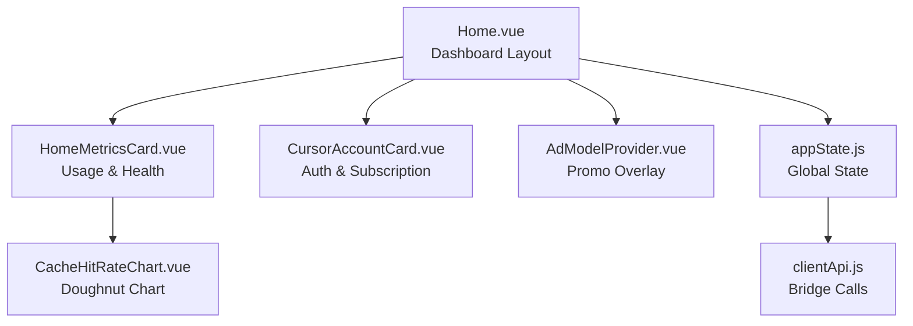
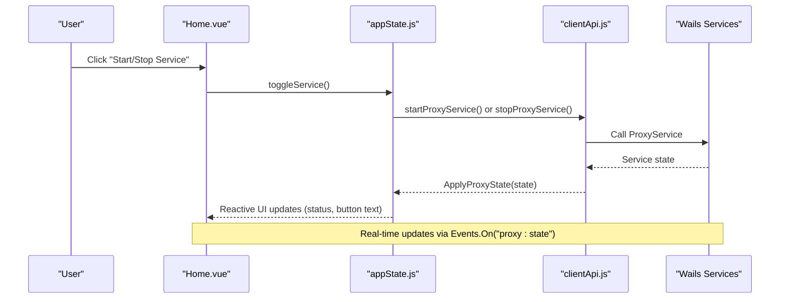
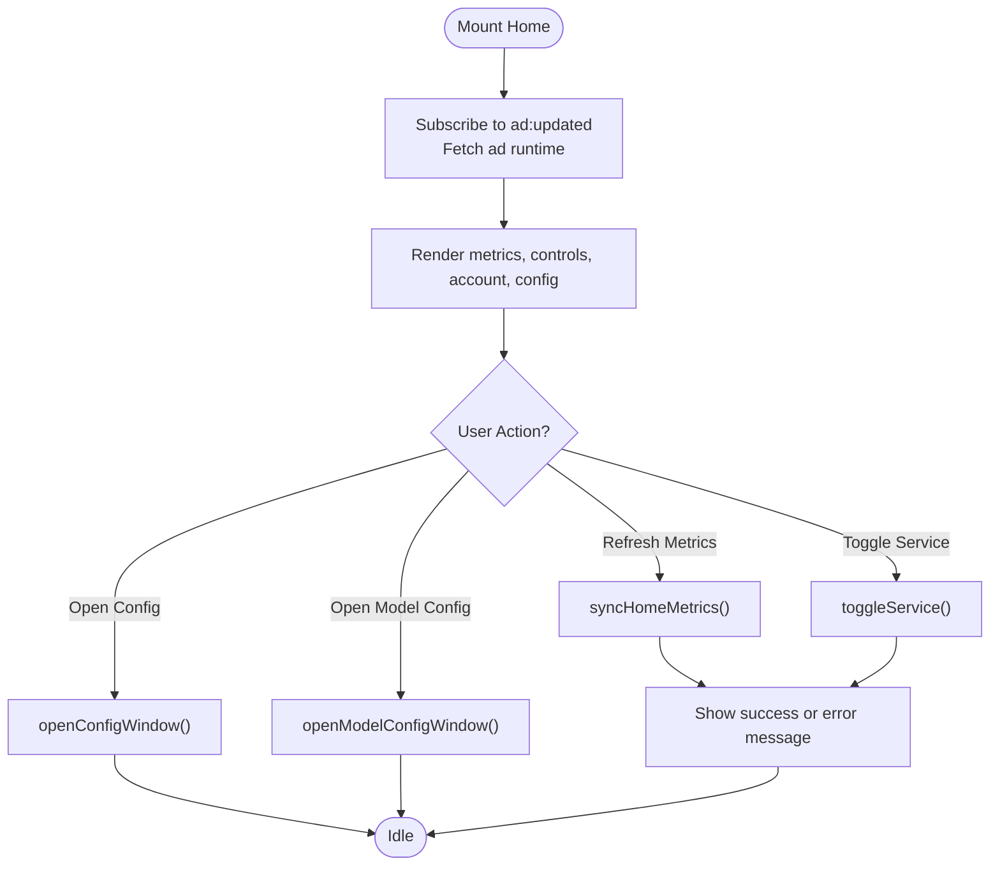
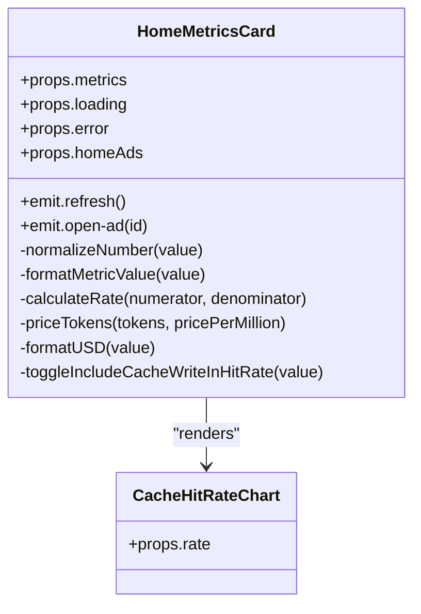
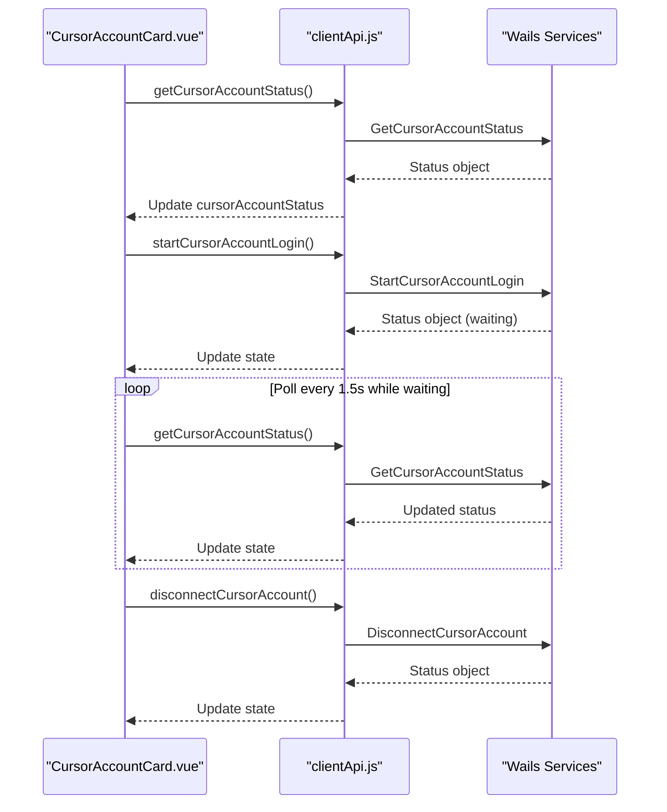
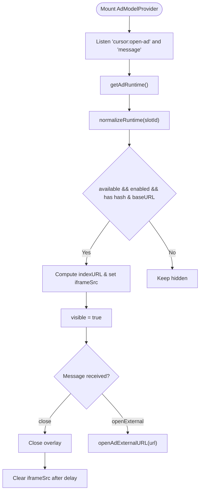
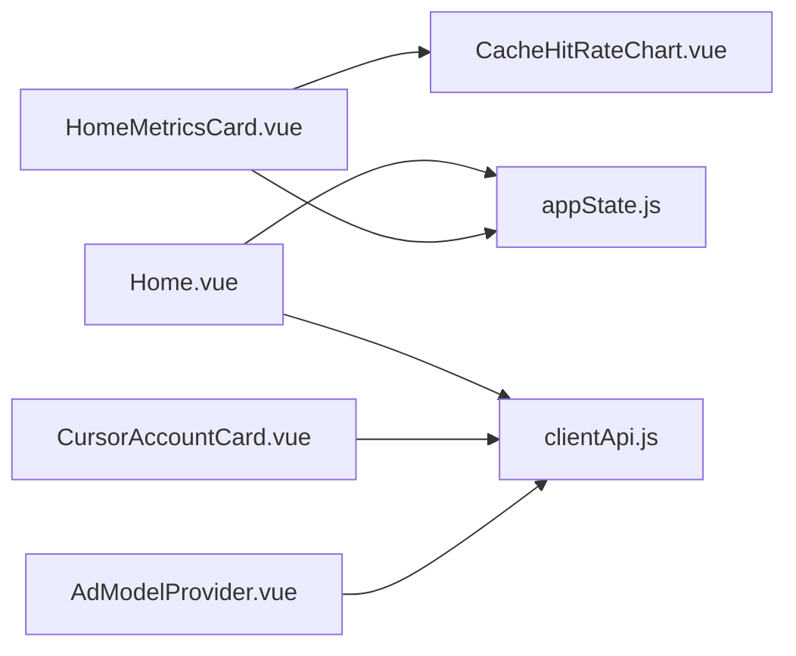

# Home Dashboard View

<cite>
**Referenced Files in This Document**
- [Home.vue](file://frontend/src/views/Home.vue)
- [HomeMetricsCard.vue](file://frontend/src/components/HomeMetricsCard.vue)
- [CursorAccountCard.vue](file://frontend/src/components/CursorAccountCard.vue)
- [AdModelProvider.vue](file://frontend/src/components/AdModelProvider.vue)
- [CacheHitRateChart.vue](file://frontend/src/components/charts/CacheHitRateChart.vue)
- [appState.js](file://frontend/src/state/appState.js)
- [clientApi.js](file://frontend/src/services/clientApi.js)
</cite>

## Table of Contents
1. [Introduction](#introduction)
2. [Project Structure](#project-structure)
3. [Core Components](#core-components)
4. [Architecture Overview](#architecture-overview)
5. [Detailed Component Analysis](#detailed-component-analysis)
6. [Dependency Analysis](#dependency-analysis)
7. [Performance Considerations](#performance-considerations)
8. [Troubleshooting Guide](#troubleshooting-guide)
9. [Conclusion](#conclusion)

## Introduction
This document explains the Home dashboard view that serves as the main interface for monitoring service status, viewing usage metrics, and performing quick actions such as starting or stopping the proxy service. It also documents:
- The metrics card showing usage statistics, performance indicators, and system health.
- The Cursor account integration card for authentication and subscription management.
- The service control panel with start/stop functionality, error handling, and status indicators.
- Event handling patterns, state synchronization with backend services, and real-time updates.
- The ad runtime integration used to display promotional content and external integrations.

The documentation is organized for both technical and non-technical readers, with progressive complexity layers, diagrams, and concrete references to source files.

## Project Structure
The Home dashboard is implemented in Vue 3 components under the frontend application. The key pieces are:
- A top-level view that composes the dashboard layout and orchestrates events.
- A metrics card component that renders usage statistics and a cache hit rate chart.
- A Cursor account card component that manages login, waiting states, and disconnection.
- An ad runtime provider that displays external promotional content via an iframe overlay.
- Centralized state management for service state, metrics, and UI flags.
- A client API layer that calls native bridge functions exposed by the Wails backend.

**Diagram sources**
- [Home.vue:1-193](file://frontend/src/views/Home.vue#L1-L193)
- [HomeMetricsCard.vue:1-403](file://frontend/src/components/HomeMetricsCard.vue#L1-L403)
- [CursorAccountCard.vue:1-203](file://frontend/src/components/CursorAccountCard.vue#L1-L203)
- [AdModelProvider.vue:1-239](file://frontend/src/components/AdModelProvider.vue#L1-L239)
- [CacheHitRateChart.vue:1-129](file://frontend/src/components/charts/CacheHitRateChart.vue#L1-L129)
- [appState.js:823-991](file://frontend/src/state/appState.js#L823-L991)
- [clientApi.js:1-180](file://frontend/src/services/clientApi.js#L1-L180)

**Section sources**
- [Home.vue:1-193](file://frontend/src/views/Home.vue#L1-L193)
- [appState.js:823-991](file://frontend/src/state/appState.js#L823-L991)
- [clientApi.js:1-180](file://frontend/src/services/clientApi.js#L1-L180)

## Core Components
- Home.vue: Orchestrates the dashboard layout, event listeners for ad runtime updates, and delegates actions to state and child components.
- HomeMetricsCard.vue: Renders session statistics, token consumption, estimated cost, and a cache hit rate visualization. It also exposes configuration toggles for how cache write tokens are included in hit rate calculations.
- CursorAccountCard.vue: Manages Cursor account login flow, shows masked identifiers, handles waiting states, and supports disconnecting the account within this app only.
- AdModelProvider.vue: Displays promotional content from an external runtime in a sandboxed iframe overlay, validates origins, and bridges external URL opening.
- CacheHitRateChart.vue: Visualizes cache hit rate using a doughnut chart with rounded segments and percentage labels.
- appState.js: Central reactive state for service status, metrics loading/error flags, configuration persistence, and computed views for UI text and button states.
- clientApi.js: Thin wrapper around Wails bindings to call backend services for proxy control, metrics, user config, and ad runtime.

**Section sources**
- [Home.vue:1-193](file://frontend/src/views/Home.vue#L1-L193)
- [HomeMetricsCard.vue:1-403](file://frontend/src/components/HomeMetricsCard.vue#L1-L403)
- [CursorAccountCard.vue:1-203](file://frontend/src/components/CursorAccountCard.vue#L1-L203)
- [AdModelProvider.vue:1-239](file://frontend/src/components/AdModelProvider.vue#L1-L239)
- [CacheHitRateChart.vue:1-129](file://frontend/src/components/charts/CacheHitRateChart.vue#L1-L129)
- [appState.js:823-991](file://frontend/src/state/appState.js#L823-L991)
- [clientApi.js:1-180](file://frontend/src/services/clientApi.js#L1-L180)

## Architecture Overview
The Home dashboard follows a layered architecture:
- Presentation Layer: Vue components render the UI and handle user interactions.
- State Layer: Reactive global state holds service status, metrics, and UI flags; it persists selected preferences.
- Service Layer: Client API wraps Wails bindings to communicate with backend services.
- Backend Integration: Native services expose endpoints for proxy control, metrics, user config, and ad runtime.

**Diagram sources**
- [Home.vue:88-128](file://frontend/src/views/Home.vue#L88-L128)
- [appState.js:1318-1392](file://frontend/src/state/appState.js#L1318-L1392)
- [clientApi.js:116-122](file://frontend/src/services/clientApi.js#L116-L122)

**Section sources**
- [Home.vue:88-128](file://frontend/src/views/Home.vue#L88-L128)
- [appState.js:1318-1392](file://frontend/src/state/appState.js#L1318-L1392)
- [clientApi.js:116-122](file://frontend/src/services/clientApi.js#L116-L122)

## Detailed Component Analysis

### Home.vue: Main Dashboard Interface
Responsibilities:
- Compose the dashboard layout with metrics, service controls, account card, and local configuration cards.
- Subscribe to ad runtime update events and fetch ad runtime data on mount.
- Handle user actions: refresh metrics, toggle service, open configuration windows.
- Normalize and filter home ads based on availability and enabled flags.

Key behaviors:
- Event subscriptions: listens for ad runtime updates and cleans up on unmount.
- Error handling: uses a message helper to show user-friendly errors for failed operations.
- State delegation: relies on appState for service toggling, metrics sync, and window opening.

**Diagram sources**
- [Home.vue:130-139](file://frontend/src/views/Home.vue#L130-L139)
- [Home.vue:88-128](file://frontend/src/views/Home.vue#L88-L128)

**Section sources**
- [Home.vue:1-193](file://frontend/src/views/Home.vue#L1-L193)

### HomeMetricsCard.vue: Metrics Card Component
Responsibilities:
- Display session statistics: total turns, valid/invalid turns, prompt tokens, request tokens.
- Compute derived metrics: input tokens excluding cache reads/writes, completion tokens, estimated costs.
- Provide a cache hit rate visualization with two calculation modes: default hit rate vs reuse rate including cache writes.
- Expose a toggle to include cache writes in hit rate denominator, persisting the preference.

Data normalization and computation:
- Normalizes numeric values safely and computes rates with guards against division by zero.
- Formats numbers with compact and full representations.
- Calculates estimated USD cost using predefined per-million token prices.

Ad integration:
- Accepts normalized home ads and renders clickable items that emit open-ad events.

**Diagram sources**
- [HomeMetricsCard.vue:1-403](file://frontend/src/components/HomeMetricsCard.vue#L1-L403)
- [CacheHitRateChart.vue:1-129](file://frontend/src/components/charts/CacheHitRateChart.vue#L1-L129)

**Section sources**
- [HomeMetricsCard.vue:1-403](file://frontend/src/components/HomeMetricsCard.vue#L1-L403)
- [CacheHitRateChart.vue:1-129](file://frontend/src/components/charts/CacheHitRateChart.vue#L1-L129)

### CursorAccountCard.vue: Cursor Account Integration
Responsibilities:
- Show current account state: signed-in, waiting for browser login, or disconnected.
- Mask sensitive identifiers for privacy.
- Trigger login flow and poll status while waiting.
- Support disconnecting the account within this application without affecting the Cursor client.

Event handling and polling:
- On mount, fetches initial status and sets an interval to poll when in waiting state.
- Uses a modal confirmation before disconnecting.

**Diagram sources**
- [CursorAccountCard.vue:77-127](file://frontend/src/components/CursorAccountCard.vue#L77-L127)
- [clientApi.js:88-98](file://frontend/src/services/clientApi.js#L88-L98)

**Section sources**
- [CursorAccountCard.vue:1-203](file://frontend/src/components/CursorAccountCard.vue#L1-L203)
- [clientApi.js:88-98](file://frontend/src/services/clientApi.js#L88-L98)

### AdModelProvider.vue: Ad Runtime Integration
Responsibilities:
- Fetch ad runtime configuration and normalize slot selection.
- Validate availability and required fields before rendering.
- Render an iframe overlay with sandbox attributes and controlled viewport sizing.
- Handle cross-origin messages securely and open external URLs through a dedicated bridge function.

Security and UX:
- Validates message origin against expected asset base URL.
- Prevents duplicate ad instances by tracking package hashes.
- Provides smooth transitions and responsive sizing.

**Diagram sources**
- [AdModelProvider.vue:101-168](file://frontend/src/components/AdModelProvider.vue#L101-L168)
- [clientApi.js:108-114](file://frontend/src/services/clientApi.js#L108-L114)

**Section sources**
- [AdModelProvider.vue:1-239](file://frontend/src/components/AdModelProvider.vue#L1-L239)
- [clientApi.js:108-114](file://frontend/src/services/clientApi.js#L108-L114)

### CacheHitRateChart.vue: Visualization Component
Responsibilities:
- Render a doughnut chart representing cache hit rate.
- Clamp percentages and compute label formatting.
- Customize segment border radius for visual clarity at extremes (0% or 100%).

**Section sources**
- [CacheHitRateChart.vue:1-129](file://frontend/src/components/charts/CacheHitRateChart.vue#L1-L129)

## Dependency Analysis
The Home dashboard depends on several modules:
- Home.vue depends on UI primitives, composables, state, and services.
- HomeMetricsCard.vue depends on charts, UI switches/tooltips, and state for saving preferences.
- CursorAccountCard.vue depends on services and modal utilities.
- AdModelProvider.vue depends on services and window messaging.
- appState.js centralizes state and coordinates service calls and event subscriptions.
- clientApi.js provides thin wrappers around Wails bindings.

**Diagram sources**
- [Home.vue:1-193](file://frontend/src/views/Home.vue#L1-L193)
- [HomeMetricsCard.vue:1-403](file://frontend/src/components/HomeMetricsCard.vue#L1-L403)
- [CursorAccountCard.vue:1-203](file://frontend/src/components/CursorAccountCard.vue#L1-L203)
- [AdModelProvider.vue:1-239](file://frontend/src/components/AdModelProvider.vue#L1-L239)
- [appState.js:823-991](file://frontend/src/state/appState.js#L823-L991)
- [clientApi.js:1-180](file://frontend/src/services/clientApi.js#L1-L180)

**Section sources**
- [Home.vue:1-193](file://frontend/src/views/Home.vue#L1-L193)
- [appState.js:823-991](file://frontend/src/state/appState.js#L823-L991)
- [clientApi.js:1-180](file://frontend/src/services/clientApi.js#L1-L180)

## Performance Considerations
- Metrics loading guard: ensures a minimum loading duration to avoid flicker during fast refreshes.
- Debounced ad runtime refresh: prevents overlapping refreshes and duplicate ad instances.
- Safe number normalization: avoids NaN and Infinity issues in computations.
- Minimal re-renders: computed properties derive values efficiently from reactive state.
- Sandboxed iframe: reduces risk and overhead for external ad content.

[No sources needed since this section provides general guidance]

## Troubleshooting Guide
Common issues and resolutions:
- Service toggle fails: check serviceBusy flag and lastError; ensure no concurrent operations; verify backend service availability.
- Metrics refresh fails: inspect homeMetricsError; confirm backend metrics endpoint responds; retry after network recovery.
- Cursor account login stuck in waiting: verify browser login completed; ensure polling interval is active; re-open plugin marketplace if needed.
- Ad runtime not displaying: validate available/enabled flags and presence of packageHash and assetBaseURL; check message origin validation; confirm external URL opening permissions.

**Section sources**
- [Home.vue:83-112](file://frontend/src/views/Home.vue#L83-L112)
- [appState.js:1324-1347](file://frontend/src/state/appState.js#L1324-L1347)
- [CursorAccountCard.vue:77-127](file://frontend/src/components/CursorAccountCard.vue#L77-L127)
- [AdModelProvider.vue:145-168](file://frontend/src/components/AdModelProvider.vue#L145-L168)

## Conclusion
The Home dashboard integrates multiple components to provide a cohesive experience for monitoring service status, analyzing usage metrics, managing Cursor account authentication, and displaying promotional content. Its architecture leverages reactive state, event-driven updates, and secure external integrations to deliver a responsive and reliable interface. By understanding the component responsibilities, state synchronization patterns, and error handling strategies, developers can extend and maintain the dashboard effectively.

[No sources needed since this section summarizes without analyzing specific files]