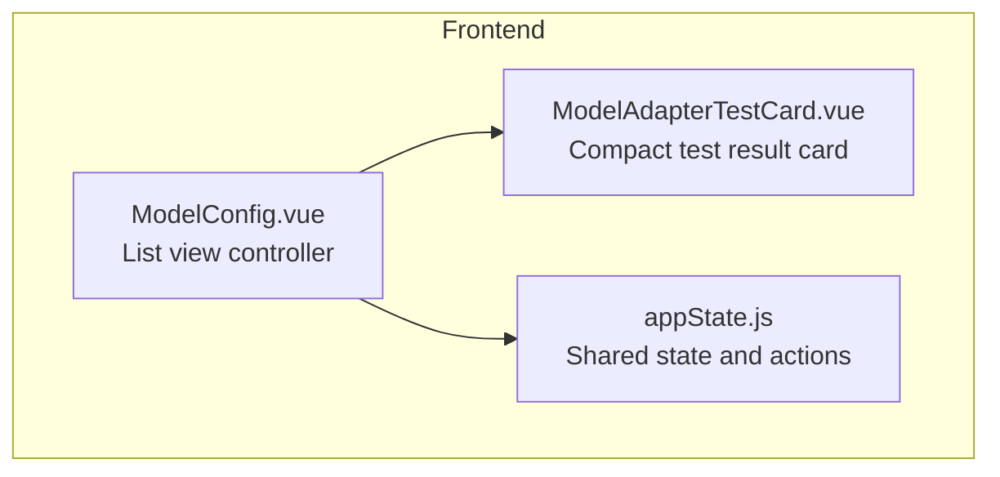
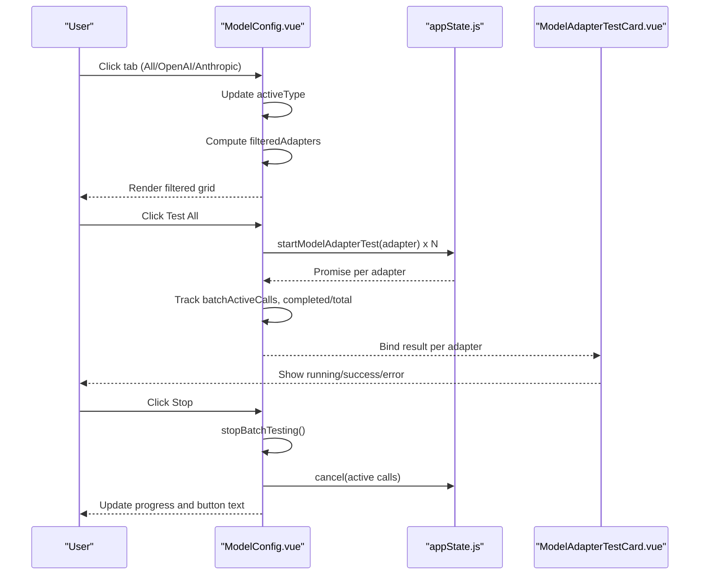
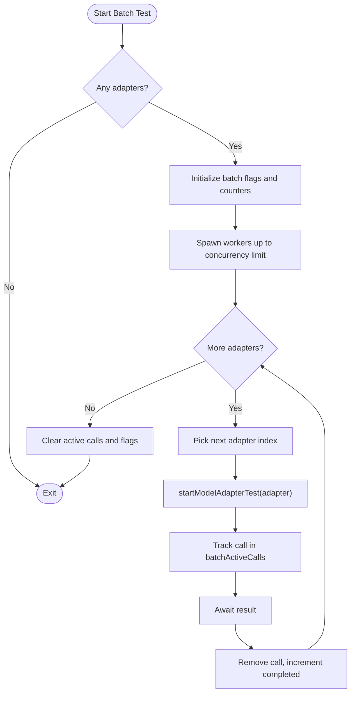
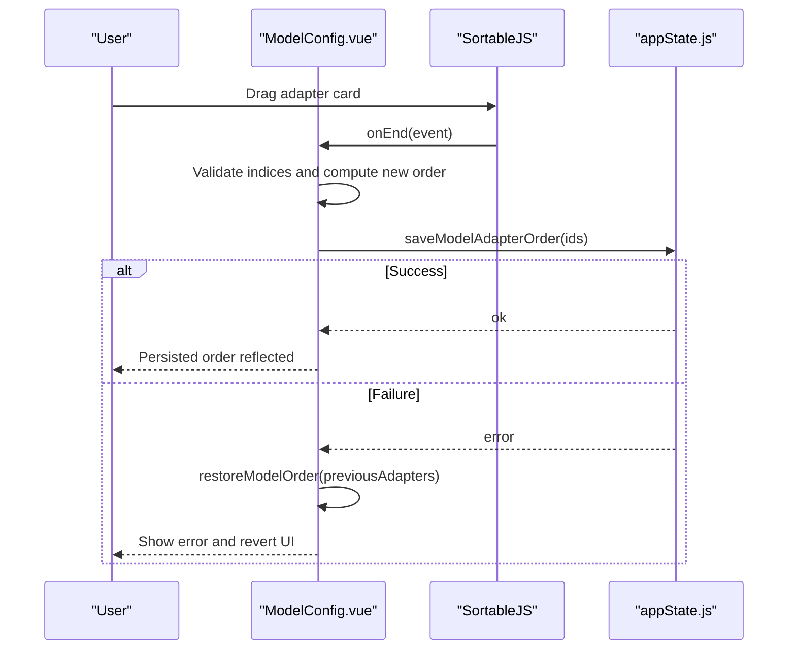
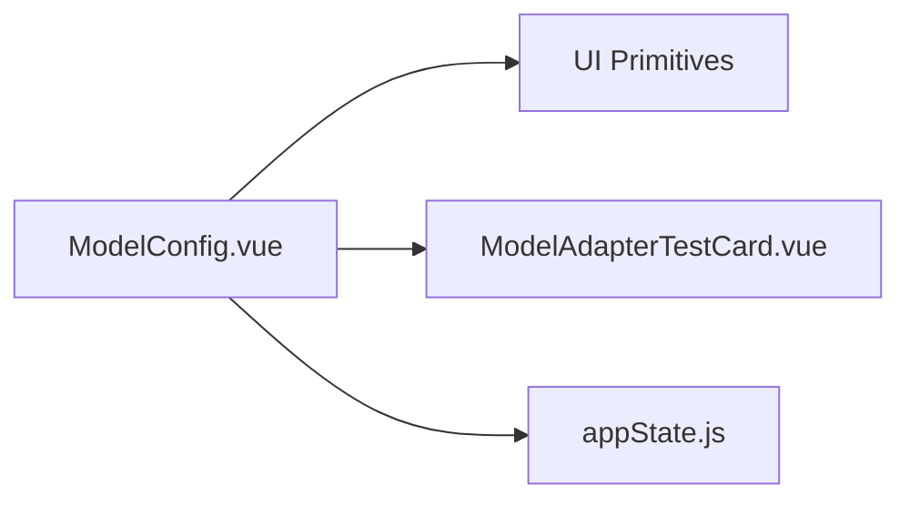

# Model Adapter List View

<cite>
**Referenced Files in This Document**
- [ModelConfig.vue](file://frontend/src/views/ModelConfig.vue)
- [ModelAdapterTestCard.vue](file://frontend/src/components/ModelAdapterTestCard.vue)
- [appState.js](file://frontend/src/state/appState.js)
</cite>

## Table of Contents
1. [Introduction](#introduction)
2. [Project Structure](#project-structure)
3. [Core Components](#core-components)
4. [Architecture Overview](#architecture-overview)
5. [Detailed Component Analysis](#detailed-component-analysis)
6. [Dependency Analysis](#dependency-analysis)
7. [Performance Considerations](#performance-considerations)
8. [Troubleshooting Guide](#troubleshooting-guide)
9. [Conclusion](#conclusion)

## Introduction
This document explains the Model Adapter List View, which is the main grid interface for managing configured model adapters. It covers:
- Tab-based filtering by provider type (All, OpenAI, Anthropic).
- Adapter card layout and display formatting for displayName, modelID, and provider indicators.
- Batch testing with concurrency control, progress tracking, and cancellation.
- Sorting and drag-and-drop reordering using SortableJS, including state persistence and error recovery.
- Empty state handling, responsive grid layout, and accessibility features.

## Project Structure
The Model Adapter List View is implemented as a Vue component that composes UI primitives, test result cards, and shared application state.

**Diagram sources**
- [ModelConfig.vue:1-22](file://frontend/src/views/ModelConfig.vue#L1-L22)
- [ModelAdapterTestCard.vue:1-31](file://frontend/src/components/ModelAdapterTestCard.vue#L1-L31)
- [appState.js:1237-1288](file://frontend/src/state/appState.js#L1237-L1288)

**Section sources**
- [ModelConfig.vue:1-22](file://frontend/src/views/ModelConfig.vue#L1-L22)
- [ModelAdapterTestCard.vue:1-31](file://frontend/src/components/ModelAdapterTestCard.vue#L1-L31)
- [appState.js:1237-1288](file://frontend/src/state/appState.js#L1237-L1288)

## Core Components
- ModelConfig.vue: Main list view controller providing tabs, grid rendering, batch operations, sorting, and editor integration.
- ModelAdapterTestCard.vue: Compact test result panel used inside each adapter card to show status, summary, raw response, and optional metrics.
- appState.js: Shared state and utilities for adapter ordering persistence, normalization, and helper functions referenced by the view.

Key responsibilities:
- Filtering: computed filteredAdapters based on activeType.
- Rendering: responsive CSS grid with auto-fill columns and fixed minimum width.
- Testing: single and batch testing with concurrency limit and cancellation.
- Ordering: SortableJS-driven drag-and-drop with server-side persistence and rollback on failure.
- Accessibility: aria-labels, focus-visible styles, keyboard-friendly controls.

**Section sources**
- [ModelConfig.vue:27-55](file://frontend/src/views/ModelConfig.vue#L27-L55)
- [ModelConfig.vue:426-494](file://frontend/src/views/ModelConfig.vue#L426-L494)
- [ModelAdapterTestCard.vue:33-99](file://frontend/src/components/ModelAdapterTestCard.vue#L33-L99)
- [appState.js:1237-1288](file://frontend/src/state/appState.js#L1237-L1288)

## Architecture Overview
The list view orchestrates user interactions and delegates data mutations and side effects to shared state.

**Diagram sources**
- [ModelConfig.vue:321-366](file://frontend/src/views/ModelConfig.vue#L321-L366)
- [ModelConfig.vue:414-421](file://frontend/src/views/ModelConfig.vue#L414-L421)
- [ModelAdapterTestCard.vue:33-99](file://frontend/src/components/ModelAdapterTestCard.vue#L33-L99)

## Detailed Component Analysis

### Tab-Based Filtering System
- Tabs are defined for All, OpenAI, and Anthropic.
- activeType drives a computed filteredAdapters that returns either all adapters or those matching the selected provider.
- When no adapters match the current filter, the empty state message adapts to the selected tab.

Behavior highlights:
- Switching to a specific provider after editing an adapter automatically navigates back to that provider tab if applicable.
- The filter updates reactively whenever appState.modelAdapters changes.

**Section sources**
- [ModelConfig.vue:27-31](file://frontend/src/views/ModelConfig.vue#L27-L31)
- [ModelConfig.vue:48-55](file://frontend/src/views/ModelConfig.vue#L48-L55)
- [ModelConfig.vue:66-70](file://frontend/src/views/ModelConfig.vue#L66-L70)
- [ModelConfig.vue:144-148](file://frontend/src/views/ModelConfig.vue#L144-L148)
- [ModelConfig.vue:72-84](file://frontend/src/views/ModelConfig.vue#L72-L84)

### Adapter Card Layout and Display Formatting
Each adapter is rendered as a card containing:
- displayName (primary label).
- modelID (secondary label).
- Provider indicator badge showing OpenAI or Anthropic icon and label.
- A compact test result panel from ModelAdapterTestCard.vue.
- Action buttons: Test, Edit, Duplicate, Delete.
- Drag handle for reordering.

Formatting details:
- displayName and modelID are truncated when too long.
- Provider badge uses conditional icons and labels.
- Test panel shows status-specific colors and messages.

Accessibility:
- Drag handle has aria-label and title attributes.
- Buttons are disabled during saving or batch testing to prevent inconsistent states.

**Section sources**
- [ModelConfig.vue:437-491](file://frontend/src/views/ModelConfig.vue#L437-L491)
- [ModelAdapterTestCard.vue:33-99](file://frontend/src/components/ModelAdapterTestCard.vue#L33-L99)

### Batch Operations: Bulk Testing, Concurrency, Progress, and Cancellation
- A constant BATCH_TEST_CONCURRENCY limits concurrent tests.
- handleTestAllModelAdapters starts multiple worker tasks up to the concurrency limit.
- Each worker pulls the next adapter index and invokes startModelAdapterTest from appState.
- Active calls are tracked in batchActiveCalls; each call supports a cancel function.
- Progress is shown via batchTotal and batchCompleted, updating the button text dynamically.
- stopBatchTesting sets a flag and cancels all active calls, then resets state.

Error handling:
- Cancel errors are ignored so the batch can continue processing remaining items.
- Individual test failures are surfaced through the test card rather than interrupting the batch.

**Diagram sources**
- [ModelConfig.vue:321-366](file://frontend/src/views/ModelConfig.vue#L321-L366)

**Section sources**
- [ModelConfig.vue:24-25](file://frontend/src/views/ModelConfig.vue#L24-L25)
- [ModelConfig.vue:305-366](file://frontend/src/views/ModelConfig.vue#L305-L366)
- [ModelConfig.vue:414-421](file://frontend/src/views/ModelConfig.vue#L414-L421)

### Sorting and Drag-and-Drop Reordering with SortableJS
- SortableJS is initialized on the grid element with draggable selector and handle.
- Sorting is disabled while saving configuration, performing sort persistence, or running batch tests.
- On drag end, handleModelSort computes new order:
  - If filtering by a specific provider, only adapters of that type are reordered within their group.
  - sort values are recalculated and persisted via saveModelAdapterOrder.
- Error recovery:
  - On failure, previous adapter order is restored by reloading config or reverting local state.
  - UI is synchronized again after recovery.

State persistence:
- saveModelAdapterOrder persists the ordered IDs.
- appState includes helpers to normalize and persist adapter order safely.

**Diagram sources**
- [ModelConfig.vue:150-184](file://frontend/src/views/ModelConfig.vue#L150-L184)
- [ModelConfig.vue:194-249](file://frontend/src/views/ModelConfig.vue#L194-L249)
- [appState.js:1237-1261](file://frontend/src/state/appState.js#L1237-L1261)

**Section sources**
- [ModelConfig.vue:150-184](file://frontend/src/views/ModelConfig.vue#L150-L184)
- [ModelConfig.vue:194-249](file://frontend/src/views/ModelConfig.vue#L194-L249)
- [appState.js:1237-1261](file://frontend/src/state/appState.js#L1237-L1261)

### Empty State Handling
- When filteredAdapters is empty, a centered message is displayed.
- The message adapts based on whether the All tab or a specific provider tab is active.

**Section sources**
- [ModelConfig.vue:66-70](file://frontend/src/views/ModelConfig.vue#L66-L70)
- [ModelConfig.vue:427-430](file://frontend/src/views/ModelConfig.vue#L427-L430)

### Responsive Grid Layout
- Uses CSS grid with auto-fill and a minimum column width to adapt to screen sizes.
- Scrollable container with shadow styling for better UX.

**Section sources**
- [ModelConfig.vue:432-436](file://frontend/src/views/ModelConfig.vue#L432-L436)

### Accessibility Features
- Drag handle exposes aria-label and title for assistive technologies.
- Focus-visible styles ensure keyboard navigation visibility.
- Buttons are disabled appropriately to avoid invalid operations.

**Section sources**
- [ModelConfig.vue:443-452](file://frontend/src/views/ModelConfig.vue#L443-L452)

## Dependency Analysis
The list view depends on:
- UI primitives (Button, Card, ContentModal) for consistent interaction patterns.
- ModelAdapterTestCard for compact test results.
- appState for adapter CRUD, testing, ordering, and configuration transfer.

**Diagram sources**
- [ModelConfig.vue:1-22](file://frontend/src/views/ModelConfig.vue#L1-L22)
- [ModelAdapterTestCard.vue:1-31](file://frontend/src/components/ModelAdapterTestCard.vue#L1-L31)
- [appState.js:1237-1288](file://frontend/src/state/appState.js#L1237-L1288)

**Section sources**
- [ModelConfig.vue:1-22](file://frontend/src/views/ModelConfig.vue#L1-L22)
- [ModelAdapterTestCard.vue:1-31](file://frontend/src/components/ModelAdapterTestCard.vue#L1-L31)
- [appState.js:1237-1288](file://frontend/src/state/appState.js#L1237-L1288)

## Performance Considerations
- Batch testing concurrency is capped to avoid overwhelming upstream services.
- Sorting disables dragging during save and batch operations to prevent race conditions.
- Reactive watchers synchronize SortableJS after DOM updates to minimize layout thrashing.

[No sources needed since this section provides general guidance]

## Troubleshooting Guide
Common issues and resolutions:
- Batch test does not stop:
  - Ensure stopBatchTesting is invoked and active calls expose a cancel method.
  - Verify batchStopRequested flag is set and batchStopping state is updated.
- Sorting fails to persist:
  - Check saveModelAdapterOrder result; on failure, previous order should be restored.
  - Confirm reloadUserConfig succeeds when restoring state.
- Test results not updating:
  - Ensure getModelAdapterTestResultByID returns the correct result object for the adapter ID.
  - Confirm ModelAdapterTestCard receives normalized status and summary fields.

**Section sources**
- [ModelConfig.vue:305-366](file://frontend/src/views/ModelConfig.vue#L305-L366)
- [ModelConfig.vue:186-192](file://frontend/src/views/ModelConfig.vue#L186-L192)
- [ModelConfig.vue:235-248](file://frontend/src/views/ModelConfig.vue#L235-L248)
- [ModelAdapterTestCard.vue:33-99](file://frontend/src/components/ModelAdapterTestCard.vue#L33-L99)

## Conclusion
The Model Adapter List View provides a robust, accessible interface for managing model adapters across providers. It combines tab-based filtering, clear card layouts, batch testing with controlled concurrency, and reliable drag-and-drop sorting with persistence and recovery. The design emphasizes user feedback, error resilience, and responsive behavior.

[No sources needed since this section summarizes without analyzing specific files]