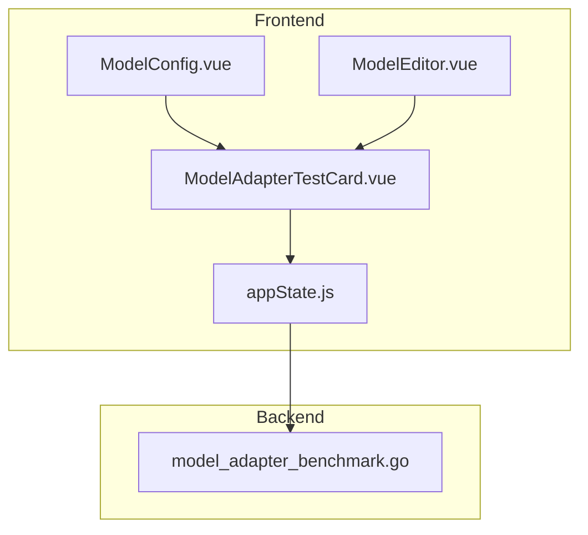
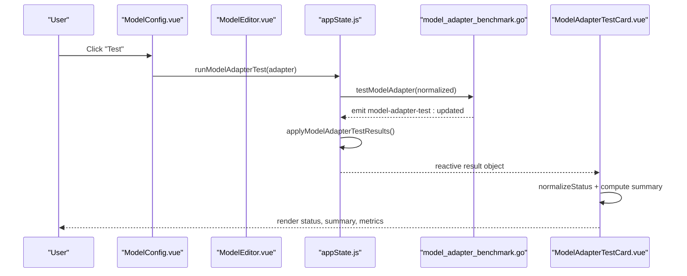
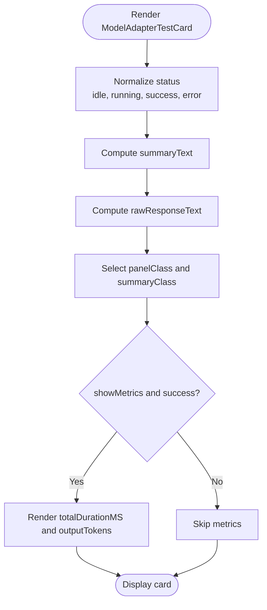
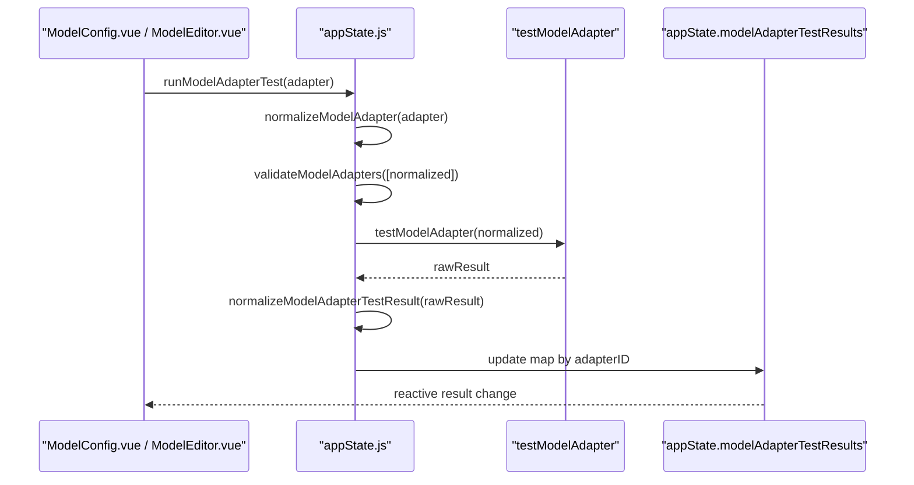
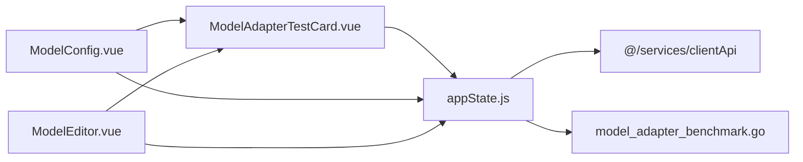

# Model Adapter Test Card

<cite>
**Referenced Files in This Document**
- [ModelAdapterTestCard.vue](file://frontend/src/components/ModelAdapterTestCard.vue)
- [appState.js](file://frontend/src/state/appState.js)
- [ModelConfig.vue](file://frontend/src/views/ModelConfig.vue)
- [ModelEditor.vue](file://frontend/src/components/ModelEditor.vue)
- [model_adapter_benchmark.go](file://internal/client/model_adapter_benchmark.go)
</cite>

## Table of Contents
1. [Introduction](#introduction)
2. [Project Structure](#project-structure)
3. [Core Components](#core-components)
4. [Architecture Overview](#architecture-overview)
5. [Detailed Component Analysis](#detailed-component-analysis)
6. [Dependency Analysis](#dependency-analysis)
7. [Performance Considerations](#performance-considerations)
8. [Troubleshooting Guide](#troubleshooting-guide)
9. [Conclusion](#conclusion)

## Introduction
The Model Adapter Test Card is a Vue component responsible for displaying the result of an individual model adapter connection test. It renders status indicators, summary text, optional raw response content, and performance metrics such as total duration and output token count. The card supports two usage modes:

- Compact mode: embedded inside adapter cards on the model configuration page.
- Standalone mode: displayed inside the model editor to show live or remembered test results.

The component does not directly execute network requests. Instead, it consumes normalized test result objects from the application state and formats them for user feedback.

## Project Structure
The test card is part of the frontend UI layer and integrates with shared state management and backend test execution.

**Diagram sources**
- [ModelConfig.vue:469-474](file://frontend/src/views/ModelConfig.vue#L469-L474)
- [ModelEditor.vue:400-405](file://frontend/src/components/ModelEditor.vue#L400-L405)
- [ModelAdapterTestCard.vue:1-150](file://frontend/src/components/ModelAdapterTestCard.vue#L1-L150)
- [appState.js:1059-1113](file://frontend/src/state/appState.js#L1059-L1113)
- [model_adapter_benchmark.go:413-449](file://internal/client/model_adapter_benchmark.go#L413-L449)

**Section sources**
- [ModelAdapterTestCard.vue:1-150](file://frontend/src/components/ModelAdapterTestCard.vue#L1-L150)
- [ModelConfig.vue:469-474](file://frontend/src/views/ModelConfig.vue#L469-L474)
- [ModelEditor.vue:400-405](file://frontend/src/components/ModelEditor.vue#L400-L405)
- [appState.js:1059-1113](file://frontend/src/state/appState.js#L1059-L1113)
- [model_adapter_benchmark.go:413-449](file://internal/client/model_adapter_benchmark.go#L413-L449)

## Core Components
The core pieces involved in adapter testing are:

| Component | Responsibility | Key Behavior |
|---|---|---|
| ModelAdapterTestCard | Display test result | Normalizes status, computes summary, selects visual theme, shows metrics when enabled |
| appState | Manage test lifecycle and state | Normalizes results, stores by adapter ID and request hash, exposes start/run helpers, listens to backend events |
| ModelConfig | List adapters and trigger tests | Renders compact test cards, triggers batch and single tests |
| ModelEditor | Edit adapter and run inline test | Shows standalone test card, persists draft before testing, remembers last tested adapter |
| Backend test service | Execute actual adapter test | Creates running result, executes non-streaming test, applies timeout, emits updated results |

**Section sources**
- [ModelAdapterTestCard.vue:6-31](file://frontend/src/components/ModelAdapterTestCard.vue#L6-L31)
- [appState.js:196-250](file://frontend/src/state/appState.js#L196-L250)
- [appState.js:1059-1113](file://frontend/src/state/appState.js#L1059-L1113)
- [ModelConfig.vue:289-303](file://frontend/src/views/ModelConfig.vue#L289-L303)
- [ModelEditor.vue:308-327](file://frontend/src/components/ModelEditor.vue#L308-L327)
- [model_adapter_benchmark.go:413-449](file://internal/client/model_adapter_benchmark.go#L413-L449)

## Architecture Overview
The test flow connects UI actions, state normalization, backend execution, event-driven updates, and card rendering.

**Diagram sources**
- [ModelConfig.vue:297-303](file://frontend/src/views/ModelConfig.vue#L297-L303)
- [appState.js:1093-1113](file://frontend/src/state/appState.js#L1093-L1113)
- [model_adapter_benchmark.go:413-449](file://internal/client/model_adapter_benchmark.go#L413-L449)
- [ModelAdapterTestCard.vue:33-99](file://frontend/src/components/ModelAdapterTestCard.vue#L33-L99)

## Detailed Component Analysis

### ModelAdapterTestCard Component
The card receives a `result` object and optional flags controlling display behavior.

#### Props and Modes
- `result`: normalized test result object.
- `stale`: indicates the current adapter configuration no longer matches the stored test request hash.
- `compact`: used inside adapter cards; affects label sizing and layout density.
- `showMetrics`: controls whether total duration and output tokens are shown.
- `title`: localized title for the panel.
- `emptyText`: fallback text when no meaningful result exists.

#### Status Normalization
The component normalizes the incoming status into one of four states:

| Status | Meaning | Visual Behavior |
|---|---|---|
| idle | No active or completed result | Neutral border and text color |
| running | Test is executing | Blue-ish border and text |
| success | Test completed successfully | Green border; golden border if tokens are estimated |
| error | Test failed | Red-ish border and text |

If the provided status is empty or unrecognized, the card treats it as idle.

#### Summary Text Logic
The summary text follows this priority:

1. Use `result.summaryText` if present.
2. If running, show a running indicator.
3. If error, show a failure message and suggest checking raw information.
4. Otherwise, show the configured empty text.

#### Raw Response Handling
Raw response text is shown when available. For errors, the card falls back to the error field so users can inspect underlying details. A tooltip provides copyable access to the raw response.

#### Visual Feedback Patterns
- Panel background and border change based on stale, running, error, success-with-estimated-tokens, success, or default.
- Summary text color changes according to the same logic.
- When `showMetrics` is true and the status is success, the card displays total duration and output tokens.
- When success includes estimated tokens, a small note explains that token counts are estimates.

#### Compact Mode Usage
Compact mode is intended for embedding inside adapter cards. It reduces typography size and keeps the panel lightweight while still showing title, summary, and optional raw response tooltip.

#### Standalone Mode Usage
In standalone mode, the card is typically paired with `showMetrics=true`, allowing detailed performance feedback during editing workflows.

**Diagram sources**
- [ModelAdapterTestCard.vue:33-99](file://frontend/src/components/ModelAdapterTestCard.vue#L33-L99)
- [ModelAdapterTestCard.vue:102-148](file://frontend/src/components/ModelAdapterTestCard.vue#L102-L148)

**Section sources**
- [ModelAdapterTestCard.vue:6-31](file://frontend/src/components/ModelAdapterTestCard.vue#L6-L31)
- [ModelAdapterTestCard.vue:33-99](file://frontend/src/components/ModelAdapterTestCard.vue#L33-L99)
- [ModelAdapterTestCard.vue:102-148](file://frontend/src/components/ModelAdapterTestCard.vue#L102-L148)

### Test Execution Flow
The test execution path starts in the UI and ends with backend execution and event-driven state updates.

**Diagram sources**
- [ModelConfig.vue:297-303](file://frontend/src/views/ModelConfig.vue#L297-L303)
- [ModelEditor.vue:308-327](file://frontend/src/components/ModelEditor.vue#L308-L327)
- [appState.js:1093-1113](file://frontend/src/state/appState.js#L1093-L1113)

**Section sources**
- [ModelConfig.vue:289-303](file://frontend/src/views/ModelConfig.vue#L289-L303)
- [ModelEditor.vue:308-327](file://frontend/src/components/ModelEditor.vue#L308-L327)
- [appState.js:1093-1113](file://frontend/src/state/appState.js#L1093-L1113)

### Asynchronous Test Operation Handling
Asynchronous operations are handled through promises and reactive state:

- `runModelAdapterTest` delegates to `startModelAdapterTest`.
- `startModelAdapterTest` validates the adapter, calls the backend API, normalizes the result, and updates the global test results map.
- The UI components await the promise and catch errors. In list views, failures are intentionally surfaced through state rather than intrusive popups. In the editor, local failure text can be shown when no persisted result exists.

Key behaviors:

| Area | Behavior |
|---|---|
| Promise handling | Tests return promises; callers use try/catch or `.then()` chains |
| Error propagation | Validation errors reject immediately; backend errors become normalized error results |
| UI resilience | List view swallows errors because the event system updates the card automatically |
| Editor fallback | Editor tracks local failure text and remembers the last tested adapter ID |

**Section sources**
- [appState.js:1093-1113](file://frontend/src/state/appState.js#L1093-L1113)
- [ModelConfig.vue:297-303](file://frontend/src/views/ModelConfig.vue#L297-L303)
- [ModelEditor.vue:308-327](file://frontend/src/components/ModelEditor.vue#L308-L327)

### Timeout Management
Timeouts are managed on the backend side:

- The backend creates a context with a timeout before executing the non-streaming test.
- If the request fails or returns no usable text token, the backend builds an errored result.
- The frontend does not implement its own per-test timeout; it relies on backend timeouts and emitted results.

This design centralizes timeout policy and ensures consistent error reporting across concurrent tests.

**Section sources**
- [model_adapter_benchmark.go:463-481](file://internal/client/model_adapter_benchmark.go#L463-L481)

### Error State Presentation
Error presentation has two layers:

1. **Normalized error result**: The backend produces a result with status `error`, a human-readable summary, an error string, and raw response text.
2. **Card rendering**: The card displays the summary text and highlights the panel in an error theme. If no summary exists, it falls back to the error field.

Additional editor-level behavior:

- If saving or testing fails locally and no adapter ID is available, the editor sets local failure text.
- If a previous test result exists, the editor prefers that result over transient local failure text.

**Section sources**
- [model_adapter_benchmark.go:733-744](file://internal/client/model_adapter_benchmark.go#L733-L744)
- [ModelAdapterTestCard.vue:52-61](file://frontend/src/components/ModelAdapterTestCard.vue#L52-L61)
- [ModelEditor.vue:308-327](file://frontend/src/components/ModelEditor.vue#L308-L327)

### Result Display Formatting
The card formats results as follows:

| Field | Display Rule |
|---|---|
| Title | Always shown; compact mode uses smaller uppercase label |
| Summary | Priority: explicit summary, running indicator, error hint, or empty text |
| Raw response | Shown when available; copied via tooltip |
| Stale warning | Shown when adapter configuration changed since the test |
| Metrics | Total duration and output tokens shown only when enabled and successful |
| Estimated tokens | Small note shown when tokens are estimated |

Duration formatting is centralized in the app state utility, converting milliseconds into human-friendly strings.

**Section sources**
- [ModelAdapterTestCard.vue:38-61](file://frontend/src/components/ModelAdapterTestCard.vue#L38-L61)
- [ModelAdapterTestCard.vue:124-147](file://frontend/src/components/ModelAdapterTestCard.vue#L124-L147)
- [appState.js:188-194](file://frontend/src/state/appState.js#L188-L194)

### Integration with App State
The app state manages test results using a map keyed by adapter ID:

- Results are normalized before storage.
- Running, success, and error statuses are supported.
- The state exports helpers to get results by adapter ID or by request hash.
- Events from the backend update the state reactively.

Key integration points:

| Functionality | Implementation |
|---|---|
| Event subscription | Subscribes to `model-adapter-test:updated` |
| Result normalization | Converts raw fields into stable shape |
| Lookup by adapter | Returns result by `adapterID` |
| Lookup by config | Falls back to matching `requestHash` |
| Refresh | Fetches latest results and replaces state |

**Section sources**
- [appState.js:679-694](file://frontend/src/state/appState.js#L679-L694)
- [appState.js:1059-1091](file://frontend/src/state/appState.js#L1059-L1091)

### Retry Mechanisms
There is no automatic retry mechanism in the test card or state layer:

- Each test call is independent.
- The backend caches running results by adapter ID and request hash to avoid duplicate concurrent executions.
- Users must manually re-run tests after configuration changes or failures.
- The stale flag helps users understand when a result no longer matches the current configuration.

**Section sources**
- [model_adapter_benchmark.go:413-419](file://internal/client/model_adapter_benchmark.go#L413-L419)
- [appState.js:1080-1085](file://frontend/src/state/appState.js#L1080-L1085)
- [ModelAdapterTestCard.vue:124-126](file://frontend/src/components/ModelAdapterTestCard.vue#L124-L126)

### User Interaction Handling
Interaction patterns differ between contexts:

- **Adapter card list**: Clicking “Test” triggers a test without interrupting the user flow. Errors are reflected in the card via state.
- **Model editor**: Saving and testing is combined. The editor persists the draft first, then runs the test. It also shows a dedicated test card with metrics.

Button disabling rules prevent redundant or unsafe operations:

- Disable test buttons while configuration saving is in progress.
- Disable test buttons while another test for the same adapter is running.
- Batch testing adds additional global guards.

**Section sources**
- [ModelConfig.vue:469-484](file://frontend/src/views/ModelConfig.vue#L469-L484)
- [ModelEditor.vue:688-695](file://frontend/src/components/ModelEditor.vue#L688-L695)

## Dependency Analysis
The following diagram maps runtime dependencies among the main files involved in adapter testing.

**Diagram sources**
- [ModelAdapterTestCard.vue:1-5](file://frontend/src/components/ModelAdapterTestCard.vue#L1-L5)
- [ModelConfig.vue:1-21](file://frontend/src/views/ModelConfig.vue#L1-L21)
- [ModelEditor.vue:1-29](file://frontend/src/components/ModelEditor.vue#L1-L29)
- [appState.js:1-22](file://frontend/src/state/appState.js#L1-L22)
- [model_adapter_benchmark.go:413-449](file://internal/client/model_adapter_benchmark.go#L413-L449)

**Section sources**
- [ModelAdapterTestCard.vue:1-5](file://frontend/src/components/ModelAdapterTestCard.vue#L1-L5)
- [ModelConfig.vue:1-21](file://frontend/src/views/ModelConfig.vue#L1-L21)
- [ModelEditor.vue:1-29](file://frontend/src/components/ModelEditor.vue#L1-L29)
- [appState.js:1-22](file://frontend/src/state/appState.js#L1-L22)

## Performance Considerations
Concurrent testing scenarios are handled at multiple levels:

| Concern | Approach |
|---|---|
| Duplicate concurrent tests | Backend caches running results by adapter ID and request hash |
| UI responsiveness | Cards are read-only and reactive; they do not block other interactions |
| Batch testing | The model configuration page defines a concurrency limit for batch operations |
| Result updates | Backend emits snapshots of all test results, avoiding per-card polling |
| Memory and lookup | Results are stored in a map by adapter ID for O(1) lookup |

Recommendations:

- Keep batch concurrency reasonable to avoid overwhelming the backend.
- Prefer adapter ID-based lookups when possible.
- Avoid triggering repeated tests for identical configurations unless explicitly requested.
- Use the stale flag to guide users toward retesting after configuration changes.

**Section sources**
- [model_adapter_benchmark.go:413-419](file://internal/client/model_adapter_benchmark.go#L413-L419)
- [model_adapter_benchmark.go:686-698](file://internal/client/model_adapter_benchmark.go#L686-L698)
- [ModelConfig.vue:24](file://frontend/src/views/ModelConfig.vue#L24)
- [appState.js:679-685](file://frontend/src/state/appState.js#L679-L685)

## Troubleshooting Guide

### Card Shows Idle but Test Was Run
Possible causes:

- The result was not yet received from the backend.
- The adapter ID is missing or mismatched.
- The UI is looking up by adapter ID, but the result is associated with a different identifier.

Actions:

- Verify the adapter has a valid `id`.
- Check whether the result exists under `appState.modelAdapterTestResults`.
- Confirm the backend emitted the `model-adapter-test:updated` event.

**Section sources**
- [appState.js:679-685](file://frontend/src/state/appState.js#L679-L685)
- [appState.js:1059-1074](file://frontend/src/state/appState.js#L1059-L1074)

### Card Shows Running Indefinitely
Possible causes:

- Backend test timed out or stalled.
- The client did not receive the final result event.
- The adapter configuration changed mid-test, causing a new request hash.

Actions:

- Wait for the backend timeout and final error or success result.
- Re-run the test after configuration stabilizes.
- Use the stale indicator to confirm whether the current configuration differs from the running test.

**Section sources**
- [model_adapter_benchmark.go:463-481](file://internal/client/model_adapter_benchmark.go#L463-L481)
- [appState.js:1080-1085](file://frontend/src/state/appState.js#L1080-L1085)
- [ModelAdapterTestCard.vue:124-126](file://frontend/src/components/ModelAdapterTestCard.vue#L124-L126)

### Card Shows Error Without Details
Possible causes:

- The backend returned an error without a clear summary.
- The raw response is empty.
- The UI fell back to a generic failure message.

Actions:

- Inspect the raw response tooltip if available.
- Check backend logs for the original error.
- Ensure the adapter configuration is valid before retrying.

**Section sources**
- [ModelAdapterTestCard.vue:52-61](file://frontend/src/components/ModelAdapterTestCard.vue#L52-L61)
- [model_adapter_benchmark.go:733-744](file://internal/client/model_adapter_benchmark.go#L733-L744)

### Metrics Are Not Showing
Possible causes:

- `showMetrics` is false.
- The test status is not success.
- The result lacks duration or token data.

Actions:

- Enable `showMetrics` in standalone mode.
- Confirm the test completed successfully.
- Verify the backend returned duration and token fields.

**Section sources**
- [ModelAdapterTestCard.vue:128-147](file://frontend/src/components/ModelAdapterTestCard.vue#L128-L147)

## Conclusion
The Model Adapter Test Card is a focused, state-driven UI component that presents adapter test outcomes clearly and consistently. It separates presentation from execution, relying on normalized state and backend events. Its compact and standalone modes support both quick inline checks and detailed editing workflows. Timeout handling, error normalization, and result deduplication are primarily managed by the backend, while the frontend emphasizes readable status indicators, actionable summaries, and optional performance metrics.