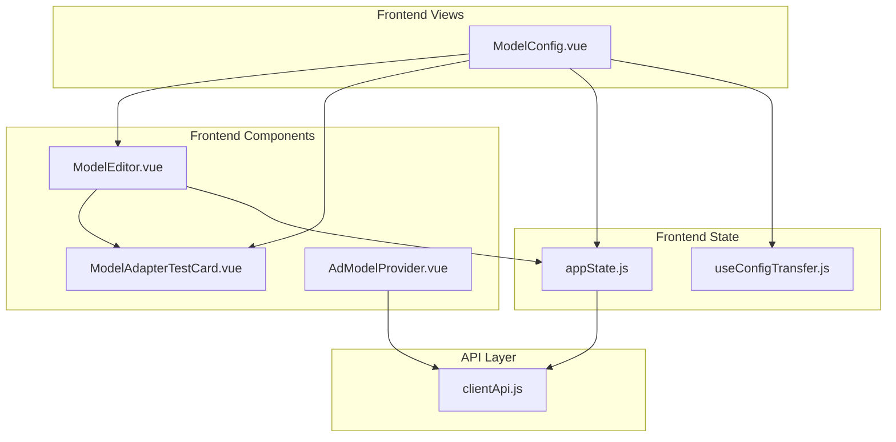
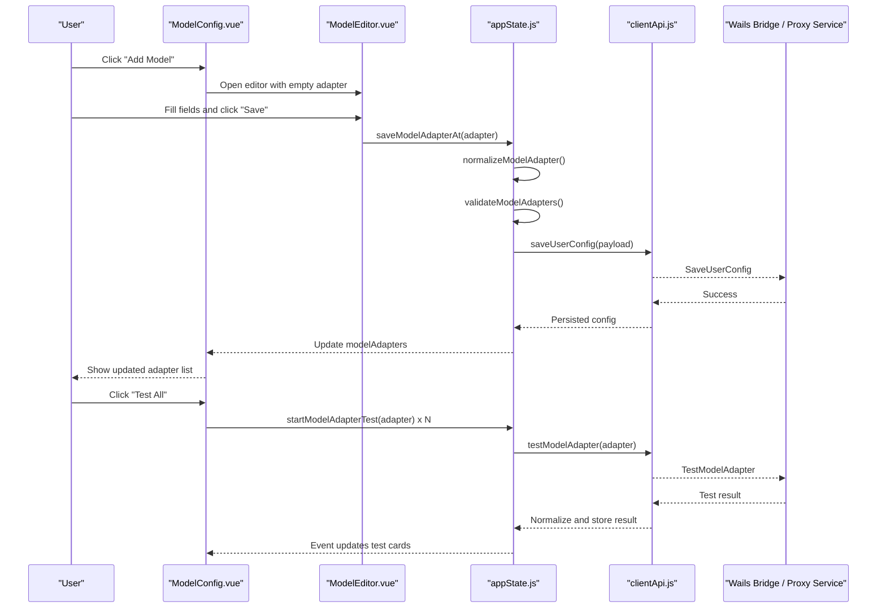
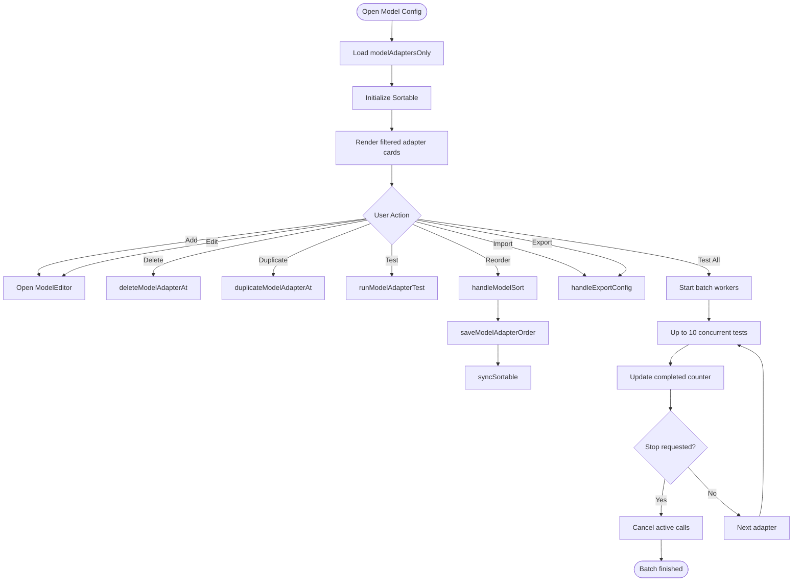
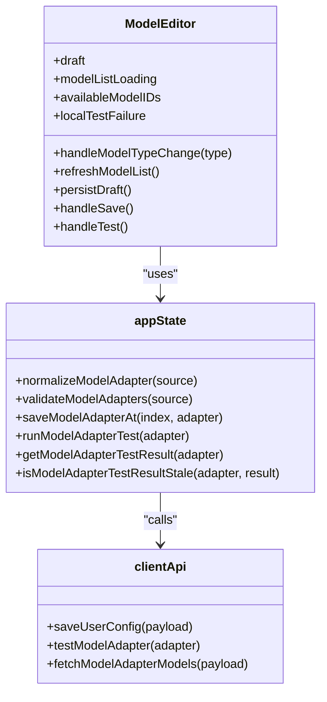
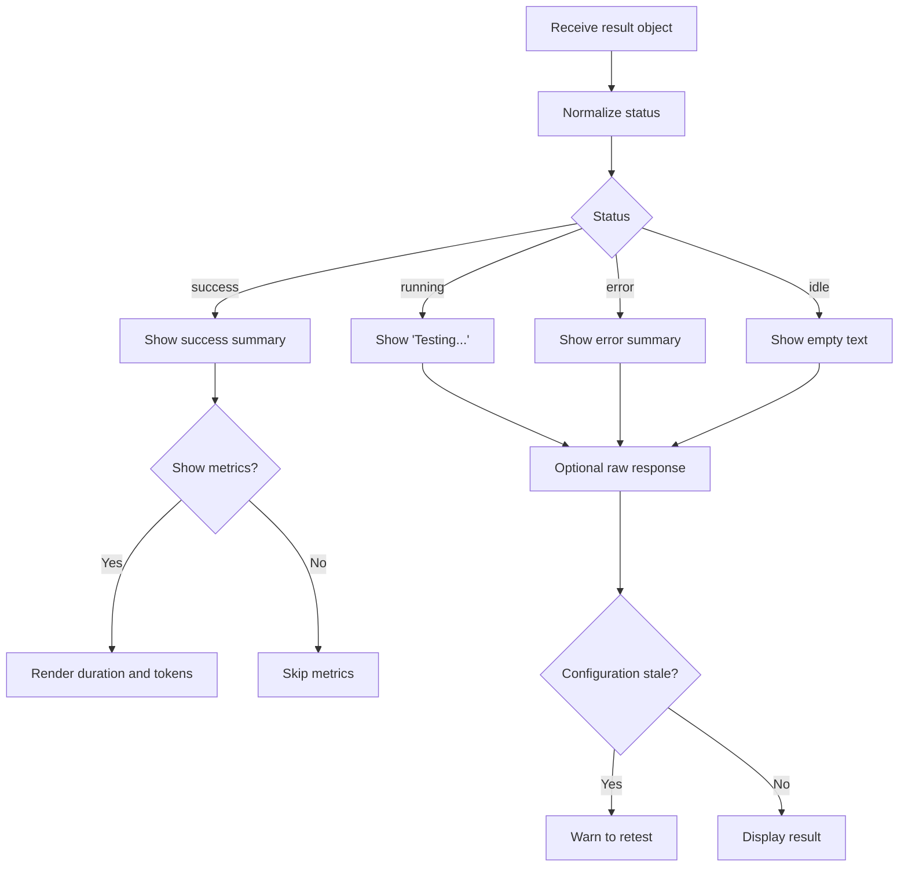
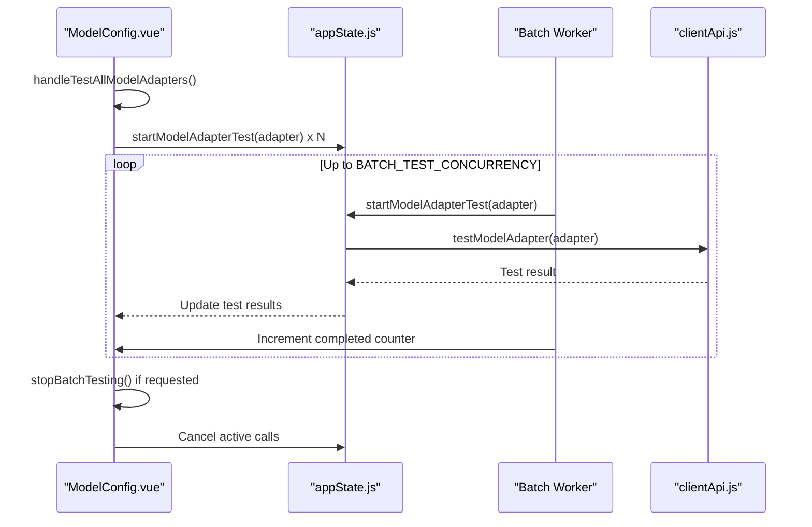
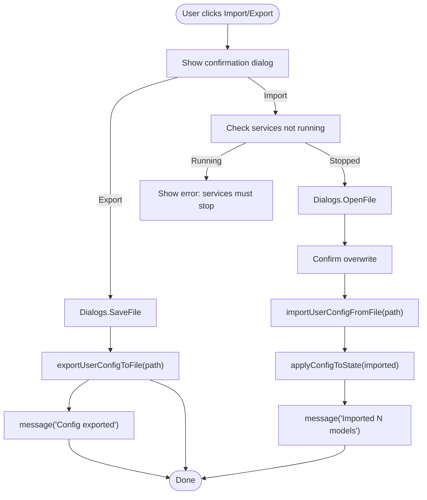
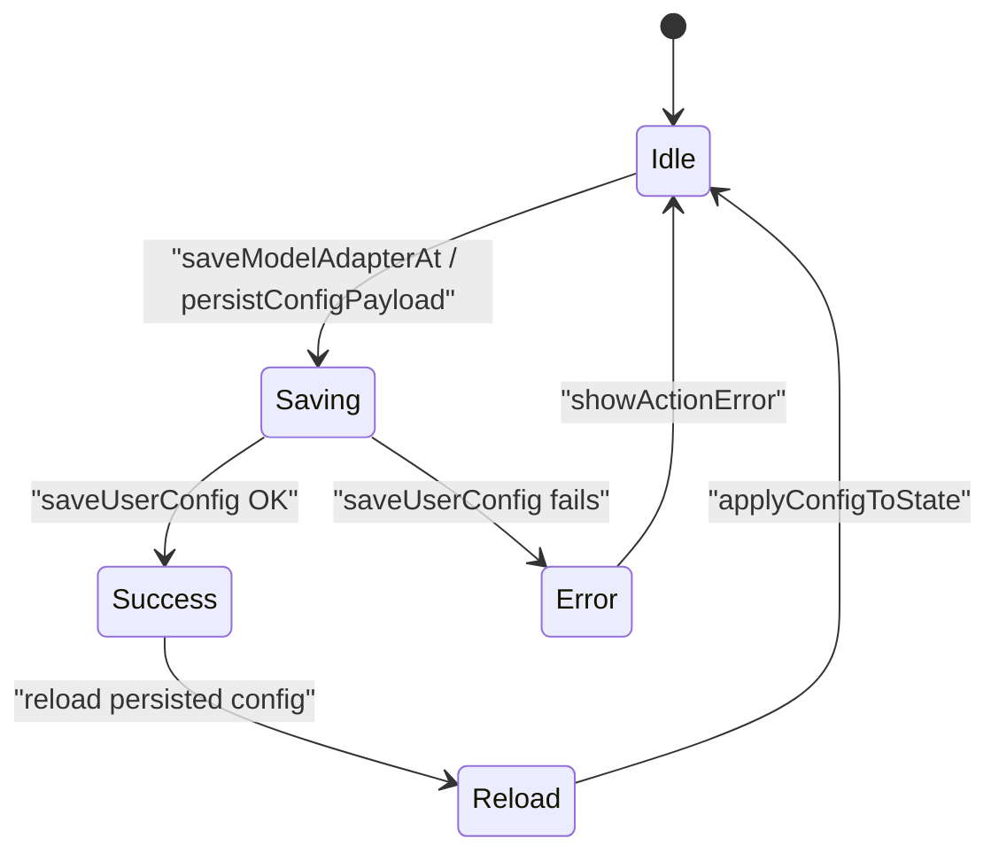
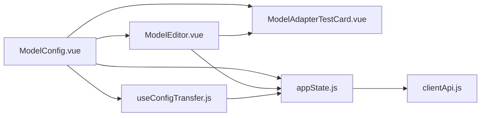

# Model Configuration View

<cite>
**Referenced Files in This Document**
- [ModelConfig.vue](file://frontend/src/views/ModelConfig.vue)
- [ModelEditor.vue](file://frontend/src/components/ModelEditor.vue)
- [ModelAdapterTestCard.vue](file://frontend/src/components/ModelAdapterTestCard.vue)
- [AdModelProvider.vue](file://frontend/src/components/AdModelProvider.vue)
- [clientApi.js](file://frontend/src/services/clientApi.js)
- [appState.js](file://frontend/src/state/appState.js)
- [useConfigTransfer.js](file://frontend/src/composables/useConfigTransfer.js)
</cite>

## Table of Contents
1. [Introduction](#introduction)
2. [Project Structure](#project-structure)
3. [Core Components](#core-components)
4. [Architecture Overview](#architecture-overview)
5. [Detailed Component Analysis](#detailed-component-analysis)
6. [Dependency Analysis](#dependency-analysis)
7. [Performance Considerations](#performance-considerations)
8. [Troubleshooting Guide](#troubleshooting-guide)
9. [Conclusion](#conclusion)

## Introduction
The Model Configuration view is the central interface for managing LLM provider model adapters. It lets users add, edit, duplicate, delete, reorder, and test model configurations for OpenAI and Anthropic providers. It also supports batch testing, configuration import/export, and robust error handling for network and service failures. The view coordinates UI components with a reactive state layer that persists configuration to the backend and listens for runtime events.

## Project Structure
The Model Configuration feature is implemented primarily in Vue 3 components and a shared state module:

- `frontend/src/views/ModelConfig.vue`: Main view that lists adapters, manages tabs, batch operations, sorting, and opens the editor modal.
- `frontend/src/components/ModelEditor.vue`: Form component for creating or editing an adapter, including validation, model list fetching, and inline testing.
- `frontend/src/components/ModelAdapterTestCard.vue`: Reusable card showing test status, summary text, raw response, and optional metrics.
- `frontend/src/components/AdModelProvider.vue`: Optional advertisement runtime iframe manager; not part of core model management but present in the frontend.
- `frontend/src/services/clientApi.js`: Thin API wrappers around Wails bridge calls for config load/save, model tests, and model listing.
- `frontend/src/state/appState.js`: Central reactive state, normalization, validation, persistence, event subscription, and adapter lifecycle helpers.
- `frontend/src/composables/useConfigTransfer.js`: Composable for exporting and importing full YAML configuration files.

**Diagram sources**
- [ModelConfig.vue:1-514](file://frontend/src/views/ModelConfig.vue#L1-L514)
- [ModelEditor.vue:1-699](file://frontend/src/components/ModelEditor.vue#L1-L699)
- [ModelAdapterTestCard.vue:1-150](file://frontend/src/components/ModelAdapterTestCard.vue#L1-L150)
- [AdModelProvider.vue:1-239](file://frontend/src/components/AdModelProvider.vue#L1-L239)
- [clientApi.js:1-180](file://frontend/src/services/clientApi.js#L1-L180)
- [appState.js:1-1454](file://frontend/src/state/appState.js#L1-L1454)
- [useConfigTransfer.js:1-93](file://frontend/src/composables/useConfigTransfer.js#L1-L93)

**Section sources**
- [ModelConfig.vue:1-514](file://frontend/src/views/ModelConfig.vue#L1-L514)
- [ModelEditor.vue:1-699](file://frontend/src/components/ModelEditor.vue#L1-L699)
- [ModelAdapterTestCard.vue:1-150](file://frontend/src/components/ModelAdapterTestCard.vue#L1-L150)
- [AdModelProvider.vue:1-239](file://frontend/src/components/AdModelProvider.vue#L1-L239)
- [clientApi.js:1-180](file://frontend/src/services/clientApi.js#L1-L180)
- [appState.js:1-1454](file://frontend/src/state/appState.js#L1-L1454)
- [useConfigTransfer.js:1-93](file://frontend/src/composables/useConfigTransfer.js#L1-L93)

## Core Components
- **ModelConfig.vue**: Provides the adapter grid, type filter tabs (All, OpenAI, Anthropic), batch test controls, import/export buttons, drag-and-drop reordering, and the editor modal. It delegates persistence and testing to `appState.js`.
- **ModelEditor.vue**: Renders provider-specific fields, validates inputs, fetches available models, runs inline tests, and saves normalized adapter data through `saveModelAdapterAt`.
- **ModelAdapterTestCard.vue**: Displays test result states (idle, running, success, error), stale warnings, raw responses, and optional performance metrics like duration and output tokens.
- **AdModelProvider.vue**: Manages an external advertisement iframe runtime via Wails bridge; it is unrelated to model adapter configuration but included in the frontend.
- **clientApi.js**: Exposes functions such as `loadUserConfig`, `saveUserConfig`, `testModelAdapter`, `fetchModelAdapterModels`, and file import/export helpers.
- **appState.js**: Normalizes adapters, validates them, persists changes, subscribes to backend events, tracks test results, and exposes lifecycle methods for CRUD and ordering.
- **useConfigTransfer.js**: Wraps export/import flows with confirmation dialogs, file dialog selection, busy state, and user feedback.

**Section sources**
- [ModelConfig.vue:1-514](file://frontend/src/views/ModelConfig.vue#L1-L514)
- [ModelEditor.vue:1-699](file://frontend/src/components/ModelEditor.vue#L1-L699)
- [ModelAdapterTestCard.vue:1-150](file://frontend/src/components/ModelAdapterTestCard.vue#L1-L150)
- [AdModelProvider.vue:1-239](file://frontend/src/components/AdModelProvider.vue#L1-L239)
- [clientApi.js:1-180](file://frontend/src/services/clientApi.js#L1-L180)
- [appState.js:1-1454](file://frontend/src/state/appState.js#L1-L1454)
- [useConfigTransfer.js:1-93](file://frontend/src/composables/useConfigTransfer.js#L1-L93)

## Architecture Overview
The Model Configuration view follows a layered architecture:

- **View Layer**: `ModelConfig.vue` orchestrates UI actions and renders cards and modals.
- **Component Layer**: `ModelEditor.vue` and `ModelAdapterTestCard.vue` encapsulate form logic and test result display.
- **State Layer**: `appState.js` holds reactive state, normalizes and validates data, persists configuration, and updates UI based on backend events.
- **API Layer**: `clientApi.js` wraps Wails bridge calls for configuration and model operations.
- **Composables**: `useConfigTransfer.js` provides reusable import/export behavior.

**Diagram sources**
- [ModelConfig.vue:125-148](file://frontend/src/views/ModelConfig.vue#L125-L148)
- [ModelConfig.vue:321-366](file://frontend/src/views/ModelConfig.vue#L321-L366)
- [ModelEditor.vue:252-289](file://frontend/src/components/ModelEditor.vue#L252-L289)
- [appState.js:1172-1199](file://frontend/src/state/appState.js#L1172-L1199)
- [appState.js:1093-1113](file://frontend/src/state/appState.js#L1093-L1113)
- [clientApi.js:58-64](file://frontend/src/services/clientApi.js#L58-L64)
- [clientApi.js:156-167](file://frontend/src/services/clientApi.js#L156-L167)

## Detailed Component Analysis

### ModelConfig.vue: Adapter Management Interface
Responsibilities:
- Filter adapters by type using tabs: All, OpenAI, Anthropic.
- Provide bulk actions: Import, Export, Test All, Add Model.
- Render adapter cards with inline test status and action buttons: Test, Edit, Duplicate, Delete.
- Manage drag-and-drop sorting with SortableJS and persist order via `saveModelAdapterOrder`.
- Open `ModelEditor` in a modal for create/edit workflows.
- Handle batch testing concurrency and cancellation.

Key behaviors:
- `openEditor(index)` initializes either a new adapter or edits an existing one, setting default type based on active tab.
- `handleModelSort(event)` computes reordered adapters, updates local state, persists order, and restores previous state on failure.
- `handleDeleteModelAdapter(index)` and `handleDuplicateModelAdapter(index)` delegate to `deleteModelAdapterAt` and `duplicateModelAdapterAt`.
- `handleTestAllModelAdapters()` launches up to 10 concurrent workers, each calling `startModelAdapterTest`, tracking active calls, and updating completion counters.
- Error messages are shown via `useMessage` and `showActionError`.

**Diagram sources**
- [ModelConfig.vue:125-148](file://frontend/src/views/ModelConfig.vue#L125-L148)
- [ModelConfig.vue:194-249](file://frontend/src/views/ModelConfig.vue#L194-L249)
- [ModelConfig.vue:265-287](file://frontend/src/views/ModelConfig.vue#L265-L287)
- [ModelConfig.vue:297-303](file://frontend/src/views/ModelConfig.vue#L297-L303)
- [ModelConfig.vue:321-366](file://frontend/src/views/ModelConfig.vue#L321-L366)
- [ModelConfig.vue:368-377](file://frontend/src/views/ModelConfig.vue#L368-L377)

**Section sources**
- [ModelConfig.vue:1-514](file://frontend/src/views/ModelConfig.vue#L1-L514)

### ModelEditor.vue: Configuration Form Handling, Validation, and Data Binding
Responsibilities:
- Provide provider-specific forms for OpenAI and Anthropic.
- Bind draft adapter fields reactively and normalize them before saving.
- Validate required fields, JSON objects, token limits, reasoning effort, and endpoint values.
- Fetch available model IDs from the backend when baseURL and apiKey are provided.
- Support inline testing via `runModelAdapterTest` and show test results using `ModelAdapterTestCard`.
- Emit saved adapter and close modal on successful save.

Key behaviors:
- `normalizeModelAdapter` ensures consistent field names and types across providers.
- `validateModelAdapters` enforces supported types, required fields, positive integers, valid endpoints, and JSON structure constraints.
- `refreshModelList` debounces model fetching and handles request sequence to avoid race conditions.
- `persistDraft` validates, saves via `saveModelAdapterAt`, and updates local draft with persisted adapter.
- `handleTest` persists then tests current configuration, preserving last tested adapter ID for result lookup.

**Diagram sources**
- [ModelEditor.vue:60-79](file://frontend/src/components/ModelEditor.vue#L60-L79)
- [ModelEditor.vue:172-211](file://frontend/src/components/ModelEditor.vue#L172-L211)
- [ModelEditor.vue:213-250](file://frontend/src/components/ModelEditor.vue#L213-L250)
- [ModelEditor.vue:252-289](file://frontend/src/components/ModelEditor.vue#L252-L289)
- [ModelEditor.vue:308-327](file://frontend/src/components/ModelEditor.vue#L308-L327)
- [appState.js:334-396](file://frontend/src/state/appState.js#L334-L396)
- [appState.js:424-493](file://frontend/src/state/appState.js#L424-L493)
- [appState.js:1172-1199](file://frontend/src/state/appState.js#L1172-L1199)
- [appState.js:1093-1113](file://frontend/src/state/appState.js#L1093-L1113)
- [clientApi.js:58-64](file://frontend/src/services/clientApi.js#L58-L64)
- [clientApi.js:156-167](file://frontend/src/services/clientApi.js#L156-L167)
- [clientApi.js:175-179](file://frontend/src/services/clientApi.js#L175-L179)

**Section sources**
- [ModelEditor.vue:1-699](file://frontend/src/components/ModelEditor.vue#L1-L699)
- [appState.js:334-396](file://frontend/src/state/appState.js#L334-L396)
- [appState.js:424-493](file://frontend/src/state/appState.js#L424-L493)
- [clientApi.js:58-64](file://frontend/src/services/clientApi.js#L58-L64)
- [clientApi.js:156-167](file://frontend/src/services/clientApi.js#L156-L167)
- [clientApi.js:175-179](file://frontend/src/services/clientApi.js#L175-L179)

### ModelAdapterTestCard.vue: Testing API Connections and Validating Credentials
Responsibilities:
- Display normalized test status and summary text.
- Show raw response or error details via tooltip.
- Indicate stale results when configuration has changed.
- Optionally render metrics like total duration and output tokens.

Key behaviors:
- `normalizedStatus` maps incoming status to idle/running/success/error.
- `summaryText` provides user-friendly messages for each state.
- `panelClass` and `summaryClass` adjust visual styling based on status and staleness.

**Diagram sources**
- [ModelAdapterTestCard.vue:33-61](file://frontend/src/components/ModelAdapterTestCard.vue#L33-L61)
- [ModelAdapterTestCard.vue:63-99](file://frontend/src/components/ModelAdapterTestCard.vue#L63-L99)
- [ModelAdapterTestCard.vue:102-149](file://frontend/src/components/ModelAdapterTestCard.vue#L102-L149)

**Section sources**
- [ModelAdapterTestCard.vue:1-150](file://frontend/src/components/ModelAdapterTestCard.vue#L1-L150)

### AdModelProvider.vue: Advertisement Runtime Manager
Responsibilities:
- Load ad runtime metadata via `getAdRuntime`.
- Render an iframe with sandbox attributes and dynamic sizing.
- Handle cross-origin message events for closing or opening external URLs.
- Manage viewport resizing and cleanup on unmount.

Note: This component is not part of model adapter configuration; it provides an optional advertisement overlay.

**Section sources**
- [AdModelProvider.vue:1-239](file://frontend/src/components/AdModelProvider.vue#L1-L239)
- [clientApi.js:108-114](file://frontend/src/services/clientApi.js#L108-L114)

### Batch Operations for Testing Multiple Adapters
Behavior:
- `handleTestAllModelAdapters` creates up to 10 concurrent workers.
- Each worker calls `startModelAdapterTest` for the next adapter until all are processed or stop is requested.
- Active calls are tracked in `batchActiveCalls`; stopping cancels pending calls gracefully.
- Completion counters update incrementally; errors per adapter are handled by individual cards.

**Diagram sources**
- [ModelConfig.vue:321-366](file://frontend/src/views/ModelConfig.vue#L321-L366)
- [appState.js:1093-1113](file://frontend/src/state/appState.js#L1093-L1113)
- [clientApi.js:156-167](file://frontend/src/services/clientApi.js#L156-L167)

**Section sources**
- [ModelConfig.vue:321-366](file://frontend/src/views/ModelConfig.vue#L321-L366)
- [appState.js:1093-1113](file://frontend/src/state/appState.js#L1093-L1113)

### Configuration Import/Export Functionality
Behavior:
- `useConfigTransfer` composes export and import flows with confirmation dialogs and file picker integration.
- Export prompts for a YAML path and writes full configuration including model adapters, API keys, and custom headers.
- Import requires services to be stopped, shows overwrite confirmation, applies normalized config, and reports imported adapter count.
- Errors are surfaced via `showActionError` and user messages.

**Diagram sources**
- [useConfigTransfer.js:13-47](file://frontend/src/composables/useConfigTransfer.js#L13-L47)
- [useConfigTransfer.js:49-85](file://frontend/src/composables/useConfigTransfer.js#L49-L85)
- [appState.js:1127-1146](file://frontend/src/state/appState.js#L1127-L1146)
- [clientApi.js:66-86](file://frontend/src/services/clientApi.js#L66-L86)

**Section sources**
- [useConfigTransfer.js:1-93](file://frontend/src/composables/useConfigTransfer.js#L1-L93)
- [appState.js:1127-1146](file://frontend/src/state/appState.js#L1127-L1146)
- [clientApi.js:66-86](file://frontend/src/services/clientApi.js#L66-L86)

### Error Handling for Network Failures
Patterns:
- `toUserError` extracts user-friendly messages from backend errors.
- `showActionError` displays localized error titles and details via `useMessage`.
- Batch testing ignores cancel errors and continues processing remaining adapters.
- Sorting restoration falls back to previous adapter order on failure.
- Model list fetching clears loading state and resets available models on error.

Examples:
- `handleModelSort` catches errors, restores previous adapters, and shows action error.
- `handleTestAllModelAdapters` filters out cancel errors and continues batch execution.
- `refreshModelList` guards against stale requests and resets UI state.

**Section sources**
- [ModelConfig.vue:86-89](file://frontend/src/views/ModelConfig.vue#L86-L89)
- [ModelConfig.vue:194-249](file://frontend/src/views/ModelConfig.vue#L194-L249)
- [ModelConfig.vue:305-318](file://frontend/src/views/ModelConfig.vue#L305-L318)
- [ModelEditor.vue:213-250](file://frontend/src/components/ModelEditor.vue#L213-L250)
- [appState.js:1434-1437](file://frontend/src/state/appState.js#L1434-L1437)

### State Management Patterns
- Reactive state: `appState` is a Vue reactive object holding model adapters, test results, service state, and UI flags.
- Normalization: `normalizeModelAdapter` and `normalizeModelAdapters` ensure consistent field names and types.
- Validation: `validateModelAdapters` enforces business rules and prevents invalid persistence.
- Persistence: `persistConfigPayload` serializes config, validates, saves via `saveUserConfig`, reloads persisted state, and updates UI.
- Events: Subscriptions to proxy state, user config changes, model adapter test updates, and update progress keep UI synchronized.
- Local storage: Cached runtime state is persisted to localStorage for resilience.

**Diagram sources**
- [appState.js:611-641](file://frontend/src/state/appState.js#L611-L641)
- [appState.js:1172-1199](file://frontend/src/state/appState.js#L1172-L1199)
- [appState.js:823-866](file://frontend/src/state/appState.js#L823-L866)
- [appState.js:868-900](file://frontend/src/state/appState.js#L868-L900)

**Section sources**
- [appState.js:1-1454](file://frontend/src/state/appState.js#L1-L1454)

### API Integration for Configuration Persistence
- `loadUserConfig` and `saveUserConfig` wrap Wails bridge calls for reading and writing user configuration.
- `testModelAdapter` triggers backend validation and connection testing for a given adapter.
- `fetchModelAdapterModels` retrieves available model IDs for a provider endpoint.
- File import/export uses `ExportUserConfig` and `ImportUserConfig` via `Call.ByName`.

**Section sources**
- [clientApi.js:58-86](file://frontend/src/services/clientApi.js#L58-L86)
- [clientApi.js:156-179](file://frontend/src/services/clientApi.js#L156-L179)

### User Feedback Mechanisms
- `useMessage` provides toast-like notifications for success and error outcomes.
- `showActionError` standardizes error presentation with titles and details.
- `ModelAdapterTestCard` visually communicates test status, staleness, and metrics.
- Confirmation dialogs in `useConfigTransfer` prevent accidental overwrites and inform users about sensitive data exposure.

**Section sources**
- [ModelConfig.vue:86-89](file://frontend/src/views/ModelConfig.vue#L86-L89)
- [ModelAdapterTestCard.vue:33-99](file://frontend/src/components/ModelAdapterTestCard.vue#L33-L99)
- [useConfigTransfer.js:17-23](file://frontend/src/composables/useConfigTransfer.js#L17-L23)
- [useConfigTransfer.js:66-72](file://frontend/src/composables/useConfigTransfer.js#L66-L72)

## Dependency Analysis
The Model Configuration feature depends on several layers:

- `ModelConfig.vue` depends on `ModelEditor.vue`, `ModelAdapterTestCard.vue`, `appState.js`, and `useConfigTransfer.js`.
- `ModelEditor.vue` depends on `ModelAdapterTestCard.vue`, `appState.js`, and UI primitives (`Button`, `Combobox`, `Input`, `Select`, `Tooltip`).
- `appState.js` depends on `clientApi.js` for all backend interactions and on Wails runtime events for synchronization.
- `useConfigTransfer.js` depends on `appState.js` for persistence and on Wails `Dialogs` for file operations.

**Diagram sources**
- [ModelConfig.vue:1-22](file://frontend/src/views/ModelConfig.vue#L1-L22)
- [ModelEditor.vue:1-30](file://frontend/src/components/ModelEditor.vue#L1-L30)
- [appState.js:1-22](file://frontend/src/state/appState.js#L1-L22)
- [useConfigTransfer.js:1-9](file://frontend/src/composables/useConfigTransfer.js#L1-L9)

**Section sources**
- [ModelConfig.vue:1-514](file://frontend/src/views/ModelConfig.vue#L1-L514)
- [ModelEditor.vue:1-699](file://frontend/src/components/ModelEditor.vue#L1-L699)
- [appState.js:1-1454](file://frontend/src/state/appState.js#L1-L1454)
- [useConfigTransfer.js:1-93](file://frontend/src/composables/useConfigTransfer.js#L1-L93)

## Performance Considerations
- Batch testing uses a fixed concurrency limit (`BATCH_TEST_CONCURRENCY = 10`) to avoid overwhelming the backend while maintaining throughput.
- Model list fetching is debounced (600ms) to reduce redundant API calls during rapid input changes.
- Request sequence numbers prevent stale responses from overwriting newer results.
- Drag-and-drop sorting disables interactions during saving or batch testing to prevent inconsistent state.
- Local storage persistence is wrapped in try/catch to avoid blocking UI on write failures.

[No sources needed since this section provides general guidance]

## Troubleshooting Guide
Common issues and resolutions:

- **Network failures during testing**:
  - Symptoms: Test cards show error status or stale warnings.
  - Resolution: Verify baseURL and apiKey; retry test; check backend logs via `openLogsDirectory`.
  - Relevant code paths: `ModelAdapterTestCard.vue`, `appState.js` test normalization, `clientApi.js` logging.

- **Configuration save failures**:
  - Symptoms: Action error displayed; sort order restored to previous state.
  - Resolution: Ensure services are not running during import; verify JSON fields; retry save.
  - Relevant code paths: `ModelConfig.vue` sort restoration, `appState.js` persistence, `useConfigTransfer.js` service checks.

- **Model list not loading**:
  - Symptoms: Combobox shows no models; loading indicator stops.
  - Resolution: Confirm baseURL and apiKey are set; wait for debounce; check network connectivity.
  - Relevant code paths: `ModelEditor.vue` `refreshModelList`, `appState.js` `fetchAvailableModelIDs`.

- **Duplicate or invalid adapter entries**:
  - Symptoms: Validation error indicating duplicate identity or unsupported fields.
  - Resolution: Adjust displayName/modelID/apiKey combination; ensure supported provider type and endpoint.
  - Relevant code paths: `appState.js` `validateModelAdapters`, `buildModelAdapterIdentityKey`.

**Section sources**
- [ModelAdapterTestCard.vue:33-99](file://frontend/src/components/ModelAdapterTestCard.vue#L33-L99)
- [ModelConfig.vue:194-249](file://frontend/src/views/ModelConfig.vue#L194-L249)
- [ModelEditor.vue:213-250](file://frontend/src/components/ModelEditor.vue#L213-L250)
- [appState.js:424-493](file://frontend/src/state/appState.js#L424-L493)
- [useConfigTransfer.js:49-85](file://frontend/src/composables/useConfigTransfer.js#L49-L85)

## Conclusion
The Model Configuration view provides a comprehensive, user-friendly interface for managing LLM provider adapters. It combines robust validation, reactive state management, batch operations, and clear user feedback to support both novice and advanced users. The architecture cleanly separates concerns between view, components, state, and API layers, ensuring maintainability and extensibility for future provider types and features.

[No sources needed since this section summarizes without analyzing specific files]