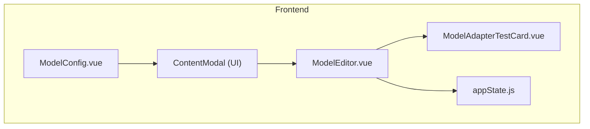
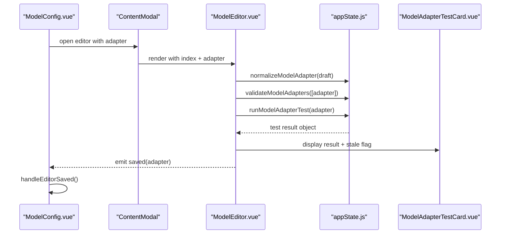
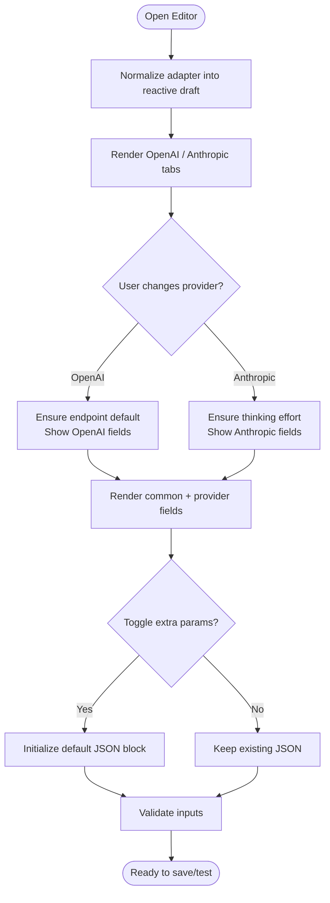
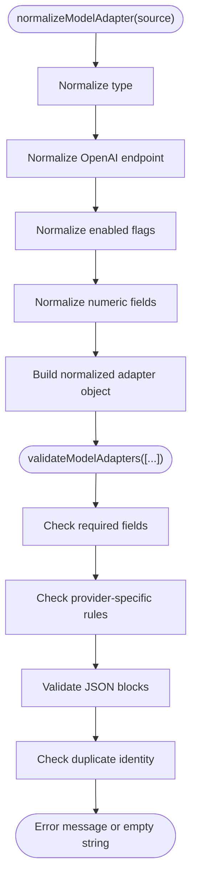
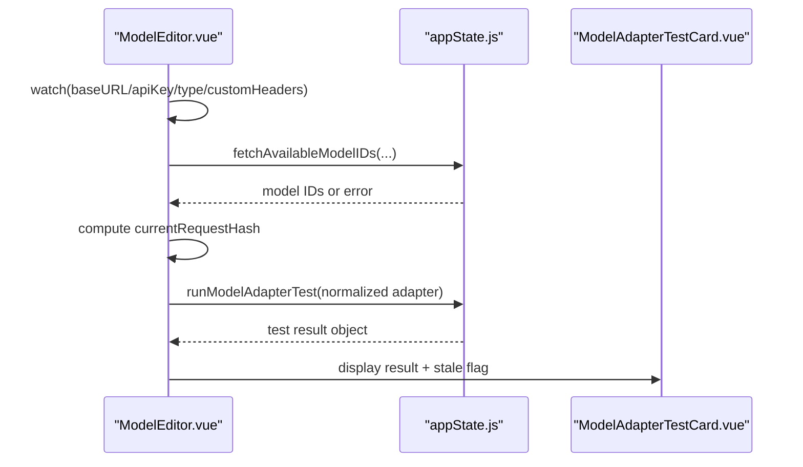
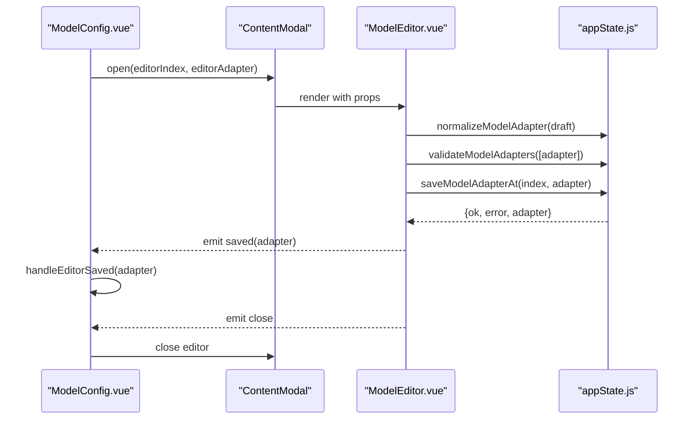
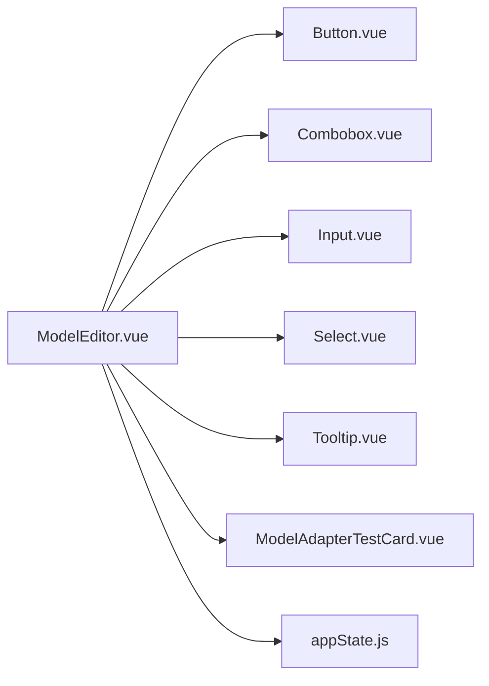

# Model Editor Component

<cite>
**Referenced Files in This Document**
- [ModelEditor.vue](file://frontend/src/components/ModelEditor.vue)
- [ModelAdapterModal.vue](file://frontend/src/components/ModelAdapterModal.vue)
- [ModelConfig.vue](file://frontend/src/views/ModelConfig.vue)
- [appState.js](file://frontend/src/state/appState.js)
- [ModelAdapterTestCard.vue](file://frontend/src/components/ModelAdapterTestCard.vue)
</cite>

## Table of Contents
1. [Introduction](#introduction)
2. [Project Structure](#project-structure)
3. [Core Components](#core-components)
4. [Architecture Overview](#architecture-overview)
5. [Detailed Component Analysis](#detailed-component-analysis)
6. [Dependency Analysis](#dependency-analysis)
7. [Performance Considerations](#performance-considerations)
8. [Troubleshooting Guide](#troubleshooting-guide)
9. [Conclusion](#conclusion)

## Introduction
The Model Editor component is the primary user interface for creating and editing model adapter configurations. It supports provider-specific configuration for OpenAI and Anthropic, dynamic field rendering based on the selected provider, input validation with real-time feedback, and integration with a modal container that manages save/cancel operations and state synchronization with the parent view.

This documentation explains:
- The form structure and conditional fields per provider.
- Input validation rules and schema normalization.
- Real-time test result display and stale-result handling.
- Configuration data binding between the editor, modal, and parent view.
- Provider-specific options such as API endpoints, authentication, extra parameters, custom headers, and advanced reasoning or thinking controls.

## Project Structure
The Model Editor lives inside the frontend Vue application and integrates with shared UI components, global state utilities, and a reusable test result card.

**Diagram sources**
- [ModelConfig.vue:497-512](file://frontend/src/views/ModelConfig.vue#L497-L512)
- [ModelEditor.vue:1-30](file://frontend/src/components/ModelEditor.vue#L1-L30)
- [ModelAdapterTestCard.vue:1-31](file://frontend/src/components/ModelAdapterTestCard.vue#L1-L31)
- [appState.js:252-276](file://frontend/src/state/appState.js#L252-L276)

**Section sources**
- [ModelConfig.vue:1-22](file://frontend/src/views/ModelConfig.vue#L1-L22)
- [ModelEditor.vue:1-30](file://frontend/src/components/ModelEditor.vue#L1-L30)
- [ModelAdapterTestCard.vue:1-31](file://frontend/src/components/ModelAdapterTestCard.vue#L1-L31)
- [appState.js:1-52](file://frontend/src/state/appState.js#L1-L52)

## Core Components
- **ModelEditor**: A self-contained editor form that renders provider-specific fields, validates inputs, triggers tests, and emits save/close events.
- **ModelAdapterModal**: A simpler modal-based editor used elsewhere; it demonstrates similar data binding and provider-specific logic but is not the main editor referenced by the Model Config view.
- **ModelConfig**: The parent view that opens the editor in a ContentModal, passes adapter data, handles saved results, and coordinates batch testing and list management.
- **ModelAdapterTestCard**: Displays test status, summary text, raw response, and optional metrics.
- **appState**: Provides normalization, validation, default values, request hashing, and persistence helpers used by the editor and parent view.

**Section sources**
- [ModelEditor.vue:60-78](file://frontend/src/components/ModelEditor.vue#L60-L78)
- [ModelAdapterModal.vue:48-74](file://frontend/src/components/ModelAdapterModal.vue#L48-L74)
- [ModelConfig.vue:125-148](file://frontend/src/views/ModelConfig.vue#L125-L148)
- [ModelAdapterTestCard.vue:6-31](file://frontend/src/components/ModelAdapterTestCard.vue#L6-L31)
- [appState.js:252-276](file://frontend/src/state/appState.js#L252-L276)

## Architecture Overview
The editor follows a unidirectional data flow pattern:
- Parent view opens the editor with an adapter snapshot.
- Editor creates a reactive draft normalized from the provided adapter.
- User edits fields; computed watchers update derived state like available models and test result hashes.
- Save persists through appState and emits a saved event to the parent.
- Test triggers a normalized request hash and displays live results via the test card.

**Diagram sources**
- [ModelConfig.vue:497-512](file://frontend/src/views/ModelConfig.vue#L497-L512)
- [ModelEditor.vue:252-289](file://frontend/src/components/ModelEditor.vue#L252-L289)
- [ModelEditor.vue:308-327](file://frontend/src/components/ModelEditor.vue#L308-L327)
- [appState.js:424-493](file://frontend/src/state/appState.js#L424-L493)

## Detailed Component Analysis

### ModelEditor Form Structure and Dynamic Rendering
The editor provides:
- Provider tabs for OpenAI and Anthropic.
- Common fields: base URL, API key, display name, model ID, context window tokens, tooltip data.
- Provider-specific fields:
  - OpenAI: reasoning effort, max completion tokens, endpoint selector, extra parameters JSON toggle.
  - Anthropic: max output tokens, thinking effort, extra parameters JSON toggle.
- Shared advanced options: custom headers JSON toggle.

Dynamic behavior:
- Selecting a provider changes visible fields and defaults.
- When OpenAI is selected, the endpoint defaults to responses if unset.
- When Anthropic is selected, thinking effort defaults are ensured.
- Extra parameter JSON blocks are initialized when toggled on.

**Diagram sources**
- [ModelEditor.vue:32-58](file://frontend/src/components/ModelEditor.vue#L32-L58)
- [ModelEditor.vue:172-194](file://frontend/src/components/ModelEditor.vue#L172-L194)
- [ModelEditor.vue:295-306](file://frontend/src/components/ModelEditor.vue#L295-L306)

**Section sources**
- [ModelEditor.vue:32-58](file://frontend/src/components/ModelEditor.vue#L32-L58)
- [ModelEditor.vue:172-194](file://frontend/src/components/ModelEditor.vue#L172-L194)
- [ModelEditor.vue:295-306](file://frontend/src/components/ModelEditor.vue#L295-L306)
- [ModelEditor.vue:536-599](file://frontend/src/components/ModelEditor.vue#L536-L599)
- [ModelEditor.vue:601-671](file://frontend/src/components/ModelEditor.vue#L601-L671)

### Input Validation Rules and Schema Normalization
Validation and normalization are centralized in appState:
- Type must be one of supported providers.
- Required fields: base URL, API key, display name, model ID, tooltip data.
- Numeric fields must be positive integers when set.
- Provider-specific constraints:
  - OpenAI reasoning effort must be a supported value.
  - OpenAI endpoint must be a supported preset or custom path.
  - Anthropic thinking effort must be a supported value.
- Optional JSON blocks:
  - OpenAI extra parameters must be a valid JSON object.
  - Anthropic extra parameters must be a valid JSON object.
  - Custom headers must be a valid JSON object with string values.
- Duplicate channel identity check across adapters.

Normalization ensures:
- Consistent field names across legacy and current formats.
- Default values for provider-specific options.
- Sanitized base URLs and boolean flags.

**Diagram sources**
- [appState.js:334-396](file://frontend/src/state/appState.js#L334-L396)
- [appState.js:424-493](file://frontend/src/state/appState.js#L424-L493)

**Section sources**
- [appState.js:334-396](file://frontend/src/state/appState.js#L334-L396)
- [appState.js:424-493](file://frontend/src/state/appState.js#L424-L493)

### Real-Time Feedback Mechanisms
The editor provides immediate feedback through:
- Debounced model list fetching when base URL, API key, or provider changes.
- Computed request hash to detect configuration changes.
- Local failure tracking for test errors.
- Stale result detection when the active configuration differs from the last tested configuration.
- Integration with ModelAdapterTestCard to show running, success, error, and estimated token states.

**Diagram sources**
- [ModelEditor.vue:213-250](file://frontend/src/components/ModelEditor.vue#L213-L250)
- [ModelEditor.vue:329-345](file://frontend/src/components/ModelEditor.vue#L329-L345)
- [ModelEditor.vue:347-391](file://frontend/src/components/ModelEditor.vue#L347-L391)
- [ModelAdapterTestCard.vue:33-99](file://frontend/src/components/ModelAdapterTestCard.vue#L33-L99)

**Section sources**
- [ModelEditor.vue:213-250](file://frontend/src/components/ModelEditor.vue#L213-L250)
- [ModelEditor.vue:329-345](file://frontend/src/components/ModelEditor.vue#L329-L345)
- [ModelEditor.vue:347-391](file://frontend/src/components/ModelEditor.vue#L347-L391)
- [ModelAdapterTestCard.vue:33-99](file://frontend/src/components/ModelAdapterTestCard.vue#L33-L99)

### Modal Integration, Save/Cancel Operations, and State Synchronization
- The parent view opens the editor inside a ContentModal, passing adapter data and receiving saved events.
- The editor emits close and saved events; the parent updates its local state and optionally switches the active filter tab based on the saved adapter’s provider.
- Save operation normalizes the draft, validates it, persists via appState, and returns the persisted adapter for UI sync.
- Cancel simply closes the editor without saving.

**Diagram sources**
- [ModelConfig.vue:125-148](file://frontend/src/views/ModelConfig.vue#L125-L148)
- [ModelConfig.vue:497-512](file://frontend/src/views/ModelConfig.vue#L497-L512)
- [ModelEditor.vue:252-289](file://frontend/src/components/ModelEditor.vue#L252-L289)
- [appState.js:611-641](file://frontend/src/state/appState.js#L611-L641)

**Section sources**
- [ModelConfig.vue:125-148](file://frontend/src/views/ModelConfig.vue#L125-L148)
- [ModelConfig.vue:497-512](file://frontend/src/views/ModelConfig.vue#L497-L512)
- [ModelEditor.vue:252-289](file://frontend/src/components/ModelEditor.vue#L252-L289)
- [appState.js:611-641](file://frontend/src/state/appState.js#L611-L641)

### Provider-Specific Configuration Fields
- OpenAI:
  - Reasoning effort selector with supported values.
  - Max completion tokens input with positive integer validation.
  - Endpoint selector supporting responses, chat completions, or custom path.
  - Optional extra parameters JSON overlay.
- Anthropic:
  - Max output tokens input with positive integer validation.
  - Thinking effort selector with supported values.
  - Optional extra parameters JSON overlay.
- Both providers share:
  - Base URL and API key for authentication.
  - Context window tokens with presets and formatted labels.
  - Custom headers JSON overlay.
  - Tooltip data for hover hints.

**Section sources**
- [ModelEditor.vue:32-58](file://frontend/src/components/ModelEditor.vue#L32-L58)
- [ModelEditor.vue:536-599](file://frontend/src/components/ModelEditor.vue#L536-L599)
- [ModelEditor.vue:601-671](file://frontend/src/components/ModelEditor.vue#L601-L671)
- [appState.js:33-43](file://frontend/src/state/appState.js#L33-L43)

### API Endpoint Customization and Authentication Setup
- Base URL normalization enforces HTTP/HTTPS and trims trailing slashes.
- API key is treated as a sensitive field with visibility toggle in the UI.
- OpenAI endpoint normalization restricts to supported presets or custom paths.
- Custom headers allow overriding final request headers with string-only values.

**Section sources**
- [appState.js:128-145](file://frontend/src/state/appState.js#L128-L145)
- [appState.js:278-291](file://frontend/src/state/appState.js#L278-L291)
- [appState.js:309-324](file://frontend/src/state/appState.js#L309-L324)
- [ModelEditor.vue:431-451](file://frontend/src/components/ModelEditor.vue#L431-L451)

### Advanced Options
- OpenAI extra parameters JSON can override request body fields, including service tier settings.
- Anthropic extra parameters JSON can override provider-specific request fields.
- Custom headers JSON allows injecting or overriding HTTP headers.
- Context window tokens support presets and human-friendly units like K/M.
- Thinking budget tokens are validated as positive integers when set.

**Section sources**
- [ModelEditor.vue:172-194](file://frontend/src/components/ModelEditor.vue#L172-L194)
- [ModelEditor.vue:112-142](file://frontend/src/components/ModelEditor.vue#L112-L142)
- [appState.js:36-42](file://frontend/src/state/appState.js#L36-L42)
- [appState.js:480-493](file://frontend/src/state/appState.js#L480-L493)

### Examples of Different Provider Configurations
- OpenAI configuration example:
  - Provider: OpenAI
  - Base URL: OpenAI-compatible API root
  - API Key: Valid access key
  - Model ID: e.g., gpt-4.1
  - Reasoning Effort: low/medium/high/xhigh/max or unset
  - Endpoint: /v1/responses or /v1/chat/completions or custom path
  - Extra Parameters JSON: optional service_tier override
  - Custom Headers JSON: optional header overrides
- Anthropic configuration example:
  - Provider: Anthropic
  - Base URL: Anthropic-compatible API root
  - API Key: Valid access key
  - Model ID: e.g., claude-3-sonnet
  - Max Output Tokens: positive integer or unset
  - Thinking Effort: low/medium/high/xhigh/max
  - Extra Parameters JSON: optional provider-specific overrides
  - Custom Headers JSON: optional header overrides

These examples reflect the fields rendered and validated by the editor and normalized by appState.

**Section sources**
- [ModelEditor.vue:536-599](file://frontend/src/components/ModelEditor.vue#L536-L599)
- [ModelEditor.vue:601-671](file://frontend/src/components/ModelEditor.vue#L601-L671)
- [appState.js:334-396](file://frontend/src/state/appState.js#L334-L396)

### Common Validation Scenarios
- Missing required fields: base URL, API key, display name, model ID, tooltip data.
- Invalid provider type: only OpenAI or Anthropic allowed.
- Unsupported reasoning effort or thinking effort values.
- Invalid OpenAI endpoint: must be a supported preset or custom path starting with /.
- Invalid JSON blocks: extra parameters and custom headers must be valid JSON objects; headers must have string values.
- Non-positive integer values for numeric fields when set.
- Duplicate adapter identity: same combination of base URL, model ID, API key, display name, and endpoint.

**Section sources**
- [appState.js:424-493](file://frontend/src/state/appState.js#L424-L493)

## Dependency Analysis
The editor depends on:
- UI primitives: Button, Combobox, Input, Select, Tooltip.
- Test result card: ModelAdapterTestCard.
- Global state: normalization, validation, defaults, persistence, and test execution helpers.

**Diagram sources**
- [ModelEditor.vue:1-30](file://frontend/src/components/ModelEditor.vue#L1-L30)
- [ModelAdapterTestCard.vue:1-31](file://frontend/src/components/ModelAdapterTestCard.vue#L1-L31)
- [appState.js:1-52](file://frontend/src/state/appState.js#L1-L52)

**Section sources**
- [ModelEditor.vue:1-30](file://frontend/src/components/ModelEditor.vue#L1-L30)
- [ModelAdapterTestCard.vue:1-31](file://frontend/src/components/ModelAdapterTestCard.vue#L1-L31)
- [appState.js:1-52](file://frontend/src/state/appState.js#L1-L52)

## Performance Considerations
- Debounced model list fetching reduces unnecessary network requests while typing base URL or API key.
- Request hashing avoids redundant tests when configuration has not changed.
- Stale result detection prevents showing outdated test outcomes after configuration edits.
- Positive integer parsing and token unit parsing avoid heavy computations during input changes.

[No sources needed since this section provides general guidance]

## Troubleshooting Guide
Common issues and resolutions:
- Validation errors appear when required fields are missing or invalid. Review base URL, API key, display name, model ID, and tooltip data.
- Provider-specific errors:
  - OpenAI: ensure reasoning effort and endpoint values are supported.
  - Anthropic: ensure thinking effort and max output tokens are valid.
- JSON block errors:
  - Extra parameters and custom headers must be valid JSON objects.
  - Header values must be strings.
- Duplicate adapter identity:
  - Adjust base URL, model ID, API key, display name, or endpoint to make the adapter unique.
- Test failures:
  - Check local failure messages and raw response details in the test card.
  - Re-run the test after correcting configuration.

**Section sources**
- [ModelEditor.vue:252-289](file://frontend/src/components/ModelEditor.vue#L252-L289)
- [ModelEditor.vue:308-327](file://frontend/src/components/ModelEditor.vue#L308-L327)
- [ModelAdapterTestCard.vue:33-99](file://frontend/src/components/ModelAdapterTestCard.vue#L33-L99)
- [appState.js:424-493](file://frontend/src/state/appState.js#L424-L493)

## Conclusion
The Model Editor component provides a robust, provider-aware configuration interface with strong validation, real-time feedback, and seamless integration with the parent view and global state. It supports both OpenAI and Anthropic adapters, offers advanced customization through extra parameters and custom headers, and ensures safe persistence and consistent state synchronization. Users can confidently create, edit, and test model adapter configurations with clear validation messages and actionable feedback.

[No sources needed since this section summarizes without analyzing specific files]