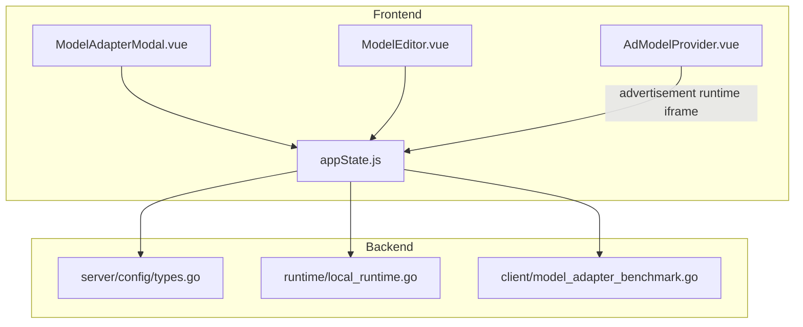
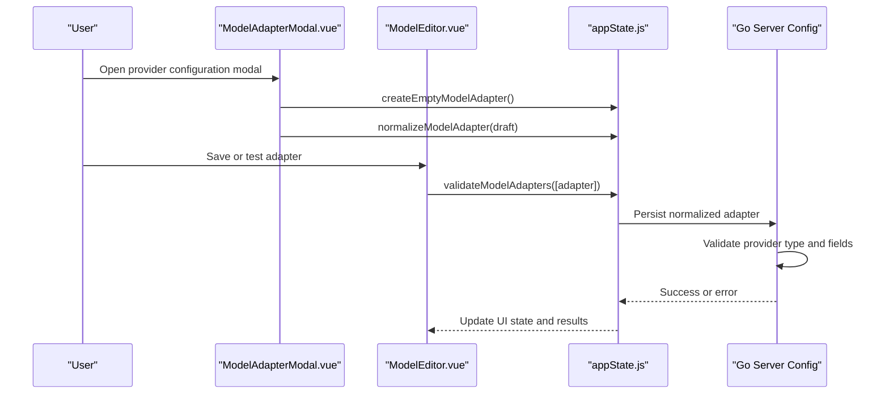
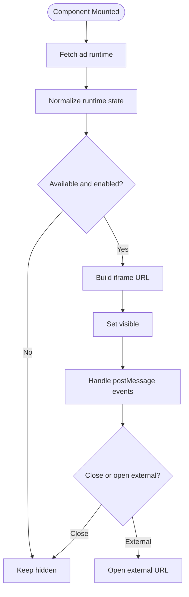
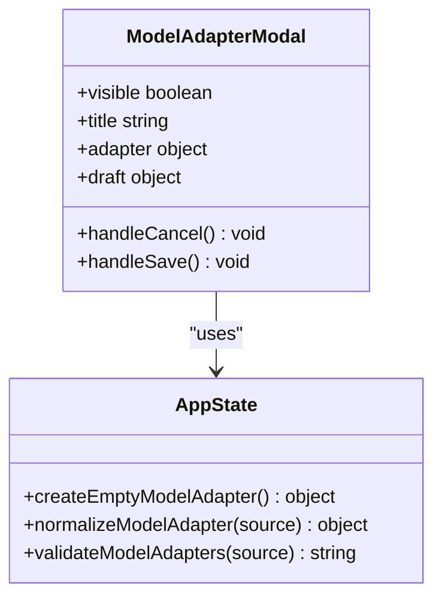
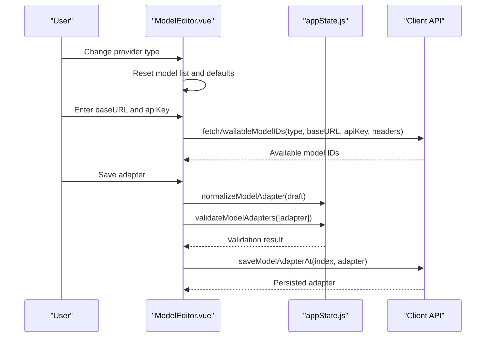
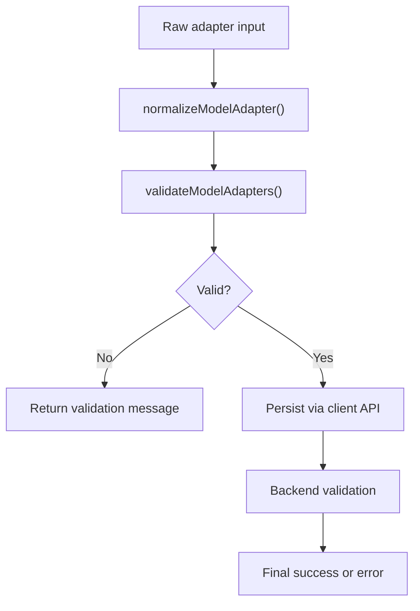
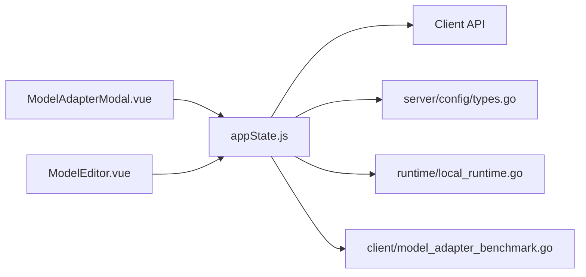

# Provider Type Adapters

<cite>
**Referenced Files in This Document**
- [AdModelProvider.vue](file://frontend/src/components/AdModelProvider.vue)
- [ModelAdapterModal.vue](file://frontend/src/components/ModelAdapterModal.vue)
- [ModelEditor.vue](file://frontend/src/components/ModelEditor.vue)
- [appState.js](file://frontend/src/state/appState.js)
- [types.go](file://internal/backend/server/config/types.go)
- [local_runtime.go](file://internal/runtime/local_runtime.go)
- [model_adapter_benchmark.go](file://internal/client/model_adapter_benchmark.go)
</cite>

## Table of Contents
1. [Introduction](#introduction)
2. [Project Structure](#project-structure)
3. [Core Components](#core-components)
4. [Architecture Overview](#architecture-overview)
5. [Detailed Component Analysis](#detailed-component-analysis)
6. [Dependency Analysis](#dependency-analysis)
7. [Performance Considerations](#performance-considerations)
8. [Troubleshooting Guide](#troubleshooting-guide)
9. [Conclusion](#conclusion)
10. [Appendices](#appendices)

## Introduction
This document explains the Provider Type Adapters system that manages different Large Language Model provider configurations. It focuses on how the frontend adapts UI and validation for OpenAI and Anthropic providers, how configuration is normalized and validated, and how backend layers enforce schema rules. The goal is to make it easy to understand the adapter factory pattern, provider detection logic, configuration schema differences, extensibility points, shared validation logic, and provider-specific authentication and request customization.

The system is not limited to a single component named `AdModelProvider`. Instead, provider adapter behavior is implemented across:
- A Vue component used for advertisement runtime display.
- Two model configuration editors.
- A centralized state module that normalizes, validates, and persists adapter configuration.
- Backend Go modules that validate and normalize server-side adapter configuration.

## Project Structure
The relevant parts of the repository are split between the frontend Vue application and the Go backend:

**Diagram sources**
- [AdModelProvider.vue:1-239](file://frontend/src/components/AdModelProvider.vue#L1-L239)
- [ModelAdapterModal.vue:1-400](file://frontend/src/components/ModelAdapterModal.vue#L1-L400)
- [ModelEditor.vue:1-699](file://frontend/src/components/ModelEditor.vue#L1-L699)
- [appState.js:252-493](file://frontend/src/state/appState.js#L252-L493)
- [types.go:136-160](file://internal/backend/server/config/types.go#L136-L160)
- [local_runtime.go:157-196](file://internal/runtime/local_runtime.go#L157-L196)
- [model_adapter_benchmark.go:926-989](file://internal/client/model_adapter_benchmark.go#L926-L989)

**Section sources**
- [AdModelProvider.vue:1-239](file://frontend/src/components/AdModelProvider.vue#L1-L239)
- [ModelAdapterModal.vue:1-400](file://frontend/src/components/ModelAdapterModal.vue#L1-L400)
- [ModelEditor.vue:1-699](file://frontend/src/components/ModelEditor.vue#L1-L699)
- [appState.js:252-493](file://frontend/src/state/appState.js#L252-L493)
- [types.go:136-160](file://internal/backend/server/config/types.go#L136-L160)
- [local_runtime.go:157-196](file://internal/runtime/local_runtime.go#L157-L196)
- [model_adapter_benchmark.go:926-989](file://internal/client/model_adapter_benchmark.go#L926-L989)

## Core Components
The Provider Type Adapters system has three main responsibilities:

1. **UI Adapter Rendering**: Show provider-specific fields and options based on the selected provider type.
2. **Configuration Normalization**: Convert various input formats into a consistent adapter object shape.
3. **Validation and Persistence**: Validate required fields, provider-specific constraints, JSON payloads, and duplicate identities before saving.

### Provider Types
Supported provider types are explicitly defined as:
- `openai`
- `anthropic`

These values are enforced by both frontend normalization and backend validation.

### Shared Adapter Fields
All adapters share common fields such as:
- Display name
- Base URL
- API key
- Tooltip data
- Model ID
- Context window tokens
- Custom headers configuration

### Provider-Specific Fields
- **OpenAI**:
  - Reasoning effort
  - Max completion tokens
  - OpenAI endpoint selection
  - Optional extra parameters JSON
- **Anthropic**:
  - Max output tokens
  - Thinking effort
  - Optional extra parameters JSON

**Section sources**
- [appState.js:30-43](file://frontend/src/state/appState.js#L30-L43)
- [appState.js:252-276](file://frontend/src/state/appState.js#L252-L276)
- [appState.js:334-396](file://frontend/src/state/appState.js#L334-L396)
- [ModelAdapterModal.vue:16-42](file://frontend/src/components/ModelAdapterModal.vue#L16-L42)
- [ModelEditor.vue:32-58](file://frontend/src/components/ModelEditor.vue#L32-L58)

## Architecture Overview
The Provider Type Adapters architecture follows an adapter factory pattern centered around configuration normalization and validation:

**Diagram sources**
- [ModelAdapterModal.vue:48-176](file://frontend/src/components/ModelAdapterModal.vue#L48-L176)
- [ModelEditor.vue:252-327](file://frontend/src/components/ModelEditor.vue#L252-L327)
- [appState.js:252-493](file://frontend/src/state/appState.js#L252-L493)
- [types.go:136-160](file://internal/backend/server/config/types.go#L136-L160)

### Key Architectural Points
- **Adapter Factory Pattern**: `createEmptyModelAdapter()` creates a default adapter object; `normalizeModelAdapter()` converts raw input into a canonical form.
- **Provider Detection Logic**: The `type` field determines which provider-specific fields are rendered and validated.
- **Configuration Schema Differences**: OpenAI and Anthropic have distinct optional fields and defaults.
- **Extensibility Mechanism**: New provider types can be added by extending supported sets, normalization logic, validation rules, and UI components.
- **Shared Validation Logic**: Common JSON validation, header validation, and identity deduplication are centralized.
- **Provider-Specific Authentication Methods**: Both providers use `baseURL` and `apiKey`, but request customization differs through provider-specific extra parameters and headers.

**Section sources**
- [appState.js:252-493](file://frontend/src/state/appState.js#L252-L493)
- [ModelAdapterModal.vue:137-176](file://frontend/src/components/ModelAdapterModal.vue#L137-L176)
- [ModelEditor.vue:295-327](file://frontend/src/components/ModelEditor.vue#L295-L327)

## Detailed Component Analysis

### AdModelProvider Component
`AdModelProvider.vue` is primarily responsible for displaying an advertisement runtime inside a sandboxed iframe. While it is not the core model adapter editor, it demonstrates how runtime state is normalized and displayed safely.

Key behaviors:
- Fetches runtime metadata from the client API.
- Normalizes slot-based runtime configuration.
- Renders an iframe with restricted permissions.
- Handles cross-origin messages securely.
- Supports external link opening through a controlled bridge.

**Diagram sources**
- [AdModelProvider.vue:101-168](file://frontend/src/components/AdModelProvider.vue#L101-L168)
- [AdModelProvider.vue:177-190](file://frontend/src/components/AdModelProvider.vue#L177-L190)

**Section sources**
- [AdModelProvider.vue:1-239](file://frontend/src/components/AdModelProvider.vue#L1-L239)

### ModelAdapterModal Component
`ModelAdapterModal.vue` provides a compact modal for creating or editing a model adapter. It uses the same normalization and validation pipeline as the full editor.

Key behaviors:
- Defines provider type options for OpenAI and Anthropic.
- Initializes draft adapter using `createEmptyModelAdapter()`.
- Syncs draft with normalized adapter data.
- Sets provider-specific defaults when type changes.
- Emits normalized adapter on save.

Provider-specific rendering:
- OpenAI fields: reasoning effort, max token, endpoint selector, extra parameters JSON toggle.
- Anthropic fields: max tokens, thinking effort.

**Diagram sources**
- [ModelAdapterModal.vue:48-176](file://frontend/src/components/ModelAdapterModal.vue#L48-L176)
- [appState.js:252-493](file://frontend/src/state/appState.js#L252-L493)

**Section sources**
- [ModelAdapterModal.vue:1-400](file://frontend/src/components/ModelAdapterModal.vue#L1-L400)
- [appState.js:252-493](file://frontend/src/state/appState.js#L252-L493)

### ModelEditor Component
`ModelEditor.vue` is the primary interface for configuring provider adapters. It includes live testing, model list fetching, and detailed validation feedback.

Key behaviors:
- Displays tabs for OpenAI and Anthropic.
- Manages draft adapter state.
- Debounces model list fetching.
- Persists adapter after validation.
- Runs model adapter tests and displays results.

Provider-specific rendering:
- OpenAI: reasoning effort, max completion tokens, endpoint selector, extra parameters JSON.
- Anthropic: max output tokens, thinking effort, extra parameters JSON.
- Shared: custom headers JSON toggle.

**Diagram sources**
- [ModelEditor.vue:213-280](file://frontend/src/components/ModelEditor.vue#L213-L280)
- [ModelEditor.vue:295-327](file://frontend/src/components/ModelEditor.vue#L295-L327)
- [appState.js:252-493](file://frontend/src/state/appState.js#L252-L493)

**Section sources**
- [ModelEditor.vue:1-699](file://frontend/src/components/ModelEditor.vue#L1-L699)
- [appState.js:252-493](file://frontend/src/state/appState.js#L252-L493)

### Configuration Normalization and Validation Pipeline
The central normalization and validation logic lives in `appState.js`. It ensures that all adapters conform to a consistent schema before being persisted or tested.

**Diagram sources**
- [appState.js:334-493](file://frontend/src/state/appState.js#L334-L493)
- [types.go:136-160](file://internal/backend/server/config/types.go#L136-L160)
- [local_runtime.go:157-196](file://internal/runtime/local_runtime.go#L157-L196)

**Section sources**
- [appState.js:334-493](file://frontend/src/state/appState.js#L334-L493)
- [types.go:136-160](file://internal/backend/server/config/types.go#L136-L160)
- [local_runtime.go:157-196](file://internal/runtime/local_runtime.go#L157-L196)

## Dependency Analysis
The Provider Type Adapters system has clear layering:

**Diagram sources**
- [ModelAdapterModal.vue:1-400](file://frontend/src/components/ModelAdapterModal.vue#L1-L400)
- [ModelEditor.vue:1-699](file://frontend/src/components/ModelEditor.vue#L1-L699)
- [appState.js:252-493](file://frontend/src/state/appState.js#L252-L493)
- [types.go:136-160](file://internal/backend/server/config/types.go#L136-L160)
- [local_runtime.go:157-196](file://internal/runtime/local_runtime.go#L157-L196)
- [model_adapter_benchmark.go:926-989](file://internal/client/model_adapter_benchmark.go#L926-L989)

### Coupling and Cohesion
- **High cohesion**: All adapter normalization and validation logic is centralized in `appState.js`.
- **Low coupling**: UI components depend only on exported functions from `appState.js`.
- **Backend alignment**: Backend validation mirrors frontend rules, reducing mismatch risk.

### External Dependencies
- Vue composition APIs for reactive state.
- Wails runtime for IPC and events.
- Go backend modules for server-side validation and benchmarking.

**Section sources**
- [appState.js:1-26](file://frontend/src/state/appState.js#L1-L26)
- [appState.js:252-493](file://frontend/src/state/appState.js#L252-L493)

## Performance Considerations
- **Debounced model list fetching**: Prevents excessive API calls while typing.
- **Normalized identity hashing**: Uses a stable hash for test result caching.
- **Minimal re-renders**: Reactive computed properties reduce unnecessary updates.
- **Sandboxed iframe**: Advertisement runtime is isolated to avoid performance impact on the main UI.

[No sources needed since this section provides general guidance]

## Troubleshooting Guide
Common issues and their likely causes:

| Issue | Likely Cause | Resolution |
|---|---|---|
| Provider type rejected | Unsupported or missing `type` field | Use `openai` or `anthropic` |
| Base URL or API key missing | Required fields empty | Fill base URL and API key |
| Invalid JSON in extra parameters | Malformed JSON object | Fix JSON syntax and ensure it is an object |
| Invalid custom headers | Header values are not strings | Ensure all header values are strings |
| Duplicate adapter identity | Same combination of URL, model ID, API key, display name, and endpoint | Change one of the identity fields |
| OpenAI endpoint invalid | Endpoint not in supported set | Use `/v1/responses`, `/v1/chat/completions`, or a valid custom path |
| Anthropic thinking effort invalid | Value not in supported set | Use `low`, `medium`, `high`, `xhigh`, or `max` |

**Section sources**
- [appState.js:424-493](file://frontend/src/state/appState.js#L424-L493)
- [types.go:136-160](file://internal/backend/server/config/types.go#L136-L160)
- [local_runtime.go:157-196](file://internal/runtime/local_runtime.go#L157-L196)

## Conclusion
The Provider Type Adapters system provides a robust, extensible foundation for managing LLM provider configurations. It separates concerns between UI rendering, configuration normalization, validation, and backend enforcement. The adapter factory pattern makes it straightforward to add new provider types by updating supported sets, normalization logic, validation rules, and UI components. Shared validation ensures consistency, while provider-specific fields allow fine-grained control over authentication and request customization.

[No sources needed since this section summarizes without analyzing specific files]

## Appendices

### Extensibility Mechanism for Adding a New Provider Type
To add a new provider type:

1. **Extend supported types**: Add the new type to the supported set.
2. **Update normalization**: Handle provider-specific fields in `normalizeModelAdapter()`.
3. **Add validation rules**: Extend `validateModelAdapters()` with provider-specific constraints.
4. **Update UI components**: Add provider options and conditional field rendering in `ModelAdapterModal.vue` and `ModelEditor.vue`.
5. **Align backend validation**: Mirror frontend rules in backend config validation.
6. **Test normalization and validation**: Verify default values, JSON parsing, and identity deduplication.

**Section sources**
- [appState.js:30-43](file://frontend/src/state/appState.js#L30-L43)
- [appState.js:334-493](file://frontend/src/state/appState.js#L334-L493)
- [ModelAdapterModal.vue:16-42](file://frontend/src/components/ModelAdapterModal.vue#L16-L42)
- [ModelEditor.vue:32-58](file://frontend/src/components/ModelEditor.vue#L32-L58)
- [types.go:136-160](file://internal/backend/server/config/types.go#L136-L160)

### Configuration Schema Reference
| Field | Type | Description | Provider Scope |
|---|---|---|---|
| `id` | String | Internal identifier | Shared |
| `sort` | Number | Sort order | Shared |
| `displayName` | String | Human-readable name | Shared |
| `type` | Enum | Provider type | Shared |
| `baseURL` | String | API root address | Shared |
| `apiKey` | String | Authentication key | Shared |
| `tooltipData` | String | Hover tooltip text | Shared |
| `modelID` | String | Model identifier | Shared |
| `reasoningEffort` | Enum | OpenAI reasoning intensity | OpenAI |
| `openAIEndpoint` | Enum | OpenAI endpoint path | OpenAI |
| `openAIExtraParamsEnabled` | Boolean | Enable extra parameters | OpenAI |
| `openAIExtraParamsJSON` | String | Extra parameters payload | OpenAI |
| `customHeadersEnabled` | Boolean | Enable custom headers | Shared |
| `customHeadersJSON` | String | Custom headers payload | Shared |
| `anthropicExtraParamsEnabled` | Boolean | Enable extra parameters | Anthropic |
| `anthropicExtraParamsJSON` | String | Extra parameters payload | Anthropic |
| `contextWindowTokens` | Number | Context window size | Shared |
| `maxCompletionTokens` | Number | Max output tokens | OpenAI |
| `anthropicMaxTokens` | Number | Anthropic max output tokens | Anthropic |
| `anthropicThinkingEffort` | Enum | Anthropic thinking intensity | Anthropic |
| `thinkingBudgetTokens` | Number | Thinking budget tokens | Shared |

**Section sources**
- [appState.js:252-276](file://frontend/src/state/appState.js#L252-L276)
- [appState.js:334-396](file://frontend/src/state/appState.js#L334-L396)

### Example Custom Provider Implementation Outline
This outline shows how a hypothetical new provider would integrate:

1. Define provider constants and supported values.
2. Add provider-specific fields to the adapter object.
3. Implement normalization for new fields.
4. Add validation rules for new fields.
5. Update UI components to render provider-specific inputs.
6. Align backend validation with frontend rules.

**Section sources**
- [appState.js:30-43](file://frontend/src/state/appState.js#L30-L43)
- [appState.js:334-493](file://frontend/src/state/appState.js#L334-L493)
- [ModelAdapterModal.vue:16-42](file://frontend/src/components/ModelAdapterModal.vue#L16-L42)
- [ModelEditor.vue:32-58](file://frontend/src/components/ModelEditor.vue#L32-L58)
- [types.go:136-160](file://internal/backend/server/config/types.go#L136-L160)

### Example Configuration Templates
Below are conceptual templates showing how normalized adapter objects look for each provider. These are structural examples, not literal code snippets.

**OpenAI Adapter Template**
- `type`: `openai`
- `baseURL`: OpenAI-compatible API root
- `apiKey`: OpenAI API key
- `modelID`: Selected model identifier
- `reasoningEffort`: Optional reasoning intensity
- `openAIEndpoint`: Endpoint selector
- `openAIExtraParamsEnabled`: Optional extra parameters flag
- `openAIExtraParamsJSON`: Optional extra parameters payload
- `customHeadersEnabled`: Optional custom headers flag
- `customHeadersJSON`: Optional custom headers payload
- `contextWindowTokens`: Optional context window size
- `maxCompletionTokens`: Optional max output tokens
- `tooltipData`: Optional tooltip text

**Anthropic Adapter Template**
- `type`: `anthropic`
- `baseURL`: Anthropic-compatible API root
- `apiKey`: Anthropic API key
- `modelID`: Selected model identifier
- `anthropicMaxTokens`: Optional max output tokens
- `anthropicThinkingEffort`: Thinking intensity
- `anthropicExtraParamsEnabled`: Optional extra parameters flag
- `anthropicExtraParamsJSON`: Optional extra parameters payload
- `customHeadersEnabled`: Optional custom headers flag
- `customHeadersJSON`: Optional custom headers payload
- `contextWindowTokens`: Optional context window size
- `tooltipData`: Optional tooltip text

**Section sources**
- [appState.js:252-276](file://frontend/src/state/appState.js#L252-L276)
- [appState.js:334-396](file://frontend/src/state/appState.js#L334-L396)
- [ModelAdapterModal.vue:284-356](file://frontend/src/components/ModelAdapterModal.vue#L284-L356)
- [ModelEditor.vue:536-647](file://frontend/src/components/ModelEditor.vue#L536-L647)