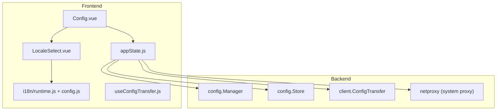
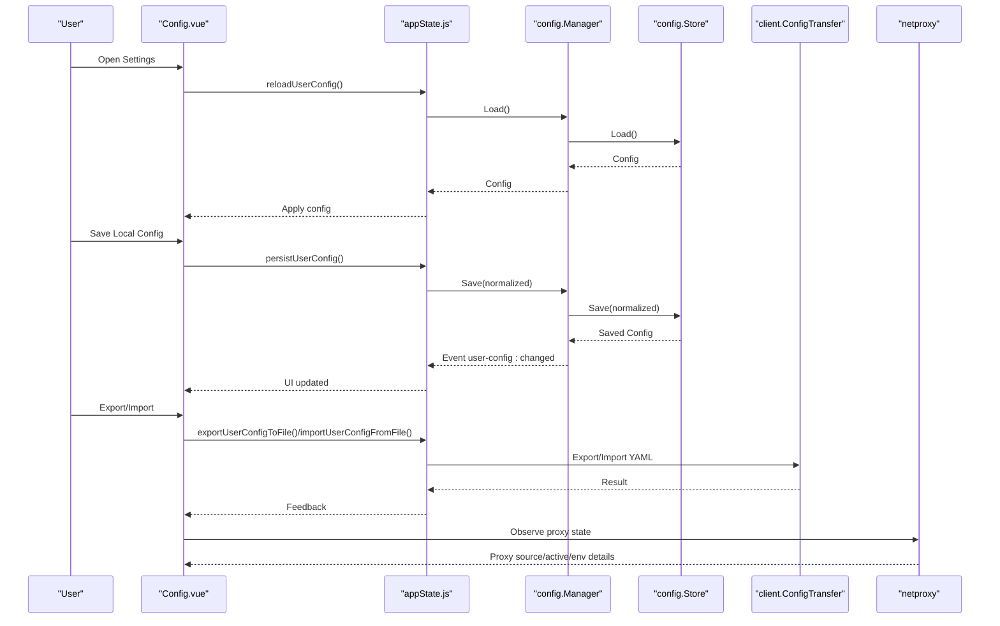
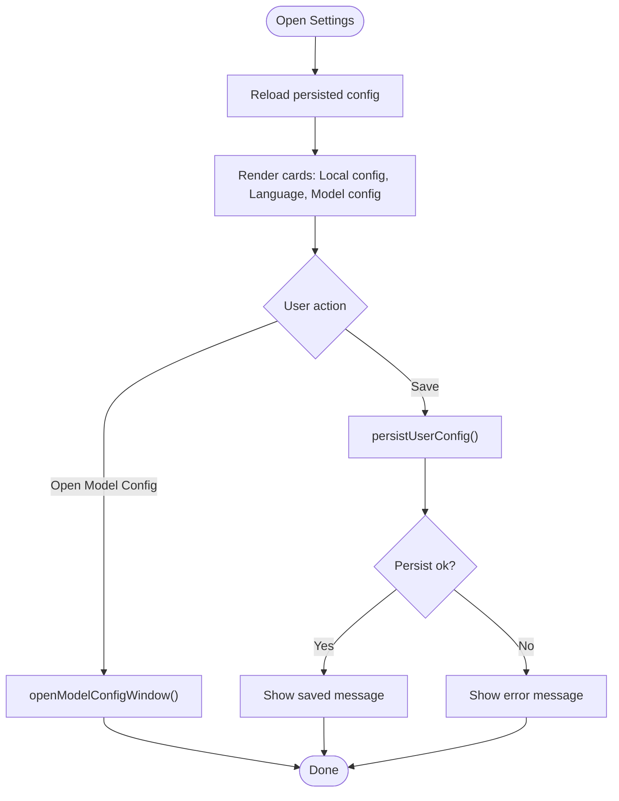
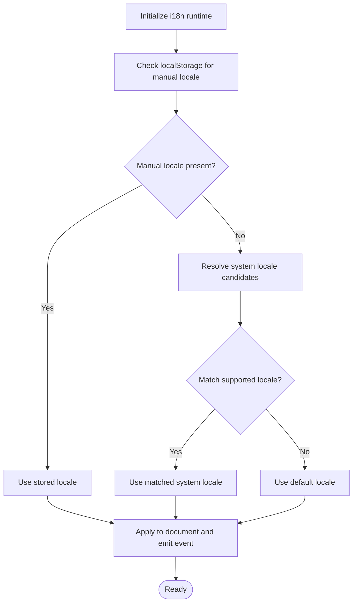
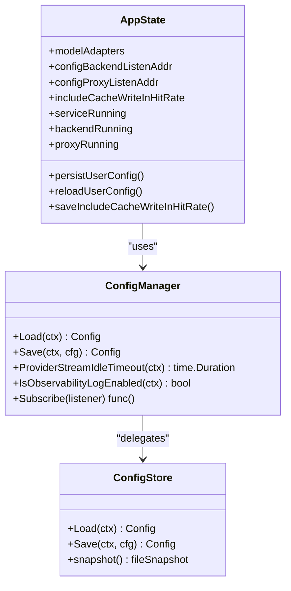
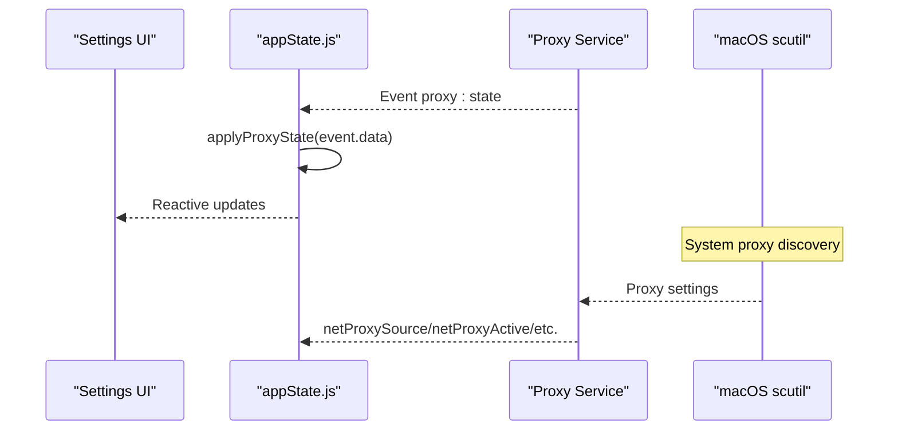
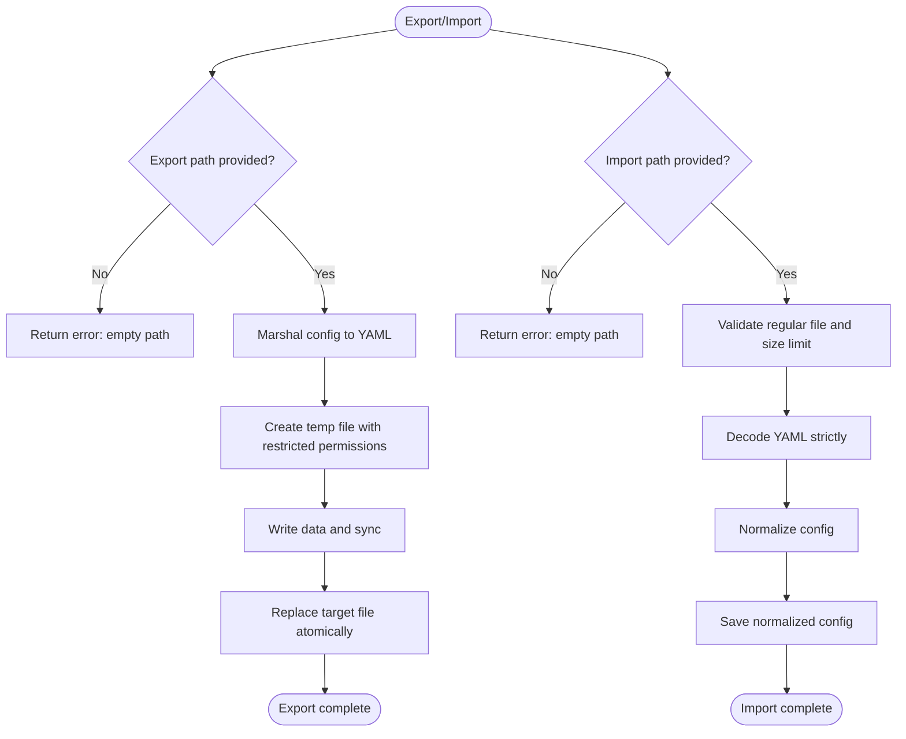
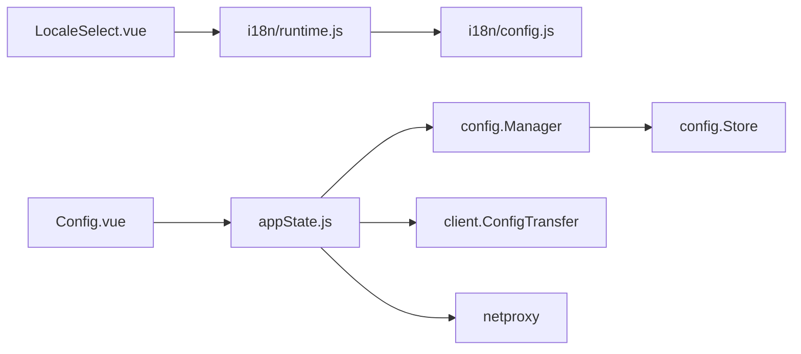

# Settings View

<cite>
**Referenced Files in This Document**
- [Config.vue](file://frontend/src/views/Config.vue)
- [LocaleSelect.vue](file://frontend/src/components/LocaleSelect.vue)
- [runtime.js](file://frontend/src/i18n/runtime.js)
- [config.js](file://frontend/src/i18n/config.js)
- [appState.js](file://frontend/src/state/appState.js)
- [useConfigTransfer.js](file://frontend/src/composables/useConfigTransfer.js)
- [store.go](file://internal/backend/server/config/store.go)
- [manager.go](file://internal/backend/server/config/manager.go)
- [types.go](file://internal/backend/server/config/types.go)
- [config_transfer.go](file://internal/client/config_transfer.go)
- [config_transfer_replace_unix.go](file://internal/client/config_transfer_replace_unix.go)
- [config_transfer_replace_windows.go](file://internal/client/config_transfer_replace_windows.go)
- [system_darwin.go](file://internal/netproxy/system_darwin.go)
</cite>

## Table of Contents
1. [Introduction](#introduction)
2. [Project Structure](#project-structure)
3. [Core Components](#core-components)
4. [Architecture Overview](#architecture-overview)
5. [Detailed Component Analysis](#detailed-component-analysis)
6. [Dependency Analysis](#dependency-analysis)
7. [Performance Considerations](#performance-considerations)
8. [Troubleshooting Guide](#troubleshooting-guide)
9. [Conclusion](#conclusion)

## Introduction
This document explains the Settings view and its surrounding configuration system. It covers:
- General settings, including model adapters, backend/proxy listen addresses, logging, and home metrics options.
- Proxy configuration and how system proxy state is observed.
- Locale selection for internationalization.
- Configuration file management, import/export, validation rules, persistence, defaults, and migration behavior.
- Security considerations for sensitive settings, environment-specific configurations, and backup/restore procedures.

## Project Structure
The Settings view is a frontend Vue page that composes reusable UI components and delegates most logic to a shared application state module. Backend services provide configuration storage, normalization, hot reload, and secure export/import operations.

**Diagram sources**
- [Config.vue:1-85](file://frontend/src/views/Config.vue#L1-L85)
- [LocaleSelect.vue:1-31](file://frontend/src/components/LocaleSelect.vue#L1-L31)
- [runtime.js:1-191](file://frontend/src/i18n/runtime.js#L1-L191)
- [config.js:1-12](file://frontend/src/i18n/config.js#L1-L12)
- [appState.js:1-1454](file://frontend/src/state/appState.js#L1-L1454)
- [manager.go:1-226](file://internal/backend/server/config/manager.go#L1-L226)
- [store.go:1-169](file://internal/backend/server/config/store.go#L1-L169)
- [config_transfer.go:1-195](file://internal/client/config_transfer.go#L1-L195)
- [system_darwin.go:1-62](file://internal/netproxy/system_darwin.go#L1-L62)

**Section sources**
- [Config.vue:1-85](file://frontend/src/views/Config.vue#L1-L85)
- [LocaleSelect.vue:1-31](file://frontend/src/components/LocaleSelect.vue#L1-L31)
- [runtime.js:1-191](file://frontend/src/i18n/runtime.js#L1-L191)
- [config.js:1-12](file://frontend/src/i18n/config.js#L1-L12)
- [appState.js:1-1454](file://frontend/src/state/appState.js#L1-L1454)
- [manager.go:1-226](file://internal/backend/server/config/manager.go#L1-L226)
- [store.go:1-169](file://internal/backend/server/config/store.go#L1-L169)
- [config_transfer.go:1-195](file://internal/client/config_transfer.go#L1-L195)
- [system_darwin.go:1-62](file://internal/netproxy/system_darwin.go#L1-L62)

## Core Components
- Settings page: Provides local configuration controls, language selection, and navigation to model configuration.
- Locale selector: Binds to i18n runtime for immediate language switching with persistent preference.
- Application state: Normalizes, validates, persists, imports, exports, and synchronizes configuration and service state.
- Configuration manager and store: Provide normalized configuration, default values, atomic saves, and hot reload.
- Config transfer: Secure YAML export/import with strict validation and platform-specific file replacement.
- System proxy observer: Reads OS-level proxy configuration on supported platforms.

**Section sources**
- [Config.vue:1-85](file://frontend/src/views/Config.vue#L1-L85)
- [LocaleSelect.vue:1-31](file://frontend/src/components/LocaleSelect.vue#L1-L31)
- [appState.js:1-1454](file://frontend/src/state/appState.js#L1-L1454)
- [manager.go:1-226](file://internal/backend/server/config/manager.go#L1-L226)
- [store.go:1-169](file://internal/backend/server/config/store.go#L1-L169)
- [config_transfer.go:1-195](file://internal/client/config_transfer.go#L1-L195)
- [system_darwin.go:1-62](file://internal/netproxy/system_darwin.go#L1-L62)

## Architecture Overview
The Settings view interacts with the application state layer, which coordinates with backend services for configuration persistence, import/export, and proxy state observation. The i18n runtime manages locale selection and persistence.

**Diagram sources**
- [Config.vue:1-85](file://frontend/src/views/Config.vue#L1-L85)
- [appState.js:1-1454](file://frontend/src/state/appState.js#L1-L1454)
- [manager.go:1-226](file://internal/backend/server/config/manager.go#L1-L226)
- [store.go:1-169](file://internal/backend/server/config/store.go#L1-L169)
- [config_transfer.go:1-195](file://internal/client/config_transfer.go#L1-L195)
- [system_darwin.go:1-62](file://internal/netproxy/system_darwin.go#L1-L62)

## Detailed Component Analysis

### Settings Page (Config.vue)
Responsibilities:
- Display local configuration summary and save button.
- Provide language selection via LocaleSelect.
- Open model configuration window.
- Show messages for success or error outcomes.

Key behaviors:
- On mount, reloads persisted user configuration.
- Save triggers persistence through appState.
- Opening model configuration delegates to appState.

**Section sources**
- [Config.vue:1-85](file://frontend/src/views/Config.vue#L1-L85)

#### Settings Page Flowchart

**Diagram sources**
- [Config.vue:1-85](file://frontend/src/views/Config.vue#L1-L85)
- [appState.js:1115-1125](file://frontend/src/state/appState.js#L1115-L1125)

### Locale Selection (LocaleSelect.vue and i18n Runtime)
Responsibilities:
- Present available locales from i18n configuration.
- Update current locale immediately and persist manual selection.
- Fallback to system locale when no manual selection exists.

Key behaviors:
- Uses useLocale composable to bind selected locale and options.
- Runtime resolves initial locale from localStorage or system preferences.
- Manual selections are stored with a source flag to distinguish from automatic resolution.

**Diagram sources**
- [runtime.js:78-107](file://frontend/src/i18n/runtime.js#L78-L107)
- [runtime.js:148-174](file://frontend/src/i18n/runtime.js#L148-L174)
- [config.js:1-12](file://frontend/src/i18n/config.js#L1-L12)

**Section sources**
- [LocaleSelect.vue:1-31](file://frontend/src/components/LocaleSelect.vue#L1-L31)
- [runtime.js:1-191](file://frontend/src/i18n/runtime.js#L1-L191)
- [config.js:1-12](file://frontend/src/i18n/config.js#L1-L12)

### Configuration Management (General Settings, Validation, Persistence)
Responsibilities:
- Normalize and validate general settings and model adapters.
- Persist changes atomically and notify listeners.
- Maintain cached runtime state in localStorage for resilience.

Key behaviors:
- normalizeConfig maps raw fields to canonical structure.
- buildConfigPayload serializes current state for persistence.
- persistConfigPayload performs validation, then calls backend save and refreshes state.
- watchSyncEffect persists reactive state to localStorage.

**Diagram sources**
- [appState.js:538-641](file://frontend/src/state/appState.js#L538-L641)
- [manager.go:62-86](file://internal/backend/server/config/manager.go#L62-L86)
- [store.go:63-136](file://internal/backend/server/config/store.go#L63-L136)

Validation highlights:
- Required fields for model adapters include type, baseURL, apiKey, displayName, modelID, tooltipData.
- Numeric constraints for token limits and timeouts.
- JSON object validation for extra parameters and custom headers.
- Endpoint restrictions for OpenAI adapters.
- Duplicate adapter identity checks.

Defaults and normalization:
- Default backend/proxy listen addresses and provider stream idle timeout.
- Listen address parsing enforces host:port format and valid port ranges.
- Provider stream idle timeout clamped to minimum and defaults if invalid.

Persistence strategy:
- Atomic save using temporary file and rename.
- Optional re-persistence when legacy keys or changed fields are detected.
- Frontend caches reactive state in localStorage for quick recovery.

**Section sources**
- [appState.js:538-641](file://frontend/src/state/appState.js#L538-L641)
- [appState.js:820-900](file://frontend/src/state/appState.js#L820-L900)
- [types.go:61-93](file://internal/backend/server/config/types.go#L61-L93)
- [types.go:95-172](file://internal/backend/server/config/types.go#L95-L172)
- [types.go:250-284](file://internal/backend/server/config/types.go#L250-L284)
- [store.go:63-136](file://internal/backend/server/config/store.go#L63-L136)
- [store.go:138-169](file://internal/backend/server/config/store.go#L138-L169)

### Proxy Configuration and System Preferences
Responsibilities:
- Observe proxy service state and display active proxy source and endpoints.
- Read system proxy configuration where supported.

Key behaviors:
- Frontend applies proxy state events to update UI fields such as netProxySource, netProxyActive, netProxyUsingSystem, netProxyUsingEnv, netProxyHttp, netProxyHttps, netProxyPacIgnored, and netProxyDescription.
- On macOS, system proxy configuration is parsed from OS tool output.

**Diagram sources**
- [appState.js:643-661](file://frontend/src/state/appState.js#L643-L661)
- [system_darwin.go:11-22](file://internal/netproxy/system_darwin.go#L11-L22)

**Section sources**
- [appState.js:643-661](file://frontend/src/state/appState.js#L643-L661)
- [system_darwin.go:11-22](file://internal/netproxy/system_darwin.go#L11-L22)

### Configuration File Management (Import/Export)
Responsibilities:
- Export full configuration to a secure YAML file.
- Import validated YAML configuration only when services are stopped.
- Enforce size limits, single-document constraint, and unknown-field rejection.

Key behaviors:
- Export writes to a temporary file with restrictive permissions, then atomically replaces target.
- Import reads file metadata, enforces regular file and size limit, decodes YAML strictly, normalizes, and saves.
- Platform-specific replace functions handle cross-platform atomicity.

**Diagram sources**
- [config_transfer.go:24-48](file://internal/client/config_transfer.go#L24-L48)
- [config_transfer.go:50-78](file://internal/client/config_transfer.go#L50-L78)
- [config_transfer.go:92-118](file://internal/client/config_transfer.go#L92-L118)
- [config_transfer.go:121-157](file://internal/client/config_transfer.go#L121-L157)
- [config_transfer.go:159-195](file://internal/client/config_transfer.go#L159-L195)
- [config_transfer_replace_unix.go:1-10](file://internal/client/config_transfer_replace_unix.go#L1-L10)
- [config_transfer_replace_windows.go:1-22](file://internal/client/config_transfer_replace_windows.go#L1-L22)

Security and safety:
- Exported files are created with restrictive permissions on non-Windows platforms.
- Import rejects running services to prevent unsafe live configuration replacement.
- Strict YAML decoding prevents unknown fields and multiple documents.
- Size limits protect against resource exhaustion.

**Section sources**
- [config_transfer.go:24-48](file://internal/client/config_transfer.go#L24-L48)
- [config_transfer.go:50-78](file://internal/client/config_transfer.go#L50-L78)
- [config_transfer.go:92-118](file://internal/client/config_transfer.go#L92-L118)
- [config_transfer.go:121-157](file://internal/client/config_transfer.go#L121-L157)
- [config_transfer.go:159-195](file://internal/client/config_transfer.go#L159-L195)
- [config_transfer_replace_unix.go:1-10](file://internal/client/config_transfer_replace_unix.go#L1-L10)
- [config_transfer_replace_windows.go:1-22](file://internal/client/config_transfer_replace_windows.go#L1-L22)

### Migration and Defaults
Responsibilities:
- Provide sensible defaults for all configuration fields.
- Normalize legacy or missing fields during load.
- Optionally rewrite normalized configuration to disk when needed.

Key behaviors:
- DefaultConfig defines baseline values for logging, timeouts, listen addresses, and model adapters.
- NormalizeConfig ensures required fields and valid ranges; returns errors for invalid inputs.
- shouldPersistNormalizedConfig decides whether to rewrite the file after normalization.

**Section sources**
- [types.go:61-93](file://internal/backend/server/config/types.go#L61-L93)
- [types.go:95-172](file://internal/backend/server/config/types.go#L95-L172)
- [store.go:63-96](file://internal/backend/server/config/store.go#L63-L96)
- [store.go:138-169](file://internal/backend/server/config/store.go#L138-L169)

### Environment-Specific Configuration
Responsibilities:
- Surface environment-derived proxy settings to the UI.
- Allow users to observe whether proxy usage comes from system settings or environment variables.

Key behaviors:
- Proxy state includes flags indicating system vs environment proxy usage and active status.
- macOS system proxy parsing populates HTTP/HTTPS proxies and bypass lists.

**Section sources**
- [appState.js:643-661](file://frontend/src/state/appState.js#L643-L661)
- [system_darwin.go:11-22](file://internal/netproxy/system_darwin.go#L11-L22)

## Dependency Analysis

**Diagram sources**
- [Config.vue:1-85](file://frontend/src/views/Config.vue#L1-L85)
- [LocaleSelect.vue:1-31](file://frontend/src/components/LocaleSelect.vue#L1-L31)
- [runtime.js:1-191](file://frontend/src/i18n/runtime.js#L1-L191)
- [config.js:1-12](file://frontend/src/i18n/config.js#L1-L12)
- [appState.js:1-1454](file://frontend/src/state/appState.js#L1-L1454)
- [manager.go:1-226](file://internal/backend/server/config/manager.go#L1-L226)
- [store.go:1-169](file://internal/backend/server/config/store.go#L1-L169)
- [config_transfer.go:1-195](file://internal/client/config_transfer.go#L1-L195)
- [system_darwin.go:1-62](file://internal/netproxy/system_darwin.go#L1-L62)

**Section sources**
- [Config.vue:1-85](file://frontend/src/views/Config.vue#L1-L85)
- [LocaleSelect.vue:1-31](file://frontend/src/components/LocaleSelect.vue#L1-L31)
- [runtime.js:1-191](file://frontend/src/i18n/runtime.js#L1-L191)
- [config.js:1-12](file://frontend/src/i18n/config.js#L1-L12)
- [appState.js:1-1454](file://frontend/src/state/appState.js#L1-L1454)
- [manager.go:1-226](file://internal/backend/server/config/manager.go#L1-L226)
- [store.go:1-169](file://internal/backend/server/config/store.go#L1-L169)
- [config_transfer.go:1-195](file://internal/client/config_transfer.go#L1-L195)
- [system_darwin.go:1-62](file://internal/netproxy/system_darwin.go#L1-L62)

## Performance Considerations
- Avoid redundant saves: persistConfigPayload guards against concurrent operations and sets a saving flag.
- Hot reload throttling: config.Manager reloads at least every 500ms to avoid excessive disk reads.
- Atomic file operations: temporary files and renames reduce corruption risk and improve reliability.
- LocalStorage caching: frontend caches reactive state to minimize initialization overhead and recover quickly.

[No sources needed since this section provides general guidance]

## Troubleshooting Guide
Common issues and resolutions:
- Save fails due to validation:
  - Ensure model adapter required fields are filled and numeric fields are positive integers.
  - Verify JSON objects for extra parameters and custom headers are valid and match expected types.
  - Confirm OpenAI endpoint is one of the supported values or a custom path starting with /.
- Import rejected while services are running:
  - Stop backend/proxy services before importing full configuration.
- Export permission issues:
  - On non-Windows platforms, exported files are created with restrictive permissions; ensure the target directory allows file creation.
- Locale not changing:
  - Check localStorage for manual locale entries; clear them to revert to automatic system locale detection.

Operational tips:
- Use export to back up configuration before making large changes.
- After import, verify the UI reflects the new configuration and restart services if necessary.

**Section sources**
- [appState.js:424-493](file://frontend/src/state/appState.js#L424-L493)
- [config_transfer.go:121-157](file://internal/client/config_transfer.go#L121-L157)
- [config_transfer.go:159-195](file://internal/client/config_transfer.go#L159-L195)
- [runtime.js:78-107](file://frontend/src/i18n/runtime.js#L78-L107)

## Conclusion
The Settings view integrates a robust configuration interface with strong validation, safe persistence, and comprehensive import/export capabilities. It supports internationalization through a resilient locale selection mechanism and exposes proxy state for transparency. Backed by normalized defaults, atomic file operations, and hot reload, the system balances usability with security and reliability. For sensitive settings, always treat exported YAML as confidential and restrict access accordingly.

[No sources needed since this section summarizes without analyzing specific files]