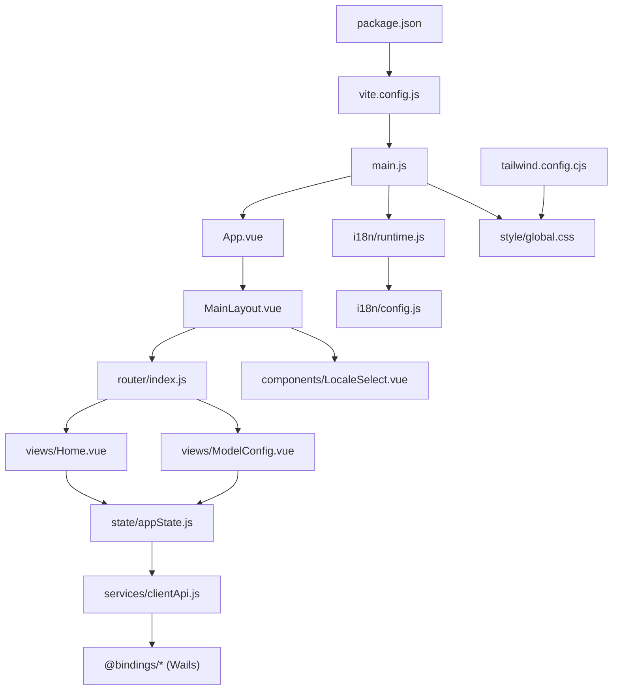
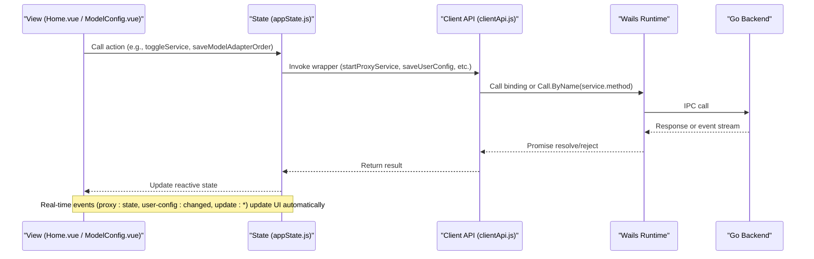
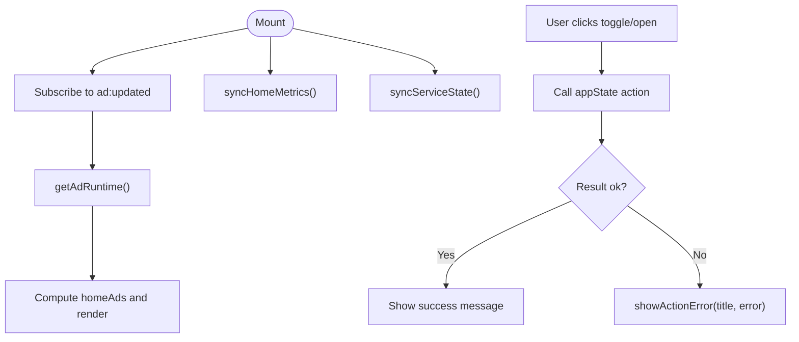
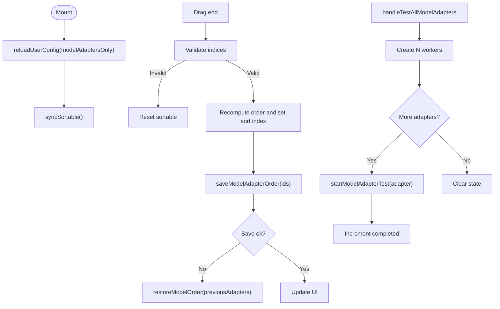
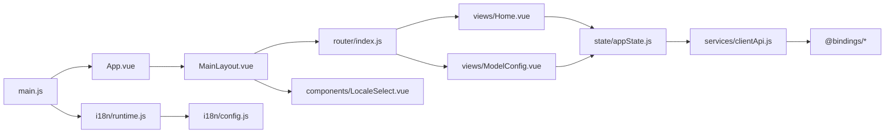

# Frontend Application

<cite>
**Referenced Files in This Document**
- [main.js](file://frontend/src/main.js)
- [App.vue](file://frontend/src/App.vue)
- [index.js](file://frontend/src/router/index.js)
- [Home.vue](file://frontend/src/views/Home.vue)
- [ModelConfig.vue](file://frontend/src/views/ModelConfig.vue)
- [MainLayout.vue](file://frontend/src/layouts/MainLayout.vue)
- [clientApi.js](file://frontend/src/services/clientApi.js)
- [appState.js](file://frontend/src/state/appState.js)
- [runtime.js](file://frontend/src/i18n/runtime.js)
- [config.js](file://frontend/src/i18n/config.js)
- [LocaleSelect.vue](file://frontend/src/components/LocaleSelect.vue)
- [global.css](file://frontend/src/style/global.css)
- [tailwind.config.cjs](file://frontend/tailwind.config.cjs)
- [vite.config.js](file://frontend/vite.config.js)
- [package.json](file://frontend/package.json)
</cite>

## Table of Contents
1. [Introduction](#introduction)
2. [Project Structure](#project-structure)
3. [Core Components](#core-components)
4. [Architecture Overview](#architecture-overview)
5. [Detailed Component Analysis](#detailed-component-analysis)
6. [Dependency Analysis](#dependency-analysis)
7. [Performance Considerations](#performance-considerations)
8. [Troubleshooting Guide](#troubleshooting-guide)
9. [Conclusion](#conclusion)
10. [Appendices](#appendices)

## Introduction
This document explains the Vue 3 frontend application that powers the user interface for cursor-byok. It covers the component architecture, state management patterns, and integration with the Go backend via Wails bindings. The main views include the Home Dashboard and Model Configuration. Internationalization support, responsive design principles, accessibility features, and guidance for extending the UI are also included. Communication patterns between components and backend services, error handling, and real-time updates are documented to help developers understand and extend the system confidently.

## Project Structure
The frontend is a Vue 3 + Vite application built with Tailwind CSS and iconify icons. It runs inside a Wails desktop shell and communicates with the Go backend through generated bindings. Key directories:
- src/views: Top-level pages (Home, ModelConfig)
- src/components/ui: Reusable UI primitives (Button, Card, Modal, etc.)
- src/composables: Shared logic hooks (useMessage, useModal, useInputModal, useConfigTransfer)
- src/state: Central reactive state and business logic (appState.js)
- src/services: Thin wrappers around Wails-generated bindings (clientApi.js)
- src/i18n: Internationalization runtime and locale configuration
- src/layouts: Shell layout (MainLayout.vue)
- src/router: Route definitions
- src/style: Global styles and Tailwind configuration

**Diagram sources**
- [main.js:1-41](file://frontend/src/main.js#L1-L41)
- [App.vue:1-56](file://frontend/src/App.vue#L1-L56)
- [index.js:1-22](file://frontend/src/router/index.js#L1-L22)
- [Home.vue:1-193](file://frontend/src/views/Home.vue#L1-L193)
- [ModelConfig.vue:1-514](file://frontend/src/views/ModelConfig.vue#L1-L514)
- [MainLayout.vue:1-232](file://frontend/src/layouts/MainLayout.vue#L1-L232)
- [clientApi.js:1-180](file://frontend/src/services/clientApi.js#L1-L180)
- [appState.js:1-800](file://frontend/src/state/appState.js#L1-L800)
- [runtime.js:1-192](file://frontend/src/i18n/runtime.js#L1-L192)
- [config.js:1-12](file://frontend/src/i18n/config.js#L1-L12)
- [LocaleSelect.vue:1-31](file://frontend/src/components/LocaleSelect.vue#L1-L31)
- [global.css:1-228](file://frontend/src/style/global.css#L1-L228)
- [tailwind.config.cjs:1-78](file://frontend/tailwind.config.cjs#L1-L78)
- [vite.config.js:1-38](file://frontend/vite.config.js#L1-L38)
- [package.json:1-40](file://frontend/package.json#L1-L40)

**Section sources**
- [main.js:1-41](file://frontend/src/main.js#L1-L41)
- [package.json:1-40](file://frontend/package.json#L1-L40)
- [vite.config.js:1-38](file://frontend/vite.config.js#L1-L38)

## Core Components
- App shell and routing:
  - App.vue mounts MainLayout, global modals, message provider, and ad model provider. It determines whether the current route is the main window to conditionally render certain providers.
  - Router defines two routes: Home (/) and Model Config (/model-config), with metadata controlling header behavior and close policy.
- Layout:
  - MainLayout provides the draggable title bar, window controls on Windows, footer with update checks, docs links, author link, and language selector. It polls service state periodically when on the home page.
- Views:
  - Home.vue shows metrics, service control, account card, and quick actions to open config windows. It listens to ad runtime events and displays ads slots.
  - ModelConfig.vue manages model adapters: list, filter by type, sort, create/edit/duplicate/delete, test single or batch, import/export configuration, and persist ordering.
- State management:
  - appState.js centralizes all reactive state, normalization/validation of model adapters, proxy/service state, update progress, and event subscriptions. It exposes functions to load/save config, toggle service, run tests, and manage UI prompts.
- API integration:
  - clientApi.js wraps Wails-generated bindings and uses Call.ByName for direct service calls. It logs success/error and exposes typed helpers for config, proxy, metrics, updates, and model adapter operations.
- Internationalization:
  - i18n/runtime.js provides locale resolution, persistence, and a localized text helper. LocaleSelect.vue binds to this runtime.
- Styling:
  - global.css sets dark theme, fonts, scrollbars, and flex-gap fallbacks. tailwind.config.cjs extends colors, fonts, z-index, and safelists for dynamic icons.

**Section sources**
- [App.vue:1-56](file://frontend/src/App.vue#L1-L56)
- [index.js:1-22](file://frontend/src/router/index.js#L1-L22)
- [MainLayout.vue:1-232](file://frontend/src/layouts/MainLayout.vue#L1-L232)
- [Home.vue:1-193](file://frontend/src/views/Home.vue#L1-L193)
- [ModelConfig.vue:1-514](file://frontend/src/views/ModelConfig.vue#L1-L514)
- [appState.js:1-800](file://frontend/src/state/appState.js#L1-L800)
- [clientApi.js:1-180](file://frontend/src/services/clientApi.js#L1-L180)
- [runtime.js:1-192](file://frontend/src/i18n/runtime.js#L1-L192)
- [config.js:1-12](file://frontend/src/i18n/config.js#L1-L12)
- [LocaleSelect.vue:1-31](file://frontend/src/components/LocaleSelect.vue#L1-L31)
- [global.css:1-228](file://frontend/src/style/global.css#L1-L228)
- [tailwind.config.cjs:1-78](file://frontend/tailwind.config.cjs#L1-L78)

## Architecture Overview
The frontend follows a layered architecture:
- Presentation layer: Vue components (views, layouts, UI primitives)
- State layer: Reactive store (appState.js) with normalization, validation, and event handling
- Service layer: Thin API wrappers (clientApi.js) over Wails bindings
- Integration layer: Wails runtime and generated bindings to Go backend

**Diagram sources**
- [Home.vue:1-193](file://frontend/src/views/Home.vue#L1-L193)
- [ModelConfig.vue:1-514](file://frontend/src/views/ModelConfig.vue#L1-L514)
- [appState.js:1-800](file://frontend/src/state/appState.js#L1-L800)
- [clientApi.js:1-180](file://frontend/src/services/clientApi.js#L1-L180)

## Detailed Component Analysis

### Home Dashboard (Home.vue)
Responsibilities:
- Display home metrics and handle refresh
- Toggle proxy/backend service start/stop
- Open configuration windows
- Render ad runtime slots and dispatch open-ad events
- Subscribe to ad runtime updates via Wails Events

Key flows:
- On mount, subscribe to ad updated events and fetch ad runtime data quietly
- Actions like toggle service, refresh metrics, and open config windows propagate errors via useMessage
- Ad runtime is normalized and filtered before rendering

**Diagram sources**
- [Home.vue:1-193](file://frontend/src/views/Home.vue#L1-L193)
- [appState.js:1-800](file://frontend/src/state/appState.js#L1-L800)
- [clientApi.js:1-180](file://frontend/src/services/clientApi.js#L1-L180)

**Section sources**
- [Home.vue:1-193](file://frontend/src/views/Home.vue#L1-L193)

### Model Configuration (ModelConfig.vue)
Responsibilities:
- List, filter, and sort model adapters
- Create, edit, duplicate, delete adapters
- Test single or batch adapters with concurrency control
- Import/export configuration using useConfigTransfer
- Persist adapter order and reload on failure

Key flows:
- Initialize sortable grid and sync on changes
- Batch testing uses multiple workers with cancellation support
- Sorting reorders adapters, persists order, and restores previous state on failure
- Editor modal opens with pre-filled adapter or empty template

**Diagram sources**
- [ModelConfig.vue:1-514](file://frontend/src/views/ModelConfig.vue#L1-L514)
- [appState.js:1-800](file://frontend/src/state/appState.js#L1-L800)
- [clientApi.js:1-180](file://frontend/src/services/clientApi.js#L1-L180)

**Section sources**
- [ModelConfig.vue:1-514](file://frontend/src/views/ModelConfig.vue#L1-L514)

### Layout and Window Controls (MainLayout.vue)
Responsibilities:
- Provide draggable header and window controls on Windows
- Show footer with update checking, usage docs, author link, and language selector
- Poll service state periodically on the home page
- Manage update progress UI and prompt flow

Real-time updates:
- Uses setInterval to poll service state while on the home page
- Integrates with appState.updateViewState for update progress and prompts

Accessibility:
- Footer elements use aria-live for status announcements
- Language selector has aria-label

**Section sources**
- [MainLayout.vue:1-232](file://frontend/src/layouts/MainLayout.vue#L1-L232)

### State Management (appState.js)
Responsibilities:
- Normalize and validate model adapters and config payloads
- Manage proxy/service state, update progress, and home metrics
- Subscribe to Wails events (proxy:state, user-config:changed, update:*, model-adapter-test:updated)
- Expose actions for loading/saving config, toggling service, running tests, opening windows

Patterns:
- Reactive state with computed properties for derived values
- Event-driven updates via @wailsio/runtime Events
- Robust normalization helpers for strings, booleans, numbers, arrays, and JSON fields
- Validation rules for supported types, endpoints, token limits, and deduplication

Error handling:
- toUserError converts backend errors to user-friendly messages
- Graceful fallbacks when initial bootstrap fails

**Section sources**
- [appState.js:1-800](file://frontend/src/state/appState.js#L1-L800)

### API Integration (clientApi.js)
Responsibilities:
- Wrap Wails-generated bindings for proxy, ads, metrics, and window services
- Provide typed helpers for config CRUD, account operations, proxy control, updates, and model adapter testing
- Log success and error details for debugging

Communication patterns:
- Direct bindings imported from @bindings/cursor/internal/bridge/*
- Dynamic service calls via Call.ByName for methods not exposed as named imports

**Section sources**
- [clientApi.js:1-180](file://frontend/src/services/clientApi.js#L1-L180)

### Internationalization (i18n/runtime.js, i18n/config.js, LocaleSelect.vue)
Responsibilities:
- Resolve initial locale from system or manual selection
- Persist selected locale and source flag
- Provide localized text helpers ($ls, $lt) and composable useLocale
- LocaleSelect.vue binds to useLocale and updates the active locale

Features:
- Support for zh-CN, en-US, ja-JP, ru-RU
- Fallback to source locale if target key missing
- Apply lang attribute to document.documentElement

**Section sources**
- [runtime.js:1-192](file://frontend/src/i18n/runtime.js#L1-L192)
- [config.js:1-12](file://frontend/src/i18n/config.js#L1-L12)
- [LocaleSelect.vue:1-31](file://frontend/src/components/LocaleSelect.vue#L1-L31)

### Responsive Design and Accessibility
- Dark theme and consistent typography via global.css
- Tailwind utility classes for layout and spacing; custom safelist for dynamic icons
- Flex gap fallback for older browsers via no-flex-gap class detection
- Accessibility attributes (aria-label, aria-live) used across interactive elements

**Section sources**
- [global.css:1-228](file://frontend/src/style/global.css#L1-L228)
- [tailwind.config.cjs:1-78](file://frontend/tailwind.config.cjs#L1-L78)

## Dependency Analysis
High-level dependencies:
- main.js bootstraps Vue app, installs i18n runtime, registers router, and boots app state
- App.vue composes layout, modals, and providers
- Router maps paths to views
- Views depend on composables, state, and services
- State depends on services and Wails events
- Services depend on Wails bindings
- i18n runtime is installed globally and consumed by components

**Diagram sources**
- [main.js:1-41](file://frontend/src/main.js#L1-L41)
- [App.vue:1-56](file://frontend/src/App.vue#L1-L56)
- [index.js:1-22](file://frontend/src/router/index.js#L1-L22)
- [Home.vue:1-193](file://frontend/src/views/Home.vue#L1-L193)
- [ModelConfig.vue:1-514](file://frontend/src/views/ModelConfig.vue#L1-L514)
- [appState.js:1-800](file://frontend/src/state/appState.js#L1-L800)
- [clientApi.js:1-180](file://frontend/src/services/clientApi.js#L1-L180)
- [runtime.js:1-192](file://frontend/src/i18n/runtime.js#L1-L192)
- [config.js:1-12](file://frontend/src/i18n/config.js#L1-L12)
- [LocaleSelect.vue:1-31](file://frontend/src/components/LocaleSelect.vue#L1-L31)

**Section sources**
- [main.js:1-41](file://frontend/src/main.js#L1-L41)
- [App.vue:1-56](file://frontend/src/App.vue#L1-L56)
- [index.js:1-22](file://frontend/src/router/index.js#L1-L22)

## Performance Considerations
- Batch testing concurrency: ModelConfig.vue uses a fixed concurrency limit to avoid overwhelming the backend during bulk tests.
- Debounced sorting: Sortable instance is synchronized after DOM updates to minimize reflows.
- Lazy initialization: Ad runtime is fetched quietly and errors are suppressed to keep UI responsive.
- Minimal polling: Service state polling interval is reasonable and only active on the home page.
- Localized text caching: i18n runtime caches localized strings to reduce repeated computations.

[No sources needed since this section provides general guidance]

## Troubleshooting Guide
Common issues and resolutions:
- Service toggle failures: Check serviceLastError in appState and ensure backend/proxy processes are available. Use message notifications to surface errors.
- Model adapter validation errors: Ensure required fields (type, baseURL, apiKey, displayName, modelID) are present and valid. Verify endpoint constraints and JSON fields.
- Batch test cancellations: If stopping batch tests, verify cancel signals are propagated and active calls are tracked.
- Update prompt not showing: Confirm update events (update:state, update:progress, update:ready, update:error) are emitted and handled by appState.
- Locale not switching: Verify setLocale is called and document.lang is updated. Check localStorage keys for manual selection.

Operational tips:
- Inspect console logs from clientApi.js for request/response details.
- Use Wails dev tools to inspect IPC calls and events.
- Reload user config when sorting fails to restore previous adapter order.

**Section sources**
- [Home.vue:1-193](file://frontend/src/views/Home.vue#L1-L193)
- [ModelConfig.vue:1-514](file://frontend/src/views/ModelConfig.vue#L1-L514)
- [appState.js:1-800](file://frontend/src/state/appState.js#L1-L800)
- [clientApi.js:1-180](file://frontend/src/services/clientApi.js#L1-L180)

## Conclusion
The frontend is a well-structured Vue 3 application that integrates tightly with the Go backend via Wails. It employs a clear separation of concerns: views for presentation, state for business logic and event handling, and services for IPC. Internationalization, responsive design, and accessibility are implemented thoughtfully. Developers can extend the UI by adding new views, components, and state actions, following the established patterns for normalization, validation, error handling, and real-time updates.

[No sources needed since this section summarizes without analyzing specific files]

## Appendices

### Extending the UI
- Add a new view:
  - Create a new file under src/views and register it in router/index.js with appropriate meta flags.
  - Compose it within App.vue if it requires global providers or modals.
- Add a new component:
  - Place reusable components under src/components/ui or feature-specific folders under src/components.
  - Use existing UI primitives (Button, Card, Modal) for consistency.
- Add new state actions:
  - Implement logic in appState.js, normalize inputs, and expose functions.
  - Use clientApi.js to call backend services via bindings or Call.ByName.
- Customize appearance:
  - Extend tailwind.config.cjs for colors, fonts, and z-index.
  - Add global styles in global.css for themes and browser compatibility.

### Adding New Components
- Follow the composition pattern: props, emits, and reactive state.
- Integrate with useMessage for user feedback and useModal/useInputModal for dialogs.
- Ensure accessibility attributes (aria-label, role) where applicable.

### Customizing Appearance
- Modify Tailwind safelist to include new icon classes used dynamically.
- Adjust color tokens and font families in tailwind.config.cjs.
- Use global.css for cross-browser fixes and scrollbar styling.

### Communication Patterns
- Use appState actions to encapsulate side effects and state updates.
- Prefer named bindings from @bindings for clarity; fall back to Call.ByName for dynamic service calls.
- Handle real-time updates via Wails Events and apply them to reactive state.

### Error Handling
- Surface user-facing errors via useMessage.
- Normalize and validate inputs before sending to backend.
- Provide graceful fallbacks and restore previous state on failures.

### Real-Time Updates
- Subscribe to relevant events (proxy:state, user-config:changed, update:*, model-adapter-test:updated).
- Apply normalized snapshots to appState to trigger reactive updates.
- Clean up event listeners on component unmount.

**Section sources**
- [index.js:1-22](file://frontend/src/router/index.js#L1-L22)
- [App.vue:1-56](file://frontend/src/App.vue#L1-L56)
- [appState.js:1-800](file://frontend/src/state/appState.js#L1-L800)
- [clientApi.js:1-180](file://frontend/src/services/clientApi.js#L1-L180)
- [tailwind.config.cjs:1-78](file://frontend/tailwind.config.cjs#L1-L78)
- [global.css:1-228](file://frontend/src/style/global.css#L1-L228)