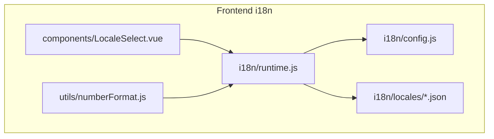
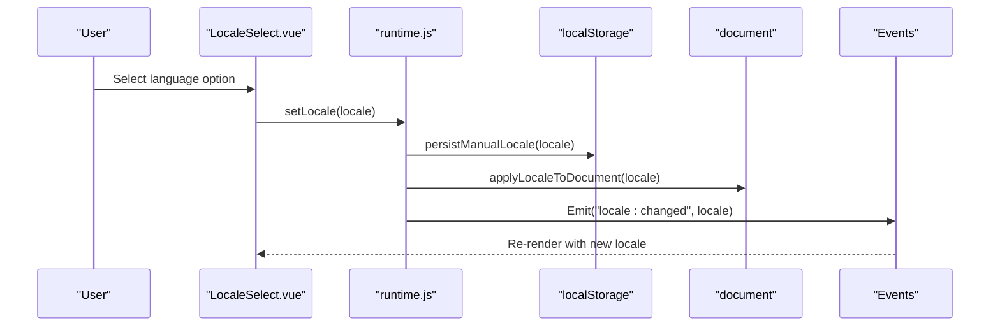
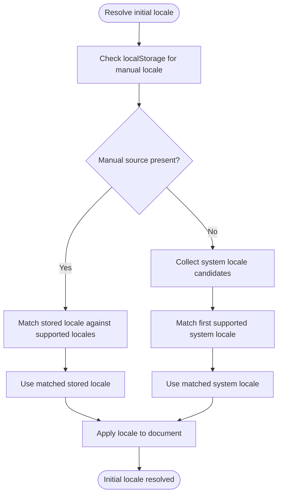
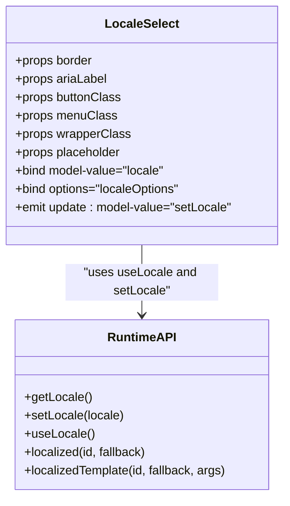
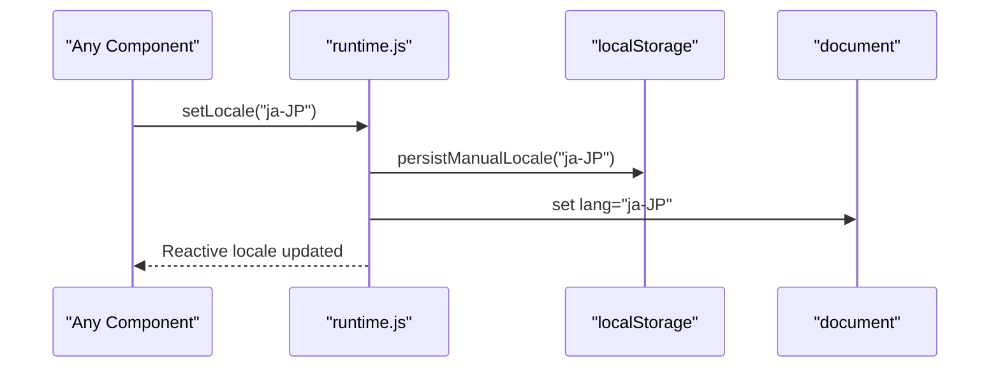
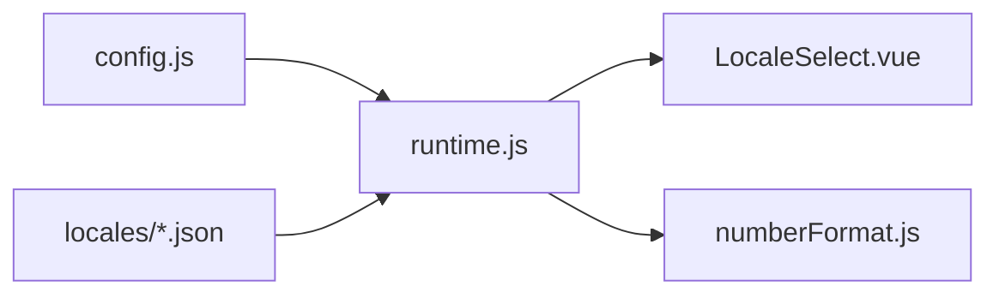

# Internationalization (i18n)

<cite>
**Referenced Files in This Document**
- [config.js](file://frontend/src/i18n/config.js)
- [runtime.js](file://frontend/src/i18n/runtime.js)
- [LocaleSelect.vue](file://frontend/src/components/LocaleSelect.vue)
- [en-US.json](file://frontend/src/i18n/locales/en-US.json)
- [ja-JP.json](file://frontend/src/i18n/locales/ja-JP.json)
- [ru-RU.json](file://frontend/src/i18n/locales/ru-RU.json)
- [zh-CN.json](file://frontend/src/i18n/locales/zh-CN.json)
- [numberFormat.js](file://frontend/src/utils/numberFormat.js)
</cite>

## Table of Contents
1. [Introduction](#introduction)
2. [Project Structure](#project-structure)
3. [Core Components](#core-components)
4. [Architecture Overview](#architecture-overview)
5. [Detailed Component Analysis](#detailed-component-analysis)
6. [Dependency Analysis](#dependency-analysis)
7. [Performance Considerations](#performance-considerations)
8. [Troubleshooting Guide](#troubleshooting-guide)
9. [Conclusion](#conclusion)
10. [Appendices](#appendices)

## Introduction
This document explains the internationalization system used by the frontend application. It covers i18n configuration, supported locales, runtime translation resolution, dynamic language switching, and number formatting utilities. The system is built around a small runtime module that manages locale state, resolves messages from JSON locale files, and exposes composables and global helpers for Vue components.

The implementation focuses on:
- A centralized configuration of supported locales and UI labels.
- Locale detection from browser settings with manual override persistence.
- Message lookup with fallback to a source locale when translations are missing.
- Template interpolation using positional placeholders.
- A reusable `LocaleSelect` component for changing the active language at runtime.
- Number formatting utilities for integers and compact numeric representations.

## Project Structure
The i18n system lives under the frontend package and is organized as follows:

**Diagram sources**
- [config.js:1-12](file://frontend/src/i18n/config.js#L1-L12)
- [runtime.js:1-21](file://frontend/src/i18n/runtime.js#L1-L21)
- [LocaleSelect.vue:1-31](file://frontend/src/components/LocaleSelect.vue#L1-L31)
- [numberFormat.js:1-40](file://frontend/src/utils/numberFormat.js#L1-L40)

**Section sources**
- [config.js:1-12](file://frontend/src/i18n/config.js#L1-L12)
- [runtime.js:1-21](file://frontend/src/i18n/runtime.js#L1-L21)
- [LocaleSelect.vue:1-31](file://frontend/src/components/LocaleSelect.vue#L1-L31)
- [numberFormat.js:1-40](file://frontend/src/utils/numberFormat.js#L1-L40)

## Core Components
- Configuration constants define storage keys, default and source locales, supported locales, and UI options for the language selector.
- Runtime module provides:
  - Locale detection and matching against supported locales.
  - Initial locale resolution from local storage or system preferences.
  - Active locale state management and persistence.
  - Message resolution with fallback to the source locale.
  - Template interpolation for positional arguments.
  - Global helper installation for Vue components.
- `LocaleSelect` component binds to the locale state and triggers language changes through the runtime API.
- Number formatting utilities provide integer and compact integer formatting.

**Section sources**
- [config.js:1-12](file://frontend/src/i18n/config.js#L1-L12)
- [runtime.js:30-113](file://frontend/src/i18n/runtime.js#L30-L113)
- [runtime.js:148-191](file://frontend/src/i18n/runtime.js#L148-L191)
- [LocaleSelect.vue:1-31](file://frontend/src/components/LocaleSelect.vue#L1-L31)
- [numberFormat.js:1-40](file://frontend/src/utils/numberFormat.js#L1-L40)

## Architecture Overview
The i18n architecture consists of three layers:

1. **Configuration Layer**: Declares supported locales, default/source locales, and UI labels.
2. **Runtime Layer**: Manages locale state, resolves messages, persists user choices, and emits events.
3. **UI Layer**: Provides components like `LocaleSelect` and uses runtime APIs to display localized text.

**Diagram sources**
- [LocaleSelect.vue:14-28](file://frontend/src/components/LocaleSelect.vue#L14-L28)
- [runtime.js:100-107](file://frontend/src/i18n/runtime.js#L100-L107)
- [runtime.js:158-164](file://frontend/src/i18n/runtime.js#L158-L164)

## Detailed Component Analysis

### i18n Configuration
The configuration file defines:
- Storage keys for locale and its source.
- Source locale used as a fallback dictionary.
- Default locale when no preference exists.
- Supported locales list.
- Locale options displayed in the UI selector.

Key responsibilities:
- Centralize locale metadata so both runtime and UI share the same definitions.
- Provide human-readable labels for each supported locale.

**Section sources**
- [config.js:1-12](file://frontend/src/i18n/config.js#L1-L12)

### Runtime Translation Management
The runtime module implements:
- Locale normalization and matching against supported locales.
- System locale candidate collection from browser APIs.
- Initial locale resolution prioritizing manual overrides stored in local storage.
- Active locale state via a reactive reference.
- Persistence of manual locale selection.
- Message resolution with fallback to the source locale.
- Template interpolation supporting positional placeholders.
- Global helper installation for Vue components.

Important behaviors:
- If a key is missing in the active locale, it falls back to the source locale.
- If still missing, it returns the provided fallback string.
- Changing the locale updates the document language attribute and emits an event for other parts of the app to react.

**Diagram sources**
- [runtime.js:78-92](file://frontend/src/i18n/runtime.js#L78-L92)
- [runtime.js:50-76](file://frontend/src/i18n/runtime.js#L50-L76)

**Section sources**
- [runtime.js:30-113](file://frontend/src/i18n/runtime.js#L30-L113)
- [runtime.js:148-191](file://frontend/src/i18n/runtime.js#L148-L191)

### LocaleSelect Component
The `LocaleSelect` component:
- Uses the `useLocale` composable to access current locale and available options.
- Renders a select control bound to the current locale.
- Calls `setLocale` when the user selects a different language.

Props allow customization of accessibility labels, styling, placeholder text, and wrapper sizing.

**Diagram sources**
- [LocaleSelect.vue:1-31](file://frontend/src/components/LocaleSelect.vue#L1-L31)
- [runtime.js:154-191](file://frontend/src/i18n/runtime.js#L154-L191)

**Section sources**
- [LocaleSelect.vue:1-31](file://frontend/src/components/LocaleSelect.vue#L1-L31)
- [runtime.js:167-174](file://frontend/src/i18n/runtime.js#L167-L174)

### Locale File Structure
Each locale file is a JSON object mapping stable keys to translated strings. Keys are consistent across all locales, enabling reliable message lookup.

Supported locales:
- zh-CN (source locale)
- en-US (default locale)
- ja-JP
- ru-RU

Message resolution strategy:
- Lookup the key in the active locale.
- If not found, fallback to the source locale.
- If still not found, return the provided fallback string.

Example key usage patterns:
- Simple labels: `"Interface Language"`
- Templates with positional placeholders: `"{0} context window must be a positive integer"`

Note: There is no pluralization logic implemented in the runtime; templates rely on positional placeholders rather than ICU-style plural rules.

**Section sources**
- [en-US.json:1-249](file://frontend/src/i18n/locales/en-US.json#L1-L249)
- [ja-JP.json:1-249](file://frontend/src/i18n/locales/ja-JP.json#L1-L249)
- [ru-RU.json:1-249](file://frontend/src/i18n/locales/ru-RU.json#L1-L249)
- [zh-CN.json:1-249](file://frontend/src/i18n/locales/zh-CN.json#L1-L249)
- [runtime.js:109-120](file://frontend/src/i18n/runtime.js#L109-L120)

### Dynamic Language Switching
Dynamic switching is handled by `setLocale`:
- Validates and matches the requested locale against supported locales.
- Updates the reactive locale state.
- Persists the choice as a manual override.
- Applies the locale to the document root element.
- Emits a locale change event for other components to react.

Components can subscribe to locale changes indirectly through reactivity or by listening to emitted events if needed.

**Diagram sources**
- [runtime.js:158-164](file://frontend/src/i18n/runtime.js#L158-L164)
- [runtime.js:100-107](file://frontend/src/i18n/runtime.js#L100-L107)

**Section sources**
- [runtime.js:158-164](file://frontend/src/i18n/runtime.js#L158-L164)

### Date and Number Formatting
Number formatting utilities:
- `formatInteger(value)`: Formats an integer using a fixed English formatter.
- `formatCompactInteger(value)`: Formats large numbers with compact suffixes (K, M, B, T).

Date formatting:
- No dedicated date formatting functions are present in the i18n runtime.
- Applications should use standard JavaScript `Intl.DateTimeFormat` with the active locale when needed.

Recommendation:
- For locale-aware date formatting, construct formatters with the current locale obtained from `getLocale()` or the reactive locale.

**Section sources**
- [numberFormat.js:1-40](file://frontend/src/utils/numberFormat.js#L1-L40)
- [runtime.js:154-156](file://frontend/src/i18n/runtime.js#L154-L156)

## Dependency Analysis
The following diagram shows how the main i18n modules depend on each other:

**Diagram sources**
- [config.js:1-12](file://frontend/src/i18n/config.js#L1-L12)
- [runtime.js:1-21](file://frontend/src/i18n/runtime.js#L1-L21)
- [LocaleSelect.vue:1-31](file://frontend/src/components/LocaleSelect.vue#L1-L31)
- [numberFormat.js:1-40](file://frontend/src/utils/numberFormat.js#L1-L40)

**Section sources**
- [config.js:1-12](file://frontend/src/i18n/config.js#L1-L12)
- [runtime.js:1-21](file://frontend/src/i18n/runtime.js#L1-L21)
- [LocaleSelect.vue:1-31](file://frontend/src/components/LocaleSelect.vue#L1-L31)
- [numberFormat.js:1-40](file://frontend/src/utils/numberFormat.js#L1-L40)

## Performance Considerations
- Message caching: The runtime caches `LocalizedText` instances keyed by id and fallback to avoid repeated object creation.
- Locale matching: Normalization and matching are lightweight operations performed on every locale change.
- DOM updates: Changing the locale updates only the document language attribute and relies on Vue reactivity for UI updates.
- Number formatting: Integer formatting uses a preconstructed formatter instance to reduce overhead.

Optimization opportunities:
- Consider lazy-loading locale files if the bundle size becomes a concern.
- Introduce pluralization and gender rules if required by future languages.
- Add memoization for computed values that depend on the active locale.

[No sources needed since this section provides general guidance]

## Troubleshooting Guide
Common issues and resolutions:
- Missing translations:
  - Ensure the key exists in the active locale file.
  - If missing, it will fall back to the source locale; verify the source locale contains the key.
  - Provide a fallback string in code where appropriate.
- Locale not applying:
  - Verify the requested locale is included in the supported locales list.
  - Check that `setLocale` is called with a valid locale value.
  - Confirm that local storage is accessible and not blocked by the environment.
- UI not updating after language switch:
  - Ensure components use reactive locale values from `useLocale`.
  - Avoid storing localized strings in non-reactive variables.
- Number formatting inconsistencies:
  - The integer formatter uses a fixed English locale; adjust if locale-specific grouping is required.
  - For compact formatting, ensure values are finite numbers before calling the formatter.

**Section sources**
- [runtime.js:109-120](file://frontend/src/i18n/runtime.js#L109-L120)
- [runtime.js:158-164](file://frontend/src/i18n/runtime.js#L158-L164)
- [numberFormat.js:10-24](file://frontend/src/utils/numberFormat.js#L10-L24)

## Conclusion
The i18n system provides a simple yet robust foundation for multilingual support in the frontend application. It centralizes locale configuration, supports dynamic language switching, and offers message resolution with fallbacks. While pluralization and date formatting are not fully integrated into the runtime, the existing structure makes it straightforward to extend these capabilities. Maintaining consistent keys across locale files and using the provided composables ensures a predictable and accessible user experience across locales.

[No sources needed since this section summarizes without analyzing specific files]

## Appendices

### Adding a New Language
Steps to add a new language:
1. Add the new locale code to the supported locales list in the configuration file.
2. Create a new JSON locale file under the locales directory with the same keys as existing files.
3. Translate all keys into the new language.
4. Update the locale options in the configuration to include the new language label.
5. Test locale detection, switching, and fallback behavior.

**Section sources**
- [config.js:1-12](file://frontend/src/i18n/config.js#L1-L12)
- [en-US.json:1-249](file://frontend/src/i18n/locales/en-US.json#L1-L249)

### Guidelines for Maintaining Translation Files
- Keep keys identical across all locale files.
- Use descriptive keys that reflect the UI element or message purpose.
- Prefer template placeholders for dynamic content instead of concatenating strings in code.
- Review missing keys regularly to ensure complete coverage.
- Validate JSON syntax for all locale files.

**Section sources**
- [runtime.js:109-120](file://frontend/src/i18n/runtime.js#L109-L120)
- [en-US.json:1-249](file://frontend/src/i18n/locales/en-US.json#L1-L249)

### Ensuring Consistent User Experience Across Locales
- Use the `LocaleSelect` component for explicit language switching.
- Rely on reactive locale values in components to keep UI synchronized.
- Provide meaningful fallback strings for critical messages.
- Test layout and typography for each supported locale, especially for longer or shorter text lengths.
- Validate number formatting behavior for locale-specific expectations.

**Section sources**
- [LocaleSelect.vue:1-31](file://frontend/src/components/LocaleSelect.vue#L1-L31)
- [runtime.js:167-174](file://frontend/src/i18n/runtime.js#L167-L174)
- [numberFormat.js:22-39](file://frontend/src/utils/numberFormat.js#L22-L39)