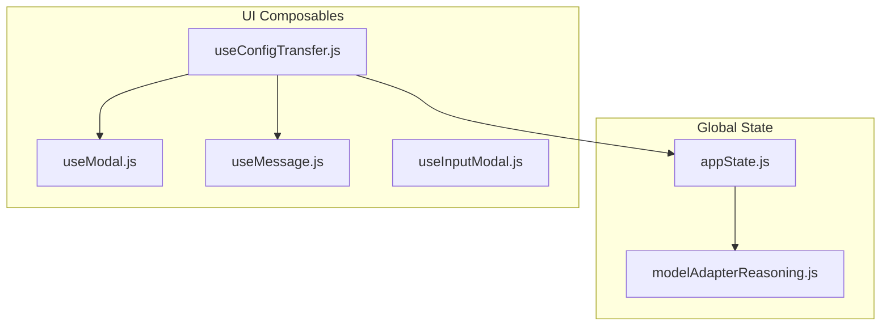
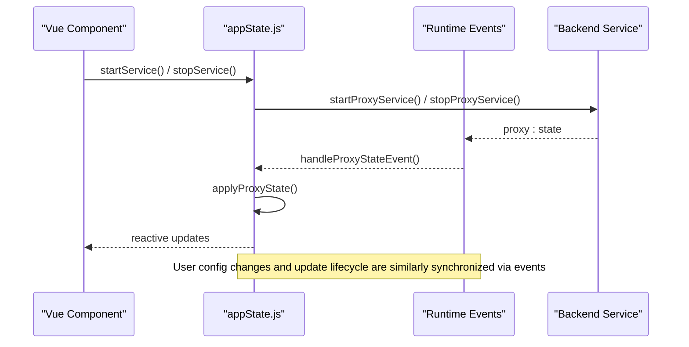
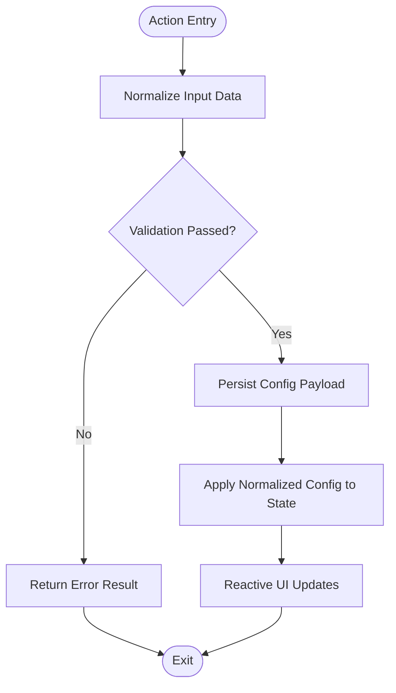
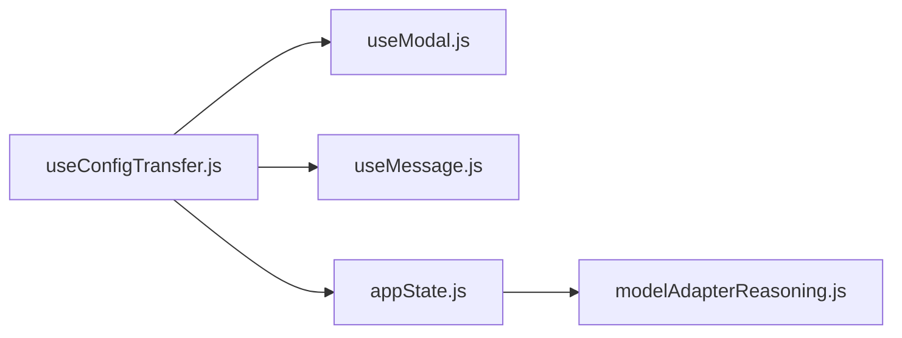

# State Management

<cite>
**Referenced Files in This Document**
- [appState.js](file://frontend/src/state/appState.js)
- [modelAdapterReasoning.js](file://frontend/src/state/modelAdapterReasoning.js)
- [useModal.js](file://frontend/src/composables/useModal.js)
- [useMessage.js](file://frontend/src/composables/useMessage.js)
- [useInputModal.js](file://frontend/src/composables/useInputModal.js)
- [useConfigTransfer.js](file://frontend/src/composables/useConfigTransfer.js)
</cite>

## Table of Contents
1. [Introduction](#introduction)
2. [Project Structure](#project-structure)
3. [Core Components](#core-components)
4. [Architecture Overview](#architecture-overview)
5. [Detailed Component Analysis](#detailed-component-analysis)
6. [Dependency Analysis](#dependency-analysis)
7. [Performance Considerations](#performance-considerations)
8. [Troubleshooting Guide](#troubleshooting-guide)
9. [Conclusion](#conclusion)

## Introduction
This document explains the frontend state management system for the application. It focuses on:
- The global app state structure and reactive updates
- Model adapter reasoning normalization and validation
- Composables for modal management and messaging
- State persistence, event-driven synchronization, and data flow patterns
- Best practices for organizing shared logic, optimizing performance, and debugging state issues

The system uses Vue 3 reactivity, a central reactive store, lightweight composables for UI state, and event-based synchronization with the backend runtime.

## Project Structure
The state-related code is organized into two main areas:
- `frontend/src/state`: Global application state, model adapter normalization, validation, persistence, and service/update orchestration
- `frontend/src/composables`: Shared UI logic for modals, input prompts, messages, and configuration transfer workflows

**Diagram sources**
- [appState.js:1-27](file://frontend/src/state/appState.js#L1-L27)
- [modelAdapterReasoning.js:1-15](file://frontend/src/state/modelAdapterReasoning.js#L1-L15)
- [useModal.js:1-42](file://frontend/src/composables/useModal.js#L1-L42)
- [useMessage.js:1-90](file://frontend/src/composables/useMessage.js#L1-L90)
- [useInputModal.js:1-37](file://frontend/src/composables/useInputModal.js#L1-L37)
- [useConfigTransfer.js:1-93](file://frontend/src/composables/useConfigTransfer.js#L1-L93)

**Section sources**
- [appState.js:1-27](file://frontend/src/state/appState.js#L1-L27)
- [modelAdapterReasoning.js:1-15](file://frontend/src/state/modelAdapterReasoning.js#L1-L15)
- [useModal.js:1-42](file://frontend/src/composables/useModal.js#L1-L42)
- [useMessage.js:1-90](file://frontend/src/composables/useMessage.js#L1-L90)
- [useInputModal.js:1-37](file://frontend/src/composables/useInputModal.js#L1-L37)
- [useConfigTransfer.js:1-93](file://frontend/src/composables/useConfigTransfer.js#L1-L93)

## Core Components
- Global app state (`appState.js`): Central reactive store that holds configuration, service status, update progress, home metrics, and model adapter test results. It also normalizes, validates, persists, and synchronizes data with the backend via events and API calls.
- Model adapter reasoning (`modelAdapterReasoning.js`): Provides supported reasoning effort values and normalization helpers used by model adapters.
- Modal composable (`useModal.js`): Reactive confirmation dialog with Promise-based resolution.
- Message composable (`useMessage.js`): Reactive toast/message system with provider/inject pattern.
- Input modal composable (`useInputModal.js`): Reactive prompt dialog returning user input or cancellation.
- Configuration transfer composable (`useConfigTransfer.js`): Orchestrates export/import flows using file dialogs, confirmation modals, and global state.

Key responsibilities:
- Normalize and validate model adapter configurations
- Persist configuration to local storage and remote storage
- Synchronize service state, user config changes, model adapter tests, and update lifecycle through events
- Provide reusable UI primitives (modals, messages) across components

**Section sources**
- [appState.js:28-52](file://frontend/src/state/appState.js#L28-L52)
- [appState.js:252-493](file://frontend/src/state/appState.js#L252-L493)
- [appState.js:820-900](file://frontend/src/state/appState.js#L820-L900)
- [appState.js:972-1057](file://frontend/src/state/appState.js#L972-L1057)
- [appState.js:1059-1454](file://frontend/src/state/appState.js#L1059-L1454)
- [modelAdapterReasoning.js:1-15](file://frontend/src/state/modelAdapterReasoning.js#L1-L15)
- [useModal.js:1-42](file://frontend/src/composables/useModal.js#L1-L42)
- [useMessage.js:1-90](file://frontend/src/composables/useMessage.js#L1-L90)
- [useInputModal.js:1-37](file://frontend/src/composables/useInputModal.js#L1-L37)
- [useConfigTransfer.js:1-93](file://frontend/src/composables/useConfigTransfer.js#L1-L93)

## Architecture Overview
The state architecture combines:
- A single reactive store for domain state
- Event listeners for real-time synchronization
- Composables for cross-component UI state
- Normalization/validation utilities for robust data handling

**Diagram sources**
- [appState.js:643-677](file://frontend/src/state/appState.js#L643-L677)
- [appState.js:902-970](file://frontend/src/state/appState.js#L902-L970)
- [appState.js:1318-1392](file://frontend/src/state/appState.js#L1318-L1392)

## Detailed Component Analysis

### Global App State (`appState.js`)
Responsibilities:
- Define constants, event names, and supported values
- Normalize and validate model adapters and related JSON fields
- Manage service lifecycle, update lifecycle, home metrics, and model adapter tests
- Persist configuration to local storage and remote storage
- Expose actions for starting/stopping services, saving configs, duplicating/deleting adapters, and fetching models

Data model highlights:
- `appState`: Reactive object containing configuration, service status, update state, metrics, and test results
- `appViewState` and `updateViewState`: Derived computed views for UI labels and styles
- Test result map keyed by `adapterID`, with fallback lookup by request hash

Persistence and sync:
- Local storage key for runtime state
- `watchSyncEffect` watchers persist selected state fields to localStorage
- Event subscriptions for proxy state, user config changes, model adapter test updates, and update lifecycle events
- Bootstrap routine loads persisted config, refreshes test results, fetches app version, and syncs service state and metrics

Normalization and validation:
- Robust type coercion helpers for strings, booleans, numbers, arrays
- Endpoint normalization and validation for OpenAI adapters
- JSON schema-like validation for extra parameters and custom headers
- Deduplication based on identity keys composed from URL, model ID, API key, display name, and endpoint

**Diagram sources**
- [appState.js:581-641](file://frontend/src/state/appState.js#L581-L641)
- [appState.js:594-605](file://frontend/src/state/appState.js#L594-L605)
- [appState.js:424-493](file://frontend/src/state/appState.js#L424-L493)

**Section sources**
- [appState.js:1-52](file://frontend/src/state/appState.js#L1-L52)
- [appState.js:54-186](file://frontend/src/state/appState.js#L54-L186)
- [appState.js:252-493](file://frontend/src/state/appState.js#L252-L493)
- [appState.js:518-641](file://frontend/src/state/appState.js#L518-L641)
- [appState.js:643-799](file://frontend/src/state/appState.js#L643-L799)
- [appState.js:820-900](file://frontend/src/state/appState.js#L820-L900)
- [appState.js:902-970](file://frontend/src/state/appState.js#L902-L970)
- [appState.js:972-1057](file://frontend/src/state/appState.js#L972-L1057)
- [appState.js:1059-1454](file://frontend/src/state/appState.js#L1059-L1454)

### Model Adapter Reasoning (`modelAdapterReasoning.js`)
Purpose:
- Define supported reasoning effort values
- Normalize reasoning effort inputs to a consistent lowercase string

Usage:
- Used by `appState.js` when normalizing model adapters to ensure consistent reasoning effort values across different input formats

Complexity:
- O(1) normalization per value; Set membership checks are constant time

**Section sources**
- [modelAdapterReasoning.js:1-15](file://frontend/src/state/modelAdapterReasoning.js#L1-L15)
- [appState.js:23-26](file://frontend/src/state/appState.js#L23-L26)
- [appState.js:334-396](file://frontend/src/state/appState.js#L334-L396)

### Modal Management (`useModal.js`)
Purpose:
- Provide a reactive confirmation modal with Promise-based resolution
- Manage modal visibility, text, buttons, and disabled states

API:
- `showModal(options)`: Returns a Promise<boolean> resolved when the user confirms or cancels
- `resolveModal(ok)`: Programmatically resolves the modal and hides it

Design notes:
- Uses a reactive `modalState` object to coordinate UI
- Ensures previous unresolved promises are rejected if a new modal opens

**Section sources**
- [useModal.js:1-42](file://frontend/src/composables/useModal.js#L1-L42)

### Messaging System (`useMessage.js`)
Purpose:
- Provide a reactive message/toast system with automatic dismissal
- Support provider/inject pattern for cross-component communication

API:
- `message(content, options)`: Shows a message and returns an ID
- `message.remove(id, options)`: Removes a specific message
- `message.clear()`: Clears current message
- `provideMessage()`: Provides the message API to component tree
- `useMessage()`: Injects the message API

Behavior:
- Enforces minimum visible duration to avoid flicker
- Manages timers for auto-dismissal
- Stores only the current message in reactive state

**Section sources**
- [useMessage.js:1-90](file://frontend/src/composables/useMessage.js#L1-L90)

### Input Modal (`useInputModal.js`)
Purpose:
- Provide a reactive input prompt returning the user’s input or null on cancel

API:
- `showInputModal(options)`: Returns a Promise<string|null>
- `resolveInputModal(ok)`: Resolves with trimmed input or null

Behavior:
- Uses reactive `inputModalState` to manage visibility and input value
- Trims default and submitted values

**Section sources**
- [useInputModal.js:1-37](file://frontend/src/composables/useInputModal.js#L1-L37)

### Configuration Transfer (`useConfigTransfer.js`)
Purpose:
- Orchestrate export and import of full configuration files
- Use confirmation modals and file dialogs
- Integrate with global state and messaging

Workflow:
- Export: Confirm → Save file dialog → Export → Show success message
- Import: Check running services → Open file dialog → Confirm overwrite → Import → Show summary

Integration points:
- Uses `showModal` for confirmations
- Uses `message` for feedback
- Reads/writes global state via `appState` exports

**Section sources**
- [useConfigTransfer.js:1-93](file://frontend/src/composables/useConfigTransfer.js#L1-L93)
- [appState.js:1127-1146](file://frontend/src/state/appState.js#L1127-L1146)

## Dependency Analysis
High-level dependencies:
- `appState.js` depends on:
  - Runtime events for synchronization
  - Client API functions for configuration, proxy control, metrics, and updates
  - `modelAdapterReasoning.js` for reasoning effort normalization
- `useConfigTransfer.js` depends on:
  - `useModal.js` for confirmations
  - `useMessage.js` for feedback
  - `appState.js` for configuration operations and global state

**Diagram sources**
- [useConfigTransfer.js:1-93](file://frontend/src/composables/useConfigTransfer.js#L1-L93)
- [appState.js:1-27](file://frontend/src/state/appState.js#L1-L27)
- [modelAdapterReasoning.js:1-15](file://frontend/src/state/modelAdapterReasoning.js#L1-L15)

**Section sources**
- [useConfigTransfer.js:1-93](file://frontend/src/composables/useConfigTransfer.js#L1-L93)
- [appState.js:1-27](file://frontend/src/state/appState.js#L1-L27)
- [modelAdapterReasoning.js:1-15](file://frontend/src/state/modelAdapterReasoning.js#L1-L15)

## Performance Considerations
- Prefer normalized and validated data before persistence to reduce downstream errors and retries
- Use computed views (`appViewState`, `updateViewState`) to derive UI labels/styles instead of recomputing in components
- Debounce frequent state writes if needed; current implementation persists on every change via `watchSyncEffect`, which is simple but can be heavy under rapid updates
- Avoid unnecessary re-normalization by caching derived values where appropriate (e.g., request hashes for test results)
- Keep event handlers minimal and delegate heavy work to utility functions

[No sources needed since this section provides general guidance]

## Troubleshooting Guide
Common issues and resolutions:
- Configuration save conflicts:
  - If a save operation is already in progress, further saves are blocked until completion
  - Check `configSaving` flag and retry after it clears
- Service state inconsistencies:
  - On unexpected events, the store falls back to syncing service state from the backend
  - Use `syncServiceState()` to reconcile state
- Validation failures:
  - Ensure required fields are present and valid (type, baseURL, apiKey, displayName, modelID, token limits, endpoints, JSON payloads)
  - Duplicate adapters are detected via identity keys; adjust one of the distinguishing fields
- Update lifecycle errors:
  - Errors set `updateError` and may open an error prompt; dismiss or retry via provided actions
- Message visibility:
  - Messages enforce a minimum visible duration; do not rely on immediate removal unless forcing it

Debugging tips:
- Inspect `appState.modelAdapterTestResults` to verify test outcomes and request hashes
- Use `toUserError(error)` to normalize error messages consistently
- Monitor event subscriptions to ensure they are active during runtime

**Section sources**
- [appState.js:611-641](file://frontend/src/state/appState.js#L611-L641)
- [appState.js:643-677](file://frontend/src/state/appState.js#L643-L677)
- [appState.js:424-493](file://frontend/src/state/appState.js#L424-L493)
- [appState.js:799-808](file://frontend/src/state/appState.js#L799-L808)
- [appState.js:1434-1437](file://frontend/src/state/appState.js#L1434-L1437)

## Conclusion
The state management system centers around a reactive global store with strong normalization and validation, event-driven synchronization, and reusable composables for UI interactions. This design promotes consistency, maintainability, and clear separation between domain state and UI concerns. Following the best practices outlined here will help keep the application responsive, reliable, and easier to debug.

[No sources needed since this section summarizes without analyzing specific files]