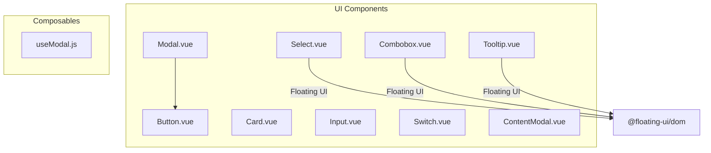
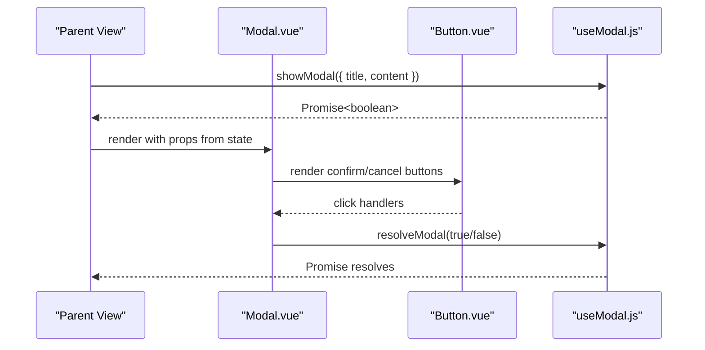
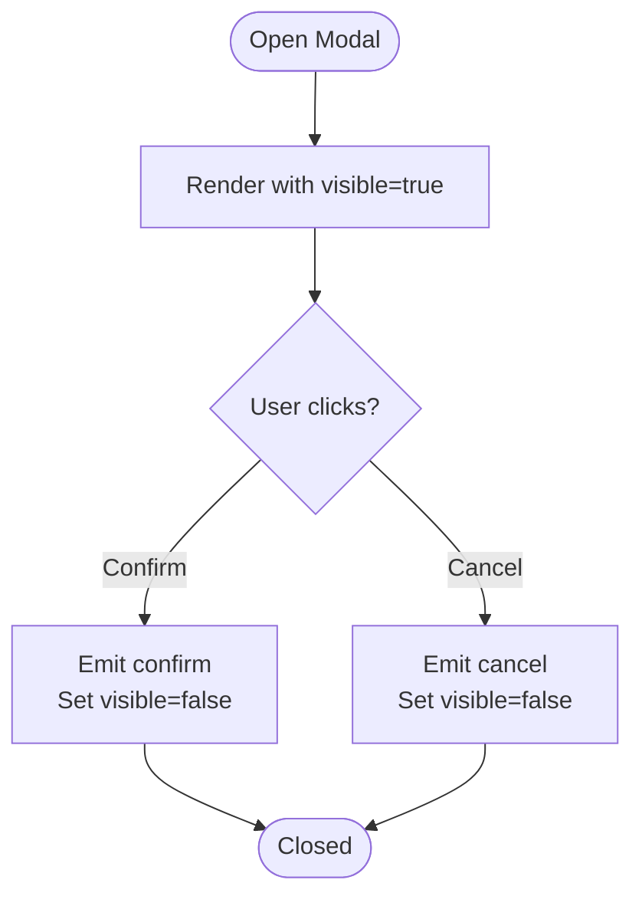
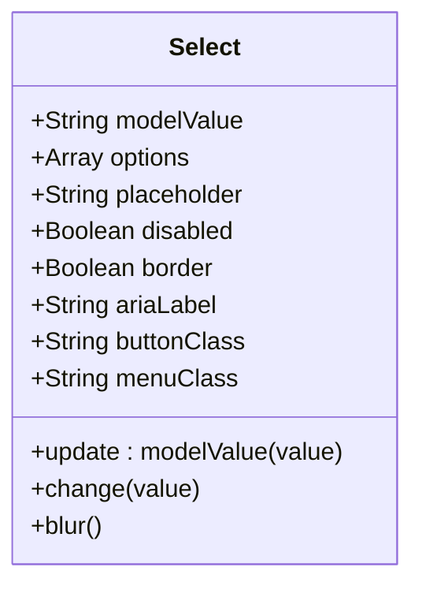
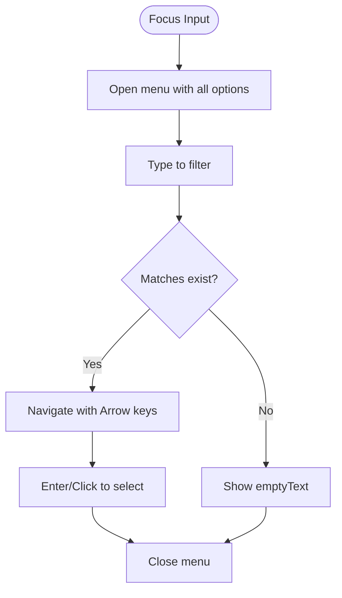
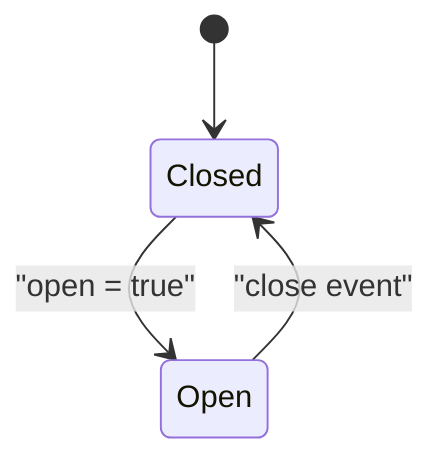
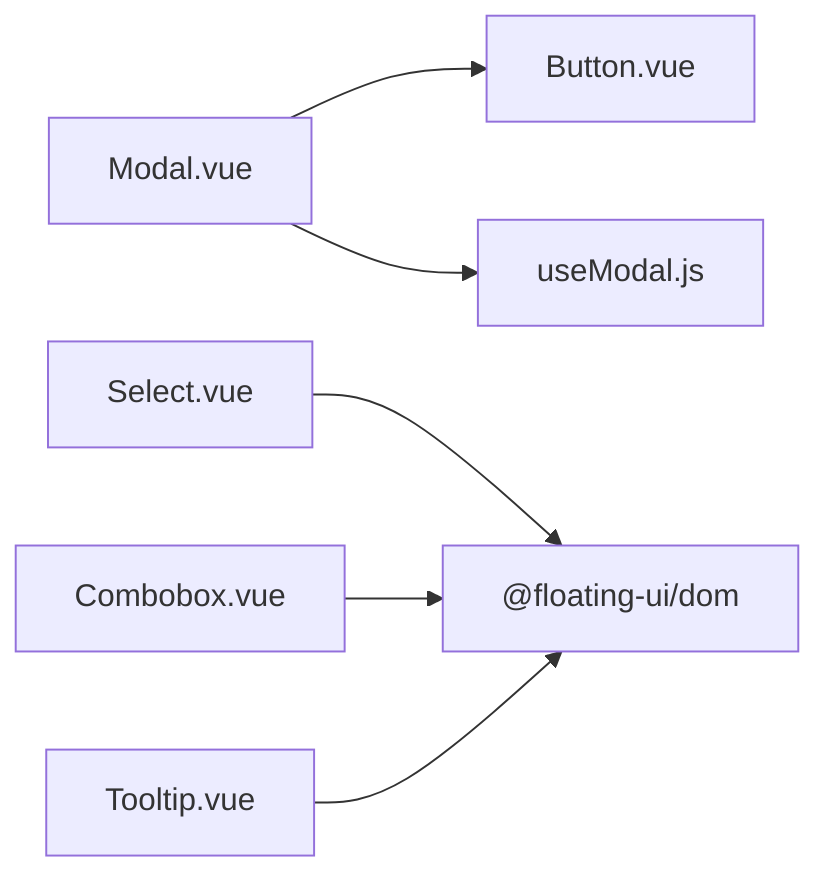

# UI Components

<cite>
**Referenced Files in This Document**
- [Button.vue](file://frontend/src/components/ui/Button.vue)
- [Card.vue](file://frontend/src/components/ui/Card.vue)
- [Modal.vue](file://frontend/src/components/ui/Modal.vue)
- [Input.vue](file://frontend/src/components/ui/Input.vue)
- [Switch.vue](file://frontend/src/components/ui/Switch.vue)
- [Select.vue](file://frontend/src/components/ui/Select.vue)
- [Combobox.vue](file://frontend/src/components/ui/Combobox.vue)
- [Tooltip.vue](file://frontend/src/components/ui/Tooltip.vue)
- [ContentModal.vue](file://frontend/src/components/ui/ContentModal.vue)
- [useModal.js](file://frontend/src/composables/useModal.js)
</cite>

## Table of Contents
1. [Introduction](#introduction)
2. [Project Structure](#project-structure)
3. [Core Components](#core-components)
4. [Architecture Overview](#architecture-overview)
5. [Detailed Component Analysis](#detailed-component-analysis)
6. [Dependency Analysis](#dependency-analysis)
7. [Performance Considerations](#performance-considerations)
8. [Troubleshooting Guide](#troubleshooting-guide)
9. [Conclusion](#conclusion)
10. [Appendices](#appendices)

## Introduction
This document describes the reusable UI component library used across the application. It covers base components such as Button, Card, Modal, Input, Switch, Select, Combobox, Tooltip, and ContentModal. For each component, you will find:
- Props, events, and slots
- Styling approach and customization points
- Accessibility features
- Usage patterns and composition guidelines
- Responsive behavior and best practices

The goal is to help you build consistent, accessible, and maintainable interfaces by following established patterns.

## Project Structure
The UI components live under a dedicated folder and are composed using Vue 3 single-file components with Tailwind CSS for styling. Floating UI is used for positioning overlays (menus, tooltips). A composable provides a programmatic API for confirmation modals.

**Diagram sources**
- [Modal.vue:1-85](file://frontend/src/components/ui/Modal.vue#L1-L85)
- [Select.vue:1-344](file://frontend/src/components/ui/Select.vue#L1-L344)
- [Combobox.vue:1-338](file://frontend/src/components/ui/Combobox.vue#L1-L338)
- [Tooltip.vue:1-157](file://frontend/src/components/ui/Tooltip.vue#L1-L157)

**Section sources**
- [Modal.vue:1-85](file://frontend/src/components/ui/Modal.vue#L1-L85)
- [Select.vue:1-344](file://frontend/src/components/ui/Select.vue#L1-L344)
- [Combobox.vue:1-338](file://frontend/src/components/ui/Combobox.vue#L1-L338)
- [Tooltip.vue:1-157](file://frontend/src/components/ui/Tooltip.vue#L1-L157)

## Core Components
This section summarizes the core building blocks and their responsibilities.

- Button: Provides default, primary, and text variants with consistent interaction states.
- Card: Simple container with border and background for grouping content.
- Modal: Confirmation dialog with title, message, and actions; integrates with Button.
- Input: Text input with optional password visibility toggle and attribute passthrough.
- Switch: Accessible toggle switch with label, description, and state messages.
- Select: Custom select with keyboard navigation, floating menu, and icon support.
- Combobox: Searchable combobox with filtering, keyboard navigation, and floating menu.
- Tooltip: Contextual help overlay with optional copy-to-clipboard.
- ContentModal: Full-screen or sized modal panel with focus management and trap.

**Section sources**
- [Button.vue:1-39](file://frontend/src/components/ui/Button.vue#L1-L39)
- [Card.vue:1-10](file://frontend/src/components/ui/Card.vue#L1-L10)
- [Modal.vue:1-85](file://frontend/src/components/ui/Modal.vue#L1-L85)
- [Input.vue:1-81](file://frontend/src/components/ui/Input.vue#L1-L81)
- [Switch.vue:1-65](file://frontend/src/components/ui/Switch.vue#L1-L65)
- [Select.vue:1-344](file://frontend/src/components/ui/Select.vue#L1-L344)
- [Combobox.vue:1-338](file://frontend/src/components/ui/Combobox.vue#L1-L338)
- [Tooltip.vue:1-157](file://frontend/src/components/ui/Tooltip.vue#L1-L157)
- [ContentModal.vue:1-139](file://frontend/src/components/ui/ContentModal.vue#L1-L139)

## Architecture Overview
The UI layer follows a layered pattern:
- Base primitives (Button, Input, Switch) provide low-level interactions.
- Composite widgets (Select, Combobox, Tooltip) compose primitives and use Floating UI for positioning.
- Layout containers (Card, Modal, ContentModal) group content and manage focus/teleportation.
- Composables (useModal) encapsulate shared state and provide a Promise-based API.

**Diagram sources**
- [Modal.vue:1-85](file://frontend/src/components/ui/Modal.vue#L1-L85)
- [Button.vue:1-39](file://frontend/src/components/ui/Button.vue#L1-L39)
- [useModal.js:1-42](file://frontend/src/composables/useModal.js#L1-L42)

## Detailed Component Analysis

### Button
Purpose:
- Provide consistent interactive elements with variant-driven styles.

Props:
- variant: String, one of "default", "primary", "text". Controls visual style.

Events:
- None defined by the component; it forwards native button events.

Slots:
- Default slot for label or icons.

Styling:
- Uses Tailwind utility classes for layout, colors, transitions, and active/hover states.
- Variants apply different gradients and text styles.

Accessibility:
- Renders a native <button>, inheriting accessibility semantics.

Usage example:
- Use variant="primary" for main actions, variant="default" for secondary actions, and variant="text" for inline links or subtle actions.

**Section sources**
- [Button.vue:1-39](file://frontend/src/components/ui/Button.vue#L1-L39)

### Card
Purpose:
- Container for grouping related content with consistent padding and borders.

Props:
- None.

Events:
- None.

Slots:
- Default slot for content.

Styling:
- Applies rounded corners, border color, background color, and padding.

Accessibility:
- Semantic container; pair with headings or other semantic elements inside.

Usage example:
- Wrap form sections, metrics, or configuration panels.

**Section sources**
- [Card.vue:1-10](file://frontend/src/components/ui/Card.vue#L1-L10)

### Modal
Purpose:
- Confirmation dialog with title, message, and action buttons.

Props:
- visible: Boolean, controls visibility.
- title: String, displayed header.
- content: String, body text.
- confirmText: String, label for confirm button.
- cancelText: String, label for cancel button.
- showCancel: Boolean, toggles cancel button visibility.
- confirmDisabled: Boolean, disables confirm button.

Events:
- update:visible: Boolean, two-way binding for visibility.
- confirm: Emitted when confirm is clicked.
- cancel: Emitted when cancel is clicked.

Slots:
- None; content is provided via props.

Styling:
- Backdrop and panel styled with Tailwind utilities; includes transition animations.

Accessibility:
- Clicking backdrop triggers cancel.
- Buttons are native and keyboard-accessible.

Composition:
- Uses Button internally for actions.

Usage example:
- Bind visible to local state and handle confirm/cancel to perform actions.

**Diagram sources**
- [Modal.vue:1-85](file://frontend/src/components/ui/Modal.vue#L1-L85)

**Section sources**
- [Modal.vue:1-85](file://frontend/src/components/ui/Modal.vue#L1-L85)

### Input
Purpose:
- Text input with optional password visibility toggle and attribute passthrough.

Props:
- modelValue: String, controlled value.
- type: String, input type (e.g., "text", "password").
- placeholder: String, placeholder text.
- disabled: Boolean, disables input.
- allowVisibilityToggle: Boolean, enables eye toggle for password inputs.

Events:
- update:modelValue: Two-way binding for value.

Slots:
- None.

Styling:
- Styled input with focus ring and disabled states.
- Optional toggle button positioned absolutely for password fields.

Accessibility:
- When toggling visibility, aria-label and aria-pressed are updated on the toggle button.

Usage example:
- v-model on modelValue; set allowVisibilityToggle for secure inputs.

**Section sources**
- [Input.vue:1-81](file://frontend/src/components/ui/Input.vue#L1-L81)

### Switch
Purpose:
- Accessible toggle control with label, description, and state messaging.

Props:
- enabled: Boolean, current state.
- disabled: Boolean, disables interaction.
- busy: Boolean, indicates pending state.
- compact: Boolean, reduces spacing and font sizes.
- label: String, primary label.
- description: String, secondary description.
- enabledText: String, text when enabled.
- disabledText: String, text when disabled.
- busyText: String, text while busy.

Events:
- change: Emits new boolean state.

Slots:
- None.

Styling:
- Toggle track and knob styled with Tailwind; responsive typography based on compact mode.

Accessibility:
- role="switch", aria-checked reflects state; focus-visible ring for keyboard users.

Usage example:
- Bind enabled to state and listen to change to persist updates.

**Section sources**
- [Switch.vue:1-65](file://frontend/src/components/ui/Switch.vue#L1-L65)

### Select
Purpose:
- Custom select with keyboard navigation, floating menu, and icon support.

Props:
- modelValue: String, selected value.
- options: Array of strings or objects with label/value/icon.
- placeholder: String, shown when no selection.
- disabled: Boolean, disables interaction.
- border: Boolean, toggles border style.
- ariaLabel: String, accessible label.
- buttonClass: String, additional classes for trigger button.
- menuClass: String, additional classes for dropdown menu.

Events:
- update:modelValue: Two-way binding for selected value.
- change: Emits selected value.
- blur: Emitted when closing without selection.

Slots:
- None.

Styling:
- Trigger button adapts to border prop; menu uses floating positioning and Tailwind styles.

Accessibility:
- aria-expanded on trigger, role="listbox" and role="option" for menu items, keyboard navigation (ArrowUp/Down, Enter, Space, Escape), focus restoration.

Positioning:
- Uses Floating UI middleware for placement, flipping, shifting, and sizing.

Usage example:
- Provide options as strings or objects; bind modelValue and handle change.

**Diagram sources**
- [Select.vue:1-344](file://frontend/src/components/ui/Select.vue#L1-L344)

**Section sources**
- [Select.vue:1-344](file://frontend/src/components/ui/Select.vue#L1-L344)

### Combobox
Purpose:
- Searchable combobox with filtering, keyboard navigation, and floating menu.

Props:
- modelValue: String, current input value.
- options: Array of strings or objects with label/value/icon.
- placeholder: String, placeholder text.
- emptyText: String, message when no matches.
- loading: Boolean, shows spinner in trigger.
- disabled: Boolean, disables interaction.
- ariaLabel: String, accessible label.

Events:
- update:modelValue: Two-way binding for input value.
- change: Emits current input value.
- blur: Emitted when closing due to outside interaction.

Slots:
- append: Slot to add trailing content next to the input.

Styling:
- Input wrapper with focus ring; trigger button with chevron or spinner; menu styled with Tailwind.

Accessibility:
- role="combobox" on input, aria-expanded, aria-controls, aria-autocomplete="list", aria-activedescendant pointing to active option; listbox/list roles for menu.

Positioning:
- Uses Floating UI for robust placement and resizing.

Usage example:
- Bind modelValue and handle change; optionally use append slot for actions like clear.

**Diagram sources**
- [Combobox.vue:1-338](file://frontend/src/components/ui/Combobox.vue#L1-L338)

**Section sources**
- [Combobox.vue:1-338](file://frontend/src/components/ui/Combobox.vue#L1-L338)

### Tooltip
Purpose:
- Contextual help overlay with optional copy-to-clipboard functionality.

Props:
- content: String, tooltip text.
- copyable: Boolean, shows copy button.
- copyText: String, text to copy (falls back to content if not provided).

Events:
- None.

Slots:
- Default slot for rich content or HTML.

Styling:
- Trigger info icon; tooltip panel with Tailwind styles and shadow.

Accessibility:
- Trigger is a button with cursor-help; tooltip content is visually hidden until triggered.

Positioning:
- Uses Floating UI for placement above the trigger.

Usage example:
- Wrap an element or use as a standalone info trigger; enable copyable for quick copying.

**Section sources**
- [Tooltip.vue:1-157](file://frontend/src/components/ui/Tooltip.vue#L1-L157)

### ContentModal
Purpose:
- Full-screen or sized modal panel with focus management and trap.

Props:
- open: Boolean, controls visibility.
- title: String, header title.
- size: String, one of "md", "lg", "xl"; controls max width and height.
- closeOnBackdrop: Boolean, closes on backdrop click.
- closeOnEscape: Boolean, closes on Escape key.
- closeDisabled: Boolean, disables closing.

Events:
- close: Emitted when user requests close.

Slots:
- Default slot for panel content.

Styling:
- Backdrop and panel styled with Tailwind; header bar with close button; content area scrolls.

Accessibility:
- role="dialog", aria-modal="true", aria-label from title; focus trap within panel; restores focus on close.

Usage example:
- Bind open to state; handle close to hide panel; place any content in default slot.

**Diagram sources**
- [ContentModal.vue:1-139](file://frontend/src/components/ui/ContentModal.vue#L1-L139)

**Section sources**
- [ContentModal.vue:1-139](file://frontend/src/components/ui/ContentModal.vue#L1-L139)

## Dependency Analysis
Key dependencies and relationships:
- Modal depends on Button for actions.
- Select, Combobox, and Tooltip depend on @floating-ui/dom for positioning.
- useModal provides global reactive state for confirmation dialogs consumed by Modal.

**Diagram sources**
- [Modal.vue:1-85](file://frontend/src/components/ui/Modal.vue#L1-L85)
- [Button.vue:1-39](file://frontend/src/components/ui/Button.vue#L1-L39)
- [Select.vue:1-344](file://frontend/src/components/ui/Select.vue#L1-L344)
- [Combobox.vue:1-338](file://frontend/src/components/ui/Combobox.vue#L1-L338)
- [Tooltip.vue:1-157](file://frontend/src/components/ui/Tooltip.vue#L1-L157)
- [useModal.js:1-42](file://frontend/src/composables/useModal.js#L1-L42)

**Section sources**
- [Modal.vue:1-85](file://frontend/src/components/ui/Modal.vue#L1-L85)
- [Select.vue:1-344](file://frontend/src/components/ui/Select.vue#L1-L344)
- [Combobox.vue:1-338](file://frontend/src/components/ui/Combobox.vue#L1-L338)
- [Tooltip.vue:1-157](file://frontend/src/components/ui/Tooltip.vue#L1-L157)
- [useModal.js:1-42](file://frontend/src/composables/useModal.js#L1-L42)

## Performance Considerations
- Floating UI auto-updates: Select, Combobox, and Tooltip use autoUpdate to keep menus positioned efficiently during scroll/resize.
- Teleport usage: Menus and modals teleport to body to avoid stacking context issues and reduce reflows.
- Transition animations: Lightweight CSS transitions for modals and menus; avoid heavy effects in tight loops.
- Event listeners: Components attach/detach pointerdown listeners only while open to minimize overhead.
- Rendering lists: Options are normalized once per prop change; ensure options arrays are stable references where possible.

[No sources needed since this section provides general guidance]

## Troubleshooting Guide
Common issues and resolutions:
- Menu not appearing: Ensure the parent container is not clipping overflow; verify that Floating UI has valid refs and that the component is mounted before opening.
- Keyboard navigation not working: Verify that focus is moved into the menu and that role attributes are present; check for disabled states preventing focus.
- Focus trap not trapping: Confirm that the modal panel contains focusable elements and that closeDisabled is not blocking focus movement.
- Password toggle not showing: Ensure type is "password" and allowVisibilityToggle is true.
- Modal not closing on backdrop: Check closeOnBackdrop prop and ensure backdrop click handler is attached.

**Section sources**
- [Select.vue:1-344](file://frontend/src/components/ui/Select.vue#L1-L344)
- [Combobox.vue:1-338](file://frontend/src/components/ui/Combobox.vue#L1-L338)
- [Tooltip.vue:1-157](file://frontend/src/components/ui/Tooltip.vue#L1-L157)
- [ContentModal.vue:1-139](file://frontend/src/components/ui/ContentModal.vue#L1-L139)
- [Input.vue:1-81](file://frontend/src/components/ui/Input.vue#L1-L81)
- [Modal.vue:1-85](file://frontend/src/components/ui/Modal.vue#L1-L85)

## Conclusion
This component library provides a cohesive set of primitives and composite widgets built with Vue 3 and Tailwind CSS. By following the documented props, events, slots, and accessibility patterns, you can create consistent and user-friendly interfaces. Use the composables for shared behaviors like confirmation dialogs, and rely on Floating UI for reliable overlay positioning.

[No sources needed since this section summarizes without analyzing specific files]

## Appendices

### Composition Patterns
- Combine primitives to build complex forms: wrap Input and Switch inside Card; use Select/Combobox for choices; display contextual help with Tooltip.
- Use ContentModal for large content areas and Modal for quick confirmations.
- Leverage append slot in Combobox for actions like clearing input.

### Accessibility Checklist
- Use semantic roles and attributes (role="switch", role="listbox", role="combobox", aria-expanded, aria-selected, aria-activedescendant).
- Ensure keyboard navigation works for all interactive components.
- Provide meaningful labels and descriptions for screen readers.
- Maintain focus management in overlays (modals, menus).

### Responsive Design Principles
- Use Tailwind’s responsive utilities to adapt layouts at breakpoints.
- Keep touch targets at least 44px for mobile.
- Avoid fixed widths for critical content; prefer fluid widths with max-width constraints.
- Test overlays near viewport edges to ensure proper placement.

[No sources needed since this section provides general guidance]