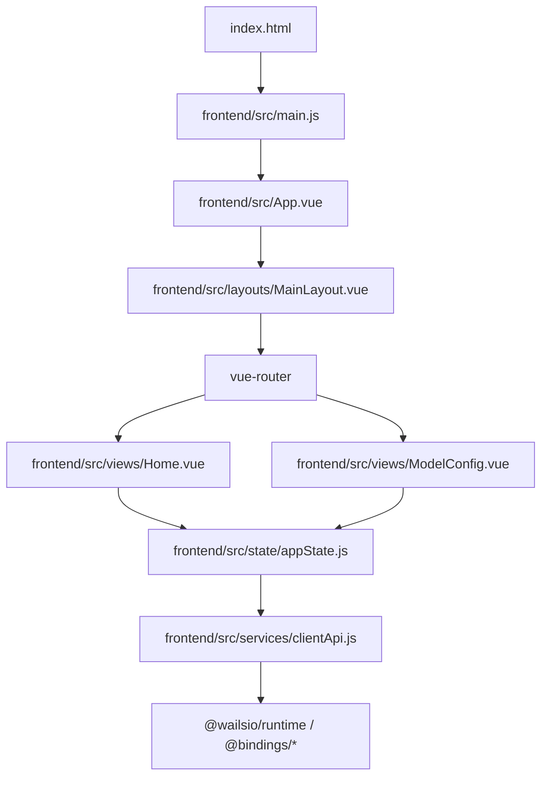
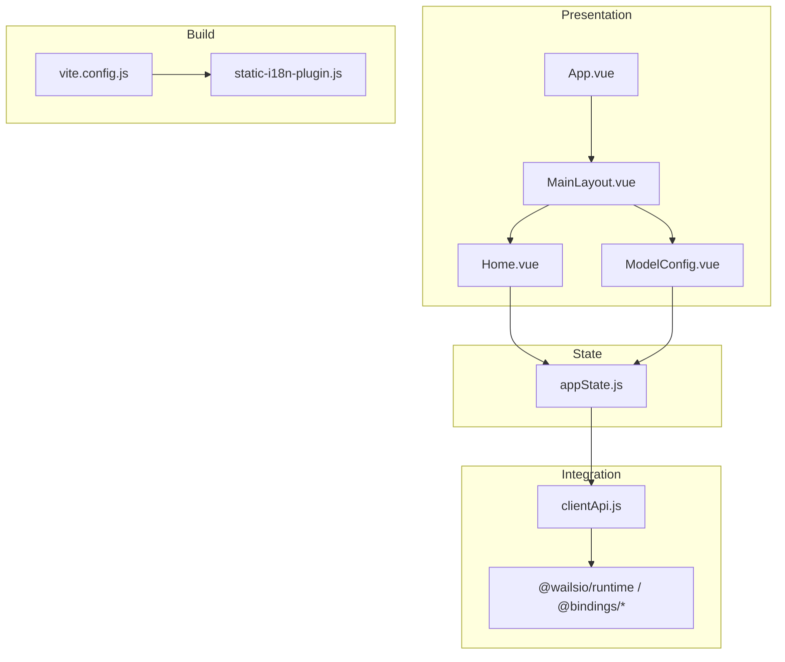
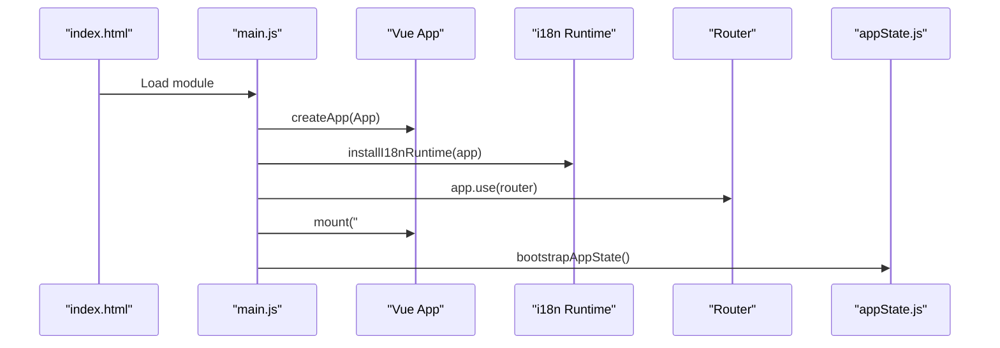
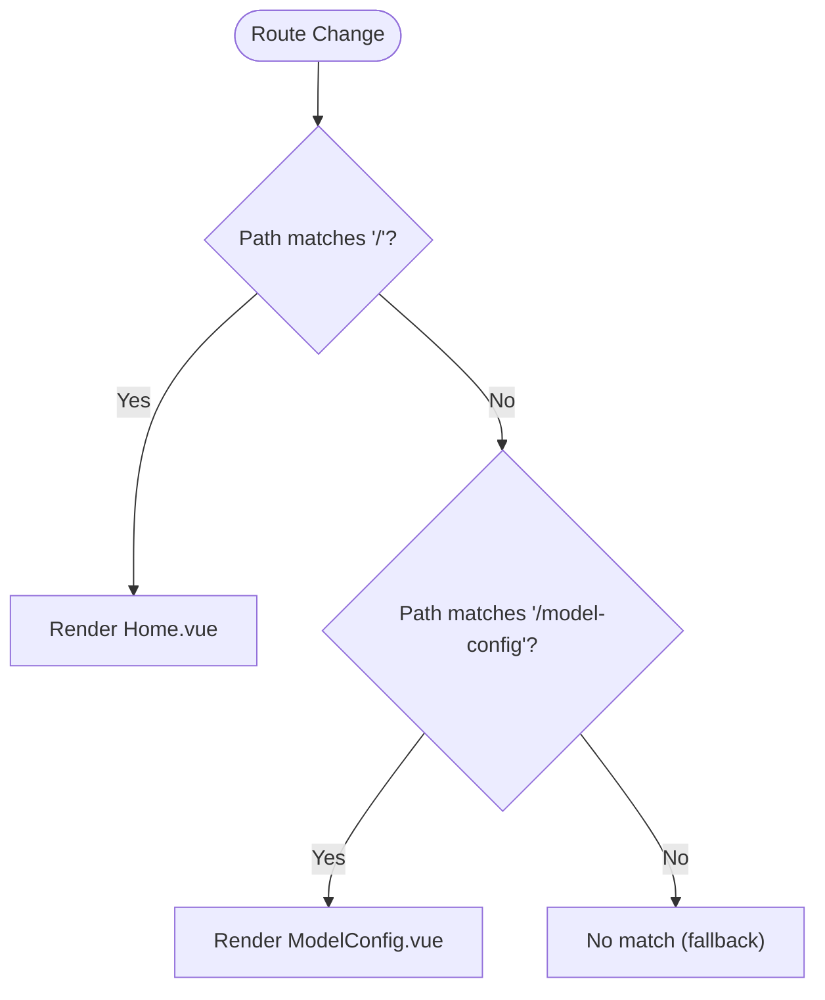
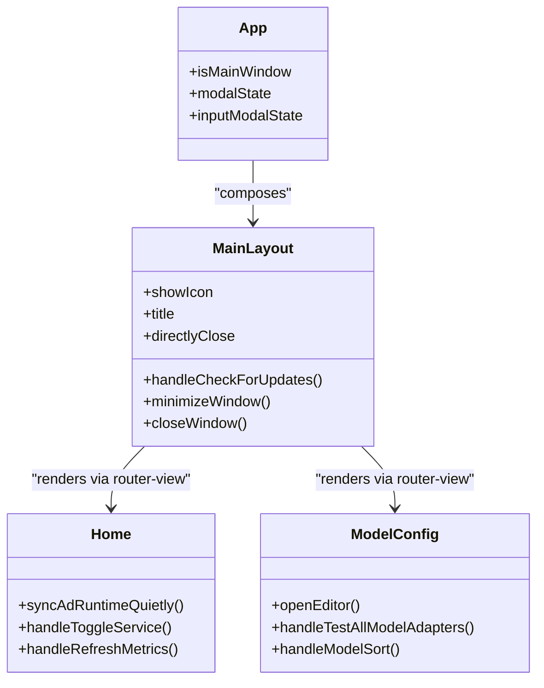
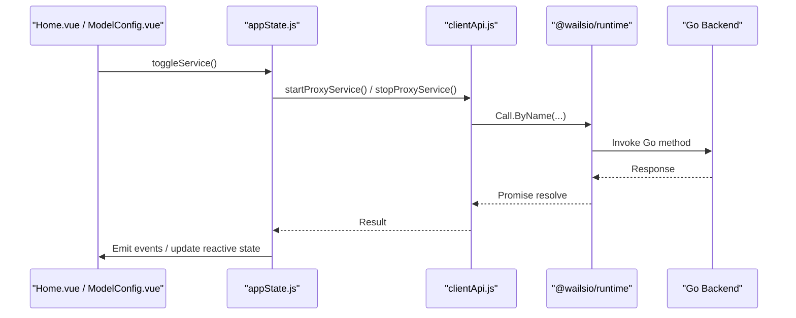
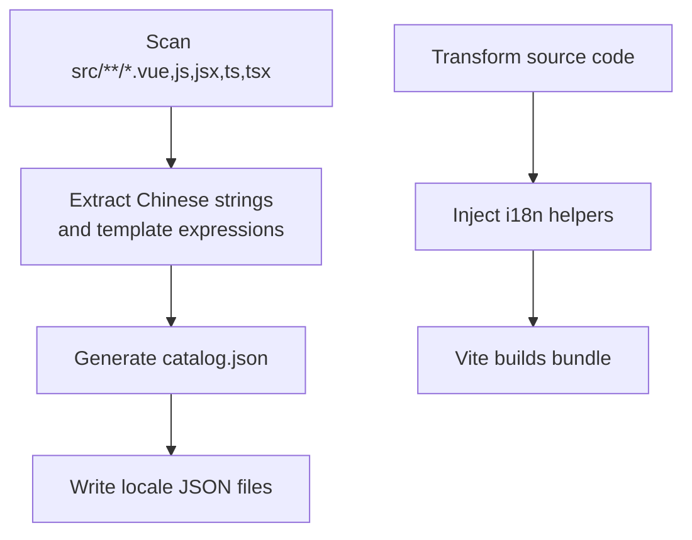
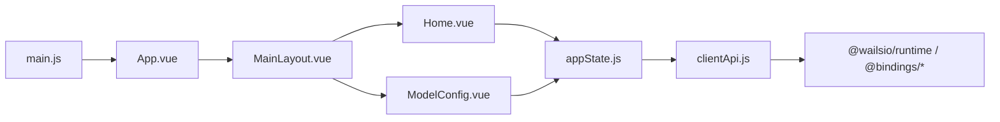

# Vue.js Architecture

<cite>
**Referenced Files in This Document**
- [main.js](file://frontend/src/main.js)
- [App.vue](file://frontend/src/App.vue)
- [index.html](file://frontend/index.html)
- [router/index.js](file://frontend/src/router/index.js)
- [layouts/MainLayout.vue](file://frontend/src/layouts/MainLayout.vue)
- [views/Home.vue](file://frontend/src/views/Home.vue)
- [views/ModelConfig.vue](file://frontend/src/views/ModelConfig.vue)
- [state/appState.js](file://frontend/src/state/appState.js)
- [services/clientApi.js](file://frontend/src/services/clientApi.js)
- [i18n/config.js](file://frontend/src/i18n/config.js)
- [plugins/static-i18n-plugin.js](file://frontend/plugins/static-i18n-plugin.js)
- [vite.config.js](file://frontend/vite.config.js)
- [package.json](file://frontend/package.json)
- [scripts/run-vite-build.mjs](file://frontend/scripts/run-vite-build.mjs)
- [tailwind.config.cjs](file://frontend/tailwind.config.cjs)
</cite>

## Table of Contents
1. [Introduction](#introduction)
2. [Project Structure](#project-structure)
3. [Core Components](#core-components)
4. [Architecture Overview](#architecture-overview)
5. [Detailed Component Analysis](#detailed-component-analysis)
6. [Dependency Analysis](#dependency-analysis)
7. [Performance Considerations](#performance-considerations)
8. [Troubleshooting Guide](#troubleshooting-guide)
9. [Conclusion](#conclusion)
10. [Appendices](#appendices)

## Introduction
This document explains the Vue.js application architecture, including entry point setup, initialization, routing, component hierarchy, build configuration with Vite, and development workflow. It also covers integration between Vue components and the Go backend services via Wails bindings, guidance for extending the app, adding routes, maintaining organization, performance optimization techniques, lazy loading strategies, and bundle size considerations.

## Project Structure
The frontend is a Vue 3 + Vite application integrated with Wails to call Go backend services. Key directories:
- src/main.js: Application bootstrap and global setup
- src/App.vue: Root component composing layout and shared UI providers
- src/router/index.js: Route definitions using vue-router
- src/layouts/MainLayout.vue: Shell layout with window controls and footer
- src/views/: Page-level components (Home, ModelConfig)
- src/components/ui: Reusable UI primitives
- src/composables: Shared logic hooks
- src/state/appState.js: Centralized reactive state and service orchestration
- src/services/clientApi.js: Thin wrappers over Wails-generated bindings
- src/i18n: Internationalization configuration and runtime helpers
- plugins/static-i18n-plugin.js: Build-time i18n extraction and transformation
- vite.config.js: Vite configuration and plugins
- scripts/run-vite-build.mjs: Build wrapper enabling static i18n scanning
- tailwind.config.cjs: Tailwind CSS theme and icon safelist
- index.html: HTML entry mounting #root
- package.json: Scripts and dependencies

**Diagram sources**
- [index.html:1-13](file://frontend/index.html#L1-L13)
- [main.js:1-41](file://frontend/src/main.js#L1-L41)
- [App.vue:1-56](file://frontend/src/App.vue#L1-L56)
- [layouts/MainLayout.vue:1-232](file://frontend/src/layouts/MainLayout.vue#L1-L232)
- [router/index.js:1-22](file://frontend/src/router/index.js#L1-L22)
- [views/Home.vue:1-193](file://frontend/src/views/Home.vue#L1-L193)
- [views/ModelConfig.vue:1-514](file://frontend/src/views/ModelConfig.vue#L1-L514)
- [state/appState.js:1-800](file://frontend/src/state/appState.js#L1-L800)
- [services/clientApi.js:1-180](file://frontend/src/services/clientApi.js#L1-L180)

**Section sources**
- [index.html:1-13](file://frontend/index.html#L1-L13)
- [package.json:1-40](file://frontend/package.json#L1-L40)
- [vite.config.js:1-38](file://frontend/vite.config.js#L1-L38)

## Core Components
- Entry point and bootstrap: main.js initializes Vue app, installs i18n runtime, registers router, mounts to #root, and bootstraps application state.
- Root component: App.vue composes MainLayout, message provider, ad model provider, and modal/input modals; determines if current route is the main window.
- Router: router/index.js defines two routes (/ and /model-config) using hash history.
- Layout: layouts/MainLayout.vue provides header/footer, window control actions, proxy status polling, and renders the active route via router-view.
- Views: views/Home.vue and views/ModelConfig.vue implement primary pages.
- State: state/appState.js centralizes reactive state, normalization/validation, persistence, events, update flow, and orchestrates calls to clientApi.
- Services: services/clientApi.js wraps Wails bindings and exposes typed functions for config, proxy, metrics, updates, and model adapter operations.

Key responsibilities:
- Initialization and environment checks (polyfills, flex-gap detection).
- Global UI concerns (modals, messages, locale selection).
- Service lifecycle management (start/stop proxy, sync state).
- Configuration management (load/save user config, validate adapters).
- Update system (check/install updates, progress tracking).
- Metrics and analytics (home metrics summary).

**Section sources**
- [main.js:1-41](file://frontend/src/main.js#L1-L41)
- [App.vue:1-56](file://frontend/src/App.vue#L1-L56)
- [router/index.js:1-22](file://frontend/src/router/index.js#L1-L22)
- [layouts/MainLayout.vue:1-232](file://frontend/src/layouts/MainLayout.vue#L1-L232)
- [views/Home.vue:1-193](file://frontend/src/views/Home.vue#L1-L193)
- [views/ModelConfig.vue:1-514](file://frontend/src/views/ModelConfig.vue#L1-L514)
- [state/appState.js:1-800](file://frontend/src/state/appState.js#L1-L800)
- [services/clientApi.js:1-180](file://frontend/src/services/clientApi.js#L1-L180)

## Architecture Overview
The application follows a layered architecture:
- Presentation layer: Vue components (App, Layout, Views, UI primitives)
- State layer: Reactive store (appState) managing UI state, configuration, and service status
- Integration layer: clientApi wrapping Wails bindings to communicate with Go backend
- Build layer: Vite with custom plugins (static i18n, Wails plugin, top-level await)

**Diagram sources**
- [App.vue:1-56](file://frontend/src/App.vue#L1-L56)
- [layouts/MainLayout.vue:1-232](file://frontend/src/layouts/MainLayout.vue#L1-L232)
- [views/Home.vue:1-193](file://frontend/src/views/Home.vue#L1-L193)
- [views/ModelConfig.vue:1-514](file://frontend/src/views/ModelConfig.vue#L1-L514)
- [state/appState.js:1-800](file://frontend/src/state/appState.js#L1-L800)
- [services/clientApi.js:1-180](file://frontend/src/services/clientApi.js#L1-L180)
- [vite.config.js:1-38](file://frontend/vite.config.js#L1-L38)
- [plugins/static-i18n-plugin.js:1-714](file://frontend/plugins/static-i18n-plugin.js#L1-L714)

## Detailed Component Analysis

### Entry Point and Bootstrap
- Initializes polyfills and feature detection (flex gap support).
- Creates Vue app instance, installs i18n runtime, registers router, and mounts to #root.
- Bootstraps application state asynchronously without blocking UI.

**Diagram sources**
- [index.html:1-13](file://frontend/index.html#L1-L13)
- [main.js:1-41](file://frontend/src/main.js#L1-L41)

**Section sources**
- [main.js:1-41](file://frontend/src/main.js#L1-L41)
- [index.html:1-13](file://frontend/index.html#L1-L13)

### Routing Configuration
- Uses vue-router with hash history suitable for desktop apps.
- Defines two routes:
  - "/" -> Home view with meta flags controlling UI behavior
  - "/model-config" -> ModelConfig view with different meta flags

Adding a new route:
- Add a new path and component import in router/index.js.
- Set appropriate meta fields (showIcon, title, directlyClose) to influence layout behavior.

**Diagram sources**
- [router/index.js:1-22](file://frontend/src/router/index.js#L1-L22)

**Section sources**
- [router/index.js:1-22](file://frontend/src/router/index.js#L1-L22)

### Component Hierarchy
- App.vue composes:
  - MainLayout (shell)
  - MessageProvider (global notifications)
  - AdModelProvider (conditional on main window)
  - Modal and InputModal (shared dialogs)
- MainLayout.vue renders router-view and manages window controls and footer.
- Views encapsulate page-specific logic and data fetching.

**Diagram sources**
- [App.vue:1-56](file://frontend/src/App.vue#L1-L56)
- [layouts/MainLayout.vue:1-232](file://frontend/src/layouts/MainLayout.vue#L1-L232)
- [views/Home.vue:1-193](file://frontend/src/views/Home.vue#L1-L193)
- [views/ModelConfig.vue:1-514](file://frontend/src/views/ModelConfig.vue#L1-L514)

**Section sources**
- [App.vue:1-56](file://frontend/src/App.vue#L1-L56)
- [layouts/MainLayout.vue:1-232](file://frontend/src/layouts/MainLayout.vue#L1-L232)
- [views/Home.vue:1-193](file://frontend/src/views/Home.vue#L1-L193)
- [views/ModelConfig.vue:1-514](file://frontend/src/views/ModelConfig.vue#L1-L514)

### State Management and Backend Integration
- appState.js maintains reactive state for:
  - Proxy/backend service status
  - User configuration (model adapters, listen addresses, logging)
  - Home metrics
  - Update system (checking/downloading/installing)
  - Model adapter testing results
- Normalization and validation ensure robust data shapes before persistence or API calls.
- Event-driven synchronization with backend via @wailsio/runtime Events.

**Diagram sources**
- [state/appState.js:1-800](file://frontend/src/state/appState.js#L1-L800)
- [services/clientApi.js:1-180](file://frontend/src/services/clientApi.js#L1-L180)

**Section sources**
- [state/appState.js:1-800](file://frontend/src/state/appState.js#L1-L800)
- [services/clientApi.js:1-180](file://frontend/src/services/clientApi.js#L1-L180)

### Internationalization (i18n)
- Configuration defines supported locales and default source locale.
- Custom Vite plugin scans source files for Chinese text and generates translation keys.
- At build time, it transforms string literals and template expressions into localized helper calls.
- Runtime helpers provide $ls/$lt macros for templates and __i18nLocalized/__i18nLocalizedTemplate for JS.

**Diagram sources**
- [plugins/static-i18n-plugin.js:1-714](file://frontend/plugins/static-i18n-plugin.js#L1-L714)
- [i18n/config.js:1-12](file://frontend/src/i18n/config.js#L1-L12)

**Section sources**
- [i18n/config.js:1-12](file://frontend/src/i18n/config.js#L1-L12)
- [plugins/static-i18n-plugin.js:1-714](file://frontend/plugins/static-i18n-plugin.js#L1-L714)

### Build Configuration and Development Workflow
- Vite config:
  - Aliases (@, @bindings)
  - Target browsers (es2019, Safari 13)
  - Plugins: code-inspector (dev), wails, topLevelAwait, static-i18n, vue, vueJsx
- Build script:
  - run-vite-build.mjs forwards arguments and sets STATIC_I18N_SCAN to enable catalog generation during build.
- Tailwind:
  - Content scanning for Vue/JS/TS files
  - Icon safelist for dynamic icon classes
  - Theme extensions (colors, fonts, font sizes, z-index)

Development commands:
- npm/yarn dev: Start Vite dev server
- npm/yarn build: Production build with i18n scanning
- npm/yarn preview: Preview production build locally

**Section sources**
- [vite.config.js:1-38](file://frontend/vite.config.js#L1-L38)
- [scripts/run-vite-build.mjs:1-28](file://frontend/scripts/run-vite-build.mjs#L1-L28)
- [tailwind.config.cjs:1-78](file://frontend/tailwind.config.cjs#L1-L78)
- [package.json:1-40](file://frontend/package.json#L1-L40)

## Dependency Analysis
High-level dependency relationships:
- main.js depends on App.vue, router, i18n runtime, and appState.
- App.vue depends on MainLayout, UI components, composables, and appState.
- Layout depends on Wails runtime for window/browser APIs and appState for service state.
- Views depend on appState for business logic and clientApi for backend calls.
- clientApi depends on Wails bindings generated from Go services.

**Diagram sources**
- [main.js:1-41](file://frontend/src/main.js#L1-L41)
- [App.vue:1-56](file://frontend/src/App.vue#L1-L56)
- [layouts/MainLayout.vue:1-232](file://frontend/src/layouts/MainLayout.vue#L1-L232)
- [views/Home.vue:1-193](file://frontend/src/views/Home.vue#L1-L193)
- [views/ModelConfig.vue:1-514](file://frontend/src/views/ModelConfig.vue#L1-L514)
- [state/appState.js:1-800](file://frontend/src/state/appState.js#L1-L800)
- [services/clientApi.js:1-180](file://frontend/src/services/clientApi.js#L1-L180)

**Section sources**
- [main.js:1-41](file://frontend/src/main.js#L1-L41)
- [App.vue:1-56](file://frontend/src/App.vue#L1-L56)
- [layouts/MainLayout.vue:1-232](file://frontend/src/layouts/MainLayout.vue#L1-L232)
- [views/Home.vue:1-193](file://frontend/src/views/Home.vue#L1-L193)
- [views/ModelConfig.vue:1-514](file://frontend/src/views/ModelConfig.vue#L1-L514)
- [state/appState.js:1-800](file://frontend/src/state/appState.js#L1-L800)
- [services/clientApi.js:1-180](file://frontend/src/services/clientApi.js#L1-L180)

## Performance Considerations
- Lazy loading routes:
  - Use dynamic imports for route components to reduce initial bundle size.
  - Example pattern: define routes with () => import('@/views/Home.vue').
- Code splitting:
  - Split large components (e.g., charts) into separate modules and load on demand.
- Tree-shaking:
  - Ensure unused utilities and icons are not imported statically.
- Polyfills:
  - Only include necessary polyfills (ResizeObserver) and conditionally apply them.
- CSS:
  - Tailwind purges unused styles; keep safelist minimal to avoid bloating.
- Network requests:
  - Debounce or throttle frequent state syncs (e.g., proxy state polling).
  - Cache responses where possible (e.g., model adapter test results).
- Rendering:
  - Avoid deep watchers on large objects; prefer computed properties and selective reactivity.
- Bundle analysis:
  - Use Vite’s built-in analyzer or external tools to identify heavy dependencies.

[No sources needed since this section provides general guidance]

## Troubleshooting Guide
Common issues and resolutions:
- i18n scanning not generating keys:
  - Ensure STATIC_I18N_SCAN is set or pass --scan to the build script.
  - Verify that Chinese text exists in source files and is not inside excluded paths.
- Wails binding errors:
  - Confirm Go bindings are regenerated and present under @bindings.
  - Check console logs from clientApi for payload/error details.
- Proxy/service state not updating:
  - Verify Events subscription and event names match backend emissions.
  - Inspect appState event handlers and error fallbacks.
- Tailwind styles missing:
  - Ensure content paths include all relevant file types.
  - Add dynamic icon classes to safelist when using iconify dynamically.

**Section sources**
- [plugins/static-i18n-plugin.js:1-714](file://frontend/plugins/static-i18n-plugin.js#L1-L714)
- [services/clientApi.js:1-180](file://frontend/src/services/clientApi.js#L1-L180)
- [tailwind.config.cjs:1-78](file://frontend/tailwind.config.cjs#L1-L78)

## Conclusion
The Vue.js application is structured around clear separation of concerns: presentation (components/views), state (appState), integration (clientApi), and build tooling (Vite + custom plugins). The architecture supports extensibility through modular components, centralized state, and well-defined integration points to the Go backend. Following the guidelines for adding routes, organizing code, and optimizing performance will help maintain scalability and efficiency.

[No sources needed since this section summarizes without analyzing specific files]

## Appendices

### Extending the Application
- Add a new route:
  - Import the new view component in router/index.js.
  - Define a route entry with appropriate meta flags.
- Add a new page:
  - Create a new component under src/views/.
  - Compose existing UI primitives and use appState for data and actions.
- Extend state:
  - Add new reactive fields and normalization/validation logic in appState.js.
  - Expose methods to interact with backend via clientApi.js.
- Integrate with backend:
  - Add new bindings in Go and regenerate Wails bindings.
  - Wrap the new binding in clientApi.js and expose typed functions.

[No sources needed since this section provides general guidance]