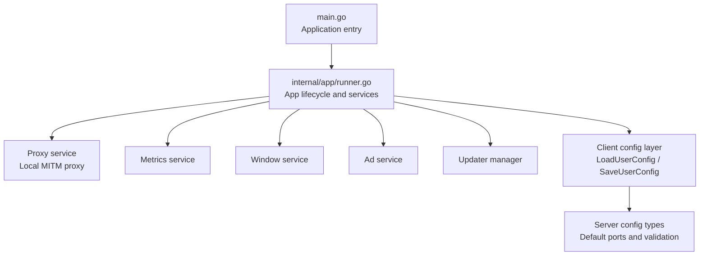
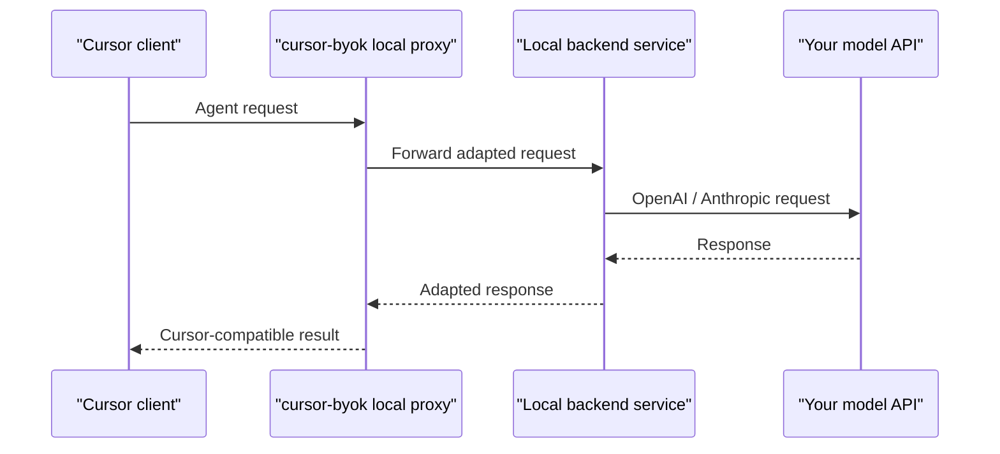
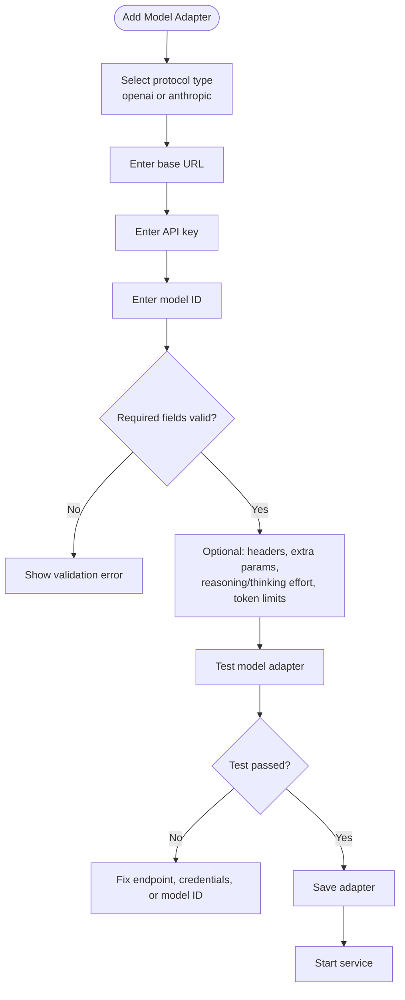
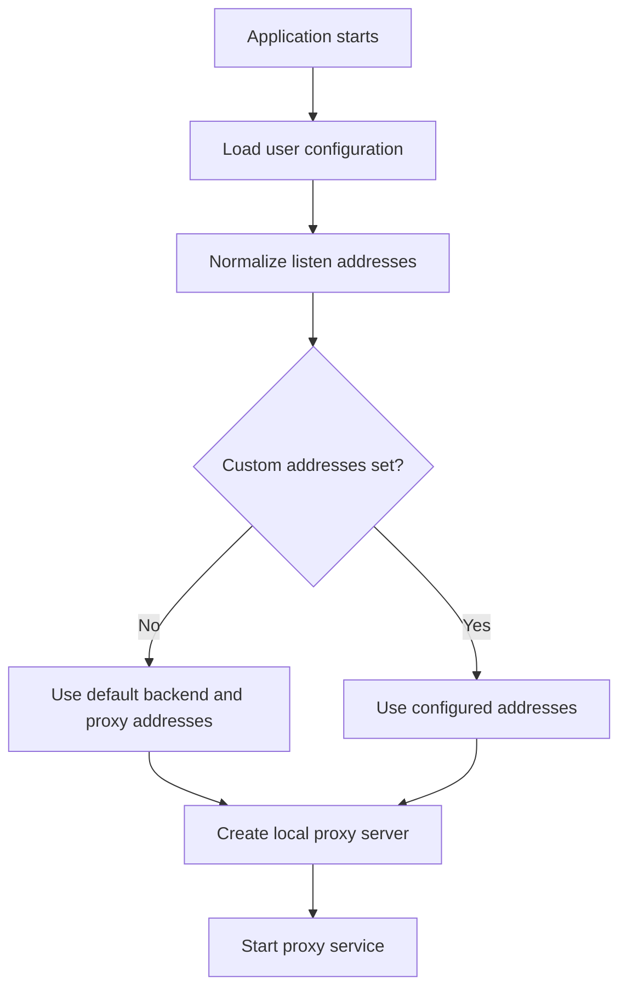
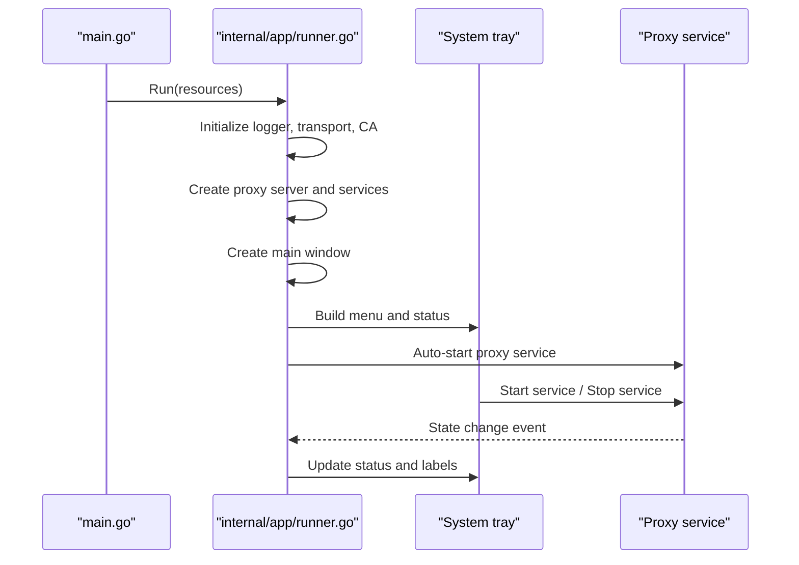
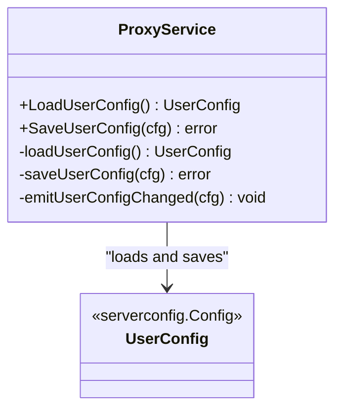
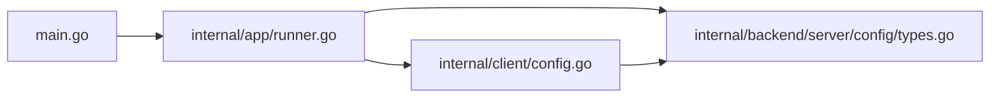

# Getting Started

<cite>
**Referenced Files in This Document**
- [README.md](file://README.md)
- [main.go](file://main.go)
- [runner.go](file://internal/app/runner.go)
- [types.go](file://internal/backend/server/config/types.go)
- [config.go](file://internal/client/config.go)
- [CONTRIBUTING_EN.md](file://CONTRIBUTING_EN.md)
</cite>

## Table of Contents
1. [Introduction](#introduction)
2. [Project Structure](#project-structure)
3. [Core Components](#core-components)
4. [Architecture Overview](#architecture-overview)
5. [Detailed Component Analysis](#detailed-component-analysis)
6. [Dependency Analysis](#dependency-analysis)
7. [Performance Considerations](#performance-considerations)
8. [Troubleshooting Guide](#troubleshooting-guide)
9. [Conclusion](#conclusion)

## Introduction
cursor-byok is a local model gateway for Cursor that implements Cursor’s backend locally. Its purpose is to enable Bring Your Own Key (BYOK) model access: instead of being locked into the platform’s default model channels, you can connect Cursor to your own OpenAI-compatible or Anthropic-compatible model APIs. The application runs on your machine, preserves Cursor Agent capabilities such as tool calling, Skills, and MCP, and forwards model requests through the providers you configure.

The project supports macOS, Windows, and Linux, and provides a local dashboard where you can add, edit, test, and manage multiple model adapters.

**Section sources**
- [README.md:4-4](file://README.md#L4-L4)
- [README.md:56-58](file://README.md#L56-L58)
- [README.md:63-71](file://README.md#L63-L71)
- [README.md:88-102](file://README.md#L88-L102)

## Project Structure
At runtime, cursor-byok is a desktop application built with Wails. The Go entry point initializes logging, embeds the frontend assets, and starts the application runner. The runner sets up the local proxy, certificate manager, system tray, update manager, and background services. Configuration is loaded from and saved to a local user configuration path.

**Diagram sources**
- [main.go:19-29](file://main.go#L19-L29)
- [runner.go:119-214](file://internal/app/runner.go#L119-L214)
- [runner.go:263-470](file://internal/app/runner.go#L263-L470)
- [config.go:15-80](file://internal/client/config.go#L15-L80)
- [types.go:15-69](file://internal/backend/server/config/types.go#L15-L69)

**Section sources**
- [main.go:1-29](file://main.go#L1-L29)
- [runner.go:119-214](file://internal/app/runner.go#L119-L214)
- [config.go:15-80](file://internal/client/config.go#L15-L80)
- [types.go:15-69](file://internal/backend/server/config/types.go#L15-L69)

## Core Components
- **Application entry**: Initializes logging and starts the app with embedded frontend assets and icons.
- **Runner**: Creates the Wails application, registers services, manages the main window, system tray, auto-start behavior, and shutdown logic.
- **Proxy service**: Starts and stops the local proxy used by Cursor to reach the local backend.
- **Configuration layer**: Loads and saves user configuration, including model adapters, listen addresses, and feature flags.
- **Server configuration types**: Defines default local ports, model adapter schema, normalization rules, and validation constraints.

Key responsibilities:
- Local proxy and backend address management.
- Model adapter configuration with endpoint, API key, and model ID.
- Dashboard UI integration via embedded frontend assets.
- System tray controls for starting, stopping, showing, hiding, and quitting the service.

**Section sources**
- [main.go:19-29](file://main.go#L19-L29)
- [runner.go:119-214](file://internal/app/runner.go#L119-L214)
- [runner.go:320-470](file://internal/app/runner.go#L320-L470)
- [config.go:15-80](file://internal/client/config.go#L15-L80)
- [types.go:23-69](file://internal/backend/server/config/types.go#L23-L69)

## Architecture Overview
cursor-byok sits between Cursor and your configured model provider. Cursor sends agent requests to the local proxy; cursor-byok adapts the protocol, forwards requests to your model API, and returns responses while preserving Cursor Agent features.

**Diagram sources**
- [README.md:88-102](file://README.md#L88-L102)
- [runner.go:120-139](file://internal/app/runner.go#L120-L139)
- [types.go:15-21](file://internal/backend/server/config/types.go#L15-L21)

## Detailed Component Analysis

### Installation and Quick Start
The official quick start describes downloading the latest build, launching the application, configuring model settings, testing the configuration, and starting the service.

Recommended steps:
1. Download the latest release for your platform from GitHub Releases.
2. Launch cursor-byok.
3. Open Model Settings and enter:
   - Endpoint
   - API key
   - Model ID
4. Test the model configuration.
5. Return to the dashboard and start the service.
6. Open Cursor, select the configured model, and use Agent.

Supported platforms are macOS, Windows, and Linux.

**Section sources**
- [README.md:73-80](file://README.md#L73-L80)
- [README.md:44-44](file://README.md#L44-L44)

### Initial System Requirements and Prerequisites
For end users, the primary requirement is a supported operating system and a valid model API credential for the provider you choose. The application itself does not require building from source unless you are developing it.

For developers contributing to the project, the prerequisites include:
- Go version 1.25 or later
- Node.js version 20 or later
- Yarn classic 1.x
- Task version 3 or later
- Wails v3 CLI alpha 74 or later
- On Linux: `libgtk-3-dev` and `libwebkit2gtk-4.1-dev`

**Section sources**
- [CONTRIBUTING_EN.md:7-17](file://CONTRIBUTING_EN.md#L7-L17)

### Model Adapter Configuration
A model adapter represents one connection to a model provider. Each adapter includes:
- Display name
- Protocol type (`openai` or `anthropic`)
- Base URL
- API key
- Model ID
- Optional reasoning effort or thinking effort
- Optional custom headers and extra parameters
- Optional context window and token limits

Validation ensures required fields are present and values are consistent with the selected protocol. Duplicate channel combinations are rejected.

**Diagram sources**
- [types.go:23-45](file://internal/backend/server/config/types.go#L23-L45)
- [types.go:95-171](file://internal/backend/server/config/types.go#L95-L171)

**Section sources**
- [types.go:23-45](file://internal/backend/server/config/types.go#L23-L45)
- [types.go:95-171](file://internal/backend/server/config/types.go#L95-L171)

### Default Ports and Local Service Behavior
By default, cursor-byok uses two local loopback addresses:
- Backend listen address: `127.0.0.1:18090`
- Proxy listen address: `127.0.0.1:18080`

These defaults are normalized and validated when configuration is loaded. The runner creates the local proxy server using the default proxy listen address and points it to the default backend base URL.

**Diagram sources**
- [types.go:15-21](file://internal/backend/server/config/types.go#L15-L21)
- [types.go:61-93](file://internal/backend/server/config/types.go#L61-L93)
- [runner.go:120-139](file://internal/app/runner.go#L120-L139)

**Section sources**
- [types.go:15-21](file://internal/backend/server/config/types.go#L15-L21)
- [types.go:61-93](file://internal/backend/server/config/types.go#L61-L93)
- [runner.go:120-139](file://internal/app/runner.go#L120-L139)

### Application Lifecycle and Tray Controls
The runner initializes logging, installs the default HTTP transport, ensures assistant home directories, loads or creates a local certificate authority, and creates the proxy server. It then builds the Wails application, registers services, creates the main window, and sets up the system tray menu.

Tray menu options include:
- Status indicator
- Start service
- Stop service
- Check for updates
- Show window
- Hide window
- Quit

On application start, the runner also attempts to auto-start the proxy service in the background and emits events for state changes.

**Diagram sources**
- [main.go:19-29](file://main.go#L19-L29)
- [runner.go:119-214](file://internal/app/runner.go#L119-L214)
- [runner.go:320-470](file://internal/app/runner.go#L320-L470)

**Section sources**
- [runner.go:119-214](file://internal/app/runner.go#L119-L214)
- [runner.go:320-470](file://internal/app/runner.go#L320-L470)

### Configuration Storage and Paths
The client configuration layer exposes functions to load and save user configuration. It resolves the configuration file path, logs root path, and settings root path. When saving, it normalizes the configuration and emits a user-config-changed event so the UI can refresh.

**Diagram sources**
- [config.go:15-80](file://internal/client/config.go#L15-L80)
- [config.go:82-100](file://internal/client/config.go#L82-L100)

**Section sources**
- [config.go:15-80](file://internal/client/config.go#L15-L80)
- [config.go:82-100](file://internal/client/config.go#L82-L100)

## Dependency Analysis
The application has clear separation between entrypoint, runner, configuration, and server configuration types:
- `main.go` depends on `internal/app` and `internal/logger`.
- `internal/app/runner.go` depends on proxy, metrics, window, ad, updater, certs, netproxy, and server configuration.
- `internal/client/config.go` depends on server configuration types and app data paths.
- `internal/backend/server/config/types.go` defines defaults and validation used across the proxy and client layers.

**Diagram sources**
- [main.go:3-8](file://main.go#L3-L8)
- [runner.go:18-36](file://internal/app/runner.go#L18-L36)
- [config.go:3-10](file://internal/client/config.go#L3-L10)
- [types.go:1-13](file://internal/backend/server/config/types.go#L1-L13)

**Section sources**
- [main.go:3-8](file://main.go#L3-L8)
- [runner.go:18-36](file://internal/app/runner.go#L18-L36)
- [config.go:3-10](file://internal/client/config.go#L3-L10)
- [types.go:1-13](file://internal/backend/server/config/types.go#L1-L13)

## Performance Considerations
- The runner sets a default provider stream idle timeout and enforces a minimum value during normalization. This helps avoid long-lived idle streams that could consume resources.
- The application uses a single-instance option to prevent multiple concurrent instances from interfering with each other.
- The proxy and backend listen addresses are validated to ensure proper host and port ranges.

Practical guidance:
- If model responses feel slow, verify network connectivity to your model provider and consider adjusting provider-related timeouts only if necessary.
- Avoid binding the backend or proxy to broad interfaces like `0.0.0.0` unless you intentionally expose them locally.

**Section sources**
- [types.go:15-21](file://internal/backend/server/config/types.go#L15-L21)
- [types.go:269-277](file://internal/backend/server/config/types.go#L269-L277)
- [runner.go:207-213](file://internal/app/runner.go#L207-L213)

## Troubleshooting Guide
Common issues and checks:
- **Model configuration fails validation**: Ensure the adapter has a display name, protocol type, API key, tooltip data, and model ID. For OpenAI adapters, the reasoning effort and OpenAI endpoint must be supported. For Anthropic adapters, thinking effort must be valid.
- **Duplicate model adapter**: The combination of base URL, model ID, API key, display name, and endpoint must be unique.
- **Invalid JSON for extra parameters or custom headers**: Extra parameters and custom headers must be valid JSON objects with string keys.
- **Listen address errors**: Backend and proxy listen addresses must be in `host:port` format with a valid port range.
- **Service does not start**: Check whether the local proxy can bind to the configured address and whether the backend address is reachable.

Where to look:
- Validation errors for model adapters are defined in the configuration normalization logic.
- Default ports and normalization rules are defined in the server configuration types.
- Application startup and proxy creation are handled in the runner.

**Section sources**
- [types.go:95-171](file://internal/backend/server/config/types.go#L95-L171)
- [types.go:250-267](file://internal/backend/server/config/types.go#L250-L267)
- [runner.go:120-139](file://internal/app/runner.go#L120-L139)

## Conclusion
cursor-byok lets you bring your own model keys and connect Cursor to your preferred model providers while keeping Cursor Agent features intact. Install the latest release for your platform, configure at least one model adapter with endpoint, API key, and model ID, test the adapter, and start the service. Use the dashboard and system tray to manage configurations and control the local proxy. If you encounter validation or startup issues, review the adapter fields, JSON inputs, and local listen addresses.