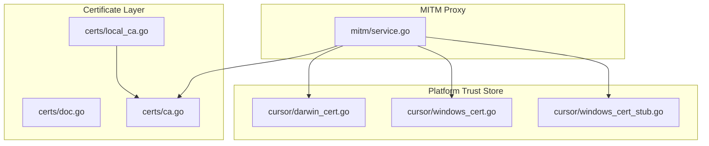
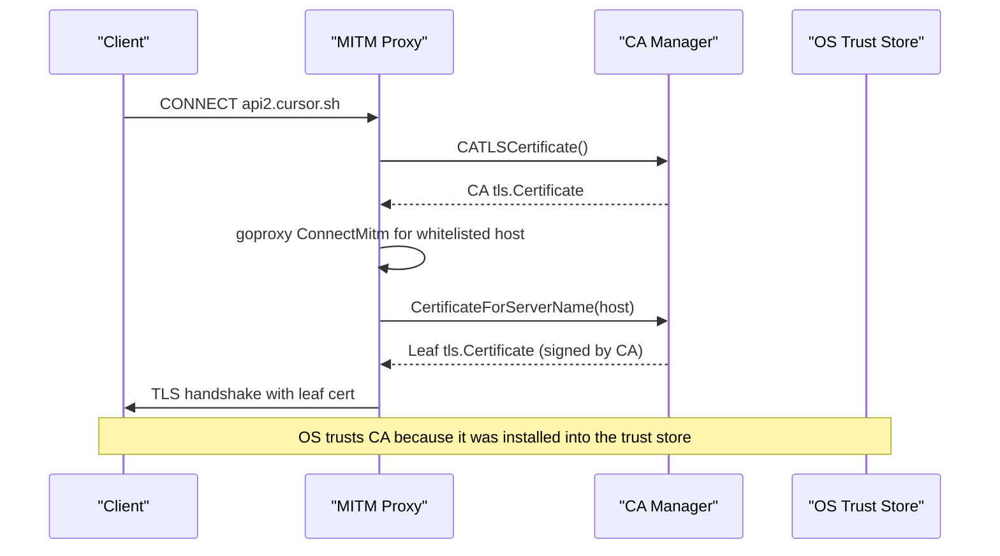
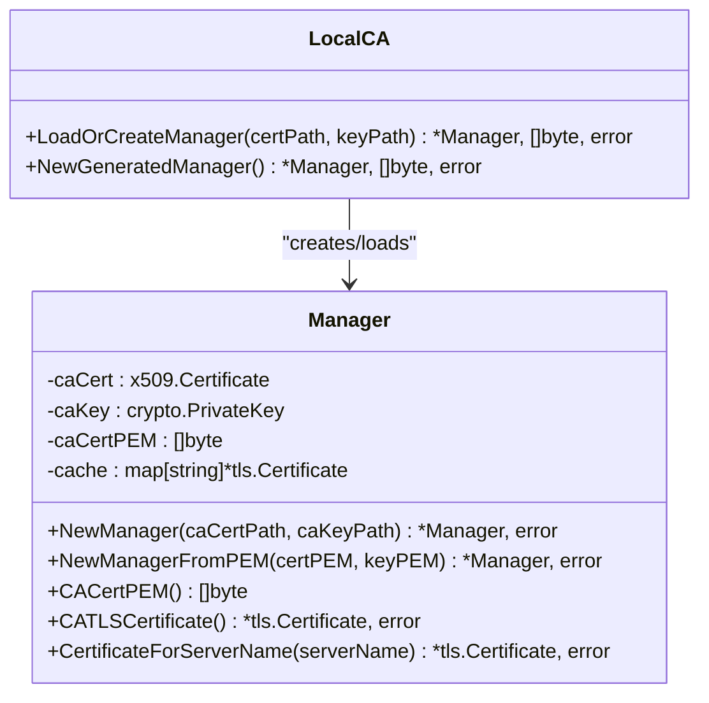
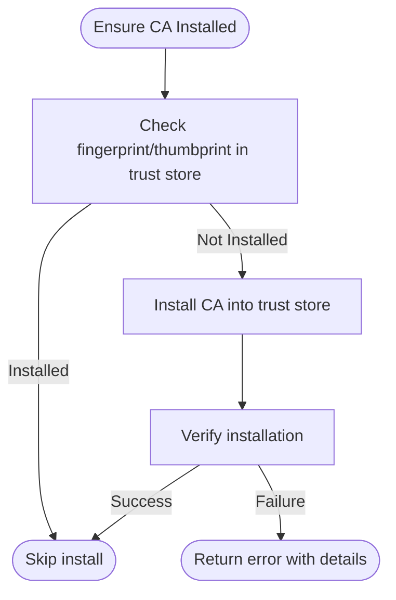
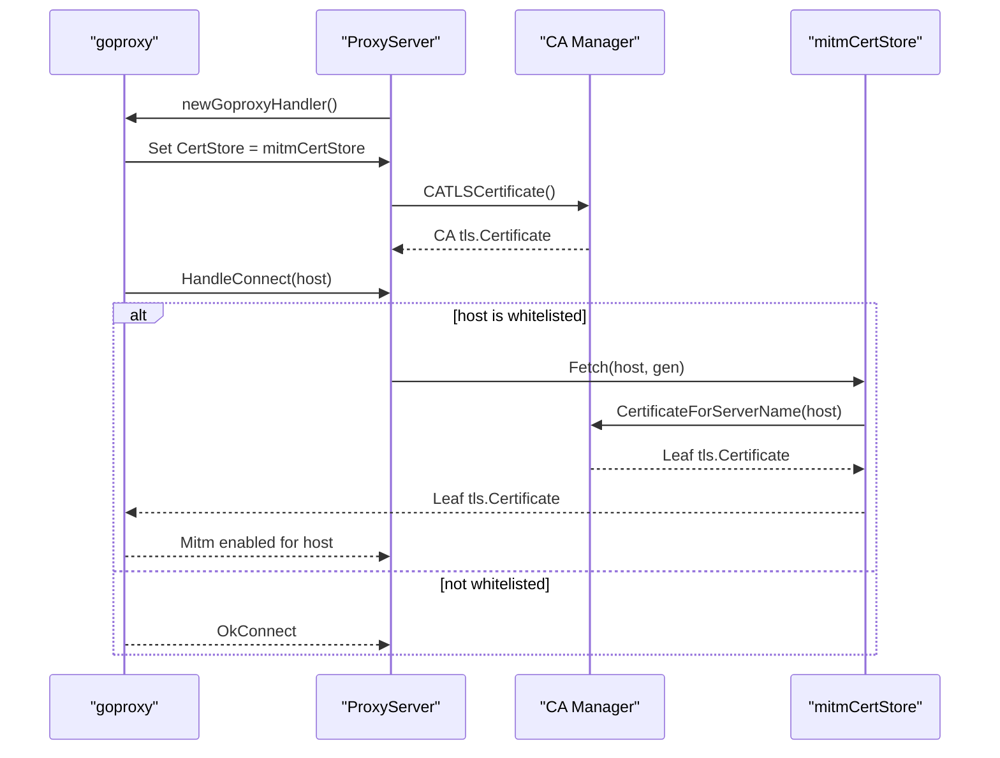
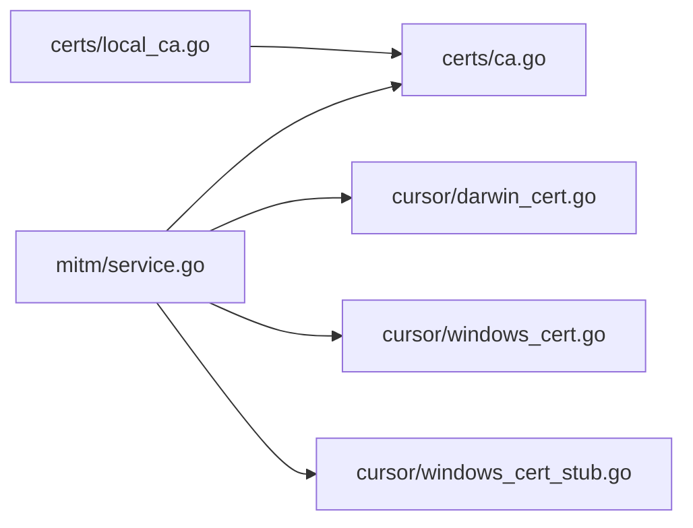

# Certificate Management

<cite>
**Referenced Files in This Document**
- [ca.go](file://internal/certs/ca.go)
- [local_ca.go](file://internal/certs/local_ca.go)
- [doc.go](file://internal/certs/doc.go)
- [local_ca_test.go](file://internal/certs/local_ca_test.go)
- [service.go](file://internal/mitm/service.go)
- [darwin_cert.go](file://internal/cursor/darwin_cert.go)
- [windows_cert.go](file://internal/cursor/windows_cert.go)
- [windows_cert_stub.go](file://internal/cursor/windows_cert_stub.go)
</cite>

## Table of Contents
1. [Introduction](#introduction)
2. [Project Structure](#project-structure)
3. [Core Components](#core-components)
4. [Architecture Overview](#architecture-overview)
5. [Detailed Component Analysis](#detailed-component-analysis)
6. [Dependency Analysis](#dependency-analysis)
7. [Performance Considerations](#performance-considerations)
8. [Troubleshooting Guide](#troubleshooting-guide)
9. [Conclusion](#conclusion)

## Introduction
This document explains the certificate management system used for local HTTPS interception and proxying. It covers how the local Certificate Authority is created, persisted, and integrated with platform trust stores; how per-host certificates are generated and cached; and how the proxy uses these materials to intercept TLS traffic safely. It also documents security considerations around private key protection, certificate validation, and platform-specific installation behavior.

## Project Structure
The certificate subsystem spans three main areas:
- Local CA lifecycle and in-memory manager: internal/certs
- Platform trust store integration: internal/cursor
- MITM proxy integration: internal/mitm

**Diagram sources**
- [doc.go:1-3](file://internal/certs/doc.go#L1-L3)
- [local_ca.go:22-95](file://internal/certs/local_ca.go#L22-L95)
- [ca.go:23-79](file://internal/certs/ca.go#L23-L79)
- [service.go:32-57](file://internal/mitm/service.go#L32-L57)
- [darwin_cert.go:16-20](file://internal/cursor/darwin_cert.go#L16-L20)
- [windows_cert.go:18-24](file://internal/cursor/windows_cert.go#L18-L24)
- [windows_cert_stub.go:1-16](file://internal/cursor/windows_cert_stub.go#L1-L16)

**Section sources**
- [doc.go:1-3](file://internal/certs/doc.go#L1-L3)
- [local_ca.go:22-95](file://internal/certs/local_ca.go#L22-L95)
- [ca.go:23-79](file://internal/certs/ca.go#L23-L79)
- [service.go:32-57](file://internal/mitm/service.go#L32-L57)
- [darwin_cert.go:16-20](file://internal/cursor/darwin_cert.go#L16-L20)
- [windows_cert.go:18-24](file://internal/cursor/windows_cert.go#L18-L24)
- [windows_cert_stub.go:1-16](file://internal/cursor/windows_cert_stub.go#L1-L16)

## Core Components
- Local CA Manager: loads or generates a per-installation CA, persists it securely, and provides methods to obtain the CA material and generate per-host leaf certificates.
- Platform Trust Store Integration: installs or removes the CA certificate into macOS login keychain or Windows Root store, including legacy shared CA removal.
- MITM Proxy Integration: configures goproxy to intercept selected hosts using the CA and dynamically sign per-host certificates.

Key responsibilities:
- CA creation and persistence with secure file permissions
- Per-host certificate generation with short-lived keys and proper SAN handling
- Platform-specific trust store operations with verification and error reporting
- Safe fallbacks for unsupported platforms

**Section sources**
- [local_ca.go:22-95](file://internal/certs/local_ca.go#L22-L95)
- [ca.go:23-79](file://internal/certs/ca.go#L23-L79)
- [darwin_cert.go:57-132](file://internal/cursor/darwin_cert.go#L57-L132)
- [windows_cert.go:83-189](file://internal/cursor/windows_cert.go#L83-L189)
- [service.go:360-450](file://internal/mitm/service.go#L360-L450)

## Architecture Overview
The system composes a local CA with a proxy that signs on-demand certificates for whitelisted hosts. The CA certificate is installed into the OS trust store so clients accept the intercepted TLS connections.

**Diagram sources**
- [service.go:388-424](file://internal/mitm/service.go#L388-L424)
- [ca.go:69-153](file://internal/certs/ca.go#L69-L153)
- [darwin_cert.go:119-132](file://internal/cursor/darwin_cert.go#L119-L132)
- [windows_cert.go:175-189](file://internal/cursor/windows_cert.go#L175-L189)

## Detailed Component Analysis

### Local CA Manager
Responsibilities:
- Load existing CA from disk or generate a new one if missing
- Validate CA certificate properties and key match
- Persist CA files atomically with strict permissions
- Provide CA PEM and TLS material
- Generate per-host leaf certificates with appropriate SANs and usage flags

Implementation highlights:
- CA loading validates IsCA, BasicConstraints, KeyUsage, and matches public key between certificate and private key.
- On first run or when a legacy shared CA is detected, a new unique CA is generated and persisted.
- Private key is written first with restrictive permissions, then the certificate.
- Per-host certificate generation creates a fresh RSA key, sets DNS or IP SANs, and builds a chain including the CA.

Security notes:
- CA private key is restricted to owner-only access where supported.
- Legacy shared CA detection prevents reuse of a compromised root across installations.

**Diagram sources**
- [ca.go:23-79](file://internal/certs/ca.go#L23-L79)
- [local_ca.go:22-95](file://internal/certs/local_ca.go#L22-L95)

**Section sources**
- [ca.go:23-79](file://internal/certs/ca.go#L23-L79)
- [ca.go:100-153](file://internal/certs/ca.go#L100-L153)
- [ca.go:178-236](file://internal/certs/ca.go#L178-L236)
- [local_ca.go:22-95](file://internal/certs/local_ca.go#L22-L95)
- [local_ca.go:97-134](file://internal/certs/local_ca.go#L97-L134)
- [local_ca.go:136-165](file://internal/certs/local_ca.go#L136-L165)
- [local_ca.go:167-178](file://internal/certs/local_ca.go#L167-L178)

### Platform Trust Store Integration
Responsibilities:
- Detect whether the CA is already installed in the OS trust store
- Install the CA into the trust store with elevated privileges when required
- Remove a known compromised legacy shared CA
- Provide stubs for unsupported platforms

Platform specifics:
- macOS: Uses the `security` command to add/remove trusted certificates in the login keychain.
- Windows: Uses `certutil.exe` via an elevated PowerShell process to add/remove certificates in the LocalMachine Root store.
- Other platforms: Returns an error indicating lack of support.

**Diagram sources**
- [darwin_cert.go:35-55](file://internal/cursor/darwin_cert.go#L35-L55)
- [darwin_cert.go:87-117](file://internal/cursor/darwin_cert.go#L87-L117)
- [darwin_cert.go:119-132](file://internal/cursor/darwin_cert.go#L119-L132)
- [windows_cert.go:48-81](file://internal/cursor/windows_cert.go#L48-L81)
- [windows_cert.go:149-173](file://internal/cursor/windows_cert.go#L149-L173)
- [windows_cert.go:175-189](file://internal/cursor/windows_cert.go#L175-L189)
- [windows_cert_stub.go:7-15](file://internal/cursor/windows_cert_stub.go#L7-L15)

**Section sources**
- [darwin_cert.go:22-55](file://internal/cursor/darwin_cert.go#L22-L55)
- [darwin_cert.go:57-85](file://internal/cursor/darwin_cert.go#L57-L85)
- [darwin_cert.go:87-132](file://internal/cursor/darwin_cert.go#L87-L132)
- [windows_cert.go:26-46](file://internal/cursor/windows_cert.go#L26-L46)
- [windows_cert.go:48-81](file://internal/cursor/windows_cert.go#L48-L81)
- [windows_cert.go:83-104](file://internal/cursor/windows_cert.go#L83-L104)
- [windows_cert.go:110-147](file://internal/cursor/windows_cert.go#L110-L147)
- [windows_cert.go:149-189](file://internal/cursor/windows_cert.go#L149-L189)
- [windows_cert_stub.go:1-16](file://internal/cursor/windows_cert_stub.go#L1-L16)

### MITM Proxy Integration
Responsibilities:
- Configure goproxy to intercept CONNECT requests for whitelisted hosts
- Use the CA manager to provide TLS configuration and per-host certificates
- Cache per-host certificates to avoid repeated signing work
- Forward whitelisted requests to the backend server after decryption

**Diagram sources**
- [service.go:360-450](file://internal/mitm/service.go#L360-L450)
- [service.go:660-688](file://internal/mitm/service.go#L660-L688)
- [ca.go:69-153](file://internal/certs/ca.go#L69-L153)

**Section sources**
- [service.go:360-450](file://internal/mitm/service.go#L360-L450)
- [service.go:660-688](file://internal/mitm/service.go#L660-L688)

## Dependency Analysis
- MITM proxy depends on the CA manager for TLS material and on platform integrations for trust store operations.
- CA manager is self-contained but relies on OS filesystem semantics for secure persistence.
- Platform integrations depend on external commands (`security`, `certutil`) and require appropriate privileges.

**Diagram sources**
- [service.go:32-57](file://internal/mitm/service.go#L32-L57)
- [local_ca.go:22-95](file://internal/certs/local_ca.go#L22-L95)
- [ca.go:23-79](file://internal/certs/ca.go#L23-L79)
- [darwin_cert.go:16-20](file://internal/cursor/darwin_cert.go#L16-L20)
- [windows_cert.go:18-24](file://internal/cursor/windows_cert.go#L18-L24)
- [windows_cert_stub.go:1-16](file://internal/cursor/windows_cert_stub.go#L1-L16)

**Section sources**
- [service.go:32-57](file://internal/mitm/service.go#L32-L57)
- [local_ca.go:22-95](file://internal/certs/local_ca.go#L22-L95)
- [ca.go:23-79](file://internal/certs/ca.go#L23-L79)
- [darwin_cert.go:16-20](file://internal/cursor/darwin_cert.go#L16-L20)
- [windows_cert.go:18-24](file://internal/cursor/windows_cert.go#L18-L24)
- [windows_cert_stub.go:1-16](file://internal/cursor/windows_cert_stub.go#L1-L16)

## Performance Considerations
- Per-host certificate caching: Both the CA manager and the MITM proxy cache per-host TLS certificates to avoid repeated RSA key generation and X.509 signing.
- Connection pooling: The proxy’s upstream HTTP client uses connection pooling and timeouts tuned for performance.
- Logging rate limiting: Proxy logs are rate-limited to reduce overhead under high load.

Recommendations:
- Keep the CA manager’s in-memory cache active for the lifetime of the proxy process.
- Avoid frequent CA rotation during normal operation; rotate only during planned maintenance.
- Monitor memory growth of the per-host certificate cache if many distinct hosts are intercepted.

[No sources needed since this section provides general guidance]

## Troubleshooting Guide

Common issues and resolutions:
- CA not trusted by browser or OS
  - macOS: Ensure the CA is added to the login keychain as a trusted root. Re-run the installation routine and verify the fingerprint exists.
  - Windows: Ensure the CA is present in the LocalMachine Root store. If UAC prompts were canceled, re-run with administrator privileges.
- Legacy shared CA still present
  - The system attempts to remove a known compromised legacy shared CA automatically. If it remains, manually remove it from the trust store and restart the application.
- Mismatched CA certificate and private key
  - The CA manager rejects mismatched pairs. Regenerate the CA pair or restore the correct matching files.
- Permission errors on CA private key
  - The private key should be readable only by the current user. Ensure file mode is restrictive (e.g., 0600).
- Unsupported platform
  - Non-Windows/macOS platforms return an error indicating lack of support. Install the CA manually according to your OS documentation.

Operational checks:
- Verify CA PEM and key exist and are valid.
- Confirm the CA certificate has CA=true, BasicConstraintsValid=true, and KeyUsage includes certificate signing.
- Validate that the CA certificate and private key match.
- Confirm the CA is installed in the OS trust store and accepted by clients.

**Section sources**
- [local_ca.go:22-56](file://internal/certs/local_ca.go#L22-L56)
- [local_ca.go:97-134](file://internal/certs/local_ca.go#L97-L134)
- [local_ca.go:167-178](file://internal/certs/local_ca.go#L167-L178)
- [darwin_cert.go:57-85](file://internal/cursor/darwin_cert.go#L57-L85)
- [darwin_cert.go:119-132](file://internal/cursor/darwin_cert.go#L119-L132)
- [windows_cert.go:83-104](file://internal/cursor/windows_cert.go#L83-L104)
- [windows_cert.go:175-189](file://internal/cursor/windows_cert.go#L175-L189)
- [windows_cert_stub.go:7-15](file://internal/cursor/windows_cert_stub.go#L7-L15)

## Conclusion
The certificate management system provides a secure, per-installation local CA with robust lifecycle handling, platform-aware trust store integration, and efficient per-host certificate generation for HTTPS interception. Security is enforced through strict file permissions, CA property validation, and explicit trust store operations. For ongoing reliability, ensure the CA is correctly installed, monitor for legacy shared CA artifacts, and follow the troubleshooting steps for common platform-specific issues.

[No sources needed since this section summarizes without analyzing specific files]