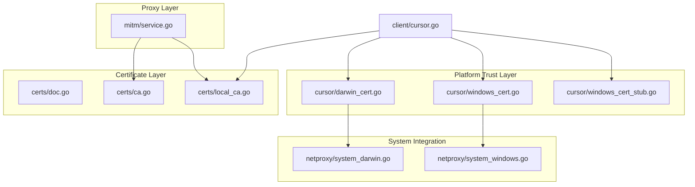
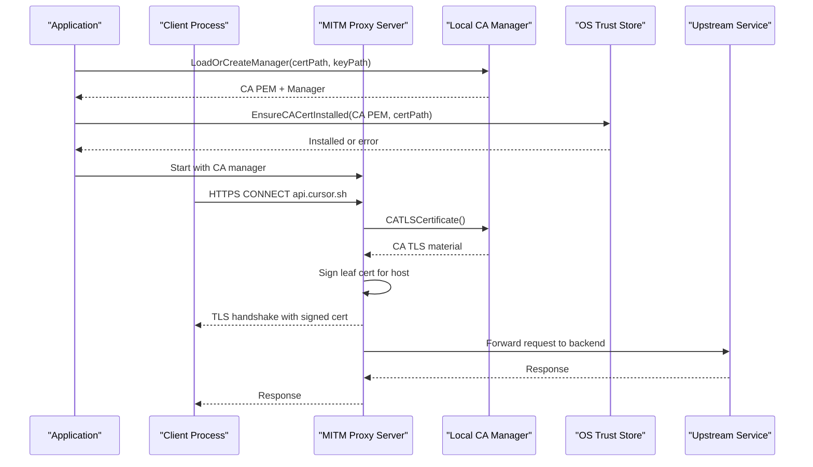
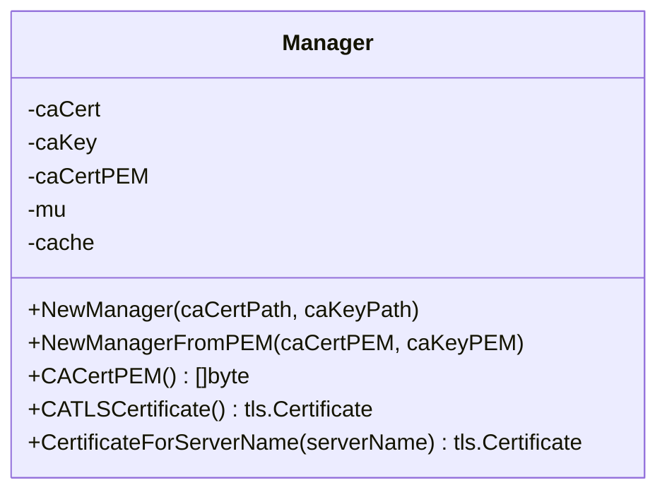
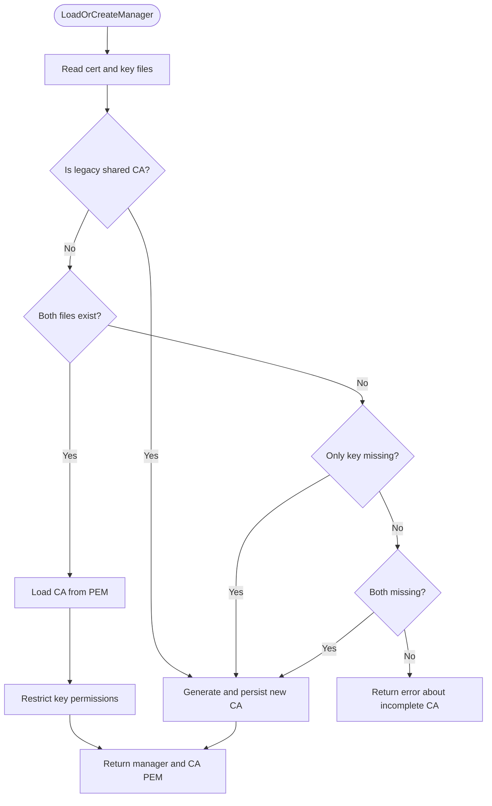
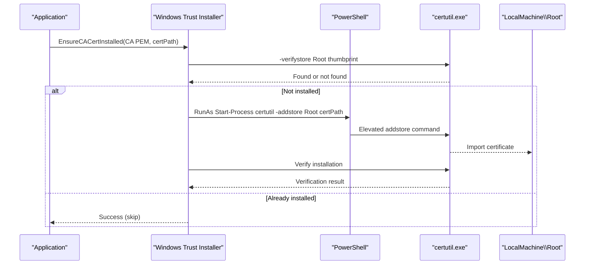
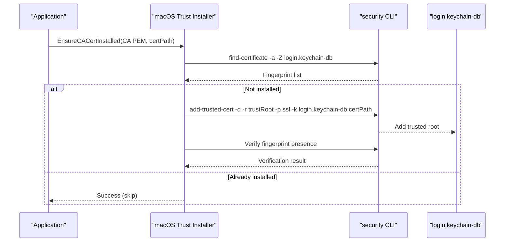
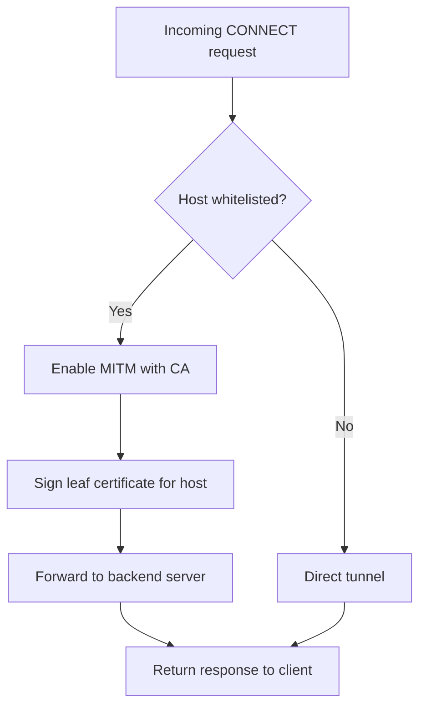
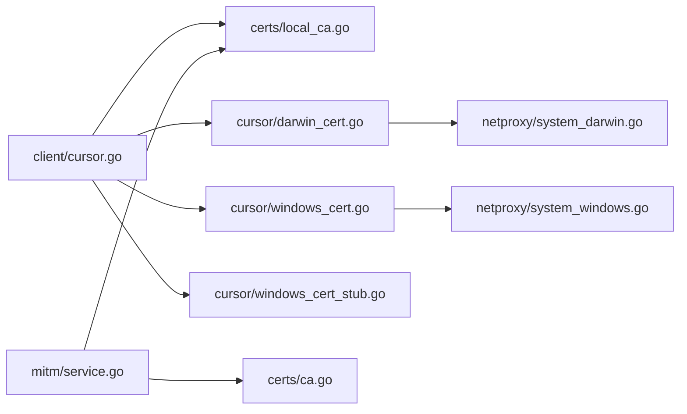

# Cross-Platform Certificate Handling

<cite>
**Referenced Files in This Document**
- [ca.go](file://internal/certs/ca.go)
- [local_ca.go](file://internal/certs/local_ca.go)
- [doc.go](file://internal/certs/doc.go)
- [service.go](file://internal/mitm/service.go)
- [darwin_cert.go](file://internal/cursor/darwin_cert.go)
- [windows_cert.go](file://internal/cursor/windows_cert.go)
- [windows_cert_stub.go](file://internal/cursor/windows_cert_stub.go)
- [system_darwin.go](file://internal/netproxy/system_darwin.go)
- [system_windows.go](file://internal/netproxy/system_windows.go)
- [cursor.go](file://internal/client/cursor.go)
</cite>

## Table of Contents
1. [Introduction](#introduction)
2. [Project Structure](#project-structure)
3. [Core Components](#core-components)
4. [Architecture Overview](#architecture-overview)
5. [Detailed Component Analysis](#detailed-component-analysis)
6. [Dependency Analysis](#dependency-analysis)
7. [Performance Considerations](#performance-considerations)
8. [Troubleshooting Guide](#troubleshooting-guide)
9. [Enterprise Guidance](#enterprise-guidance)
10. [Conclusion](#conclusion)

## Introduction
This document explains how the project handles cross-platform certificate trust for its local MITM proxy. The system generates an installation-specific CA, dynamically signs TLS certificates for selected upstream hosts, and installs the CA into platform-native trust stores where supported. On Windows, it integrates with the LocalMachine Root store using elevated privileges. On macOS, it adds the CA to the user login keychain as a trusted root. On other platforms, automatic trust installation is not supported by default.

The documentation covers:
- Platform-specific trust store integration
- Automatic CA installation flow
- User consent and administrative privilege handling
- Security policies and validation differences
- Troubleshooting steps per operating system
- Enterprise deployment guidance including custom policies and automated strategies

## Project Structure
The certificate and trust logic is split across three main areas:
- Local CA generation and runtime certificate signing
- Platform-specific trust store operations
- Proxy service that uses the CA for selective MITM

**Diagram sources**
- [doc.go:1-2](file://internal/certs/doc.go#L1-L2)
- [ca.go:23-153](file://internal/certs/ca.go#L23-L153)
- [local_ca.go:22-133](file://internal/certs/local_ca.go#L22-L133)
- [service.go:180-450](file://internal/mitm/service.go#L180-L450)
- [darwin_cert.go:16-132](file://internal/cursor/darwin_cert.go#L16-L132)
- [windows_cert.go:18-189](file://internal/cursor/windows_cert.go#L18-L189)
- [windows_cert_stub.go:1-16](file://internal/cursor/windows_cert_stub.go#L1-L16)
- [system_darwin.go:11-72](file://internal/netproxy/system_darwin.go#L11-L72)
- [system_windows.go:11-45](file://internal/netproxy/system_windows.go#L11-L45)

**Section sources**
- [doc.go:1-2](file://internal/certs/doc.go#L1-L2)
- [ca.go:23-153](file://internal/certs/ca.go#L23-L153)
- [local_ca.go:22-133](file://internal/certs/local_ca.go#L22-L133)
- [service.go:180-450](file://internal/mitm/service.go#L180-L450)
- [darwin_cert.go:16-132](file://internal/cursor/darwin_cert.go#L16-L132)
- [windows_cert.go:18-189](file://internal/cursor/windows_cert.go#L18-L189)
- [windows_cert_stub.go:1-16](file://internal/cursor/windows_cert_stub.go#L1-L16)
- [system_darwin.go:11-72](file://internal/netproxy/system_darwin.go#L11-L72)
- [system_windows.go:11-45](file://internal/netproxy/system_windows.go#L11-L45)

## Core Components
- Local CA Manager: Generates and manages an installation-specific CA, validates CA material, and produces per-host TLS certificates for MITM.
- Persistent CA Loader: Loads or creates a persistent CA pair, enforces secure file permissions, detects legacy shared CA, and writes files atomically.
- Platform Trust Installers: Provide `EnsureCACertInstalled` and `EnsureLegacySharedCACertRemoved` on supported platforms.
- MITM Proxy Service: Uses the CA to sign certificates only for whitelisted relay hosts and forwards requests to the backend server.
- System Proxy Readers: Read OS-level proxy configuration on macOS and Windows.

Key responsibilities:
- Generate a strong RSA-based CA with appropriate CA constraints.
- Cache generated leaf certificates per host.
- Persist CA files securely and recover from interrupted first-run writes.
- Integrate with Windows Root store via elevated certutil.
- Integrate with macOS login keychain via security tooling.
- Skip automatic trust installation on unsupported platforms.

**Section sources**
- [ca.go:23-153](file://internal/certs/ca.go#L23-L153)
- [local_ca.go:22-133](file://internal/certs/local_ca.go#L22-L133)
- [service.go:360-450](file://internal/mitm/service.go#L360-L450)
- [darwin_cert.go:16-132](file://internal/cursor/darwin_cert.go#L16-L132)
- [windows_cert.go:18-189](file://internal/cursor/windows_cert.go#L18-L189)
- [windows_cert_stub.go:1-16](file://internal/cursor/windows_cert_stub.go#L1-L16)

## Architecture Overview
The application bootstraps a local CA, optionally installs it into the OS trust store, and runs a proxy that intercepts HTTPS CONNECT requests for specific hosts. For those hosts, it signs dynamic certificates using the local CA. Clients must trust the local CA to avoid certificate errors.

**Diagram sources**
- [local_ca.go:22-94](file://internal/certs/local_ca.go#L22-L94)
- [ca.go:61-153](file://internal/certs/ca.go#L61-L153)
- [service.go:360-450](file://internal/mitm/service.go#L360-L450)
- [darwin_cert.go:87-132](file://internal/cursor/darwin_cert.go#L87-L132)
- [windows_cert.go:149-189](file://internal/cursor/windows_cert.go#L149-L189)

## Detailed Component Analysis

### Local CA Generation and Runtime Signing
The CA manager loads or generates a CA, validates that it is a proper signing CA, and caches per-host TLS certificates. It supports RSA, ECDSA, and Ed25519 private keys when loading existing CA material.

Important behaviors:
- CA validation ensures the certificate has CA constraints and matching public key.
- Per-host certificate generation sets SANs based on IP or DNS name.
- Leaf certificate caching avoids repeated signing workloads.
- Private key marshaling supports multiple formats.

**Diagram sources**
- [ca.go:23-153](file://internal/certs/ca.go#L23-L153)

**Section sources**
- [ca.go:23-153](file://internal/certs/ca.go#L23-L153)

### Persistent Installation CA
The persistent CA loader:
- Detects legacy shared CA and regenerates a new installation-specific CA.
- Creates directories and files atomically.
- Enforces restrictive permissions on the private key.
- Recovers safely if only one of the CA files exists.

**Diagram sources**
- [local_ca.go:22-94](file://internal/certs/local_ca.go#L22-L94)

**Section sources**
- [local_ca.go:22-133](file://internal/certs/local_ca.go#L22-L133)

### Windows Trust Store Integration
On Windows:
- The implementation checks whether the CA thumbprint exists in the LocalMachine Root store.
- If missing, it invokes `certutil.exe` through PowerShell with elevation (`RunAs`).
- It verifies installation after import.
- It removes a known legacy shared CA if present.

User consent and privileges:
- Elevation triggers UAC.
- If the user cancels elevation, a specific error is returned.

**Diagram sources**
- [windows_cert.go:48-189](file://internal/cursor/windows_cert.go#L48-L189)

**Section sources**
- [windows_cert.go:18-189](file://internal/cursor/windows_cert.go#L18-L189)

### macOS Trust Store Integration
On macOS:
- The implementation computes the SHA1 fingerprint and searches the login keychain.
- If missing, it adds the CA as a trusted root using the `security` CLI.
- It verifies installation afterward.
- It removes a known legacy shared CA if present.

Note:
- The current macOS implementation targets the user login keychain rather than the system-wide keychain.

**Diagram sources**
- [darwin_cert.go:22-132](file://internal/cursor/darwin_cert.go#L22-L132)

**Section sources**
- [darwin_cert.go:16-132](file://internal/cursor/darwin_cert.go#L16-L132)

### Unsupported Platforms
On non-Windows and non-macOS platforms:
- `EnsureCACertInstalled` returns an error indicating the platform is not supported.
- `EnsureLegacySharedCACertRemoved` is a no-op.

This prevents silent failures while making the limitation explicit.

**Section sources**
- [windows_cert_stub.go:1-16](file://internal/cursor/windows_cert_stub.go#L1-L16)

### MITM Proxy Behavior
The proxy:
- Uses goproxy with a custom certificate store.
- Enables MITM only for whitelisted relay hosts such as Cursor API domains.
- Uses the CA manager to obtain TLS material and generate per-host certificates.
- Forwards whitelisted requests to the configured backend server.
- Ignores or filters noisy TLS handshake logs.

**Diagram sources**
- [service.go:360-450](file://internal/mitm/service.go#L360-L450)

**Section sources**
- [service.go:360-450](file://internal/mitm/service.go#L360-L450)

### System Proxy Configuration Readers
The system proxy readers detect OS-level proxy settings:
- macOS: Reads `scutil --proxy` output and parses HTTP/HTTPS/SOCKS and PAC settings.
- Windows: Reads Internet Settings registry values for auto-detection, PAC URL, override rules, and proxy server configuration.

These readers are used to understand system proxy behavior but do not directly modify trust stores.

**Section sources**
- [system_darwin.go:11-72](file://internal/netproxy/system_darwin.go#L11-L72)
- [system_windows.go:11-45](file://internal/netproxy/system_windows.go#L11-L45)

## Dependency Analysis
The following diagram shows how components depend on each other during startup and operation.

**Diagram sources**
- [cursor.go:25-35](file://internal/client/cursor.go#L25-L35)
- [local_ca.go:22-94](file://internal/certs/local_ca.go#L22-L94)
- [ca.go:23-153](file://internal/certs/ca.go#L23-L153)
- [service.go:180-450](file://internal/mitm/service.go#L180-L450)
- [darwin_cert.go:16-132](file://internal/cursor/darwin_cert.go#L16-L132)
- [windows_cert.go:18-189](file://internal/cursor/windows_cert.go#L18-L189)
- [windows_cert_stub.go:1-16](file://internal/cursor/windows_cert_stub.go#L1-L16)
- [system_darwin.go:11-72](file://internal/netproxy/system_darwin.go#L11-L72)
- [system_windows.go:11-45](file://internal/netproxy/system_windows.go#L11-L45)

**Section sources**
- [cursor.go:25-35](file://internal/client/cursor.go#L25-L35)
- [local_ca.go:22-94](file://internal/certs/local_ca.go#L22-L94)
- [ca.go:23-153](file://internal/certs/ca.go#L23-L153)
- [service.go:180-450](file://internal/mitm/service.go#L180-L450)
- [darwin_cert.go:16-132](file://internal/cursor/darwin_cert.go#L16-L132)
- [windows_cert.go:18-189](file://internal/cursor/windows_cert.go#L18-L189)
- [windows_cert_stub.go:1-16](file://internal/cursor/windows_cert_stub.go#L1-L16)
- [system_darwin.go:11-72](file://internal/netproxy/system_darwin.go#L11-L72)
- [system_windows.go:11-45](file://internal/netproxy/system_windows.go#L11-L45)

## Performance Considerations
- CA key strength: The persistent CA uses a 3072-bit RSA key, balancing security and performance.
- Leaf certificate caching: The CA manager caches per-host TLS certificates to reduce repeated cryptographic work.
- Proxy transport tuning: The proxy configures connection pooling, timeouts, and HTTP/2 preferences.
- Logging rate limiting: Proxy logs are rate-limited to avoid excessive I/O under high traffic.

Recommendations:
- Keep the CA private key restricted and backed up securely.
- Avoid frequent CA regeneration; prefer stable installation paths.
- Monitor proxy log suppression metrics to detect noisy environments.

[No sources needed since this section provides general guidance]

## Troubleshooting Guide

### Windows
Common issues:
- UAC elevation canceled: The installer explicitly detects user cancellation when elevating `certutil`.
- Certificate not found in store: Verification may fail due to language differences in `certutil` output; the code treats missing output as not installed.
- Permission denied: Installing into LocalMachine Root requires administrator rights.

Steps:
- Confirm the process can trigger UAC elevation.
- Check whether the CA thumbprint appears in the LocalMachine Root store.
- Remove the legacy shared CA if present before installing the new CA.
- Review elevated command output for detailed errors.

**Section sources**
- [windows_cert.go:48-189](file://internal/cursor/windows_cert.go#L48-L189)

### macOS
Common issues:
- Certificate not added to login keychain: The `security` CLI may fail due to keychain access restrictions.
- Legacy shared CA still present: Removal may fail if the keychain is locked or inaccessible.

Steps:
- Unlock the login keychain or run the application with appropriate keychain access.
- Verify the CA fingerprint exists in the login keychain.
- Remove the legacy shared CA manually if necessary.
- Reinstall the CA using the application’s trust installation flow.

**Section sources**
- [darwin_cert.go:22-132](file://internal/cursor/darwin_cert.go#L22-L132)

### Unsupported Platforms
Symptoms:
- Errors indicating automatic trust installation is not supported.

Steps:
- Manually install the CA PEM into the OS trust store according to your platform’s procedures.
- Validate that applications trust the CA for the targeted hosts.

**Section sources**
- [windows_cert_stub.go:1-16](file://internal/cursor/windows_cert_stub.go#L1-L16)

### Proxy and TLS Issues
Symptoms:
- Handshake mismatches or TLS handshake errors in proxy logs.
- Requests not being intercepted for expected hosts.

Steps:
- Confirm the CA is installed and trusted.
- Verify the target host matches the whitelisted relay pattern.
- Check system proxy configuration to ensure traffic reaches the local proxy.
- Inspect proxy logs for suppressed messages and TLS handshake diagnostics.

**Section sources**
- [service.go:360-450](file://internal/mitm/service.go#L360-L450)
- [system_darwin.go:11-72](file://internal/netproxy/system_darwin.go#L11-L72)
- [system_windows.go:11-45](file://internal/netproxy/system_windows.go#L11-L45)

## Enterprise Guidance

### Custom Certificate Policies
- Prefer generating and distributing a unique installation CA per device or tenant.
- Use the persistent CA loader to manage CA files securely and enforce restrictive permissions.
- Avoid shipping legacy shared CA material; the code detects and replaces it automatically.

### Group Policy and Automated Deployment
- Windows:
  - Deploy the CA PEM to the LocalMachine Root store using enterprise tools or scripts with administrative privileges.
  - Configure group policy to trust the organization’s CA and restrict untrusted roots.
  - Automate removal of legacy shared CA before deploying the new CA.
- macOS:
  - Deploy the CA PEM to the system keychain or configure mobile device management (MDM) to trust the root.
  - Note: Current implementation targets the login keychain; consider MDM for system-wide trust.
- Linux and other platforms:
  - Distribute the CA PEM and configure the system trust store accordingly.
  - Ensure applications use the system trust store or are configured to trust the CA explicitly.

### Automated Deployment Strategies
- Pre-generate CA material and distribute both certificate and private key to trusted locations.
- Use secure provisioning pipelines to write CA files atomically and set correct permissions.
- Implement rollback procedures to restore previous CA material if migration fails.
- Validate trust installation post-deployment by checking OS store contents.

### Security Best Practices
- Protect the CA private key with strict file permissions.
- Limit MITM to whitelisted hosts to reduce exposure.
- Rotate CAs periodically and invalidate old leaf certificates.
- Monitor proxy logs for unexpected TLS errors and suppressed message counts.

[No sources needed since this section provides general guidance]

## Conclusion
The project implements a robust, cross-platform approach to certificate handling:
- A secure, installation-specific CA is generated and persisted.
- Dynamic per-host certificates are signed for whitelisted relay hosts.
- Windows integrates with the LocalMachine Root store using elevated privileges.
- macOS integrates with the login keychain as a trusted root.
- Unsupported platforms return explicit errors to guide manual trust setup.
- The proxy service carefully controls MITM scope and forwards requests to the backend.

For enterprise environments, combine secure CA distribution, platform-appropriate trust store integration, and automated verification to achieve reliable, secure connectivity.

[No sources needed since this section summarizes without analyzing specific files]