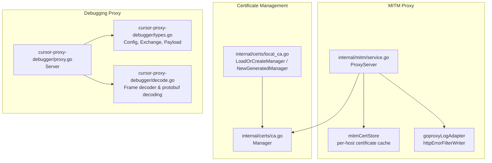
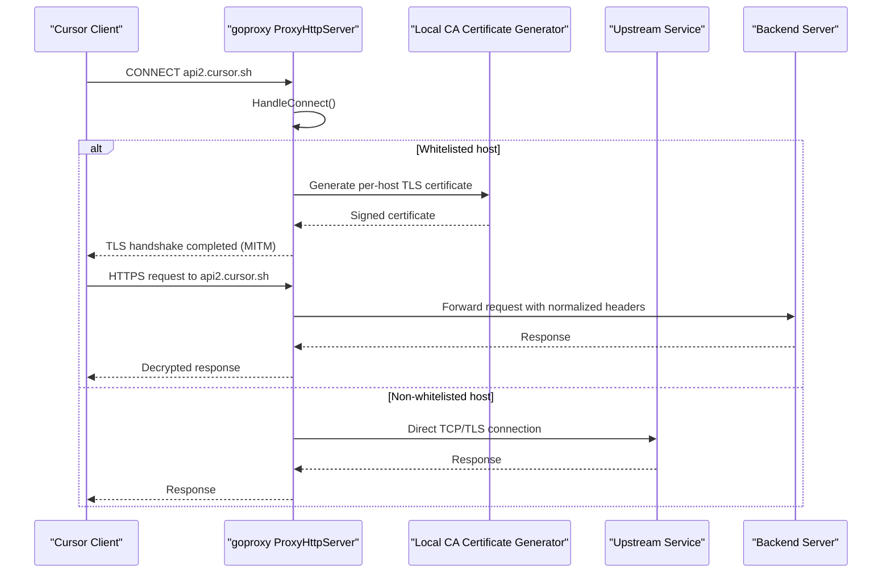
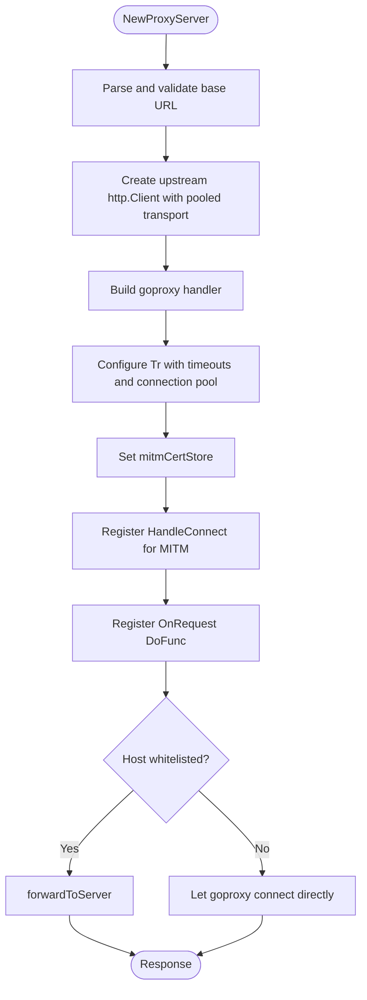
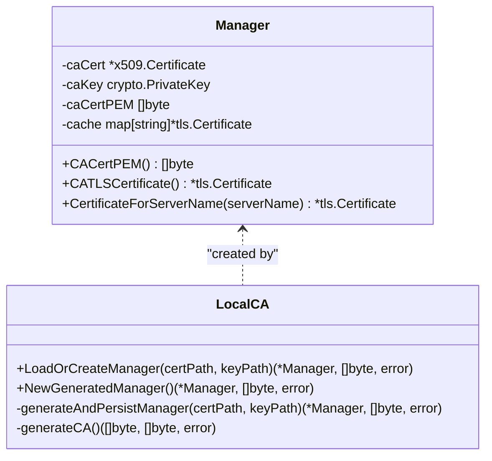
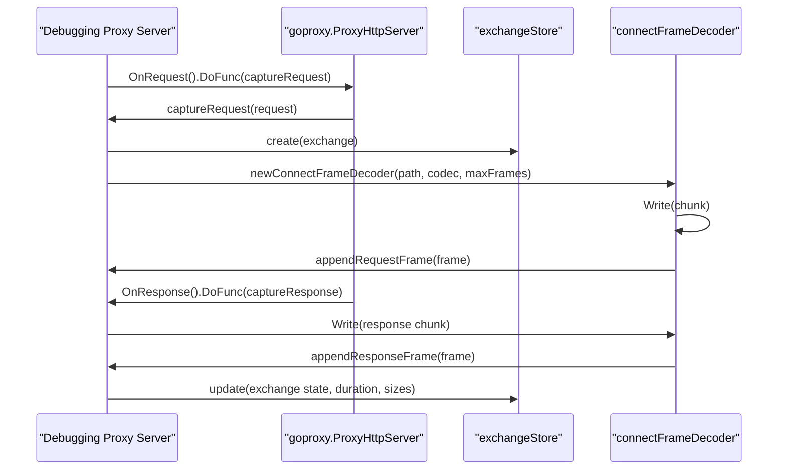
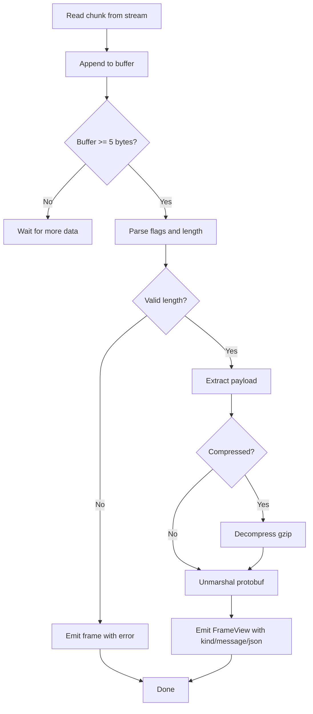
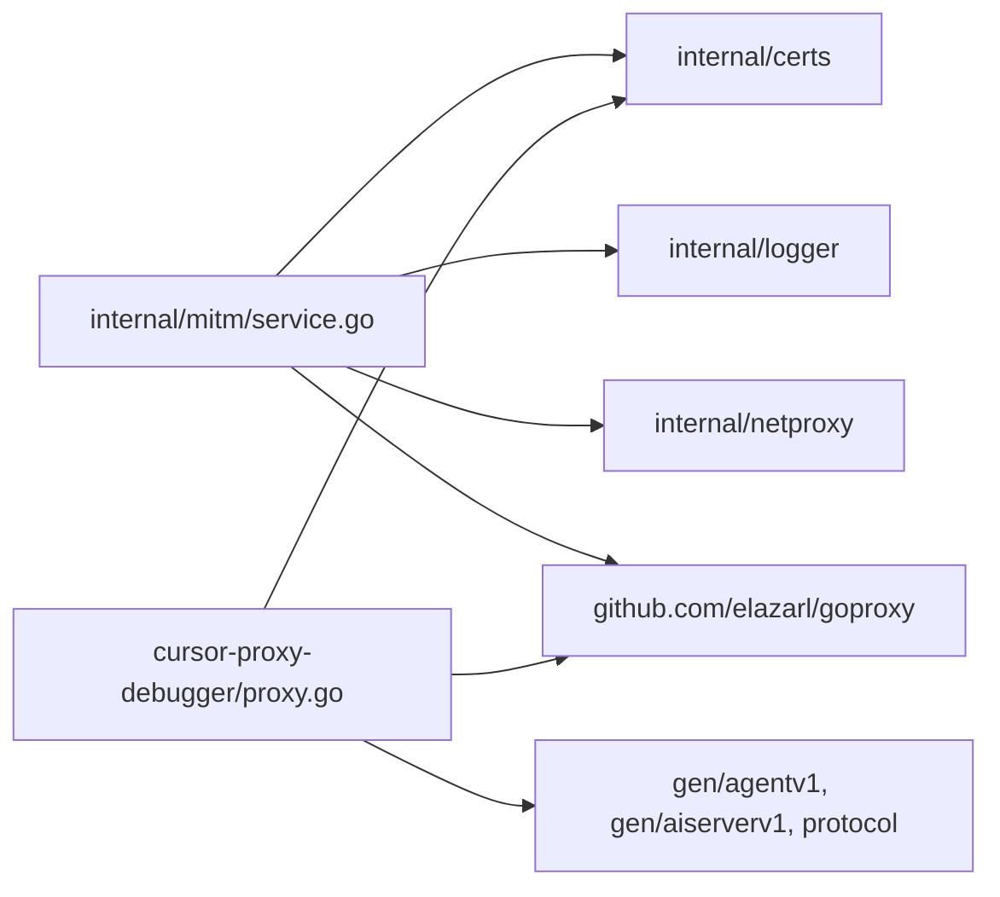

# HTTPS Interception Engine

<cite>
**Referenced Files in This Document**
- [service.go](file://internal/mitm/service.go)
- [ca.go](file://internal/certs/ca.go)
- [local_ca.go](file://internal/certs/local_ca.go)
- [proxy.go](file://cursor-proxy-debugger/proxy.go)
- [types.go](file://cursor-proxy-debugger/types.go)
- [decode.go](file://cursor-proxy-debugger/decode.go)
- [main.go](file://cmd/cursor-proxy-debugger/main.go)
</cite>

## Table of Contents
1. [Introduction](#introduction)
2. [Project Structure](#project-structure)
3. [Core Components](#core-components)
4. [Architecture Overview](#architecture-overview)
5. [Detailed Component Analysis](#detailed-component-analysis)
6. [Dependency Analysis](#dependency-analysis)
7. [Performance Considerations](#performance-considerations)
8. [Troubleshooting Guide](#troubleshooting-guide)
9. [Security and Compliance](#security-and-compliance)
10. [Conclusion](#conclusion)

## Introduction
This document explains the HTTPS interception engine used by the project to capture, inspect, and forward Cursor’s network traffic between the Cursor client and upstream services. It covers two related implementations:

- The production-oriented MITM proxy under `internal/mitm`, which intercepts selected Cursor domains, performs TLS handshake interception using a local CA, and forwards whitelisted requests to a configurable backend server while letting other traffic pass through goproxy.
- The standalone debugging proxy under `cursor-proxy-debugger`, which captures request/response payloads, decodes Connect streaming frames and selected protobuf messages, and exposes a local UI for inspection.

The documentation focuses on proxy architecture with goproxy, connection hijacking via CONNECT, TLS interception, filtering and forwarding logic, header manipulation, payload inspection, service initialization, listener configuration, connection pooling, performance tuning, memory management, concurrency handling, security implications, and debugging strategies.

## Project Structure
The relevant code is organized into three main areas:

- `internal/mitm`: Core MITM proxy server that integrates with goproxy, manages a local CA, handles CONNECT interception, filters whitelisted hosts, and forwards Cursor traffic to a backend server.
- `internal/certs`: Local CA manager that loads or generates CA certificates, signs per-host TLS certificates, and caches them.
- `cursor-proxy-debugger`: Standalone debugging proxy that captures HTTP/HTTPS exchanges, decodes Connect frames and protobuf payloads, and serves a local web UI.

**Diagram sources**
- [service.go:32-57](file://internal/mitm/service.go#L32-L57)
- [service.go:660-688](file://internal/mitm/service.go#L660-L688)
- [service.go:737-791](file://internal/mitm/service.go#L737-L791)
- [ca.go:23-36](file://internal/certs/ca.go#L23-L36)
- [local_ca.go:22-69](file://internal/certs/local_ca.go#L22-L69)
- [proxy.go:27-39](file://cursor-proxy-debugger/proxy.go#L27-L39)
- [types.go:14-22](file://cursor-proxy-debugger/types.go#L14-L22)
- [decode.go:30-46](file://cursor-proxy-debugger/decode.go#L30-L46)

**Section sources**
- [service.go:32-57](file://internal/mitm/service.go#L32-L57)
- [ca.go:23-36](file://internal/certs/ca.go#L23-L36)
- [local_ca.go:22-69](file://internal/certs/local_ca.go#L22-L69)
- [proxy.go:27-39](file://cursor-proxy-debugger/proxy.go#L27-L39)
- [types.go:14-22](file://cursor-proxy-debugger/types.go#L14-L22)
- [decode.go:30-46](file://cursor-proxy-debugger/decode.go#L30-L46)

## Core Components
- **MITM Proxy Server**: Wraps goproxy, configures TLS interception for whitelisted Cursor domains, forwards matching requests to a backend server, and passes other requests directly to their original destinations.
- **Local CA Manager**: Loads or generates a local CA, validates CA key material, signs per-host certificates, and caches signed certificates.
- **Debugging Proxy Server**: Captures HTTP/HTTPS exchanges, limits captured bytes, decodes Connect streaming frames, decodes selected protobuf payloads, and stores exchanges for a local UI.
- **Frame Decoder and Protobuf Decoder**: Parses Connect frame headers, decompresses gzip payloads when needed, decodes specific protobuf messages, and produces structured views for inspection.

Key responsibilities:
- Connection hijacking via goproxy CONNECT handler.
- TLS handshake interception using a local CA.
- Host-based filtering for Cursor domains.
- Header normalization and hop-by-hop header removal.
- Request/response capture and optional decoding.
- Safe shutdown and error logging.

**Section sources**
- [service.go:180-206](file://internal/mitm/service.go#L180-L206)
- [service.go:360-451](file://internal/mitm/service.go#L360-L451)
- [ca.go:69-154](file://internal/certs/ca.go#L69-L154)
- [proxy.go:118-165](file://cursor-proxy-debugger/proxy.go#L118-L165)
- [decode.go:30-46](file://cursor-proxy-debugger/decode.go#L30-L46)

## Architecture Overview
The interception pipeline has two layers:

1. **goproxy CONNECT interception**: When a client initiates an HTTPS connection, goproxy receives a CONNECT request. For whitelisted hosts, the proxy performs MITM by generating a per-host certificate signed by the local CA.
2. **HTTP request routing after TLS decryption**: Once decrypted, the proxy inspects the HTTP request. If the host matches the Cursor relay whitelist, it forwards the request to the configured backend server; otherwise, it lets goproxy connect directly to the original destination.

**Diagram sources**
- [service.go:388-424](file://internal/mitm/service.go#L388-L424)
- [service.go:426-450](file://internal/mitm/service.go#L426-L450)
- [ca.go:81-154](file://internal/certs/ca.go#L81-L154)

## Detailed Component Analysis

### MITM Proxy Server (`internal/mitm/service.go`)
The MITM proxy server initializes a goproxy instance, sets up a custom transport with connection pooling, configures a certificate store, and registers handlers for CONNECT interception and request processing.

Key behaviors:
- **Initialization**: Parses and validates the base URL, creates an upstream HTTP client with tuned timeouts and connection pool settings, and builds the goproxy handler.
- **CONNECT interception**: Uses `HandleConnect` to decide whether to perform MITM based on a whitelist of Cursor domains.
- **TLS interception**: Builds a TLS configuration from the local CA and logs CA information when available.
- **Request routing**: After decryption, removes internal headers, checks if the host is whitelisted, optionally handles CORS preflight locally, and forwards to the backend server.
- **Header handling**: Copies headers, removes hop-by-hop headers, and preserves content semantics.
- **Logging and rate limiting**: Adapts goproxy logs, suppresses expected disconnect noise, and rate-limits repeated errors.

**Diagram sources**
- [service.go:180-206](file://internal/mitm/service.go#L180-L206)
- [service.go:360-451](file://internal/mitm/service.go#L360-L451)

**Section sources**
- [service.go:180-206](file://internal/mitm/service.go#L180-L206)
- [service.go:360-451](file://internal/mitm/service.go#L360-L451)
- [service.go:453-488](file://internal/mitm/service.go#L453-L488)
- [service.go:570-597](file://internal/mitm/service.go#L570-L597)
- [service.go:635-658](file://internal/mitm/service.go#L635-L658)
- [service.go:660-688](file://internal/mitm/service.go#L660-L688)
- [service.go:737-791](file://internal/mitm/service.go#L737-L791)

### Local CA Manager (`internal/certs/ca.go` and `internal/certs/local_ca.go`)
The CA manager provides:
- Loading CA from PEM files or generating a new installation-specific CA.
- Validating CA certificate and private key compatibility.
- Generating per-host TLS certificates with appropriate SANs and usage flags.
- Caching generated certificates to avoid repeated signing operations.
- Persisting CA files securely with restricted permissions.

Important details:
- Per-host certificate generation uses RSA keys and x509 templates with DNS names or IP addresses.
- Installation CA generation uses a 3072-bit RSA key and persists both certificate and private key atomically.
- Legacy shared CA detection triggers regeneration to improve isolation.

**Diagram sources**
- [ca.go:23-36](file://internal/certs/ca.go#L23-L36)
- [ca.go:69-154](file://internal/certs/ca.go#L69-L154)
- [local_ca.go:22-69](file://internal/certs/local_ca.go#L22-L69)
- [local_ca.go:71-95](file://internal/certs/local_ca.go#L71-L95)
- [local_ca.go:97-134](file://internal/certs/local_ca.go#L97-L134)

**Section sources**
- [ca.go:69-154](file://internal/certs/ca.go#L69-L154)
- [local_ca.go:22-69](file://internal/certs/local_ca.go#L22-L69)
- [local_ca.go:71-95](file://internal/certs/local_ca.go#L71-L95)
- [local_ca.go:97-134](file://internal/certs/local_ca.go#L97-L134)

### Debugging Proxy Server (`cursor-proxy-debugger/proxy.go`)
The debugging proxy runs two HTTP servers:
- A proxy server that intercepts and captures Cursor traffic.
- A local UI server for viewing captured exchanges.

Key behaviors:
- **Configuration validation**: Ensures the UI address is loopback-only.
- **MITM setup**: Creates a generated CA and configures goproxy to intercept target hosts.
- **Exchange capture**: Records request/response metadata, headers, raw bytes, decoded JSON, and streaming frames.
- **Streaming frame decoding**: Parses Connect frames, decompresses gzip payloads, and decodes protobuf messages.
- **Memory controls**: Limits maximum exchanges, captured bytes, and frames.

**Diagram sources**
- [proxy.go:118-165](file://cursor-proxy-debugger/proxy.go#L118-L165)
- [proxy.go:167-224](file://cursor-proxy-debugger/proxy.go#L167-L224)
- [proxy.go:226-274](file://cursor-proxy-debugger/proxy.go#L226-L274)
- [decode.go:30-46](file://cursor-proxy-debugger/decode.go#L30-L46)

**Section sources**
- [proxy.go:41-67](file://cursor-proxy-debugger/proxy.go#L41-L67)
- [proxy.go:69-112](file://cursor-proxy-debugger/proxy.go#L69-L112)
- [proxy.go:118-165](file://cursor-proxy-debugger/proxy.go#L118-L165)
- [proxy.go:167-274](file://cursor-proxy-debugger/proxy.go#L167-L274)
- [proxy.go:394-412](file://cursor-proxy-debugger/proxy.go#L394-L412)
- [types.go:14-22](file://cursor-proxy-debugger/types.go#L14-L22)

### Frame Decoder and Protobuf Decoder (`cursor-proxy-debugger/decode.go`)
The decoder supports:
- Parsing Connect frame headers (flags, length, compression).
- Limiting frame size and total frames.
- Decompressing gzip payloads.
- Decoding specific protobuf messages for bidirectional streams and unary endpoints.
- Producing structured frame views including kind, message type, request ID, JSON representation, and raw hex.

**Diagram sources**
- [decode.go:48-68](file://cursor-proxy-debugger/decode.go#L48-L68)
- [decode.go:89-129](file://cursor-proxy-debugger/decode.go#L89-L129)
- [decode.go:131-148](file://cursor-proxy-debugger/decode.go#L131-L148)
- [decode.go:150-194](file://cursor-proxy-debugger/decode.go#L150-L194)

**Section sources**
- [decode.go:30-46](file://cursor-proxy-debugger/decode.go#L30-L46)
- [decode.go:48-68](file://cursor-proxy-debugger/decode.go#L48-L68)
- [decode.go:89-129](file://cursor-proxy-debugger/decode.go#L89-L129)
- [decode.go:131-148](file://cursor-proxy-debugger/decode.go#L131-L148)
- [decode.go:150-194](file://cursor-proxy-debugger/decode.go#L150-L194)

## Dependency Analysis
The components have clear dependency boundaries:

- `internal/mitm/service.go` depends on:
  - `internal/certs` for CA and per-host certificate generation.
  - `internal/logger` for structured logging.
  - `internal/netproxy` for wrapping the HTTP transport.
  - `github.com/elazarl/goproxy` for proxying and TLS interception.
- `cursor-proxy-debugger/proxy.go` depends on:
  - `internal/certs` for generating a temporary CA.
  - `github.com/elazarl/goproxy` for proxying.
  - `cursor/gen/*` and `cursor/internal/backend/agent/protocol` for protobuf decoding.
- `internal/certs` is self-contained and provides CA utilities used by both proxy implementations.

**Diagram sources**
- [service.go:3-25](file://internal/mitm/service.go#L3-L25)
- [proxy.go:3-21](file://cursor-proxy-debugger/proxy.go#L3-L21)
- [decode.go:3-19](file://cursor-proxy-debugger/decode.go#L3-L19)

**Section sources**
- [service.go:3-25](file://internal/mitm/service.go#L3-L25)
- [proxy.go:3-21](file://cursor-proxy-debugger/proxy.go#L3-L21)
- [decode.go:3-19](file://cursor-proxy-debugger/decode.go#L3-L19)

## Performance Considerations
- **Connection pooling**: Both the MITM proxy and debugging proxy configure `http.Transport` with:
  - `MaxIdleConns: 200`
  - `IdleConnTimeout: 90s`
  - `TLSHandshakeTimeout: 10s`
  - `ExpectContinueTimeout: 1s`
  - `ResponseHeaderTimeout: 60s` (MITM proxy)
  These settings reduce connection churn and improve throughput under concurrent load.
- **Certificate caching**:
  - `mitmCertStore` caches per-host TLS certificates to avoid repeated RSA/x509 signing.
  - `Manager.CertificateForServerName` caches generated certificates by hostname.
- **Memory management**:
  - Debugging proxy limits captured bytes per exchange (`MaxCaptureBytes`).
  - Frame count is limited (`MaxFrames`) to prevent unbounded memory growth.
  - Maximum Connect frame size is enforced (`maxConnectFrameBytes`) during decompression.
- **Concurrency**:
  - goproxy handles concurrent connections.
  - Mutexes protect CA manager cache and MITM certificate store.
  - Atomic counters track exchange IDs.
- **I/O efficiency**:
  - Streaming capture wraps request/response bodies without full buffering where possible.
  - Rate-limited logging reduces overhead during high-error scenarios.

[No sources needed since this section provides general guidance]

## Troubleshooting Guide
Common issues and diagnostics:

- **TLS handshake mismatch**:
  - The HTTP server error writer filters out “first record does not look like a TLS handshake” messages and logs them as informational.
  - goproxy log adapter also ignores expected handshake mismatches.
- **Expected client disconnects**:
  - Logs containing “broken pipe”, “connection reset by peer”, “forcibly closed by the remote host”, or “aborted by the software in your host machine” are suppressed as expected.
- **Proxy connect errors**:
  - Connection errors are logged with host, remote address, user agent, and error message, with rate limiting to avoid log storms.
- **MITM CA availability**:
  - If CA configuration is invalid, MITM is disabled and an error is logged.
  - CA info logging prints SHA256 fingerprint, subject, and validity period when available.
- **Debugging proxy UI**:
  - Ensure the UI address is loopback-only; non-loopback addresses are rejected.
  - Use command-line flags to adjust proxy/UI addresses, target host, and memory limits.

Operational tips:
- Verify that the local CA is trusted by the system or browser if MITM is required.
- Monitor logs for suppressed repeated messages and adjust rate-limit windows if necessary.
- Use the debugging proxy UI to inspect captured exchanges, decoded JSON, and streaming frames.

**Section sources**
- [service.go:376-386](file://internal/mitm/service.go#L376-L386)
- [service.go:737-791](file://internal/mitm/service.go#L737-L791)
- [proxy.go:436-449](file://cursor-proxy-debugger/proxy.go#L436-L449)
- [main.go:18-52](file://cmd/cursor-proxy-debugger/main.go#L18-L52)

## Security and Compliance
- **MITM risks**:
  - Intercepting HTTPS requires installing and trusting a local CA. Misuse can expose sensitive data.
  - Only whitelisted Cursor domains are intercepted; other traffic is passed through directly.
- **Data privacy**:
  - Captured payloads may contain sensitive information; limit capture size and retention.
  - The debugging proxy stores exchanges in memory with configurable limits.
- **Compliance considerations**:
  - Ensure organizational policies allow local CA installation and traffic interception.
  - Avoid capturing unnecessary data; use minimal logging and strict access controls for the UI.
- **Secure CA handling**:
  - Installation CA private keys are persisted with restrictive file permissions.
  - Legacy shared CA detection triggers regeneration to avoid shared secrets across installations.

[No sources needed since this section summarizes policy and risk guidance]

## Conclusion
The HTTPS interception engine combines goproxy-based proxying, local CA-driven TLS interception, and targeted request forwarding to enable secure inspection of Cursor traffic. The MITM proxy focuses on production-grade routing and logging, while the debugging proxy adds rich payload inspection, streaming frame decoding, and a local UI. Together, they provide a robust foundation for monitoring, troubleshooting, and understanding Cursor’s network behavior, with careful attention to performance, memory safety, concurrency, and security.

[No sources needed since this section summarizes without analyzing specific files]